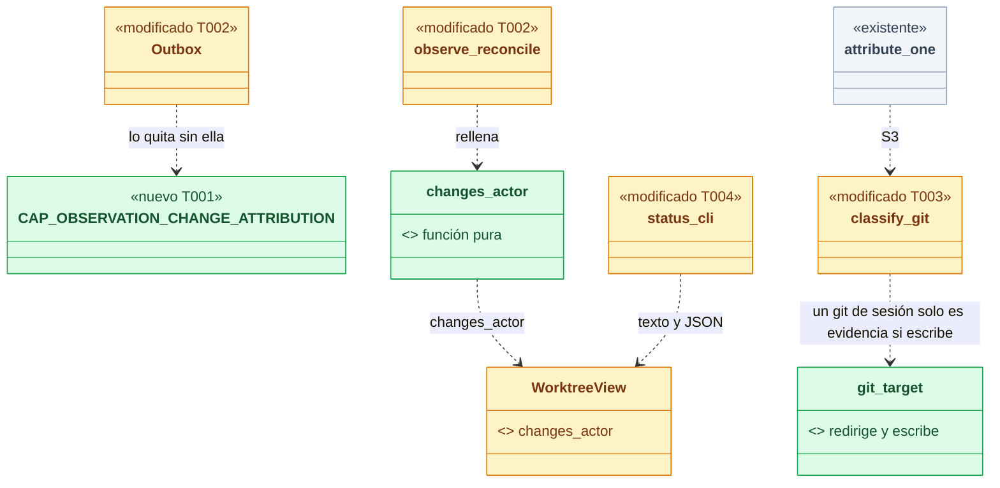
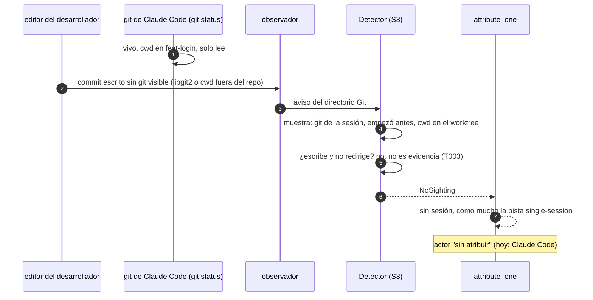
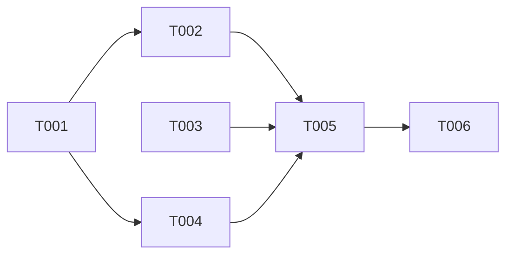

# DS-US-GRP-008 · El editor del desarrollador nunca se atribuye a Claude Code

## Contexto rápido

Al terminar, un cambio sin commitear de un worktree figura en el estado del motor como "sin atribuir", haya o no una sesión de Claude Code en ese worktree, y un commit del desarrollador hecho desde un proceso que no desciende de la sesión nunca sale con actor Claude Code, tampoco cuando su editor escribe sin lanzar un `git` visible.

Casi todo existe desde US-GRP-007, US-GRP-009 y TS-GRP-008:

- **"Humano" no existe**: `Actor` (`crates/api/src/actor.rs`) solo tiene `Agent` y `Unattributed`; lo prueba `schema_has_no_human_variant` (Q34, BR-CONS-003).
- **Qué es una sesión**: solo un proceso que `AgentMatcher::classify` (`crates/core/src/channel/authz.rs`) reconoce como Claude Code, con su cwd en un worktree observado. Cursor, VS Code o Codex sin registrar nunca crean una sesión (Q32, Q35).
- **Commits**: `Daemon::attribute_one` (`crates/core/src/daemon/sessions.rs`) atribuye solo con S4 (`detect/hook.rs`), S3 (`Detector::evidence` y la clasificación de `detect/mod.rs`) o el registro de un "otro agente" como única sesión (`registration_evidence`). Un `git` ajeno visible deja el evento ambiguo; sin `git` visible, como mucho la pista `single-session`, que no atribuye. La confirmación de Claude Code no da evidencia por registro (`claude_code_never_gets_the_registration_as_evidence`).
- **Pruebas que ya cubren parte del escenario 3**: `a_developer_commit_while_claude_code_runs_git_is_unattributed` (`apps/cli/tests/claude_sessions.rs`) y `a_developers_commit_next_to_a_live_agent_session_stays_unattributed` (`apps/cli/tests/events_s4_hook_attribution.rs`).

Esta ficha cubre lo que falta:

1. **Los cambios de archivo no tienen atribución en ningún sitio.** `FileChangeView` es `{path, area, kind}` y ningún evento ni vista dice de quién es un cambio sin commitear. "El cambio de `pagos.txt` figura como sin atribuir" no se puede observar hoy.
2. **El criterio de S3 tiene un hueco en el escenario 3.** Un `git` de la sesión cuenta como evidencia por estar vivo y en el worktree del evento, aunque solo lea (`git status`, `git cat-file`). Si el editor del desarrollador escribe el commit sin un `git` que S3 vea, el commit sale de Claude Code. Pasa con un editor que escribe en proceso (libgit2, el caso de GitKraken anotado en `detect/mod.rs`) o con un `git` lanzado con cwd fuera del repo y `--git-dir` (L-05 de TD-GRP-004).
3. **No hay pruebas de aceptación** de los escenarios 1 y 2, ni de la variante del escenario 3 sin `git` visible.

| Término | Qué es aquí |
|---|---|
| Evidencia suficiente | Una señal positiva que apunta a una sola sesión: S4, S3 corroborado (D4) o el registro de un "otro agente" como única sesión presente. La co-ubicación, la actividad, la confirmación de Claude Code y el trailer `Co-Authored-By` nunca lo son (ADR-GRP-012, regla 3) |
| Actor de los cambios | El actor que el motor publica para los cambios sin commitear de un worktree (D2). En el MVP, siempre "sin atribuir" |
| `git` que escribe | Un `git` cuyo subcomando puede mover una ref o el `HEAD` y que no redirige su destino (D4) |

⚠️ **ASSUMPTION**: no existe `architecture-constitution.md` en la cascada. Rigen `AGENTS.md` (Rust, NFR-01, NFR-02, tests obligatorios) y los ADR citados, como en las Dev Specs hermanas.

---

## ⚠️ Gaps y violaciones de la constitución

| # | Gap | Bloquea | Acción | Owner |
|---|---|---|---|---|
| G1 | **S2 (transcripts) no entra.** DS-US-GRP-007 D2 asignó el adaptador de transcripts (S2a y S2b) a esta historia, y SPIKE-GRP-001 dejó S2a y S2b abiertas "hasta US-GRP-008". Ningún escenario lo exige: los tres son negativos. S2b es además la única señal que podría atribuir un cambio humano a Claude Code (mismo archivo dentro de Δ, ADR-GRP-012, Consecuencias). **Cerrado por Q52**: S2 sale del MVP | No | Enmiendas de ADR-GRP-012, SPIKE-GRP-001 y DS-US-GRP-007 D2 aplicadas (2026-10-28) | — |
| G2 | **La historia pide un valor que el contrato no tiene.** "El cambio figura como sin atribuir" necesita un dato publicado; la TUI y la CLI no pueden calcularlo (escenario "Un campo que el motor no publica no se calcula en la TUI" de US-CKP-001). Lo resuelve D2 | No | — | — |
| G3 | **Texto "sin atribuir" frente a "sin agente".** La CLI ya presenta `Actor::Unattributed` con `actor.unattributed` = "sin agente" / "no agent" (`apps/cli/i18n/*/sessions.txt`), y la historia dice "sin atribuir". Los tests comprueban el valor del contrato (`unattributed`) y la clave `actor.unattributed`, no el literal | No | El PO confirma el texto o pide cambiar la clave en otra tarea | PO |
| G4 | **La pista `single-session` sobre un commit del desarrollador.** Si el `git` del desarrollador terminó antes de la muestra, su commit queda "sin atribuir; inferido: Claude Code" (Enmienda 2026-10-06 de ADR-GRP-012). El escenario 3 se cumple (el actor es "sin atribuir"), **Cerrado por Q54**: la pista no es atribución; PO y Arquitecto aceptan el riesgo, abierto a veto de Rene | No | — | — |
| G5 | **El hueco de S3 contradice BR-EDGE-004.** Un commit humano sin `git` visible junto a un `git` de solo lectura de Claude Code sale de Claude Code (Contexto, punto 2). Lo cierra D4; el riesgo estaba declarado en DS-US-GRP-007 § 4 y en el comentario de `detect/mod.rs` | No (lo cierra esta ficha) | — | — |

---

## 🔭 La forma



🟩 nuevo · 🟨 modificado · ⬜ existente.

**Por qué así.** Los cambios sin commitear no son eventos (ADR-GRP-013 § 1) y no se persisten (Enmienda Cockpit de ADR-GRP-013), así que su actor es una proyección del estado del worktree, como `last_activity_utc_ms`. Sin S2b no hay evidencia por archivo, y la proyección vale "sin atribuir" mientras haya cambios. El campo es la costura en la que entrará S2b o S5, y le da a la CLI, a la TUI y a la Time Machine un valor que mostrar sin calcularlo. Para los commits, S3 ya era evidencia positiva; D4 le exige además que el `git` de la sesión pudiera hacer esa escritura, igual que ya le exige haber empezado antes del aviso.



---

## 🚀 Plan de implementación

> Orden topológico (`Depende:`). Rutas relativas a la raíz del repo; las ediciones en archivos compartidos son las que se nombran (ADR-GRP-016).

### El trabajo de un vistazo

| # | Tarea | Depende | Aterriza en |
|---|---|---|---|
| T001 | Contrato: actor de los cambios y su capacidad | — | `crates/api/src/` |
| T002 | Proyectar el actor de los cambios | T001 | `crates/core/src/change_attribution.rs`, `observe.rs`, `channel/` |
| T003 | S3: un `git` de la sesión solo es evidencia si escribe **(hecha en PR #PRNUM)** | — | `crates/macsys/`, `crates/core/src/detect/` |
| T004 | Mostrar el actor de los cambios en `raptor status` | T001 | `apps/cli/` |
| T005 | Probar los escenarios | T002, T003, T004 | `apps/cli/tests/`, `crates/core/` |
| T006 | Cerrar la historia | T005 | `docs/` |

### En qué orden



### T001 — Contrato: actor de los cambios y su capacidad

**Objetivo.** Un campo opcional en la vista del worktree y la capacidad que lo habilita, sin lógica.

**Ubicación.** `crates/api/src/methods/observation.rs` (**MODIFY**, archivo propio del módulo `observation`) · `crates/api/src/messages.rs` (**MODIFY**, compartido: el campo de `WorktreeView` y `WorktreeView::without_change_attribution`, junto a `without_special_states`)

**Reglas**
- `pub const CAP_OBSERVATION_CHANGE_ATTRIBUTION: Capability = Capability::new("observation.change-attribution");` en `GROUP.capabilities`, detrás de las dos que ya hay. Sin subir el protocolo (ADR-GRP-016; `crates/api/tests/architecture.rs` lo vigila).
- `WorktreeView.changes_actor: Option<Actor>`, con `#[serde(default, skip_serializing_if = "Option::is_none")]`. Doc: "Who the uncommitted changes of the worktree are attributed to (US-GRP-008). Present only when the worktree is `ready` with changes and the connection has `observation.change-attribution`. No signal attributes them in the MVP, so it is always `unattributed` (BR-EDGE-004)".
- `without_change_attribution()` pone `changes_actor = None`, también en `WorktreeStateData` y en las vistas de snapshot que ya tienen `without_special_states()`.
- El campo es por worktree, no por archivo (D2).

- **Depende:** —
- **Refs:** ADR-GRP-016 (capacidades), ADR-GRP-013 § 6, BR-CONS-003, Q52, Q53
- **Aceptación:** `change_attribution_is_a_capability_of_observation` en `crates/api/src/methods/observation.rs`; `changes_actor_wire_form` (presente como `{"actor":"unattributed"}`, ausente sin cambios) en `crates/api/src/messages.rs`

### T002 — Proyectar el actor de los cambios

**Objetivo.** El motor publica `changes_actor` en cada vista de worktree con cambios, y solo a quien pidió la capacidad.

**Ubicación.** `crates/core/src/change_attribution.rs` (**CREATE**) · `crates/core/src/lib.rs` (**MODIFY**, una línea `pub mod`) · `crates/core/src/observe.rs` (**MODIFY**, donde se construye `WorktreeView` de un worktree `ready`) · `crates/core/src/channel/bus.rs` (**MODIFY**, compartido: `Outbox::set_without_change_attribution`, como `set_without_special_states`) · `crates/core/src/channel/conn.rs` (**MODIFY**, compartido: una línea en `apply_capabilities` y lo mismo en las tres salidas con `RepoView` que ya pasan por `shape_special_states`: `repo.add`, `engine.snapshot` y `scope.snapshot`)

**Pasos**
1. `pub fn changes_actor(counts: &ChangeCounts) -> Option<Actor>`: `None` si `counts.is_clean()`, `Some(Actor::Unattributed)` si no. Doc con la regla: un cambio de archivo solo tendría agente con evidencia positiva por archivo (S2b o S5, ADR-GRP-012); el MVP no tiene ninguna (D1, D3). No recibe sesiones, registros ni actividad, a propósito: ninguno de ellos es evidencia para un cambio de archivo.
2. `observe.rs` rellena el campo al construir la vista con los `counts` que ya calcula `changes()`. Un worktree `unavailable` no lo lleva.
3. `Outbox` y `apply_capabilities`: sin `observation.change-attribution`, `without_change_attribution()` antes de enviar, como `set_without_special_states`.
4. `raptor-mcp` no la pide: `channel/mcp_status.rs` no cambia (fuera de alcance).

- **Depende:** T001
- **Refs:** ADR-GRP-012 (regla de combinación, puntos 2, 3 y 6), ADR-GRP-013 § 3 y Enmienda Cockpit, BR-EDGE-004
- **Aceptación:** `clean_worktree_has_no_changes_actor` y `changes_are_unattributed_whatever_the_sessions` en `crates/core/src/change_attribution.rs`; `a_connection_without_the_capability_never_sees_changes_actor` en `crates/core/src/channel/conn.rs` (tests del módulo)

### T003 — S3: un `git` de la sesión solo es evidencia si escribe

> **Implementado en: PR #PRNUM (2026-10-28)**, en `fix/attribution-detected-session`, junto con la Enmienda (2026-10-28, `git` ajeno que no puede producir un evento) de ADR-GRP-012. **Decisión del orquestador (2026-10-28), validada por Arquitecto y PO.** Diferencias con los pasos: la lectura única devuelve los argumentos y la redirección (`process_git_args_and_redirect` en macsys), y `detect/procs.rs` deriva `writes` y `harmless` en `GitFacts`. Linux usa la implementación por defecto de `git_facts`, que lee `cmdline` y `environ` en dos pasos. Los tests de aceptación conservan sus nombres: `subcommand_writes_table` (macsys); `a_session_git_that_only_reads_is_no_evidence`, `a_session_git_that_redirects_is_no_evidence`, `an_unreadable_session_git_is_no_evidence` y `a_writing_session_git_is_still_evidence` (`detect/tests.rs`); y `the_s3_log_line_carries_only_counters`, actualizado con `foreign_harmless` y `sessions_not_writing`.

**Objetivo.** Un `git` de la sesión cuenta como evidencia de un evento solo si su subcomando puede mover una ref o el `HEAD` y no redirige su destino. Si no se puede saber, no cuenta.

**Ubicación.** `crates/macsys/src/process.rs` (**MODIFY**, el único parser: `git_subcommand_writes` junto a `git_redirects`, y una lectura que devuelve los dos booleanos de una vez) · `crates/core/src/detect/procs.rs` (**MODIFY**, lo mismo en Linux desde `/proc/<pid>/cmdline` y `environ`, por nombre) · `crates/core/src/detect/mod.rs` (**MODIFY**, `GitSeen` y la clasificación) · `crates/core/src/daemon/sessions.rs` (**MODIFY**, un contador más en `s3_log_fields`)

**Pasos**
1. `pub fn git_subcommand_writes<'a>(args: impl IntoIterator<Item = &'a [u8]>) -> bool`: recorre las opciones globales con la misma tabla que `global_options_redirect` y compara el primer argumento que no es opción con `REF_WRITERS`: `commit`, `merge`, `rebase`, `cherry-pick`, `revert`, `am`, `pull`, `reset`, `checkout`, `switch`, `bisect`, `branch`, `update-ref`, `symbolic-ref`, `stash`, `tag`, `push`, `worktree`. `fetch` no entra: solo mueve `refs/remotes/*` y no produce ningún evento (`watch/repo.rs`: "a fetch is not an event"), así que un `git fetch` de la sesión nunca es el autor del evento y contarlo solo ensancharía la ventana en la que un commit humano sale de Claude Code. `bisect` sí: mueve el `HEAD`. Falla cerrado: un subcomando desconocido (un alias incluido) o una opción global desconocida dan `false`. Solo sale el booleano (SEC-04).
2. `GitSeen.writes: Option<bool>`, leído **también para los `git` de una sesión** con cwd en el repo, en la misma pasada y con el mismo tope que la redirección (`MAX_REDIRECT_READS`, fuera del lock del detector). La redirección se lee ya para los `git` ajenos; ahora también para los de la sesión.
3. En la clasificación de `detect/mod.rs`, el brazo que hoy da `Class::Evidence(id)` exige además `writes == Some(true)` y `redirect == Some(false)`. Si no, `Class::Ignored` (no es evidencia ni ajeno) con un contador nuevo `sessions_not_writing`. Si ninguna sesión da evidencia y no hay ajenos, el resultado es `NoSighting`, como un `git` que ya terminó; la pista `single-session` sigue igual (D5).
4. En Windows no se lee el argv (TS-GRP-008): `writes` es `None`, así que S3 nunca atribuye allí y un commit de Claude Code solo se atribuye con S4 (D4).
5. `s3_log_fields` añade `sessions_not_writing`: un entero, nunca argv, rutas ni pids (SEC-04).

- **Depende:** —
- **Refs:** ADR-GRP-012 (regla 2, Enmiendas 2026-10-06 y 2026-10-09), TS-GRP-008, TD-GRP-004 (L-05), BR-EDGE-004, SEC-04
- **Aceptación:** `subcommand_writes_table` (incluye `git -c x=y commit`, `git log`, `git status`, `git cat-file`, `git fetch` (no escribe), `git bisect`, un alias, `--` y una opción global desconocida) en `crates/macsys/src/process.rs`; `a_session_git_that_only_reads_is_no_evidence`, `a_session_git_that_redirects_is_no_evidence`, `an_unreadable_session_git_is_no_evidence` y `a_writing_session_git_is_still_evidence` en `crates/core/src/detect/tests.rs`; `the_s3_log_line_carries_only_counters` (actualizado) en `crates/core/src/daemon/sessions_s3_tests.rs`

### T004 — Mostrar el actor de los cambios en `raptor status`

**Objetivo.** El texto y el JSON de `raptor status` dicen de quién son los cambios sin commitear.

**Ubicación.** `apps/cli/src/status.rs` (**MODIFY**) · `apps/cli/i18n/{en,es}/status.txt` (**MODIFY**, una clave)

**Reglas**
- El cliente pide la capacidad en `connection.accept` (regla 3 de "Añadir una capacidad"). La TUI no la presenta en esta historia: la tolera, porque `WorktreeView` ya la deserializa.
- Texto: la línea de recuento de cambios (`status.changes`) añade el actor con la clave nueva `status.changes-actor` = "{changes} · {actor}", con `{actor}` de `crate::events::actor` (hoy "sin agente" / "no agent", G3). Sin el campo (daemon anterior), la línea queda como hoy.
- JSON: `WorktreeJson.changes_actor`, con la misma forma que el actor de `raptor events --json`, ausente sin cambios.

- **Depende:** T001
- **Refs:** AGENTS.md (i18n en/es), US-GRP-001 D11
- **Aceptación:** `status_shows_the_changes_actor_in_text_and_json` y `catalogs_match` en `apps/cli`

### T005 — Probar los escenarios

**Objetivo.** Un test por escenario y ejemplo, con el binario `raptor` real como daemon y como cliente, repos y perfiles temporales del arnés (INF-GRP-001, NFR-01).

**Ubicación.** `apps/cli/tests/editor_unattributed.rs` (**CREATE**, macOS, arnés de `claude_sessions.rs`) · `apps/cli/tests/editor_unattributed_windows.rs` (**CREATE**, Windows, arnés de `claude_sessions_windows.rs`)

**Reglas**
- Repo "demo" con los worktrees `feat-pagos` y `feat-login`. El Claude Code simulado es `raptor-fake-agent` (`GITRAPTOR_AGENT_EXECUTABLES`). Los editores son copias del binario de test llamadas `cursor`, `code` y `codex`, fuera de la raíz del fixture y **nunca** en `GITRAPTOR_AGENT_EXECUTABLES`, lanzadas con cwd en el worktree; escriben el archivo y terminan.
- "Ninguna sesión" y "no figura como de un agente" se comprueban en `raptor status --json` (`sessions: []`, `changes` con la ruta, `changes_actor` `unattributed`), en `raptor sessions --all --json` y en el almacén (ninguna fila nueva en `sessions` ni en `attribution_records`).
- El editor que escribe un commit sin `git` visible se simula con `git --git-dir=<común> --work-tree=<feat-login> commit`, lanzado con cwd fuera del repo: S3 lo ignora (L-05), como a un editor que escribe en proceso.
- Los tiempos no son fijos: se espera a cada estado con un tope, como en `claude_sessions.rs`.

- **Depende:** T002, T003, T004
- **Refs:** § Estrategia de pruebas
- **Aceptación:** la tabla de § 9.4 completa

### T006 — Cerrar la historia

**Objetivo.** La historia pasa a `implemented` con su PR; los pendientes quedan anotados donde corresponde.

**Ubicación.** `docs/requirements/features/motor-local/user-stories/US-GRP-008-editor-humano-sin-atribuir.md` (**MODIFY**) · `docs/architecture/xplat-pendientes.md` (**MODIFY**)

**Reglas**
- Las enmiendas de ADR-GRP-012 (S2 fuera del MVP por Q52; la regla de D4), SPIKE-GRP-001, DS-US-GRP-007 y ADR-GRP-016 ya están aplicadas (§ Enmiendas aplicadas). El PR solo comprueba que siguen al día.
- Linux (e2e) y el escenario 3 en Windows van a `xplat-pendientes.md`.

- **Depende:** T005
- **Refs:** AGENTS.md
- **Aceptación:** `cargo test --workspace` verde en macOS; la historia con `status: implemented` y el enlace al PR

---

## Estructura de ficheros

```text
crates/api/src/methods/observation.rs            ← MODIFY  (T001, capacidad)
crates/api/src/messages.rs                       ← MODIFY  (T001, campo y without_change_attribution)
crates/core/src/change_attribution.rs            ← CREATE  (T002, función pura y tests)
crates/core/src/lib.rs                           ← MODIFY  (T002, una línea `pub mod`)
crates/core/src/observe.rs                       ← MODIFY  (T002, rellena el campo)
crates/core/src/channel/bus.rs, conn.rs          ← MODIFY  (T002, quitarlo sin capacidad)
crates/macsys/src/process.rs                     ← MODIFY  (T003, git_subcommand_writes)
crates/core/src/detect/procs.rs, mod.rs          ← MODIFY  (T003, writes y clasificación)
crates/core/src/daemon/sessions.rs               ← MODIFY  (T003, contador del log)
apps/cli/src/status.rs, i18n/{en,es}/status.txt  ← MODIFY  (T004)
apps/cli/tests/editor_unattributed.rs            ← CREATE  (T005, macOS)
apps/cli/tests/editor_unattributed_windows.rs    ← CREATE  (T005, Windows)
docs/…                                           ← MODIFY  (T006)
```

## Contrato de API

| Elemento | Forma | Quién lo recibe |
|---|---|---|
| Capacidad `observation.change-attribution` | Sin parámetros; se pide en `connection.accept` | CLI y TUI de `crates/core`; no `raptor-mcp` |
| `WorktreeView.changes_actor` | `Option<Actor>`: ausente si el worktree está limpio, `unavailable` o la conexión no tiene la capacidad; si no, `{"actor":"unattributed"}` | `engine.snapshot`, `scope.snapshot`, `repo.add`, `worktree.state` |

Sin métodos, errores ni eventos nuevos. Sin persistencia nueva: el actor de los cambios se calcula al publicar y no se guarda (Enmienda Cockpit de ADR-GRP-013: las rutas sin commitear no se persisten).

## Modelo de datos

Sin cambios en el almacén. `GitSeen.writes` vive en memoria durante una muestra de S3, como `redirect`.

## Estrategia de pruebas y cobertura

### 9.1 Pirámide de pruebas

- **Unitarias**: parser de subcomandos (`crates/macsys`), clasificación de S3 con árbol de procesos sintético (`detect/tests.rs`), proyección (`change_attribution.rs`), forma del contrato (`crates/api`), texto y JSON de la CLI.
- **Punta a punta**: `apps/cli/tests/editor_unattributed.rs` (macOS) y `editor_unattributed_windows.rs` (Windows), con el binario real.

### 9.2 Umbrales de cobertura

Todo brazo nuevo de la clasificación de S3 tiene un test que lo recorre; los de `change_attribution.rs`, también.

### 9.3 Datos de prueba

Repos temporales del arnés (INF-GRP-001) con `feat-pagos` y `feat-login`; perfil temporal; nunca este repo (NFR-01).

### 9.4 Comportamientos críticos verificados

| Escenario Gherkin | Test (`apps/cli/tests/editor_unattributed.rs` salvo indicación) |
|---|---|
| Un cambio sin agente identificado queda sin atribuir · el desarrollador desde Cursor | `a_change_without_an_identified_agent_is_unattributed_cursor`: un proceso `cursor` con cwd en `feat-pagos` modifica `pagos.txt`; `feat-pagos` tiene `sessions: []`, `changes` incluye `pagos.txt` y `changes_actor` es `unattributed`; el texto en en y es muestra `actor.unattributed` en la línea de cambios; ninguna fila nueva en `sessions` ni `attribution_records` |
| ídem · el desarrollador desde otro editor | `a_change_without_an_identified_agent_is_unattributed_other_editor`: lo mismo con un proceso `code` |
| ídem · un agente sin soporte completo que no se registró, como Codex | `a_change_without_an_identified_agent_is_unattributed_unregistered_codex`: lo mismo con un proceso `codex`; además `raptor sessions --all --json` no tiene ninguna sesión `other` |
| Un cambio dudoso junto a Claude Code no se atribuye a Claude Code | `a_doubtful_change_next_to_claude_code_is_unattributed`: el Claude Code simulado está `active` en `feat-login`; un proceso `cursor` modifica `README.md`; la sesión sigue siendo la única de `feat-login` (`shared: false`), `changes` incluye `README.md` y `changes_actor` es `unattributed`, no `claude-code`. La sesión puede seguir `active` por esa actividad (BR-WF-001): no es atribución |
| Un commit del desarrollador junto a Claude Code no se atribuye a Claude Code | `a_developer_commit_next_to_claude_code_without_a_visible_git_is_unattributed`: un `git` de solo lectura del Claude Code simulado sigue vivo (`git cat-file --batch-check` de 4 s, como en `claude_sessions.rs`); el desarrollador escribe el commit sin `git` visible (T005, Reglas); el evento `commit` tiene actor `unattributed` y en el almacén no apunta a ninguna sesión. **Falla hoy**: sale `claude-code / detected` |
| ídem, con el `git` del desarrollador visible | Ya cubierto: `a_developer_commit_while_claude_code_runs_git_is_unattributed` (`claude_sessions.rs`) y, con Guardrails, `a_developers_commit_next_to_a_live_agent_session_stays_unattributed` (`events_s4_hook_attribution.rs`). No se duplican |
| ídem, cuando S3 no ve ningún `git` | `a_developer_commit_after_claude_codes_git_ended_is_unattributed`: sin `git` vivo de la sesión; actor `unattributed`, sin sesión en el almacén; si lleva la pista `inferred`, su `trailer` es `unconfirmed`, nunca `confirmed` (G4, Q54) |

Además:

- `an_agents_own_uncommitted_edit_is_unattributed_too`: el Claude Code simulado modifica `login.txt`; `changes_actor` sigue `unattributed`. Fija que en el MVP la co-ubicación nunca atribuye un cambio de archivo, tampoco el del propio agente (Q52).
- `a_registered_other_agent_does_not_take_the_uncommitted_changes`: Codex registrado como única sesión de `feat-pagos`; `changes_actor` sigue `unattributed` (Q53). Un commit posterior sigue siendo de Codex (US-GRP-009 D8, sin cambio).
- `a_claude_code_commit_is_still_attributed_by_s3`: el commit con hook lento de US-GRP-007 sigue saliendo `claude-code / detected` con evidencia `{"signals":["s3"]}` después de T003 (`git commit` escribe).
- `repo_intact_editor_scenarios_do_not_modify_it`: huella del testkit antes y después de los escenarios: cero diferencias fuera del perfil y de lo que escribe el propio test (BR-CONS-001).
- `crates/api/src/actor.rs::schema_has_no_human_variant` (existente) cubre "no figura como humano" en los tres escenarios.

### 9.5 Plataformas

| SO | Qué corre |
|---|---|
| macOS | Todo § 9.4 |
| Windows | `editor_unattributed_windows.rs`: escenarios 1 (los tres ejemplos) y 2, con el `claude.exe` simulado de `claude_sessions_windows.rs` y editores `cursor.exe`, `code.exe` y `codex.exe`. El escenario 3 se cumple por construcción (sin argv, `writes` es `None`: S3 nunca atribuye) y lo prueba `an_unreadable_session_git_is_no_evidence` en `crates/core`. *Pendiente: etapa de validación multiplataforma* del e2e del escenario 3 |
| Linux | Las pruebas de `crates/core` y `crates/macsys` del CI (la lectura de `/proc` de T003). Los e2e usan `script` y el canal Unix como sus hermanos: *Pendiente: etapa de validación multiplataforma* |

## Gate de seguridad

- **SEC-04**: T003 lee el argv de los `git` de una sesión solo para sacar dos booleanos; nunca se guarda ni se registra un argumento, una variable ni su valor. El tope de lecturas es el de TS-GRP-008 y se lee fuera del lock.
- **Falla cerrado**: todo lo que no se puede leer o no se reconoce deja el evento "sin atribuir" (BR-EDGE-004). El único efecto de un fallo es perder atribuciones de Claude Code, nunca ganar una falsa.
- **SEC-12**: `changes_actor` no lleva rutas ni texto del repo.

## Dependencias

| Dependencia | Cómo entra aquí |
|---|---|
| US-GRP-007 | Detector, S3, arnés `claude_sessions.rs` y `raptor-fake-agent` |
| US-GRP-009 | `registration_evidence` y el arnés de `agent_registration.rs` (test de Q53) |
| US-GRP-010 | Sin solape: no toca `session_actor` ni la proyección de la atribución vigente (Q50, Q51). Un cambio de archivo no tiene sesión, así que una corrección no lo alcanza |
| TS-GRP-008 | El parser de `gitraptor-macsys` y el tope de lecturas que T003 amplía a los `git` de la sesión |
| TD-GRP-004 | Sigue con M-01 y L-03. D4 vuelve inofensivo L-05 para BR-EDGE-004 (un `git` ajeno invisible ya no deja que un `git` de solo lectura de la sesión sea evidencia), pero no lo cierra: un `git` de la sesión que escribe a la vez sigue ganando |
| US-CKP-001 | Podrá mostrar "Tú u otro (sin atribuir)" para los cambios con `changes_actor`; su presentación es del Cockpit |

## Fuera de alcance

| Ítem / no-objetivo | Historia que lo cubre | Gate (cómo se verifica) |
|---|---|---|
| Adaptador de transcripts (S2a, S2b) y atribución positiva de cambios de archivo a Claude Code | Enabler nuevo después del MVP (Q52) | `an_agents_own_uncommitted_edit_is_unattributed_too`; `rg -n "\.claude" crates/core/src` sin lecturas nuevas |
| Atribución por archivo (`actor` en `FileChangeView`) | Con S2b; en worktree compartido, Q7 | `FileChangeView` sin campos nuevos |
| `changes_actor` por MCP | Sin historia | `channel/mcp_status.rs` sin cambios |
| Presentar el actor de los cambios en la TUI | Cockpit (US-CKP-001) | `git diff --stat` sin cambios en `apps/cli/src/tui/` |
| M-01 y L-03 de S3 | TD-GRP-004 | — |
| Un `git` de la sesión que escribe a la vez que el commit humano (dos escrituras en la misma ventana) | Riesgo aceptado de ADR-GRP-012 (regla 6); lo mide SPIKE-GRP-001 | — |

---

## Decisiones

| # | Decisión | Origen |
|---|---|---|
| D1 | **Alcance**: hacer observable el actor de los cambios sin commitear (T001, T002, T004), cerrar el hueco de S3 del escenario 3 (T003) y probar los tres escenarios. **Fuera**: el adaptador de transcripts S2 (Q52), la atribución por archivo, el MCP y la TUI | **Decisión del orquestador (2026-10-28), validada por Arquitecto**; la parte de S2, validada por PO y Arquitecto (Q52) |
| D2 | **Dónde figura "sin atribuir" un cambio**: `WorktreeView.changes_actor` por worktree, bajo la capacidad nueva `observation.change-attribution` del módulo `observation`, calculado al publicar y no persistido. **Descartadas**: un `actor` por archivo en `FileChangeView` (ocupa bytes del tope `MAX_WORKTREE_CHANGE_BYTES` por un valor que en el MVP es siempre el mismo y que solo S2b distinguiría por archivo), y no publicar nada (la CLI y la TUI tendrían que inventar el valor) | **Decisión del orquestador (2026-10-28), validada por Arquitecto** |
| D3 | **Evidencia suficiente para un cambio de archivo**: solo una señal positiva por archivo (S2b o S5, ADR-GRP-012). La co-ubicación, la actividad (BR-WF-001), la confirmación de Claude Code (Q39) y el registro no lo son para un cambio de archivo. En el MVP no hay ninguna, así que `changes_actor` es siempre "sin atribuir" y la función no recibe sesiones (T002) | **Decisión del orquestador (2026-10-28), validada por Arquitecto**; el registro, validado por PO y Arquitecto (Q53) |
| D4 | **Evidencia suficiente para un evento de Git con S3**: un `git` de la sesión cuenta solo si empezó antes del aviso, su cwd está en el worktree del evento, **su subcomando puede mover una ref o el `HEAD` (tabla `REF_WRITERS`, sin `fetch`) y no redirige su destino**. Lo que no se pudo leer no cuenta (falla cerrado). Consecuencia aceptada: en Windows, sin lectura del argv, S3 deja de atribuir y los commits de Claude Code se atribuyen solo con S4 (Guardrails instalado) o quedan "sin atribuir" con la pista. No toca la meta del 90 %, que se mide sobre sesiones (Q9, Q52). Enmienda ADR-GRP-012 (Enmienda 2026-10-28) | **Decisión del orquestador (2026-10-28), validada por Arquitecto** (revisión: `fetch` fuera de la tabla, `bisect` dentro) |
| D5 | **La pista `single-session` no cambia**: un evento con `NoSighting`, ahora también cuando la sesión solo tenía `git` de lectura, se guarda sin sesión y con la pista, como dice la Enmienda 2026-10-06 de ADR-GRP-012. El escenario 3 se cumple con el actor "sin atribuir"; la pista no es atribución (Q54) | **Decisión del orquestador (2026-10-28), validada por Arquitecto**; el riesgo, validado por PO y Arquitecto (Q54) |
| D6 | **Editores y agentes sin registrar en las pruebas**: copias del binario de test con nombre `cursor`, `code` y `codex`, fuera de `GITRAPTOR_AGENT_EXECUTABLES`. El editor que escribe un commit sin `git` visible se simula con un `git --git-dir … --work-tree …` lanzado con cwd fuera del repo, la forma observable de un editor que escribe en proceso | **Decisión del orquestador (2026-10-28), validada por Arquitecto** |
| D7 | **Texto de la CLI**: el actor de los cambios usa el mismo texto que el resto de actores (`actor.unattributed`), no una clave propia con "sin atribuir" (G3) | **Decisión del orquestador (2026-10-28), validada por Arquitecto** |
| D8 | **Coordinación con las fichas hermanas**: `crates/api/src/messages.rs` (aquí `WorktreeView`), `channel/conn.rs`, `channel/bus.rs`, `apps/cli/src/status.rs` y `apps/cli/i18n/{en,es}/status.txt` los tocan también DS-US-GRP-011 (`SessionView.presence`, `sessions.shared`) y DS-US-GRP-016 (`BaseBranchView.pending`, `engine.base-pending`); `detect/mod.rs` y `daemon/sessions.rs`, DS-US-GRP-013 y DS-US-GRP-011. Los nombres no chocan y cada capacidad vive en el archivo de su módulo (ADR-GRP-016). Se mergean en serie y la segunda rebasa | **Decisión del orquestador (2026-10-28), validada por Arquitecto** |

### Decisiones de producto

Registradas en `context.md` y en BR-EDGE-004 y BR-VAL-001 (business-rules v1.20), abiertas a veto de Rene.

| # | Pregunta | Decisión y motivo | Estado |
|---|---|---|---|
| Q52 | ¿Entra en el MVP la atribución positiva de cambios sin commitear a Claude Code (adaptador de transcripts S2a/S2b de ADR-GRP-012), que DS-US-GRP-007 D2 asignó a US-GRP-008? | **No.** Sale de US-GRP-008 a un enabler posterior al MVP, que se decide con los datos de SPIKE-GRP-001. En el MVP los cambios sin commitear quedan siempre "sin atribuir", también los de Claude Code. Ningún escenario de la historia lo pide, US-TMC-011 ya deja fuera las ediciones sin commit ("después del MVP"), y S2b es la única señal que podría atribuir a Claude Code un cambio humano (mismo archivo dentro de Δ). Coste: el "deshacer lo de Claude Code" no alcanza sus cambios sin commitear, y la meta del 90 % solo se mide para sesiones y commits (riesgo ya anotado en `architecture-overview.md`) | Sí, sale. **Decisión del orquestador (2026-10-28), validada por PO y Arquitecto (Q52)** |
| Q53 | Con un "otro agente" registrado como única sesión de un worktree, ¿sus cambios sin commitear se le atribuyen, como sus commits (BR-VAL-001, US-GRP-009 D8)? | **No en el MVP.** El actor de los cambios es por worktree y no separa lo hecho antes del registro ni lo que el desarrollador edita en ese worktree; "desde ese momento" (ejemplo 3 de BR-EDGE-004) no se puede cumplir sin evidencia por archivo. Los commits siguen siendo del agente registrado | No; sus commits sí. **Decisión del orquestador (2026-10-28), validada por PO y Arquitecto (Q53)** |
| Q54 | ¿Se acepta que un commit del desarrollador junto a una sesión activa de Claude Code muestre "sin atribuir; inferido: Claude Code" cuando S3 no vio ningún `git` escritor? | **Sí, como está**: el actor es "sin atribuir", la pista lleva su propia etiqueta, la comprobación del trailer la deja `unconfirmed` (o la quita con la política `human-author`) y la Time Machine no le da efectos (ADR-TMC-005). Ratifica el riesgo residual que la Enmienda 2026-10-06 de ADR-GRP-012 dejó a Rene | Sí. **Decisión del orquestador (2026-10-28), validada por PO y Arquitecto (Q54)**. La pista no es atribución: no cuenta para el undo por agente, la meta del 90 % ni la comprobación de autoría |

### Enmiendas aplicadas (2026-10-28)

| Documento | Enmienda |
|---|---|
| ADR-GRP-012 | Enmienda 2026-10-28: S2 (S2a, S2b) fuera del MVP (Q52); la degradación "solo procesos" (alternativa 3) pasa a ser la configuración del MVP. Regla de S3: un `git` de la sesión solo es evidencia si escribe y no redirige (D4), con la consecuencia en Windows. El comentario del hueco de GitKraken en `detect/mod.rs` deja de ser un riesgo de atribución humano → Claude Code |
| SPIKE-GRP-001 | Enmienda 2026-10-28: S2a, S2b, la robustez del adaptador y la comprobación de privacidad de transcripts no aplican al MVP (Q52). El criterio "0 cambios humanos atribuidos a Claude Code" se cumple por construcción para cambios de archivo y se sigue midiendo para commits, con el contador `sessions_not_writing` |
| DS-US-GRP-007 | Enmienda 2026-10-28 a D2: el adaptador de transcripts deja de ser de US-GRP-008 |
| ADR-GRP-016 | Enmienda 2026-10-28: la capacidad `observation.change-attribution` anotada |

## Notas del autor

| ID | Nota | Acción | Owner |
|---|---|---|---|
| N1 | Medir en el dogfooding cuántos commits de Claude Code pasan de "atribuido por S3" a "sin atribuir" por D4 (`sessions_not_writing` en `s3_evidence`). Si la pérdida es relevante sin Guardrails, revisar `REF_WRITERS` antes que relajar la regla | Revisión diaria de SPIKE-GRP-001 | Orquestador |
| N2 | El escenario 1 no prueba un commit de un agente sin registrar; ya sale "sin atribuir" por `S3Outcome::NoSession` sin registro, y no es parte de la historia | Ninguna | — |
