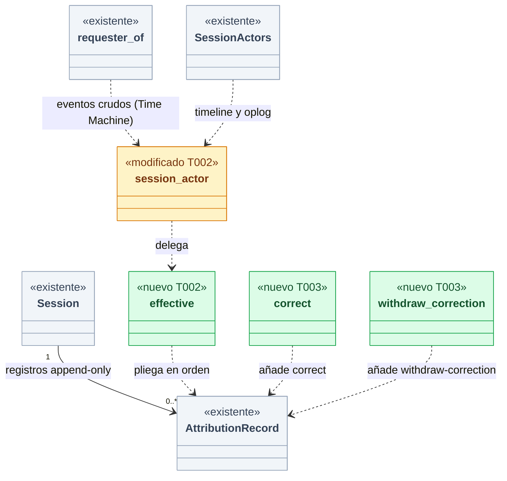
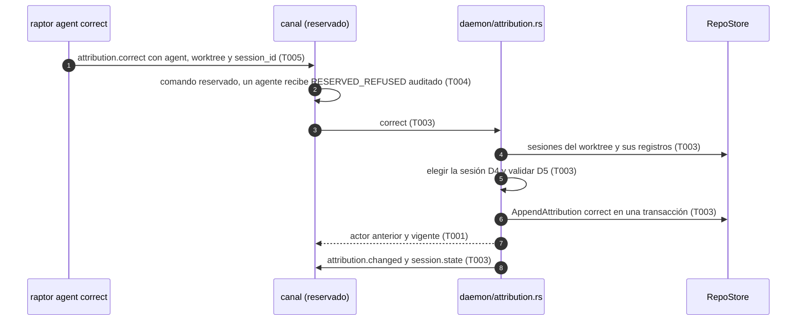
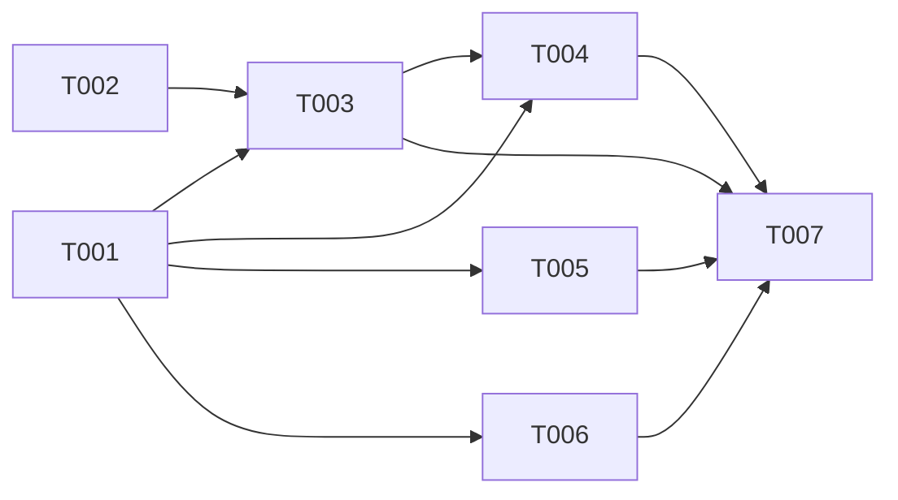

# DS-US-GRP-010 · Corregir una atribución detectada

## Contexto rápido

Al terminar, el desarrollador corrige con `raptor agent correct Codex` la sesión que el motor detectó mal en el worktree de su cwd: la sesión pasa a "otro agente: Codex", con origen "registrado", desde su inicio, y lo mismo sus eventos. Con `raptor agent uncorrect` vuelve todo a la atribución detectada. La corrección sobrevive al reinicio del motor, la detección no la deshace y un agente no puede pedirla. Hoy los dos métodos están declarados y responden `NOT_IMPLEMENTED` (`crates/api/src/methods/attribution.rs`, `pending(.., "US-GRP-010")`).

Gran parte existe: el almacén ya admite los registros `correct` y `withdraw-correction` en `attribution_records`, que es append-only (triggers `attribution_no_update`/`attribution_no_delete` en `profile/schema.rs`); los eventos apuntan a su sesión por `session_id` y nunca copian el actor; y hay **una sola** proyección del actor efectivo, `daemon/sessions.rs::session_actor`, que hoy solo aplica `confirm` (P16) y que consumen `sessions.list`, el historial de eventos (`daemon/mod.rs`, `daemon/repos.rs`), los eventos crudos de la Time Machine (`daemon/tm.rs::requester_of`) y el timeline (`SessionActors`, `CurrentAttribution`). Esta ficha es la **brecha**: el pliegue de las correcciones en esa proyección, los dos métodos, la CLI, los textos y las pruebas.

| Término | Qué es aquí |
|---|---|
| Atribución detectada | El actor inicial de la sesión (`sessions.agent_kind/agent_name`, origen `detected`), con la confirmación de P16 si la hubo |
| Corrección activa | El último registro `correct` de la sesión que no tiene un `withdraw-correction` posterior |
| Atribución vigente | `effective(sesión, registros)`: la corrección activa si existe; si no, la detectada. Se calcula en cada consulta |

⚠️ **ASSUMPTION**: no existe `architecture-constitution.md` en la cascada; rigen `AGENTS.md` (Rust, NFR-01, NFR-02, tests obligatorios) y los ADR citados, como en las Dev Specs hermanas.

---

## ⚠️ Gaps y violaciones de la constitución

_No gaps. Ready to implement._ P17 está cerrada (Q50 en BR-CONS-002; § Decisiones, D1).

---

## 🔭 La forma



🟩 nuevo · 🟨 modificado · ⬜ existente.

**Por qué así** (D1): la atribución vigente de un evento es una función pura de (atribución detectada de su sesión, correcciones activas en el momento de la consulta). Nada guarda un actor copiado, así que corregir es **añadir** un registro y retirar es **añadir** otro que la desactiva. Los eventos nunca se reescriben (ADR-GRP-013 § 2, ADR-TMC-003 § 5), Q37 (alcance desde el inicio de la sesión) sale gratis porque todos los eventos de la sesión apuntan a ella, y Q50 (retirar devuelve los eventos a la detectada) también. La sesión anterior (`c0`) tiene otro `session_id` y no cambia.



---

## 🚀 Plan de implementación

> Orden topológico (`Depende:`). Rutas relativas a la raíz del repo; las ediciones en archivos compartidos son las que se nombran (ADR-GRP-016).

### El trabajo de un vistazo

| # | Tarea | Depende | Aterriza en |
|---|---|---|---|
| T001 | Contrato de la corrección | — | `crates/api/src/` |
| T002 | Plegar las correcciones en la atribución vigente | — | `crates/core/src/daemon/attribution.rs`, `sessions.rs` |
| T003 | Corregir y retirar en el daemon | T001, T002 | `crates/core/src/daemon/attribution.rs`, `daemon/mod.rs` |
| T004 | Servir los dos métodos en el canal | T001, T003 | `crates/core/src/channel/conn.rs` |
| T005 | `raptor agent correct` y `uncorrect` | T001 | `apps/cli/` |
| T006 | Probar los escenarios | T001 | `crates/core/tests/`, `apps/cli/tests/` |
| T007 | Cerrar la historia | T003, T004, T005, T006 | `docs/` |

### En qué orden



### T001 — Contrato de la corrección

**Objetivo.** Parámetros, resultados, motivos de rechazo y el código de error del módulo `attribution`, sin lógica.

**Ubicación.** `crates/api/src/methods/attribution.rs` (**MODIFY**) · `crates/api/src/messages.rs` o un archivo propio `crates/api/src/attribution.rs` (**CREATE**, preferido por ADR-GRP-016) · `apps/cli/i18n/{en,es}/contract.txt` (**MODIFY**, `error.attribution-rejected`)

**Reglas**
- Los dos métodos pasan de `pending(..)` a `method(.., true, false)`: siguen **reservados** y **fuera del MCP** (BR-AUTH-001, SEC-14). Sin capacidad nueva: hasta ahora siempre respondieron `NOT_IMPLEMENTED`, así que ningún cliente recibió otra forma (criterio de DS-US-TMC-006 D5).
- `AttributionCorrectParams { agent: DeclaredAgent, worktree: Option<String>, session_id: Option<String> }` (`DeclaredAgent` de US-GRP-009: `claude-code` u `other` con nombre validado por `declared_agent_name`).
- `AttributionCorrectResult { repo_id, session_id, previous: Actor, actor: Actor }`.
- `AttributionWithdrawParams { worktree: Option<String>, session_id: Option<String> }` → `AttributionWithdrawResult { repo_id, session_id, previous: Actor, actor: Actor }`.
- Código nuevo del módulo: `error_block: Some(FIRST_ERROR_BLOCK - 5 * ERROR_BLOCK_LEN)` (−33100, el siguiente libre tras `mcp`) y `ATTRIBUTION_REJECTED = ErrorSpec::new(-33100, "attribution-rejected")`. `data = AttributionRejectedData { reason: AttributionRejection, candidates: Vec<SessionCandidate> }` (`candidates` solo con `ambiguous-session`, a lo sumo 10; `skip_serializing_if` vacío).
- `AttributionRejection` (kebab-case): `not-a-worktree`, `repo-not-observed`, `no-detected-attribution`, `ambiguous-session`, `unknown-session`, `same-agent`, `not-corrected`.
- `SessionCandidate { session_id: String, actor: Actor, started_utc_ms: i64, present: bool }`. Sin rutas (SEC-12).
- `attribution.changed` (declarado en `event.rs` para US-GRP-010) lleva `{repo_id, session_id, actor}`.

- **Depende:** —
- **Refs:** ADR-GRP-016 § 1–3, ADR-GRP-005 § 6, SEC-12, SEC-14
- **Aceptación:** `attribution_methods_are_reserved_and_not_mcp`, `attribution_rejected_is_in_its_block`, `correct_params_wire_form` en `crates/api`

### T002 — Plegar las correcciones en la atribución vigente

**Objetivo.** `session_actor` devuelve la atribución vigente con correcciones, en una función pura y probada.

**Ubicación.** `crates/core/src/daemon/attribution.rs` (**CREATE**) · `crates/core/src/daemon/sessions.rs` (**MODIFY**, `session_actor` delega; `register` compara con el agente vigente) · `crates/core/src/daemon/mod.rs` (**MODIFY**, una línea `mod`)

**Pasos**
1. `pub(super) fn effective(session: &Session, records: &[AttributionRecord]) -> Effective`, con `Effective { agent: Agent, origin: Origin, corrected: bool }`. Recorre `records` en orden de `effective_seq`: `confirm` marca confirmada; `correct` fija la corrección activa (reemplaza a una anterior, D3); `withdraw-correction` la quita; `register` y `withdraw-registration` no cambian el actor.
2. Con corrección activa: su agente, origen `registered`. Sin ella: el agente inicial, origen `registered` si la sesión nació registrada o está confirmada (P16), `detected` en otro caso (D2).
3. `session_actor` construye el `Actor` desde `effective` y no cambia de firma: sus cinco consumidores (sesiones, historial, eventos crudos de la Time Machine, timeline, `repos.rs`) ven la corrección sin tocarlos.
4. `register` (US-GRP-009, D5) compara el agente pedido con el agente **vigente** de cada sesión presente, no con el inicial: registrar "Codex" donde hay una sesión corregida a Codex responde `already-registered` y no crea una segunda sesión.

> **Nota técnica.** `requester_of` (`daemon/tm.rs`) llama a `session_actor` por evento; con muchos eventos son muchas lecturas de `attribution_records`. Memoizar por `session_id` dentro de `raw_events` (un `HashMap` local a la llamada). La memoria nunca sobrevive a la llamada: lo que se lee es siempre lo vigente en ese momento.

- **Depende:** —
- **Refs:** ADR-GRP-013 § 2, BR-CONS-002, Q37, Q50, P16
- **Aceptación:** `effective_without_records_is_the_detected_one`, `a_correction_replaces_the_agent_with_origin_registered`, `a_second_correction_replaces_the_first`, `withdrawing_returns_to_the_detected_one_not_to_an_earlier_correction`, `a_confirmed_session_withdrawn_returns_registered` en `crates/core/src/daemon/attribution.rs`; `registering_the_corrected_agent_does_not_add_a_session` en `crates/core/src/daemon/sessions.rs`

### T003 — Corregir y retirar en el daemon

**Objetivo.** `Daemon::correct` y `Daemon::withdraw_correction`: eligen la sesión, validan y añaden un registro en una transacción.

**Ubicación.** `crates/core/src/daemon/attribution.rs` (**MODIFY**) · `crates/core/src/daemon/mod.rs` (**MODIFY**, el brazo del bucle que recibe la petición, como `register`)

**Pasos**
1. Destino: `locate_worktree` de US-GRP-009 (D4 de esa ficha) sobre `worktree` o el cwd del llamante; fuera de todo worktree observado, `repo-not-observed` o `not-a-worktree`.
2. Elegir la sesión (D4). Con `session_id`: una sesión de ese worktree, presente o terminada; si no, `unknown-session`. Sin él: las sesiones **presentes** del worktree con atribución detectada (origen inicial `detected`); una → esa; ninguna → `no-detected-attribution`; varias → `ambiguous-session` con las candidatas.
3. Validar (D5): una sesión creada por registro (origen inicial `registered`) → `no-detected-attribution` (Q38: se usa el registro). El agente pedido igual al vigente → `same-agent`.
4. Escribir `WriteOp::AppendAttribution { kind: Correct, agent, author: Developer, recorded_ms: now }` en un `write_batch`. Nada más: ni la sesión ni sus eventos cambian.
5. Retirar: misma elección de sesión, entre las que tienen corrección activa; sin ella, `not-corrected`. Escribe `WithdrawCorrection` con el agente de la corrección que retira (traza).
6. Tras escribir: publicar `attribution.changed` y `session.state` de la sesión (como `publish_sessions`), y registrar en el log `attribution_corrected` / `attribution_correction_withdrawn` con repo, clase de agente y autor; nunca el nombre declarado sin sanear ni rutas (NFR-03).

- **Depende:** T001, T002
- **Refs:** BR-CONS-002, BR-VAL-002, ADR-GRP-013 § 1
- **Aceptación:** los tests de integración de § 9.4 en `crates/core/tests/us_grp_010.rs`

### T004 — Servir los dos métodos en el canal

**Objetivo.** El canal autoriza como comando reservado y entrega la petición al daemon.

**Ubicación.** `crates/core/src/channel/conn.rs` (**MODIFY**, dos brazos junto a `REGISTRATION_WITHDRAW`)

**Reglas**
- Reservados: el despacho genérico de métodos reservados (`reserved()`, que audita y rechaza con `RESERVED_REFUSED`) se aplica antes del brazo, como en `registration.withdraw`. Un agente recibe `RESERVED_REFUSED` y el rechazo queda en el registro de auditoría (Validación 7 de ADR-GRP-005).
- Sin `worktree`, el destino es el cwd del llamante (`process_cwd`), como `raptor agent withdraw`.
- `ATTRIBUTION_REJECTED` con `AttributionRejectedData`; error de almacén → `INTERNAL` sin detalle.

- **Depende:** T001, T003
- **Refs:** ADR-GRP-005 § 6, BR-AUTH-001
- **Aceptación:** `an_agent_cannot_correct_and_it_is_audited` en `crates/core/tests/us_grp_010.rs`

### T005 — Añadir `raptor agent correct` y `uncorrect` a la CLI

**Objetivo.** Los dos subcomandos con textos en/es.

**Ubicación.** `apps/cli/src/commands/agent.rs` (**MODIFY**, dos variantes de `AgentAction`) · `apps/cli/src/agent.rs` (**MODIFY**) · `apps/cli/i18n/{en,es}/registration.txt` (**MODIFY**, grupo `correction.`)

**Reglas**
- `raptor agent correct <AGENTE> [--worktree <ruta>] [--session <id>] [--json]`; `raptor agent uncorrect [--worktree <ruta>] [--session <id>] [--json]`. `<AGENTE>` se interpreta como en `register` (D11 de US-GRP-009: "Claude Code", "claude-code" o "claude" es Claude Code).
- Éxito: el actor anterior, el vigente y que alcanza a toda la sesión. `ambiguous-session`: lista las candidatas (id, actor, inicio, presente) y sugiere `--session`.
- `RESERVED_REFUSED` en estos dos métodos: `correction.reserved` ("solo el desarrollador puede corregir una atribución").
- `--json`: el resultado tal cual (`session_id`, `previous`, `actor`).

- **Depende:** T001
- **Refs:** AGENTS.md (i18n), NFR-TMC-14 no aplica
- **Aceptación:** `every_correction_rejection_has_a_message` y `catalogs_match` en `apps/cli`

### T006 — Probar los escenarios

**Objetivo.** Un test por escenario Gherkin, con detección real simulada y Git real, más la proyección que consume la Time Machine.

**Ubicación.** `crates/core/tests/us_grp_010.rs` (**CREATE**) · `apps/cli/tests/attribution_correction.rs` (**CREATE**, arnés de `agent_registration.rs`)

**Reglas**
- Repos y perfiles temporales (INF-GRP-001, NFR-01); `#![cfg(target_os = "macos")]` en el e2e, como `agent_registration.rs`; core en `cfg(any(macos, linux))`.
- El Claude Code detectado es `raptor-fake-agent`; los commits se atribuyen por S3 con el hook lento de US-GRP-007 (D9 de DS-US-TMC-004).
- "Ninguna atribución ni sesión cambia" se comprueba con el número de filas de `sessions` y `attribution_records` y con `sessions.list` antes y después.

- **Depende:** T001
- **Refs:** § Estrategia de pruebas
- **Aceptación:** § 9.4 completo

### T007 — Cerrar la historia

**Objetivo.** La historia pasa a `implemented` con su PR; los pendientes multiplataforma quedan anotados.

**Ubicación.** `docs/requirements/features/motor-local/user-stories/US-GRP-010-corregir-atribucion.md` (**MODIFY**) · `docs/architecture/xplat-pendientes.md` (**MODIFY**)

**Reglas**
- Las enmiendas propuestas a ADR-GRP-013 y ADR-GRP-016 las aplica el orquestador.
- Los pendientes de Linux y Windows de § 9.5 van a `xplat-pendientes.md`.

- **Depende:** T003, T004, T005, T006
- **Refs:** AGENTS.md
- **Aceptación:** `cargo test --workspace` verde en macOS; la historia con `status: implemented` y el enlace al PR

---

## Estructura de ficheros

```text
crates/api/src/methods/attribution.rs            ← MODIFY  (T001)
crates/api/src/attribution.rs                    ← CREATE  (T001, tipos del módulo)
crates/core/src/daemon/attribution.rs            ← CREATE  (T002, T003)
crates/core/src/daemon/sessions.rs               ← MODIFY  (T002, delega y compara con el vigente)
crates/core/src/daemon/tm.rs                     ← MODIFY  (T002, memo local en raw_events)
crates/core/src/daemon/mod.rs                    ← MODIFY  (T002 `mod`, T003 brazo)
crates/core/src/channel/conn.rs                  ← MODIFY  (T004, dos brazos)
apps/cli/src/commands/agent.rs, src/agent.rs     ← MODIFY  (T005)
apps/cli/i18n/{en,es}/{registration,contract}.txt← MODIFY  (T001, T005)
crates/core/tests/us_grp_010.rs                  ← CREATE  (T006)
apps/cli/tests/attribution_correction.rs         ← CREATE  (T006)
docs/…                                           ← MODIFY  (T007)
```

## Contratos compartidos

### Tipos y datos compartidos

```rust
// crates/api/src/attribution.rs (T001) — Serialize + Deserialize + JsonSchema, deny_unknown_fields
pub struct AttributionCorrectParams { pub agent: DeclaredAgent,
    #[serde(default)] pub worktree: Option<String>, #[serde(default)] pub session_id: Option<String> }
pub struct AttributionWithdrawParams { #[serde(default)] pub worktree: Option<String>,
    #[serde(default)] pub session_id: Option<String> }
pub struct AttributionChangeResult { pub repo_id: String, pub session_id: String,
    pub previous: Actor, pub actor: Actor }          // resultado de los dos métodos
pub enum AttributionRejection { NotAWorktree, RepoNotObserved, NoDetectedAttribution,
    AmbiguousSession, UnknownSession, SameAgent, NotCorrected }
pub struct AttributionRejectedData { pub reason: AttributionRejection,
    #[serde(default, skip_serializing_if = "Vec::is_empty")] pub candidates: Vec<SessionCandidate> }
pub struct SessionCandidate { pub session_id: String, pub actor: Actor,
    pub started_utc_ms: i64, pub present: bool }
pub const MAX_SESSION_CANDIDATES: usize = 10;

// crates/core/src/timemachine/timeline.rs — existente: el timeline lee la atribución vigente
pub struct SessionActors(HashMap<String, Actor>);   // desde sessions.list, por session_id

// crates/core/src/daemon/attribution.rs (T002) — nuevo
pub(super) struct Effective { pub agent: Agent, pub origin: Origin, pub corrected: bool }
pub(super) fn effective(session: &Session, records: &[AttributionRecord]) -> Effective;
```

`session_id` sigue la forma de hoy (`<pid>:<inicio>` para una sesión detectada, `reg:<ms>:<n>` para una registrada) y valida con `check_agent_id` de `crates/api/src/timemachine.rs` (mismo alfabeto; lo reutiliza el `--agent` de US-TMC-011).

### Ciclos de vida (DI)

| Servicio / componente | Ámbito / ciclo de vida | Razón |
|---|---|---|
| `RepoStore` | El del repo, escritor único en el bucle del daemon | ADR-GRP-005: corregir es una escritura más del bucle |
| Memo de `requester_of` | Una llamada a `raw_events` | Nunca sirve una atribución de otra consulta |

### Firmas del stack

```rust
// crates/core/src/daemon/sessions.rs — MODIFICADO: misma firma, delega en `effective`
pub(super) fn session_actor(store: &RepoStore, session: &Session) -> Actor;
// crates/core/src/daemon/attribution.rs — NUEVO
impl Daemon {
    pub(super) fn correct(&mut self, req: CorrectRequest) -> Result<AttributionChangeResult, AttributionError>;
    pub(super) fn withdraw_correction(&mut self, req: WithdrawCorrectionRequest)
        -> Result<AttributionChangeResult, AttributionError>;
}
// existentes: RepoStore::attribution_records, RepoStore::write_batch(WriteOp::AppendAttribution {..})
```

## Contrato de API

| Método | Canal | Parámetros | Resultado |
|---|---|---|---|
| `attribution.correct` | CLI/TUI; reservado; **no** MCP | `AttributionCorrectParams` | `AttributionChangeResult` |
| `attribution.withdraw-correction` | CLI/TUI; reservado; **no** MCP | `AttributionWithdrawParams` | `AttributionChangeResult` |
| `attribution.changed` (notificación) | Suscriptores del repo | — | `{repo_id, session_id, actor}` |

### Forma del error y del cuerpo de respuesta

| Respuesta | Cuándo |
|---|---|
| `RESERVED_REFUSED` (lista congelada) | El llamante no pasa los controles de comando reservado: un agente o un proceso que desciende de él. Auditado |
| `ATTRIBUTION_REJECTED` (−33100) + `reason` | Destino no observado, sin atribución detectada, sesión ambigua o desconocida, mismo agente, sin corrección que retirar |
| `INVALID_PARAMS` | Agente o `session_id` con forma inválida |

### Forma de la configuración

_No aplica — la entrega no añade configuración._

### Valores numéricos

| Concepto | Valor | Fuente |
|---|---|---|
| Código de error | −33100 | Siguiente bloque libre (ADR-GRP-016 § 3) |
| Candidatas en `ambiguous-session` | 10 | Decisión del Arquitecto |

### i18n

| Clave | en | es |
|---|---|---|
| `correction.done` | the attribution of this session changed from {previous} to {actor}, from its start; its events follow it | la atribución de esta sesión pasó de {previous} a {actor}, desde su inicio; sus eventos la siguen |
| `correction.withdrawn` | the correction was withdrawn: the session and its events are {actor} again | se retiró la corrección: la sesión y sus eventos vuelven a ser de {actor} |
| `correction.reason.repo-not-observed` | that repo is not observed; nothing changed | ese repo no está observado; nada cambió |
| `correction.reason.not-a-worktree` | that folder is not a worktree of an observed repo; nothing changed | esa carpeta no es un worktree de un repo observado; nada cambió |
| `correction.reason.no-detected-attribution` | there is no detected attribution to correct here; to attribute work to an agent, register it with raptor agent register | aquí no hay ninguna atribución detectada que corregir; para atribuir trabajo a un agente, regístralo con raptor agent register |
| `correction.reason.ambiguous-session` | several detected sessions are present here; choose one with --session | hay varias sesiones detectadas presentes aquí; elige una con --session |
| `correction.reason.unknown-session` | this worktree has no session {session} | este worktree no tiene la sesión {session} |
| `correction.reason.same-agent` | the session is already attributed to {actor}; nothing changed | la sesión ya está atribuida a {actor}; nada cambió |
| `correction.reason.not-corrected` | this session has no correction to withdraw | esta sesión no tiene ninguna corrección que retirar |
| `correction.reserved` | only the developer can correct an attribution | solo el desarrollador puede corregir una atribución |

---

## Modelo de datos

_Sin esquema ni migración nuevos._ `attribution_records` ya admite `correct` y `withdraw-correction` y es append-only; `effective_seq` comparte secuencia con los eventos, así que el orden de los registros es total.

| Registro | `agent_*` | Efecto en la atribución vigente |
|---|---|---|
| `correct` | El agente correcto | Pasa a ser la corrección activa (reemplaza a otra) |
| `withdraw-correction` | El agente de la corrección retirada (traza) | Quita la corrección activa |

Persistencia y reinicio (BR-CONS-005, escenario 5): no hay estado en memoria que recargar; la proyección lee el almacén en cada consulta.

---

## Estrategia de pruebas y cobertura

### 9.1 Pirámide de pruebas

| Tipo | Cantidad | Tareas dueñas | Herramientas | Cuándo |
|---|---:|---|---|---|
| Unit | 9 | T001, T002, T005 | `cargo test` | PR gate |
| Integration | 9 | T006 | `cargo test -p gitraptor-core --test us_grp_010` | PR gate |
| E2E | 8 | T006 | `cargo test -p gitraptor-cli --test attribution_correction` | PR gate (macOS) |

### 9.2 Umbrales de cobertura

| Capa | Línea | Rama | Mutación | Camino crítico 100% |
|---|---:|---:|---:|:---:|
| `daemon/attribution.rs::effective` | — | — | — | cada combinación de `confirm`, `correct`, `withdraw-correction` |

### 9.3 Datos de prueba

- Repo temporal del arnés con `main`, `feat-login` y `feat-pagos`; un repo `otro` sin observar; perfil temporal.
- Claude Code detectado: `raptor-fake-agent` con su cwd en `feat-login`; commits con el hook lento de US-GRP-007 para que S3 los atribuya.

### 9.4 Comportamientos críticos verificados

| Escenario | Test |
|---|---|
| 1. Corregir reemplaza la detectada | e2e `correcting_replaces_the_detected_attribution`: una sesión; `raptor agent correct Codex --worktree <feat-login>`; `status --json`: una sesión `other`/`Codex`/`registered`, `shared = false`; un commit posterior tiene actor "otro agente: Codex" en `raptor events` |
| 2. Alcance desde el inicio | e2e `the_correction_reaches_the_session_from_its_start`: `c0` de una sesión terminada, `c1` y `c2` de la presente; tras corregir, `c1` y `c2` son de Codex `registered` y `c0` sigue Claude Code `detected` |
| 3. La detección no la deshace | e2e `detection_does_not_undo_a_correction`: tras corregir, el agente simulado sigue vivo y escribe; el detector sigue la misma sesión; una sola sesión, Codex |
| 4. Retirar devuelve la detectada | e2e `withdrawing_returns_the_detected_attribution`: `raptor agent uncorrect`; la sesión y `c1`, `c2` vuelven a Claude Code `detected` (Q50) |
| 5. Persiste al reiniciar | e2e `the_correction_survives_an_engine_restart`: parar y relanzar el motor; la sesión y `c1`, `c2` siguen de Codex |
| 6a. Repo no observado | core `correcting_in_an_unobserved_repo_is_rejected`: `repo-not-observed`; filas iguales |
| 6b. Sin atribución detectada | core `correcting_without_a_detected_attribution_is_rejected`: `feat-pagos` → `no-detected-attribution`; el texto menciona el registro |
| 6c. Un agente corrige | core `an_agent_cannot_correct_and_it_is_audited`: `RESERVED_REFUSED`, auditado; filas iguales. e2e `an_agent_correcting_is_told_only_the_developer_can` (en y es) |

Además: core `the_time_machine_sees_the_current_attribution` (los eventos crudos de `raw_events` y `SessionActors` siguen la corrección y su retirada, para US-TMC-008/011), `a_registered_session_cannot_be_corrected`, `ambiguous_sessions_list_candidates`, `correcting_an_ended_session_by_id`; e2e `repo_intact_correcting_does_not_modify_it` (huella del testkit). Unitarios de T001, T002 y T005.

### 9.5 Plataformas

| Plataforma | Cómo se verifica | Pendiente |
|---|---|---|
| macOS | `cargo clippy --workspace --all-targets -- -D warnings` y `cargo test --workspace` | — |
| Linux | `us_grp_010.rs` con `cfg(any(macos, linux))` | **Pendiente: etapa de validación multiplataforma** (e2e) |
| Windows | Compila; el canal no tiene transporte allí (D12 de US-GRP-009) | **Pendiente: etapa de validación multiplataforma** |

---

## Gate de seguridad

- Corregir es un comando reservado: solo el desarrollador (controles 1 a 3 y `daemon-descendant`, ADR-GRP-005 § 6); el MCP nunca lo ofrece (SEC-14). Un rechazo a un agente queda auditado.
- Nada se reescribe: los eventos y los registros son append-only (triggers del esquema); una corrección mal hecha se retira con otro registro.
- El nombre declarado viaja como `UntrustedName` y se valida con `declared_agent_name` (SEC-12); el log no lleva rutas ni nombres sin sanear (NFR-03).
- La corrección no es evidencia de atribución para eventos futuros de otras sesiones: solo cambia el actor de **su** sesión.

Corre `/security-review --scope devspec docs/requirements/features/motor-local/dev-specs/US-GRP-010-dev-spec.md` antes de mezclar.

---

## Dependencias

| Dependencia | Cómo entra aquí |
|---|---|
| US-GRP-009 (registro) | Reutiliza `DeclaredAgent`, `declared_agent_name`, `locate_worktree` y el patrón de `registration.withdraw` |
| US-TMC-006 / 008 / 011 (Time Machine) | Consumen la atribución vigente por `session_actor` sin cambios propios. **Un undo por agente usa la atribución vigente en el momento de planificar** (D-TMC-2, BR-TMC-WF-002): lo que deshizo queda en el oplog por ids y una corrección posterior no lo cambia; el solicitante congelado tampoco cambia (D-TMC-18) |

---

## Fuera de alcance

| Ítem / no-objetivo | Historia que lo cubre | Gate (cómo se verifica) |
|---|---|---|
| Presentar "compartido" en texto | US-GRP-011 | `git diff --stat` sin cambios en `apps/cli/src/status.rs` salvo lo de T005 |
| Corregir desde la TUI o por MCP | Cockpit; nunca por MCP (BR-AUTH-001) | `attribution_methods_are_reserved_and_not_mcp` |
| Atribución por archivo | US-GRP-008 | — |
| Corregir a "sin atribuir" | Sin historia | `DeclaredAgent` no tiene esa variante |

---

## Decisiones

| # | Decisión | Origen |
|---|---|---|
| D1 | **P17 / Q50**: al retirar una corrección, los eventos que reatribuyó vuelven a la atribución detectada. Se acepta el supuesto de BR-CONS-002. Consecuencia de diseño: la atribución vigente de un evento es una función pura de (atribución detectada de su sesión, correcciones activas en el momento de la consulta), nunca un valor copiado; retirar es añadir un registro que desactiva la corrección | **Decisión del orquestador (2026-10-27), validada por PO y Arquitecto** |
| D2 | Retirar devuelve la atribución que la sesión tendría sin ninguna corrección: la detectada, con origen `registered` si estaba confirmada (P16) | **Decisión del orquestador (2026-10-27), validada por Arquitecto** |
| D3 | Una segunda corrección reemplaza a la primera; retirar vuelve a la detectada, nunca a una corrección anterior | **Decisión del orquestador (2026-10-27), validada por Arquitecto** |
| D4 | Sesión a corregir: la única sesión detectada presente en el worktree; con varias, `ambiguous-session` con candidatas; `--session <id>` elige cualquiera del worktree, también una terminada | **Decisión del orquestador (2026-10-27), validada por Arquitecto** |
| D5 | Una sesión creada por registro no se corrige (`no-detected-attribution`, Q38); corregir al agente vigente es `same-agent` | **Decisión del orquestador (2026-10-27), validada por Arquitecto** |
| D6 | Registrar compara con el agente **vigente** de las sesiones presentes: registrar el agente corregido no duplica | **Decisión del orquestador (2026-10-27), validada por Arquitecto** |
| D7 | Código propio del módulo `attribution.rejected` (−33100) en vez de reutilizar `REGISTRATION_REJECTED` | **Decisión del orquestador (2026-10-27), validada por Arquitecto** (ADR-GRP-016: la lista congelada no crece) |

**Validación de P17 desde la arquitectura**: no hay problema serio. El modelo ya era así antes de esta ficha (eventos por `session_id`, registros append-only, proyección única), así que aceptar Q50 no cambia nada del almacén. El único coste es de lectura (plegar los registros en cada consulta), acotado por el número de registros de una sesión y memoizado por llamada. Riesgo a vigilar: un consumidor que copie el actor resuelto a un almacén propio (por ejemplo, una caché del timeline) dejaría de ver la retirada; por eso `attribution.changed` existe y ADR-TMC-003 § 5 pide invalidar cachés.

### Preguntas abiertas

_Ninguna._

### Enmiendas propuestas a ADR (no aplicadas)

| ADR | Enmienda propuesta |
|---|---|
| ADR-GRP-013 § 2 | Añadir: "La atribución vigente de una sesión pliega sus registros en orden: `correct` fija la corrección activa (reemplaza a otra), `withdraw-correction` la quita y vuelve la detectada (Q50). Nunca se copia a los eventos" (D1–D3) |
| ADR-GRP-016 | Anotar el bloque −33100 del módulo `attribution` (D7) |

## Notas del autor

| ID | Nota | Acción | Owner |
|---|---|---|---|
| G1 | `raptor sessions` en texto no muestra `session_id`; la vía para `--session` es `--json` o la lista de candidatas de `ambiguous-session` | Revisar con el design system si se muestra un id corto | PO |
| G2 | `attribution.changed` estaba declarado sin emisor; los clientes que lo ignoren verán la corrección en la siguiente consulta, nunca un valor viejo | Ninguna | — |
