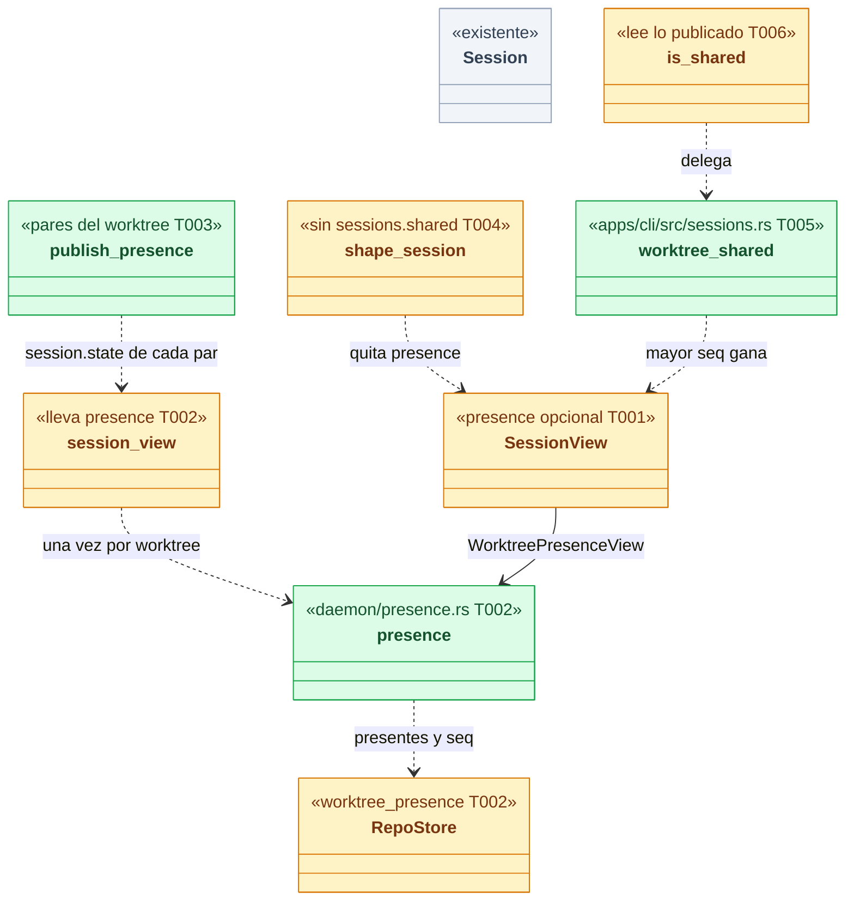
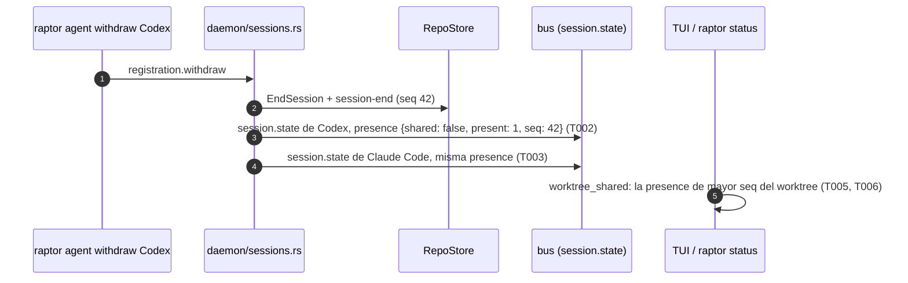
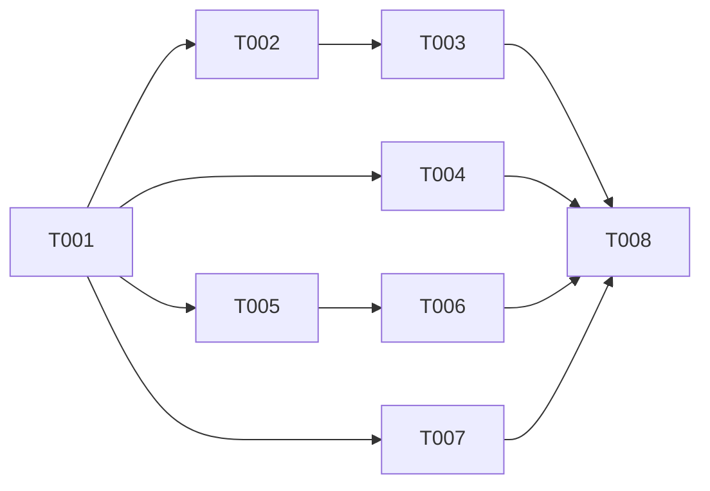

# DS-US-GRP-011 · Worktree compartido

## Contexto rápido

Al terminar, el motor **publica** si cada worktree es compartido, y `raptor status`, `raptor sessions` y la TUI muestran ese valor sin calcularlo. Compartido significa dos o más sesiones presentes (Activo o Inactivo) en el worktree, detectadas o registradas.

La mayor parte ya existe y esta ficha no la toca:

| Qué pide la historia | Dónde está hoy |
|---|---|
| Registrar otro agente **añade** una sesión y conserva la detectada (Q33) | `daemon/sessions.rs::register`: filtra las presentes con `same_agent` y, si no hay ninguna del mismo agente, `StartSession` con origen `registered` |
| Registrar al mismo agente confirma y no duplica (Q39) | `register` → `RecordKind::Confirm` o `AlreadyRegistered` |
| Dos sesiones de Claude Code en un worktree | El detector identifica cada proceso por `(pid, inicio)` (`detect/mod.rs`, S1); `detect/tests.rs::a_child_claude_folds_into_its_parent_only_in_the_same_worktree` pliega solo a los descendientes |
| Retirar un registro termina su sesión | `daemon/sessions.rs::withdraw` → `EndSession` con `RegistrationWithdrawn` |
| Lo compartido sobrevive al reinicio (BR-CONS-005) | Las sesiones viven en el almacén del repo; `detect_repo` reconcilia las detectadas vivas y sigue a las registradas |
| El editor del humano no crea sesión (BR-EDGE-004) | `AgentMatcher` solo clasifica Claude Code (D4 de DS-US-GRP-007); ningún otro proceso es una sesión |
| `shared` en `raptor status --json` | `apps/cli/src/status.rs::json`: **lo calcula la CLI** contando las sesiones no terminadas de `sessions.list` |
| "compartido con" en la TUI | `apps/cli/src/tui/fleet_order.rs::is_shared`: **lo calcula la TUI**, provisional, excepción a BR-CKP-CALC-001 (G1 de DS-US-CKP-002) |

La brecha: el contrato no lleva la marca (`SessionView` no tiene campo de compartido), así que hay dos copias de la regla en el cliente. `raptor status` en texto y `raptor sessions` no dicen "compartido". El stream tampoco avisa a la **otra** sesión de un worktree cuando cambia el número de presentes, y las pruebas de cuatro de los cinco escenarios no existen. `apps/cli/tests/agent_registration.rs::a_second_agent_makes_commits_unattributed_until_it_is_withdrawn` solo prueba dos agentes registrados.

`crates/core/src/daemon/state.rs` no interviene: guarda los estados de disponibilidad del motor (BR-WF-002), no los de las sesiones.

⚠️ **ASSUMPTION**: no existe `architecture-constitution.md` en la cascada; rigen `AGENTS.md` (Rust, NFR-01, NFR-02, tests obligatorios) y los ADR citados, como en las Dev Specs hermanas.

---

## Gaps

| ID | Gap | Tipo | Acción |
|---|---|---|---|
| G1 | Dos definiciones de "otra sesión viva" en el motor. La marca que publica esta ficha cuenta las sesiones **presentes** (`end_cause IS NULL`, ADR-GRP-013 § 3). La comprobación del commit por MCP (`executor/mod.rs`, `SharedWorktreeNeedsPaths`) usa `ProtectedBackend::live_sessions`, que solo cuenta las abiertas con actividad en los últimos `PRESENCE_TTL` (600 s) y, si no puede leer, falla cerrado. Una sesión registrada Inactiva desde hace más de 10 min hace que el estado diga "compartido" mientras un commit de "todo lo preparado" por MCP pasa | Informativo, no bloquea | Fuera de esta ficha (D8). Lo revisa el dueño de US-MCP-010: si el TTL debe desaparecer, la comprobación pasa a usar la misma proyección (`daemon/presence.rs`) |
| G2 | Un Claude Code lanzado **por** otro Claude Code en el mismo worktree (un subagente desde su terminal) se pliega en la sesión del padre: una sesión, no compartido. El escenario 2 dice "se lanza una segunda sesión de Claude Code" sin distinguir | Producto, **cerrado por Q55** | Ninguna: Q55 confirma el plegado (D9) y BR-CONS-004 lleva el ejemplo |
| G3 | En un worktree compartido, los eventos sin evidencia de una sola sesión quedan "sin atribuir" (ADR-GRP-013 § 3, Q7). "La sesión de Claude Code conserva su atribución" (escenario 1) se refiere al actor **de la sesión**, que no cambia; sus commits siguientes se atribuyen solo con S3 o S4 | Informativo | Ninguna: coherente con DS-US-GRP-009 § Notas |

Ninguna contradicción entre la historia, el código y los ADR. ADR-GRP-013 § 3 ya decide que "compartido se deriva de cuántas sesiones presentes tiene; no se guarda como dato propio".

---

## La forma



🟩 nuevo · 🟨 modificado · ⬜ existente.

**Por qué así** (D1–D3): compartido es una proyección de lo que ya se guarda: cuántas sesiones del worktree no tienen fin. No hay nada que persistir ni que recargar al reiniciar, y una corrección (DS-US-GRP-010) no puede cambiarla porque no crea ni termina sesiones (Q33). La marca viaja en cada `SessionView` con un número de orden, el `seq` del último `session-start` o `session-end` del worktree, para que la lista y el stream converjan en cualquier orden. Así no hace falta un evento nuevo ni tocar `WorktreeView`.



---

## Plan de implementación

> Orden topológico (`Depende:`). Rutas relativas a la raíz del repo; las ediciones en archivos compartidos son las que se nombran (ADR-GRP-016).

### El trabajo de un vistazo

| # | Tarea | Depende | Aterriza en |
|---|---|---|---|
| T001 | Contrato: `WorktreePresenceView` y la capacidad `sessions.shared` | — | `crates/api/src/` |
| T002 | Proyección de presencia en el daemon | T001 | `crates/core/src/daemon/presence.rs`, `sessions.rs`, `profile/store.rs` |
| T003 | Publicar a las otras sesiones del worktree | T002 | `crates/core/src/daemon/sessions.rs` |
| T004 | Servir la marca solo con la capacidad | T001 | `crates/core/src/channel/{bus,conn}.rs` |
| T005 | `raptor status` y `raptor sessions` muestran lo publicado | T001 | `apps/cli/src/` |
| T006 | La TUI usa lo publicado y borra la regla provisional | T005 | `apps/cli/src/model.rs`, `tui/` |
| T007 | Probar los escenarios | T001 | `crates/core/tests/`, `apps/cli/tests/` |
| T008 | Cerrar la historia | T002–T007 | `docs/` |



### T001 — Contrato

**Objetivo.** El tipo de la marca, el campo opcional en `SessionView` y la capacidad, sin lógica.

**Ubicación.** `crates/api/src/messages.rs` (**MODIFY**, `SessionView.presence` y `SessionView::without_shared`, junto a `without_worktree_removed`) · `crates/api/src/methods/sessions.rs` (**MODIFY**, `CAP_SESSIONS_SHARED` en `GROUP.capabilities`)

**Reglas**
- `WorktreePresenceView { shared: bool, present: u32, seq: u64 }`, `deny_unknown_fields`. `present` = sesiones del worktree sin fin; `shared = present >= 2`; `seq` = el `seq` del último evento `session-start` o `session-end` del worktree, 0 si no hay ninguno (D3).
- `SessionView.presence: Option<WorktreePresenceView>` con `#[serde(default, skip_serializing_if = "Option::is_none")]`. La llevan **todas** las vistas, presentes o terminadas: describe el worktree en el momento de la vista, no a la sesión.
- `CAP_SESSIONS_SHARED = Capability::new("sessions.shared")`. Es un campo nuevo, así que es una capacidad (ADR-GRP-016 § 1), sin número de protocolo. `SessionView::without_shared(&mut self)` pone `presence = None`.
- Sin código de error nuevo ni método nuevo. `raptor-mcp` sigue sin `sessions.list` ni `session.state` (SEC-12).

- **Depende:** —
- **Refs:** ADR-GRP-016 § 1, ADR-GRP-013 § 3 y § 6
- **Aceptación:** `presence_wire_form` y `without_shared_drops_only_presence` en `crates/api`; el test del catálogo de capacidades (nombres únicos) sigue verde

### T002 — Proyección de presencia en el daemon

**Objetivo.** Una función, la única, que dice si un worktree es compartido; `session_view` la incluye.

**Ubicación.** `crates/core/src/daemon/presence.rs` (**CREATE**) · `crates/core/src/daemon/mod.rs` (**MODIFY**, una línea `mod`) · `crates/core/src/profile/store.rs` (**MODIFY**, `RepoStore::worktree_presence`) · `crates/core/src/daemon/sessions.rs` (**MODIFY**, `session_view` y `sessions_list`)

**Pasos**
1. `RepoStore::worktree_presence(&self, worktree: &Path) -> Result<(u32, u64)>`: una consulta de solo lectura que devuelve el número de sesiones del worktree con `end_cause IS NULL` y `MAX(seq)` de sus eventos con `kind IN ('session-start', 'session-end')` (`COALESCE(.., 0)`). Usa los índices existentes (`events_by_worktree`).
2. `pub(super) fn presence(store: &RepoStore, worktree: &Path) -> Option<WorktreePresenceView>`: `None` si la consulta falla (el cliente lo muestra como no disponible, D5), nunca un `false` inventado.
3. `session_view(repo_id, store, session, latest, presence)` recibe la presencia ya calculada. `sessions_list` la calcula **una vez por worktree** con un `HashMap<PathBuf, Option<WorktreePresenceView>>` local a la llamada. Se calcula sobre todas las sesiones del almacén, no sobre la página que limita `limit`.
4. Presente = sin fin. Activo e Inactivo cuentan igual; Terminado nunca (D1). Ni el TTL de `PRESENCE_TTL` ni el umbral de inactividad intervienen.

- **Depende:** T001
- **Refs:** ADR-GRP-013 § 3, BR-CONS-004
- **Aceptación:** `presence_counts_present_sessions_only`, `an_inactive_session_counts_as_present`, `presence_seq_follows_session_starts_and_ends` en `crates/core/src/daemon/presence.rs`

### T003 — Publicar a las otras sesiones del worktree

**Objetivo.** Cuando cambia el número de presentes de un worktree, cada sesión de ese worktree recibe su `session.state` con la presencia nueva.

**Ubicación.** `crates/core/src/daemon/sessions.rs` (**MODIFY**, `publish_sessions` y sus llamadores)

**Pasos**
1. `fn publish_presence(&self, repo_id: &str, worktree: &Path, except: &[String], t_recv: u64)`: publica `session.state` de cada sesión **presente** del worktree que no esté en `except`, con la misma presencia. Las terminadas no se republican: su última vista ya se publicó y la de mayor `seq` gana (D3).
2. Lo llaman, después de `publish_sessions`, los cambios que alteran el conjunto presente: `SessionChange::Started` y `SessionChange::Ended` en `sessions_changed` (incluye los fines de la reconciliación al arrancar y `end_absent_worktrees`), `register` con `RegistrationOutcome::Created` y `withdraw`. **No** lo llaman `SessionChange::State`, `Confirmed`, `AlreadyRegistered` ni las correcciones de DS-US-GRP-010, porque no cambian el número (Q33, Q39).
3. Un mismo lote con varios cambios en un worktree publica a los pares una sola vez, al final del lote.
4. Log: ningún campo nuevo. `session_detected` y `agent_registered` ya dicen lo que pasó (NFR-03).

- **Depende:** T002
- **Refs:** ADR-GRP-013 § 6, BR-CONS-004
- **Aceptación:** `starting_a_second_session_republishes_the_first`, `ending_one_of_two_republishes_the_other`, `a_state_change_does_not_republish_peers` en `crates/core/tests/us_grp_011.rs`

### T004 — Servir la marca solo con la capacidad

**Objetivo.** Una conexión sin `sessions.shared` recibe las vistas de siempre.

**Ubicación.** `crates/core/src/channel/bus.rs` (**MODIFY**: `without_shared: AtomicBool`, `Outbox::set_without_shared`; `shape_session` aplica `without_shared` además de `without_worktree_removed`) · `crates/core/src/channel/conn.rs` (**MODIFY**: `set_without_shared(!self.has(methods::CAP_SESSIONS_SHARED.name))` junto a `set_without_worktree_removed`; en `sessions_list`, `without_shared` en cada vista sin la capacidad)

**Reglas**
- Un cliente nuevo acepta todas las capacidades (`client/mod.rs`, `capability::all()`), así que la CLI y la TUI la reciben sin cambios en el saludo.
- `shape_session` deserializa la vista una sola vez para las dos degradaciones.

- **Depende:** T001
- **Refs:** ADR-GRP-016 § 1, `channel_capabilities.rs`
- **Aceptación:** `without_sessions_shared_no_view_carries_presence` (lista y stream) en `crates/core/tests/channel_capabilities.rs`

### T005 — `raptor status` y `raptor sessions` muestran lo publicado

**Objetivo.** La CLI deja de contar sesiones y presenta la marca del motor en texto y JSON.

**Ubicación.** `apps/cli/src/sessions.rs` (**MODIFY**: `pub fn worktree_shared(views, repo_id, worktree) -> Option<&WorktreePresenceView>`; `SessionJson.worktree_shared: Option<bool>`; `text` con la línea compartida) · `apps/cli/src/status.rs` (**MODIFY**: `json` y `text`) · `apps/cli/i18n/{en,es}/status.txt` y `sessions.txt` (**MODIFY**)

**Reglas**
- `worktree_shared`: entre las vistas de ese repo y worktree, la `presence` con mayor `seq`. Elige uno de los valores publicados y no cuenta nada. Es el único sitio de la CLI que lo lee: `status`, `sessions` y la TUI (T006) lo llaman.
- `raptor status --json`: `shared` pasa a `Option<bool>` desde `worktree_shared`; `null` si el motor no publica la marca (un daemon sin la capacidad o una presencia ilegible, D5). Los asserts existentes `shared == true/false` siguen valiendo con el motor nuevo.
- `raptor status` (texto): con el worktree compartido, una línea bajo el worktree y antes de sus sesiones: `status.worktree-shared`.
- `raptor sessions` (texto): cada sesión **presente** de un worktree compartido usa `sessions.line-shared` en vez de `sessions.line`. `--json`: `worktree_shared` en cada sesión.
- Los textos no nombran a los agentes (ya están en las líneas de sesión) y no sugieren ninguna acción (Q7: no hay atribución por archivo que ofrecer).

- **Depende:** T001
- **Refs:** BR-CKP-CALC-001, AGENTS.md (i18n)
- **Aceptación:** `the_latest_presence_wins_in_any_order`, `unknown_presence_is_null_not_false`, `catalogs_match` en `apps/cli`

### T006 — La TUI usa lo publicado

**Objetivo.** Cerrar la excepción a BR-CKP-CALC-001 de DS-US-CKP-002 (D8, G1).

**Ubicación.** `apps/cli/src/model.rs` (**MODIFY**: `SessionRow.presence: Option<(bool, u64)>`, copiado de la vista) · `apps/cli/src/tui/fleet_order.rs` (**MODIFY**: `is_shared` lee la presencia de mayor `seq` entre las sesiones del worktree, **todas**, no solo las mostradas; borra la cuenta de presentes y su comentario "Provisional") · `apps/cli/src/tui/fleet_order_tests.rs` (**MODIFY**)

**Reglas**
- `Model::upsert` no cambia: la vista de la misma sesión con igual `state_since_ms` reemplaza a la guardada (salvo terminada), y la presencia de mayor `seq` gana en `is_shared`, así que el orden en que llegan lista y stream no importa.
- Sin presencia publicada (daemon sin la capacidad): la fila no dice "compartido con" (BR-CKP-CALC-001: no se deriva).
- `two_present_sessions_are_shared` y `an_ended_and_an_inactive_session_are_not_shared` pasan a construir vistas con la presencia publicada. Los snapshots `fleet_shared_*` no cambian.

- **Depende:** T005
- **Refs:** DS-US-CKP-002 D8 y G1, BR-CKP-CALC-001
- **Aceptación:** `an_older_presence_never_overwrites_a_newer_one`, `no_published_presence_is_not_shared` en `fleet_order_tests.rs`; `apps/cli/tests/tui_fleet_order.rs::a_shared_worktree_shows_all_its_sessions` y `live_fleet.rs::a_shared_worktree_shows_all_its_sessions` verdes sin tocarlos

### T007 — Probar los escenarios

**Objetivo.** Un test por escenario Gherkin con el `raptor` real, más la proyección y la degradación en `crates/core`.

**Ubicación.** `apps/cli/tests/shared_worktree.rs` (**CREATE**, arnés de `agent_registration.rs`: `launch`, `register`, `withdraw`, `status_worktree`, `stop`) · `crates/core/tests/us_grp_011.rs` (**CREATE**)

**Reglas**
- Repos y perfiles temporales (INF-GRP-001, NFR-01); nunca este repo. `#![cfg(target_os = "macos")]` en el e2e, como `agent_registration.rs`; core en `cfg(any(target_os = "macos", target_os = "linux"))`.
- El Claude Code detectado es el binario simulado del arnés (`FAKE_CLAUDE`, modo `attached`). Las dos sesiones del escenario 2 son dos lanzamientos independientes desde el test, ninguno descendiente del otro (G2).
- Q55 (un Claude Code lanzado por otro en el mismo worktree es la misma sesión): el plegado ya lo prueba `detect/tests.rs::a_child_claude_folds_into_its_parent_only_in_the_same_worktree`; esta ficha añade `a_child_claude_in_the_same_worktree_does_not_make_it_shared` en `crates/core/tests/us_grp_011.rs` (una sesión presente, `shared: false`).
- El editor del escenario 5 es el mismo binario clonado con `clone_binary` bajo el nombre `Cursor`, en modo `detached`, con su cwd en `feat-login`, que escribe un archivo.

- **Depende:** T001
- **Refs:** § Estrategia de pruebas
- **Aceptación:** § Comportamientos verificados completo

### T008 — Cerrar la historia

**Ubicación.** `docs/requirements/features/motor-local/user-stories/US-GRP-011-worktree-compartido.md` (**MODIFY**, `status: implemented` y PR) · `docs/requirements/features/cockpit/dev-specs/US-CKP-002-orden-atencion-terminadas.md` (**MODIFY**, G1 cerrado por esta historia) · `docs/architecture/xplat-pendientes.md` (**MODIFY**)

- **Depende:** T002–T007
- **Aceptación:** `cargo test --workspace` verde en macOS; la historia con el enlace al PR

---

## Estructura de ficheros

```text
crates/api/src/messages.rs                     ← MODIFY  (T001)
crates/api/src/methods/sessions.rs             ← MODIFY  (T001, capacidad)
crates/core/src/daemon/presence.rs             ← CREATE  (T002)
crates/core/src/daemon/mod.rs                  ← MODIFY  (T002, una línea `mod`)
crates/core/src/profile/store.rs               ← MODIFY  (T002, worktree_presence)
crates/core/src/daemon/sessions.rs             ← MODIFY  (T002 session_view, T003 publish_presence)
crates/core/src/channel/bus.rs, conn.rs        ← MODIFY  (T004)
apps/cli/src/sessions.rs, status.rs            ← MODIFY  (T005)
apps/cli/i18n/{en,es}/{status,sessions}.txt    ← MODIFY  (T005)
apps/cli/src/model.rs, tui/fleet_order*.rs     ← MODIFY  (T006)
apps/cli/tests/shared_worktree.rs              ← CREATE  (T007)
crates/core/tests/us_grp_011.rs                ← CREATE  (T007)
docs/…                                         ← MODIFY  (T008)
```

## Contratos compartidos

```rust
// crates/api/src/messages.rs (T001) — Serialize + Deserialize + JsonSchema, deny_unknown_fields
pub struct WorktreePresenceView {
    pub shared: bool,   // present >= 2 (BR-CONS-004)
    pub present: u32,   // sesiones del worktree sin fin: Activo o Inactivo
    pub seq: u64,       // seq del último session-start/session-end del worktree; mayor gana
}
pub struct SessionView { /* … campos actuales … */
    #[serde(default, skip_serializing_if = "Option::is_none")]
    pub presence: Option<WorktreePresenceView>,   // solo con `sessions.shared`
}
impl SessionView { pub fn without_shared(&mut self); }

// crates/api/src/methods/sessions.rs (T001)
pub const CAP_SESSIONS_SHARED: Capability = Capability::new("sessions.shared");

// crates/core/src/profile/store.rs (T002)
impl RepoStore { pub fn worktree_presence(&self, worktree: &Path) -> Result<(u32, u64)>; }

// crates/core/src/daemon/presence.rs (T002)
pub(super) fn presence(store: &RepoStore, worktree: &Path) -> Option<WorktreePresenceView>;

// apps/cli/src/sessions.rs (T005)
pub fn worktree_shared<'a>(views: &'a [SessionView], repo_id: &str, worktree: &str)
    -> Option<&'a WorktreePresenceView>;
```

Cada constructor de `SessionView` (`daemon/sessions.rs::session_view` y los tests de `apps/cli` y `crates/core`) añade `presence`.

### Contrato de API

| Superficie | Cambio |
|---|---|
| `sessions.list` | Cada vista lleva `presence` con la capacidad `sessions.shared` |
| `session.state` | Igual, y además se publica para las otras sesiones presentes del worktree cuando cambia el número de presentes (T003) |
| Errores, métodos, protocolo | Sin cambios |
| `raptor-mcp` | Sin cambios: no recibe sesiones (SEC-12) |

### Valores numéricos

| Concepto | Valor | Fuente |
|---|---|---|
| Umbral de compartido | 2 sesiones presentes | BR-CONS-004 |
| `seq` sin eventos de sesión | 0 | D3 |

### i18n

| Clave | en | es |
|---|---|---|
| `status.worktree-shared` | shared · {count} present sessions | compartido · {count} sesiones presentes |
| `sessions.line-shared` | {worktree} · shared  {session} | {worktree} · compartido  {session} |

---

## Modelo de datos

_Sin esquema ni migración nuevos._ Compartido no se guarda (ADR-GRP-013 § 3): `worktree_presence` lee `sessions` y `events`, que ya existen. Persistencia y reinicio (BR-CONS-005, escenario 4): las sesiones y sus eventos `session-*` están en el almacén; tras el reinicio, la detectada viva sigue abierta (`detect_repo`), la registrada sigue presente hasta que se retira (Q41) y la proyección da el mismo resultado.

---

## Estrategia de pruebas

### Pirámide

| Tipo | Cantidad | Tareas | Comando | Cuándo |
|---|---:|---|---|---|
| Unit | 10 | T001, T002, T005, T006 | `cargo test` | PR gate |
| Integration | 5 | T003, T004, T007 | `cargo test -p gitraptor-core --test us_grp_011 --test channel_capabilities` | PR gate |
| E2E | 6 | T007 | `cargo test -p gitraptor-cli --test shared_worktree` | PR gate (macOS) |

### Comportamientos verificados

| Escenario | Test |
|---|---|
| 1. Registrar otro agente junto a una detectada | e2e `registering_another_agent_next_to_a_detected_session_shares_it`: `FAKE_CLAUDE` detectado en `feat-login`; `raptor agent register Codex --worktree <feat-login>`. `status --json`: dos sesiones, `claude-code`/`detected` con el **mismo** `session_id` y actor de antes, y `other`/`Codex`/`registered`; `shared == true`. El texto (en y es) tiene la línea `status.worktree-shared` con 2. `raptor sessions` marca las dos líneas |
| 2. Dos sesiones de Claude Code | e2e `two_claude_code_sessions_share_the_worktree`: dos `FAKE_CLAUDE` independientes en `feat-login`; dos sesiones `claude-code`/`detected` con ids distintos; `shared == true` |
| 3. Deja de ser compartido con una sola | e2e `withdrawing_the_registration_unshares_the_worktree`: desde el escenario 1, `raptor agent withdraw Codex`; `shared == false`, la sesión de Claude Code sigue presente con su actor. Un suscriptor recibe `session.state` de Claude Code con `presence.shared == false` y un `seq` mayor que el anterior |
| 4. Sigue compartido tras reiniciar | e2e `a_shared_worktree_stays_shared_after_an_engine_restart`: desde el escenario 1, con `FAKE_CLAUDE` vivo, parar y relanzar el motor; las dos sesiones con su origen y `shared == true` |
| 5. El editor no comparte | e2e `the_developer_editor_does_not_share_the_worktree`: `FAKE_CLAUDE` detectado y un proceso `Cursor` con cwd en `feat-login` que escribe un archivo; una sola sesión, `shared == false`, ninguna línea compartida |
| BR-CONS-001 | e2e `repo_intact_sharing_a_worktree_does_not_modify_it` (huella del testkit) |

Además, en `crates/core/tests/us_grp_011.rs`: `starting_a_second_session_republishes_the_first`, `ending_one_of_two_republishes_the_other`, `a_state_change_does_not_republish_peers`, `a_confirmation_does_not_share_the_worktree` (Q39) y `presence_is_computed_over_all_sessions_not_the_page` (`limit = 1`). Cuando DS-US-GRP-010 esté en `main`, `a_correction_does_not_change_presence` (Q33); antes, el test queda `#[ignore = "DS-US-GRP-010"]`.

### Plataformas (BR-03)

| Plataforma | Cómo se verifica | Pendiente |
|---|---|---|
| macOS | `cargo clippy --workspace --all-targets -- -D warnings` y `cargo test --workspace` | — |
| Linux | `us_grp_011.rs` y los unitarios corren en CI | **Pendiente: etapa de validación multiplataforma** (e2e de proceso) |
| Windows | Compila; los unitarios de la proyección y de la CLI corren. Sin detección de sesiones y sin transporte del canal (D12 de DS-US-GRP-009) | **Pendiente: etapa de validación multiplataforma** |

---

## Gate de seguridad

- Ningún dato nuevo cruza a `raptor-mcp`. `presence` no lleva rutas ni nombres: dos enteros y un booleano.
- La proyección es de solo lectura sobre el perfil; no escribe en el repo observado (BR-CONS-001, NFR-01).
- Sin entrada nueva de cliente: nada que validar más allá de lo que `sessions.list` ya valida (`valid_repo_id`, NFR-02).

---

## Fuera de alcance

| Ítem | Dónde se cubre | Gate |
|---|---|---|
| Atribución por archivo dentro de un worktree compartido | Fase posterior (Q7, BR-CONS-004) | Ningún campo de atribución nuevo en `crates/api` |
| Unificar la comprobación del commit por MCP con esta proyección | US-MCP-010 (G1) | `git diff --stat` sin cambios en `crates/core/src/executor/` ni en `timemachine/protected/backend.rs` |
| Corregir una atribución | US-GRP-010 | — |
| Marca de compartido en `WorktreeView` o un evento propio | Rechazado (D2) | `WorktreeView` sin cambios |

---

## Decisiones

| # | Decisión | Origen |
|---|---|---|
| D1 | Compartido es una **proyección derivada**, nunca un campo persistido: `present >= 2`, con presente = sesión del worktree sin fin (Activo o Inactivo, detectada o registrada). Terminado no cuenta; ni el TTL de presencia ni el umbral de inactividad intervienen | **Decisión del orquestador (2026-10-28), validada por Arquitecto** (ADR-GRP-013 § 3; coincide con D8 de DS-US-CKP-002) |
| D2 | La marca viaja en `SessionView.presence` (`WorktreePresenceView`), en `sessions.list` y `session.state`. Se descartan un campo en `WorktreeView` (lo publica la observación de Git, y la regla de cambio de `worktree.state` excluye los cambios de sesión, Enmienda Cockpit de ADR-GRP-013) y un evento nuevo (más superficie para el mismo dato) | **Decisión del orquestador (2026-10-28), validada por Arquitecto** |
| D3 | Orden de la marca: `seq` del último `session-start`/`session-end` del worktree; un cliente toma la presencia de mayor `seq` de ese worktree, así lista y stream convergen en cualquier orden | **Decisión del orquestador (2026-10-28), validada por Arquitecto** |
| D4 | Cuando cambia el número de presentes (inicio, fin, registro que crea sesión, retiro), el daemon publica `session.state` de las otras sesiones presentes del worktree; confirmar, corregir o cambiar de estado no lo hace | **Decisión del orquestador (2026-10-28), validada por Arquitecto** |
| D5 | Capacidad `sessions.shared`; sin ella el daemon quita `presence`. Si el motor no publica la marca, la CLI da `shared: null` y la TUI no dice "compartido con": no se deriva (BR-CKP-CALC-001) | **Decisión del orquestador (2026-10-28), validada por Arquitecto** |
| D6 | `raptor status` en texto añade una línea "compartido · N sesiones presentes" bajo el worktree; `raptor sessions` marca las líneas de las sesiones presentes de un worktree compartido; los JSON llevan `shared` / `worktree_shared` | **Decisión del orquestador (2026-10-28), validada por Arquitecto**; redacción a revisar por PO |
| D7 | La TUI lee la marca publicada y se borra la regla provisional de `fleet_order::is_shared` (cierra G1 de DS-US-CKP-002) | **Decisión del orquestador (2026-10-28), validada por Arquitecto** |
| D8 | La comprobación del commit por MCP (`live_sessions`, `PRESENCE_TTL`) no cambia en esta historia; la diferencia queda en G1 | **Decisión del orquestador (2026-10-28), validada por Arquitecto** |
| D9 | El plegado de un Claude Code descendiente en la sesión de su padre, en el mismo worktree (DS-US-GRP-007), no cambia: una sesión, no compartido | **Decisión del orquestador (2026-10-28), validada por Arquitecto**; el alcance de producto, validado por PO y Arquitecto (Q55) |
| D10 | **Coordinación con las fichas hermanas**: `crates/api/src/messages.rs` (aquí `SessionView`), `channel/bus.rs`, `channel/conn.rs`, `daemon/mod.rs` (una línea `mod`), `apps/cli/src/status.rs` y `apps/cli/i18n/{en,es}/status.txt` los tocan también DS-US-GRP-008 y DS-US-GRP-016; `daemon/sessions.rs`, DS-US-GRP-008 y DS-US-GRP-013. Los nombres no chocan (`sessions.shared`, `status.worktree-shared`) y la capacidad vive en `methods/sessions.rs` (ADR-GRP-016). Se mergean en serie y la segunda rebasa | **Decisión del orquestador (2026-10-28), validada por Arquitecto** |

### Decisiones de producto

| ID | Pregunta | Decisión y motivo | Estado |
|---|---|---|---|
| Q55 | ¿Un Claude Code lanzado por otro Claude Code en el mismo worktree (un subagente desde su terminal) es una segunda sesión que vuelve compartido el worktree? | No: es trabajo de la misma sesión y se pliega en ella, como hoy. El escenario 2 se lee como dos lanzamientos independientes. Si la respuesta fuera "sí", cambia el plegado del detector (US-GRP-007) y la atribución S3 de esos `git`, no esta proyección | **Decisión del orquestador (2026-10-28), validada por PO y Arquitecto (Q55)**; en `context.md` y BR-CONS-004 (business-rules v1.20), abierta a veto de Rene |

## Notas del autor

| ID | Nota | Acción | Owner |
|---|---|---|---|
| N1 | `worktree_presence` añade una consulta por worktree a `sessions.list` y una por par en cada publicación; con pocas sesiones por worktree el coste es despreciable frente a `sessions_with_state` (una consulta por sesión) | Ninguna; medir si INF-GRP-002 lo pide | — |
| N2 | `presence.present` permite decir "N sesiones" sin contar en el cliente | Ninguna | — |
