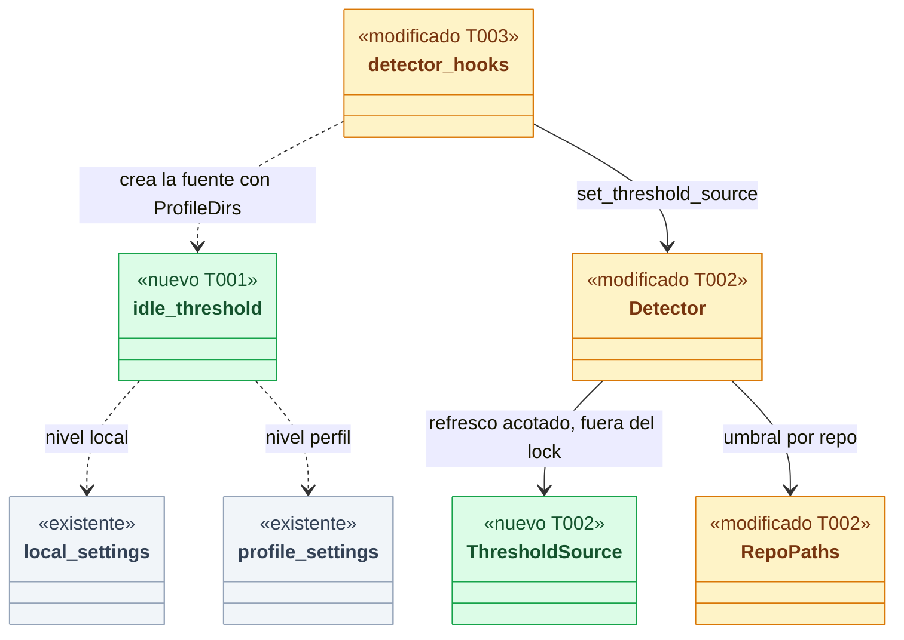
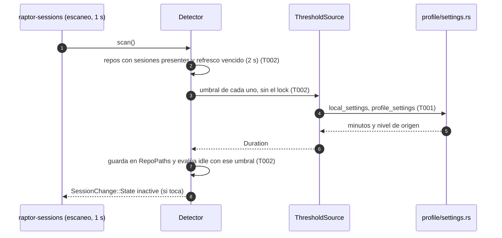
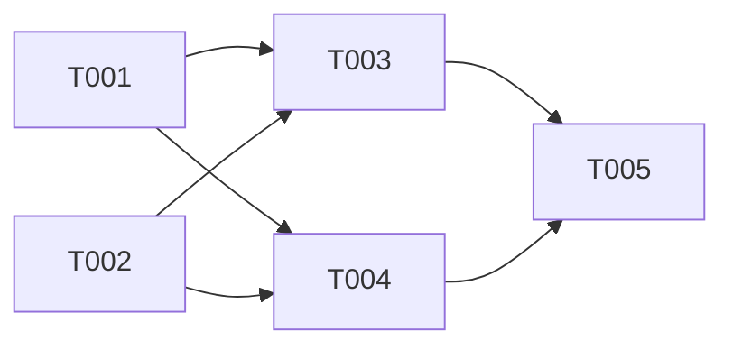

# DS-US-GRP-013 · Umbral de inactividad por repo

## Contexto rápido

Cuando esto esté hecho, una sesión de un repo pasa a "Inactivo" al cabo del umbral que fija el nivel local de ese repo (`<config>/repos/<repo_id>/settings.local.json`) o, si no lo fija, el perfil (`<config>/settings.json`), y a los 5 minutos si ninguno de los dos lo fija. Un valor en la configuración del equipo no cuenta. Si el desarrollador edita el archivo, el umbral nuevo rige en segundos, sin reiniciar el motor ni reinstalar nada, y el motor nunca escribe en esos archivos.

Gran parte ya existe:

| Pieza | Dónde | Qué da |
|---|---|---|
| Clave y schema | `crates/policy/src/settings/model.rs`, `Engine::idle_threshold_minutes` con `range(min = 1, max = 1440)` y `x-gitraptor-levels = ["profile", "local"]` | Un valor fuera de rango invalida el nivel entero (PQ-8). En `Level::Team` la clave se descarta con diagnóstico (Q24) |
| Lectores del perfil y del local | `crates/core/src/profile/settings.rs`, `profile_settings(dirs)` y `local_settings(dirs, repo_id)` | Lectura sin seguir enlaces, archivo regular, 64 KiB, nunca crea nada (SEC-11). Ya los usa Guardrails (`guardrails/layers.rs`). **No hay un segundo lector**: esta historia los reutiliza |
| Umbral fijo | `crates/core/src/detect/mod.rs`, `SessionConfig::inactivity` = 5 min (`SessionConfig::default()`), leído en `Detector::watch_repo`, `Detector::register` y `Inner::scan` | Un solo umbral para todos los repos. `Live::idle(now, threshold)` ya recibe el umbral como argumento |
| Reloj de pruebas | `crates/core/src/daemon/env.rs`, `GITRAPTOR_TEST_CLOCK_SKEW_FILE` (DS-US-GRP-007 D14, solo en debug) | Probar los minutos sin esperarlos |

Esta ficha es la brecha: resolver el umbral por repo con los dos lectores, llevarlo al detector y refrescarlo sin reiniciar.

| Término | Qué es aquí |
|---|---|
| Umbral efectivo | `engine.idleThresholdMinutes` del local legible; si no, del perfil legible; si no, 5 (ADR-GRP-007 § Precedencia) |
| Nivel legible | Un `Parsed` con `applicable()` = `Some`. Un nivel `ignorado` (JSON inválido, fuera de rango, enlace, demasiado grande) no aporta nada y rige el siguiente (PQ-8) |

⚠️ **ASSUMPTION**: no existe `architecture-constitution.md` en la cascada. Rigen `AGENTS.md` (Rust, NFR-01, NFR-02, tests obligatorios) y los ADR citados, como en las Dev Specs hermanas.

---

## ⚠️ Gaps y violaciones de la constitución

Ninguno bloquea. Tres informativos para el orquestador:

1. **Recarga por sondeo acotado, no con el observador** (desvío de ADR-GRP-007 § Lectura y recarga, que dice que el motor "vigila sus cambios con el observador de ADR-GRP-010"). La carpeta de configuración del perfil no es una raíz observada. Vigilarla añadiría un stream de FSEvents o una vigilancia de inotify por máquina solo para dos archivos. D4 los vuelve a leer como mucho cada 2 s por repo, y solo para los repos que tienen sesiones presentes. Guardrails ya hace lo mismo: `guardrails/layers.rs::load` los lee en cada evaluación. **Resuelto**: ADR-GRP-007 lleva la Enmienda 2026-10-28 ("relee los niveles personales al usarlos, con un sondeo acotado donde el uso es continuo"), validada por el Arquitecto.
2. **Comentarios que prometen más alcance**: `profile/settings.rs` dice "US-GRP-013 adds the local level" (el nivel local ya existe, lo añadió Guardrails) y que "the local level of `dormantAfterHours` arrives with US-GRP-013". La historia solo cubre `idleThresholdMinutes`. El nivel local de `engine.observation.*` y de `engine.watcher.*Seconds` queda **fuera** (§ Fuera de alcance), y T001 corrige los dos comentarios.
3. **"Se consulta el umbral efectivo"** (escenario 2): **cerrado por Q57**. El PO reescribió el escenario por comportamiento (cada sesión pasa a "Inactivo" con el umbral de su repo); ninguna superficie lo muestra en esta historia.

---

## 🔭 La forma



🟩 nuevo · 🟨 modificado · ⬜ existente.

**Por qué así** (D2, D3): el detector no hace E/S de configuración ni conoce el perfil. Recibe una función `repo_id → Duration`, igual que ya recibe el reloj (`Clock`) y el sumidero (`ChangeSink`), así sus pruebas siguen con un umbral sintético. El daemon construye esa función con los dos lectores que ya existen, sin un segundo lector.



---

## 🚀 Plan de implementación

> Orden topológico (`Depende:`). Rutas relativas a la raíz del repo. Ningún archivo compartido de la lista de ADR-GRP-016 cambia: ni `methods/mod.rs`, ni `rpc.rs`, ni el protocolo, ni los catálogos i18n.

### El trabajo de un vistazo

| # | Tarea | Depende | Aterriza en |
|---|---|---|---|
| T001 | Resolver el umbral efectivo de un repo | — | `crates/core/src/profile/settings.rs` |
| T002 | Umbral por repo en el detector | — | `crates/core/src/detect/mod.rs`, `detect/threshold.rs` |
| T003 | Cablear la fuente en el daemon | T001, T002 | `crates/core/src/daemon/sessions.rs` |
| T004 | Probar los escenarios | T001, T002 | `crates/core/tests/`, `apps/cli/tests/` |
| T005 | Cerrar la historia | T003, T004 | `docs/` |

### En qué orden



### T001 — Resolver el umbral efectivo de un repo

**Objetivo.** Una función pura sobre los dos lectores que devuelve los minutos y de qué nivel salen.

**Ubicación.** `crates/core/src/profile/settings.rs` (**MODIFY**)

**Pasos**
1. `pub const DEFAULT_IDLE_THRESHOLD_MINUTES: u32 = 5;` (BR-TIME-001, Q20).
2. `pub enum ThresholdLevel { Default, Profile, Local }` y `pub struct IdleThreshold { pub minutes: u32, pub level: ThresholdLevel }` con `fn duration(&self) -> Duration`.
3. `pub fn idle_threshold(dirs: &ProfileDirs, repo_id: &str) -> IdleThreshold`: `local_settings(dirs, repo_id).applicable()` → `engine.idle_threshold_minutes`; si es `None`, `profile_settings(dirs).applicable()` → lo mismo; si no, `DEFAULT_IDLE_THRESHOLD_MINUTES`. Lo de fuera del rango ya lo rechaza el schema, que deja el nivel entero ignorado (PQ-8); aquí no se repite la validación (D1).
4. La configuración del equipo **no se lee** (D1): ni `TeamLoader` ni el blob del suelo entran en esta función.
5. Corregir los comentarios del módulo y de `observation()` (Gap 2): el nivel local existe, y el de `dormantAfterHours` no es de esta historia.

- **Depende:** —
- **Refs:** ADR-GRP-007 § Precedencia y § Validación, ADR-GRP-008, BR-TIME-001, BR-CONS-007, Q20, Q24, PQ-8
- **Aceptación:** en `profile/settings.rs`, `idle_threshold_defaults_to_five_minutes`, `idle_threshold_follows_the_profile`, `the_local_level_wins_over_the_profile`, `an_ignored_local_level_falls_back_to_the_profile` (JSON inválido y `0` fuera de rango), `an_out_of_range_profile_falls_back_to_the_default` (`1441`), `a_local_link_is_not_followed_for_the_threshold` (Unix) y `idle_threshold_never_creates_the_files` (sin `repos/` tras leer)

### T002 — Umbral por repo en el detector

**Objetivo.** El detector evalúa la inactividad de cada sesión con el umbral de su repo y lo refresca sin reiniciar, sin E/S bajo su lock.

**Ubicación.** `crates/core/src/detect/threshold.rs` (**CREATE**) · `crates/core/src/detect/mod.rs` (**MODIFY**: `mod threshold;`, `RepoPaths`, `Inner`, `scan`, `watch_repo`, `register`)

**Pasos**
1. En `threshold.rs`: `pub type ThresholdSource = Arc<dyn Fn(&str) -> Duration + Send + Sync>;` y `pub const THRESHOLD_REFRESH: Duration = Duration::from_secs(2);`.
2. `RepoPaths` gana `inactivity: Duration` y `refreshed: Option<Instant>`. Sin fuente, `inactivity` es `SessionConfig::inactivity` (5 min), así las pruebas actuales de `detect/tests.rs` no cambian.
3. `Inner` gana `thresholds: Mutex<Option<ThresholdSource>>` y `Detector::set_threshold_source(&self, source: ThresholdSource)`. La firma de `Detector::start` no cambia, así sus llamadas actuales siguen igual.
4. `watch_repo`: resuelve el umbral del repo con la fuente (si la hay) **antes** de tomar el lock, lo guarda en su `RepoPaths` y lo usa para sembrar `last_activity_ms = now - threshold` de una sesión que reanuda inactiva. `register` hace lo mismo con el umbral del repo de la sesión.
5. `scan`: (a) bajo el lock, junta los `repo_id` con al menos una sesión presente (`live` o `registered`) cuyo `refreshed` venció `THRESHOLD_REFRESH`; (b) suelta el lock y llama a la fuente para cada uno; (c) vuelve a tomarlo, guarda `inactivity` y `refreshed`, y sigue el escaneo de siempre. Los repos sin sesiones no se leen.
6. La evaluación de inactividad usa el umbral del repo de cada sesión: `l.idle(now, ms(repos[l.repo_id].inactivity))`, con `SessionConfig::inactivity` si el repo ya no está.
7. Semántica de un cambio (Q56): el umbral nuevo se compara con la última actividad de cada sesión en el siguiente escaneo. Bajarlo por debajo del tiempo sin actividad pasa la sesión a "Inactivo" en ese escaneo. Subirlo **no** reactiva una sesión ya inactiva: solo la actividad la reactiva (BR-WF-001).

> **Nota técnica.** El escaneo ya despierta cada `scan_interval` (1 s), así que el refresco no añade despertares (RES-03). Por cada repo con sesiones son como mucho dos `symlink_metadata` y dos lecturas de menos de 64 KiB cada 2 s. La comparación es por contenido, no por la fecha de modificación: pasar de `15` a `20` no cambia el tamaño del archivo y en un sistema de archivos con fechas de 1 s tampoco la fecha.

- **Depende:** —
- **Refs:** ADR-GRP-012, DS-US-GRP-007 D7 y D14, BR-TIME-001, BR-WF-001, RES-03
- **Aceptación:** los dos ejemplos de Q56 en BR-TIME-001 (bajar de 15 a 5 min a las 10:08 → Inactivo en el siguiente escaneo; subir de 5 a 30 min una sesión ya Inactiva → sigue Inactiva) son `a_lower_threshold_idles_at_the_next_scan` y `a_higher_threshold_does_not_reactivate_an_idle_session`. En `crates/core/src/detect/tests.rs` (árbol de procesos sintético y reloj falso), `each_repo_uses_its_own_threshold`, `a_registered_session_uses_its_repo_threshold`, `a_lower_threshold_idles_at_the_next_scan`, `a_higher_threshold_does_not_reactivate_an_idle_session`, `the_threshold_is_read_outside_the_lock` (una fuente que bloquea hasta que otro hilo llama a `observer_hooks().worktree_touched`: no hay interbloqueo), `repos_without_sessions_are_not_read` (contador de llamadas a la fuente) y `the_refresh_is_bounded` (como mucho una llamada por repo cada `THRESHOLD_REFRESH`)

### T003 — Cablear la fuente en el daemon

**Objetivo.** El detector de producción lee el umbral de cada repo de su perfil.

**Ubicación.** `crates/core/src/daemon/sessions.rs` (**MODIFY**, `Daemon::detector_hooks`)

**Pasos**
1. Tras `Detector::start(..)`, `detector.set_threshold_source(Arc::new(move |repo_id| { .. }))`, con un `ProfileDirs` clonado de `self.config.dirs`. La función llama a `profile::settings::idle_threshold(&dirs, repo_id)`. El `repo_id` es la clave del registro del daemon, nunca un texto de un cliente.
2. Dentro de la función, un `Mutex<HashMap<String, IdleThreshold>>` local guarda el último valor por repo. Si cambia, registra `idle_threshold_changed` con `repo`, `minutes` y `level` (`default`, `profile` o `local`): solo números y códigos, nunca rutas ni contenido de los archivos (SEC-11).
3. Nada más cambia en el daemon: el umbral no se persiste, no viaja en el contrato y la CLI no lo muestra (Q57).

- **Depende:** T001, T002
- **Refs:** ADR-GRP-005 (un solo escritor: la fuente solo lee), ADR-GRP-006, SEC-11
- **Aceptación:** los tests de T004 con el daemon real

### T004 — Probar los escenarios

**Objetivo.** Un test por escenario y por fila del esquema, en repos y perfiles temporales (NFR-01).

**Ubicación.** `crates/core/tests/us_grp_013.rs` (**CREATE**) · `apps/cli/tests/idle_threshold.rs` (**CREATE**, arnés de `apps/cli/tests/claude_sessions.rs`)

**Pasos**
1. `crates/core/tests/us_grp_013.rs` corre en todos los SO del CI: perfil temporal (`ProfileDirs::under_root`), dos ids de repo, `idle_threshold` real y el detector con una lista de procesos y un reloj sintéticos (como `detect/tests.rs`), con `set_threshold_source` sobre `idle_threshold`.
2. `apps/cli/tests/idle_threshold.rs` (macOS, como `claude_sessions.rs`): `raptor` real como daemon y cliente, el Claude Code simulado de `GITRAPTOR_AGENT_EXECUTABLES` y el reloj adelantado con `GITRAPTOR_TEST_CLOCK_SKEW_FILE`. El nivel de equipo es un `.gitraptor/settings.json` **commiteado** en `main` y en la copia `origin/main` de un remoto temporal.
3. En cada test, la huella del testkit no tiene diferencias fuera del perfil (BR-CONS-001), y el SHA-256 y la fecha de modificación de los tres archivos de configuración son los mismos antes y después, salvo los cambios que hace el propio test.

- **Depende:** T001, T002
- **Refs:** NFR-01, BR-03, BR-CONS-001, DS-US-GRP-007 § 3
- **Aceptación:** la tabla de § Estrategia de pruebas

### T005 — Cerrar la historia

**Objetivo.** Estado, trazabilidad y pendientes multiplataforma.

**Ubicación.** `docs/requirements/features/motor-local/user-stories/US-GRP-013-umbral-inactividad-por-repo.md` (**MODIFY**, `status` y enlace a esta ficha) · `docs/architecture/xplat-pendientes.md` (**MODIFY**, fila de los tests de proceso de T004)

- **Depende:** T003, T004
- **Refs:** AGENTS.md § Pull requests
- **Aceptación:** la historia enlaza esta ficha y el PR la nombra

---

## Estructura de ficheros

```
crates/core/src/profile/settings.rs   MODIFY  idle_threshold, IdleThreshold, ThresholdLevel, DEFAULT_IDLE_THRESHOLD_MINUTES
crates/core/src/detect/threshold.rs   CREATE  ThresholdSource, THRESHOLD_REFRESH
crates/core/src/detect/mod.rs         MODIFY  mod threshold; RepoPaths.inactivity; set_threshold_source; scan; watch_repo; register
crates/core/src/detect/tests.rs       MODIFY  tests de T002
crates/core/src/daemon/sessions.rs    MODIFY  detector_hooks: fuente del perfil y registro de cambios
crates/core/tests/us_grp_013.rs       CREATE  escenarios en todos los SO
apps/cli/tests/idle_threshold.rs      CREATE  escenarios de punta a punta (macOS)
```

## Contratos compartidos

### Firmas del stack

```rust
// crates/core/src/profile/settings.rs
pub const DEFAULT_IDLE_THRESHOLD_MINUTES: u32 = 5;
pub enum ThresholdLevel { Default, Profile, Local }
pub struct IdleThreshold { pub minutes: u32, pub level: ThresholdLevel }
impl IdleThreshold { pub fn duration(&self) -> std::time::Duration; }
pub fn idle_threshold(dirs: &ProfileDirs, repo_id: &str) -> IdleThreshold;

// crates/core/src/detect/threshold.rs
pub type ThresholdSource = std::sync::Arc<dyn Fn(&str) -> std::time::Duration + Send + Sync>;
pub const THRESHOLD_REFRESH: std::time::Duration = std::time::Duration::from_secs(2);

// crates/core/src/detect/mod.rs
impl Detector { pub fn set_threshold_source(&self, source: ThresholdSource); }
```

## Contrato de API

Sin cambios: ni método, ni capacidad, ni campo, ni código de error. `SessionView` y `session.state` siguen igual. El umbral no viaja por el canal (Q57).

### Forma de la configuración

Sin claves nuevas. `engine.idleThresholdMinutes` (entero de 1 a 1440, niveles perfil y local) ya está en el schema embebido y versionado (`crates/policy/schema/settings.schema.json`). Ejemplos en ADR-GRP-007 § Estructura.

### Valores numéricos

| Valor | Cifra | De dónde |
|---|---|---|
| Umbral por defecto | 5 min | BR-TIME-001, Q20 |
| Rango admitido | 1 a 1440 min | ADR-GRP-007, schema |
| Refresco del umbral | 2 s por repo con sesiones | D4 (⚠️ **ASSUMPTION**: bastan 2 s, porque el umbral se mide en minutos) |

### i18n

Sin textos nuevos.

## Modelo de datos

Sin cambios en el almacén ni en el perfil. El umbral se resuelve, nunca se guarda.

## Estrategia de pruebas y cobertura

### 9.1 Pirámide de pruebas

| Nivel | Dónde | Qué |
|---|---|---|
| Unitarias | `profile/settings.rs`, `detect/tests.rs` | Precedencia, PQ-8, archivos hostiles, umbral por repo, refresco, sin E/S bajo el lock |
| Integración (todos los SO) | `crates/core/tests/us_grp_013.rs` | Escenarios con el lector real y el detector con reloj sintético |
| Punta a punta (macOS) | `apps/cli/tests/idle_threshold.rs` | Escenarios con `raptor` real, Claude Code simulado y reloj adelantado |

### 9.2 Umbrales de cobertura

Toda rama de `idle_threshold` y del refresco de `scan` tiene un test. No hay un porcentaje propio: rige el del workspace.

### 9.3 Datos de prueba

Repos, remotos y perfiles temporales del testkit. El nivel de equipo siempre commiteado, nunca solo en disco. Ningún test lee el perfil real (`GITRAPTOR_PROFILE_DIR` solo en debug).

### 9.4 Comportamientos críticos verificados

| Escenario Gherkin | Test (`apps/cli/tests/idle_threshold.rs`, y su réplica sin procesos en `crates/core/tests/us_grp_013.rs`) |
|---|---|
| Esquema, fila 1: perfil 10, local y equipo sin definir → 10 min | `profile_10_gives_10`: con el reloj adelantado 9 min 50 s la sesión sigue "Activo"; con 10 min 5 s llega `session.state` `inactive` |
| Fila 2: perfil 10, local 15 → 15 min | `local_15_over_profile_10_gives_15`: activa a 14 min 50 s, inactiva a 15 min 5 s |
| Fila 3: solo equipo 30 → 5 min | `team_30_alone_gives_the_default_5`: el equipo commiteado en `main` y `origin/main` dice 30; inactiva a 5 min 5 s, activa a 4 min 50 s |
| Fila 4: perfil 10, equipo 30 → 10 min | `team_30_does_not_override_profile_10`: inactiva a 10 min 5 s |
| El ajuste de un repo no afecta a los demás (reescrito por Q57) | `a_repo_setting_does_not_reach_another_repo`: perfil 10, local de "demo" 15, "otro" sin local; una sesión de Claude Code en cada repo deja de tener actividad a la vez. Con 9 min 50 s las dos siguen "Activo"; con 10 min 5 s solo la de "otro" está inactiva; con 15 min 5 s, también la de "demo" |
| Un cambio en la configuración se aplica sin que el motor la escriba | `a_settings_change_applies_without_restart_and_is_not_written`: local 15; con el motor observando, el test reescribe el archivo con 20. Tras el refresco, con 15 min 5 s sigue "Activo" y con 20 min 5 s pasa a "Inactivo". El pid del daemon no cambia (sin reinicio ni reinstalación). Los bytes de los tres niveles son los que escribió el test y nada más: el motor no crea `settings.json` ni la carpeta `repos/<id>/` de "otro" |

Además, en `crates/core/tests/us_grp_013.rs`: `an_invalid_local_level_falls_back_to_the_profile` (JSON inválido y `0` → perfil 10) y `a_symlinked_local_file_is_ignored` (Unix).

### 9.5 Plataformas

- `profile/settings.rs`, `detect/tests.rs` y `crates/core/tests/us_grp_013.rs` corren en macOS, Linux y Windows en el CI (BR-03). El enlace simbólico solo en Unix, como los tests actuales de `local_links_are_not_followed`.
- `apps/cli/tests/idle_threshold.rs` usa el arnés de procesos de `claude_sessions.rs`: solo macOS. *Pendiente: etapa de validación multiplataforma* (`docs/architecture/xplat-pendientes.md`), que la añade en T005.
- La lectura no depende del SO: `local_settings` ya resuelve `open_no_follow` en Unix y `File::open` en Windows, con `symlink_metadata` antes en los dos.

## Gate de seguridad

| Riesgo | Control |
|---|---|
| Un archivo hostil en el perfil (enlace, FIFO, enorme) | `local_settings` y `profile_settings` lo ignoran entero, sin seguir enlaces y con tope de 64 KiB (SEC-11). Ya probado en `profile/settings.rs`; T001 lo prueba para el umbral |
| Un `repo_id` que saca la lectura del perfil | `local_settings_path` solo admite `[0-9a-fA-F-]{1,64}`, y el id es la clave del registro del daemon |
| Un agente que cambia el umbral escribiendo el archivo | Es un archivo del usuario: el motor solo lo lee (BR-CONS-007). El umbral no afecta a la atribución ni a la protección, solo al estado mostrado |
| Contenido de los archivos en los registros | `idle_threshold_changed` solo lleva el id, los minutos y el nivel |

## Dependencias

- **Historias**: US-GRP-007 (detector y estados, en `main`), US-GRP-009 (sesiones registradas, en `main`).
- **Enablers**: TS-GRD-001 (cargador y schema en `crates/policy`, en `main`).
- **Después**: US-GRP-016 comparte la regla de "solo leer" (BR-CONS-007), pero **no** estos lectores: la rama base es solo de equipo y la lee el cargador de Guardrails (D2 de DS-US-GRP-016).

## Fuera de alcance

- El nivel local de `engine.observation.*` y de `engine.watcher.*Seconds` (Gap 2): ADR-GRP-007 los admite, pero no están en esta historia. Propuesta: una tarea propia que reutilice el mismo patrón.
- Mostrar el umbral efectivo y los diagnósticos de los niveles en un cliente (`raptor status`, `raptor doctor`, TUI): Q57. Queda para `raptor doctor` o una historia de diagnóstico posterior; US-GRP-018 hoy solo trata el gasto de recursos.
- La edición de los archivos: la hace el desarrollador con su editor. El comando de edición de la configuración es de Guardrails (Q27).
- La configuración del equipo: esta historia no la lee.

## Decisiones

Las D<n> son **Decisión del orquestador (2026-10-28), validada por Arquitecto**.

| # | Decisión |
|---|---|
| D1 | **Niveles**: solo el local y el perfil, en ese orden, y 5 min si ninguno lo define (ADR-GRP-007, BR-TIME-001, Q24). La configuración del equipo no se lee para el umbral: un valor ahí no tiene efecto, y el schema ya lo descarta con diagnóstico en `Level::Team`. La validación (entero de 1 a 1440) es la del schema, y un valor inválido deja su nivel entero ignorado (PQ-8), así rige el siguiente |
| D2 | **Un solo lector**: `profile::settings::{local_settings, profile_settings}`, los mismos que usa Guardrails. `idle_threshold` solo aplica la precedencia sobre ellos |
| D3 | **Umbral por repo en el detector**, guardado en `RepoPaths`, con una fuente inyectada (`ThresholdSource`) como el reloj y el sumidero. Sin fuente, el umbral de `SessionConfig` (5 min). Las sesiones registradas usan el mismo umbral que las detectadas de su repo |
| D4 | **Recarga sin reiniciar**: el escaneo de sesiones (cada 1 s) vuelve a leer el umbral de cada repo con sesiones presentes como mucho cada 2 s, fuera del lock y comparando valores, no fechas. Sin hilo, sin vigilancia nueva y sin despertares nuevos (RES-03). Desvío de ADR-GRP-007 § Lectura y recarga: Gap 1 |
| D5 | **Sin contrato ni CLI**: el umbral no viaja por el canal ni se muestra. Solo el registro del daemon dice cuándo cambia, con el nivel de origen y sin contenido (SEC-11) |
| D6 | **Pruebas**: el reloj adelantado de DS-US-GRP-007 D14 para los minutos, y ningún gancho nuevo. El refresco de 2 s es de tiempo real y los tests lo esperan con un sondeo acotado, sin esperas fijas |
| D7 | **Coordinación con las fichas hermanas**: `detect/mod.rs` lo toca también DS-US-GRP-008 (`GitSeen` y la clasificación de S3, otra parte del archivo) y `daemon/sessions.rs`, DS-US-GRP-008 (`s3_log_fields`) y DS-US-GRP-011 (`session_view`, `publish_sessions`). Sin campos ni nombres comunes; se mergean en serie y la segunda rebasa |

### Decisiones de producto

Las dos son **Decisión del orquestador (2026-10-28), validada por PO y Arquitecto**, registradas en `context.md` y BR-TIME-001 (business-rules v1.20), abiertas a veto de Rene.

| # | Pregunta | Decisión | Motivo |
|---|---|---|---|
| Q56 | ¿Qué hace un cambio del umbral con las sesiones que ya están en marcha? | El umbral nuevo se compara con la última actividad de cada sesión en el siguiente escaneo. Bajarlo puede pasar una sesión activa a "Inactivo" en ese momento. Subirlo no reactiva una sesión inactiva: solo la actividad la vuelve a "Activo" (BR-WF-001) | Reactivar sin actividad daría un `session-active` que no corresponde a nada ocurrido en el worktree |
| Q57 | Escenario 2, "se consulta el umbral efectivo": ¿hace falta una superficie que lo muestre? | No en esta historia: el escenario se verifica por comportamiento (cada repo pasa a inactivo con su umbral). Mostrar el umbral efectivo y de qué nivel sale queda para `raptor doctor` o una historia de diagnóstico posterior. El PO reescribió el escenario 2 en esos términos | El valor de la historia es que "Inactivo" llegue a su hora, y eso es observable sin un campo nuevo en el contrato |

## Notas del autor

- El `0` del rango es la trampa más probable del usuario ("sin umbral"). Hoy invalida su nivel entero, y con él los `permissions` del local de ese repo. Es la regla PQ-8 de ADR-GRP-007 para todo el documento y esta ficha no la cambia; T001 la prueba para que quede a la vista.
