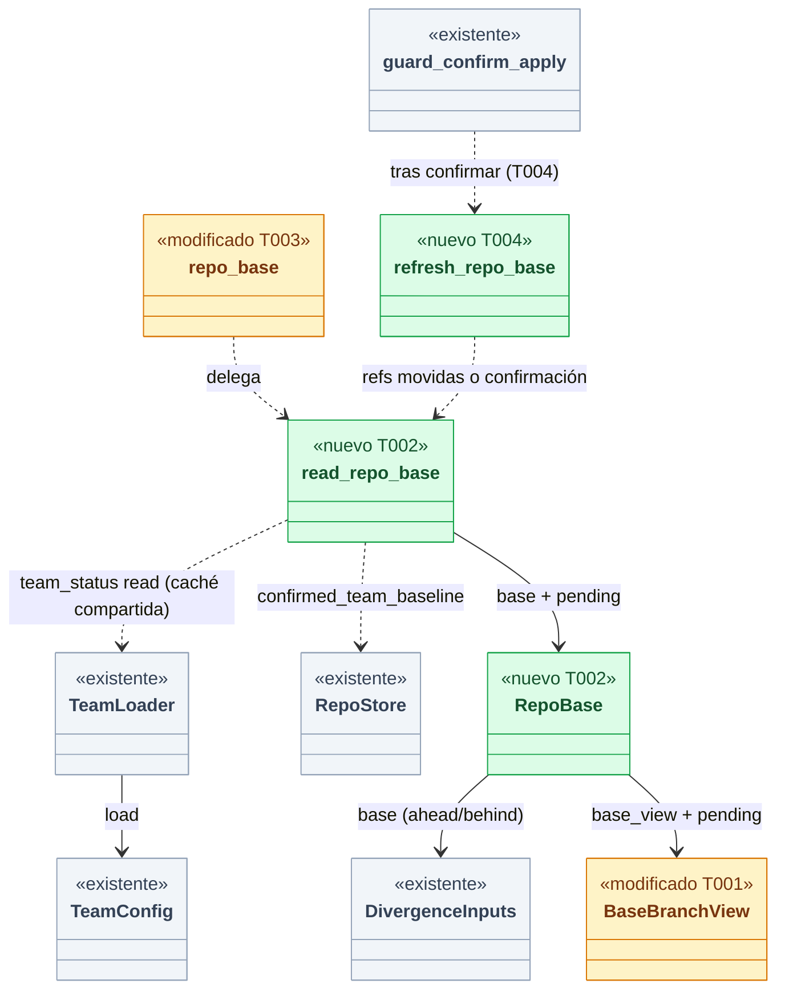
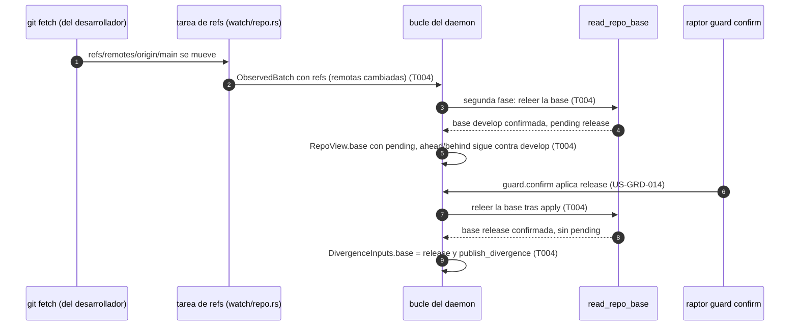
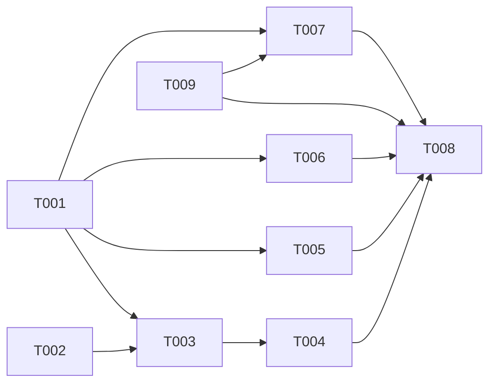

# DS-US-GRP-016 · La rama base sale de la configuración del equipo

## Contexto rápido

Cuando esto esté hecho, `raptor status` dice que la rama base de "demo" es `develop` si la configuración del equipo commiteada en la copia conocida de la rama principal la fija, y calcula contra ella el ahead/behind de cada worktree. Hasta que el desarrollador la confirma con `raptor guard confirm` (US-GRD-014), la marca como "no confirmada". Si ya hay una confirmada y llega otra, sigue con la confirmada y muestra la nueva como "pendiente de confirmar". Al confirmar, el ahead/behind pasa a la nueva sin reiniciar el motor. Un valor en el perfil o en el local no cuenta.

Lo que ya está en `main` y esta historia **no** rehace:

| Pieza | Dónde | Qué da |
|---|---|---|
| Cargador del nivel de equipo (TS-GRD-001) | `crates/policy/src/team.rs`, `TeamLoader::load(reader, confirmed)` | `TeamConfig::base_branch()` con `BaseStatus::{Confirmed, Unconfirmed, Invalid}`, `resolved_base` y los diagnósticos `BaseUnconfirmed` y `BaseChangePending { invalid }`. Copia de la rama principal sin red (`resolve_main_branch`), solo objetos commiteados, caché LRU por blob |
| El cargador compartido | `crates/core/src/guardrails/team_status.rs::read` sobre `guardrails::layers::LOADER` | La misma lectura y la misma caché que usa Guardrails. Con ella el motor y Guardrails no pueden discrepar sobre la rama base (prueba de integración del [índice de Guardrails](../../guardrails/user-stories.md#relación-con-us-grp-016-motor-local)) |
| Lo confirmado por repo | `crates/core/src/profile/team_baseline.rs`, `RepoStore::confirmed_team_baseline` | La escribe solo `guardrails::confirm::apply` (`raptor guard confirm`, US-GRD-014) y la instalación (US-GRD-001) |
| Ahead/behind contra la base (US-GRP-012) | `crates/core/src/observe.rs`: `base_branch(confirmed)`, `base_view`, `reconcile`, `RepoRead::set_base`, `DivergenceInputs`; `daemon/mod.rs::repo_base`; `daemon/repos.rs::{publish_observed_views, publish_divergence}` | `BaseBranchView {name, status}`, `DivergenceView::{Counted, BaseMissing, NoBase, NoCommits, Unreadable}` y los textos `status.base`, `status.base-unconfirmed` y `status.base-invalid`. **Hoy, sin confirmada, la base es siempre `main`**: `observe::base_branch` no lee el equipo (DS-US-GRP-012 D1) |

La brecha:

1. `repo_base` no carga el equipo, así que sin confirmada la base es `main` aunque el suelo diga `develop`.
2. El estado del motor no dice que haya un cambio pendiente: `BaseBranchView` no tiene dónde decirlo. Hoy el MCP lo deduce de los diagnósticos de Guardrails (`channel/mcp_status.rs`, DS-US-GRD-014 D9).
3. Nada vuelve a leer la base cuando cambia la copia de la rama principal ni cuando el desarrollador confirma. `DivergenceInputs.base` se queda con la del arranque o la del alta. Además, la tarea de refs (`watch/repo.rs::apply`) no envía un lote si solo cambian las ramas remotas (`RefsView::remotes`), que es lo que mueve un `git fetch`.

La confirmación es de Guardrails. Esta ficha solo **consume** lo confirmado, lo pendiente y lo no confirmado.

⚠️ **ASSUMPTION**: no existe `architecture-constitution.md` en la cascada. Rigen `AGENTS.md` (Rust, NFR-01, NFR-02, tests obligatorios) y los ADR citados, como en las Dev Specs hermanas.

---

## ⚠️ Gaps y violaciones de la constitución

Ninguno bloquea. Para el orquestador:

1. **`BaseBranchView` gana un campo** (`pending`), detrás de la capacidad `engine.base-pending` (D4). DS-US-GRD-014 D9 dice "`BaseBranchView` no cambia". Lo decía dentro de su propio alcance (US-GRD-014 no tocaba el estado del motor), así que no es una contradicción. Esta ficha tampoco cambia el MCP: `McpBaseState::Pending` se sigue deduciendo como fija D9 (§ Fuera de alcance).
2. **Rama base del equipo solo en el remoto**: resuelto por Q58 (D8, T009). En un clon recién hecho, `develop` suele existir solo como `origin/develop`; el ahead/behind se cuenta contra esa copia y el escenario 5 lo exige. Enmienda DS-US-GRP-012 D2 (§ Enmienda 2026-10-28 (Q58) de esa ficha).
3. **Esquema, fila "sin definir / develop (perfil) / sin definir → main"**: con el suelo sin `baseBranch` y la confirmada `main`, la base es `main`, confirmada. La fila se prueba con la base confirmada que dice el "Dado" ("la que resulta de esa configuración"). Sin confirmada, la misma fila daría `main` no confirmada. Se cumple igual.
4. **Sin aviso en vivo a los suscriptores**: ningún evento lleva `RepoView.base`. Hoy solo se entera `engine.snapshot` (y `raptor status`), igual que el ahead/behind antes de US-GRP-002 (DS-US-GRP-012 § Pendientes). Lo necesita US-CKP-009 (§ Fuera de alcance).
5. **La predicción de pares no usa la misma base** (revisión del Arquitecto, 2026-10-28). `daemon/modules/predict.rs::read_plan` usa siempre `observe::base_branch(None)` (`main` no confirmada) y busca su punta con `reader.resolve_ref(name)` sobre el nombre corto. gix resuelve un nombre corto con las reglas de Git (`refs/<n>`, `refs/tags/<n>`, `refs/heads/<n>`, `refs/remotes/<n>`…), así que una etiqueta `main` gana a la rama: contradice Q42 y daría a Cockpit otra base que la del ahead/behind. T009 le hace usar el mismo resolvedor de punta (una línea en el archivo del módulo). Pasarle la base del equipo, en vez de `main`, es de Cockpit (US-CKP-009) y queda fuera.

---

## 🔭 La forma



🟩 nuevo · 🟨 modificado · ⬜ existente.

**Por qué así** (D1, D2): `TeamConfig::base_branch()` ya es "la confirmada o, sin ella, la resuelta no confirmada, o `invalid`" (ADR-GRD-004 § 3.5), y es lo mismo que protege Guardrails. El motor no decide nada nuevo: llama al mismo cargador, con la misma caché, en un solo punto (`repo_base`), el punto que DS-US-GRP-012 D1 dejó preparado. El pendiente sale de los diagnósticos del cargador, que son los mismos que muestra `raptor guard status`.



---

## 🚀 Plan de implementación

> Orden topológico (`Depende:`). Rutas relativas a la raíz del repo. Las ediciones en archivos compartidos son las que se nombran (ADR-GRP-016).

### El trabajo de un vistazo

| # | Tarea | Depende | Aterriza en |
|---|---|---|---|
| T001 | Contrato: la base pendiente | — | `crates/api/src/` |
| T002 | Leer la base del repo con el cargador del equipo | — | `crates/core/src/daemon/base.rs` |
| T003 | Usarla al añadir, al arrancar y al despertar | T001, T002 | `crates/core/src/daemon/{mod,repos,tiers}.rs` |
| T004 | Releerla cuando cambian las refs o se confirma | T003 | `crates/core/src/{watch/repo.rs,daemon/repos.rs,daemon/guard.rs}` |
| T005 | Servir el campo solo con la capacidad | T001 | `crates/core/src/channel/conn.rs` |
| T006 | `raptor status` muestra la base pendiente | T001 | `apps/cli/` |
| T007 | Probar los escenarios | T001, T009 | `crates/core/tests/`, `apps/cli/tests/` |
| T008 | Cerrar la historia | T004, T005, T006, T007, T009 | `docs/` |
| T009 | Contar contra la copia del remoto si no hay rama local (Q58) | — | `crates/policy/src/team.rs`, `crates/core/src/observe.rs`, `crates/core/src/daemon/modules/predict.rs` |

### En qué orden



### T001 — Contrato: la base pendiente

**Objetivo.** Que el estado del motor pueda decir que hay otra rama base esperando confirmación, sin romper a un cliente que no lo entiende.

**Ubicación.** `crates/api/src/messages.rs` (**MODIFY**, `BaseBranchView`, `RepoView::without_base_pending`) · `crates/api/src/methods/engine.rs` (**MODIFY**, `CAP_ENGINE_BASE_PENDING` en el `GROUP`)

**Reglas**
- `BaseBranchView` gana `#[serde(default, skip_serializing_if = "Option::is_none")] pub pending: Option<PendingBaseView>`.
- `PendingBaseView { name: Option<UntrustedName>, invalid: bool }` (`deny_unknown_fields`). Con `invalid: true`, `name` es `None`: el suelo declara un nombre que no es una rama válida y ese nombre nunca sale del motor (SEC-11). El nombre de la rama confirmada sigue en `BaseBranchView.name`, así un cliente pinta "`develop` → `release`" (US-CKP-009) sin otro campo.
- `pending` solo llega con `status = confirmed`. Sin confirmada no hay pendiente: la resuelta **es** la base, marcada `unconfirmed` (Q-GRD-21).
- `pub const CAP_ENGINE_BASE_PENDING: Capability = Capability::new("engine.base-pending");`, en `capabilities` del `GROUP` de `engine`. Un cliente sin ella recibe `BaseBranchView` como hoy (`RepoView::without_base_pending` pone `pending = None`). Ni `PROTOCOL_VERSION` ni `API_VERSION` cambian (ADR-GRP-016 § 1).

- **Depende:** —
- **Refs:** ADR-GRP-016 § 1, ADR-GRD-004 § 3, Q-GRD-21, SEC-11, SEC-12, NFR-10
- **Aceptación:** `base_pending_is_a_capability_of_engine`, `base_branch_view_without_pending_keeps_its_wire_form` (sin `pending`, el JSON es idéntico al de hoy), `pending_invalid_carries_no_name` en `crates/api`

### T002 — Leer la base del repo con el cargador del equipo

**Objetivo.** Una función que da la base del repo y el pendiente, con el cargador compartido y sin escribir nada.

**Ubicación.** `crates/core/src/daemon/base.rs` (**CREATE**) · `crates/core/src/daemon/mod.rs` (**MODIFY**, una línea `mod base;`)

**Pasos**
1. `pub(super) struct RepoBase { pub base: BaseBranch, pub pending: Option<PendingBase> }`, con `pub(super) enum PendingBase { Branch(RefName), Invalid }`.
2. `pub(super) fn read_repo_base(common_dir: &Path, store: Option<&RepoStore>) -> RepoBase`:
   - `confirmed` = `store.confirmed_team_baseline().ok().flatten()`. Un valor ilegible cuenta como no confirmado, como hoy (DS-US-GRP-012 D1).
   - Abre el lector como Guardrails (`guardrails::evaluate::open(common_dir)`) y llama a `guardrails::team_status::read(&reader, confirmed.as_ref())`, el mismo `LOADER` con su caché. **No hay un segundo cargador ni un segundo lector de configuración** (D2).
   - `base` = `team.base_branch().clone()`.
   - `pending`: si `base.status == Confirmed` y `team.team_diagnostics()` trae `Code::BaseChangePending { invalid: false }`, `Branch(r)` con `r` de `team.resolved_base` (`ResolvedBase::Valid(r)`). Con `invalid: true`, `Invalid`. Si no, `None`. El cargador ya no emite el pendiente cuando el suelo está `ignorado` (§ 3.6 de ADR-GRD-004): la ficha no lo repite.
   - Si el lector no abre o `load` devuelve `Err`: `RepoBase { base: observe::base_branch(confirmed.as_ref()), pending: None }`, la regla de hoy. Nunca se inventa una base del equipo que no se pudo leer.
3. `pub(super) fn view(rb: &RepoBase) -> BaseBranchView` = `observe::base_view(&rb.base)` más `pending` en `PendingBaseView`.
4. Nada de esto escribe: ni el almacén, ni el repo, ni la configuración (BR-CONS-007). Sin red (NFR-03): `resolve_main_branch` no hace `fetch`.
5. `observe::base_branch` se queda como respaldo y actualiza su comentario: "US-GRP-016 resuelve la no confirmada desde el equipo en `daemon/base.rs`".

- **Depende:** —
- **Refs:** ADR-GRP-007 § Qué configuración de equipo manda, ADR-GRD-004 § 3, Q-GRD-18, Q-GRD-20, Q-GRD-21, Q-GRD-23, Q42
- **Aceptación:** en `daemon/base.rs`, `no_team_settings_gives_main_unconfirmed`, `the_floor_gives_its_base_unconfirmed`, `the_confirmed_base_wins_and_a_different_floor_is_pending`, `an_invalid_floor_over_a_confirmed_base_is_pending_invalid`, `an_invalid_floor_without_confirmation_is_invalid` (Q42), `an_ignored_floor_has_no_pending`, `an_unreadable_repo_falls_back_to_the_confirmed_or_main`, `reading_the_base_writes_nothing` (huella estricta del testkit)

### T003 — Usarla al añadir, al arrancar y al despertar

**Objetivo.** La base del equipo rige desde la primera consulta del estado (BR-EDGE-007).

**Ubicación.** `crates/core/src/daemon/mod.rs` (**MODIFY**, `repo_base`, el armado de `RepoView` del arranque) · `crates/core/src/daemon/repos.rs` (**MODIFY**, alta del repo y `publish_observed_views`) · `crates/core/src/daemon/tiers.rs` (**MODIFY**, despertar)

**Pasos**
1. `repo_base(stores, repo_id)` pasa a `repo_base(stores, repo_id, common_dir) -> RepoBase` y delega en `base::read_repo_base`. Sus cinco llamadas ya tienen la ruta a mano: `entry.canonical_path` en el arranque (`daemon/mod.rs`, el hilo de reconciliación y el armado de `RepoView`), la del alta en `repos.rs`, `common_dir` en `publish_observed_views` y `entry.canonical_path` en `tiers.rs`.
2. Donde se usa la base para contar (`observe::reconcile`, `RepoRead::set_base`, `DivergenceInputs`), se pasa `rb.base`. Donde se arma `RepoView.base`, `base::view(&rb)`.
3. **Sin campo nuevo en `EngineShared`** (`channel/bus.rs` es compartido y `RepoBase` es privado de `daemon/`): lo publicado ya está ahí. T004 compara el `RepoBase` releído con `EngineShared.divergence[repo_id].base` (la base del recuento) y con `EngineShared.repos[..].base` (la vista, con `pending` desde T001).
4. Añadir el repo no confirma nada (Q-GRD-23): la base del alta es la del cargador con lo que haya en el almacén, normalmente `unconfirmed`.

- **Depende:** T001, T002
- **Refs:** BR-EDGE-007, Q-GRD-23, DS-US-GRP-012 D1 y D5
- **Aceptación:** los escenarios 1, 4 y 5 de T007

### T004 — Releerla cuando cambian las refs o se confirma

**Objetivo.** Un cambio en la copia de la rama principal se ve como pendiente (o cambia la base no confirmada), y una confirmación cambia la base del ahead/behind, sin reiniciar el motor.

**Ubicación.** `crates/core/src/watch/repo.rs` (**MODIFY**, `RepoTask::apply`) · `crates/core/src/daemon/repos.rs` (**MODIFY**, `refresh_repo_base` y su llamada en la segunda fase) · `crates/core/src/daemon/guard.rs` (**MODIFY**, una llamada tras `guard_confirm::apply`)

**Pasos**
1. **Refs remotas**: en `apply`, `let remotes_changed = new.remotes != self.view.remotes;` entra en `others`. Un `git fetch` que solo mueve `refs/remotes/*` envía un lote con `refs` (las ramas locales de siempre), sin eventos. Ningún otro consumidor cambia: la Time Machine compara `branches` (iguales) y `publish_divergence` recuenta con caché. `RefsView::read` ya lee `remote_branches()`.
2. **`refresh_repo_base(&mut self, repo_id) -> bool`** en `daemon/repos.rs`: vuelve a llamar a `read_repo_base`. Si `rb.base` difiere de `DivergenceInputs.base`, actualiza los inputs y llama a `publish_divergence` (el ahead/behind se recuenta contra la nueva). Si solo cambia `pending`, actualiza `RepoView.base` (lo que hace `publish_views` con su argumento `base`). Devuelve si algo cambió.
3. **Cuándo**: en la segunda fase de un lote de la tarea de refs (donde ya está `if views_changed || batch.refs.is_some() { self.publish_divergence(..) }`), **antes** de `publish_divergence`. Y en `daemon/guard.rs`, justo después de cada `guard_confirm::apply` que devuelve `Ok` (aceptar sin ventana y aplicar al cerrarse la ventana): una línea, `self.refresh_repo_base(repo_id)`.
4. **Cuánto cuesta**: `read_repo_base` abre el lector, resuelve la rama principal y busca el blob de `.gitraptor/settings.json` en su árbol. El documento sale de la caché por blob. Corre fuera del presupuesto del primer evento (ADR-GRP-011 § 2), como el ahead/behind. ⚠️ **ASSUMPTION**: un lote de refs cada pocos segundos como mucho; si el gate de frescura de INF-GRP-002 lo contradice, saltar la relectura cuando el commit de la copia (`MainBranch.copy`) y lo confirmado no cambiaron.
5. **El escenario 3 sale solo**: una edición o un commit en el worktree principal que no llega a `refs/remotes/<remoto>/<principal>` no cambia el suelo, así que el cargador da la misma base y ningún pendiente. Esta tarea no añade ninguna regla.

- **Depende:** T003
- **Refs:** ADR-GRP-007 § Lectura y recarga, ADR-GRP-010 § 2 y § 4, ADR-GRP-011 § 2, ADR-GRD-004 § 3, Q-GRD-21
- **Aceptación:** los escenarios 2 y 3 de T007; `a_fetch_that_only_moves_remotes_sends_a_batch` y `a_local_commit_alone_sends_no_remote_change` en `crates/core/src/watch/repo.rs`

### T005 — Servir el campo solo con la capacidad

**Objetivo.** Un cliente sin `engine.base-pending` (y `raptor-mcp`) no ve `pending`.

**Ubicación.** `crates/core/src/channel/conn.rs` (**MODIFY**, en las **tres** salidas que llevan `RepoView` y ya pasan por `shape_special_states`: `repo.add`, `engine.snapshot` y `scope.snapshot` con `Scope::Repo`)

**Pasos**
1. Sin `self.has(methods::CAP_ENGINE_BASE_PENDING.name)`, `RepoView::without_base_pending` en cada `RepoView` de esas tres salidas, como `without_tier`. `BaseBranchView` es `deny_unknown_fields`: un cliente sin la capacidad que recibiera `pending` por `scope.snapshot` fallaría al deserializar. Lo prueba `scope_snapshot_without_base_pending_does_not_see_it`.
2. Ningún evento lleva `RepoView.base` hoy, así que `apply_capabilities` y `Outbox` no cambian.
3. `raptor-mcp` no la pide y su `status` sigue con `McpBaseState` (DS-US-GRD-014 D9).

- **Depende:** T001
- **Refs:** ADR-GRP-016 § 1 y § 2, SEC-MCP-01
- **Aceptación:** `a_connection_without_base_pending_does_not_see_it`, `scope_snapshot_without_base_pending_does_not_see_it` y `raptor_mcp_never_sees_base_pending` en `crates/core/tests/channel_capabilities.rs`

### T006 — `raptor status` muestra la base pendiente

**Objetivo.** El desarrollador ve el pendiente y cómo resolverlo, en texto y en JSON.

**Ubicación.** `apps/cli/src/status.rs` (**MODIFY**, `base_text` y el modelo JSON) · `apps/cli/i18n/{en,es}/status.txt` (**MODIFY**, grupo `status.`)

**Pasos**
1. Debajo de `status.base` (confirmada), con `pending` = `Branch`: `status.base-pending` = `change to {pending} pending confirmation: raptor guard confirm` / `cambio a {pending} pendiente de confirmar: raptor guard confirm`. Con `Invalid`: `status.base-pending-invalid` = `the main branch names an invalid base branch: fix the team settings` / `la rama principal nombra una rama base no válida: corrige la configuración del equipo`. El nombre se sanea y se sustituye el último, como en DS-US-GRP-012 D8.
2. Los textos de hoy no cambian: `status.base-unconfirmed` es la marca "no confirmada" del escenario 4 y del 5, y `status.base-invalid` es Q42 sin confirmada.
3. JSON: el repo gana `base_pending` (nombre o `null`) y `base_pending_invalid` (booleano). Son campos de salida de la CLI, no del contrato.
4. La CLI pide la capacidad sin hacer nada: el cliente de `crates/core` acepta todas las que conoce (`capability::all()`).

- **Depende:** T001
- **Refs:** DS-US-GRP-012 D8, US-CKP-009 (mismo orden "confirmada → pendiente"), NFR-10, SEC-12
- **Aceptación:** unitarias en `apps/cli/src/status.rs`: `pending_base_line_en_es`, `pending_invalid_line_names_no_branch`, `a_branch_named_like_a_placeholder_does_not_fill_others`, `json_has_base_pending`; las pruebas de catálogo de `i18n` (mismas claves y marcadores en `en` y `es`)

### T007 — Probar los escenarios

**Objetivo.** Un test por escenario y por fila del esquema, en repos, remotos y perfiles temporales (NFR-01).

**Ubicación.** `crates/core/tests/us_grp_016.rs` (**CREATE**) · `apps/cli/tests/base_branch_team.rs` (**CREATE**, arnés de `apps/cli/tests/base_branch.rs`)

**Pasos**
1. `crates/core/tests/us_grp_016.rs` corre en todos los SO del CI: repos con un remoto temporal, `.gitraptor/settings.json` commiteado en `origin/main`, lo confirmado escrito en un `RepoStore` temporal con `set_confirmed_team_baseline` (como hace `guard confirm`), y `read_repo_base` + `observe::reconcile` reales.
2. `apps/cli/tests/base_branch_team.rs` (macOS, como `base_branch.rs`): `raptor` real como daemon y cliente. La confirmación se hace con `raptor guard confirm` real (los tres pasos de DS-US-GRD-014 D2) o, donde el "Dado" ya parte de una confirmada, con `raptor guard confirm` antes de medir. La llegada a la copia conocida es un `git fetch` que hace el test desde otro clon.
3. En cada test, la huella del testkit no tiene diferencias fuera del perfil, salvo las refs que mueve el propio test (BR-CONS-001). El motor nunca hace `fetch`: `refs/remotes/origin/*` solo se mueve con el `fetch` del test.

- **Depende:** T001, T009 (escenario 5)
- **Refs:** NFR-01, BR-03, BR-CONS-001, ADR-GRP-007 Validación 6, 7 y 13, Q58
- **Aceptación:** la tabla de § Estrategia de pruebas

### T008 — Cerrar la historia

**Ubicación.** `docs/requirements/features/motor-local/user-stories/US-GRP-016-rama-base-configuracion-equipo.md` (**MODIFY**, `status` y enlace) · `docs/requirements/features/motor-local/dev-specs/US-GRP-012-dev-spec.md` (**MODIFY**, § Pendientes: la rama base del equipo ya no es pendiente) · `docs/architecture/design/api-contract-ipc.md` (**MODIFY**, `BaseBranchView.pending` y la capacidad) · `docs/architecture/xplat-pendientes.md` (**MODIFY**, la fila de T007)

- **Depende:** T004, T005, T006, T007, T009
- **Aceptación:** la historia enlaza esta ficha y el PR la nombra

### T009 — Contar contra la copia del remoto si no hay rama local (Q58)

**Objetivo.** El ahead/behind se cuenta contra `refs/heads/<base>` y, si no existe, contra la copia que el repo conoce de la base en el remoto del que se lee la configuración del equipo. Solo `base-missing` si no existe de ninguna de las dos formas.

**Ubicación.** `crates/policy/src/team.rs` (**MODIFY**, `pub fn main_remote(reader) -> Option<RefName>` extraída de `resolve_main_branch`, que pasa a llamarla) · `crates/core/src/observe.rs` (**MODIFY**, `pub(crate) fn base_tip` y su uso en `divergences`) · `crates/core/src/daemon/modules/predict.rs` (**MODIFY**, una línea: la punta de la base con `observe::base_tip`) · `crates/core/tests/base_branch.rs` (**MODIFY**) · `apps/cli/tests/base_branch.rs` (**MODIFY**, solo el comentario y un caso)

**Pasos**
1. `main_remote`: la regla que ya usa `resolve_main_branch` (el único remoto; con varios, `origin`; con varios sin `origin`, ninguno). Un solo sitio decide "el remoto del que se lee la configuración del equipo", así el motor y Guardrails no pueden discrepar.
2. `base_tip(reader, name) -> Result<Option<String>, ReadError>`: `refs/heads/<name>` si resuelve; si no, con `main_remote` = `Some(r)`, `refs/remotes/<r>/<name>` si existe y **no es simbólica** (`reader.symbolic_target` da `None`; así una base llamada `HEAD` nunca toma `refs/remotes/<r>/HEAD`). Si no, `None`. Nunca un nombre corto ni una etiqueta.
3. En `divergences`, la punta de la base sale de `base_tip`. `branch_tip` sigue solo para el `HEAD` de un worktree en una rama (`follow_branches`), que es siempre local.
4. Se resuelve en cada recuento, sin guardar qué ref ganó: si el desarrollador crea la rama local, el lote de refs que eso provoca recuenta contra la local; si la borra, vuelve a la copia. Un `git fetch` que mueve la copia recuenta gracias a T004 paso 1. `BaseBranchView` y `DivergenceView` no cambian: el nombre sigue siendo `develop` (es la misma rama, Q58).
5. Sin escrituras ni red: solo lecturas de refs con el lector de gix (NFR-01, NFR-03, Q12). Lo que Guardrails protege no cambia: protege la rama base por nombre, no su punta.
6. Tests existentes: ver Enmienda 2026-10-28 (Q58) de DS-US-GRP-012. Siguen dando `base-missing` (sus repos no tienen remoto configurado); se corrige su comentario.

- **Depende:** —
- **Refs:** Q58, Q42, Q12, Q-GRD-18, Q-GRD-20, BR-CONS-006, BR-EDGE-007, DS-US-GRP-012 D2 (enmendada)
- **Aceptación:** en `crates/core/tests/base_branch.rs`: `repo_intact_a_missing_base_branch_is_not_replaced_by_another` (comentario corregido, sigue `base-missing`), `the_remote_copy_counts_when_there_is_no_local_branch` (remoto `origin` configurado, sin `main` local, `origin/main` conocida: contado contra `origin/main`, huella estricta), `the_local_branch_wins_over_the_remote_copy`, `a_local_branch_created_later_takes_over` (`set_base`/recuento tras `git branch`), `a_remote_that_is_not_the_main_remote_does_not_count` (remotos `up` y `fork` sin `origin`: `base-missing`), `a_tag_named_like_the_base_is_never_the_base`, `a_symbolic_remote_ref_is_not_the_base`; en `crates/policy`: `main_remote_rule`; en `daemon/modules/predict.rs`: `the_pairs_base_tip_ignores_a_tag`

---

## Estructura de ficheros

```
crates/api/src/messages.rs            MODIFY  BaseBranchView.pending, PendingBaseView, RepoView::without_base_pending
crates/api/src/methods/engine.rs      MODIFY  CAP_ENGINE_BASE_PENDING
crates/core/src/daemon/base.rs        CREATE  RepoBase, PendingBase, read_repo_base, view
crates/core/src/daemon/mod.rs         MODIFY  mod base; repo_base delega; RepoView del arranque
crates/core/src/daemon/repos.rs       MODIFY  alta, publish_observed_views, refresh_repo_base
crates/core/src/daemon/tiers.rs       MODIFY  despertar con repo_base(.., common_dir)
crates/core/src/daemon/guard.rs       MODIFY  refresh_repo_base tras guard_confirm::apply
crates/core/src/watch/repo.rs         MODIFY  remotes_changed entra en el envío del lote
crates/core/src/observe.rs            MODIFY  comentario de base_branch; base_tip (T009)
crates/policy/src/team.rs             MODIFY  main_remote (T009)
crates/core/src/daemon/modules/predict.rs MODIFY  punta de la base con base_tip (T009)
crates/core/tests/base_branch.rs      MODIFY  Q58 (T009)
apps/cli/tests/base_branch.rs         MODIFY  comentario y caso con remoto (T009)
crates/core/src/channel/conn.rs       MODIFY  without_base_pending sin la capacidad
apps/cli/src/status.rs                MODIFY  línea y JSON de la base pendiente
apps/cli/i18n/{en,es}/status.txt      MODIFY  status.base-pending, status.base-pending-invalid
crates/core/tests/us_grp_016.rs       CREATE  escenarios en todos los SO
crates/core/tests/channel_capabilities.rs MODIFY  capacidad engine.base-pending
apps/cli/tests/base_branch_team.rs    CREATE  escenarios de punta a punta (macOS)
```

## Contratos compartidos

### Tipos y datos compartidos

```rust
// crates/api/src/messages.rs
pub struct BaseBranchView {                       // deny_unknown_fields
    pub name: Option<UntrustedName>,
    pub status: BaseStatusView,
    #[serde(default, skip_serializing_if = "Option::is_none")]
    pub pending: Option<PendingBaseView>,          // solo con engine.base-pending y status confirmed
}
pub struct PendingBaseView {                      // deny_unknown_fields
    pub name: Option<UntrustedName>,               // None si invalid
    pub invalid: bool,
}

// crates/api/src/methods/engine.rs
pub const CAP_ENGINE_BASE_PENDING: Capability = Capability::new("engine.base-pending");
```

### Firmas del stack

```rust
// crates/core/src/daemon/base.rs
pub(super) enum PendingBase { Branch(gitraptor_git::RefName), Invalid }
pub(super) struct RepoBase { pub base: gitraptor_policy::team::BaseBranch, pub pending: Option<PendingBase> }
pub(super) fn read_repo_base(common_dir: &Path, store: Option<&RepoStore>) -> RepoBase;
pub(super) fn view(rb: &RepoBase) -> gitraptor_api::messages::BaseBranchView;

// crates/core/src/daemon/mod.rs
fn repo_base(stores: &[(String, RepoStore)], repo_id: &str, common_dir: &Path) -> base::RepoBase;
```

El implementador fija el tipo exacto de `RefName` (el de `gitraptor_policy::team`) y dónde vive `RepoBase` dentro de `EngineShared`.

## Contrato de API

| Cambio | Forma | Versión |
|---|---|---|
| `BaseBranchView.pending` | Campo opcional, solo con la capacidad `engine.base-pending` | Sin subida de protocolo ni de `API_VERSION` (ADR-GRP-016 § 1) |

`engine.snapshot` y `repo.add` lo llevan. Ningún evento lleva `RepoView.base` (Gap 4). `raptor-mcp` no la pide.

### Forma de la configuración

Sin claves nuevas. `engine.baseBranch` sigue siendo solo de equipo, leída del suelo (ADR-GRP-007). En el perfil o en el local se descarta con `key-not-allowed-at-level`, y en el worktree con `floor-only-key` (TS-GRD-001, ya en `main`).

### i18n

| Clave | en | es |
|---|---|---|
| `status.base-pending` | `change to {pending} pending confirmation: raptor guard confirm` | `cambio a {pending} pendiente de confirmar: raptor guard confirm` |
| `status.base-pending-invalid` | `the main branch names an invalid base branch: fix the team settings` | `la rama principal nombra una rama base no válida: corrige la configuración del equipo` |

El PO valida la redacción (como en DS-US-GRP-012 D8).

## Modelo de datos

Sin cambios en el almacén. Lo confirmado lo escribe Guardrails (`set_confirmed_team_baseline`). Esta historia solo lo lee.

## Estrategia de pruebas y cobertura

### 9.1 Pirámide de pruebas

| Nivel | Dónde | Qué |
|---|---|---|
| Unitarias | `daemon/base.rs`, `watch/repo.rs`, `apps/cli/src/status.rs`, `crates/api` | Base y pendiente desde el cargador, lote por refs remotas, textos y JSON, forma del contrato |
| Integración (todos los SO) | `crates/core/tests/us_grp_016.rs`, `channel_capabilities.rs` | Escenarios con el cargador real y la capacidad |
| Punta a punta (macOS) | `apps/cli/tests/base_branch_team.rs` | Escenarios con `raptor` y `raptor guard confirm` reales |

### 9.3 Datos de prueba

Repos con ramas `main`, `develop` y `release`, un remoto y un segundo clon temporales. El nivel de equipo siempre commiteado y empujado al remoto. Los niveles personales en el perfil temporal.

### 9.4 Comportamientos críticos verificados

| Escenario Gherkin | Test (`base_branch_team.rs`, con réplica en `us_grp_016.rs`) |
|---|---|
| Esquema, filas 1 a 3: equipo `develop`, con o sin `release` en el perfil o el local → `develop` | `the_team_base_wins_over_personal_levels_{alone, local_release, profile_release}`: confirmada `develop`; base `develop` `confirmed`; `feat-login` contado contra `develop` (cifras conocidas); un `baseBranch` personal no cambia nada |
| Filas 4 a 6: equipo sin definir, con `develop` en el perfil, `release` en el local o nada → `main` | `without_a_team_base_it_is_main_{profile_develop, local_release, nothing}`: confirmada `main`; base `main`; contado contra `main` |
| Un cambio en la rama principal queda pendiente de confirmar | `a_floor_change_is_pending_until_confirmed`: confirmada `develop`; otro clon empuja `baseBranch: release` y el test hace `git fetch`. Sin reiniciar: la base sigue `develop`, el ahead/behind contra `develop`, `pending: release` en JSON y la línea de texto (en y es). Con `raptor guard confirm` (los tres pasos), la base pasa a `release` confirmada, sin pendiente, y el ahead/behind contra `release`. El pid del daemon no cambia. Los SHA-256 de `settings.json`, de `settings.local.json` y del blob commiteado no cambian |
| Un cambio que no está en la copia conocida no cuenta | `a_change_outside_the_main_copy_does_not_count_{uncommitted, committed}`: confirmada `develop` y `origin/main` con `develop`. En el worktree principal se edita `.gitraptor/settings.json` a `release`, primero sin commit y después con commit en `main` local, sin empujar. Base `develop`, sin pendiente |
| Sin confirmación inicial, el ahead/behind se marca no confirmado | `without_a_confirmation_the_team_base_is_unconfirmed`: suelo `develop` y nada confirmado. Base `develop` `unconfirmed`, contada contra `develop`, texto `(no confirmada)` / `(unconfirmed)` |
| En una máquina nueva aplica desde el primer momento | `on_a_new_machine_the_team_base_applies_at_once`: perfil vacío, `git clone` del remoto **sin** crear la rama local `develop` (solo `origin/develop`), `raptor repo add`. La primera `raptor status` ya da `develop` `unconfirmed` y cada worktree contado contra `origin/develop` (cifras conocidas, Q58); añadir no confirma (el almacén no tiene línea base). Después el test hace `git branch develop origin/develop~1` y el siguiente `raptor status` cuenta contra la local. Ningún `fetch` del motor: `refs/remotes/origin/*` no cambia |

Además, en `us_grp_016.rs`: `an_invalid_floor_without_confirmation_reports_no_base` (Q42: `invalid` y `no-base`, sin buscar otra rama), `an_invalid_floor_over_a_confirmed_base_is_pending_invalid` (ADR-GRP-007 Validación 15), `a_forged_remote_ref_only_makes_it_pending` (ADR-GRP-007 Validación 13: `git update-ref refs/remotes/origin/main <otro commit>` deja la confirmada y da pendiente) y `the_engine_and_guardrails_agree_on_the_base` (la base de `read_repo_base` es la primera de `guarded_base_branches()` con la misma confirmada, para la prueba de integración del índice de Guardrails).

### 9.5 Plataformas

- `daemon/base.rs`, `watch/repo.rs`, `crates/core/tests/us_grp_016.rs` y `channel_capabilities.rs` corren en macOS, Linux y Windows en el CI (BR-03). El cargador lee objetos con gix, sin depender del SO.
- `apps/cli/tests/base_branch_team.rs` usa el arnés de `base_branch.rs`: solo macOS. *Pendiente: etapa de validación multiplataforma* (`docs/architecture/xplat-pendientes.md`), que la añade en T008.

## Gate de seguridad

| Riesgo | Control |
|---|---|
| Un agente cambia la rama base con un commit en su worktree | Solo cuenta el suelo (Q-GRD-20). El worktree solo endurece y su `baseBranch` da `floor-only-key` (cargador en `main`). Probado en `a_change_outside_the_main_copy_does_not_count_*` |
| Un agente fuerza la copia de la rama principal (`update-ref`) | Sin confirmación humana solo da un pendiente (Q-GRD-21). Confirmar es reservado y el intento de un agente se audita (US-GRD-014). Probado en `a_forged_remote_ref_only_makes_it_pending` |
| Un `baseBranch` hostil (`--upload-pack=x`, `refs/...`) | `RefName::new` y el prefijo `refs/` lo rechazan en el cargador: `ResolvedBase::Invalid`, nunca llega a Git y su nombre nunca sale en `PendingBaseView` (SEC-11) |
| Un `.gitraptor/settings.json` como enlace o submódulo | El cargador ignora la fuente sin leer el contenido (ADR-GRP-007 Validación 8) |
| Rutas y nombres en la salida | El nombre va como `UntrustedName` y la CLI lo sanea (SEC-12) |
| `raptor-mcp` | No pide `engine.base-pending`. Su `status` sigue con `McpBaseState` (DS-US-GRD-014 D9) |

## Dependencias

- **Historias**: US-GRP-012 (ahead/behind, en `main`), US-GRP-013 (lectores de los niveles personales y la regla de "solo leer"; esta ficha no los usa para la rama base, porque los niveles personales no la admiten), US-GRD-014 (`raptor guard confirm`, en `main`).
- **Enablers**: TS-GRD-001 (cargador, en `main`).
- **Después**: US-CKP-009 consume `BaseBranchView.pending` para su aviso "(main → develop)".

## Fuera de alcance

- **Confirmar la rama base**: Guardrails (US-GRD-001, US-GRD-014). Esta ficha no añade ningún comando ni escribe lo confirmado.
- **Aviso en vivo a los suscriptores** (Gap 4): un evento con la base de cada repo es de US-CKP-009 o de una ampliación de US-GRP-002.
- **`McpBaseState` desde `BaseBranchView.pending`**: el MCP sigue deduciendo el pendiente de los diagnósticos de Guardrails (DS-US-GRD-014 D9). Unificarlo es una mejora sin cambio visible.
- **Decir en la salida que se cuenta contra la copia del remoto** (Q58): es la misma rama; el nombre sigue siendo `develop`. Si el PO lo pide, es una capacidad nueva sobre `DivergenceView`, en otra historia.
- **La base del equipo en la predicción de pares**: `predict.rs` sigue con `main` no confirmada (Gap 5); es de Cockpit (US-CKP-009).
- La protección de la unión {confirmada, resuelta}: Guardrails. El motor no la usa (ADR-GRP-007).

## Decisiones

Las D<n> son **Decisión del orquestador (2026-10-28), validada por Arquitecto**.

| # | Decisión |
|---|---|
| D1 | **La base del repo es `TeamConfig::base_branch()`**: la confirmada si la hay; si no, la resuelta del suelo (o `main`) marcada `unconfirmed`; o `invalid` si el suelo declara un nombre inválido y no hay confirmada (Q42). Es el mismo valor que protege Guardrails (Q-GRD-21). Si el equipo no se puede leer, la regla de hoy (DS-US-GRP-012 D1): la confirmada o `main` no confirmada |
| D2 | **Un solo cargador**: `guardrails::team_status::read` sobre `guardrails::layers::LOADER`, con su caché por blob, en un solo punto (`repo_base` → `daemon/base.rs::read_repo_base`). No hay un segundo lector de la configuración del equipo ni del perfil |
| D3 | **El pendiente sale de los diagnósticos del cargador**: `BaseChangePending { invalid }` con la base confirmada, y su nombre es `resolved_base`. Sin confirmada no hay pendiente: la resuelta es la base. Con el suelo `ignorado`, el cargador no da pendiente (ADR-GRD-004 § 3.6) |
| D4 | **Contrato**: `BaseBranchView.pending: Option<PendingBaseView {name, invalid}>`, detrás de la capacidad nueva `engine.base-pending`, en `engine.snapshot` y `repo.add`. Sin subida de protocolo. Un nombre inválido nunca sale del motor |
| D5 | **Cuándo se relee**: al añadir, al arrancar y al despertar (con la reconciliación); en la segunda fase de cada lote de la tarea de refs; y justo después de cada confirmación aplicada. La tarea de refs envía un lote también cuando solo cambian las ramas remotas, que es lo que mueve un `git fetch`. Un cambio de la base recuenta el ahead/behind con `publish_divergence` |
| D6 | **CLI**: una línea bajo la base confirmada con el pendiente y el comando para confirmarlo, o el aviso de que el equipo declara una rama no válida, y `base_pending` y `base_pending_invalid` en el JSON. Los textos de "no confirmada" e "inválida" de DS-US-GRP-012 no cambian |
| D7 | **MCP sin cambios** (DS-US-GRD-014 D9): `raptor-mcp` no pide la capacidad |
| D8 | **Qué ref se cuenta (Q58)**: `refs/heads/<base>`; si no existe, `refs/remotes/<remoto>/<base>` no simbólica, con `<remoto>` = `team::main_remote` (el mismo que da la configuración del equipo); si no, `base-missing`. Se resuelve en cada recuento, sin `fetch` y sin escribir. Un solo resolvedor (`observe::base_tip`) para el ahead/behind y la predicción de pares. Enmienda DS-US-GRP-012 D2 |
| D9 | **Coordinación con las fichas hermanas**: `crates/api/src/messages.rs`, `channel/conn.rs`, `apps/cli/src/status.rs` y `apps/cli/i18n/{en,es}/status.txt` los tocan también DS-US-GRP-008 y DS-US-GRP-011, y `daemon/repos.rs` DS-US-GRP-006. Cada una añade su campo, su capacidad (en el archivo de su módulo: `engine.rs`, `observation.rs`, `sessions.rs`) y sus claves `status.*` sin colisión de nombres; se mergean en serie y la segunda rebasa |

### Decisiones de producto

| # | Pregunta | Decisión |
|---|---|---|
| Q58 | La rama base del equipo existe solo como copia conocida del remoto (`origin/develop`), lo normal en un clon recién hecho: ¿contra qué se calcula el ahead/behind? | **Contra esa copia**, sin traer novedades (Q12); la local si existe; `base-missing` solo si no existe de ninguna forma. **Decisión del orquestador (2026-10-28), validada por PO y Arquitecto (Q58)**. Ajusta la propuesta inicial de esta ficha, que mantenía `base-missing` |

## Notas del autor

- T004 paso 1 hace que la tarea de refs envíe lotes que antes no enviaba (solo remotas). Revisar con el gate de frescura de INF-GRP-002 que un `fetch` grande no dispare el presupuesto del primer evento: el lote no lleva eventos, así que no debería.
- Revisión del Arquitecto (2026-10-28): Q58 validada contra el código (`observe::divergences`, `team::resolve_main_branch`). Sin red, sin escrituras y determinista: el remoto sale de la misma regla que la configuración del equipo, y la local manda en cada recuento.
- La prueba de integración posterior del índice de Guardrails queda cubierta en parte por `the_engine_and_guardrails_agree_on_the_base`. La parte de "dos worktrees con versiones distintas" la da el cargador, que no lee el worktree para la base.
