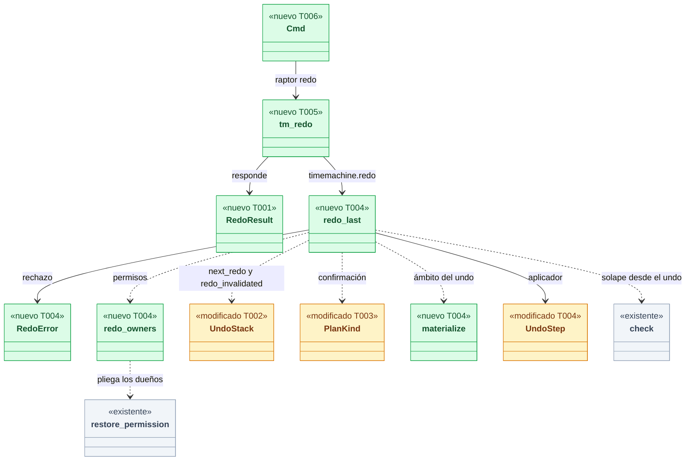
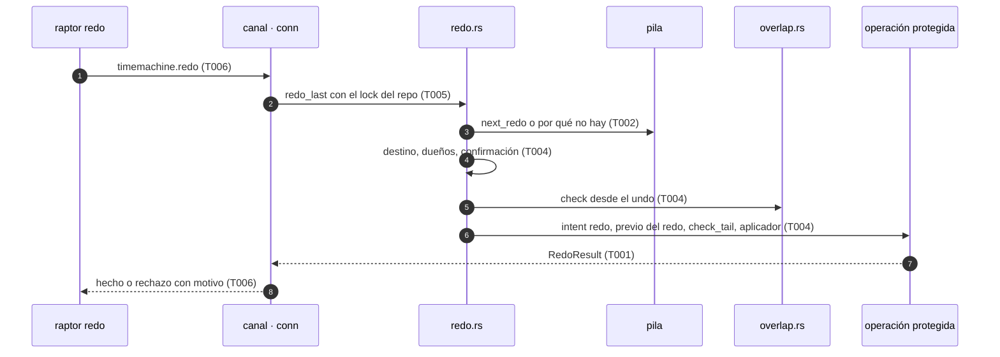
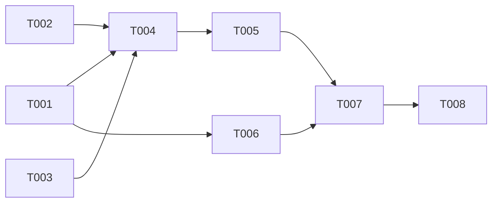

# DS-US-TMC-003 · Rehacer el último undo del worktree

## Contexto rápido

Al terminar, el desarrollador ejecuta `raptor redo` en su worktree y vuelve al estado justo anterior a su último undo, con un punto previo propio, con el solape de DS-US-TMC-012 y con la regla de permisos de ADR-TMC-005. Hoy no puede: `timemachine.redo` está en el catálogo (`mcp: false`, `implemented_by: US-TMC-003`) y responde "no implementado" desde `tm_command`; la pila (`oplog/stack.rs`) ya modela `Redo` y `next_redo`, y una operación nueva ya limpia el redo.

Para eso: dos motivos y el resultado en el contrato (api), saber **qué** invalidó el redo en la pila, el plan y la operación protegida del redo sobre las piezas del undo (core), la ruta del canal y el subcomando `raptor redo` (cli). Depende de que DS-US-TMC-012 esté en `main`: el redo usa su módulo de solape y el `keep` del aplicador.

| Término | Qué es aquí |
|---|---|
| Undo que se rehace | `UndoStack::next_redo()`: el último undo del ámbito que no se rehízo y que ninguna operación posterior invalidó |
| Destino | El snapshot previo de ese undo: el estado justo antes de deshacer (ADR-TMC-003 § 4) |
| Dueños | El solicitante congelado del undo y los dueños de lo que ese undo deshizo |
| Actor de referencia del solape | El solicitante del undo: produjo el estado que el redo sobrescribe (DS-US-TMC-012 D4) |

⚠️ **ASSUMPTION**: no existe `architecture-constitution.md` en la cascada (release-plan, Huecos, fila 11); rigen `AGENTS.md` y los ADR citados.

---

## ⚠️ Gaps y violaciones de la constitución

_No gaps. Ready to implement._ Las decisiones están en § Decisiones; la de negocio nueva (D-TMC-26) la ratificó el PO el 2026-10-27 y no cambia el código: la pila ya la implementa.

---

## 🔭 La forma

El redo es un undo con otro selector y otro destino. Reutiliza la pila, el materializado del ámbito, la puerta de confirmación, el solape y el paso del aplicador del undo; añade la selección y su registro.



🟩 nuevo · 🟨 modificado · ⬜ existente.

**Cómo fluye** (orden de ADR-TMC-005 § 4, igual que el undo):



---

## 🚀 Plan de implementación

> Orden topológico (`Depende:`). Rutas relativas a la raíz del repo. Rebanadas disjuntas; las ediciones en archivos compartidos son las que se nombran (ADR-GRP-016). Requisito externo: DS-US-TMC-012 mezclada.

### El trabajo de un vistazo

Contrato (T001), pila (T002) y confirmación (T003) en paralelo; el redo (T004) los junta; canal (T005) y CLI (T006) lo exponen; T007 lo prueba de punta a punta y T008 cierra la documentación.

| # | Tarea | Depende | Aterriza en |
|---|---|---|---|
| T001 | Añadir los motivos del redo, su confirmación y su resultado al contrato | — | `crates/api/src/` |
| T002 | Hacer que la pila diga qué invalidó el redo | — | `crates/core/src/timemachine/oplog/stack.rs` |
| T003 | Añadir el redo a la puerta de confirmación | — | `crates/core/src/timemachine/confirm/mod.rs` |
| T004 | Crear el redo sobre las piezas del undo | T001, T002, T003 | `crates/core/src/timemachine/` |
| T005 | Servir `timemachine.redo` en el canal | T004 | `crates/core/src/channel/conn.rs` |
| T006 | Crear el subcomando `raptor redo` | T001 | `apps/cli/` |
| T007 | Probar el redo de punta a punta | T005, T006 | `crates/core/tests/`, `apps/cli/tests/` |
| T008 | Actualizar la documentación y los pendientes multiplataforma | T007 | `docs/` |

### En qué orden



### T001 — Añadir los motivos del redo, su confirmación y su resultado al contrato

**Objetivo.** Dos variantes de `TmRejectReason`, `confirmation` en `RedoParams` y el tipo `RedoResult`; sin lógica.

**Ubicación.**
- `crates/api/src/timemachine.rs` (**MODIFY**)
- `crates/api/src/methods/timemachine.rs` (**MODIFY**, solo el comentario de `CAP_TM_CONFIRMATION`)

**Reglas**
- `TmRejectReason` gana `NothingToRedo` (`nothing-to-redo`) y `RedoInvalidated` (`redo-invalidated`), al final del enum.
- `RedoParams` gana `confirmation: Option<ConfirmationToken>` (`skip_serializing_if`), y `validate()` llama a `check_confirmation` como `UndoParams`.
- `RedoResult` lleva los mismos campos que `UndoResult` con `redone_undo_id` en lugar de `undone_operation_id` y `undone_subtype`, y con `kept` de DS-US-TMC-012 (solo con `CAP_TM_OVERLAP`).
- Un rechazo del redo se serializa como `TmConfirmData`, igual que el del undo (con `overlap` si hay solape y la capacidad).

> **Nota técnica.** El método nunca respondió algo distinto de `NOT_IMPLEMENTED`: no hay cliente anterior que dependa de su forma, así que el campo nuevo de `RedoParams` y el resultado no piden capacidad nueva (mismo criterio que DS-US-TMC-006 D5). `CAP_TM_CONFIRMATION` pasa a cubrir también el redo; solo cambia su comentario.

- **Depende:** —
- **Refs:** ADR-GRP-016 § 1, NFR-TMC-14
- **Aceptación:** `redo_wire_form` y `redo_params_reject_a_bad_confirmation` en `crates/api/src/timemachine.rs`

### T002 — Hacer que la pila diga qué invalidó el redo

**Objetivo.** `UndoStack::redo_invalidated()`: la operación que dejó sin redo un ámbito que lo tenía; `None` si nunca hubo redo o si un undo posterior lo volvió a abrir.

**Ubicación.** `crates/core/src/timemachine/oplog/stack.rs` (**MODIFY**, campo `invalidated_by` y su método; tests en su `mod tests`)

**Reglas**
- En `build`, un `Do` con la lista de redo **no vacía** guarda su `OpRef` en `invalidated_by` antes de vaciarla; un `Undo` lo pone a `None`. `Redo` no lo toca.
- `next_redo()` y `last_operation()` no cambian.

- **Depende:** —
- **Refs:** ADR-TMC-003 § 4, TQ-9
- **Aceptación:** `a_new_operation_says_it_invalidated_the_redo`, `an_undo_after_the_invalidation_reopens_the_redo`, `a_stack_that_never_had_a_redo_has_nothing_invalidated` en `stack.rs`

### T003 — Añadir el redo a la puerta de confirmación

**Objetivo.** `PlanKind::Redo` con su etiqueta en el hash del plan.

**Ubicación.**
- `crates/core/src/timemachine/confirm/mod.rs` (**MODIFY**, variante y `tag() = "redo"`)
- `crates/core/src/timemachine/confirm/tests.rs` (**MODIFY**)

**Reglas**
- El hash de un plan de redo nunca coincide con el de un undo con los mismos hechos: un token de un undo no confirma un redo.

- **Depende:** —
- **Refs:** ADR-TMC-005 § 3 (SEC-TMC-03)
- **Aceptación:** `a_redo_token_does_not_confirm_an_undo` en `confirm/tests.rs`

### T004 — Crear el redo sobre las piezas del undo

**Objetivo.** `redo::redo_last`: selecciona, comprueba y aplica el redo como operación protegida de tipo `redo`, con su previo, su ancla y su registro.

**Ubicación.**
- `crates/core/src/timemachine/redo.rs` (**CREATE**)
- `crates/core/src/timemachine/redo_tests.rs` (**CREATE**)
- `crates/core/src/timemachine/mod.rs` (**MODIFY**, una línea `mod`)
- `crates/core/src/timemachine/undo.rs` (**MODIFY**, extraer `materialize` y parametrizar `UndoStep`)

**Pasos**
1. Extraer de `undo::plan` a `undo::materialize(common_dir, meta, scope) -> Result<(Vec<PlanWorktree>, BTreeSet<String>), TmRejectReason>` el mapeo de raíces a claves del destino y las ramas de `HEAD` (sin la regla de worktrees recreados, que es del undo de una restauración). `UndoStep` gana `subtype: &'static str` (`"undo"` o `"redo"`). Los tests del undo siguen en verde.
2. Lock del repo, `settle` del motor y `RawSide` como `undo_last` (mismo orden, mismos `repo-busy`).
3. Pila: `undo_stack_in(StackScope::Worktree(..), &external, floor)`. `next_redo()` → el undo U. Sin él: `redo_invalidated()` presente → `redo-invalidated`; ausente → `nothing-to-redo`.
4. Destino: `prior_snapshot` de U, disponible, sin manipular y verificado en el almacén; si no, `target-unavailable`. El ámbito es el `Scope` que U registró (sus worktrees y sus ramas, DS-US-TMC-002 D2); `materialize` sobre él; una rama sacada fuera del ámbito: `ref-in-use`.
5. Dueños (`redo_owners`): el solicitante de U y el dueño de cada `OpRef` de su `Target::Undo` (solicitante congelado de la operación; actor del evento crudo en `RawSide`, o `Unattributed` si el evento ya no está). Regla con `restore_permission(who, channel, &owners)` y `confirm.gate_over` con `PlanKind::Redo`.
   5.1 ⛔4.1 Comparar solo con el solicitante de U deja que un "sin atribuir" rehaga el undo de un commit de claude-2 sin confirmación, o que claude-2 rehaga sobre el "sin atribuir" que lo deshizo.
6. Guardrails: hueco marcado, como en el undo. Solape: `overlap::check` con `reference = [solicitante de U]`, `undone = [OpRef::Oplog(U)]` y destino = previo de U; quitar las ramas conservadas antes de `ref-in-use`.
7. Precondiciones de Git antes del previo; operación protegida con `kind: Redo`, `target: Target::Redo(U)`, el `Scope` de U y el solicitante; `UndoStep` con `subtype: "redo"` corre `check_tail` y el aplicador; después `await_moved_branches` y `anchor`, como el undo.
   7.1 ⛔4.2 Sin el ancla, las escrituras del redo vuelven como Git crudo: entran en la pila como `Do`, limpian los redos siguientes y el siguiente undo desharía otra cosa.
8. Rechazos de los pasos 3 a 7: `redo` de `intent` a `rejected` con su motivo; `nothing-to-redo` con `Target::None`, el resto con `Target::Redo(U)`.

> **Nota técnica.** `Oplog::undo_stack_in` ya cuenta un `redo` terminado solo si su undo existe (`own.contains(undo)`), un `redo` interrumpido como `Do` y un rechazado no lo cuenta; `record_operation` no restringe la combinación de tipo y destino (escribe `target` como JSON), así que `Target::None` para un redo rechazado sin undo es válido.

- **Depende:** T001, T002, T003
- **Refs:** ADR-TMC-003 § 4, ADR-TMC-005 § 2 a § 5, DS-US-TMC-002 § 2, DS-US-TMC-012 D1 a D7
- **Aceptación:** los unitarios de `redo_tests.rs` y `crates/core/tests/us_tmc_003.rs` (T007)
- **Guard ⛔4.1:** `the_owners_of_a_redo_are_the_undo_and_what_it_undid`
- **Guard ⛔4.2:** `a_redo_right_after_an_undo_is_not_invalidated_by_its_echo`

### T005 — Servir `timemachine.redo` en el canal

**Objetivo.** `tm_redo` como `tm_undo`: validar, resolver el solicitante y el repo, llamar a `redo_last` y serializar.

**Ubicación.** `crates/core/src/channel/conn.rs` (**MODIFY**, el brazo `WriteRoute::TimeMachine(_) if spec.name == methods::TM_REDO`, la función `tm_redo` y `redo_error`/`redo_result`)

**Pasos**
1. Añadir el brazo junto a los de `TM_UNDO` y `TM_RESTORE`; quitar `TM_REDO` de la rama de `tm_command` para la petición sin `operation_id`.
2. Con `operation_id`: sigue `tm_command` con `"unassigned"` (`NOT_IMPLEMENTED`), como el undo por id.
3. `check_confirmation_param`, `request_channel`, `named_worktree`, `resolve`, `tm_scope_for` y `tm_confirmation` como `tm_undo`. El método no es MCP (`mcp: false`, Q-MCP-11): por MCP sigue `METHOD_NOT_FOUND`.
4. Errores con `rejection_data` (y `overlap` con `CAP_TM_OVERLAP`), `PRIOR_SNAPSHOT_FAILED`, `OPERATION_FAILED` e `INTERNAL`, como `undo_error`.

- **Depende:** T004
- **Refs:** DS-US-TMC-002 § 2.1 y § 2.3, ADR-GRP-016
- **Aceptación:** `crates/core/tests/us_tmc_003.rs`; los tests de `channel_protected.rs` que esperan `NOT_IMPLEMENTED` del redo se actualizan al nuevo comportamiento solo para la petición sin `operation_id`

### T006 — Crear el subcomando `raptor redo`

**Objetivo.** `raptor redo [--json]` con textos en/es, sobre las utilidades del undo.

**Ubicación.**
- `apps/cli/src/commands/redo.rs` (**CREATE**)
- `apps/cli/src/commands/mod.rs` (**MODIFY**, una línea `Redo(redo)` tras `Undo(undo)` en `commands!`)
- `apps/cli/src/undo/redo.rs` (**CREATE**, la lógica)
- `apps/cli/src/undo/mod.rs` (**MODIFY**, una línea `mod redo` y `pub(crate)` en las utilidades que comparte)
- `apps/cli/i18n/en/timemachine.txt` (**MODIFY**, grupo `redo.`)
- `apps/cli/i18n/es/timemachine.txt` (**MODIFY**, grupo `redo.`)

**Reglas**
- Raíz del worktree del cwd con `worktree_root`; avisos pendientes con `notices::show_pending`; `confirm::call` con `methods::TM_REDO` y `confirm::required_key("redo", ..)`.
- Hecho: "rehecho el undo {id} en {worktree}" y "el estado justo antes de este redo se guardó como {snapshot}; no se perdió nada"; rutas no restauradas y conservadas como el undo.
- Un texto `redo.reason.<código>` por **cada** valor de `TmRejectReason` (test `every_redo_rejection_has_a_message`). `nothing-to-redo`: "no hay ningún undo que rehacer en este worktree; nada cambió". `redo-invalidated`: "una operación posterior al undo invalidó el redo; nada cambió".
- El solape se muestra con el formato de `apps/cli/src/undo/overlap.rs` (DS-US-TMC-012).
- Códigos de salida: 0 hecho; 1 rechazado o fallo. Todo texto del repo, saneado.

- **Depende:** T001
- **Refs:** NFR-TMC-14, extender-sin-archivos-compartidos ("Añadir un subcomando")
- **Aceptación:** `every_redo_rejection_has_a_message`, `catalogs_match` y `apps/cli/tests/redo_process.rs` (T007)

### T007 — Probar el redo de punta a punta

**Objetivo.** Los escenarios de la historia, con daemon real, Git real y repos temporales.

**Ubicación.**
- `crates/core/tests/us_tmc_003.rs` (**CREATE**)
- `apps/cli/tests/redo_process.rs` (**CREATE**)

**Reglas**
- Daemon real en proceso con el catálogo de test (`us_tmc_002.rs`); huella del testkit para "no cambia"; sin esperas fijas.
- El e2e reutiliza el agente simulado de `raw_git_undo.rs` (`raptor-fake-agent`) y el desarrollador bajo `script`.

- **Depende:** T005, T006
- **Refs:** NFR-01, § Estrategia de pruebas
- **Aceptación:** los tests de § 9.4

### T008 — Actualizar la documentación y los pendientes multiplataforma

**Objetivo.** Contrato, pendientes y estado de la historia al día; no toca código.

**Ubicación.**
- `docs/architecture/design/api-contract-ipc.md` (**MODIFY**, `timemachine.redo`, sus motivos y `RedoResult`)
- `docs/architecture/xplat-pendientes.md` (**MODIFY**, una fila nueva con el número siguiente)
- `docs/requirements/features/time-machine/dev-specs/US-TMC-003-redo.md` (**MODIFY**, "Estado de la implementación")
- `docs/requirements/features/time-machine/user-stories/US-TMC-003-redo.md` (**MODIFY**, `status` y vínculos)

**Reglas**
- No se edita `docs/ARTIFACTS.md`.

- **Depende:** T007
- **Refs:** `AGENTS.md`
- **Aceptación:** revisión; `/aadd-analyze` sin BLOCKER

---

## Estructura de ficheros

```text
crates/api/src/timemachine.rs                      ← MODIFY  (T001)
crates/api/src/methods/timemachine.rs              ← MODIFY  (T001, comentario)
crates/core/src/timemachine/oplog/stack.rs         ← MODIFY  (T002)
crates/core/src/timemachine/confirm/{mod,tests}.rs ← MODIFY  (T003)
crates/core/src/timemachine/redo.rs                ← CREATE  (T004)
crates/core/src/timemachine/redo_tests.rs          ← CREATE  (T004)
crates/core/src/timemachine/{mod,undo}.rs          ← MODIFY  (T004, 1 línea y la extracción)
crates/core/src/channel/conn.rs                    ← MODIFY  (T005)
apps/cli/src/commands/{redo,mod}.rs                ← CREATE / MODIFY (T006)
apps/cli/src/undo/{redo,mod}.rs                    ← CREATE / MODIFY (T006)
apps/cli/i18n/{en,es}/timemachine.txt              ← MODIFY  (T006)
crates/core/tests/us_tmc_003.rs                    ← CREATE  (T007)
apps/cli/tests/redo_process.rs                     ← CREATE  (T007)
docs/…                                             ← MODIFY  (T008)
```

## Contratos compartidos

### Tipos y datos compartidos

```rust
// crates/api/src/timemachine.rs (T001) — Serialize + Deserialize + JsonSchema, deny_unknown_fields
pub enum TmRejectReason { /* … existentes y los de DS-US-TMC-012 … */ NothingToRedo, RedoInvalidated }

pub struct RedoParams {                                  // existente
    pub worktree: Option<String>,
    pub operation_id: Option<String>,                    // con valor: NOT_IMPLEMENTED ("unassigned")
    pub surface: Option<Surface>,
    #[serde(default, skip_serializing_if = "Option::is_none")]
    pub confirmation: Option<ConfirmationToken>,         // nuevo
}

pub struct RedoResult {                                  // nuevo
    pub operation_id: String,                            // el redo, tal como se registró
    pub prior_snapshot_id: String,                       // el punto justo antes del redo
    pub redone_undo_id: String,
    pub target_snapshot_id: String,                      // el previo del undo
    pub requester: RequesterView,
    pub written: u64,
    pub removed: u64,
    pub not_restored: Vec<NotRestored>,
    #[serde(default, skip_serializing_if = "Vec::is_empty")]
    pub kept: Vec<KeptPath>,                             // DS-US-TMC-012; solo con CAP_TM_OVERLAP
    pub warnings: Vec<String>,
}
```

```rust
// crates/core/src/timemachine/oplog/stack.rs (T002)
pub struct UndoStack { done: Vec<OpRef>, redo: Vec<(String, Vec<OpRef>)>,
                       invalidated_by: Option<OpRef> }   // campo nuevo
impl UndoStack {
    pub fn next_redo(&self) -> Option<&str>;             // existente
    pub fn redo_invalidated(&self) -> Option<&OpRef>;    // nuevo
}
// crates/core/src/timemachine/confirm/mod.rs (T003)
pub enum PlanKind { Undo, Restore, Redo }                // variante nueva
```

### Ciclos de vida (DI)

| Servicio / componente | Ámbito / ciclo de vida | Razón |
|---|---|---|
| Lock del repo (`RepoGuard`) | De la lectura de la pila al cierre, como el undo (DS-US-TMC-002 D9) | El undo que se rehace no cambia debajo; un repo ocupado no gasta un previo |
| Oplog del repo (`Mutex`) | Cogido para leer la pila, el destino y los puntos; suelto antes de la confirmación | La confirmación recorre el árbol de procesos del llamante |
| `TimeMachineWiring` | El del undo, sin cambios | El redo usa el mismo backend, Git, invocador y plazo del previo |

### Firmas del stack

```rust
// crates/core/src/timemachine/redo.rs (T004) — nuevo
pub struct RedoDone { pub operation_id: String, pub prior_snapshot_id: String,
                      pub redone_undo_id: String, pub target_snapshot_id: String,
                      pub report: ApplyReport, pub warnings: Vec<String> }
pub enum RedoError {
    Rejected { reason: TmRejectReason, operation_id: Option<String> },
    Overlap { operation_id: Option<String>, report: OverlapReport },
    Prior { reason: PriorFailure, operation_id: Option<String> },
    Interrupted { operation_id: String, message: String },
    Internal(String),
}
pub fn redo_last(repo: &TmRepoHandle, who: &Who, channel: Channel,
                 confirm: &Confirmation<'_>, env: &UndoEnv<'_>) -> Result<RedoDone, RedoError>;
pub(crate) fn redo_owners(undo: &OperationView, raw: &RawSide,
                          oplog: &Oplog) -> Vec<Requester>;
// crates/core/src/timemachine/undo.rs (T004) — extraído de `plan`
pub(super) fn materialize(common_dir: &Path, meta: &Meta, scope: &Scope)
    -> Result<(Vec<PlanWorktree>, BTreeSet<String>), TmRejectReason>;
pub(super) struct UndoStep<'a> { /* … */ pub(super) subtype: &'static str }   // campo nuevo
// crates/core/src/timemachine/restore.rs — existente, se reutiliza tal cual
pub fn restore_permission(who: &Requester, channel: Channel,
                          owners: &[Requester]) -> Result<(), TmRejectReason>;
// crates/core/src/timemachine/overlap.rs — existente tras DS-US-TMC-012
pub fn check(store: &SnapshotStore, input: &OverlapInput<'_>) -> OverlapReport;
// crates/core/src/channel/conn.rs (T005)
fn tm_redo(&self, spec: &MethodSpec, request: &Request) -> Result<serde_json::Value, ErrorObject>;
// apps/cli/src/commands/redo.rs (T006) — `Cmd` de clap con `json`
impl Cmd { pub(crate) fn run(self, _: &Global) -> ExitCode; }
```

## Contrato de API

| Método | Canal | Parámetros | Resultado |
|---|---|---|---|
| `timemachine.redo` | CLI/TUI; no MCP | `worktree` (raíz, requerido por la CLI), `surface`, `confirmation`; `operation_id` responde `NOT_IMPLEMENTED` | `RedoResult` |

### Forma del error y del cuerpo de respuesta

| Respuesta | Cuándo |
|---|---|
| `RedoResult` | Redo terminado |
| `OPERATION_REJECTED` + `TmConfirmData { reason, operation_id, challenge?, owners?, overlap? }` | `nothing-to-redo`, `redo-invalidated`, `target-unavailable`, `other-actor`, `confirmation-required`, `challenge-invalid`, `confirmation-unavailable`, `overlap`, `overlap-unverified`, `ref-in-use` y los del aplicador; repo sin cambios |
| `PRIOR_SNAPSHOT_FAILED` + `PriorFailedData` | El previo del redo falló; el redo no corre |
| `OPERATION_FAILED` + `operation_id` | Interrumpido a mitad; `raptor undo` vuelve a su previo |
| `SCOPE_REFUSED`, `INVALID_PARAMS`, `NOT_IMPLEMENTED`, `METHOD_NOT_FOUND` (MCP) | Como hasta ahora |

Sin códigos de error nuevos: los motivos son valores de `TmRejectReason`.

### Forma de la configuración

_No aplica — la entrega no añade configuración._

### Valores numéricos

| Concepto | Valor | Fuente |
|---|---|---|
| Plazo de `settle` antes de leer la pila | `ANCHOR_SETTLE_LIMIT` (2 s) | El del undo (ADR-TMC-003, Enmienda US-TMC-004) |
| Plazo del previo del redo | `prior_deadline` del cableado | El del undo (SEC-TMC-12) |
| Plazo del solape | 1,5 s | DS-US-TMC-012 |

---

## Modelo de datos

_No aplica — sin tablas ni migraciones._ El redo usa lo que el oplog ya tiene: `OperationKind::Redo`, `Target::Redo(undo_id)` y los estados de ADR-TMC-003 § 3.

---

## Estrategia de pruebas y cobertura

### 9.1 Pirámide de pruebas

Repos, perfiles y worktrees temporales (`Fixture`, `TempProfile`); nunca este repo (NFR-01).

| Tipo | Cantidad | Tareas dueñas | Herramientas | Cuándo |
|---|---:|---|---|---|
| Unit | 12 | T001, T002, T003, T004, T006 | `cargo test` | PR gate |
| Integration | 10 | T007 | `cargo test -p gitraptor-core --test us_tmc_003` | PR gate |
| E2E | 3 | T007 | `cargo test -p gitraptor-cli --test redo_process` | PR gate (macOS) |
| Security | 1 | T005 | la misma | PR gate |

### 9.2 Umbrales de cobertura

| Capa | Línea | Rama | Mutación | Camino crítico 100% |
|---|---:|---:|---:|:---:|
| `redo.rs` | ≥ 90 % | ≥ 85 % | — | sin redo nunca cambia el repo; dueños completos; ancla tomada |

### 9.3 Datos de prueba

- Fixture del testkit con `feat-login` y `feat-pagos`; el catálogo de test registra operaciones reales (`git rm b.rs` + commit, `git reset --hard`).
- El cliente en proceso es "sin atribuir"; un agente solo existe en el e2e (`raptor-fake-agent`) o en los unitarios puros.
- Confirmación: `TestConfirmation::Eligible` de `us_tmc_013_common`, solo en debug.

### 9.4 Comportamientos críticos verificados

Aceptación de la historia (con § Enmienda a la historia) → test:

| Escenario | Test |
|---|---|
| 1. Rehacer el último undo | core `redo_returns_to_the_state_before_the_undo`: una operación sin atribuir borra `b.rs`, un undo lo recupera, el redo lo vuelve a borrar; huella = la de después de la operación; el contenido de `b.rs` está en el previo del redo |
| 2. El redo queda protegido por su propio punto previo | core `the_redo_has_its_own_prior_point`: el previo del redo está disponible, verificado y con el estado de `feat-login` justo antes del redo |
| 3. No hay undo que rehacer | core `nothing_to_redo_changes_nothing`: sin undo, `nothing-to-redo`; huella igual; el rechazo está en el oplog |
| 4. Una operación nueva invalida el redo | core `a_new_commit_invalidates_the_redo`: undo, commit nuevo en `feat-login`, redo → `redo-invalidated`; huella igual |
| 5. Otro actor cambió los mismos archivos después del undo (enmendado) | e2e `redo_process.rs::a_later_unattributed_change_stops_the_agents_redo`: el agente hace `reset --hard`, lo deshace él mismo, el desarrollador edita `b.rs`, el agente pide `raptor redo` → `overlap` con `b.rs` y "sin agente"; repo intacto |
| 6. Un agente no rehace trabajo de otro actor | unitario `the_owners_of_a_redo_are_the_undo_and_what_it_undid` (dueños `{sin atribuir, claude-2}`, solicitante claude-1 → `other-actor`); e2e `an_agent_cannot_redo_another_actors_undo` (el agente B pide rehacer el undo que hizo el agente A de su trabajo → `other-actor`, repo intacto) |

Además: `consecutive_redos_walk_forward` (dos undos y dos redos vuelven al estado del final, D-TMC-26), `an_undo_after_a_redo_takes_back_the_operation_again`, `a_redo_right_after_an_undo_is_not_invalidated_by_its_echo` (con captura continua activa), `an_unattributed_redo_of_an_agents_work_needs_confirmation` (`confirmation-required`, y con `TestConfirmation::Eligible` el redo se hace), `a_redo_token_is_not_an_undo_token`, `an_interrupted_redo_is_undone_back_to_its_prior` (US-TMC-019), `a_redo_by_id_is_not_implemented`, `redo_is_not_offered_over_mcp` (Security: `METHOD_NOT_FOUND`). E2E: `raptor redo` en inglés y en español, y `--json`.

### 9.5 Plataformas

| Plataforma | Cómo se verifica | Pendiente |
|---|---|---|
| macOS | `cargo clippy --workspace --all-targets -- -D warnings` y `cargo test --workspace` en Apple Silicon | — |
| Linux | `us_tmc_003.rs` con `cfg(any(macos, linux))`; el e2e es solo macOS | **Pendiente: etapa de validación multiplataforma** |
| Windows | Unitarios de la pila y de los dueños; el aplicador devuelve `Unsupported`; la confirmación de trabajo ajeno no existe (`confirmation-unavailable`, TQ-14) | **Pendiente: etapa de validación multiplataforma** |

---

## Gate de seguridad

- Toda escritura pasa por la operación protegida con su previo (NFR-01); sin shell ni argv nuevos (NFR-02).
- Permisos sobre todos los dueños (ADR-TMC-005 § 2); la confirmación usa el mismo reto de un solo uso, ligado al plan del redo (SEC-TMC-03).
- No MCP (Q-MCP-11). El oplog es entrada no confiable al releerse: el undo que se rehace se valida como cualquier otra fila (SEC-TMC-09) y sus raíces contra los worktrees registrados.

Corre `/security-review --scope devspec docs/requirements/features/time-machine/dev-specs/US-TMC-003-redo.md` antes de mezclar.

---

## Fuera de alcance

| Ítem / no-objetivo | Historia que lo cubre | Gate (cómo se verifica) |
|---|---|---|
| Rehacer un undo concreto por id | sin historia asignada | `operation_id` responde `NOT_IMPLEMENTED` con `unassigned` |
| Redo por MCP | Q-MCP-11 | `mcp: false` en el catálogo sin cambios |
| Redo desde la TUI | Cockpit (US-CKP-014) | `git diff --stat` sin cambios bajo `apps/cli/src/tui/` |
| Continuar a pesar del solape | D-TMC-27 | el contrato no tiene parámetro para continuar |
| Guardrails en el redo | US-TMC-021 | hueco marcado en `redo.rs` |

---

## Decisiones

Todas son **Decisión del orquestador (2026-10-27), validada por Arquitecto**, salvo que se diga otra cosa. D1, D2, D3 y D4 tienen efecto visible para el usuario: son **Decisión del orquestador (2026-10-27), validada por Arquitecto y PO**.

| # | Decisión | Por qué |
|---|---|---|
| D1 | El redo rehace `UndoStack::next_redo()`. "El último evento del ámbito es un undo" se lee como "desde el último undo no hubo ninguna operación nueva": un redo no es una operación nueva, así que redos seguidos rehacen undos seguidos (D-TMC-26) | Es lo que ya hace la pila (`undo_undo_redo_walks_back_and_forth`) y la simetría de TQ-9 |
| D2 | Sin redo, la pila dice por qué: `redo-invalidated` si una operación nueva vació un redo pendiente, `nothing-to-redo` si nunca lo hubo. Un undo interrumpido cuenta como operación nueva (US-TMC-019) | Escenario 4 pide el motivo; la pila ya borraba el redo sin dejar rastro |
| D3 | Destino: el previo de ese undo, disponible y verificado. Ámbito: el `Scope` que registró el undo, con la misma regla de `ref-in-use` | DS-US-TMC-002 D2 ya guardó el ámbito para esto; el undo de una restauración que recreó worktrees no se rehace con la excepción de sus ramas: falla cerrado con `ref-in-use` |
| D4 | Dueños para los permisos: el solicitante del undo y los dueños de lo que deshizo, plegados con `restore_permission` | ADR-TMC-005 § 2: "un agente no rehace un undo de trabajo de otro actor". Rehacer pisa el resultado del undo y devuelve el trabajo deshecho; los dos tienen dueño |
| D5 | Solape con DS-US-TMC-012: actor de referencia = solicitante del undo; base = el ancla del undo; destino = su previo | El redo sobrescribe el estado que dejó el undo (S5) |
| D6 | El redo toma su ancla al terminar, como el undo | Sin ella, su efecto entraría en la pila como Git crudo (Guard ⛔4.2) |
| D7 | `RedoParams.confirmation` y `PlanKind::Redo`; sin capacidad nueva | El método nunca respondió; `CAP_TM_CONFIRMATION` pasa a cubrirlo |
| D8 | `operation_id` sigue en `NOT_IMPLEMENTED` (`unassigned`) | Igual que el undo por id (DS-US-TMC-002 D7) |
| D9 | `raptor redo` reutiliza las utilidades del undo de la CLI y tiene su grupo de textos `redo.`, completo para cada motivo | Los textos del undo nombran `raptor undo`; un grupo vive en un solo archivo |
| D10 | Rechazos registrados como `redo` de `intent` a `rejected`; `nothing-to-redo` con `Target::None` | Auditoría de ADR-TMC-005 § 4; sin undo no hay id que poner en `Target::Redo` |

**Decisión de negocio nueva** (la anota el PO en `context.md` y en BR-TMC-WF-001):

| ID | Decisión |
|---|---|
| D-TMC-26 | (TQ-9) Redos seguidos rehacen, en orden inverso, los undos seguidos del worktree; una operación nueva en el worktree invalida todos los redos pendientes. **Decisión del orquestador (2026-10-27), validada por Arquitecto y PO**; registrada en [business-rules.md](../business-rules.md#decisiones-de-negocio) y en BR-TMC-WF-001 |

**Validación de producto**:

- **Decisión del orquestador (2026-10-27), validada por PO**: D-TMC-26 se ratifica: el redo está disponible si desde el último undo no hubo una operación nueva; redos seguidos rehacen undos seguidos; la invalidación tiene su propio motivo, distinto de "nada que rehacer".
- **Decisión del orquestador (2026-10-27), validada por PO**: el escenario 5 de US-TMC-003 se reescribe con la redacción propuesta: "claude-1" deshizo una operación suya que tocó "b.rs", después un cambio sin atribuir modificó "b.rs", y el redo que pide "claude-1" se detiene por solape. El caso original (un cambio de "claude-1" con Git) ya lo cubre el escenario 4.
- **Decisión del orquestador (2026-10-27), validada por PO**: el escenario 3 de US-TMC-003 pasa de "el último evento no es un undo" a "no hay ningún undo pendiente de rehacer": con D-TMC-26, tras un redo puede quedar otro undo pendiente.
- **Decisión del orquestador (2026-10-27), validada por PO**: D-TMC-27 aplica al redo: detenido por solape, no se continúa.
- **Decisión del orquestador (2026-10-27), validada por PO**: la viñeta de Requisitos Técnicos propuesta en § Enmienda a la historia se aprueba; la aplica el Arquitecto, porque el PO no edita esa sección.

**Interacción con el eco tardío de un restore (#256)**: ADR-TMC-003 lo da por **cerrado** (Enmienda 2026-10-21, `fix/tm-restore-calm-mark`: la marca en calma espera a las ramas y a todo `git` vivo). Queda el límite "enlace por ventana, no por proceso": un `git` ajeno en el mismo worktree puede cerrar antes la ventana de eco. Para el redo el efecto es un `redo-invalidated` o un `nothing-to-undo` de más, nunca una escritura indebida: el repo no cambia y el previo del undo sigue en el timeline para restaurarlo. Lo vigila `a_redo_right_after_an_undo_is_not_invalidated_by_its_echo`.

**Enmienda propuesta a ADR** (no aplicada):

| # | ADR | Cambio |
|---|---|---|
| E1 | ADR-TMC-003 § 4 | "`redo` rehace el último undo si es lo último del ámbito" pasa a "si no hubo una operación nueva en el ámbito desde ese undo; redos seguidos rehacen undos seguidos (D-TMC-26)". Y: "sin redo, se informa si una operación nueva lo invalidó" |

## Enmienda a la historia (aplicada)

Aplicada el 2026-10-27 en [US-TMC-003](../user-stories/US-TMC-003-redo.md): el PO reescribió el escenario 5. Con Git, un cambio de `claude-1` en `feat-login` es una operación nueva e invalida el redo; una edición de archivo queda "sin atribuir" (DS-US-TMC-012 D3). Por eso el escenario pasa a un undo de `claude-1` seguido de un cambio sin atribuir de `b.rs`. El Arquitecto cambió la primera viñeta de Requisitos Técnicos por "Redo disponible si desde el último undo del ámbito no hubo una operación nueva" (D1, D-TMC-26). Esta ficha cita los escenarios tal como están ahora.

## Notas del autor

| ID | Nota | Acción | Owner |
|---|---|---|---|
| G1 | El escenario 6 con un "sin atribuir" que deshizo el commit de claude-2 exige una confirmación interactiva en el e2e; por eso se cubre con el unitario de los dueños y el e2e usa dos agentes | Ninguna | — |
| G2 | `TmRejectReason`, `every_rejection_has_a_message` y `i18n/*/timemachine.txt` son puntos calientes compartidos con DS-US-TMC-012 y US-TMC-010/011: variantes y claves al final | Ninguna | — |
| G3 | Un redo tras el undo de una restauración que recreó un worktree responde `ref-in-use` si la rama solo la tiene ese worktree (D3). Se recupera con `raptor restore` al previo del undo | Medir en uso | Arquitecto |
