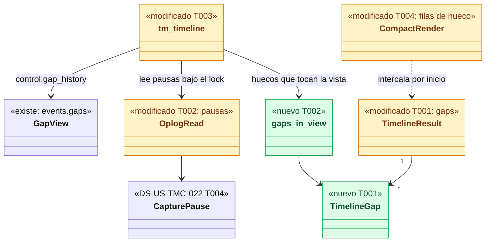
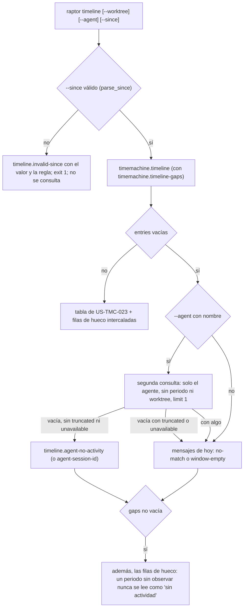
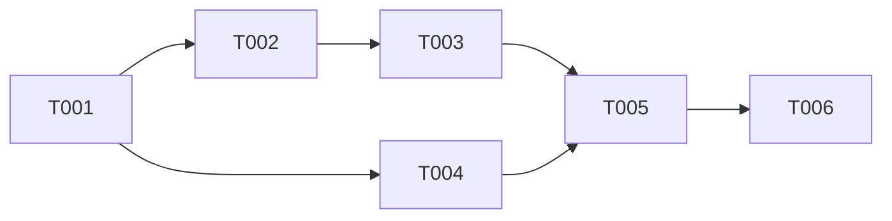

# DS-US-TMC-007 · Timeline filtrado y huecos de observación

## Contexto rápido

Al terminar, `raptor timeline` muestra, entre sus entradas y en orden, cada periodo que la Time Machine no vio: los huecos del motor (máquina apagada, motor parado, desbordamiento del vigilante…) y los huecos "sin espacio" de la captura (tope, cuota o espacio libre). Cada hueco dice su causa y su intervalo, y no ofrece ningún punto para restaurar. Un filtro que no encuentra nada lo explica: un agente sin actividad en el repo lo dice con su nombre, y un periodo mal escrito se rechaza con el motivo antes de consultar.

**Los filtros ya existen.** DS-US-TMC-006 D6 entregó `--worktree`, `--agent` y `--since` en el mismo ensamblado (`AgentFilter`, `TimelineQuery` en `crates/core/src/timemachine/timeline.rs:67` y `:108`; `TimelineParams.only_worktree`, `since` y `agent` en `crates/api/src/timemachine.rs:556`), y US-TMC-023 (commits `8e21a741` y `5706bf42`) fijó el formato legible: ventana de 24 h por defecto, días, columnas, plegado, id corto. Esta ficha no cambia ni la regla de los filtros ni ese formato. Añade:

| Añade | Dónde |
|---|---|
| Lista `gaps` en el resultado, tras la capacidad `timemachine.timeline-gaps` | `crates/api/src/timemachine.rs`, `crates/api/src/methods/timemachine.rs` |
| Selección de los huecos que tocan la vista (motor y "sin espacio") | `crates/core/src/timemachine/timeline_gaps.rs` (a crear), `timeline.rs` (`OplogRead`) |
| Lectura de `events.gaps` en la ruta del canal | `crates/core/src/channel/conn.rs` (`tm_timeline`) |
| Filas de hueco intercaladas, aviso de agente sin actividad, periodo rechazado con motivo | `apps/cli/src/commands/timeline.rs`, `timeline_compact.rs`, `apps/cli/i18n/{en,es}/timemachine.txt` |
| Certificación de los escenarios de filtro (DS-US-TMC-006 D6) | `crates/core/tests/us_tmc_007.rs`, `apps/cli/tests/us_tmc_007_process.rs` (a crear) |

Lo que ya existe y se reutiliza:
- `events.gaps` y `GapView { gap_id, started_utc_ms, ended_utc_ms, cause, during_session }` (`crates/api/src/methods/events.rs:15`, `:72`), servido por `Conn::events_gaps` (`conn.rs:2534`) sobre `control.gap_history` (`daemon/shutdown.rs:683`).
- Los eventos que la reconciliación encuentra en un hueco del motor llevan `gap_id`, sin sesión y con la hora del fin del hueco (`daemon/gaps.rs:182`-`219`, DS-US-GRP-005 D4 y D6). Ya son entradas del timeline como "tú u otro"; el `reconciled` no lo es (DS-US-TMC-006 D7).
- Del hueco "sin espacio": `Oplog::capture_pauses(since_ms) -> Vec<CapturePause { cause, from_ms, to_ms }>` y `NoSpaceCause { FreeSpace, Limit, Quota }` (a crear por DS-US-TMC-022 T002 y T004).
- `parse_since` (`crates/api/src/timemachine.rs:788`), la misma validación de periodo que `raptor undo --since` (DS-US-TMC-010 § Diseño, paso 1).
- Las causas traducidas `gap.cause.*` de `apps/cli/i18n/{en,es}/events.txt:45`-`56`.

| Término | Qué es aquí |
|---|---|
| Hueco del motor | Intervalo que el motor no observó (`GapView`, ADR-GRP-013 § 5). Lo que se encontró en él es "sin atribuir" |
| Hueco "sin espacio" | Intervalo en el que la captura por observación de un repo se omitió por el tope, la cuota o el espacio libre (DS-US-TMC-022 D4). El motor sí observó; los snapshots previos se siguieron tomando |
| Fila de hueco | Una línea del timeline que dice tipo, causa e intervalo de un hueco. No es una entrada: no cuenta en `--limit` ni en la cabecera |
| Vista | El periodo que el timeline muestra: desde `--since` (o la ventana de 24 h) o, si la lista se cortó por `--limit`, desde la entrada más antigua mostrada, hasta ahora |

⚠️ **ASSUMPTION**: no existe `architecture-constitution.md` en la cascada; rigen `AGENTS.md` y los ADR listados.

---

## ⚠️ Gaps y violaciones de la constitución

_No gaps. Ready to implement_ cuando DS-US-TMC-022 T002 y T004 estén mezcladas (el tipo `NoSpaceCause` y `Oplog::capture_pauses`). T001, T004 y la parte del motor de T002 no dependen de ellas; ver D12 si se quiere entregar antes.

TQ-28 y TQ-29 quedan cerradas como decisiones en la revisión de Arquitecto y PO (D5, D13).

---

## 🔭 La forma



🟩 nuevo · 🟨 modificado.

### Qué hace `raptor timeline` con los filtros



### Diseño

**1. Contrato** (T001). `TimelineResult` gana `gaps: Vec<TimelineGap>` (`serde(default, skip_serializing_if = "Vec::is_empty")`), y `TimelineSource` la variante `Gaps`. Las dos solo llegan a una conexión con `CAP_TM_TIMELINE_GAPS` (`"timemachine.timeline-gaps"`): `TimelineResult` y `TimelineSource` son `deny_unknown_fields` / enum cerrado en el cliente, y una CLI anterior que recibiera un campo o una variante nuevos fallaría al leer. La CLI declara todas las capacidades que conoce (`crates/core/src/client.rs:77`), así que no hay que tocar el cliente para pedirla. `TimelineEntry` no cambia.

**2. Fuentes** (T002, T003). Dos, sin mezclarlas (D2):
- **Motor**: `control.gap_history(EventsGapsParams { repo_id, since_utc_ms: since_ms, limit: Some(MAX_GAPS_PAGE) })`, la misma consulta que `events.gaps`: devuelve los huecos abiertos o terminados en `since_ms` o después. Sin `since` (solo `--json` sin `--since`), los `MAX_GAPS_PAGE` más recientes.
- **"Sin espacio"**: `oplog.capture_pauses(since_ms.unwrap_or(i64::MIN))`, leída en `OplogRead::read` bajo el mismo lock que las operaciones (`timeline.rs:150`), con la misma regla de solape. Se quedan las `MAX_GAPS_PAGE` más recientes.

Si una fuente falla, el resultado lleva `unavailable: [gaps]` y la CLI dice "timeline incompleto: no se pudo leer los huecos de observación". Nunca se lee como "no hubo huecos" (D11).

**3. Qué huecos entran** (T002, `gaps_in_view`). Los que tocan la vista:
- Su fin (o "abierto") es posterior al inicio de la vista. El inicio es `since_ms` y, si la lista de entradas se cortó por `limit` o por una página llena del motor (`truncated`), la hora de la entrada más antigua que se muestra: un hueco anterior a todo lo mostrado no se pinta suelto.
- Con **cualquier** `--worktree` y **cualquier** `--agent` (D3). Un hueco es del repo entero: ni `GapView` ni `CapturePause` tienen worktree, y lo que pasó en un hueco del motor no tiene agente. Esconderlo al filtrar por `claude-1` daría la falsa certeza que la historia quiere evitar: `claude-1` pudo trabajar durante el hueco y figurar como "tú u otro".
- Si alguna fuente llenó su página, `truncated = true` (el pie `timeline.truncated` ya existe).

**4. Forma del hueco**. Una `TimelineGap` por hueco, enum con etiqueta `kind` y forma plana en el cable. Las dos variantes llevan `started_utc_ms`, `ended_utc_ms` (ausente si sigue abierto) y `utc_offset_s` (el del reloj del daemon al responder, como las operaciones, `timeline.rs:457`):
- `unobserved { cause: GapCauseView, during_session }`: del motor, con su causa tal cual (`methods/events.rs:85`) y la marca de SEC-13.
- `no-space { cause: NoSpaceCause }`: de la captura.

Sin `gap_id`, sin rutas, sin texto del repo: nada no confiable viaja en un hueco.

**5. Lo que pasó dentro de un hueco** (D5). No cambia nada del ensamblado de las entradas:
- Los commits que la reconciliación encontró en un hueco del motor son eventos sin sesión (DS-US-GRP-005 D6): su actor es `unattributed` y la CLI los escribe "tú u otro" con la leyenda de US-TMC-023 (`timeline_compact.rs:541`). No entran en ningún filtro por **nombre** de agente (`AgentFilter::Named`, `timeline.rs:85`); sí en `--agent unattributed` (`AgentFilter::Unattributed`).
- Su punto "antes de" lo sigue eligiendo la regla única de `prior_point::before_event` (`prior_point.rs:65`): el último punto que existe antes del hueco, un snapshot real y más antiguo, que es recuperable (la restauración toma su propio previo). Ningún punto se inventa: `protection` sale siempre de un snapshot del almacén (`timeline.rs:259`).
- **Ese punto lo dice** (D5, cierra TQ-28). La CLI marca la columna de protección de una entrada de evento de Git con `snapshot_id` cuya hora cae dentro de un hueco `unobserved` (`started ≤ occurred ≤ ended`, o abierto): `timeline.level.before-gap`, "(antes del hueco: deshace todo lo del hueco)". Los eventos de un hueco llevan la hora de su fin (DS-US-GRP-005 D4) y dentro no hay capturas, así que su punto es anterior al hueco. Se decide en el cliente, sin campo nuevo.
- La **fila de hueco** nunca lleva id ni acción de restaurar: el tipo no tiene `snapshot_id`, y su texto dice "sin punto para restaurar dentro del hueco".
- En un hueco "sin espacio" no hay puntos de observación nuevos (DS-US-TMC-022 T005). Un cambio de archivo sin commit no es una entrada; la fila de hueco dice que lo de ese periodo no se capturó.

**6. Orden y presentación** (T004). La CLI intercala las filas de hueco con las filas de entrada por su **inicio**; con la misma hora, el hueco va antes. Así los commits que la reconciliación fecha al final del hueco quedan debajo de él. `raptor events` las ordena por el fin (`apps/cli/src/events.rs:52`), porque allí la fila anuncia lo encontrado; en el timeline la fila abre el periodo y su texto lleva el intervalo completo, así que las dos vistas dicen lo mismo (D4). Las filas de hueco:
- Usan el agrupado por día de US-TMC-023 (un hueco abre el día de su inicio).
- No se pliegan nunca, no cuentan en la cabecera ("N entradas, M resumidas") ni en `--limit`.
- Ocupan la línea entera tras la hora (no siguen las columnas): `  12:00  -- hueco de observación (motor detenido), 12:00 → 13:00 · lo encontrado figura sin atribuir · sin punto para restaurar dentro del hueco`.
- En `--verbose`, igual, más `· había una sesión de agente activa` si `during_session`.
- `--json` imprime `gaps` tal cual (aditivo; la forma de las entradas no cambia).

**7. Resultado vacío** (T004, D6). Hoy la CLI responde "sin actividad" si `entries` y `unavailable` están vacíos (`timeline.rs:94`), y `render_compact` también (`timeline_compact.rs:60`). Con huecos en la vista, esa frase sería falsa: las dos condiciones pasan a exigir también `gaps` vacía. Con entradas vacías y huecos, se imprime la línea que toque (abajo) y después las filas de hueco.

**8. Agente sin actividad** (T004, D7). Con `entries` vacía y `--agent <nombre>` (no `unattributed`), la CLI hace **una** consulta más, como ya hace para la ventana de 24 h (`timeline.rs:96`-`104`): mismo agente, sin `since`, sin `only_worktree`, `limit: 1`. Con `--agent`, esta consulta **sustituye** a la de la ventana: como mucho una consulta extra por comando. Esa consulta solo ve la última página de `events.history` (`MAX_HISTORY_PAGE`), así que:
- Vacía, con `truncated == false` y `unavailable` vacía: `timeline.agent-no-activity` con el nombre saneado ("ningún agente llamado X tiene actividad atribuida en este repo").
- Vacía con `truncated` (la página del motor estaba llena) o con una fuente en `unavailable`: `timeline.no-match`. Nunca se afirma "sin actividad" sobre lo que no se leyó.
- Con algo: los mensajes de hoy (`timeline.no-match` o `timeline.window-empty`).
- Si además hay huecos en la vista, tras el aviso va `timeline.agent-no-activity-gaps` ("lo ocurrido en los huecos de abajo figura sin atribuir y pudo ser suyo") y las filas de hueco.
- **Id de sesión** (D13, cierra TQ-29). Si el texto de `--agent` tiene forma de id de sesión (`<pid>:<inicio>` de `detect::session_id`, `crates/core/src/detect/mod.rs:67`, o `reg:<ms>:<n>` de `daemon/sessions.rs:938`), en lugar del aviso anterior va `timeline.agent-session-id`. La ayuda de `--agent` lo dice también.

Sale con 0. Con `--json`, ninguna consulta extra ni texto: la máquina lee `entries: []`.

**9. Periodo no válido** (T004, D8). Antes de conectar con el motor (antes de `engine(CMD)` y de `undo::notices::show_pending`, `timeline.rs:52`-`56`), la CLI valida `--since` con `gitraptor_api::timemachine::parse_since`, la misma función que valida el daemon y `raptor undo --since`. Si falla: `timeline.invalid-since` con el valor saneado y la regla, a stderr, y sale con 1. No se consulta nada, así que no se aplica ningún filtro. El daemon sigue validando (`TimelineParams::validate`, `timemachine.rs:932`). Si un cliente le manda un periodo malo, el `INVALID_PARAMS` cuyo mensaje empieza por `since:` (`Invalid::message`, `:781`) se traduce en `failure_text` (`timeline.rs:134`) al mismo texto, sin el valor. Los demás `INVALID_PARAMS` siguen con `timeline.invalid-params`.

---

## 🚀 Plan de implementación

> Orden topológico (`Depende:`). T001 a T004 en una sola PR, después de DS-US-TMC-022 T002 y T004 (D12).

### El trabajo de un vistazo

| # | Tarea | Depende | Aterriza en |
|---|---|---|---|
| T001 | Ampliar el contrato: huecos en el resultado | DS-US-TMC-022 T002 | `crates/api/src/timemachine.rs`, `crates/api/src/methods/timemachine.rs` |
| T002 | Elegir los huecos que tocan la vista | T001, DS-US-TMC-022 T004 | `crates/core/src/timemachine/timeline_gaps.rs` (a crear), `timeline.rs`, `timemachine/mod.rs` |
| T003 | Servir los huecos en `timemachine.timeline` | T002 | `crates/core/src/channel/conn.rs` |
| T004 | Pintar huecos, agente sin actividad y periodo rechazado | T001 | `apps/cli/src/commands/timeline.rs`, `timeline_compact.rs`, `apps/cli/i18n/{en,es}/timemachine.txt` |
| T005 | Probar los escenarios | T003, T004 | `crates/core/tests/us_tmc_007.rs`, `apps/cli/tests/us_tmc_007_process.rs` |
| T006 | Cerrar la historia | T001-T005 | `docs/` |

### En qué orden



### T001 — Ampliar el contrato: huecos en el resultado

**Ubicación.** `crates/api/src/timemachine.rs` (**MODIFY**: tipos al final, campo en `TimelineResult` `:591`, variante en `TimelineSource` `:582`); `crates/api/src/methods/timemachine.rs` (**MODIFY**: la capacidad, al final de `GROUP.capabilities`, `:62`-`67`)

**Reglas**
- `TimelineResult.gaps: Vec<TimelineGap>` con `#[serde(default, skip_serializing_if = "Vec::is_empty")]`. El resto de `TimelineResult` no cambia.
- `TimelineSource::Gaps` (`"gaps"`), al final del enum.
- `TimelineGap` (§ Tipos y datos compartidos): enum con etiqueta interna `kind`, `deny_unknown_fields`, `JsonSchema`.
- `CAP_TM_TIMELINE_GAPS = Capability::new("timemachine.timeline-gaps")`, con su comentario: sin ella, ni `gaps` ni `unavailable: [gaps]`.
- **Refs:** ADR-GRP-016 § 1 y § 3, BR-TMC-EDGE-002
- **Aceptación:** `timeline_gap_wire_form` (los dos `kind`, abierto y cerrado, `during_session` omitido si es `false`), `a_result_without_gaps_has_no_gaps_field` (la forma de hoy, byte a byte), `timeline_gaps_capability_is_declared`

### T002 — Elegir los huecos que tocan la vista

**Ubicación.** `crates/core/src/timemachine/timeline_gaps.rs` (**CREATE**); `crates/core/src/timemachine/timeline.rs` (**MODIFY**: `OplogRead` gana `pauses: Option<Vec<CapturePause>>`, leída en `OplogRead::read` `:150`; `without_gaps` junto a `without_manual` `:597`); `crates/core/src/timemachine/mod.rs` (**MODIFY**: una línea `mod`)

**Reglas**
- `gaps_in_view(observed: Option<&[GapView]>, pauses: Option<&[CapturePause]>, floor_ms: Option<i64>, offset_s: i32, page: usize) -> GapsInView { gaps, unavailable, cut }`. Pura. `CapturePause` es el del núcleo (`timemachine/oplog/model.rs`, DS-US-TMC-022 T004) y su causa se convierte al tipo del cable con `From<oplog::NoSpaceCause> for gitraptor_api::timemachine::NoSpaceCause`: DS-US-TMC-022 define dos `NoSpaceCause`, el del oplog y el del cable.
- `floor_ms`: `since_ms`; si `result.truncated`, el máximo entre `since_ms` y `occurred_utc_ms` de la primera entrada que queda. Entra un hueco con `ended.is_none_or(|e| e >= floor)`.
- Orden por `started_utc_ms`, desempate por tipo (`unobserved` antes que `no-space`) y por fin. De cada fuente, las `page` más recientes; si se descartó alguna, `cut = true`.
- `None` en una fuente → `unavailable = true`; la otra fuente sigue.
- `pauses` se lee con `capture_pauses(query.since_ms.unwrap_or(i64::MIN))` dentro del lock; un error de lectura deja `None`.
- `without_gaps(result)`: vacía `gaps` y quita `TimelineSource::Gaps` de `unavailable`.
- Las entradas y su `protection` no cambian (§ Diseño, punto 5): `build_timeline_from` (`:390`) queda igual.
- **Refs:** BR-TMC-EDGE-002, ADR-GRP-013 § 5, DS-US-TMC-022 D4
- **Aceptación** (en `timeline_gaps.rs`): `a_gap_ending_before_the_view_is_left_out`, `an_open_gap_is_always_in`, `a_cut_list_moves_the_floor_to_its_oldest_entry`, `both_sources_are_merged_by_start`, `an_unreadable_source_is_unavailable_never_empty`, `each_source_keeps_its_most_recent_page`; en `timeline.rs`: `without_gaps_leaves_the_shape_of_today`

### T003 — Servir los huecos en `timemachine.timeline`

**Ubicación.** `crates/core/src/channel/conn.rs` (**MODIFY**: `tm_timeline`, `:3931`)

**Reglas**
- Solo si `self.has(CAP_TM_TIMELINE_GAPS.name)`: tras `build_timeline_from` (`:4043`), leer `control.gap_history` con el `repo_id` del alcance, `since_utc_ms = since_ms` y `MAX_GAPS_PAGE`; un error deja `None` (no es un error de la petición).
- Llamar a `gaps_in_view` con las pausas de `read`, el `floor_ms` del punto 3 y `now.1`; poner `result.gaps`, añadir `TimelineSource::Gaps` a `unavailable` si toca y `result.truncated |= cut`.
- Sin la capacidad: `without_gaps(&mut result)`, igual que `without_manual` (`:4078`).
- El alcance no cambia: el repo lo nombra el ancla (`tm_scope_for`), así que nunca se leen los huecos de otro repo. Sigue sin ofrecerse por MCP (`mcp = false`, `methods/timemachine.rs:58`).
- **Refs:** ADR-GRP-016, SEC-12, DS-US-TMC-006 D11
- **Aceptación:** `us_tmc_007.rs::without_the_capability_the_answer_is_todays` (una conexión sin la capacidad no recibe `gaps` aunque haya un hueco)

### T004 — Pintar huecos, agente sin actividad y periodo rechazado

**Ubicación.** `apps/cli/src/commands/timeline.rs` (**MODIFY**: `Cmd::run` `:44`, `failure_text` `:134`); `apps/cli/src/commands/timeline_compact.rs` (**MODIFY**: `render_compact` `:58`, filas de hueco); `apps/cli/src/commands/timeline_compact_tests.rs` (**MODIFY**, al final); `apps/cli/i18n/{en,es}/timemachine.txt` (**MODIFY**, claves al final)

**Reglas**
- **Periodo**: antes de `engine(CMD)`, si `self.since` es `Some`, `parse_since`. Si falla, `eprintln!("{CMD}: {}", t("timeline.invalid-since", [value: sanitize(since)]))` y `ExitCode::FAILURE`. En `failure_text`, un `INVALID_PARAMS` con mensaje que empieza por `"since:"` va a `timeline.invalid-since` con `value` = `--since` del usuario (o el texto `timeline.invalid-since-unknown` si no se tiene). Va antes del brazo genérico.
- **Vacío**: la condición de `timeline.rs:94` y la de `render_compact` (`timeline_compact.rs:60`) exigen también `result.gaps.is_empty()`.
- **Agente sin actividad**: § Diseño, punto 8. Con `--agent`, su consulta sustituye a la de la ventana. `AgentFilter` no se reimplementa en la CLI: el daemon decide qué casa. La forma de id de sesión se reconoce con una función pura de la CLI (`looks_like_session_id`: `^\d+:\d+$` o `^reg:\d+:\d+$`); la ayuda de `--agent` gana "nombres de agente, no ids de sesión (raptor undo --agent sí los acepta)".
- **Punto anterior al hueco**: § Diseño, punto 5; la marca `timeline.level.before-gap` va tras el nivel corto (compacta) o el largo (`--verbose`).
- **Filas de hueco**: `struct GapRow { day, date, time, text }` construida en `timeline_compact.rs`. `rows()` sigue igual (plegado incluido); `render_compact` mezcla las filas de entrada y las de hueco por `(inicio, hueco antes)` antes de pintar días. Las horas `{from}` y `{to}` con el mismo formato de hora que la columna, y con fecha si el hueco cruza de día. La causa: `gap.cause.<kebab>` para `unobserved` y `timeline.no-space.cause.<kebab>` para `no-space`.
- `unavailable: [gaps]` → `timeline.source.gaps` en el pie `timeline.incomplete`.
- Todo lo que viene del usuario (`--since`, `--agent`) se imprime saneado (SEC-12).
- **Refs:** US-TMC-023 (formato), DS-US-TMC-010 (`undo.invalid-since`, mismo texto de regla), SEC-12
- **Aceptación** (en `timeline_compact_tests.rs` y `timeline.rs`): `a_gap_row_sits_before_what_it_found`, `gap_rows_are_never_folded_nor_counted`, `a_gap_row_has_no_restore_id`, `an_empty_list_with_a_gap_is_not_no_activity`, `a_no_space_row_names_its_cause_in_en_and_es`, `during_session_is_said_in_verbose`, `an_invalid_since_names_the_value_and_the_rule`, `a_daemon_since_rejection_reads_the_same`, `a_point_before_a_gap_says_so`, `a_full_history_page_never_claims_no_activity` (consulta extra vacía con `truncated` → `timeline.no-match`), `agent_without_activity_but_gaps_does_not_claim_none`, `a_session_id_gets_the_session_hint`, y la lista de `every_key_has_both_languages` (`timeline.rs`) con las claves nuevas

### T005 — Probar los escenarios

Ver § 9.4.

### T006 — Cerrar la historia

US-TMC-007 a `implemented`. El orquestador integra D-TMC-44 en `business-rules.md`, las dos filas de capacidad en `api-contract-ipc.md` y XP-53 en `xplat-pendientes.md` (§ Enmiendas que implica). Se actualiza la nota "Los huecos (`reconciled`) y los filtros adicionales: US-TMC-007" del Estado de DS-US-TMC-006 y de US-TMC-006 a "entregados en DS-US-TMC-007".

## Estructura de ficheros

```text
crates/api/src/timemachine.rs                         ← MODIFY  (T001)
crates/api/src/methods/timemachine.rs                 ← MODIFY  (T001: una capacidad)
crates/core/src/timemachine/timeline_gaps.rs          ← CREATE  (T002)
crates/core/src/timemachine/timeline.rs               ← MODIFY  (T002: OplogRead.pauses, without_gaps)
crates/core/src/timemachine/mod.rs                    ← MODIFY  (T002: una línea)
crates/core/src/channel/conn.rs                       ← MODIFY  (T003: tm_timeline)
apps/cli/src/commands/timeline.rs                     ← MODIFY  (T004)
apps/cli/src/commands/timeline_compact.rs             ← MODIFY  (T004)
apps/cli/src/commands/timeline_compact_tests.rs       ← MODIFY  (T004)
apps/cli/i18n/{en,es}/timemachine.txt                 ← MODIFY  (T004: claves al final)
crates/core/tests/us_tmc_007.rs                       ← CREATE  (T005)
apps/cli/tests/us_tmc_007_process.rs                  ← CREATE  (T005)
```

## Contratos compartidos

### Tipos y datos compartidos

```rust
// crates/api/src/timemachine.rs (T001) — nuevo
/// A period the Time Machine did not see, among the entries of a timeline (US-TMC-007).
/// Never carries a restore point: nothing was captured in it. Internally tagged, so the wire
/// form is flat (`{"kind":"unobserved","started_utc_ms":…,"cause":"daemon-down"}`); serde does
/// not combine `flatten` with `deny_unknown_fields`.
#[derive(Debug, Clone, PartialEq, Eq, Serialize, Deserialize, JsonSchema)]
#[serde(tag = "kind", rename_all = "kebab-case", deny_unknown_fields)]
pub enum TimelineGap {
    /// The engine did not observe the repo: what it found there is unattributed.
    Unobserved {
        started_utc_ms: i64,
        /// Absent: still open.
        #[serde(default, skip_serializing_if = "Option::is_none")]
        ended_utc_ms: Option<i64>,
        utc_offset_s: i32,
        cause: crate::methods::GapCauseView,
        /// The engine stopped while an agent session was present (SEC-13).
        #[serde(default, skip_serializing_if = "std::ops::Not::not")]
        during_session: bool,
    },
    /// Observation captures were skipped for lack of space (DS-US-TMC-022).
    NoSpace {
        started_utc_ms: i64,
        #[serde(default, skip_serializing_if = "Option::is_none")]
        ended_utc_ms: Option<i64>,
        utc_offset_s: i32,
        /// `gitraptor_api::timemachine::NoSpaceCause` (DS-US-TMC-022 T002, con `Eq` y `JsonSchema`).
        cause: NoSpaceCause,
    },
}

impl TimelineGap {
    pub fn started_utc_ms(&self) -> i64;
    pub fn ended_utc_ms(&self) -> Option<i64>;
}

// TimelineResult (existente, :591) gana:
#[serde(default, skip_serializing_if = "Vec::is_empty")]
pub gaps: Vec<TimelineGap>,
// TimelineSource (existente, :582) gana: Gaps
```

```rust
// crates/core/src/timemachine/timeline_gaps.rs (T002) — nuevo
pub struct GapsInView { pub gaps: Vec<TimelineGap>, pub unavailable: bool, pub cut: bool }
```

### Ciclos de vida (DI)

Sin estado nuevo. `gaps_in_view` es pura; las pausas se leen en `OplogRead::read` bajo el lock del oplog y los huecos del motor por el bucle del daemon (`control.gap_history`), como `events.gaps`.

### Firmas del stack

```rust
pub fn gaps_in_view(
    observed: Option<&[GapView]>,
    pauses: Option<&[CapturePause]>,   // del núcleo; causa vía From al tipo del cable
    floor_ms: Option<i64>,
    offset_s: i32,
    page: usize,
) -> GapsInView;
pub fn without_gaps(result: &mut TimelineResult);        // timeline.rs
// Ya existentes, se usan sin cambios:
pub fn parse_since(text: &str) -> Result<u64, Invalid>;  // crates/api/src/timemachine.rs:788
impl Oplog { pub fn capture_pauses(&self, since_ms: i64) -> Result<Vec<CapturePause>>; } // DS-US-TMC-022 T004
```

## Contrato de API

| Método | Canal | Parámetros | Resultado |
|---|---|---|---|
| `timemachine.timeline` | CLI/TUI (no MCP) | sin cambios (`worktree`, `only_worktree`, `since`, `agent`, `limit`, `short_ids`) | con `timemachine.timeline-gaps`: `gaps: [TimelineGap]` (solo si hay alguno) y, si una fuente de huecos no se pudo leer, `"gaps"` en `unavailable` |

### Forma del error y del cuerpo de respuesta

Sin códigos nuevos. `INVALID_PARAMS` con mensaje `since: …` (periodo), ya existente.

```json
{ "repo_id": "…", "entries": [ … ], "truncated": false, "unavailable": [], "detection_available": true,
  "gaps": [
    { "kind": "unobserved", "started_utc_ms": 1761652800000, "ended_utc_ms": 1761656400000,
      "utc_offset_s": -18000, "cause": "daemon-down" },
    { "kind": "no-space", "started_utc_ms": 1761663600000, "utc_offset_s": -18000,
      "cause": "quota" } ] }
```

### Valores numéricos

| Concepto | Valor | Fuente |
|---|---|---|
| Huecos por fuente y respuesta | 200 como mucho (`MAX_GAPS_PAGE`) | `crates/api/src/methods/events.rs:17` |
| Periodo máximo | 30 días (`MAX_SINCE_SECS`) | `parse_since`, DS-US-TMC-010 |
| Consultas extra por comando | como mucho 1, solo en texto: con `--agent`, la del agente sustituye a la de la ventana de 24 h | D7 |
| Alcance de la consulta del agente | la última página de `events.history` (`MAX_HISTORY_PAGE`); con `truncated` no se afirma "sin actividad" | D7 |

### i18n

Claves nuevas en `apps/cli/i18n/{en,es}/timemachine.txt`. `{cause}` es el texto de `gap.cause.*` (`events.txt`) o de `timeline.no-space.cause.*`.

| Clave | en | es |
|---|---|---|
| `timeline.gap.closed` | -- observation gap ({cause}), {from} → {to} · what was found reads unattributed · no restore point inside the gap | -- hueco de observación ({cause}), {from} → {to} · lo encontrado figura sin atribuir · sin punto para restaurar dentro del hueco |
| `timeline.gap.open` | -- observation gap ({cause}), since {from} (still open) · what was found reads unattributed · no restore point inside the gap | -- hueco de observación ({cause}), desde {from} (abierto) · lo encontrado figura sin atribuir · sin punto para restaurar dentro del hueco |
| `timeline.level.before-gap` | (before the gap: undoes everything in it) | (antes del hueco: deshace todo lo del hueco) |
| `timeline.gap.during-session` | an agent session was active | había una sesión de agente activa |
| `timeline.no-space.closed` | -- not captured, no space ({cause}), {from} → {to} · changes in it have no restore point; prior snapshots of protected operations are still taken while the disk has room | -- sin capturar por falta de espacio ({cause}), {from} → {to} · los cambios de ese periodo no tienen punto para restaurar; los snapshots previos de las operaciones protegidas se siguen tomando mientras quepa en el disco |
| `timeline.no-space.open` | -- not captured, no space ({cause}), since {from} (still open) · changes have no restore point; prior snapshots of protected operations are still taken while the disk has room | -- sin capturar por falta de espacio ({cause}), desde {from} (abierto) · los cambios no tienen punto para restaurar; los snapshots previos de las operaciones protegidas se siguen tomando mientras quepa en el disco |
| `timeline.no-space.cause.free-space` | disk almost full | disco casi lleno |
| `timeline.no-space.cause.limit` | disk limit reached | tope de disco alcanzado |
| `timeline.no-space.cause.quota` | repo quota reached | cuota del repo alcanzada |
| `timeline.source.gaps` | observation gaps | los huecos de observación |
| `timeline.agent-no-activity` | no agent named {agent} has attributed activity in this repo | ningún agente llamado {agent} tiene actividad atribuida en este repo |
| `timeline.agent-no-activity-gaps` | what happened in the gaps below reads unattributed and may have been theirs | lo ocurrido en los huecos de abajo figura sin atribuir y pudo ser suyo |
| `timeline.agent-session-id` | --agent in the timeline takes agent names, not session ids; raptor undo --agent does take them | --agent en el timeline acepta nombres de agente, no ids de sesión; raptor undo --agent sí los acepta |
| `timeline.invalid-since` | "{value}" is not a valid period: --since must be a duration such as 20m, 2h or 1d, up to 30 days; the timeline was not queried | "{value}" no es un periodo válido: --since debe ser una duración como 20m, 2h o 1d, de hasta 30 días; no se consultó el timeline |
| `timeline.invalid-since-unknown` | the period is not valid: --since must be a duration such as 20m, 2h or 1d, up to 30 days; the timeline was not queried | el periodo no es válido: --since debe ser una duración como 20m, 2h o 1d, de hasta 30 días; no se consultó el timeline |

---

## Modelo de datos

Sin cambios. Los huecos del motor están en la tabla `gaps` del almacén del repo (DS-US-GRP-005); los "sin espacio", en el diario del oplog (`capture-paused`, `capture-resumed`, migración de DS-US-TMC-022 T004). Esta ficha solo los lee.

---

## Estrategia de pruebas y cobertura

### 9.1 Pirámide de pruebas

| Tipo | Cantidad | Tareas dueñas | Herramientas | Cuándo |
|---|---:|---|---|---|
| Unit | 21 | T001-T004 | `cargo test` | PR gate |
| Integration | 9 | T005 | `cargo test -p gitraptor-core --test us_tmc_007` | PR gate |
| E2E | 6 | T005 | `cargo test -p gitraptor-cli --test us_tmc_007_process` | PR gate (macOS) |

### 9.2 Umbrales de cobertura

| Capa | Línea | Rama | Mutación | Camino crítico 100% |
|---|---:|---:|---:|:---:|
| `timeline_gaps.rs` | — | — | — | un hueco que toca la vista siempre sale; una fuente ilegible nunca se lee como "sin huecos"; ninguna fila de hueco lleva id |

### 9.3 Datos de prueba

- Repos temporales del testkit y perfil temporal; nunca el repo ni el perfil reales (NFR-01). Huella del repo antes y después en todos (el timeline es de solo lectura).
- **Hueco del motor**: el patrón de `crates/core/tests/us_grp_005.rs`: parar el daemon, hacer dos commits con Git crudo y arrancarlo; la reconciliación abre y cierra el hueco y registra los commits "sin atribuir".
- **Hueco "sin espacio"**: la sonda simulada de DS-US-TMC-022 (`SimProbe`, solo en debug, `daemon/tm.rs`) a la cuota del repo.
- **Agentes**: los clientes en proceso salen "sin atribuir", así que cada agente es un worktree con su sesión registrada (`registration.register`, `crates/api/src/methods/registration.rs:7`): `feat-login` → `claude-1`, `feat-pagos` → `claude-2`, como `register` en `apps/cli/tests/timeline_process.rs`. El arnés de ese archivo es privado: si DS-US-TMC-008 ya lo extrajo a `apps/cli/tests/common/timeline_harness.rs`, se reutiliza; si no, esta ficha lo extrae allí con el mismo nombre (G2 de DS-US-TMC-008).
- **Periodo**: con `--since` en segundos (`2s`) y una espera de 3 s entre la actividad vieja y la nueva; la regla con horas sintéticas ya la cubre el unitario `since_leaves_out_what_is_older_in_operations_and_events` (`timeline.rs:1824`).

### 9.4 Comportamientos críticos verificados

| Escenario | Test |
|---|---|
| 1. Filtrar por worktree | `us_tmc_007.rs::only_the_worktree_asked_for`: commits en `feat-login` y `feat-pagos`; `only_worktree = feat-login` → todas las entradas tienen `worktrees == [feat-login]` y está la de `feat-login`. e2e `us_tmc_007_process.rs::worktree_filter_in_en_and_es` (`raptor timeline --worktree <feat-login>`). Unitario ya existente: `the_filters_narrow_by_agent_period_and_worktree` (`timeline.rs:1417`) |
| 2. Filtrar por agente y periodo | `agent_and_period_keep_only_that_agent_in_the_window`: `claude-1` (registrado en `feat-login`) y `claude-2` (en `feat-pagos`) hacen commits, espera de 3 s, cada uno otro commit; `agent = claude-1`, `since = 2s` → solo el segundo commit de `claude-1` |
| 3. Hueco del motor explícito | `an_engine_gap_is_listed_and_its_commits_are_unattributed`: motor parado, dos commits, motor arrancado → `gaps` tiene un `unobserved` (`daemon-stopped` o `daemon-down`) con inicio y fin; las dos entradas de esos commits tienen `actor = unattributed` y van después del inicio del hueco; ninguna fila de hueco tiene `snapshot_id` (el tipo no lo tiene). e2e `an_engine_gap_reads_in_en_and_es`: la línea `timeline.gap.closed` con el intervalo, y los dos commits con "tú u otro" / "you or other" y la leyenda |
| 3. (filtros no esconden huecos) | `a_gap_survives_any_worktree_or_agent_filter`: con el mismo hueco, `only_worktree = feat-pagos` y `agent = claude-1` → `entries` vacía o sin los commits del hueco, y `gaps` sigue con el hueco. `a_gap_commit_is_kept_by_agent_unattributed`: con `agent = unattributed`, los dos commits del hueco están. `a_point_before_a_gap_says_so` (CLI): la entrada de un commit del hueco con punto lleva `timeline.level.before-gap` en en y es |
| 4. Hueco "sin espacio" | `a_no_space_gap_is_listed_with_its_cause`: `SimProbe` a la cuota a las T0; se modifica `api.rs` en `feat-login` fuera de GitRaptor → `gaps` con `no-space` / `quota` abierto desde T0; ninguna entrada posterior a T0 en `feat-login` tiene un `snapshot_id` de un punto tomado después de T0. e2e `a_no_space_gap_reads_in_en_and_es` (`timeline.no-space.open`) |
| 5. Agente sin actividad | e2e `an_agent_without_activity_is_told_so_in_en_and_es`: `raptor timeline --agent claude-9` → `timeline.agent-no-activity` con `claude-9`, exit 0; con `--json`, `entries: []` y ningún texto extra. `an_agent_active_elsewhere_is_no_match`: `claude-1` solo tiene actividad en `feat-pagos`; `--agent claude-1 --worktree feat-login` → `timeline.no-match`, no el aviso de agente. `a_full_history_page_never_claims_no_activity` (CLI, cliente falso): la consulta extra vuelve vacía con `truncated` → `timeline.no-match`. `agent_without_activity_but_gaps_does_not_claim_none`: `--agent claude-9` con un hueco en la vista → aviso, `timeline.agent-no-activity-gaps` y la fila del hueco. `a_session_id_gets_the_session_hint`: `--agent 123:456` → `timeline.agent-session-id` |
| 6. Periodo no válido | e2e `an_invalid_period_says_why_and_applies_nothing`: `raptor timeline --since veinte` → exit 1, stderr con `timeline.invalid-since` y `"veinte"` (en y es), y no se consultó nada: la validación va antes de `engine(CMD)` y de `show_pending`, el test arranca **sin** daemon y comprueba que el perfil temporal sigue sin daemon ni socket. Canal: `us_tmc_007.rs::the_daemon_still_rejects_a_bad_since` (`INVALID_PARAMS`, mensaje `since: …`) |
| Sin la capacidad, lo de hoy | `without_the_capability_the_answer_is_todays` |
| Fuente de huecos ilegible | `timeline_gaps.rs::an_unreadable_source_is_unavailable_never_empty`; en la CLI, `timeline_compact_tests.rs`: `unavailable: [gaps]` → `timeline.incomplete` con `timeline.source.gaps` |
| Lista vacía con hueco | `an_empty_list_with_a_gap_is_not_no_activity` (unitario de la CLI): `entries` vacía y un hueco → la fila de hueco, nunca `timeline.empty` |
| Repo intacto | huella del testkit antes y después en todos |

### 9.5 Plataformas

| Plataforma | Cómo se verifica | Pendiente |
|---|---|---|
| macOS | `cargo clippy --workspace --all-targets -- -D warnings`, `cargo test --workspace` | — |
| Linux | `us_tmc_007.rs` con `#![cfg(any(target_os = "macos", target_os = "linux"))]`, como `us_tmc_006.rs:17`; `us_tmc_007_process.rs` con `#![cfg(target_os = "macos")]` | **Pendiente: etapa de validación multiplataforma** (XP-53) |
| Windows | Compila; los dos archivos de prueba no corren (el escenario 4 depende además de `below_floor` y del tamaño en disco de Windows, XP-51) | **Pendiente: etapa de validación multiplataforma** (XP-53) |

---

## Gate de seguridad

- Solo lectura: ninguna escritura en el repo, el oplog ni el almacén (`RepoWrite::None`, `methods/timemachine.rs:58`).
- Un hueco no lleva texto del repo: horas, una causa de una lista cerrada y un booleano. `--since` y `--agent` se imprimen saneados (SEC-12).
- Alcance: los huecos son los del repo que nombra el ancla, por `tm_scope_for`; nunca por un id que mande el cliente.
- No se ofrece por MCP: `timemachine.timeline` sigue con `mcp = false` (DS-US-TMC-006 D11); `METHOD_NOT_FOUND` por MCP no cambia.
- No repudio (SEC-13): el hueco con una sesión de agente presente lo dice en `--verbose` y en `--json` (`during_session`).
- Una fuente de huecos que no se lee se declara; nunca se presenta como "no hubo huecos".

Corre `/security-review --scope devspec docs/requirements/features/time-machine/dev-specs/US-TMC-007-timeline-filtros-huecos.md` antes de mezclar.

---

## Dependencias

| Dependencia | Cómo entra aquí |
|---|---|
| DS-US-TMC-006 (implementada) | Ensamblado, filtros (`AgentFilter`, `TimelineQuery`, `only_worktree`), contrato del resultado |
| US-TMC-023 (implementada, `8e21a741`, `5706bf42`) | Formato legible: ventana de 24 h, días, columnas, plegado, id corto, leyenda "tú u otro". No se cambia |
| DS-US-GRP-005 (implementada) | `events.gaps`, `GapView`, eventos de reconciliación "sin atribuir" con la hora del fin del hueco |
| DS-US-TMC-022 T002, T004 | `NoSpaceCause`, `Oplog::capture_pauses` |
| DS-US-TMC-010 | `parse_since` y el texto de la regla del periodo (`undo.invalid-since`) |
| DS-US-TMC-008 | Contrato del filtro por agente (C1 a C5): esta ficha no cambia el filtro y lo cumple (D9). Las dos tocan `timeline_compact.rs` (008 en `who`, 007 en `render_compact`) y el arnés e2e |
| DS-US-TMC-011 | La equivalencia "lo que `raptor timeline --agent X --since D` muestra es lo que `raptor undo --agent X --since D` deshace" no cambia: los filtros siguen iguales y lo del hueco no entra en ninguno de los dos |

---

## Fuera de alcance

| Ítem / no-objetivo | Historia que lo cubre | Gate (cómo se verifica) |
|---|---|---|
| Vista navegable del timeline y de los huecos en la TUI | F-001-02 Cockpit | `git diff --stat` sin cambios bajo `apps/cli/src/tui/` |
| `--agent <id de sesión>` en el timeline | TQ-29 | `AgentFilter` sin cambios |
| Listar en la fila de hueco los worktrees donde la reconciliación encontró cambios (`reconciled`) | Después del MVP | `reconciled` sigue sin ser entrada (DS-US-TMC-006 D7) |
| Agrupar microhuecos (`periodic-reconciliation`, `watcher-overflow`) | Q49 de motor-local (DS-US-GRP-005 P7) | se listan todos |
| Vista MCP del timeline | US-MCP-017 | `METHOD_NOT_FOUND` por MCP |

---

## Decisiones

| # | Decisión | Origen |
|---|---|---|
| D1 | Los huecos viajan en una lista aparte, `TimelineResult.gaps`, tras la capacidad `timemachine.timeline-gaps`; `TimelineEntry` no cambia y la CLI los intercala. Un tipo de entrada nuevo en `EntryOrigin` contaría en `--limit`, en los plegados y en la cabecera, y rompería a los clientes que leen las entradas | **Decisión del orquestador (2026-10-28), validada por Arquitecto y PO** |
| D2 | Dos tipos de hueco que no se mezclan: `unobserved` (el motor no observó, `events.gaps`) y `no-space` (la captura se omitió por espacio, el oplog). Lo del primero es "sin atribuir"; en el segundo el motor sí atribuye y los previos se toman (DS-US-TMC-022 D4) | **Decisión del orquestador (2026-10-28), validada por Arquitecto y PO** |
| D3 | Un hueco que toca la vista se muestra con cualquier `--worktree` y cualquier `--agent`: es del repo entero, y lo que un agente hizo durante un hueco del motor figura como "tú u otro". No cuenta en `--limit` ni en la cabecera y nunca se pliega | **Decisión del orquestador (2026-10-28), validada por Arquitecto y PO** |
| D4 | Las filas de hueco se ordenan por su inicio; con la misma hora, antes que las entradas. `raptor events` las ordena por el fin; las dos llevan el intervalo completo | **Decisión del orquestador (2026-10-28), validada por Arquitecto y PO** |
| D5 | El ensamblado de las entradas no cambia: un commit encontrado en un hueco conserva el punto "antes de" que da `prior_point::before_event` (el último snapshot real anterior al hueco, más antiguo y recuperable). La fila de hueco nunca lleva id ni acción. Nada dentro de un hueco recibe un punto que no exista (BR-TMC-EDGE-002). La entrada lo dice con `timeline.level.before-gap` ("antes del hueco: deshace todo lo del hueco") y la fila del hueco, "sin punto para restaurar dentro del hueco". Cierra TQ-28 | **Decisión del orquestador (2026-10-28), validada por Arquitecto y PO (revisión, con cambios)** |
| D6 | Una lista vacía con huecos en la vista no dice "sin actividad": pinta los huecos | **Decisión del orquestador (2026-10-28), validada por Arquitecto y PO** |
| D7 | "Agente sin actividad" lo decide la CLI con una consulta más (el agente solo, sin periodo ni worktree, `limit 1`), que sustituye a la de la ventana de 24 h; sin campo nuevo en el contrato. Solo lee la última página de `events.history`: con `truncated` o una fuente en `unavailable` dice `timeline.no-match`, nunca "sin actividad". El aviso dice "actividad atribuida" y, con huecos en la vista, añade que lo de los huecos pudo ser suyo. Solo en texto; `--json` no cambia | **Decisión del orquestador (2026-10-28), validada por Arquitecto y PO (revisión, con cambios)** |
| D8 | El periodo se valida en la CLI con `parse_since` antes de conectar: un periodo mal escrito no consulta nada y el mensaje dice el valor y la regla (la de DS-US-TMC-010). El daemon sigue validando; su rechazo de `since` se lee con el mismo texto, que termina en "no se consultó el timeline" | **Decisión del orquestador (2026-10-28), validada por Arquitecto y PO (revisión, con cambios)** |
| D9 | Los filtros de los escenarios 1 y 2 ya están (DS-US-TMC-006 D6); aquí se certifican con pruebas de canal y de extremo a extremo, sin cambiar su regla. `--agent` sigue casando por nombre declarado o `claude-code`, y cumple el contrato C1, C3 y C5 de DS-US-TMC-008 (actor mostrado, `AgentFilter::keeps`, sin caché); C2 y C4 no aplican porque esta ficha no baja el filtro a `events.history` ni añade selector por sesión | **Decisión del orquestador (2026-10-28), validada por Arquitecto** |
| D10 | Hasta `MAX_GAPS_PAGE` huecos por fuente, los más recientes; si la lista de entradas se cortó, no se pintan los huecos que terminaron antes de la entrada más antigua mostrada. Cualquier corte pone `truncated` | **Decisión del orquestador (2026-10-28), validada por Arquitecto** |
| D11 | Una fuente de huecos ilegible va a `unavailable` como `gaps` y la CLI lo dice en el pie "timeline incompleto"; nunca se lee como "no hubo huecos" | **Decisión del orquestador (2026-10-28), validada por Arquitecto y PO** |
| D12 | Una sola PR después de DS-US-TMC-022 T002 y T004. Si hay que entregar antes los huecos del motor, la variante `no-space` llega después con su propia capacidad (`timemachine.timeline-no-space-gaps`), porque una CLI con `timemachine.timeline-gaps` sin esa variante fallaría al leerla | **Decisión del orquestador (2026-10-28), validada por Arquitecto** |
| D13 | En el MVP `raptor timeline --agent` acepta solo nombres de agente. Un texto con forma de id de sesión recibe `timeline.agent-session-id` ("acepta nombres, no ids de sesión; raptor undo --agent sí"), y la ayuda de `--agent` lo dice. Igualarlo con `undo --agent` exige que las entradas lleven la sesión (C4 de DS-US-TMC-008). Cierra TQ-29 | **Decisión del orquestador (2026-10-28), validada por Arquitecto y PO (revisión, con cambios)** |

### Decisiones de negocio nuevas (para `business-rules.md`, las integra el orquestador)

| ID | Decisión |
|---|---|
| D-TMC-44 | (BR-TMC-EDGE-002) El timeline muestra cada hueco que toca el periodo consultado, sea cual sea el filtro de worktree o de agente, con su tipo (no observado o sin espacio), su causa y su intervalo, en el lugar de su inicio. Un hueco nunca ofrece un punto para restaurar. Lo que se encontró en un hueco del motor figura como "tú u otro (sin atribuir)": no entra en ningún filtro por nombre de agente y sí en el filtro de lo no atribuido. El punto anterior a un hueco que se ofrece para lo encontrado en él dice que es de antes del hueco y que deshace todo lo del hueco. Si el resultado de un filtro está vacío pero hay huecos en el periodo, el timeline los muestra y no dice "sin actividad". Un filtro por un agente sin ninguna actividad atribuida en el repo lo dice con su nombre, y si hay huecos en el periodo añade que lo ocurrido en ellos pudo ser suyo; no lo afirma si no pudo leer todo el historial. En el MVP el filtro del timeline acepta nombres de agente, no ids de sesión, y lo dice. Un periodo no válido se rechaza con el valor y la regla, y no se consulta nada. Cierra TQ-28 y TQ-29. **Decisión del orquestador (2026-10-28), validada por Arquitecto y PO (revisión, con cambios)** |

### Preguntas cerradas en la revisión

| ID | Pregunta | Respuesta por defecto | Dueño |
|---|---|---|---|
| TQ-28 | Un commit encontrado en un hueco del motor muestra como punto "antes de" el último snapshot anterior al hueco (real, más antiguo). ¿Se prefiere "sin protección" para no sugerir un punto justo antes del commit? | **Cerrada**: se conserva el punto y la entrada dice "antes del hueco: deshace todo lo del hueco"; la fila del hueco, "sin punto para restaurar dentro del hueco" (D5) | PO |
| TQ-29 | `raptor undo --agent` acepta un id de sesión (D-TMC-32, DS-US-TMC-011); `raptor timeline --agent` solo nombres. ¿Se iguala? | **Cerrada**: solo nombres en el MVP; un id de sesión recibe `timeline.agent-session-id` y la ayuda de `--agent` lo dice (D13) | PO + Arquitecto |

---

## Enmiendas que implica

Las aplica el orquestador; esta ficha no las toca.

| # | Archivo | Sección | Cambio |
|---|---|---|---|
| E1 | `docs/requirements/features/time-machine/business-rules.md` | Tabla de decisiones D-TMC | Fila D-TMC-44 (§ Decisiones de negocio nuevas) |
| E2 | `docs/requirements/features/time-machine/business-rules.md` | Tabla TQ | Filas TQ-28 y TQ-29, **Cerradas** (D5, D13) |
| E3 | `docs/architecture/design/api-contract-ipc.md` | Tabla de capacidades (tras `timemachine.timeline-inferred`) y viñetas de `timemachine.timeline` | Fila y viñeta de `timemachine.timeline-gaps` |
| E4 | `docs/architecture/xplat-pendientes.md` | Pendientes y Anexo | Fila y marcas de XP-53 |
| E5 | DS-US-TMC-006 § Estado y US-TMC-006 | Nota "Los huecos (`reconciled`) y los filtros adicionales: US-TMC-007" | "Entregados en DS-US-TMC-007" (en T006) |

Sin enmiendas a ADR: los huecos del motor ya están en ADR-GRP-013 § 5 y § 6, y el "sin espacio" en ADR-TMC-003 § 2 (E4 de DS-US-TMC-022).

## Notas del autor

| ID | Nota | Acción | Owner |
|---|---|---|---|
| G1 | DS-US-GRP-005 D4 fecha los eventos de un hueco al **fin** del hueco. Con `--since` corto que empiece dentro de un hueco largo, los commits encontrados salen y el hueco también (toca la vista): coherente. Con `--since` que termine antes del fin, no hay forma: el periodo siempre acaba en "ahora" | Ninguna | — |
| G2 | Los huecos `periodic-reconciliation` y `watcher-overflow` pueden ser muchos y cortos (P7 de DS-US-GRP-005). Se listan todos; si hacen ruido en el uso real, se agrupan con Q49 | Medir en dogfooding | Arquitecto |
| G3 | `timeline.rs`, `conn.rs` y `i18n/*/timemachine.txt` los tocan también DS-US-TMC-016 y DS-US-TMC-022: claves y capacidades al final; `OplogRead` gana un campo, sin reordenar. DS-US-TMC-008 también toca `tm_timeline` (antes de `build_timeline_from`; esta ficha, después, `conn.rs:4043`): se resuelve con rebase. Orden recomendado: una PR `test:` pequeña extrae el arnés e2e a `apps/cli/tests/common/timeline_harness.rs` antes de 007 y 008 | Mezclar 022 antes; PR `test:` del arnés primero | Orquestador |
| G4 | La línea de hueco del timeline repite el patrón de `events.gap_line` (`events.txt:41`) con su propia clave, porque añade "sin punto para restaurar"; las causas se comparten (`gap.cause.*`) | Ninguna | — |
