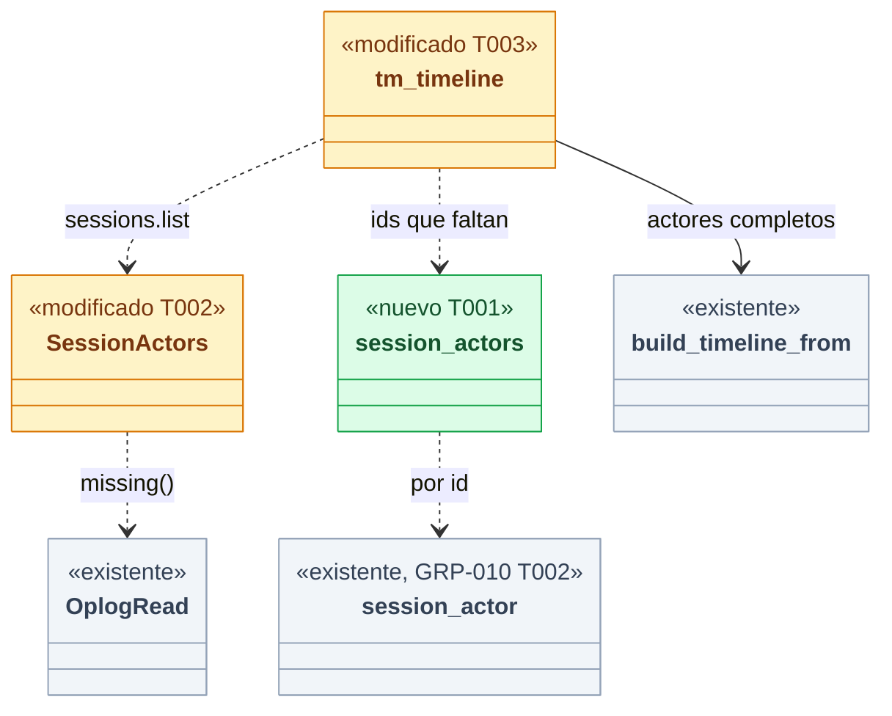
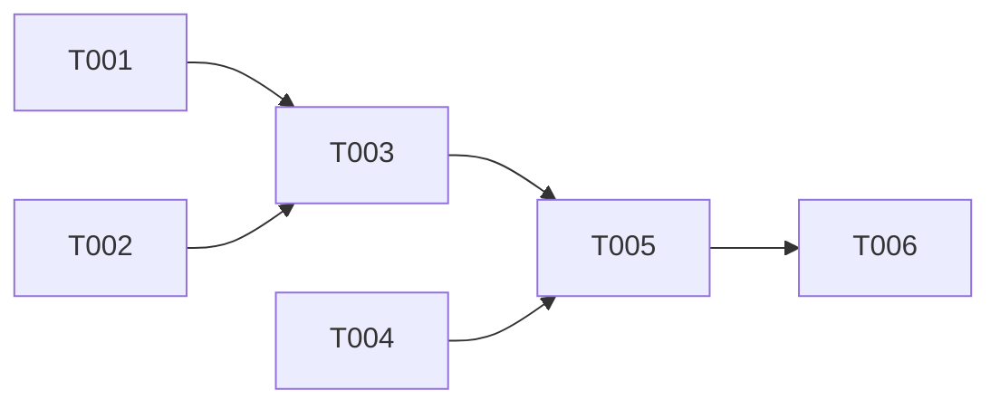

# DS-US-TMC-008 · El timeline refleja las correcciones de atribución

## Contexto rápido

Al terminar, `raptor timeline` muestra la atribución vigente de cada evento y de cada operación protegida justo después de `raptor agent correct` o `raptor agent uncorrect` (DS-US-GRP-010). Los undo, redo, restauraciones y snapshots manuales conservan su solicitante tal como se grabó, y lo mismo aquello sobre lo que actuaron.

**Esta ficha no rediseña el timeline.** El modelo ya resuelve el actor en cada consulta y no guarda ninguno copiado:

| Pieza | Dónde (existe) | Qué hace con la atribución |
|---|---|---|
| `session_actor` | `crates/core/src/daemon/sessions.rs:1038` | Proyección única del actor vigente. DS-US-GRP-010 T002 le añade las correcciones sin cambiar su firma |
| Historial de eventos | `daemon/repos.rs:621`, `daemon/mod.rs:1240` | Cada `GitEventView.actor` sale de `session_actor` en la consulta |
| `SessionActors` | `crates/core/src/timemachine/timeline.rs:44` | `session_id → Actor` construido con `sessions.list` en cada petición (`conn.rs:3983-3996`) |
| `operation_actor` | `timeline.rs:338` | Operación `protected`: actor vigente (`Attribution::Current`). `undo`, `redo` y `restore`: `recorded_actor` (`timeline.rs:322`), `Attribution::Recorded` (D-TMC-18) |
| Snapshot manual | `timeline.rs:496` | Solicitante grabado, `Recorded` |
| `acted_on` | `timeline.rs` (`acted_on`) | Ids del oplog (`Target::Undo`, `OpRef`); nunca un actor |
| `PathsCache` | `timeline.rs:682` | La única caché del timeline: clave `(repo, oid, oid)`, sin actor |
| Texto del actor | `apps/cli/src/commands/timeline_compact.rs:541` (`who`) | Vista compacta: solo el nombre. `--verbose`: `actor.with-origin` = "{agent}, {origin}" (US-TMC-023, punto 4) |

Queda una brecha. `sessions.list` devuelve como mucho las `MAX_SESSIONS_PAGE` (500, `crates/api/src/messages.rs:803`) sesiones más recientes (`daemon/sessions.rs:886-891`). Una operación protegida de una sesión más antigua no está en `SessionActors` y cae en `recorded_actor`: muestra el nombre grabado y no ve la corrección. Esta ficha cierra esa brecha, dice en `--verbose` qué actores son registro (D7), certifica los cinco escenarios de punta a punta y fija el contrato del filtro por agente para DS-US-TMC-007.

| Término | Qué es aquí |
|---|---|
| Atribución vigente | `effective(sesión, registros)` de DS-US-GRP-010: la corrección activa o, sin ella, la detectada. Se calcula en cada consulta |
| Actor mostrado | El `actor` de la `TimelineEntry`: vigente (`attribution: current`) o grabado (`attribution: recorded`) según el tipo de entrada |
| Registro del undo | La fila del oplog: `Requester` (`oplog/model.rs:167`, nombre, origen y `session_id` del momento) y `Target` |

⚠️ **ASSUMPTION**: no existe `architecture-constitution.md` en la cascada; rigen `AGENTS.md` y los ADR listados, como en las Dev Specs hermanas.

---

## ⚠️ Gaps y violaciones de la constitución

_No gaps. Ready to implement_ cuando DS-US-GRP-010 esté mezclada (T001 a T006 de esa ficha: `effective`, `attribution.correct`, `attribution.withdraw-correction` y `raptor agent correct|uncorrect`). Sin ella, T001 a T004 se pueden mezclar (no dependen de las correcciones) y T005 espera.

---

## 🔭 La forma



🟩 nuevo · 🟨 modificado · ⬜ existente.

### Diseño

**Quién muestra cada entrada** (sin cambios, D1). Eventos de Git y operaciones `protected`: atribución vigente. `undo`, `redo`, `restore` y snapshots manuales: el solicitante grabado. Lo que deshizo un undo son ids, así que el commit deshecho sigue siendo su propia entrada de evento y muestra su atribución vigente. Su registro no cambia: ni el solicitante ni `acted_on`.

**Sesiones fuera de la página** (T001 a T003, D2). Tras leer el oplog (`OplogRead`), `SessionActors::missing(&read)` lista los `session_id` de las operaciones `protected` que no están en el mapa. Si hay alguno, `tm_timeline` los pide con `ShutdownHandle::session_actors(repo_id, ids)`, que resuelve cada uno con `store.session(id)` (`profile/store.rs:344`) y `session_actor`, y los añade al mapa antes de ensamblar. Una sesión que el almacén ya no tiene sigue cayendo en el registro (`recorded`): es la regla de DS-US-TMC-006, paso 4. Si la consulta falla, se ensambla con lo que hay y esas entradas salen `recorded`, sin error. El cable siempre dice qué atribución lleva cada entrada.

**Sin caché del actor** (D3). Nada del timeline guarda un actor entre peticiones: `SessionActors` vive una petición y `PathsCache` no lleva actor. Por eso, al publicarse `attribution.changed` (`crates/api/src/event.rs:198`, que DS-US-GRP-010 T003 emite), no hay nada que invalidar en el daemon. La regla de ADR-TMC-003 § 5 queda como contrato para quien añada una caché o una vista viva: la TUI del timeline (US-CKP-021) vuelve a pedir `timemachine.timeline` al recibir `attribution.changed` o `session.state`.

**Momento de la lectura** (D4). `events.history` y `sessions.list` se leen en dos llamadas al bucle del daemon. Si una corrección llega entre las dos, una respuesta puede mezclar los dos momentos. El timeline es una lectura y la siguiente consulta sale coherente. El undo por agente, que sí actúa, lee una sola vez (DS-US-TMC-011 D9).

### Contrato del filtro por agente (para DS-US-TMC-007)

`--agent` (y cualquier filtro por actor que añada DS-US-TMC-007) debe respetar:

| # | Regla | Hoy |
|---|---|---|
| C1 | Filtra por el **actor mostrado**, resuelto con la misma regla que la entrada: vigente en eventos y `protected`, grabado en `undo`, `redo`, `restore` y manuales. Nunca por `Requester.name` del oplog en un `protected`, ni por `sessions.agent_kind`/`agent_name` del almacén, que son la detectada | `timeline.rs:432` y `:548` filtran tras resolver |
| C2 | Si el filtro baja a la consulta de `events.history` (para no llenar la página con eventos que luego se descartan), se traduce a un conjunto de `session_id` cuya atribución vigente coincide, leído en la misma petición. Nunca a una condición SQL sobre las columnas de `sessions` | El filtro se aplica tras la página |
| C3 | Coincidencia por nombre con `AgentFilter::keeps` (`timeline.rs:84`) (o `name_matches`, que DS-US-TMC-011 T003 extrae de `keeps`): nombre declarado exacto, `claude-code` en todas sus grafías, `unattributed` reservado. DS-US-TMC-011 (`AgentSelector`) usa la misma regla: lo que `timeline --agent X --since D` muestra es lo que `undo --agent X --since D` deshace | Existe |
| C4 | Un selector por `session_id`, si 007 lo añade: eventos y `protected` por su sesión; `undo`, `redo`, `restore` y manuales por la sesión del solicitante grabado (`Requester::session_id`, `oplog/model.rs:178`) | No existe |
| C5 | Tras `raptor agent correct` o `uncorrect`, la siguiente consulta filtra con la atribución nueva sin reiniciar nada. Ningún filtro guarda un resultado entre peticiones | Se cumple por D3 |

Esta regla pasa a `business-rules.md` como `D-TMC-45` (§ Decisiones).

---

## 🚀 Plan de implementación

> Orden topológico (`Depende:`). Cada tarea es una rebanada disjunta; las ediciones en puntos compartidos son de una variante o un brazo, al final (ADR-GRP-016).

### El trabajo de un vistazo

| # | Tarea | Depende | Aterriza en |
|---|---|---|---|
| T001 | Resolver el actor vigente de sesiones concretas | — | `crates/core/src/daemon/{sessions,shutdown,mod}.rs` |
| T002 | Completar `SessionActors` con las sesiones que faltan | — | `crates/core/src/timemachine/timeline.rs` |
| T003 | Pedir las sesiones que faltan al servir el timeline | T001, T002 | `crates/core/src/channel/conn.rs` |
| T004 | Decir en `--verbose` qué actor es registro | — | `apps/cli/src/commands/timeline_compact.rs`, `apps/cli/i18n/{en,es}/timemachine.txt` |
| T005 | Probar los escenarios | T003, T004, DS-US-GRP-010, PR `test:` del arnés | `apps/cli/tests/`, `crates/core/` |
| T006 | Cerrar la historia | T005 | `docs/` |

### En qué orden



### T001 — Resolver el actor vigente de sesiones concretas

**Ubicación.** `crates/core/src/daemon/sessions.rs` (**MODIFY**: función nueva junto a `sessions_list`) · `crates/core/src/profile/store.rs` (**MODIFY**: `sessions_by_ids`, junto a `session`, `store.rs:344`) · `crates/core/src/daemon/shutdown.rs` (**MODIFY**, punto compartido: una variante al final de `Control`, `shutdown.rs:236`, y `ShutdownHandle::session_actors`, como `sessions_list` en `shutdown.rs:608`) · `crates/core/src/daemon/mod.rs` (**MODIFY**: un brazo junto a `Control::SessionsList`, `mod.rs:843`)

**Reglas**
- `Control::SessionActors { repo_id: String, ids: Vec<String>, reply: SyncSender<Option<HashMap<String, Actor>>> }`.
- `pub(super) fn session_actors(&self, repo_id: &str, ids: &[String]) -> Option<HashMap<String, Actor>>`: `None` si el repo no está observado. Descarta los ids sin forma de id de sesión (`is_session_id`, a crear en `daemon/sessions.rs` si DS-US-GRP-010 no trae uno). Lee las sesiones en **una sola consulta por lotes** (`RepoStore::sessions_by_ids(&[&str])`, a crear en `profile/store.rs`, `IN (?, ?, …)` parametrizado, nunca texto interpolado) y aplica `session_actor` a cada una. Un id desconocido no entra en el mapa. Como mucho `MAX_SESSION_LOOKUP` (64) ids por llamada; los que pasan del tope no se piden y su entrada sale `recorded`.
- `ShutdownHandle::session_actors` con `AUDIT_TIMEOUT`; `None` si el bucle no contesta. Interno: **no** es un método del canal ni cambia el protocolo.
- **Refs:** ADR-GRP-013 § 2, DS-US-GRP-010 D1
- **Aceptación:** `session_actors_resolves_each_id_with_the_current_attribution`, `an_unknown_session_is_left_out`, `a_session_older_than_the_sessions_page_still_resolves`, `past_the_lookup_cap_the_rest_stays_recorded` en `daemon/sessions.rs`

### T002 — Completar `SessionActors` con las sesiones que faltan

**Ubicación.** `crates/core/src/timemachine/timeline.rs` (**MODIFY**: `impl SessionActors`, `timeline.rs:46`)

**Reglas**
- `pub fn missing(&self, read: &OplogRead) -> Vec<String>`: los `session_id` de las operaciones `Protected` (`Requester::session_id`) que no están en el mapa, sin repetir y en orden estable. Recorre solo `OplogRead.operations` (la ventana consultada), nunca `all_operations`: `operation_actor` solo se aplica a las operaciones de la ventana (`timeline.rs:432`). Las de `undo`, `redo`, `restore` y manuales no se piden: muestran el registro.
- `pub fn extend(&mut self, more: HashMap<String, Actor>)`. Lo que ya estaba no se pisa: viene de la misma proyección.
- Se corrige el comentario de `SessionActors` (`timeline.rs:41-42`): la página de `sessions.list` más las sesiones que faltan.
- **Refs:** DS-US-TMC-006 D8, ADR-TMC-003 § 5
- **Aceptación:** `missing_lists_only_protected_sessions_not_in_the_map`, `a_protected_operation_of_an_old_session_shows_its_current_actor` (sin la sesión en la página y con ella añadida por `extend` → `Current` con el actor corregido) en `timeline.rs`

### T003 — Pedir las sesiones que faltan al servir el timeline

**Ubicación.** `crates/core/src/channel/conn.rs` (**MODIFY**: `tm_timeline`, `conn.rs:3931`)

**Reglas**
- Tras la lectura del oplog (`read`) y antes de `build_timeline_from`: `let ids = actors.missing(&read)`. Si no está vacío, `self.ctx.control.session_actors(repo_id, ids)` y `actors.extend(..)`. Con `None`, se sigue sin error (§ Diseño, D2).
- La llamada se hace después de soltar el lock del oplog: el bucle del daemon nunca se espera con el oplog cogido.
- **Refs:** ADR-GRP-016 § 1 (sin capacidad nueva: el resultado no cambia de forma)
- **Aceptación:** core `us_tmc_008.rs::an_old_protected_operation_follows_the_attribution` (véase § 9.4)

### T004 — Decir en `--verbose` qué actor es registro

**Ubicación.** `apps/cli/src/commands/timeline_compact.rs` (**MODIFY**: `who`, `timeline_compact.rs:541`) · `apps/cli/i18n/{en,es}/timemachine.txt` (**MODIFY**, dos claves al final)

**Reglas**
- Solo en `--verbose` y sin consulta extra: lee `entry.attribution` y `entry.origin`.
- `undo`, `redo` y `restore` (`attribution: recorded`): `timeline.actor.requested-by`, con el texto de `actor.with-origin` como `{actor}`.
- `protected` con `attribution: recorded` (sesión desconocida o fuera del tope): `timeline.actor.as-recorded`.
- La vista compacta y `--json` no cambian.
- **Refs:** D7, US-TMC-023 punto 4
- **Aceptación:** `verbose_says_who_requested_an_undo_at_request_time`, `verbose_marks_a_recorded_protected_operation` en `apps/cli/src/commands/timeline_compact_tests.rs`, en en y es

### T005 — Probar los escenarios

Ver § 9.4. Las pruebas con agente (detectado, corregido) son e2e con `raptor-fake-agent`, como `apps/cli/tests/timeline_process.rs`: el cliente en proceso y el `git` del test salen "sin atribuir" (DS-US-TMC-006 § 9.3).

- `apps/cli/tests/us_tmc_008_process.rs` (**CREATE**), `#![cfg(target_os = "macos")]`.
- Se extraen `Machine`, `FakeAgent` y sus ayudas (`timeline`, `timeline_json`, `commit`, `claude_session_detected`) a `apps/cli/tests/common/timeline_harness.rs` (**CREATE**), y `timeline_process.rs` pasa a usarlo (**MODIFY**, solo imports). Cada binario que lo use conserva su propio `#[test] fn fake_agent_entry` (o `launch_claude` lo filtra por su ruta completa), porque el agente falso es una copia del binario de pruebas. Orden: una PR `test:` previa extrae el arnés; si DS-US-TMC-007 ya lo hizo, se reutiliza.

### T006 — Cerrar la historia

US-TMC-008 a `implemented`. El orquestador integra `D-TMC-45` en `business-rules.md` las enmiendas E1 y E2 y la precisión E3 (§ Decisiones).

## Estructura de ficheros

```text
crates/core/src/daemon/sessions.rs                       ← MODIFY  (T001)
crates/core/src/profile/store.rs                         ← MODIFY  (T001: sessions_by_ids)
crates/core/src/daemon/shutdown.rs                       ← MODIFY  (T001: una variante y un método)
crates/core/src/daemon/mod.rs                            ← MODIFY  (T001: un brazo)
crates/core/src/timemachine/timeline.rs                  ← MODIFY  (T002)
crates/core/src/channel/conn.rs                          ← MODIFY  (T003)
apps/cli/src/commands/timeline_compact.rs               ← MODIFY  (T004)
apps/cli/i18n/{en,es}/timemachine.txt                    ← MODIFY  (T004: dos claves)
crates/core/tests/us_tmc_008.rs                          ← CREATE  (T005)
apps/cli/tests/common/timeline_harness.rs                ← CREATE  (PR test: previa, si 007 no lo creó)
apps/cli/tests/timeline_process.rs                       ← MODIFY  (PR test: previa, imports)
apps/cli/tests/us_tmc_008_process.rs                     ← CREATE  (T005)
```

## Contratos compartidos

### Tipos y datos compartidos

```rust
// crates/core/src/daemon/sessions.rs
pub(crate) const MAX_SESSION_LOOKUP: usize = 64; // los que pasan del tope salen `recorded`

// crates/core/src/profile/store.rs
pub fn sessions_by_ids(&self, ids: &[&str]) -> Result<Vec<Session>>; // IN (?, …) parametrizado

// crates/core/src/daemon/shutdown.rs — al final de `Control`
SessionActors { repo_id: String, ids: Vec<String>, reply: SyncSender<Option<HashMap<String, Actor>>> },
```

### Ciclos de vida (DI)

| Pieza | Vida | Por qué |
|---|---|---|
| `SessionActors` | Una petición de `timemachine.timeline` | La atribución vigente se resuelve en cada consulta (Q37, ADR-TMC-003 § 5) |
| Resultado de `session_actors` | Una llamada | Nunca se guarda: lo leído es lo vigente en ese momento |

### Firmas del stack

```rust
impl Daemon { pub(super) fn session_actors(&self, repo_id: &str, ids: &[String]) -> Option<HashMap<String, Actor>>; }
impl ShutdownHandle { pub(crate) fn session_actors(&self, repo_id: &str, ids: Vec<String>) -> Option<HashMap<String, Actor>>; }
impl SessionActors {
    pub fn missing(&self, read: &OplogRead) -> Vec<String>;
    pub fn extend(&mut self, more: HashMap<String, Actor>);
}
```

## Contrato de API

| Método | Canal | Parámetros | Resultado |
|---|---|---|---|
| `timemachine.timeline` | CLI/TUI (no MCP: `TM_TIMELINE` tiene `mcp = false`, Q-MCP-11) | sin cambios | sin cambios de forma; una operación `protected` de una sesión fuera de la página pasa de `recorded` a `current` |

### Forma del error y del cuerpo de respuesta

Sin códigos nuevos. Si la consulta de sesiones falla, la entrada sale `attribution: recorded`, nunca un error ni "sin atribuir".

### Valores numéricos

| Concepto | Valor | Fuente |
|---|---|---|
| Sesiones por consulta de actores | 64 | Revisión del Arquitecto (2026-10-28) |

### i18n

| Clave | en | es |
|---|---|---|
| `timeline.actor.requested-by` | requested by {actor} (attribution at request time) | pedido por {actor} (atribución en el momento de la petición) |
| `timeline.actor.as-recorded` | {actor} (as recorded) | {actor} (según el registro) |

El resto son los de `sessions.txt` (`actor.with-origin`, `origin.detected`, `origin.registered`) y de `timemachine.txt` (`timeline.acted-on`, `timeline.acted.*`), en en y es.

---

## Modelo de datos

Sin cambios. Los eventos apuntan a su sesión por `session_id`; las correcciones son filas append-only de `attribution_records` (DS-US-GRP-010); el oplog no se toca.

---

## Estrategia de pruebas y cobertura

### 9.1 Pirámide de pruebas

| Tipo | Cantidad | Tareas dueñas | Herramientas | Cuándo |
|---|---:|---|---|---|
| Unit | 8 | T001, T002, T004 | `cargo test` | PR gate |
| Integration | 2 | T003, T005 | `cargo test -p gitraptor-core --test us_tmc_008` | PR gate |
| E2E | 6 | T005 | `cargo test -p gitraptor-cli --test us_tmc_008_process` | PR gate (macOS) |

### 9.2 Umbrales de cobertura

| Capa | Línea | Rama | Mutación | Camino crítico 100% |
|---|---:|---:|---:|:---:|
| `timeline.rs::operation_actor`, `SessionActors` | — | — | — | `undo`, `redo` y `restore` siempre `recorded`; `protected` con sesión conocida siempre `current` |

### 9.3 Datos de prueba

- Repos temporales del testkit y perfil temporal; nunca este repo ni el perfil real (NFR-01).
- Sesiones: dos sesiones sucesivas de `raptor-fake-agent` en el worktree `feat-login` (la primera termina antes de lanzar la segunda). ⚠️ **ASSUMPTION**: los nombres "claude-1" y "claude-2" de la historia son ilustrativos; el motor detecta Claude Code sin nombre declarado y el texto es "Claude Code". "codex-1" es el nombre de la corrección (`raptor agent correct codex-1`).
- El undo del escenario 3 lo pide el propio agente dentro de su sesión (`raptor undo` desde el agente falso), así el solicitante grabado es esa sesión con su atribución de entonces.
- Sesiones antiguas (integración): `seed_sessions(store, n, worktree)` (a crear en `crates/core/tests/common/`) siembra `MAX_SESSIONS_PAGE + 1` sesiones en el almacén del perfil temporal (la más antigua, con una operación `protected`) para quedar fuera de la página. Para el tope de la consulta, `MAX_SESSION_LOOKUP + 1` (65) operaciones `protected` de sesiones fuera de la página.

### 9.4 Comportamientos críticos verificados

El texto "codex-1 (registrado)" de la historia se comprueba con `--verbose` ("codex-1, registrado" / "codex-1, registered") y con `--json` (`actor.name = "codex-1"`, `actor.origin = "registered"`, `attribution = "current"`). La vista compacta solo muestra el nombre (US-TMC-023, punto 4).

| Escenario | Test |
|---|---|
| 1. Corregir reatribuye la sesión | e2e `a_correction_reattributes_the_session`: tres commits del agente en `feat-login`; `timeline --json` los da "Claude Code" `detected`; `raptor agent correct codex-1`; la siguiente consulta, sin reiniciar el daemon, da los tres `codex-1` `registered`, `current`; `--verbose` en en y es |
| 2. Las demás sesiones no cambian | e2e `other_sessions_keep_their_attribution`: segunda sesión con dos commits; tras corregir la primera, los de la segunda siguen `detected`. Unitario `a_correction_only_touches_its_session` en `timeline.rs` (dos sesiones en `SessionActors`) |
| 3. El registro del undo no se reescribe | e2e `the_undo_record_survives_a_correction`: el agente commitea y deshace su commit; se corrige la sesión a codex-1. La entrada del undo conserva `actor` "claude-code" `detected`, `attribution: recorded` y `acted_on` igual que antes (comparado con el JSON previo). La entrada del commit deshecho sale `codex-1` `registered`, `current`. Ya existe el unitario `an_undo_entry_shows_the_recorded_requester_not_the_current_actor` (`timeline.rs:1188`) |
| 4. Retirar la corrección | e2e `withdrawing_the_correction_brings_back_the_detected_one`: tras el escenario 1, `raptor agent uncorrect` → los tres commits vuelven a "Claude Code" `detected` (Q50) |
| 5. Sin corrección no cambia nada | e2e `without_corrections_the_attribution_is_the_detected_one`: dos consultas seguidas dan el mismo JSON de actores, todos `detected` |
| Filtro por agente (C1, C5) | e2e `the_agent_filter_follows_the_correction`: antes, `--agent claude-code` da los tres commits y `--agent codex-1` nada; tras corregir, al revés; la entrada del undo sigue en `--agent claude-code` (grabado) |
| Sesión fuera de la página (D2) | core `us_tmc_008.rs::an_old_protected_operation_follows_the_attribution`: 501 sesiones con `seed_sessions`; la `protected` de la más antigua sale `current` con su actor del almacén. Con un registro `correct` sembrado en `attribution_records`, sale el corregido. Y `past_the_lookup_cap_entries_stay_recorded`: 65 sesiones fuera de la página → 64 `current` y 1 `recorded` |
| Registro en `--verbose` (D7) | dentro del e2e `the_undo_record_survives_a_correction`: `--verbose` dice "pedido por claude-code, detectado (atribución en el momento de la petición)" en es, y su texto en en |
| Repo intacto | huella del testkit antes y después en todos (corregir y consultar no tocan el repo) |

### 9.5 Plataformas

| Plataforma | Cómo se verifica | Pendiente |
|---|---|---|
| macOS | `cargo clippy --workspace --all-targets -- -D warnings`, `cargo test --workspace`; e2e con `raptor-fake-agent` | — |
| Linux | `us_tmc_008.rs` con `cfg(any(macos, linux))`; los e2e con agente son solo macOS, como `timeline_process.rs` | **Pendiente: etapa de validación multiplataforma** (detección del agente y e2e de corrección en el timeline) (XP-54) |
| Windows | Compila; `Control::SessionActors` igual que `SessionsList` | **Pendiente: etapa de validación multiplataforma** (XP-54) |

---

## Gate de seguridad

- Solo lectura: el timeline y `session_actors` no escriben en el repo, el oplog ni el perfil (NFR-01). Corregir es de DS-US-GRP-010, reservado y fuera del MCP.
- `session_actors` es interno del daemon. No hay método nuevo en el canal ni superficie nueva para un agente (NFR-02).
- Los ids que se piden salen del oplog releído, que no es de confianza (SEC-TMC-09): se descartan los que no tienen forma de id de sesión y la lectura es una consulta parametrizada (`IN (?, …)`), nunca texto interpolado. Como mucho 64 por llamada. El daemon los busca solo en el almacén del repo del llamante: una consulta no ve sesiones de otro repo.
- Los nombres siguen viajando como `UntrustedName` y la CLI los sanea al pintarlos (`sanitized`).
- Nada se registra en el log con nombres declarados ni rutas (NFR-03).

Corre `/security-review --scope devspec docs/requirements/features/time-machine/dev-specs/US-TMC-008-timeline-atribucion-vigente.md` antes de mezclar.

---

## Cómo extender

- Un consumidor nuevo del actor (otra vista, otro filtro) lo resuelve en cada consulta con `session_actor` o `SessionActors`. Si guarda algo entre peticiones, lo invalida con `attribution.changed` (ADR-TMC-003 § 5, ADR-GRP-013, tabla de reglas).
- Un tipo de entrada nuevo del timeline decide su regla en `operation_actor`: vigente si representa trabajo de una sesión, grabado si es un registro de quién pidió algo a la Time Machine.
- Variante de `Control` al final y brazo junto a los de sesiones ([extender-sin-archivos-compartidos.md](../../../../architecture/extender-sin-archivos-compartidos.md)).

---

## Dependencias

| Dependencia | Cómo entra aquí |
|---|---|
| DS-US-GRP-010 | `effective` en `session_actor`, `attribution.correct`/`withdraw-correction`, `raptor agent correct|uncorrect`, `attribution.changed`. T005 la necesita mezclada |
| DS-US-TMC-006 | Timeline, `SessionActors`, `operation_actor`, `recorded_actor`, `acted_on` (implementada) |
| US-TMC-023 | Formato de `raptor timeline` (commit 8e21a741): origen solo en `--verbose` |
| DS-US-TMC-011 | Mismo criterio de dueño que el timeline (C3); el undo fija lo deshecho por ids |
| DS-US-TMC-007 | Debe respetar C1 a C5 en sus filtros |
| US-TMC-002 | Undo simple para el escenario 3 |

---

## Fuera de alcance

| Ítem / no-objetivo | Historia que lo cubre | Gate (cómo se verifica) |
|---|---|---|
| Corregir y retirar la atribución | US-GRP-010 | Sus tests |
| Filtros del timeline (worktree, periodo, agente, huecos) | US-TMC-007 | C1 a C5 |
| Timeline vivo en la TUI y su refresco con `attribution.changed` | US-CKP-021 | Contrato de D3 |
| Mostrar en el texto que el solicitante grabado de un undo tiene hoy otra atribución | Nunca en el MVP (`TQ-30` cerrada, D7) | — |

---

## Decisiones

| # | Decisión | Origen |
|---|---|---|
| D1 | No cambia la regla del actor: eventos y `protected` con la atribución vigente; `undo`, `redo`, `restore` y manuales con el solicitante grabado; `acted_on` por ids. La historia se cumple con lo que existe más las correcciones de DS-US-GRP-010 | **Decisión del orquestador (2026-10-28), validada por Arquitecto y PO** (D-TMC-18, DS-US-TMC-006 D8) |
| D2 | Las operaciones `protected` de sesiones fuera de la página de `sessions.list` se resuelven con una consulta interna por id (`session_actors`), en una sola lectura por lotes parametrizada y con un tope de 64 ids (los demás salen `recorded`). Se descartan dos alternativas: subir la página, porque solo aplaza el límite, y añadir un filtro por ids a `sessions.list`, porque cambia un método público sin necesidad. Si la consulta falla, la entrada sale `recorded`, sin error | **Decisión del orquestador (2026-10-28), validada por Arquitecto y PO (revisión, con cambios)** |
| D3 | El timeline no guarda actores entre peticiones, así que `attribution.changed` no invalida nada en el daemon. Una vista viva (TUI) vuelve a pedir el timeline con `attribution.changed` o `session.state` | **Decisión del orquestador (2026-10-28), validada por Arquitecto** (ADR-TMC-003 § 5) |
| D4 | Una corrección que llega entre `events.history` y `sessions.list` puede dar una respuesta con dos momentos. Se acepta porque es una lectura y la siguiente consulta sale coherente. El undo por agente lee una vez (DS-US-TMC-011 D9) | **Decisión del orquestador (2026-10-28), validada por Arquitecto** |
| D5 | El origen registrado de la historia ("codex-1" con origen registrado) se verifica con `--verbose` y `--json`. La vista compacta muestra solo el nombre (US-TMC-023, punto 4) y no se cambia. El Gherkin del escenario 1 se ajustó a esta forma | **Decisión del orquestador (2026-10-28), validada por Arquitecto y PO (revisión, con cambios)** |
| D6 | El filtro por agente del timeline selecciona por el actor mostrado (C1 a C5) | **Decisión del orquestador (2026-10-28), validada por Arquitecto y PO (revisión, con cambios)** (`D-TMC-45`) |
| D7 | `TQ-30` cerrada: no se consulta la atribución actual de quien pidió un undo. En `--verbose`, el solicitante de `undo`, `redo` y `restore` se presenta como "pedido por {actor} (atribución en el momento de la petición)", y una `protected` con `attribution: recorded` dice "(según el registro)". Sin consulta extra | **Decisión del orquestador (2026-10-28), validada por Arquitecto y PO (revisión, con cambios)** |

### Decisiones de negocio nuevas (para `business-rules.md`, las integra el orquestador)

| ID | Decisión |
|---|---|
| `D-TMC-45` | En el timeline, el filtro por agente selecciona por el actor que muestra cada entrada: la atribución vigente para los eventos de Git y las operaciones protegidas, y el solicitante tal como se grabó para undo, redo, restauración y snapshots manuales. Tras corregir o retirar una corrección, la siguiente consulta ya filtra con la atribución nueva. Una operación protegida muestra su atribución vigente aunque su sesión sea antigua; solo una sesión que el motor ya no conoce muestra su registro. **Decisión del orquestador (2026-10-28), validada por Arquitecto y PO** |

### Preguntas abiertas nuevas

| ID | Pregunta | Respuesta | Dueño |
|---|---|---|---|
| `TQ-30` | Un undo pedido por una sesión que después se corrigió muestra a su solicitante grabado ("claude-code, detectado") junto a commits de la misma sesión que ahora son "codex-1". ¿`--verbose` debe añadir que esa sesión hoy tiene otra atribución? | **Cerrada**: no en el MVP. `--verbose` dice que el solicitante es el del momento de la petición y marca las `protected` según el registro (D7) | PO |

### Enmiendas a otras fichas (las aplica el orquestador)

| # | Destino | Enmienda | Estado |
|---|---|---|---|
| E1 | DS-US-TMC-006 D8 y § Fuera de alcance ("`SessionActors` solo lee `sessions.list`") | `SessionActors` se construye con la página de `sessions.list` más las sesiones de las operaciones protegidas que falten, pedidas con `session_actors` (DS-US-TMC-008 D2) | Propuesta |
| E2 | DS-US-TMC-011 T002 (`EngineLink::session_attribution`) | Puede construirse sobre la misma lectura del bucle que `session_actors` (convierte `Actor` a `Requester` con la regla de `requester_of`), para no tener dos lecturas del actor vigente. No cambia su comportamiento | Propuesta; opcional |
| E3 | BR-TMC-CONS-005, regla formal (`actor mostrado ∈ {"agente X (detectado|registrado)", "sin agente"}`) | Precisión: el origen se muestra en `--verbose` y `--json`; la vista compacta muestra el agente sin origen (US-TMC-023, punto 4) | Propuesta |

## Notas del autor

| ID | Nota | Acción | Owner |
|---|---|---|---|
| G1 | El solicitante grabado de Claude Code se muestra como "claude-code" (sin `kind`, G4 de DS-US-TMC-006), y el actor vigente como "Claude Code". El escenario 3 los compara por JSON (`origin`, `attribution`), no por texto | Deuda de US-TMC-023: unificar "claude-code" y "Claude Code" en el texto mostrado | Orquestador |
| G2 | El arnés e2e de timeline lo pueden extraer esta ficha y DS-US-TMC-007 a la vez. El que se mezcle segundo reutiliza el del primero | Coordinar al planificar | Orquestador |
| G4 | El Gherkin del escenario 1 de US-TMC-008 pasa a `figuran en el timeline como "codex-1" con origen registrado` (D5) | Aplicado en la historia (2026-10-28) | — |
| G3 | `Control` en `shutdown.rs` lo tocan también DS-US-GRP-010 (dos variantes) y DS-US-TMC-011. Todas van al final; el que se mezcle segundo rebasa | Ninguna | — |
