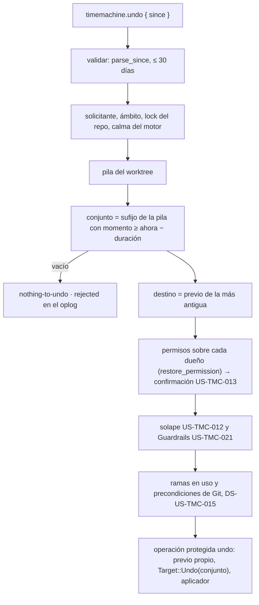
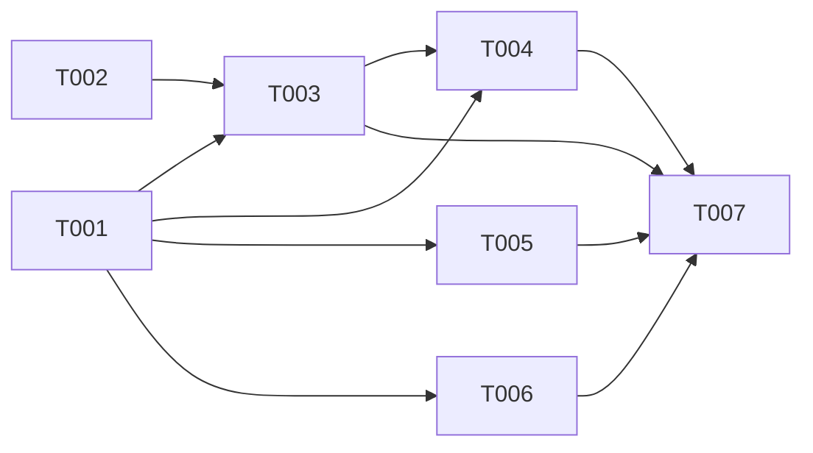

# DS-US-TMC-010 · `raptor undo --since <duración>`

## Contexto rápido

Al terminar, `raptor undo --since 20m` deshace de una vez todas las operaciones del worktree del cwd ocurridas en los últimos 20 minutos, como **un solo** undo: un punto previo, un registro en el oplog con todas las operaciones que deshizo y un redo que las rehace todas. Hoy `timemachine.undo` con `since` valida el parámetro y responde `NOT_IMPLEMENTED` con `implemented_by: US-TMC-010` (`crates/core/src/channel/conn.rs`, `tm_undo` → `tm_command`).

Casi todo existe: la pila por worktree (`oplog/stack.rs`), el plan del undo de la última operación (`undo.rs::plan`), la regla de permisos sobre varios dueños y el reto ligado al plan (`restore.rs::restore_permission`, US-TMC-013), el aplicador con `RefScope::Only` y `Target::Undo(Vec<OpRef>)`, que ya admite varias operaciones (`UndoStack::build` las saca y el redo las devuelve todas). Falta elegir el conjunto por tiempo, el momento de cada evento de Git crudo, el cable del resultado y el flag de la CLI.

| Término | Qué es aquí |
|---|---|
| Conjunto | Las operaciones aún no deshechas del worktree cuyo momento es ≥ ahora − duración, tomadas desde la cima de la pila |
| Momento | `recorded_ms` para una operación del oplog; `observed.utc_ms` del motor para un evento de Git crudo |
| Destino | El estado previo a la operación más antigua del conjunto (ADR-TMC-003 § 4) |

⚠️ **ASSUMPTION**: no existe `architecture-constitution.md` en la cascada; rigen `AGENTS.md` y los ADR listados (NFR-01, NFR-02, ADR-GRP-016). Formalizar con `/aadd-architect --init-constitution`.

---

## ⚠️ Gaps y violaciones de la constitución

_No gaps. Ready to implement._ El solape (US-TMC-012) es una dependencia: se aplica con la misma interfaz que en el undo sin selectores (§ Dependencias); esta Dev Spec no la rediseña.

---

## 🔭 La forma



### Diseño

1. **Validación** (BR-TMC-VAL-001): `UndoParams::validate` ya rechaza un periodo mal formado (`"veinte"`) o de más de 30 días (`MAX_SINCE_SECS`, la retención por defecto) con `INVALID_PARAMS` y el campo `since`, sin abrir nada. Sin cambios.
2. **Ruta**: en `tm_undo`, `since` deja de ir a `tm_command` y sigue el mismo camino que el undo sin selectores: `require_attributed`, `tm_scope_for` (allowlist por MCP), `UndoEnv` y la confirmación. `agent` y `operation_id` siguen en `NOT_IMPLEMENTED` (US-TMC-011 y sin historia). El comentario `SECURITY` de `tm_command` se cumple: el selector no salta el ámbito ni el solicitante.
3. **Umbral**: `since_ms = now_ms() − secs × 1000`, calculado una vez, en el daemon, después de tomar el lock del repo y de la calma.
4. **Conjunto** (`Selection::Since`): se recorre `UndoStack::done()` desde la cima y se toma el **sufijo** de operaciones con momento ≥ `since_ms`; el recorrido para en la primera más antigua. Así el undo equivale exactamente a N undos seguidos (D2). Vacío: `rejected` con `nothing-to-undo`.
5. **Cada operación del conjunto** pasa las mismas comprobaciones que hoy la única: un evento crudo no deshacible (`is_undoable` falso) rechaza la petición entera con `raw-git-not-covered` (nunca se salta en silencio); una operación manipulada o ilegible, `target-unavailable`.
6. **Destino**: el de la más antigua, con la regla de hoy (`raw_target` para un evento crudo, el previo garantizado para una operación del oplog), disponible y verificado.
7. **Ámbito**: la unión de los `Scope.worktrees` de las operaciones (casi siempre solo el worktree pedido) y de sus refs: las ramas de `HEAD` en el destino y ahora, más las refs declaradas y las ramas de los eventos crudos. Las comprobaciones de `ref-in-use` y de ramas en uso de DS-US-TMC-015 (D3) se aplican al conjunto.
8. **Permisos** (ADR-TMC-005 § 2): `restore_permission(who, channel, owners)` con el solicitante congelado de cada operación (el actor del evento para el Git crudo). Agente: todo debe ser de su sesión, si no `other-actor`. "Sin atribuir" con trabajo de un agente: `confirmation-required` y el reto de US-TMC-013, cuyo hash de plan incluye los ids del conjunto, como en la restauración (`taken_back`): una operación más en el periodo después del reto es otro plan (`challenge-invalid`).
9. **Solape y Guardrails**: el mismo punto de enganche que el undo sin selectores, con el conjunto entero (§ Dependencias).
10. **Precondiciones de Git** antes del previo y bajo los locks (DS-US-TMC-015 D7).
11. **Operación protegida** `undo` con `Target::Undo(conjunto en orden de la pila)`: un previo propio, el aplicador desde `ready` con `RefScope::Only`. La pila ya entiende varios objetivos (`StackItem::Undo { targets }`), y el redo de US-TMC-003 los devolverá todos (`UndoStack::build`, rama `Redo`).

---

## 🚀 Plan de implementación

> Orden topológico (`Depende:`). Rutas relativas a la raíz del repo; las ediciones en archivos compartidos son las que se nombran (ADR-GRP-016).

### El trabajo de un vistazo

| # | Tarea | Depende | Aterriza en |
|---|---|---|---|
| T001 | Ampliar el resultado del undo con las operaciones deshechas | — | `crates/api/src/` |
| T002 | Dar momento a los eventos crudos y exponer la pila | — | `crates/core/src/timemachine/{engine,oplog/stack}.rs`, `crates/core/src/daemon/tm.rs` |
| T003 | Planificar el undo por periodo | T001, T002 | `crates/core/src/timemachine/undo.rs` |
| T004 | Servir `since` en el canal | T001, T003 | `crates/core/src/channel/conn.rs` |
| T005 | Añadir `--since` a `raptor undo` | T001 | `apps/cli/` |
| T006 | Probar los escenarios | T001 | `crates/core/tests/`, `apps/cli/tests/` |
| T007 | Cerrar la historia | T003, T004, T005, T006 | `docs/` |

### En qué orden



### T001 — Ampliar el resultado del undo con las operaciones deshechas

**Objetivo.** `UndoResult` dice todas las operaciones que deshizo un undo por periodo.

**Ubicación.** `crates/api/src/timemachine.rs` (**MODIFY**)

**Reglas**
- `UndoResult` gana `undone_operation_ids: Vec<String>` (nuevo) con `#[serde(default, skip_serializing_if = "Vec::is_empty")]`: todas, de la más antigua a la más reciente, solo cuando la petición llevó `since`. `undone_operation_id` es la más antigua (la que fija el destino); `undone_subtype`, el de esa.
- `McpUndoResult` gana `undone_count: u64` (nuevo) con `skip_serializing_if` cero; sin ids de Git crudo ni rutas (SEC-12).
- Sin capacidad nueva: el campo solo aparece en la respuesta a una petición con `since`, que hasta ahora siempre respondió `NOT_IMPLEMENTED`; no hay cliente anterior que lo reciba (mismo criterio que DS-US-TMC-006 D5).

- **Depende:** —
- **Refs:** ADR-GRP-016 § 1, NFR-TMC-14
- **Aceptación:** `undo_result_without_since_is_todays_form` y `undo_result_lists_every_undone_operation` en `crates/api/src/timemachine.rs`

### T002 — Dar momento a los eventos crudos y exponer la pila

**Objetivo.** Cada `RawGitEvent` lleva su momento y la pila deja leer sus operaciones.

**Ubicación.** `crates/core/src/timemachine/engine.rs` (**MODIFY**) · `crates/core/src/daemon/tm.rs` (**MODIFY**, `raw_events`) · `crates/core/src/timemachine/oplog/stack.rs` (**MODIFY**)

**Reglas**
- `RawGitEvent` gana `observed_ms: i64` (nuevo), de `profile::store::Event.observed.utc_ms`. Los dobles de test (`capture_mark_tests.rs` y otros que construyen `RawGitEvent`) ponen un valor.
- `UndoStack::done(&self) -> &[OpRef]` (nuevo): las operaciones no deshechas, de la más antigua a la más reciente. `last_operation()` no cambia.

- **Depende:** —
- **Refs:** ADR-TMC-003 § 4
- **Aceptación:** `done_lists_what_is_not_undone_oldest_first` en `crates/core/src/timemachine/oplog/stack.rs`

### T003 — Planificar el undo por periodo

**Objetivo.** `plan` elige un conjunto en vez de una operación; el resto del flujo de `undo_last` lo reutiliza.

**Ubicación.** `crates/core/src/timemachine/undo.rs` (**MODIFY**)

**Reglas**
- `pub enum Selection { Last, Since { since_ms: i64 } }` (nuevo). `plan(.., selection)` devuelve `Planned { undone: Vec<Undone>, .. }` (hoy un solo `Undone`); `Selection::Last` devuelve un vector de uno y el comportamiento de hoy, sin cambios.
- `pub fn undo_selected(repo, who, channel, confirm, env, selection) -> Result<UndoDone, UndoError>` (nuevo); `undo_last` pasa a llamarlo con `Selection::Last`.
- El conjunto, el destino, el ámbito y los permisos siguen § Diseño, pasos 4–8. Los permisos reutilizan `restore::restore_permission`; el hash del plan del reto incluye los ids del conjunto en orden.
- El rechazo registra `Target::Undo(conjunto)` (o vacío si no hay conjunto), como hoy.
- `UndoDone` gana la lista de `Undone` para T001.

- **Depende:** T001, T002
- **Refs:** ADR-TMC-003 § 4, ADR-TMC-005 § 2–4, DS-US-TMC-015 D7
- **Aceptación:** `since_takes_the_suffix_of_the_stack_inside_the_period`, `since_stops_at_the_first_older_operation`, `a_raw_event_not_covered_rejects_the_whole_period`, `the_target_is_the_prior_of_the_oldest` en `crates/core/src/timemachine/undo.rs`

### T004 — Servir `since` en el canal

**Objetivo.** `timemachine.undo` con `since` deshace el periodo; los demás selectores siguen en `NOT_IMPLEMENTED`.

**Ubicación.** `crates/core/src/channel/conn.rs` (**MODIFY**, `tm_undo`)

**Reglas**
- El brazo `p.since.is_some()` deja de devolver `Some("US-TMC-010")`: calcula `secs` con `parse_since` (ya validado) y llama a `undo_selected` con `Selection::Since`, después del mismo `require_attributed` y `tm_scope_for` que el undo sin selectores.
- `undo_result` rellena `undone_operation_ids` desde `UndoDone`.

- **Depende:** T001, T003
- **Refs:** ADR-TMC-005 § 1 (MCP: cwd y allowlist)
- **Aceptación:** `since_is_served_and_agent_is_still_not_implemented` en `crates/core/tests/us_tmc_010.rs`

### T005 — Añadir `--since` a `raptor undo`

**Objetivo.** `raptor undo --since <duración> [--json]` con textos en/es.

**Ubicación.** `apps/cli/src/undo/mod.rs` (**MODIFY**) · `apps/cli/src/main.rs` o el `Cmd` del subcomando (**MODIFY**, un campo de clap) · `apps/cli/i18n/{en,es}/timemachine.txt` (**MODIFY**, grupo `undo.`)

**Reglas**
- `--since` pasa el texto tal cual; la CLI no lo interpreta (el daemon valida).
- Éxito: cuántas operaciones se deshicieron, la más antigua y el id del punto previo (`undo.done-since`). Rechazo `nothing-to-undo` con `--since`: `undo.reason.nothing-in-period` con `{since}` (D3). `INVALID_PARAMS` en `since`: `undo.invalid-since`.
- La confirmación interactiva reutiliza `apps/cli/src/undo/confirm/` sin cambios: ya muestra los dueños de `TmConfirmData`.

- **Depende:** T001
- **Refs:** NFR-TMC-14, AGENTS.md (i18n)
- **Aceptación:** `every_rejection_has_a_message` y `catalogs_match` siguen verdes; `since_messages_exist_in_en_and_es` en `apps/cli/src/undo/mod.rs`

### T006 — Probar los escenarios

**Objetivo.** Un test por escenario Gherkin con daemon real y Git real, más el e2e del binario.

**Ubicación.** `crates/core/tests/us_tmc_010.rs` (**CREATE**, reutiliza `us_tmc_013_common`) · `apps/cli/tests/us_tmc_010_process.rs` (**CREATE**)

**Reglas**
- Repos y perfiles temporales (NFR-01); `#![cfg(any(target_os = "macos", target_os = "linux"))]` en core y `macos` en el e2e, como sus hermanos.
- El escenario 1 necesita una operación **fuera** del periodo: la crea, espera por reloj hasta que tenga más de 10 s (única espera por tiempo, inherente al escenario) y pide `since = 8s`. El lado "fuera" es seguro porque el reloj solo avanza; el lado "dentro" tiene 8 s de margen.
- "No cambia" es la huella del testkit; "existe un punto recuperable previo al undo" es el `prior_snapshot_id` disponible y verificado.

- **Depende:** T001
- **Refs:** § Estrategia de pruebas y cobertura
- **Aceptación:** los tests de § 9.4 en `crates/core/tests/us_tmc_010.rs` y `apps/cli/tests/us_tmc_010_process.rs`

### T007 — Cerrar la historia

**Objetivo.** La historia pasa a `implemented` con su PR y los pendientes multiplataforma quedan anotados.

**Ubicación.** `docs/requirements/features/time-machine/user-stories/US-TMC-010-undo-since.md` (**MODIFY**) · `docs/architecture/xplat-pendientes.md` (**MODIFY**)

**Reglas**
- La enmienda propuesta a ADR-TMC-003 la aplica el orquestador.

- **Depende:** T003, T004, T005, T006
- **Refs:** AGENTS.md
- **Aceptación:** `cargo test --workspace` verde en macOS con los tests de T006; la historia lleva `status: implemented` y el enlace al PR

---

## Estructura de ficheros

```text
crates/api/src/timemachine.rs                          ← MODIFY  (T001)
crates/core/src/timemachine/engine.rs                  ← MODIFY  (T002, un campo)
crates/core/src/daemon/tm.rs                           ← MODIFY  (T002, una línea)
crates/core/src/timemachine/oplog/stack.rs             ← MODIFY  (T002, un método)
crates/core/src/timemachine/undo.rs                    ← MODIFY  (T003)
crates/core/src/channel/conn.rs                        ← MODIFY  (T004, el brazo de since)
apps/cli/src/undo/mod.rs, apps/cli/src/main.rs         ← MODIFY  (T005)
apps/cli/i18n/{en,es}/timemachine.txt                  ← MODIFY  (T005)
crates/core/tests/us_tmc_010.rs                        ← CREATE  (T006)
apps/cli/tests/us_tmc_010_process.rs                   ← CREATE  (T006)
docs/…                                                 ← MODIFY  (T007)
```

## Contratos compartidos

### Tipos y datos compartidos

```rust
// crates/api/src/timemachine.rs — MODIFICADO
pub struct UndoResult {
    // … campos de hoy …
    /// Every operation a `since` undo took back, oldest first. Empty otherwise.
    #[serde(default, skip_serializing_if = "Vec::is_empty")]
    pub undone_operation_ids: Vec<String>,
}
pub struct McpUndoResult {
    // … campos de hoy …
    #[serde(default, skip_serializing_if = "is_zero")]
    pub undone_count: u64,
}

// crates/core/src/timemachine/engine.rs — MODIFICADO
pub struct RawGitEvent { pub seq: i64, pub kind: GitEventKind, pub branch: Option<String>,
                         pub actor: Requester, /* NUEVO */ pub observed_ms: i64 }

// crates/core/src/timemachine/undo.rs — NUEVO
pub enum Selection { Last, Since { since_ms: i64 } }
```

Los ids de Git crudo siguen la forma de hoy (`git-event-<seq>`).

### Ciclos de vida (DI)

| Servicio / componente | Ámbito / ciclo de vida | Razón |
|---|---|---|
| Lock del repo | Desde antes de leer la pila hasta el cierre del undo | DS-US-TMC-002 D9: el conjunto no cambia debajo |
| Oplog (`Mutex`) | Durante la lectura de la pila y del destino; se suelta antes de la confirmación | Como `plan` hoy |
| Reto de confirmación | Uno por conexión y plan, 60 s | ADR-TMC-005 § 3, US-TMC-013 |

### Firmas del stack

```rust
// crates/core/src/timemachine/oplog/stack.rs — NUEVO
impl UndoStack { pub fn done(&self) -> &[OpRef]; }
// crates/core/src/timemachine/undo.rs — NUEVO; `undo_last` pasa a ser un envoltorio
pub fn undo_selected(repo: &TmRepoHandle, who: &Who, channel: Channel, confirm: &Confirmation<'_>,
                     env: &UndoEnv<'_>, selection: Selection) -> Result<UndoDone, UndoError>;
// MODIFICADO: `plan(.., raw: &RawSide, selection: Selection)`; `Planned.undone: Vec<Undone>`
```

⚠️ **ASSUMPTION**: las firmas de `undo_last` y `UndoDone` se leen en `undo.rs`; los nombres de los parámetros siguen a los de hoy.

## Contrato de API

| Método | Canal | Parámetros | Resultado |
|---|---|---|---|
| `timemachine.undo` | CLI/TUI; MCP (hoy `SCOPE_REFUSED`, DEP-MCP-4) | `since` (ya validado), `worktree`, `surface`, `confirmation` | `UndoResult` con `undone_operation_ids` |

### Forma del error y del cuerpo de respuesta

Sin códigos nuevos. `INVALID_PARAMS` (periodo inválido), `OPERATION_REJECTED` con `TmRejectedData`/`TmConfirmData` (`nothing-to-undo`, `raw-git-not-covered`, `other-actor`, `confirmation-required`, `challenge-invalid`, los de DS-US-TMC-015 y los del aplicador), `PRIOR_SNAPSHOT_FAILED`, `OPERATION_FAILED`, `SCOPE_REFUSED`.

### Forma de la configuración

_No aplica — la entrega no añade configuración._

### Valores numéricos

| Concepto | Valor | Fuente |
|---|---|---|
| Periodo máximo | 30 días (`MAX_SINCE_SECS`) | BR-TMC-VAL-001, retención por defecto |
| Unidades | `s`, `m`, `h`, `d`; sin cero inicial | `parse_since` |
| Dueños en el reto | `MAX_CONFIRM_OWNERS` | US-TMC-013 |
| Espera del test del escenario 1 | 10 s, `since = 8s` | Decisión del Arquitecto (§ T006) |

### i18n

| Clave | en | es |
|---|---|---|
| `undo.done-since` | undid {count} operations of the last {since} in {worktree} (from {oldest}); point before the undo: {id} (redo brings them back) | se deshicieron {count} operaciones de los últimos {since} en {worktree} (desde {oldest}); punto previo al undo: {id} (redo las recupera) |
| `undo.reason.nothing-in-period` | nothing to undo in this worktree in the last {since}; nothing changed | no hay operaciones que deshacer en este worktree en los últimos {since}; nada cambió |
| `undo.invalid-since` | --since must be a duration such as 20m, 2h or 1d, up to 30 days; nothing changed | --since debe ser una duración como 20m, 2h o 1d, de hasta 30 días; nada cambió |

---

## Modelo de datos

_No aplica — el oplog ya guarda `Target::Undo(Vec<OpRef>)` y la pila ya lo reproduce; no hay esquema ni migración nuevos._

---

## Estrategia de pruebas y cobertura

### 9.1 Pirámide de pruebas

| Tipo | Cantidad | Tareas dueñas | Herramientas | Cuándo |
|---|---:|---|---|---|
| Unit | 9 | T001, T002, T003, T005 | `cargo test` | PR gate |
| Integration | 9 | T006 | `cargo test -p gitraptor-core --test us_tmc_010` | PR gate |
| E2E | 2 | T006 | `cargo test -p gitraptor-cli --test us_tmc_010_process` | PR gate (macOS) |

### 9.2 Umbrales de cobertura

| Capa | Línea | Rama | Mutación | Camino crítico 100% |
|---|---:|---:|---:|:---:|
| Selección del conjunto en `undo.rs` | — | — | — | nunca una operación fuera del periodo ni de otro worktree |

### 9.3 Datos de prueba

- Fixture con `main`, `feat-login` y `feat-pagos` (`repo_with_login`). Operaciones del catálogo de test (`reset_hard`, `script`) y commits de Git crudo.
- Trabajo de un agente: `Running::agent_work(session)` de `us_tmc_013_common`; la confirmación, con el patrón de `us_tmc_013.rs`.

### 9.4 Comportamientos críticos verificados

| Escenario | Test |
|---|---|
| 1. Deshacer el periodo indicado | `us_tmc_010.rs::since_undoes_the_operations_of_the_period_only`: A fuera, B y C dentro; tras el undo, el estado es el de después de A; `undone_operation_ids = [B, C]`; el previo existe y verifica; el oplog tiene un `undo` con `Target::Undo([B, C])` |
| 2. Otros worktrees no cambian | `since_never_touches_other_worktrees`: commits en `feat-pagos` en el periodo; huella de `feat-pagos` (worktree y rama) igual |
| 3. Periodo no válido | `an_invalid_period_changes_nothing`: `"veinte"` → `INVALID_PARAMS` con `since`; huella igual; nada en el oplog. E2E `undo_since_invalid_says_why_in_es` |
| 4. Nada en el periodo | `nothing_in_the_period_changes_nothing`: `nothing-to-undo`; huella igual; el rechazo queda en el oplog. E2E `undo_since_with_nothing_says_so_in_en_and_es` |
| 5. Trabajo de otro actor con confirmación | `another_actor_in_the_period_is_undone_once_confirmed`: operación sin atribuir y commit de un agente; reto, confirmación, las dos deshechas |
| 6. Sin confirmación | `another_actor_in_the_period_without_confirmation_is_rejected`: `confirmation-required` con los dueños; huella igual |
| Undo por periodo equivale a N undos | `since_equals_consecutive_undos`: dos repos iguales; `--since` en uno y dos `undo` en otro; misma huella |
| Redo preparado | `the_undo_records_every_target_for_redo`: la pila tras el undo no tiene B ni C, y `next_redo` es el undo |
| Precondiciones (DS-US-TMC-015 D7) | `since_with_a_rebase_in_progress_is_rejected_without_a_prior` |

Unitarios: los de T001, T002, T003 y T005.

### 9.5 Plataformas

| Plataforma | Cómo se verifica | Pendiente |
|---|---|---|
| macOS | `cargo clippy --workspace --all-targets -- -D warnings` y `cargo test --workspace` | — |
| Linux | `us_tmc_010.rs` con `cfg(any(macos, linux))` | **Pendiente: etapa de validación multiplataforma** (e2e) |
| Windows | Compila; aplicador `unsupported`; sin confirmación de trabajo ajeno (TQ-14) | **Pendiente: etapa de validación multiplataforma** |

---

## Gate de seguridad

- El selector no salta el ámbito, la allowlist ni el solicitante: sigue el camino del undo sin selectores (comentario `SECURITY` de `tm_command`).
- El periodo lo calcula el daemon con su reloj; el cliente solo manda la duración validada (SEC-TMC-07).
- Un "sin atribuir" nunca deshace trabajo de un agente sin el reto ligado al plan, que incluye los ids del conjunto (SEC-TMC-03).
- Nada se salta en silencio: una operación del periodo que no se puede deshacer rechaza la petición entera (NFR-01).
- La proyección MCP lleva solo un recuento.

Corre `/security-review --scope devspec docs/requirements/features/time-machine/dev-specs/US-TMC-010-undo-since.md` antes de mezclar.

---

## Dependencias

| Dependencia | Cómo entra aquí |
|---|---|
| Solape, US-TMC-012 ([DS-US-TMC-012](./US-TMC-012-solape-otro-actor.md)) | Se evalúa con el conjunto entero y en las dos fases de DS-US-TMC-012 (D1, D12): `overlap::check` en el plan, en el mismo punto de enganche que el undo sin selectores (entre la regla base y las precondiciones, ADR-TMC-005 § 4), y `overlap::check_tail` en el paso de aplicación, tras el previo y con el repo tomado. Así se ve el trabajo sin commitear que aún no se capturó. Cuenta lo que cambió otro actor después de la operación más antigua del conjunto, y los actores de referencia son los dueños de las operaciones del conjunto. Mientras US-TMC-012 no esté mezclada, los dos puntos siguen vacíos como hoy. **Decisión del orquestador (2026-10-27), validada por Arquitecto**: alineado con DS-US-TMC-012 § D1 y § D12 |
| Confirmación y permisos, US-TMC-013 (`confirm/`, ADR-TMC-005 § 3) | Sin cambios: `restore_permission` y el reto con el hash del plan |
| Precondiciones de Git, DS-US-TMC-015 | D7 de esa Dev Spec |
| Redo, US-TMC-003 | `UndoStack::build` ya devuelve todos los objetivos de un undo; nada que hacer aquí |

---

## Fuera de alcance

| Ítem / no-objetivo | Historia que lo cubre | Gate (cómo se verifica) |
|---|---|---|
| `--agent` (con o sin `--since`) | US-TMC-011 | `since_is_served_and_agent_is_still_not_implemented` |
| Undo por id de operación | Sin historia | `operation_id` sigue en `NOT_IMPLEMENTED` |
| Elegir el periodo en la TUI | Cockpit | `git diff --stat` sin cambios en `apps/cli/src/tui/` |
| Redo | US-TMC-003 | `timemachine.redo` sigue en `NOT_IMPLEMENTED` |

---

## Decisiones

| # | Decisión | Origen |
|---|---|---|
| D1 | Un undo por periodo es **una** operación `undo` con un previo y `Target::Undo(conjunto)`, no N undos | **Decisión del orquestador (2026-10-27), validada por Arquitecto y PO** (el tipo ya lo admite, TS-TMC-002) |
| D2 | El conjunto es el sufijo de la pila con momento ≥ ahora − duración; para en la primera operación más antigua. Un reloj desordenado deshace de menos, nunca de más | **Decisión del orquestador (2026-10-27), validada por Arquitecto y PO** |
| D3 | "Nada en el periodo" reutiliza `nothing-to-undo`; el texto lo elige la CLI porque sabe que pidió `--since` | **Decisión del orquestador (2026-10-27), validada por Arquitecto y PO** |
| D4 | Una operación del periodo que no se puede deshacer (Git crudo no cubierto, manipulada) rechaza la petición entera | **Decisión del orquestador (2026-10-27), validada por Arquitecto y PO** (NFR-01: nada se salta en silencio) |
| D5 | `undone_operation_ids` sin capacidad nueva: solo aparece en respuestas a `since`, que nunca respondieron | **Decisión del orquestador (2026-10-27), validada por Arquitecto** (criterio de DS-US-TMC-006 D5) |
| D6 | El momento de un evento crudo es el `observed` del motor; el de una operación, `recorded_ms` | **Decisión del orquestador (2026-10-27), validada por Arquitecto** |

**D-TMC-29** (negocio, **Decisión del orquestador (2026-10-27), validada por Arquitecto y PO**; registrada en [business-rules.md](../business-rules.md#decisiones-de-negocio) y en BR-TMC-WF-002): `--since` cuenta todo lo del worktree en el periodo, de cualquier actor; el trabajo de otro actor pide la confirmación de US-TMC-013 y nunca se excluye en silencio (escenarios 5 y 6). Excluirlo es `--agent` (US-TMC-011).

**Validación de producto**:

- **Decisión del orquestador (2026-10-27), validada por PO**: D-TMC-29 se ratifica con una precisión que ya da BR-TMC-AUTH-001: si el solicitante es un agente, una operación de otro actor en el periodo rechaza la petición entera; si es "sin atribuir", pide la confirmación (rechazo en Windows y por MCP). Lo de otro actor nunca se excluye en silencio. Queda en BR-TMC-WF-002.
- **Decisión del orquestador (2026-10-27), validada por PO**: D1 y D2: un periodo es un solo undo, con un previo y un redo que lo rehace entero; con un reloj desordenado deshace de menos, nunca de más. D3 y D4: "nada en el periodo" tiene su propio texto, y una operación que no se puede deshacer rechaza la petición entera. Las cuatro cumplen NFR-01 y los escenarios de US-TMC-010, que no cambian.
- **Decisión del orquestador (2026-10-27), validada por PO**: TQ-20: el límite del worktree movido se acepta en el MVP como limitación conocida, igual que para `raptor undo` sin flags (DS-US-TMC-002 § 6). Falla hacia deshacer de menos, y los puntos siguen en el timeline para restaurarlos. Se anota en las limitaciones conocidas de la versión; seguir el worktree por su id queda para después del MVP. No es irreversible.

### Preguntas abiertas

| ID | Pregunta | Por defecto mientras tanto | Dueño |
|---|---|---|---|
| TQ-20 | Si un worktree se movió (`git worktree move`), la pila se indexa por la ruta canónica y `--since` no ve lo de antes (límite de DS-US-TMC-002 § 6). ¿Hace falta seguir el worktree por su id? | Límite conocido, sin cambio | Arquitecto |

### Enmiendas propuestas a ADR (aplicadas el 2026-10-27)

| ADR | Enmienda propuesta |
|---|---|
| ADR-TMC-003 § 4 | Añadir: "`undo --since` deshace, como una sola operación, el sufijo de la pila del worktree cuyo momento cae en el periodo; el destino es el previo de la más antigua" (D1, D2) |

## Notas del autor

| ID | Nota | Acción | Owner |
|---|---|---|---|
| G1 | El eco tardío de un restore (ADR-TMC-003, enmienda `fix/tm-restore-calm-mark`) está cerrado; si reapareciera, un `--since` que incluya el restore deshace también el eco, que lleva al mismo estado | Ninguna | — |
| G2 | La calma del motor es por repo: con mucha actividad en otro worktree, `--since` puede dar `repo-busy` como el undo de hoy | Ninguna | — |
