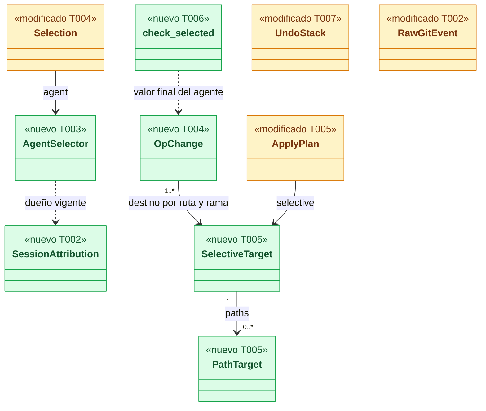
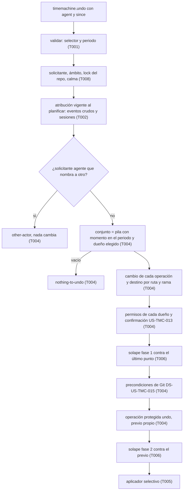
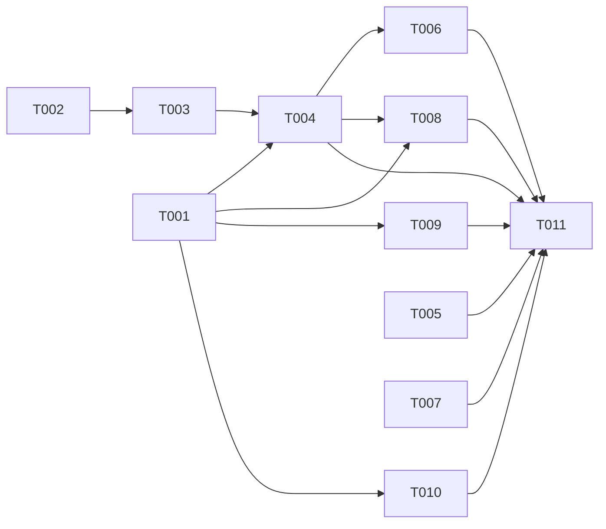

# DS-US-TMC-011 · `raptor undo --agent <id> [--since <duración>]`

## Contexto rápido

Al terminar, `raptor undo --agent claude-code --since 20m` deshace, en el worktree del cwd y como **un solo** undo, solo lo que hizo ese agente en el periodo: sus commits salen del historial, del índice y de los archivos, y lo de los demás actores sigue intacto. Si otro actor cambió después una ruta o una rama que el undo tendría que cambiar, se detiene sin tocar nada (solape, DS-US-TMC-012). Es el criterio 2 de M2 (la demo del BRD § 13). Hoy `timemachine.undo` con `agent` responde `NOT_IMPLEMENTED` con `implemented_by: US-TMC-011` (`crates/core/src/channel/conn.rs`, `tm_undo`), y `UndoParams::validate` rechaza `agent` junto a `since`.

La historia queda **desbloqueada**: P17 de motor-local se cerró (Q50, DS-US-GRP-010 D1) y D-TMC-22 deja de bloquear.

| Término | Qué es aquí |
|---|---|
| Atribución vigente | La de DS-US-GRP-010: función de la sesión y sus correcciones activas, leída **al planificar** |
| Selector | Lo que nombra `--agent`: un id de sesión o un nombre de agente (D-TMC-32) |
| Conjunto | Las operaciones aún no deshechas del worktree, con momento en el periodo, cuyo dueño vigente elige el selector |
| Cambio de una operación | Las rutas (archivo e índice), las ramas y el `HEAD` del worktree que esa operación cambió (D-TMC-31) |
| Destino de una ruta o rama | Su valor antes del cambio de la operación **más antigua** del conjunto que la tocó |
| Valor final del agente | Su valor después del cambio de la operación **más reciente** del conjunto que la tocó |
| Undo selectivo | El que escribe solo las rutas y ramas del conjunto; el resto del worktree queda como está |

⚠️ **ASSUMPTION**: no existe `architecture-constitution.md` en la cascada; rigen `AGENTS.md` y los ADR listados (NFR-01, NFR-02, ADR-GRP-016), como en las Dev Specs hermanas.

---

## ⚠️ Gaps y violaciones de la constitución

_No gaps. Ready to implement._

Depende de tres fichas por mezclar, en este orden: DS-US-TMC-010 (selección por periodo, `done()`, `observed_ms`, `undo_selected`), DS-US-TMC-012 (fase 1 y 2 del solape, `changed_between`, base B) y DS-US-GRP-010 (atribución vigente con correcciones; solo la necesita el escenario 3). § Dependencias dice qué toma de cada una.

---

## 🔭 La forma



🟩 nuevo · 🟨 modificado.

**Cómo fluye** (orden de ADR-TMC-005 § 4):



### Diseño

1. **Selector** (D-TMC-32). Actúa solo en el worktree desde el que se invoca (D-TMC-36). `--agent <id>`: si `<id>` es el `session_id` de una sesión del repo (`raptor sessions --json`), elige esa sesión. Si no, es un **nombre**: el nombre declarado de un "otro agente" o `claude-code` para Claude Code, con la regla exacta de `raptor timeline --agent` (`AgentFilter::keeps`, D3 de DS-US-TMC-006); elige toda sesión cuya atribución **vigente** lleva ese nombre. `unattributed` no es un agente para el undo: `INVALID_PARAMS`.
2. **Periodo** (D-TMC-33): `--since` opcional. Sin él, el periodo es la retención (30 días, `MAX_SINCE_SECS`). `agent` y `since` se combinan; `operation_id` sigue siendo excluyente.
3. **Atribución vigente al planificar** (D-TMC-2, BR-TMC-WF-002): bajo el lock del repo y tras la calma, el daemon lee **una vez** el actor vigente de cada sesión (`SessionAttribution`, con `session_actor` de DS-US-GRP-010). Ese mapa es la única fuente de dueños de la planificación: el dueño de un evento crudo es `SessionAttribution[sesión del evento]` (o "sin atribuir" si no tiene sesión), no el `RawGitEvent.actor` leído en otra llamada; así una corrección que llega entre las dos lecturas no deja dueños de dos momentos distintos. El lock de la Time Machine no frena `attribution.correct`: una corrección posterior a esa lectura no cambia este undo (D1). El dueño de una operación del oplog sigue la regla de `operation_actor` del timeline: el de `SessionAttribution` para una operación protegida cuya sesión se conoce, el congelado en los demás casos. Así **lo que `raptor timeline --agent X --since D` muestra es lo que `raptor undo --agent X --since D` deshace**. El conjunto queda en el oplog por ids (`Target::Undo(conjunto)`); una corrección posterior no cambia lo que se deshizo, y el redo rehace los mismos ids.
4. **Solicitante agente** (BR-TMC-AUTH-001, D-TMC-23): si el selector no lo nombra a él (otra sesión, u otro nombre que su actor vigente), `other-actor` **antes** de calcular el conjunto: un agente no deshace lo de otro y no sabe si el otro tiene algo. Después, la regla base por dueño sigue igual (un nombre que también elige otra sesión del mismo nombre → `other-actor`).
5. **Conjunto**: `UndoStack::done()` (DS-US-TMC-010), filtrado por momento ≥ umbral y dueño elegido. Nunca entra lo "sin atribuir" ni lo de otros agentes. Un evento crudo de un hueco nunca entra aunque llevara sesión (`RawGitEvent.in_gap`, defensa en profundidad de BR-TMC-EDGE-002; el motor ya los deja "sin atribuir", BR-EDGE-005). Vacío: `nothing-to-undo`.
6. **Cada operación del conjunto**: un evento crudo no deshacible → `raw-git-not-covered`; uno que no se puede deshacer de forma selectiva → `not-selectable`: una operación cuyo ámbito abarca otros worktrees (como una restauración), un `commit`, `merge` o `rebase` sin `old_commit` o sin `new_commit` (también el primer commit de una rama huérfana), un evento cuyo worktree el motor infirió (`GitEventDetails.worktree_inferred`: no se sabe si es de este worktree), o una ruta de su cambio que no se puede escribir tal cual (no UTF-8 o más larga que `MAX_PATH_BYTES`). Rechaza la petición entera (D4 de DS-US-TMC-010).
7. **Cambio de cada operación** (D-TMC-31):
   - **Contenido en commits** (`commit`, `merge`, `rebase`): las rutas de la diferencia de árboles entre `old_commit` y `new_commit` (lectura con gitoxide), y la rama del evento. Antes: la entrada de `old_commit` en archivo e índice (o ausente) y `old_commit` en la rama. Después: la de `new_commit`.
   - **Lo demás** (`reset`, `branch-update`, `branch-switch`, operaciones del oplog): `changed_between(T_i, B_i)` de DS-US-TMC-012 T002 en la clave del worktree, con T_i su destino de hoy (`raw_target` o el previo garantizado) y B_i su base (paso 1 de DS-US-TMC-012 T003); `HEAD` del worktree si cambió en `Meta`. Antes: valores en T_i; después: en B_i. Sin B_i → `overlap-unverified` (D7 de DS-US-TMC-012).
8. **Destino** por sujeto (ruta, rama, `HEAD`): el "antes" de la operación más antigua del conjunto que lo tocó. **Valor final del agente**: el "después" de la más reciente.
9. **Permisos** (ADR-TMC-005 § 2–3): `restore_permission(who, channel, dueños)`; un "sin atribuir" confirma (US-TMC-013) con el hash del plan, que incluye los ids del conjunto y los sujetos con su destino. Windows y MCP "sin atribuir": rechazo, como hoy.
10. **Solape** (D-TMC-34): un sujeto está en conflicto si su valor actual difiere del valor final del agente (alguien lo cambió después del último cambio del agente), o, para una rama, si entre el primer cambio del agente y ahora la movió algún evento u operación que no es del conjunto (paso 4 de DS-US-TMC-012 T003). Fase 1 contra el último punto limpio, solo para los sujetos cuyo último cambio del agente es anterior a ese punto (un punto anterior todavía no tiene el valor final y daría un falso conflicto, D8); fase 2, para todos, contra el previo del undo, con el repo tomado. Un conflicto lleva actor y momento con los tramos de DS-US-TMC-012 (D3, D9). El resultado usa los motivos `overlap` y `overlap-unverified` de esa ficha.
11. **Rutas y ramas que el agente no tocó**: el undo selectivo no las escribe nunca (se conservan por construcción, no por `keep`). `UndoResult.kept` no se rellena.
12. **Aplicador selectivo** (T005): escribe solo los sujetos, cada uno con su destino, partiendo del estado del previo; el resto del pipeline (intercambio, protección de último instante, índice, refs con valor esperado) no cambia. Solo escribe rutas que el previo capturó: una ruta del destino que el previo excluye (ignorada o declarada) no tendría copia para el redo, así que el undo se rechaza con `not-selectable` antes del aplicador (NFR-01, D7).
13. **Pila** (D-TMC-35): el undo se registra `undo` con subtipo `agent` y `Target::Undo(conjunto)`. Un `raptor undo` o `--since` posterior que bajaría por debajo de un undo selectivo activo se rechaza con `selective-undo-below`. "Por debajo" es toda operación que ya estaba hecha cuando corrió el undo selectivo, no solo las anteriores a su último objetivo: deshacer una operación de otro actor posterior al último cambio del agente también volvería a un estado con el trabajo quitado (D6).

---

## 🚀 Plan de implementación

> Orden topológico (`Depende:`). Rutas relativas a la raíz del repo; ediciones en archivos compartidos las que se nombran (ADR-GRP-016).

### El trabajo de un vistazo

| # | Tarea | Depende | Aterriza en |
|---|---|---|---|
| T001 | Ampliar el contrato del undo por agente | — | `crates/api/src/timemachine.rs` |
| T002 | Dar al planificador la atribución vigente y el hueco de cada evento | — | `crates/core/src/timemachine/engine.rs`, `crates/core/src/daemon/tm.rs` |
| T003 | Crear el selector de agente | T002 | `crates/core/src/timemachine/agent_selector.rs`, `timeline.rs` |
| T004 | Planificar el undo por agente | T001, T003 | `crates/core/src/timemachine/undo_agent.rs`, `undo.rs` |
| T005 | Añadir el modo selectivo al aplicador | — | `crates/core/src/timemachine/apply/` |
| T006 | Crear el solape por sujeto | T004 | `crates/core/src/timemachine/overlap.rs` |
| T007 | Poner la barrera del undo selectivo en la pila | — | `crates/core/src/timemachine/oplog/stack.rs`, `undo.rs` |
| T008 | Servir `agent` en el canal | T001, T004 | `crates/core/src/channel/conn.rs` |
| T009 | Añadir `--agent` a `raptor undo` | T001 | `apps/cli/` |
| T010 | Probar los escenarios y la demo de M2 | T001 | `crates/core/tests/`, `apps/cli/tests/` |
| T011 | Cerrar la historia | T004, T005, T006, T007, T008, T009, T010 | `docs/` |

### En qué orden



### T001 — Ampliar el contrato del undo por agente

**Objetivo.** `agent` se combina con `since`; tres motivos nuevos; sin lógica.

**Ubicación.** `crates/api/src/timemachine.rs` (**MODIFY**)

**Reglas**
- `UndoParams::validate`: `operation_id` excluye a `since` y `agent`; `since` + `agent` es válido. `agent = "unattributed"` → `Invalid("agent", "unattributed is not an agent")`. El test `param_validation` cambia su aserción `since + agent → error` por `→ ok`. Sin capacidad: `agent` siempre respondió `NOT_IMPLEMENTED` (criterio de DS-US-TMC-006 D5).
- El doc de `UndoParams.agent` pasa a "a session id or an agent name (D-TMC-32)".
- `TmRejectReason` gana, **al final** y detrás de las de DS-US-TMC-012 (G6 de esa ficha): `NotSelectable` (`not-selectable`), `SelectiveUndoBelow` (`selective-undo-below`), `AttributionUnavailable` (`attribution-unavailable`). `every_rejection_has_a_message` las exige en la CLI.
- `UndoResult.undone_operation_ids` (DS-US-TMC-010 T001) se rellena también con `agent`; `McpUndoResult.undone_count` igual.

- **Depende:** —
- **Refs:** ADR-GRP-016 § 1, NFR-TMC-14
- **Aceptación:** `agent_combines_with_since_but_not_with_operation_id`, `unattributed_is_not_an_agent_for_undo`, `agent_reasons_wire_form` en `crates/api/src/timemachine.rs`

### T002 — Dar al planificador la atribución vigente y el hueco de cada evento

**Objetivo.** El planificador lee, bajo el lock y al planificar, el actor vigente de cada sesión y si un evento crudo cayó en un hueco.

**Ubicación.** `crates/core/src/timemachine/engine.rs` (**MODIFY**, `RawGitEvent` y `EngineLink`) · `crates/core/src/daemon/tm.rs` (**MODIFY**)

**Reglas**
- `RawGitEvent` gana `in_gap: bool` (de `Event.gap_id.is_some()`), `inferred: bool` (de `GitEventDetails.worktree_inferred`) y `old_commit`/`new_commit: Option<String>` (de `GitEventDetails`). Los dobles de test ponen valores.
- `EngineLink::session_attribution(&self, repo_id) -> Option<SessionAttribution>` (nuevo, con implementación por defecto `None`): `session_id → Requester` vigente de todas las sesiones del repo, con `requester_of` (que ya delega en `session_actor`), en una sola lectura del bucle del daemon (como `raw_events`). `None` sin motor.
- Sin motor (`None`), el undo por agente se rechaza con `attribution-unavailable`: sin atribución vigente no se elige nada (falla cerrado).

- **Depende:** —
- **Refs:** ADR-TMC-003 § 5, DS-US-GRP-010 D1
- **Aceptación:** `raw_events_carry_the_gap_and_the_commits`, `session_attribution_follows_a_correction` en `crates/core/src/daemon/tm.rs`

### T003 — Crear el selector de agente

**Objetivo.** Un tipo que decide si una operación es del agente nombrado, con la misma regla de nombre que el timeline.

**Ubicación.** `crates/core/src/timemachine/agent_selector.rs` (**CREATE**) · `crates/core/src/timemachine/timeline.rs` (**MODIFY**, extraer `name_matches`) · `crates/core/src/timemachine/mod.rs` (**MODIFY**, una línea `mod`)

**Reglas**
- `pub enum AgentSelector { Session(String), Name(String) }`; `AgentSelector::resolve(text, &SessionAttribution)`: `Session` si `text` es una clave del mapa, `Name` si no.
- `fn selects(&self, owner: &Requester) -> bool`: `Session` compara `session_id`; `Name` usa `name_matches(wanted, name)` sobre `Requester::Agent.name`. `Unattributed` nunca se elige.
- `name_matches(wanted: &str, name: &str) -> bool` sale de `AgentFilter::keeps`: `name == wanted || (wanted == "claude-code" && is_claude_code_name(name))`. `keeps` sigue recibiendo un `Actor` y la llama con su nombre, y conserva aparte su regla por clase (`AgentKind::ClaudeCode` con `claude-code`); `timeline` en verde. Para el undo la regla por clase no hace falta: `requester_of` ya pone `claude-code` como nombre de una sesión de Claude Code sin nombre.
- `fn names_requester(&self, who: &Requester) -> bool` para el paso 4 del Diseño.

- **Depende:** T002
- **Refs:** D-TMC-32, DS-US-TMC-006 D3
- **Aceptación:** `a_session_id_selects_that_session`, `a_name_selects_by_current_attribution`, `claude_code_matches_every_spelling_the_timeline_matches`, `unattributed_is_never_selected` en `agent_selector.rs`

### T004 — Planificar el undo por agente

**Objetivo.** `Selection::Agent` produce el conjunto, el cambio de cada operación, el destino selectivo y los permisos; el resto lo reutiliza de `undo_selected`.

**Ubicación.** `crates/core/src/timemachine/undo_agent.rs` (**CREATE**) · `crates/core/src/timemachine/undo.rs` (**MODIFY**, la variante y la llamada) · `crates/git/src/changed_paths.rs` (**MODIFY**, lectura `commit_tree_diff`)

**Pasos**
1. `Selection` (DS-US-TMC-010) gana `Agent { selector: String, since_ms: i64 }`. `undo_selected` la desvía a `undo_agent::plan` tras tomar el lock, la calma y los eventos crudos.
2. Leer `session_attribution`; sin ella, `attribution-unavailable`. Resolver el selector (T003).
3. Solicitante agente que no está nombrado por el selector: `other-actor` sin calcular el conjunto (registrar el rechazo con `Target::Undo([])`).
   3.1 ⛔4.1 Calcular el conjunto antes de esta comprobación revela si otro agente tiene trabajo.
4. Conjunto: `done()` filtrado por momento ≥ `since_ms`, `!in_gap` y `selector.selects(dueño)`. Dueño (paso 3 del Diseño): para un evento crudo, `SessionAttribution` por la sesión de `RawGitEvent.actor`; para el oplog, la regla de `operation_actor` (vigente de `SessionAttribution` si `Protected` y la sesión se conoce, congelado si no).
   4.1 ⛔4.2 Un evento con `in_gap` entra en el conjunto aunque tenga sesión.
5. Cada operación: comprobaciones del paso 6 del Diseño; luego su `OpChange` (paso 7). `RepoReader::commit_tree_diff(old, new, deadline)` (nueva, en `crates/git/src/changed_paths.rs`, solo lectura con gitoxide, plazo del plan) reutiliza el recorrido privado `diff_trees` de `changed_paths`, pero devuelve las entradas de cada lado, sin tope de rutas y sin recortarlas: `changed_paths` sirve para mostrar (corta a `max` y recorta con `PATH_CUT_MARK`) y nunca se usa para escribir. Un objeto ausente → `target-unavailable`; una ruta no UTF-8 o recortable → `not-selectable`.
6. Destino y valor final por sujeto (pasos 8). Los objetos de los destinos deben estar en el almacén: los que falten se copian del repo con el mismo camino que usa la captura (`store/capture.rs`); si no se puede, `target-unavailable`.
7. Permisos y confirmación (paso 9), con `PlanFacts.owners` = dueños distintos del conjunto y el hash del plan con ids y sujetos.
8. Guardrails (hueco), solape fase 1 (T006), precondiciones de DS-US-TMC-015 sobre las ramas del destino, y `ref-in-use` solo para esas ramas.
9. Operación protegida `undo`, subtipo `agent`, `Target::Undo(conjunto en orden de pila)`; en el paso, tras el previo: si una ruta del destino está en las exclusiones del previo, `not-selectable` (`lista → rechazada`, D7); después fase 2 (T006) contra el previo y `ApplyPlan.selective` (T005).

- **Depende:** T001, T003
- **Refs:** ADR-TMC-005 § 2–5, DS-US-TMC-010 § Diseño, DS-US-TMC-012 T003 y T005
- **Aceptación:** `the_set_is_the_agents_operations_in_the_period`, `unattributed_and_other_agents_never_enter`, `a_gap_event_never_enters`, `an_inferred_worktree_event_is_not_selectable`, `owners_come_from_one_attribution_read`, `a_commit_change_is_its_tree_diff`, `the_target_of_a_path_is_before_the_oldest_change`, `an_agent_naming_another_is_rejected_before_the_set` en `undo_agent.rs`; `commit_tree_diff_returns_entries_uncut` en `crates/git/src/changed_paths.rs`
- **Guard ⛔4.1:** `an_agent_naming_another_is_rejected_before_the_set`
- **Guard ⛔4.2:** `a_gap_event_never_enters`

### T005 — Añadir el modo selectivo al aplicador

**Objetivo.** `ApplyPlan.selective`: escribir solo unos sujetos, cada uno con su valor, y dejar el resto como está.

**Ubicación.** `crates/core/src/timemachine/apply/mod.rs` (**MODIFY**) · `crates/core/src/timemachine/apply/plan.rs` (**MODIFY**, `LoadedWorktree`) · `crates/core/tests/tm_apply.rs` (**MODIFY**)

**Reglas**
- Con `selective: Some(s)`, al cargar cada worktree: `target_files` = `prior_files` con las entradas de `s.paths` aplicadas (`file: None` borra); el índice = el del previo con las entradas de `s.paths` (`index: None` quita la entrada); `target_head` = `s.head` o el del previo. Las refs que se actualizan son exactamente `s.refs`, con valor esperado el del previo.
- Con `selective`, `target_snapshot` = `prior_snapshot`: todo el contenido sale del previo y de `s`, así que el undo no depende de que el punto de la operación más antigua siga en el almacén (con el periodo por defecto de 30 días puede estar purgado). Los commits de `s.refs` que el repo no tenga siguen el paso 4 de ADR-TMC-002 § 3 (desde el almacén); si tampoco están allí, `target-unavailable` al planificar (T004 paso 6).
- `refs` debe ser `RefScope::Only` con exactamente las claves de `s.refs`; otra cosa es un error de programación.
- Una ruta de `s.paths` que el previo excluye (`LoadedWorktree::is_excluded`) nunca se escribe ni se omite en silencio: T004 la rechaza antes; si llega al aplicador, es un error de programación.
- `selective` y `PlanWorktree.keep` (DS-US-TMC-012 T004) son excluyentes: en el modo selectivo todo lo que no está en `s` se conserva por construcción, así que `keep` sobra. Los dos a la vez, como los dos casos anteriores → error de programación (`debug_assert` y `Refusal::InvalidSnapshot` en release, sin cambiar nada).
- `selective: None` deja todo como hoy.

- **Depende:** —
- **Refs:** TS-TMC-003 (pasos 6 y 7), ADR-TMC-002 § 3, NFR-01
- **Aceptación:** `selective_writes_only_its_paths`, `selective_removes_a_path_absent_in_its_target`, `selective_moves_only_its_refs`, `selective_with_keep_or_excluded_path_changes_nothing`, `no_selective_changes_nothing` en `crates/core/tests/tm_apply.rs`

### T006 — Crear el solape por sujeto

**Objetivo.** `overlap::check_selected` y `check_selected_tail`: conflicto si un sujeto cambió después del último cambio del agente.

**Ubicación.** `crates/core/src/timemachine/overlap.rs` (**MODIFY**, de DS-US-TMC-012) · `crates/core/src/timemachine/overlap_tests.rs` (**MODIFY**)

**Reglas**
- Ruta: conflicto si su valor (archivo e índice) en el punto de comparación difiere del valor final del agente. Rama: conflicto si su valor difiere, o si entre la base del primer cambio del agente y el punto la nombra un evento o una operación fuera del conjunto (paso 4 de DS-US-TMC-012 T003).
- Fase 1: punto de comparación = el último punto limpio del worktree (`last_point`), solo para los sujetos cuya marca de último cambio del agente es anterior a la de ese punto; los demás quedan para la fase 2 (D8). Fase 2: todos los sujetos, contra el previo del undo, con el repo tomado; la regla de rama mira los eventos hasta la marca de la intención del undo. Un conflicto lleva el actor del primer tramo posterior al último cambio del agente que lo muestra (D3 y D9 de DS-US-TMC-012).
- Almacén ilegible o plazo vencido (1,5 s, el de DS-US-TMC-012): `overlap-unverified`.
- `check` y `check_tail` de DS-US-TMC-012 no cambian.

- **Depende:** T004
- **Refs:** ADR-TMC-005 § 5 y Enmienda 2026-10-27, D-TMC-34
- **Aceptación:** `an_edit_after_the_agents_last_change_conflicts`, `the_agents_own_commits_on_one_file_do_not_conflict`, `another_actors_commit_on_the_branch_after_the_first_change_conflicts`, `an_earlier_change_of_another_actor_does_not_conflict`, `a_point_older_than_the_last_change_defers_to_phase_2` en `overlap_tests.rs`

### T007 — Poner la barrera del undo selectivo en la pila

**Objetivo.** Un undo que no es por agente no baja por debajo de un undo selectivo activo.

**Ubicación.** `crates/core/src/timemachine/oplog/stack.rs` (**MODIFY**) · `crates/core/src/timemachine/undo.rs` (**MODIFY**, la comprobación en `plan` y en `Selection::Since`)

**Reglas**
- `StackItem::Undo` gana `selective: bool` (subtipo `agent` del registro, que entra en la cadena del oplog). `UndoStack` numera cada `Do` en orden de historia al reproducirlo.
- **Barrera** (D6): al reproducir un `Undo` selectivo, `UndoStack` guarda, con el id de ese undo, el número de historia más alto de lo que queda en `done` en ese momento: toda operación ya hecha cuando corrió el undo selectivo está "por debajo", también las de otro actor posteriores al último objetivo. Una operación nueva queda por encima. Un `Redo` de ese undo quita su barrera; con varias activas, cuenta la más alta. Un número, no una posición en `done`: los `retain` de undos posteriores no la desplazan.
- **Orden tras un redo** (D6): `Redo` hoy hace `done.extend(targets)`, que con un conjunto selectivo (no contiguo) dejaría los objetivos encima de operaciones posteriores, y el siguiente `raptor undo` volvería al previo de un objetivo, quitando lo de encima. Tras un `Redo`, `done` se reordena por número de historia. Para los undos no selectivos no cambia nada: sus objetivos son la cima.
- `UndoStack::is_below_barrier(&self, op: &OpRef) -> bool` (nuevo). `raptor undo` y `--since`: si alguna operación de su conjunto está por debajo → `selective-undo-below`. `--agent` no la mira: su propio solape por sujeto lo protege (D-TMC-35), y un undo selectivo anterior que movió una rama cuenta como operación fuera del conjunto en la regla de rama.
- `selective-undo-below` llega también a un `raptor undo` sin selectores. Sin capacidad: un valor nuevo de `data.reason` bajo un código congelado es aditivo (ADR-GRP-016 § 3, Nota 2026-10-09) y todo cliente del repo cae a genérico, como con `overlap` en DS-US-TMC-012; el repo no cambia.

- **Depende:** —
- **Refs:** ADR-TMC-003 § 4, BR-TMC-WF-001
- **Aceptación:** `a_selective_undo_sets_a_barrier`, `another_actors_operation_after_the_agents_last_is_below_the_barrier`, `an_operation_after_the_selective_undo_is_above_it`, `redoing_it_lifts_the_barrier`, `redo_of_a_selective_undo_restores_history_order`, `undo_below_the_barrier_is_rejected` en `stack.rs`

### T008 — Servir `agent` en el canal

**Objetivo.** `timemachine.undo` con `agent` deshace; `operation_id` sigue en `NOT_IMPLEMENTED`.

**Ubicación.** `crates/core/src/channel/conn.rs` (**MODIFY**, `tm_undo`)

**Reglas**
- El brazo `p.agent.is_some()` deja de devolver `Some("US-TMC-011")`: mismo camino que `since` (`require_attributed`, `tm_scope_for`, `UndoEnv`), con `Selection::Agent { selector, since_ms }`; `since_ms` del `since` o de `MAX_SINCE_SECS`.
- Por MCP: el solicitante es el agente (TQ-7); "sin atribuir" se rechaza como hoy. La respuesta MCP es `McpUndoResult` con el recuento; sin rutas ni ramas (SEC-12).

- **Depende:** T001, T004
- **Refs:** ADR-TMC-005 § 1
- **Aceptación:** `agent_is_served_and_operation_id_is_still_not_implemented` en `crates/core/tests/us_tmc_011.rs`

### T009 — Añadir `--agent` a `raptor undo`

**Objetivo.** `raptor undo --agent <id> [--since <duración>] [--json]` con textos en/es.

**Ubicación.** `apps/cli/src/undo/mod.rs` (**MODIFY**) · el `Cmd` de clap de `undo` (**MODIFY**, un campo) · `apps/cli/i18n/{en,es}/timemachine.txt` (**MODIFY**, grupo `undo.`, al final)

**Reglas**
- `--agent` pasa el texto tal cual; el daemon valida y resuelve.
- Éxito: cuántas operaciones del agente se deshicieron, el agente, el periodo y el previo (`undo.done-agent`). `nothing-to-undo` con `--agent`: `undo.reason.nothing-of-agent`, con el periodo y "en este worktree" (como D3 de DS-US-TMC-010; D-TMC-33 y D-TMC-36). El periodo `{since}` (desde cuándo contó, D-TMC-33) lo pone la CLI con la hora local de ahora − `--since` (o − 30 días sin él); no hace falta campo nuevo en `UndoResult`.
- La confirmación reutiliza `apps/cli/src/undo/confirm/` sin cambios.

- **Depende:** T001
- **Refs:** NFR-TMC-14, AGENTS.md (i18n)
- **Aceptación:** `every_rejection_has_a_message`, `catalogs_match` y `agent_messages_exist_in_en_and_es` en `apps/cli/src/undo/mod.rs`

### T010 — Probar los escenarios y la demo de M2

**Objetivo.** Un test por escenario Gherkin con daemon y Git reales, el e2e del binario y la demo del criterio 2 de M2.

**Ubicación.** `crates/core/tests/us_tmc_011.rs` (**CREATE**, reutiliza `us_tmc_013_common`) · `apps/cli/tests/us_tmc_011_process.rs` (**CREATE**) · `apps/cli/tests/m2_demo_undo_agent.rs` (**CREATE**)

**Reglas**
- Repos y perfiles temporales (NFR-01), nunca este repo; core en `cfg(any(macos, linux))`, e2e en `macos`, como sus hermanos.
- "claude-1" y "claude-2" son dos sesiones de Claude Code (`Running::agent_work(session)`); se nombran por `session_id`. "codex-1" es un "otro agente" y se nombra por nombre. El escenario 3 usa el nombre `claude-code` (la sesión corregida ya no lo lleva).
- Las ediciones de "claude-1" van dentro de sus commits (D-TMC-31; ver § Cambios de negocio, nota para el PO).
- "El repo no cambia" es la huella del testkit.

- **Depende:** T001
- **Refs:** § Estrategia de pruebas
- **Aceptación:** § 9.4 completo

### T011 — Cerrar la historia

**Objetivo.** La historia pasa a `implemented` con su PR; pendientes multiplataforma anotados.

**Ubicación.** `docs/requirements/features/time-machine/user-stories/US-TMC-011-undo-por-agente.md` (**MODIFY**) · `docs/architecture/xplat-pendientes.md` (**MODIFY**)

**Reglas**
- Las enmiendas a ADR-TMC-002, 003 y 005 ya están aplicadas (§ Enmiendas a ADR); si la implementación cambia algo de ellas, se enmienda el ADR en el mismo PR.

- **Depende:** T004, T005, T006, T007, T008, T009, T010
- **Refs:** AGENTS.md
- **Aceptación:** `cargo test --workspace` verde en macOS con los tests de T010; la historia con `status: implemented` y el enlace al PR

---

## Estructura de ficheros

```text
crates/api/src/timemachine.rs                         ← MODIFY  (T001)
crates/core/src/timemachine/engine.rs                 ← MODIFY  (T002)
crates/core/src/daemon/tm.rs                          ← MODIFY  (T002)
crates/core/src/timemachine/agent_selector.rs         ← CREATE  (T003)
crates/core/src/timemachine/timeline.rs               ← MODIFY  (T003, extraer name_matches)
crates/core/src/timemachine/undo_agent.rs             ← CREATE  (T004)
crates/core/src/timemachine/undo.rs                   ← MODIFY  (T004, T007)
crates/git/src/changed_paths.rs                       ← MODIFY  (T004, commit_tree_diff)
crates/core/src/timemachine/apply/{mod,plan}.rs       ← MODIFY  (T005)
crates/core/src/timemachine/overlap.rs                ← MODIFY  (T006)
crates/core/src/timemachine/oplog/stack.rs            ← MODIFY  (T007)
crates/core/src/timemachine/mod.rs                    ← MODIFY  (T003, T004: dos líneas mod)
crates/core/src/channel/conn.rs                       ← MODIFY  (T008)
apps/cli/src/undo/mod.rs, apps/cli/i18n/*             ← MODIFY  (T009)
crates/core/tests/{us_tmc_011,tm_apply}.rs            ← CREATE / MODIFY (T010, T005)
apps/cli/tests/{us_tmc_011_process,m2_demo_undo_agent}.rs ← CREATE (T010)
docs/…                                                ← MODIFY  (T011)
```

## Contratos compartidos

### Tipos y datos compartidos

```rust
// crates/api/src/timemachine.rs (T001) — MODIFICADO
pub enum TmRejectReason { /* … de hoy y de DS-US-TMC-012 … */
    NotSelectable, SelectiveUndoBelow, AttributionUnavailable }       // nuevas, al final

// crates/core/src/timemachine/engine.rs (T002) — MODIFICADO
pub struct RawGitEvent { pub seq: i64, pub kind: GitEventKind, pub branch: Option<String>,
    pub actor: Requester, pub observed_ms: i64 /* DS-US-TMC-010 */,
    pub in_gap: bool, pub inferred: bool,
    pub old_commit: Option<String>, pub new_commit: Option<String> }  // nuevos
pub struct SessionAttribution(pub HashMap<String, Requester>);       // nuevo: session_id → vigente

// crates/core/src/timemachine/agent_selector.rs (T003) — nuevo
pub enum AgentSelector { Session(String), Name(String) }

// crates/core/src/timemachine/undo.rs (T004) — MODIFICADO (de DS-US-TMC-010)
pub enum Selection { Last, Since { since_ms: i64 }, Agent { selector: String, since_ms: i64 } }

// crates/core/src/timemachine/undo_agent.rs (T004) — nuevo
pub enum Subject { Path { worktree_key: String, path: String }, Ref(String), Head { worktree_key: String } }
pub struct OpChange { pub op: OpRef, pub before: BTreeMap<Subject, Value>, pub after: BTreeMap<Subject, Value> }
pub enum Value { Entry { file: Option<(Kind, Oid)>, index: Option<(Kind, Oid)> }, Ref(Option<Oid>), Head(HeadValue) }

// crates/core/src/timemachine/apply/mod.rs (T005) — nuevo
pub struct PathTarget { pub file: Option<(Kind, Oid)>, pub index: Option<(Kind, Oid)> }   // None = ausente
pub struct SelectiveTarget {
    pub paths: BTreeMap<String /* worktree key */, BTreeMap<String, PathTarget>>,
    pub refs: BTreeMap<String /* refs/heads/… */, Option<Oid>>,
    pub head: BTreeMap<String /* worktree key */, HeadValue>,
}
pub struct ApplyPlan { /* … de hoy … */ pub selective: Option<SelectiveTarget> }           // campo nuevo
```

```rust
// crates/core/src/timemachine/overlap.rs (T006) — nuevo
pub struct SelectedInput<'a> {
    pub worktree_key: &'a str,
    /// Por sujeto: valor final del agente y marca del motor de su último cambio.
    pub finals: &'a BTreeMap<undo_agent::Subject, (undo_agent::Value, i64)>,
    /// Por rama del destino: marca de la base del primer cambio del agente.
    pub first_base: &'a BTreeMap<String, i64>,
    /// El conjunto: lo que no está aquí y nombra una rama cuenta en la regla de rama.
    pub set: &'a [OpRef],
    pub events: &'a [RawGitEvent],
    pub last_point: Option<&'a str>,
    pub deadline: Instant,
}
```

`Subject` aquí es el de `undo_agent.rs` (con `Ord`, por ser clave); el de `overlap.rs` (DS-US-TMC-012) no tiene `Head`. `check_selected` recibe el de `undo_agent.rs` y traduce para el informe. `Kind`, `Oid` y `HeadValue` son los que ya usa `apply/plan.rs`.

### Ciclos de vida (DI)

| Servicio / componente | Ámbito / ciclo de vida | Razón |
|---|---|---|
| Lock del repo | De antes de leer la pila hasta el cierre | El conjunto y la atribución vigente no cambian debajo (D-TMC-2) |
| `SessionAttribution` | Una planificación | Atribución vigente **en el momento de planificar**; nunca se guarda |
| Reto de confirmación | Uno por conexión y plan, 60 s | ADR-TMC-005 § 3 |

### Firmas del stack

```rust
// crates/core/src/timemachine/engine.rs — NUEVO (por defecto None)
fn session_attribution(&self, repo_id: &str) -> Option<SessionAttribution>;   // en trait EngineLink
// crates/core/src/timemachine/agent_selector.rs — NUEVO
impl AgentSelector {
    pub fn resolve(text: &str, sessions: &SessionAttribution) -> Self;
    pub fn selects(&self, owner: &Requester) -> bool;
    pub fn names_requester(&self, who: &Requester) -> bool;
}
// crates/core/src/timemachine/timeline.rs — extraída de AgentFilter::keeps, sin cambio de conducta
pub(crate) fn name_matches(wanted: &str, name: &str) -> bool;
// crates/core/src/timemachine/overlap.rs — NUEVO
pub fn check_selected(store: &SnapshotStore, input: &SelectedInput<'_>) -> OverlapReport;
pub fn check_selected_tail(store: &SnapshotStore, input: &SelectedInput<'_>, prior: &str) -> OverlapReport;
// crates/core/src/timemachine/oplog/stack.rs — NUEVO
impl UndoStack { pub fn is_below_barrier(&self, op: &OpRef) -> bool; }
// crates/git/src/changed_paths.rs — NUEVO, solo lectura; reutiliza el recorrido privado diff_trees
impl RepoReader {
    pub fn commit_tree_diff(&self, old: &str, new: &str, deadline: Instant)
        -> Result<Vec<TreeChange>, ReadError>;
}
// Kind y Oid: los de gitraptor_git (tm_write::files::Kind, Oid), los mismos que usa apply/plan.rs;
// gix no sale de crates/git. Un submódulo (gitlink) o un tipo sin Kind → not-selectable.
pub struct TreeChange { pub path: Vec<u8>, pub old: Option<(Kind, Oid)>, pub new: Option<(Kind, Oid)> }
```

`crates/git` ya tiene la diferencia de árboles entre commits (`RepoReader::changed_paths`, DS-US-TMC-006 T002), pero solo devuelve rutas, cortadas a `max` y recortadas a `MAX_PATH_BYTES`: vale para mostrar, no para escribir. `commit_tree_diff` comparte su recorrido y devuelve las entradas completas; T004 traduce `path` a texto y rechaza (`not-selectable`) la que no sea UTF-8 o pase de `MAX_PATH_BYTES`.

## Contrato de API

| Método | Canal | Parámetros | Resultado |
|---|---|---|---|
| `timemachine.undo` | CLI/TUI; MCP con solicitante agente (hoy `SCOPE_REFUSED` hasta DEP-MCP-4) | `agent` (+ `since` opcional), `worktree`, `surface`, `confirmation` | `UndoResult` con `undone_operation_ids`; `McpUndoResult` con `undone_count` |

### Forma del error y del cuerpo de respuesta

Sin códigos nuevos. `INVALID_PARAMS` (`agent` mal formado o `unattributed`; `since` inválido), `OPERATION_REJECTED` con `TmRejectedData`/`TmConfirmData`: `nothing-to-undo`, `other-actor`, `confirmation-required`, `challenge-invalid`, `raw-git-not-covered`, `target-unavailable`, `overlap`, `overlap-unverified` (DS-US-TMC-012), los de DS-US-TMC-015 y del aplicador, y los nuevos `not-selectable`, `selective-undo-below`, `attribution-unavailable`. `PRIOR_SNAPSHOT_FAILED`, `OPERATION_FAILED`, `SCOPE_REFUSED`.

### Forma de la configuración

_No aplica — la entrega no añade configuración._

### Valores numéricos

| Concepto | Valor | Fuente |
|---|---|---|
| Periodo por defecto sin `--since` | 30 días (`MAX_SINCE_SECS`) | D-TMC-33 |
| Plazo del solape (las dos fases) | 1,5 s | DS-US-TMC-012 |
| Dueños en el reto | `MAX_CONFIRM_OWNERS` | US-TMC-013 |

### i18n

| Clave | en | es |
|---|---|---|
| `undo.done-agent` | undid {count} operations of {agent} since {since} in {worktree}; the rest stays as it was; point before the undo: {id} (redo brings them back) | se deshicieron {count} operaciones de {agent} desde {since} en {worktree}; lo demás queda como estaba; punto previo al undo: {id} (redo las recupera) |
| `undo.reason.nothing-of-agent` | {agent} has nothing to undo in this worktree since {since}; nothing changed | {agent} no tiene nada que deshacer en este worktree desde {since}; nada cambió |
| `undo.reason.not-selectable` | an operation of {agent} in that period cannot be undone on its own (it spans other worktrees or lacks its commits); nothing changed | una operación de {agent} en ese periodo no se puede deshacer por separado (abarca otros worktrees o le faltan sus commits); nada cambió |
| `undo.reason.selective-undo-below` | an undo of an agent's work sits above this operation; run raptor redo or restore a point from raptor timeline; nothing changed | por encima de esta operación hay un undo del trabajo de un agente; usa raptor redo o restaura un punto de raptor timeline; nada cambió |
| `undo.reason.attribution-unavailable` | the engine's attribution could not be read, so no agent's work can be chosen; nothing changed | no se pudo leer la atribución del motor, así que no se puede elegir el trabajo de ningún agente; nada cambió |
| `undo.invalid-agent` | --agent must be a session id from raptor sessions --json or an agent name such as claude-code; nothing changed | --agent debe ser un id de sesión de raptor sessions --json o un nombre de agente como claude-code; nada cambió |

---

## Modelo de datos

_Sin esquema ni migración._ El undo usa `Target::Undo(conjunto)` y el subtipo `agent` del registro de operación (texto, ya existe la columna). `UndoStack` deduce de él la barrera (T007).

---

## Estrategia de pruebas y cobertura

### 9.1 Pirámide de pruebas

| Tipo | Cantidad | Tareas dueñas | Herramientas | Cuándo |
|---|---:|---|---|---|
| Unit | 31 | T001, T002, T003, T004, T006, T007, T009 | `cargo test` | PR gate |
| Integration | 17 | T005, T010 | `cargo test -p gitraptor-core --test us_tmc_011 --test tm_apply` | PR gate |
| E2E | 4 | T010 | `cargo test -p gitraptor-cli --test us_tmc_011_process --test m2_demo_undo_agent` | PR gate (macOS) |

### 9.2 Umbrales de cobertura

| Capa | Línea | Rama | Mutación | Camino crítico 100% |
|---|---:|---:|---:|:---:|
| Selección del conjunto y destino en `undo_agent.rs` | — | — | — | nunca una operación de otro actor, de un hueco o fuera del periodo; nunca una ruta que el agente no tocó |

### 9.3 Datos de prueba

- Fixture con `main`, `feat-login` y `feat-pagos` (`repo_with_login`); sesiones con `Running::agent_work(session)` de `us_tmc_013_common`; confirmación con el patrón de `us_tmc_013.rs`.
- "codex-1": "otro agente" registrado (US-GRP-009). Corrección del escenario 3 con `attribution.correct` (DS-US-GRP-010).

### 9.4 Comportamientos críticos verificados

| Escenario | Test |
|---|---|
| 1. Deshacer lo de un agente en 20 min | `us_tmc_011.rs::undoes_the_agents_commits_and_edits_only`: claude-1 hace dos commits (uno con su edición de `api.rs`); una edición sin atribuir de `README.md`; solicitante sin atribuir confirma; la rama vuelve a antes del primer commit, `api.rs` al contenido de antes en archivo e índice, `README.md` intacto; `undone_operation_ids` = los dos commits; el previo existe y verifica |
| 2. Lo de otros agentes no entra (esquema: el commit de otro agente se queda; uno intercalado detiene, D-TMC-34) | `another_agents_commit_stays`: claude-2 hace un commit en otros archivos antes del primer commit de claude-1, en el mismo worktree; tras el undo, el commit de claude-2 sigue en la rama y sus archivos intactos. Variante `another_agents_commit_after_stops_on_the_branch`: el commit de claude-2 llega entre los de claude-1 → `overlap` en la rama, huella igual (D-TMC-34) |
| 3. Se usa la atribución vigente | `a_corrected_session_is_not_its_detected_agent`: sesión detectada Claude Code corregida a codex-1 (`attribution.correct`); `--agent claude-code` en el periodo → `nothing-to-undo`, huella igual. Y `--agent codex-1` la elige. Fila "corrección retirada antes del undo": `a_withdrawn_correction_brings_the_session_back`: la misma sesión corregida y retirada con `raptor agent uncorrect` antes del undo; `--agent claude-code` la elige y sus commits se deshacen |
| 4. Lo del hueco nunca entra | `gap_commits_never_enter`: claude-1 registrado, motor parado, commits en el hueco (reconciliación); `--agent` sobre un periodo que lo incluye → los commits del hueco siguen; unitario `a_gap_event_never_enters` con un evento `in_gap` que lleva sesión |
| 5. El repo no cambia (esquema), fila `other-actor` | `an_agent_undoing_another_agent_is_rejected`: claude-1 (solicitante) pide `--agent <sesión de claude-2>` → `other-actor`, huella igual, rechazo en el oplog sin conjunto |
| 5. El repo no cambia (esquema), fila `nothing-to-undo` | `an_agent_without_operations_changes_nothing`: claude-9 → `nothing-to-undo`; e2e `undo_agent_with_nothing_says_so_in_en_and_es` |
| Equivale al timeline | `undo_takes_what_the_timeline_shows_for_the_agent`: el conjunto es el de `raptor timeline --agent X --since D` (ids de operación y eventos) |
| Solapes | `an_edit_after_the_agents_last_commit_stops` (fase 1); `an_uncaptured_edit_just_before_stops_in_phase_2` (fase 2, `ready → rejected`) |
| 6. Un undo sin agente no baja por debajo de un undo por agente (barrera, D-TMC-35) | `plain_undo_below_a_selective_undo_is_rejected` (incluye un commit de otro actor posterior al último del agente); `redo_restores_the_set_and_lifts_the_barrier`; `plain_undo_after_redo_takes_the_latest_operation` (tras el redo, el siguiente `raptor undo` deshace la operación más reciente, no un objetivo rehecho) |
| Exclusiones | `an_excluded_path_in_the_target_is_not_selectable`: el agente commitea una ruta que el perfil excluye de la captura → `not-selectable` desde `lista`, huella igual |
| Atribución al planificar | `a_correction_after_the_undo_does_not_change_what_it_undid`: el registro guarda los ids; la corrección posterior no los cambia; el redo rehace los mismos |
| Sin motor | `without_attribution_the_agent_undo_is_rejected`: `attribution-unavailable` |
| Demo M2, criterio 2 | e2e `m2_demo_undo_agent.rs::four_sessions_and_one_agent_undone`: 4 sesiones de Claude Code simuladas en 4 worktrees con commits cada una; en una, `raptor undo --agent claude-code --since 20m` con confirmación en pty; su trabajo se deshace y la huella de los otros 3 worktrees y sus ramas no cambia; `raptor redo` lo devuelve |

Unitarios: los de T001 a T007 y T009.

### 9.5 Plataformas

| Plataforma | Cómo se verifica | Pendiente |
|---|---|---|
| macOS | `cargo clippy --workspace --all-targets -- -D warnings` y `cargo test --workspace` | — |
| Linux | `us_tmc_011.rs` con `cfg(any(macos, linux))` | **Pendiente: etapa de validación multiplataforma** (e2e y demo) |
| Windows | Compila; aplicador `unsupported`; sin confirmación de trabajo ajeno (TQ-14): un "sin atribuir" que pide `--agent` de un agente recibe el rechazo | **Pendiente: etapa de validación multiplataforma** |

---

## Gate de seguridad

- El selector no salta ámbito, allowlist ni solicitante: mismo camino que el undo sin selectores.
- Un agente no deshace lo de otro y no averigua si tiene trabajo: el rechazo llega antes del conjunto (guard ⛔4.1).
- Un "sin atribuir" no deshace trabajo de un agente sin el reto ligado al plan, que incluye ids y sujetos (SEC-TMC-03).
- Nada se elige sin atribución vigente legible: falla cerrado (`attribution-unavailable`).
- Nada se salta en silencio: una operación del conjunto que no se puede deshacer rechaza la petición entera (NFR-01).
- El undo selectivo tiene su previo como cualquier undo: todo lo que escribe se recupera con redo o con el timeline (NFR-01). Nunca escribe una ruta que el previo no capturó (D7), y la barrera impide que otro undo devuelva lo que quitó (D6).
- Las rutas que escribe salen de árboles del repo, no de la petición: pasan por la apertura relativa a la raíz y la revalidación del árbol del aplicador (SEC-TMC-04); una ruta no representable se rechaza, nunca se recorta (D10).
- MCP: solo recuentos (SEC-12).

Corre `/security-review --scope devspec docs/requirements/features/time-machine/dev-specs/US-TMC-011-undo-por-agente.md` antes de mezclar.

---

## Dependencias

| Dependencia | Cómo entra aquí |
|---|---|
| DS-US-TMC-010 (`--since`) | `Selection`, `UndoStack::done()`, `RawGitEvent.observed_ms`, `undo_selected`, `undone_operation_ids`. `undo --agent X --since D` es la selección por periodo filtrada por actor: un solo undo, un previo, un redo |
| DS-US-TMC-012 (solape) | `changed_between`, la base B, los tramos y actores (D2, D3, D9), `overlap`/`overlap-unverified`, el plazo; `check_selected` vive en su módulo. `PlanWorktree.keep` no se usa (D-TMC-34) |
| DS-US-TMC-015 | Precondiciones de Git y ramas en uso sobre las ramas del destino |
| DS-US-GRP-010 | Atribución vigente con correcciones. Solo el escenario 3 la necesita; sin ella, el resto funciona con la de hoy |
| US-TMC-013 | Reto y confirmación, sin cambios |
| US-TMC-003 (redo) | `UndoStack::build` ya devuelve todos los objetivos; el redo de un undo selectivo vuelve a su previo |

---

## Fuera de alcance

| Ítem / no-objetivo | Historia que lo cubre | Gate (cómo se verifica) |
|---|---|---|
| Atribuir ediciones sin commit a un agente | US-GRP-008 / después del MVP | `the_agents_uncommitted_edit_is_not_taken` (queda o solapa) |
| Reescribir historial para quitar commits intercalados (rebase o revert) | Después del MVP (D-TMC-34) | `another_agents_commit_after_stops_on_the_branch` |
| `--agent unattributed` | Sin historia | `unattributed_is_not_an_agent_for_undo` |
| Elegir el agente en la TUI | Cockpit | `git diff --stat` sin cambios en `apps/cli/src/tui/` |
| Undo por id de operación | Sin historia | `operation_id` sigue en `NOT_IMPLEMENTED` |

---

## Decisiones

| # | Decisión | Origen |
|---|---|---|
| D1 | Un undo por agente usa la atribución vigente **en el momento de planificar**, leída bajo el lock del repo; el conjunto queda por ids y no se recalcula después | **Decisión del orquestador (2026-10-27), validada por Arquitecto** (D-TMC-2, BR-TMC-WF-002) |
| D2 | El dueño de una operación del oplog sigue `operation_actor` del timeline: lo que el timeline filtra es lo que el undo deshace | **Decisión del orquestador (2026-10-27), validada por Arquitecto** |
| D3 | Destino por ruta y por rama en el aplicador (modo selectivo) en vez de un snapshot sintético en el almacén: no ensucia el timeline con puntos que nadie capturó, y el aplicador conserva su intercambio y su protección | **Decisión del orquestador (2026-10-27), validada por Arquitecto** |
| D4 | El solape por sujeto compara el valor actual con el valor final del agente (más reglas de rama de DS-US-TMC-012), en vez de los tramos entre los cambios del propio agente: con la regla D3 de DS-US-TMC-012 dos commits del agente sobre el mismo archivo se solaparían consigo mismos | **Decisión del orquestador (2026-10-27), validada por Arquitecto** |
| D5 | Sin motor, `attribution-unavailable` (falla cerrado) | **Decisión del orquestador (2026-10-27), validada por Arquitecto** |
| D6 | La barrera de D-TMC-35 cubre toda operación ya hecha cuando corrió el undo selectivo (número de historia), no solo las anteriores a su último objetivo; y tras el redo de un undo selectivo, `done` vuelve al orden de historia. Con la regla anterior, deshacer una operación de otro actor posterior al último cambio del agente, o un objetivo rehecho que quedó encima, volvía a un previo con el trabajo quitado, o quitaba lo de encima | **Decisión del orquestador (2026-10-27), validada por Arquitecto** (revisión del 2026-10-28) |
| D7 | El modo selectivo toma el contenido del previo y de `s` (`target_snapshot` = previo) y rechaza con `not-selectable` una ruta del destino que el previo excluye: así no depende de puntos purgados y nunca escribe algo que el redo no pueda devolver (NFR-01) | **Decisión del orquestador (2026-10-27), validada por Arquitecto** (revisión del 2026-10-28) |
| D8 | La fase 1 del solape por sujeto solo compara los sujetos cuyo último cambio del agente es anterior al último punto limpio; los demás los compara la fase 2 contra el previo. Un punto anterior al último commit del agente todavía tiene el valor de antes y daría un conflicto falso | **Decisión del orquestador (2026-10-27), validada por Arquitecto** (revisión del 2026-10-28) |
| D9 | Los dueños de la planificación salen de una sola lectura de la atribución vigente (`SessionAttribution`), también los de los eventos crudos; el lock de la Time Machine no frena una corrección, así que dos lecturas podían mezclar dos momentos | **Decisión del orquestador (2026-10-27), validada por Arquitecto** (revisión del 2026-10-28) |
| D10 | Son `not-selectable`, además: un evento cuyo worktree infirió el motor (`worktree_inferred`) y una ruta que no se puede escribir tal cual (no UTF-8 o más larga que `MAX_PATH_BYTES`). `changed_paths` no se usa para escribir: corta y recorta rutas | **Decisión del orquestador (2026-10-27), validada por Arquitecto** (revisión del 2026-10-28) |

**P17 / D-TMC-22**: cerrada por Q50 (DS-US-GRP-010 D1). Validación desde la arquitectura: este undo no depende de cómo se retira una corrección más allá de leer la atribución vigente al planificar, que es una función pura de la sesión y sus correcciones activas. La historia queda desbloqueada.

### Decisiones de negocio nuevas (para `business-rules.md`, las integra el orquestador)

| ID | Decisión |
|---|---|
| D-TMC-31 | Deshacer el trabajo de un agente devuelve cada ruta, rama y `HEAD` que sus operaciones cambiaron al valor que tenía antes de la primera de ellas que lo cambió, y deja todo lo demás como está. Para un commit, un merge o un rebase, lo que el agente cambió es el contenido que el commit registra: sale del historial, del índice y de los archivos. Las ediciones sin commitear del agente cuentan como "sin agente" en el MVP (ADR-GRP-013, D-TMC-27): no entran; si están en una ruta que el undo cambiaría, lo detienen por solape. `raptor undo` sin flags y `--since` no cambian: siguen volviendo al estado previo de la operación. **Decisión del orquestador (2026-10-27), validada por Arquitecto** |
| D-TMC-32 | `--agent <id>` acepta un id de sesión (`raptor sessions --json`), que elige esa sesión, o un nombre de agente (el declarado de un "otro agente", o `claude-code`), que elige toda sesión cuya atribución vigente lo lleva, con la misma regla que `raptor timeline --agent`. Fija la sintaxis provisional de D3 de DS-US-TMC-006. `unattributed` no vale para el undo. **Decisión del orquestador (2026-10-27), validada por Arquitecto** |
| D-TMC-33 | `--since` es opcional con `--agent`; sin él, el periodo es la retención (30 días). Con él, `undo --agent X --since D` es `undo --since D` filtrado por actor: un solo undo, un previo, un redo. El resultado dice desde cuándo contó el periodo. Actúa solo en el worktree desde el que se invoca (D-TMC-36). **Decisión del orquestador (2026-10-27), validada por Arquitecto** |
| D-TMC-34 | Si otro actor movió la rama después del primer cambio del agente (un commit intercalado), el undo por agente se detiene por solape en la rama: el MVP no reescribe historial. Lo de otro actor anterior al primer cambio del agente no cuenta. **Decisión del orquestador (2026-10-27), validada por Arquitecto** |
| D-TMC-35 | Mientras un undo por agente esté activo (no rehecho), `raptor undo` y `--since` no bajan por debajo de él: devolver un punto anterior traería de vuelta lo que el undo por agente quitó. Se rechaza con su motivo y se ofrecen `raptor redo` o restaurar un punto. **Decisión del orquestador (2026-10-27), validada por Arquitecto** |

### Preguntas abiertas nuevas

| ID | Pregunta | Por defecto mientras tanto | Dueño |
|---|---|---|---|
| TQ-21 | ¿La barrera de D-TMC-35 es demasiado estricta cuando hay mucho trabajo encima (el redo ya se invalidó)? La alternativa es planificar también ese undo de forma selectiva | Barrera; el timeline y la restauración siguen disponibles | Arquitecto |
| TQ-22 | Un nombre declarado con espacios ("GitHub Copilot") no pasa `check_agent_id`. ¿Se normaliza (espacio ≡ `-`) o basta el id de sesión? | **Respondida** (PO, D-TMC-32): en el MVP se elige por id de sesión, sin normalizar; `undo.invalid-agent` lo dice | PO |
| TQ-23 | `raptor sessions` en texto muestra un id corto de sesión que acepten `--agent` y `--session` (hoy solo `--json` da el id) | Id completo vía `--json`; no bloquea la demo de M2 | Arquitecto + design system |

### Enmiendas a ADR (aplicadas el 2026-10-28)

| # | ADR | Enmienda | Estado |
|---|---|---|---|
| E1 | ADR-TMC-003 § 4 | "`undo --agent` deshace, como una sola operación selectiva, las operaciones del worktree con atribución vigente al agente en el periodo; el destino es por ruta y por rama (D-TMC-31). Un undo selectivo activo es una barrera para `undo` y `--since` (D-TMC-35)", con la barrera y el orden tras el redo de D6 | Aplicada: ADR-TMC-003, Enmienda (2026-10-28, US-TMC-011) |
| E2 | ADR-TMC-002 § 3 | El aplicador admite un destino selectivo (`ApplyPlan.selective`): solo escribe los sujetos indicados, partiendo del previo; excluyente con `keep`; nunca escribe una ruta que el previo excluye (D7) | Aplicada: ADR-TMC-002, Enmienda (2026-10-28, US-TMC-011) |
| E3 | ADR-TMC-005 § 5 (Enmienda 2026-10-27) | Para el undo por agente, el solape por sujeto compara con el valor final del agente; las rutas que el agente no tocó no se escriben (no hay conservadas que informar) (D4, D8, D-TMC-34) | Aplicada: ADR-TMC-005, Enmienda (2026-10-28, US-TMC-011) |
| E4 | ADR-TMC-003 § 5 | Quitar "por eso el undo por agente sigue bloqueado (D-TMC-22)": P17 cerrada (Q50) | Aplicada: ADR-TMC-003 § 5 y Enmienda (2026-10-28, US-TMC-011) |

## Enmienda (2026-10-28, US-TMC-014)

**Decisión del orquestador (2026-10-28), validada por Arquitecto y PO.** Origen: [DS-US-TMC-014](./US-TMC-014-undo-ya-empujado.md) (E3); D-TMC-46. Su plan hace la misma llamada a `on_remote::check` (tras las precondiciones y antes de `ProtectedRequest`) y usa `UndoResult.on_remote`, que ya existe tras DS-US-TMC-014. Si aterriza después de DS-US-TMC-014, lo hace en su PR.

## Enmienda (2026-10-28, US-TMC-008)

**Decisión del orquestador (2026-10-28), validada por Arquitecto y PO.** Origen: [DS-US-TMC-008](./US-TMC-008-timeline-atribucion-vigente.md) D2; D-TMC-45. **T002 (opcional)**: `EngineLink::session_attribution` puede construirse sobre la misma lectura del bucle que `session_actors` (Actor → Requester con la regla de `requester_of`) para tener una sola lectura del actor vigente.

## Notas del autor

| ID | Nota | Acción | Owner |
|---|---|---|---|
| G1 | Escenario 1 de US-TMC-011: "editó api.rs" solo se cumple si la edición está en sus commits (D-TMC-31). Propuesta al PO: "claude-1 hizo dos commits, uno con su edición de api.rs" | Enmienda de la historia | PO |
| G2 | Si el agente hizo `git commit -a` con una edición previa del desarrollador en otra ruta, esa ruta es contenido del commit y se deshace; se recupera con el previo del undo (NFR-01). Lo mismo con una edición "sin atribuir" entre dos commits del agente sobre la misma ruta que el segundo recoge: D4 compara con el valor final y no la ve. Es el coste de D4 (con la regla de tramos, el agente se solaparía consigo mismo); un commit intercalado de otro actor sí detiene el undo por la regla de rama | Ninguna | — |
| G3 | Con dos sesiones de Claude Code en un worktree compartido, `--agent claude-code` elige las dos; la confirmación las lista como dos dueños. Para una sola, el id de sesión | Ninguna | — |
| G4 | `TmRejectReason` y `i18n/*/timemachine.txt` son puntos calientes compartidos con US-TMC-003, 010 y 012: variantes y claves al final | Ninguna | — |
