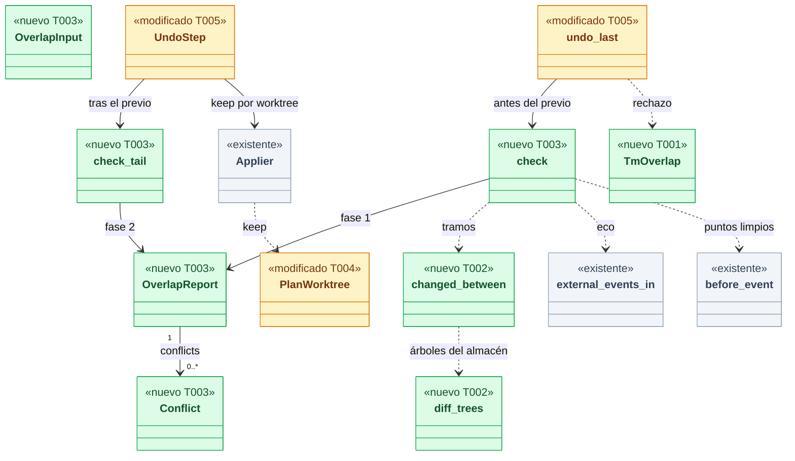
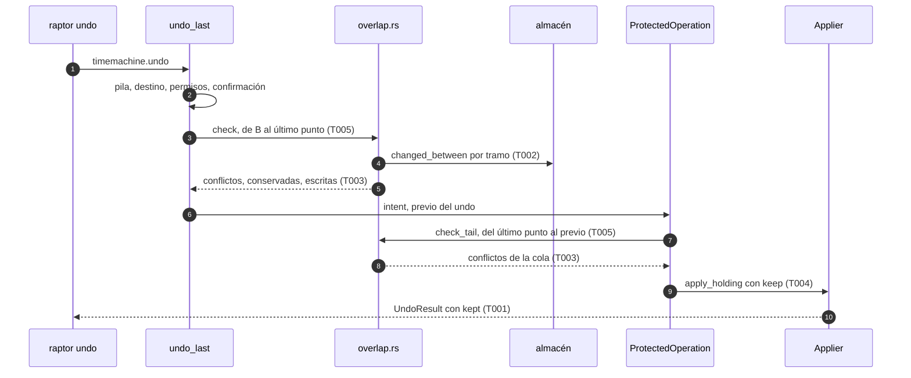
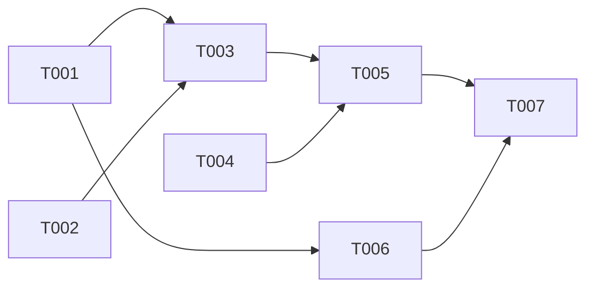

# DS-US-TMC-012 · Un undo nunca sobrescribe trabajo posterior de otro actor

## Contexto rápido

Al terminar, un `raptor undo` que tocaría una ruta o una rama que otro actor cambió **después** de la operación deshecha se detiene sin cambiar el repo y devuelve cada conflicto con su actor y su momento; si el otro actor cambió **otras** rutas, el undo procede y deja esas rutas como están. Hoy no: el undo devuelve el worktree entero al destino y solo el aplicador protege, en el último instante, lo que alguien escribe mientras aplica (`Outcome::Overlap` en `crates/git/src/tm_write/files.rs`).

Para eso: un módulo puro de solape sobre las capturas del intervalo (core), la clasificación de rutas en conflicto, conservadas o escritas, la opción del aplicador de dejar rutas intactas, dos códigos y el detalle del conflicto en el contrato (api), y los textos de la CLI. El redo (DS-US-TMC-003) reutiliza el mismo módulo.

| Término | Qué es aquí |
|---|---|
| Cambio deshecho | Lo que el undo toma de vuelta: una operación del oplog o un evento de Git crudo (`Undone`) |
| Actor de referencia | Quien produjo el estado que el comando sobrescribe. En el undo, el dueño del cambio deshecho (`Undone.requester`) |
| Base (B) | El primer punto con el estado justo después del cambio deshecho: el ancla de la operación o la captura causada por el evento |
| Tramo | El intervalo entre dos puntos limpios consecutivos posteriores a B, o entre el último y el previo del undo (la cola) |
| Conservada | Ruta o rama que el cambio deshecho no tocó y que otro actor cambió después: el undo la deja como está |
| Protección de último instante | La del aplicador: compara lo desplazado con el previo del undo y conserva lo que alguien escribió durante la aplicación. No es este solape |

⚠️ **ASSUMPTION**: no existe `architecture-constitution.md` en la cascada (release-plan, Huecos, fila 11); rigen `AGENTS.md` (Rust, NFR-01, NFR-02, tests obligatorios) y los ADR citados, como en las Dev Specs hermanas.

---

## ⚠️ Gaps y violaciones de la constitución

_No gaps que bloqueen la implementación._ Las decisiones de diseño están en § Decisiones. Queda un gap de release:

| ID | Gap | Severidad | Alcance | Owner |
|---|---|---|---|---|
| G1 | TQ-18 (resuelta): la restauración sigue sin solape. La Enmienda (2026-10-08, US-TMC-009) de ADR-TMC-005 dice "sin cubrir hasta US-TMC-012"; esta ficha entrega el módulo genérico y no lo engancha en `restore_to` (punto marcado "Next, in this order: Guardrails and the overlap"). Lo cubre una historia de usuario aparte, todavía por crear, y bloquea el **cierre de M2** (fila "no pisar a otro" de release-plan), no la implementación de esta ficha | Bloquea liberación | — | Orquestador / PO |

---

## 🔭 La forma

El solape es una **lectura pura** entre la regla de permisos y las precondiciones de Git. Lee puntos del oplog, árboles del almacén y eventos del motor, y devuelve qué rutas y ramas están en conflicto, cuáles se conservan y cuáles se escriben. No escribe nada; el undo decide.



🟩 nuevo · 🟨 modificado · ⬜ existente.

**Tres capas, tres momentos** (D1):

| Capa | Cuándo | Qué cubre | Resultado |
|---|---|---|---|
| Fase 1 (`check`) | En `undo::plan`, antes del previo del undo | Los tramos entre puntos ya capturados después de B | `rejected` desde `intent`, sin gastar un previo |
| Fase 2 (`check_tail`) | En `UndoStep::run`, tras el previo y antes del aplicador, con el repo tomado | La cola: del último punto al previo del undo, que es el estado de ahora, con lo no capturado todavía | `ready → rejected` |
| Último instante (aplicador) | Durante el paso 6 | Lo que alguien escribe después del previo | La ruta se conserva y sale en `not_restored` con `overlap` |

**Cómo fluye:**



---

## 🚀 Plan de implementación

> Orden topológico (`Depende:`). Rutas relativas a la raíz del repo. Cada tarea es una rebanada disjunta; las ediciones en archivos compartidos son las que se nombran (ADR-GRP-016).

### El trabajo de un vistazo

Contrato (T001) y diff del almacén (T002) en paralelo; el módulo puro (T003) sobre T002; el aplicador (T004) aparte; el enganche en el undo (T005) junta todo; CLI (T006) y documentación (T007) cierran.

| # | Tarea | Depende | Aterriza en |
|---|---|---|---|
| T001 | Añadir los códigos de solape y el detalle del conflicto al contrato | — | `crates/api/src/` |
| T002 | Crear el diff de árboles del almacén entre dos puntos | — | `crates/git/src/tm_write/store/`, `crates/core/src/timemachine/store/` |
| T003 | Crear el módulo de solape | T001, T002 | `crates/core/src/timemachine/overlap.rs` |
| T004 | Dejar intactas en el aplicador las rutas conservadas | — | `crates/core/src/timemachine/apply/` |
| T005 | Enganchar el solape en el undo (fases 1 y 2) | T003, T004 | `crates/core/src/timemachine/undo.rs`, `crates/core/src/channel/conn.rs`, `crates/core/tests/` |
| T006 | Mostrar el solape y las rutas conservadas en `raptor undo` | T001 | `apps/cli/` |
| T007 | Actualizar la documentación y los pendientes multiplataforma | T005, T006 | `docs/` |

### En qué orden



### T001 — Añadir los códigos de solape y el detalle del conflicto al contrato

**Objetivo.** Dos variantes de `TmRejectReason`, el detalle `TmOverlap`, la lista `kept` del resultado y la capacidad que los sirve; sin lógica.

**Ubicación.**
- `crates/api/src/timemachine.rs` (**MODIFY**)
- `crates/api/src/methods/timemachine.rs` (**MODIFY**, `CAP_TM_OVERLAP` y una línea en `capabilities`)

**Reglas**
- `TmRejectReason` gana `Overlap` (`overlap`) y `OverlapUnverified` (`overlap-unverified`), al final del enum.
- `TmConfirmData` gana `overlap: Option<TmOverlap>` con `skip_serializing_if = "Option::is_none"`; sigue siendo el superconjunto de todo rechazo del undo. `TmRejectedData` no cambia.
- `UndoResult` gana `kept: Vec<KeptPath>` con `default` y `skip_serializing_if = "Vec::is_empty"`; `McpUndoResult` gana `kept: u64` (cuántas), con `default`.
- Toda ruta y nombre de rama viaja como `Untrusted`; los actores como `Actor` (sin "humano").
- `CAP_TM_OVERLAP = "timemachine.overlap"`: con ella la conexión recibe `overlap` y `kept`; sin ella, solo el código (el undo conserva igual las rutas).

> **Nota técnica.** `TmConfirmData` y `UndoResult` llevan `deny_unknown_fields`: por eso los campos nuevos van detrás de una capacidad (extender-sin-archivos-compartidos, "Añadir una capacidad"). La CLI de este repo la pide en el mismo PR.

- **Depende:** —
- **Refs:** ADR-GRP-016 § 1, NFR-TMC-14, SEC-12
- **Aceptación:** `overlap_wire_form` y `overlap_detail_is_omitted_without_the_capability` en `crates/api/src/timemachine.rs`

### T002 — Crear el diff de árboles del almacén entre dos puntos

**Objetivo.** Las rutas de un worktree que difieren entre dos puntos del almacén (archivos e índice) y las ramas que cambiaron, sin leer contenidos.

**Ubicación.**
- `crates/git/src/tm_write/store/mod.rs` (**MODIFY**, `diff_trees`)
- `crates/core/src/timemachine/store/mod.rs` (**MODIFY**, `changed_between`)

**Reglas**
- `diff_trees(a, b)` recorre los dos árboles a la vez y salta todo subárbol con el mismo id: nunca lista el árbol entero.
- `changed_between(from, to, key, deadline)` une las rutas de `wt/<key>/files` y `wt/<key>/index` y compara `Meta.branches` de los dos puntos. Una ruta que solo cambió en el índice cuenta.
- Vencido el plazo o falta un objeto: `Err`, nunca un conjunto parcial ni vacío.

- **Depende:** —
- **Refs:** ADR-TMC-001 (almacén), ADR-TMC-003 § 4
- **Aceptación:** `diff_trees_skips_equal_subtrees`, `an_index_only_change_is_a_change`, `a_missing_object_is_an_error_not_empty` en `crates/core/src/timemachine/store/mod.rs`

### T003 — Crear el módulo de solape

**Objetivo.** `overlap::check` (fase 1) y `overlap::check_tail` (fase 2), puras sobre lo que reciben: tramos, actores y clasificación de cada ruta y rama.

**Ubicación.**
- `crates/core/src/timemachine/overlap.rs` (**CREATE**)
- `crates/core/src/timemachine/overlap_tests.rs` (**CREATE**)
- `crates/core/src/timemachine/mod.rs` (**MODIFY**, una línea `mod`)

**Pasos**
1. Elegir la base B: para `OpRef::Oplog`, la `Observation` con `cause_operation` = la operación y mayor marca (su ancla); para `OpRef::GitEvent(seq)`, la captura con `cause_event_seq` = `seq` o, si no hay, el primer punto limpio con marca ≥ `seq`.
   1.1 ⛔3.1 Sin B y con un actor de referencia que es un agente: `OverlapUnverified`. Nunca usar el destino T como base: mezcla el cambio deshecho con lo posterior y lo atribuiría al dueño.
2. Tomar los puntos limpios posteriores a B en el worktree: disponibles, sin manipular, de la generación actual (`seq >= floor`), con marca, y que `prior_point` no ensombrece. Un punto no disponible o ensombrecido no corta: fusiona sus dos tramos.
3. Por tramo, `changed_between` (T002) y sus actores: el actor vigente de cada evento crudo del worktree con marca en `(marca_i, marca_i+1]`; un eco cuenta con el solicitante de su operación (`external_events_in`); y `Unattributed` si el tramo cambia una ruta de archivos o del índice (D3).
4. Ramas: por cada rama del ámbito, los eventos de **cualquier** worktree del repo que la nombran y las operaciones del oplog cuyo `scope.refs` la contiene, en el intervalo; un movimiento sin evento que lo explique es `Unattributed`.
5. Clasificar cada ruta de `diff(T, último estado)` y cada rama del ámbito (D5, D6): **conflicto** si la tocó el cambio deshecho (T ≠ B en ella) y la tocó después un tramo con algún actor fuera de la referencia; **conservada** si no la tocó el cambio deshecho y la tocó después un tramo con algún actor fuera de la referencia; **escrita** en otro caso.
6. `check_tail` repite 3 a 5 solo para la cola (último punto → previo del undo), con los eventos hasta la marca de la intención del undo, y une el resultado al de la fase 1.

> **Nota técnica.** Un archivo editado no es un evento del motor y en el MVP no hay atribución por archivo (ADR-GRP-013, Q7): sin la regla del paso 3, un cambio sin evento no tendría actor y nunca solaparía. La marca de un punto cubre su contenido gracias a la marca confirmada (`fix/tm-restore-calm-mark`, caso 2), así que un evento cae en un solo tramo.

- **Depende:** T001, T002
- **Refs:** ADR-TMC-005 § 5, ADR-TMC-003 § 4, ADR-GRP-013 § 2
- **Aceptación:** los unitarios de `overlap_tests.rs` de § Estrategia de pruebas
- **Guard ⛔3.1:** `without_a_base_an_agents_change_is_unverified_never_written`

### T004 — Dejar intactas en el aplicador las rutas conservadas

**Objetivo.** `PlanWorktree.keep`: rutas que el aplicador ni escribe ni borra, con su entrada del índice tal como está ahora.

**Ubicación.**
- `crates/core/src/timemachine/apply/mod.rs` (**MODIFY**, `PlanWorktree.keep` y el informe `ApplyReport.kept`)
- `crates/core/src/timemachine/apply/plan.rs` (**MODIFY**, `LoadedWorktree.kept`)
- `crates/core/tests/tm_apply.rs` (**MODIFY**, tests de `keep`)

**Reglas**
- Una ruta en `keep` se trata como `excluded` en el paso 6 (ni escritura ni borrado) pero no emite `ApplyWarning::Excluded`: sale en `ApplyReport.kept`.
- En el paso 7 la entrada del índice de una ruta conservada es la del previo (lo que hay ahora), nunca la del destino.
- `keep` vacío (restauración, US-TMC-009, y todo llamador actual) deja el comportamiento como hoy: `tm_apply.rs` sigue en verde.
- Las ramas conservadas no llegan aquí: el undo las quita de `RefScope::Only` (T005).

- **Depende:** —
- **Refs:** TS-TMC-003 (pasos 6 y 7), SEC-TMC-11
- **Aceptación:** `a_kept_path_is_neither_written_nor_removed`, `a_kept_path_keeps_its_current_index_entry`, `an_empty_keep_changes_nothing` en `crates/core/tests/tm_apply.rs`

### T005 — Enganchar el solape en el undo (fases 1 y 2)

**Objetivo.** El undo sin selectores pasa por las dos fases y responde el solape; el canal lo serializa según la capacidad.

**Ubicación.**
- `crates/core/src/timemachine/undo.rs` (**MODIFY**)
- `crates/core/src/channel/conn.rs` (**MODIFY**, `undo_error` y `undo_result`)
- `crates/core/tests/us_tmc_012.rs` (**CREATE**)
- `crates/core/tests/us_tmc_013_common/mod.rs` (**MODIFY**, `agent_work` registra el ancla de la operación)

**Pasos**
1. En `plan`, en el punto marcado "Next, in this order: Guardrails (US-TMC-021) and overlap (US-TMC-012)", dejar el hueco de Guardrails y, tras construir `worktrees` y `refs`, llamar a `overlap::check`. Conflictos: `Err((Overlap, ..))` con el informe; `OverlapUnverified`: igual. Quitar de `refs` las ramas conservadas **antes** del control de `ref-in-use`.
   1.1 ⛔5.1 Comprobar `ref-in-use` antes de quitar las conservadas rechaza un undo que no movería esa rama.
2. `Planned` gana el informe de la fase 1; `PlanWorktree.keep` sale de sus rutas conservadas.
3. `UndoStep::run`: antes de `apply_holding`, `overlap::check_tail` con el previo (`ctx.prior_snapshot_id()`). Con conflictos, anotar `ready → rejected` con `overlap` en `ctx.oplog()`, guardar el informe en el paso y devolver `StepError`; sin ellos, añadir las conservadas de la cola a `keep` y aplicar.
4. `UndoError` gana `Overlap { operation_id, report }`; `undo_last` lo produce desde la fase 1 (con `record_rejection`) o desde el paso (fase 2). El ancla posterior se toma igual (no cambia nada).
5. `conn.rs`: `OPERATION_REJECTED` con `TmConfirmData { reason, operation_id, overlap }`; `overlap` solo con `CAP_TM_OVERLAP` y nunca por MCP. Por MCP, `TmRejectedData` con el código y nada más (SEC-12). `kept` de `UndoResult` con la capacidad; `McpUndoResult.kept` es el número.

> **Nota técnica.** `OperationState::can_become(Ready, Rejected)` ya existe (`oplog/model.rs`) y la operación protegida no cierra una operación que el paso dejó terminal (`self_annotated`, DS-US-TMC-002 D1). ⚠️ **ASSUMPTION**: `ProtectedOperation::run` devuelve `ProtectedError::Step` sin reescribir el estado cuando el paso ya anotó `rejected`; si no, el paso devuelve `Ok` y `undo_last` lee el informe guardado.

- **Depende:** T003, T004
- **Refs:** ADR-TMC-005 § 4 y § 5 (enmienda propuesta E1), DS-US-TMC-002 § 2.1
- **Aceptación:** `crates/core/tests/us_tmc_012.rs` completo; `us_tmc_002.rs`, `us_tmc_004.rs` y `us_tmc_013.rs` siguen en verde
- **Guard ⛔5.1:** `a_kept_branch_checked_out_elsewhere_is_not_ref_in_use`

### T006 — Mostrar el solape y las rutas conservadas en `raptor undo`

**Objetivo.** Textos en/es del rechazo por solape, de cada conflicto y de las rutas conservadas.

**Ubicación.**
- `apps/cli/src/undo/mod.rs` (**MODIFY**, `failure_text`, `reason_key`, `print_done`, test `every_rejection_has_a_message`)
- `apps/cli/src/undo/overlap.rs` (**CREATE**, el formato de la lista)
- `apps/cli/i18n/en/timemachine.txt` (**MODIFY**, claves `undo.reason.overlap*` y `undo.overlap.*`)
- `apps/cli/i18n/es/timemachine.txt` (**MODIFY**, mismas claves)
- `apps/cli/tests/undo_overlap_process.rs` (**CREATE**)

**Reglas**
- La CLI pide `CAP_TM_OVERLAP` en `connection.accept` (como pide `CAP_TM_CONFIRMATION`).
- Rechazo: una línea con el motivo y "nada cambió", la línea del cambio deshecho (qué, quién, cuándo) y una por conflicto: ruta y worktree, o rama; actor ("sin agente" para `unattributed`, D1 de DS-US-TMC-006); "visto a las HH:MM:SS" en hora local. Las 20 primeras y "+K más" con el total real.
- `overlap-unverified`: "no se pudo comprobar que nadie más cambió esos archivos después; nada cambió". Sin lista.
- Undo hecho con conservadas: "se dejaron como estaban N rutas que otro actor cambió después" y la lista (20 + "+K más").
- Todo texto del repo se imprime saneado (`sanitize`); `--json` imprime el dato del daemon sin reformatear.

- **Depende:** T001
- **Refs:** `docs/design-system/README.md` (fila "sin agente"), NFR-TMC-14
- **Aceptación:** `every_rejection_has_a_message` con las dos variantes nuevas, `catalogs_match`, y `apps/cli/tests/undo_overlap_process.rs`

### T007 — Actualizar la documentación y los pendientes multiplataforma

**Objetivo.** Contrato, ADR (si el orquestador aprueba las enmiendas E1 a E4) y pendientes al día; no toca código.

**Ubicación.**
- `docs/architecture/design/api-contract-ipc.md` (**MODIFY**, `overlap`, `overlap-unverified`, `TmOverlap`, `kept`, `CAP_TM_OVERLAP`)
- `docs/architecture/xplat-pendientes.md` (**MODIFY**, una fila nueva con el número siguiente)
- `docs/requirements/features/time-machine/dev-specs/US-TMC-012-solape-otro-actor.md` (**MODIFY**, "Estado de la implementación")
- `docs/requirements/features/time-machine/user-stories/US-TMC-012-solape-otro-actor.md` (**MODIFY**, `status` y vínculos)

**Reglas**
- No se edita `docs/ARTIFACTS.md` (lo regenera la herramienta).
- La fila de `xplat-pendientes.md` recoge § 9.5.

- **Depende:** T005, T006
- **Refs:** `AGENTS.md` (PR con IDs; estado de la historia)
- **Aceptación:** revisión; `/aadd-analyze` sin BLOCKER

---

## Estructura de ficheros

```text
crates/api/src/timemachine.rs                         ← MODIFY  (T001)
crates/api/src/methods/timemachine.rs                 ← MODIFY  (T001, CAP_TM_OVERLAP)
crates/git/src/tm_write/store/mod.rs                  ← MODIFY  (T002, diff_trees)
crates/core/src/timemachine/store/mod.rs              ← MODIFY  (T002, changed_between)
crates/core/src/timemachine/overlap.rs                ← CREATE  (T003)
crates/core/src/timemachine/overlap_tests.rs          ← CREATE  (T003)
crates/core/src/timemachine/mod.rs                    ← MODIFY  (T003, 1 línea)
crates/core/src/timemachine/apply/{mod,plan}.rs       ← MODIFY  (T004, keep)
crates/core/tests/tm_apply.rs                         ← MODIFY  (T004)
crates/core/src/timemachine/undo.rs                   ← MODIFY  (T005)
crates/core/src/channel/conn.rs                       ← MODIFY  (T005, undo_error y undo_result)
crates/core/tests/us_tmc_012.rs                       ← CREATE  (T005)
crates/core/tests/us_tmc_013_common/mod.rs            ← MODIFY  (T005, ancla de agent_work)
apps/cli/src/undo/{mod,overlap}.rs                    ← MODIFY / CREATE (T006)
apps/cli/i18n/{en,es}/timemachine.txt                 ← MODIFY  (T006)
apps/cli/tests/undo_overlap_process.rs                ← CREATE  (T006)
docs/…                                                ← MODIFY  (T007)
```

## Contratos compartidos

### Tipos y datos compartidos

```rust
// crates/api/src/timemachine.rs (T001) — Serialize + Deserialize + JsonSchema, deny_unknown_fields
pub const MAX_OVERLAP_CONFLICTS: usize = 50;
pub const MAX_KEPT_PATHS: usize = 200;

pub enum TmRejectReason { /* … existentes … */ Overlap, OverlapUnverified }   // nuevas, al final

pub struct TmConfirmData { /* … existentes … */
    #[serde(default, skip_serializing_if = "Option::is_none")]
    pub overlap: Option<TmOverlap>,                // nuevo; solo con CAP_TM_OVERLAP
}

pub struct TmOverlap {                             // nuevo
    pub undone: OverlapUndone,
    pub conflicts: Vec<OverlapConflict>,           // a lo sumo MAX_OVERLAP_CONFLICTS
    pub total: u32,                                // cuántos conflictos hay en total
}
pub struct OverlapUndone {                         // nuevo: el cambio que se pidió deshacer
    pub id: String,                                // operación o `git-event-<seq>`
    pub subtype: Option<Untrusted>,
    pub actor: Actor,
    pub at_utc_ms: Option<i64>,
}
pub struct OverlapConflict {                       // nuevo: uno por ruta o rama y actor
    pub subject: OverlapSubject,
    pub actor: Actor,
    pub seen_utc_ms: i64,                          // el punto que lo mostró por primera vez
}
#[serde(tag = "kind", rename_all = "kebab-case")]
pub enum OverlapSubject {                          // nuevo
    Path { worktree: Untrusted, path: Untrusted },
    Ref { name: Untrusted },
}

pub struct KeptPath { pub worktree: Untrusted, pub path: Untrusted }   // nuevo
pub struct UndoResult { /* … existentes … */
    #[serde(default, skip_serializing_if = "Vec::is_empty")]
    pub kept: Vec<KeptPath>,                       // nuevo; a lo sumo MAX_KEPT_PATHS
}
pub struct McpUndoResult { /* … existentes … */ #[serde(default)] pub kept: u64 }   // nuevo
```

```rust
// crates/core/src/timemachine/overlap.rs (T003) — todo nuevo
pub struct OverlapInput<'a> {
    pub reference: &'a [Requester],                // actores de referencia (uno en el undo)
    pub undone: &'a [OpRef],                       // lo que se deshace (uno en el undo)
    pub target: &'a str,                           // T: snapshot destino
    pub worktrees: &'a [PlanWorktree],             // clave y raíz
    pub refs: &'a BTreeSet<String>,
    pub ops: &'a [OperationView],
    pub snaps: &'a [SnapshotView],
    pub raw: &'a HashMap<PathBuf, RawSide>,        // eventos de cada worktree registrado
    pub deadline: Instant,
}
pub struct OverlapReport {
    pub conflicts: Vec<Conflict>,
    pub kept: BTreeMap<String, BTreeSet<String>>,  // clave del worktree → rutas
    pub kept_refs: BTreeSet<String>,
    pub last_point: Option<String>,                // donde empieza la cola (fase 2)
    pub unverified: bool,
}
pub struct Conflict { pub subject: Subject, pub actor: Requester, pub seen_ms: i64 }
pub enum Subject { Path { worktree_key: String, path: String }, Ref(String) }
```

### Ciclos de vida (DI)

| Servicio / componente | Ámbito / ciclo de vida | Razón |
|---|---|---|
| Oplog del repo (`Mutex`) | Fase 1: cogido solo para leer `ops` y `snaps`, como `plan` | No retiene el lock mientras lee el almacén |
| Almacén (`SnapshotStore`) | El del repo, compartido; solo lectura | `changed_between` no escribe |
| Lock del repo (`RepoGuard`) | El del undo, de la pila al cierre | La fase 2 corre con el repo tomado: nada cambia entre la cola y el aplicador |

### Firmas del stack

```rust
// crates/git/src/tm_write/store/mod.rs (T002)
impl StoreHandle { pub fn diff_trees(&self, a: Oid, b: Oid) -> Result<Vec<String>>; }   // nuevo
// crates/core/src/timemachine/store/mod.rs (T002)
pub struct PointChanges { pub paths: BTreeSet<String>, pub refs: BTreeSet<String> }      // nuevo
impl SnapshotStore {
    pub fn changed_between(&self, from: &str, to: &str, key: &str,
                           deadline: Instant) -> Result<PointChanges, CaptureError>;     // nuevo
}
// crates/core/src/timemachine/overlap.rs (T003)
pub fn check(store: &SnapshotStore, input: &OverlapInput<'_>) -> OverlapReport;
pub fn check_tail(store: &SnapshotStore, input: &OverlapInput<'_>, phase1: &OverlapReport,
                  prior: &str, intent_mark: i64) -> OverlapReport;
// crates/core/src/timemachine/apply/mod.rs (T004)
pub struct PlanWorktree { /* key, root, recreate_id */ pub keep: BTreeSet<String> }       // campo nuevo
pub struct ApplyReport { /* … */ pub kept: Vec<(String, String)> }                        // campo nuevo
// crates/core/src/timemachine/undo.rs (T005)
pub enum UndoError { /* … */ Overlap { operation_id: Option<String>, report: OverlapReport } }
pub(super) struct UndoStep<'a> { /* … existentes … */ pub(super) overlap: Option<OverlapReport> }  // campo nuevo
pub fn undo_last(repo: &TmRepoHandle, who: &Who, channel: Channel,
                 confirm: &Confirmation<'_>, env: &UndoEnv<'_>) -> Result<UndoDone, UndoError>;  // existente
pub fn external_events_in(ops: &[OperationView], snaps: &[SnapshotView], raw: &RawSide,
                          key: &str, wt_key: &str) -> Vec<ExternalEvent>;                        // existente
// crates/core/src/timemachine/prior_point.rs — existente: la regla de los puntos limpios (#272)
pub(crate) fn before_event(points: &[PointFacts], event_seqs: &[i64], seq: i64, floor: i64) -> Vec<usize>;
// crates/core/src/timemachine/apply/mod.rs — existente: `Applier::apply_holding(op_id, &plan, &guard)`
```

T003 necesita el criterio de sombra de `before_event` para cortar tramos, no su resultado: extrae de `prior_point.rs` una función `is_clean(points, i, event_seqs, floor) -> bool` (nueva, `pub(crate)`) que usen las dos, sin cambiar lo que `before_event` devuelve (`prior_point_tests.rs` en verde).

## Contrato de API

| Método | Canal | Parámetros | Resultado |
|---|---|---|---|
| `timemachine.undo` | CLI/TUI y MCP (sin cambios en parámetros) | `UndoParams` (sin cambios) | `UndoResult` con `kept`; `McpUndoResult` con `kept` (número) |

### Forma del error y del cuerpo de respuesta

| Respuesta | Cuándo | `data` |
|---|---|---|
| `OPERATION_REJECTED` + `overlap` | Fase 1 o fase 2 encuentra un conflicto; repo sin cambios | Completa con `CAP_TM_OVERLAP`: `TmConfirmData { reason, operation_id, overlap: TmOverlap }`. Sin ella: `TmConfirmData::rejected`. MCP: `TmRejectedData` |
| `OPERATION_REJECTED` + `overlap-unverified` | Sin base para un cambio de un agente, o el almacén no se pudo leer a tiempo | Como arriba, sin `overlap` |

Sin códigos de error nuevos: `OPERATION_REJECTED` ya existe; los dos motivos son valores de `TmRejectReason`.

### Forma de la configuración

_No aplica — la entrega no añade configuración._

### Valores numéricos

| Concepto | Valor | Fuente |
|---|---|---|
| Conflictos en la respuesta | 50 y el total real | Decisión del Arquitecto |
| Rutas conservadas en la respuesta | 200 | Decisión del Arquitecto |
| Conflictos y conservadas en pantalla | 20 y "+K más" | Mismo tope que el timeline (DS-US-TMC-006 D2) |
| Plazo de las dos fases juntas | 1,5 s | Decisión del Arquitecto; ⚠️ **ASSUMPTION**: se mide en T005 con 1.000 puntos; vencido, `overlap-unverified` |

---

## Modelo de datos

_No aplica — sin tablas ni migraciones._ El rechazo queda en el oplog como hoy (`intent → rejected` o `ready → rejected`, motivo `overlap`); la lista de conflictos no se guarda: se recalcula de los puntos.

---

## Estrategia de pruebas y cobertura

### 9.1 Pirámide de pruebas

Repos, perfiles y worktrees temporales (`Fixture`, `TempProfile`); nunca este repo (NFR-01). Sin esperas fijas: cada paso espera un estado con plazo (modelos: `us_tmc_004.rs`, `us_tmc_013.rs`, `apps/cli/tests/raw_git_undo.rs`).

| Tipo | Cantidad | Tareas dueñas | Herramientas | Cuándo |
|---|---:|---|---|---|
| Unit | 18 | T001, T002, T003, T006 | `cargo test` | PR gate |
| Integration | 12 | T004, T005 | `cargo test -p gitraptor-core --test us_tmc_012 --test tm_apply` | PR gate |
| E2E | 4 | T006 | `cargo test -p gitraptor-cli --test undo_overlap_process` | PR gate (macOS) |
| Security | 2 | T005 | las mismas | PR gate |

### 9.2 Umbrales de cobertura

| Capa | Línea | Rama | Mutación | Camino crítico 100% |
|---|---:|---:|---:|:---:|
| `overlap.rs` | ≥ 90 % | ≥ 85 % | — | conflicto nunca escrito; sin base nunca escrito; conservada nunca tocada |

### 9.3 Datos de prueba

- Fixture del testkit con `feat-login` y `feat-pagos`; `api.rs` con una función `login`.
- Operación de un agente: `agent_work` de `us_tmc_013_common` (con el ancla que añade T005) y, en el e2e, `raptor-fake-agent` haciendo `git reset --hard` atribuido a su sesión (patrón de `raw_git_undo.rs`).
- Cambio "sin atribuir" posterior: escritura del test y captura continua (o `capture` explícita en el core); el desarrollador del e2e corre bajo `script`.
- Cambio de rama de otro actor: `git update-ref` desde `feat-pagos` sobre la rama del ámbito.

### 9.4 Comportamientos críticos verificados

| Escenario Gherkin | Test |
|---|---|
| El undo se detiene ante un solape | `an_overlap_stops_the_undo_and_lists_both_changes`: operación de claude-1 que toca `api.rs`, después un cambio sin atribuir de `api.rs`; un sin atribuir confirma (`TestConfirmation::Eligible`) y el undo responde `overlap` con el cambio deshecho (claude-1, su momento) y el conflicto (`api.rs`, `unattributed`, su momento); huella igual; oplog `rejected` con `overlap` |
| Sin solape, el undo procede | `a_later_change_in_another_file_is_kept`: el cambio posterior está en `b.rs`; el undo deshace lo de claude-1 en `api.rs`, `b.rs` queda como lo dejó el otro y sale en `kept` |
| Tras un solape no se puede continuar | `a_stopped_undo_leaves_the_repo_exactly_as_before`: huella del worktree, del índice y de las ramas antes de pedir el undo = después del rechazo y de cerrar el cliente; ningún punto nuevo salvo el previo de la fase 2 si se llegó a ella. Y `a_stopped_undo_offers_no_way_to_continue`: la respuesta no trae reto ni opción de continuar, `UndoParams` no acepta ningún parámetro para forzarlo y la salida de la CLI (en/es) no lo sugiere |
| Solo cuentan los cambios posteriores | `an_earlier_change_does_not_count`: cambio sin atribuir de `api.rs` capturado antes de la operación de claude-1; el undo procede y `api.rs` queda como a las 09:55 |
| Una edición posterior sin Git cuenta como de otro actor, aunque la haga el mismo agente | e2e `undo_overlap_process.rs::an_agents_own_edit_without_git_counts_as_another_actor`: el agente simulado hace `git reset --hard` (atribuido a su sesión), después reescribe `api.rs` desde su propia shell sin Git, la captura continua lo toma y el mismo agente pide `raptor undo` → `overlap` con `api.rs` y el actor `unattributed` ("sin agente" / "no agent" en pantalla); repo intacto. Es el mismo caso que la edición del desarrollador: para el motor, las dos son un cambio de archivo sin evento (D3) |

Además, en `us_tmc_012.rs`: `an_uncaptured_change_is_caught_by_the_tail` (escritura sin captura justo antes del undo: fase 2, `ready → rejected`), `a_write_during_the_application_is_the_applier_overlap` (gancho `before_exchange`: la ruta sale en `not_restored` con `overlap`, no como rechazo), `a_branch_moved_by_another_actor_is_an_overlap`, `a_kept_branch_checked_out_elsewhere_is_not_ref_in_use`, `the_same_agent_session_is_not_another_actor` (evento posterior de la misma sesión en una rama: sin solape), `an_unattributed_undo_ignores_unattributed_edits` (dueño sin atribuir), `overlap_detail_needs_the_capability`, `mcp_gets_the_reason_without_paths`. E2E (`undo_overlap_process.rs`): el agente deshace su `reset --hard` tras una edición del desarrollador en el mismo archivo (`overlap`, texto en inglés), en otro archivo (procede, `kept`, texto en español) y `--json`.

En `overlap_tests.rs` (puros, con puntos y eventos sintéticos): `mixed_attribution_counts_as_another_actor`, `an_echo_counts_with_its_operations_requester`, `an_unavailable_point_merges_two_segments`, `a_shadowed_point_does_not_cut`, `without_a_base_an_agents_change_is_unverified_never_written`, `a_path_back_to_its_target_content_is_not_written`, `an_index_only_change_overlaps`, `the_deadline_gives_unverified`, `conflicts_are_capped_with_the_real_total`.

**Seguridad** (los dos tests de Security): `mcp_gets_the_reason_without_paths` (ni rutas ni nombres de rama en la respuesta MCP ni en el log del daemon) y `paths_with_control_characters_are_printed_sanitized` (CLI).

### 9.5 Plataformas

| Plataforma | Cómo se verifica | Pendiente |
|---|---|---|
| macOS | `cargo clippy --workspace --all-targets -- -D warnings` y `cargo test --workspace` en Apple Silicon | — |
| Linux | `us_tmc_012.rs` con `cfg(any(macos, linux))`; el e2e es solo macOS | **Pendiente: etapa de validación multiplataforma** |
| Windows | `overlap_tests.rs` y `tm_apply.rs` compilan y corren; el aplicador devuelve `Unsupported` | **Pendiente: etapa de validación multiplataforma** (`keep` cuando exista el aplicador de Windows) |

---

## Gate de seguridad

- Solo lectura hasta el aplicador: el módulo de solape no escribe en el repo, el oplog ni el almacén (NFR-01); sin shell ni argv nuevos (NFR-02).
- Falla cerrado: un tramo ilegible, un plazo vencido o la falta de base para un cambio de un agente dan `overlap-unverified`, nunca "sin solape".
- Rutas y nombres de rama son texto no confiable: `Untrusted` en el cable y saneados en pantalla. No van por MCP ni al log del daemon (SEC-12).
- El oplog es entrada no confiable al releerse: solo cuentan puntos sin manipular y de la generación actual (SEC-TMC-09).

Corre `/security-review --scope devspec docs/requirements/features/time-machine/dev-specs/US-TMC-012-solape-otro-actor.md` antes de mezclar.

---

## Fuera de alcance

| Ítem / no-objetivo | Historia que lo cubre | Gate (cómo se verifica) |
|---|---|---|
| Continuar a pesar del solape o fusionar por fragmentos | D-TMC-27; TQ-6 → b (más adelante) | el contrato no tiene parámetro para continuar |
| Solape en la restauración | Historia de usuario aparte, por crear (TQ-18); bloquea el cierre de M2 | `git diff --stat` sin cambios en `restore.rs` |
| Solape del redo | US-TMC-003 (DS-US-TMC-003) | `TM_REDO` sigue `NOT_IMPLEMENTED` en esta entrega |
| Undo por periodo o por agente (varios cambios deshechos) | US-TMC-010, US-TMC-011 | `OverlapInput.undone` y `reference` ya aceptan varios; `undo_last` pasa uno |
| Guardrails en el undo | US-TMC-021 | el hueco marcado sigue en `undo::plan` |
| Atribución por archivo | motor-local (ADR-GRP-013 Q7) | `Unattributed` para todo tramo con cambio de archivo |

---

## Decisiones

Todas son **Decisión del orquestador (2026-10-27), validada por Arquitecto**, salvo que se diga otra cosa. D3, D5, D7, D9 y D11 tienen efecto visible para el usuario: son **Decisión del orquestador (2026-10-27), validada por Arquitecto y PO**.

| # | Decisión | Por qué |
|---|---|---|
| D1 | Tres capas: fase 1 sobre los puntos capturados antes del previo del undo; fase 2 sobre la cola, tras el previo y con el repo tomado, desde `ready`; y la protección de último instante del aplicador para lo escrito durante la aplicación | La fase 1 rechaza sin gastar un previo; el trabajo sin commitear que la captura continua aún no tomó solo existe en el previo del undo, así que la fase 2 es la única forma exacta de verlo. La protección del aplicador compara con ese mismo previo: cubre lo posterior, no lo anterior |
| D2 | Los tramos van de la base B (ancla de la operación o captura del evento) a cada punto limpio posterior y al previo del undo. Un punto no disponible, manipulado o ensombrecido por `prior_point` fusiona sus dos tramos | Fusionar es conservador (más actores por tramo); la regla del punto previo (#272) ya dice qué puntos pueden llevar el efecto de un comando con una marca atrasada |
| D3 | Actores de un tramo: el actor vigente de cada evento crudo del worktree en el tramo (un eco, con el solicitante de su operación) más `Unattributed` si el tramo cambia una ruta de archivos o del índice. Ramas: los eventos de cualquier worktree que las nombran y las operaciones que las declaran; un movimiento sin evento es `Unattributed` | El MVP no atribuye ediciones (ADR-GRP-013 Q7): un archivo editado es "sin atribuir", como todo lo que nadie atribuye. Así lo pide la atribución conservadora de ADR-TMC-005 § 5 |
| D4 | "Mismo actor" se compara con el actor de referencia: quien produjo el estado que el comando sobrescribe (en el undo, el dueño del cambio deshecho). Agentes por `session_id`; "sin atribuir" es una sola clase; el solicitante y el canal nunca entran. Un tramo con cualquier actor fuera de la referencia cuenta como otro (mixta = otro) | ADR-TMC-005 § 5 compara con "el actor de lo que se deshace"; el solicitante ya pasó la regla de permisos. El nombre del agente es texto que él aporta (DS-US-TMC-002 D6) |
| D5 | Cada ruta de `diff(T, ahora)` es conflicto (la tocó el cambio deshecho y después otro actor), conservada (no la tocó el cambio deshecho y sí otro actor después) o escrita | Escenario 2: "el cambio del otro actor sigue intacto". Devolver el worktree entero a T lo desharía aunque esté en otro archivo |
| D6 | Las ramas siguen la misma regla; una conservada sale de `RefScope::Only` antes del control de `ref-in-use` | Una rama que el undo no mueve no puede bloquearlo |
| D7 | Sin base B y con un agente como referencia, o con el almacén ilegible o el plazo vencido: `overlap-unverified` | Falla cerrado (NFR-01): sin B no se separa el cambio deshecho de lo posterior. Con referencia "sin atribuir" las ediciones no cuentan (D4) y la base no hace falta |
| D8 | Dos motivos nuevos, `overlap` y `overlap-unverified`; el detalle (`TmOverlap`, `kept`) solo con `CAP_TM_OVERLAP`; por MCP, el motivo y el número de conservadas, sin rutas ni ramas | `TmConfirmData` y `UndoResult` tienen `deny_unknown_fields` (ADR-GRP-016); SEC-12 |
| D9 | El momento de un conflicto es la hora del punto que lo mostró por primera vez (`seen_utc_ms`); el del cambio deshecho, la de su operación o la de su base | `RawGitEvent` no trae hora y la cadencia de captura (≤ 5 s, `CaptureConfig`) acota el error |
| D10 | La lista de conflictos no se guarda en el oplog; el rechazo sí, con su motivo | Se recalcula de los puntos; no multiplica rutas en filas inmutables |
| D11 | Tras un solape, la única opción del MVP es no seguir (D-TMC-27) | D-TMC-13 deja decidir al desarrollador; continuar exige la fusión por fragmentos (TQ-6 → b) o un control nuevo |
| D12 | `overlap::check` recibe varios cambios deshechos y varios actores de referencia | US-TMC-010 y US-TMC-011 (otro arquitecto) y la restauración (TQ-18) lo reutilizan sin cambiar su firma |
| D13 | El orden de ADR-TMC-005 § 4 se mantiene para la fase 1 (confirmación, Guardrails, solape, precondiciones); la fase 2 va tras el previo (enmienda E1) | Mover el solape antes de la confirmación cambiaría el orden validado; el coste es una confirmación que acaba en `overlap` (Notas, G3) |

**Decisiones de negocio nuevas** (las anota el PO en `context.md`):

| ID | Decisión |
|---|---|
| D-TMC-27 | (D-TMC-13, TQ-6) En el MVP, un undo o un redo detenido por solape no se continúa: el desarrollador decide no seguir y el repo no cambia. Continuar o fusionar por fragmentos queda para después. **Decisión del orquestador (2026-10-27), validada por Arquitecto y PO**; registrada en [business-rules.md](../business-rules.md#decisiones-de-negocio) y en BR-TMC-CONS-005 |

**Validación de producto**:

- **Decisión del orquestador (2026-10-27), validada por PO**: D-TMC-27 se ratifica: tras un solape no se continúa y el repo no cambia. Cumple D-TMC-13, porque el desarrollador sigue decidiendo qué hacer fuera del undo, y NFR-01, porque nada se escribe.
- **Decisión del orquestador (2026-10-27), validada por PO**: en el MVP el solape se mide por archivo y por rama, y una edición sin evento de Git cuenta como "sin agente" aunque la haya hecho un agente (D3, G2). Queda en BR-TMC-CONS-005 y en el escenario 5 nuevo de US-TMC-012. Es más conservador que la regla original ("archivos o fragmentos"): detiene de más, nunca de menos.
- **Decisión del orquestador (2026-10-27), validada por PO**: los escenarios 1, 3 y 4 de US-TMC-012 se reescriben. El 1 y el 4 hablan de "una operación que cambió api.rs" y del momento en que se vio cada cambio (D9). El 3 pasa a "Tras un solape no se puede continuar", con "no se le ofrece continuar a pesar del solape" como resultado comprobable. Se descarta "Cuando el desarrollador no hace nada más", porque deja el escenario sin acción.
- **Decisión del orquestador (2026-10-27), validada por PO**: el escenario 5 nuevo de US-TMC-012 ("una edición posterior sin Git del mismo agente cuenta como de otro actor") se cubre con el mismo caso que el e2e de `undo_overlap_process.rs`: para el motor, una edición del desarrollador y una del propio agente sin Git son el mismo evento. Conviene nombrarlo en § 9.4.
- **Decisión del orquestador (2026-10-27), validada por PO**: las rutas que solo cambió otro actor después se conservan y se informan (D5), y sin poder separar lo deshecho de lo posterior el undo se detiene (D7). Las dos quedan en BR-TMC-CONS-005; las viñetas de Requisitos Técnicos propuestas se aprueban y las aplica el Arquitecto, porque el PO no edita esa sección.
- **Decisión del orquestador (2026-10-27), validada por Arquitecto y PO**: TQ-18: el solape de la restauración va en una **historia de usuario aparte**, no en una TD, porque tiene un resultado que el usuario ve (la restauración se detiene o conserva). Bloquea el **cierre de M2** (fila "no pisar a otro"), no solo la liberación. Ver § Preguntas abiertas nuevas.

**Preguntas abiertas nuevas**:

| ID | Pregunta | Resolución |
|---|---|---|
| TQ-18 | ¿Quién cubre el solape de la restauración ("sin cubrir hasta US-TMC-012", ADR-TMC-005, Enmienda 2026-10-08)? | **Decisión del orquestador (2026-10-27), validada por Arquitecto y PO**: una historia de usuario aparte (la crea el PO), que reutiliza `overlap::check` (D12) en `restore_to` y bloquea el cierre de M2. Queda pendiente una decisión de producto para esa historia: la restauración retira con la confirmación de US-TMC-013 lo que lista su plan y se detiene ante lo que aparezca fuera de él. La restauración tiene varios dueños y varios worktrees, y para ella "otro actor" es todo lo posterior al punto que no está en el plan |

**Enmiendas propuestas a ADR** (no aplicadas; las aplica el orquestador si las aprueba):

| # | ADR | Cambio |
|---|---|---|
| E1 | ADR-TMC-005 § 4 | El solape se evalúa en dos fases: la de los puntos capturados en su sitio del orden, y la de la cola tras el previo y las precondiciones, desde `ready` |
| E2 | ADR-TMC-005 § 5 | "Otro actor" se compara con quien produjo el estado que se sobrescribe; una ruta cambiada sin evento es "sin atribuir"; los tramos los cortan solo puntos limpios; sin base para un agente, `overlap-unverified`; las rutas que solo tocó otro actor se conservan |
| E3 | ADR-TMC-003 § 3 y § 4 | `ready → rejected` también por el solape de la cola. La frase "incluidas las ediciones posteriores del mismo actor" no se cumple en el MVP para un agente: sus ediciones son "sin atribuir", así que solapan (mismo archivo) o se conservan (otro) |
| E4 | ADR-TMC-005, Enmienda (2026-10-08, US-TMC-009) | "Sin cubrir hasta US-TMC-012" pasa a "sin cubrir hasta la historia del solape de la restauración (TQ-18)" |

## Enmienda a la historia (aplicada)

Aplicada el 2026-10-27 en [US-TMC-012](../user-stories/US-TMC-012-solape-otro-actor.md): el PO reescribió los escenarios 1, 3 y 4 y añadió el 5 (§ Validación de producto, más arriba); el Arquitecto añadió a Requisitos Técnicos las viñetas de D5 (la ruta conservada se informa) y D7 (`overlap-unverified`). Esta ficha cita los escenarios tal como están ahora.

## Notas del autor

| ID | Nota | Acción | Owner |
|---|---|---|---|
| G2 | Un agente que deshace su operación tras editar él mismo el mismo archivo choca con su propio cambio, porque su edición es "sin atribuir" (D3). Seguro, pero confuso: el texto dice "sin agente" | Revisar cuando el motor atribuya ediciones | Arquitecto |
| G3 | Un "sin atribuir" puede confirmar un undo de un agente y recibir después `overlap` (D13) | Medir en uso; si molesta, enmendar el orden de ADR-TMC-005 § 4 | Orquestador |
| G4 | Ventana residual: una edición de otro actor entre un evento y su captura queda en B y cuenta como parte del cambio deshecho. Se recupera con el previo del undo (NFR-01) | Ninguna | — |
| G5 | `raptor restore` sigue sin solape hasta la historia de TQ-18: restaurar un punto puede sobrescribir lo que un undo habría detenido, con su propio previo | El PO crea la historia antes del cierre de M2 | PO |
| G6 | `TmRejectReason`, `every_rejection_has_a_message` y `i18n/*/timemachine.txt` son puntos calientes que también tocan US-TMC-003 (redo) y US-TMC-010/011: variantes y claves al final de cada lista para que el rebase sea trivial | Ninguna | — |
