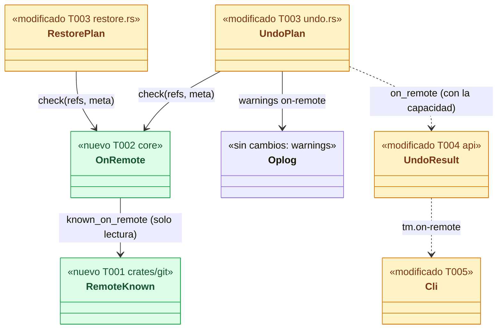
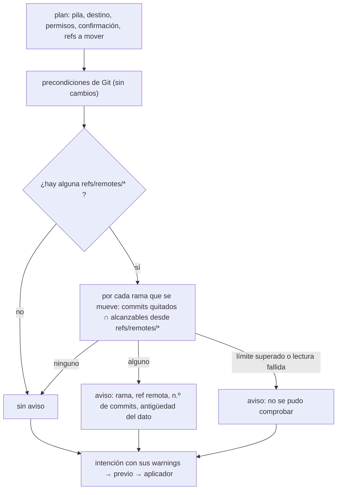
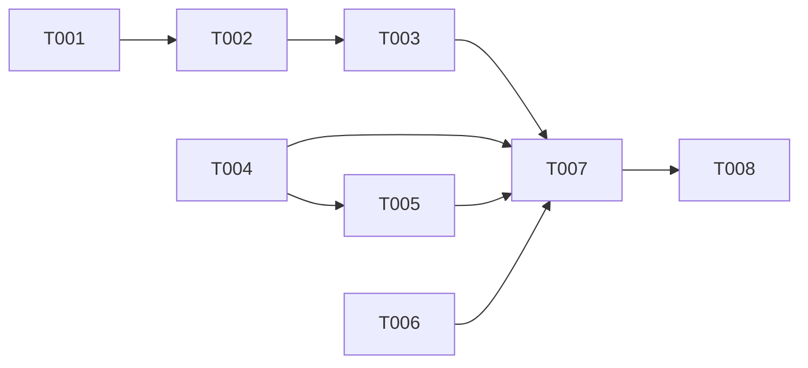

# DS-US-TMC-014 · Aviso de que lo deshecho sigue en el remoto

## Contexto rápido

Al terminar, cada escritura de la Time Machine que mueve una rama local (undo, redo y restauración) comprueba al planificar, en solo lectura y sin red, si alguno de los commits que quita de esa rama es alcanzable desde una ref de seguimiento remoto **local** (`refs/remotes/*`). Si lo es, la operación sigue en local igual que antes y su resultado dice qué rama, qué ref remota, cuántos commits y **de cuándo es el dato** (la última vez que el repo actualizó esa ref con un fetch o un push). Sin ref remota, sin commits publicados o sin remoto configurado: ni aviso ni error. La Time Machine nunca hace fetch, push ni force-push (D-TMC-14, SEC-TMC-05).

**Esta ficha no cambia qué se deshace.** El plan, la regla de permisos, la confirmación, las precondiciones y el aplicador de DS-US-TMC-002 y DS-US-TMC-009 quedan igual. Solo añade:

| Añade | Dónde |
|---|---|
| Lectura "commits quitados que conoce el remoto", acotada y con gitoxide | `crates/git/src/remote_known.rs` (a crear) |
| Comprobación compartida del plan y su código de aviso en el oplog | `crates/core/src/timemachine/on_remote.rs` (a crear) |
| Llamada en el plan del undo y de la restauración | `undo.rs`, `restore.rs` |
| `on_remote` en `UndoResult`, `RestoreResult` y la proyección MCP, con la capacidad `timemachine.on-remote` | `crates/api/src/timemachine.rs`, `crates/api/src/methods/timemachine.rs` |
| Textos en/es en `raptor undo` y `raptor restore` | `apps/cli/src/undo/mod.rs`, `apps/cli/src/commands/restore.rs`, `apps/cli/i18n/{en,es}/timemachine.txt` |
| Puerta estática: gitoxide sin cliente de red | `crates/git/tests/static_check.rs` |

Lo que ya existe y se reutiliza:
- `RepoReader::remote_branches` (`crates/git/src/reader.rs:290`), que ya salta los simbólicos (`origin/HEAD`).
- El recorrido con refs ocultas de `guard_paths.rs` (`Hide::RemoteTracking`, `hidden_tips`, `crates/git/src/guard_paths.rs:262`) como modelo de lectura acotada.
- `branch_tips(common_dir)` (`crates/core/src/timemachine/continuous.rs:686`) para la punta actual de cada rama.
- `Meta.branches` (`crates/core/src/timemachine/store/meta.rs:23`), la punta destino de cada rama.
- `observe::fetched_utc_ms` (`crates/core/src/observe.rs:55`, DEP-CKP-4): hora de `FETCH_HEAD`, nunca futura.
- `age`/`Text::Ago` de `apps/cli/src/present/i18n.rs:93`, para la antigüedad.
- `NewOperation.warnings` (`crates/core/src/timemachine/oplog/model.rs:237`), cuyo comentario ya prevé el aviso "already pushed".

Hoy no hay ninguna comprobación del remoto: `apply/mod.rs:26` dice que el aviso "already pushed" (US-TMC-014) vive fuera del aplicador, y `undo.rs::plan` (`undo.rs:379-603`) solo calcula los avisos de refs conservadas (`kept_ref_warning`).

| Término | Qué es aquí |
|---|---|
| Commit quitado | Commit alcanzable desde la punta actual de una rama local que la operación mueve y no desde su punta destino. Si la operación borra la rama, el que no queda alcanzable desde ninguna otra rama local |
| Conocido en el remoto | Commit quitado alcanzable desde alguna ref no simbólica bajo `refs/remotes/` que el repo ya tiene, de cualquier remoto |
| Dato del remoto | Lo que el repo sabe del remoto: sus `refs/remotes/*`. Se actualiza solo cuando el usuario o un agente hacen fetch, pull o push. GitRaptor nunca lo refresca |
| Antigüedad del dato | Tiempo desde la última entrada del reflog de esa ref remota; sin reflog, desde `FETCH_HEAD`; sin ninguno, "desconocida" |

⚠️ **ASSUMPTION**: no existe `architecture-constitution.md` en la cascada; rigen `AGENTS.md` y los ADR listados.

---

## ⚠️ Gaps y violaciones de la constitución

_No gaps. Ready to implement._ Depende solo de código que ya está en `main` (`undo_last`, `restore_to`). Redo (DS-US-TMC-003), `--since` (DS-US-TMC-010) y `--agent` (DS-US-TMC-011) están en `draft` y sin código: cada una llama a `on_remote::check` cuando aterrice (§ Enmiendas, E3). La que se mezcle segunda añade la llamada.

---

## 🔭 La forma



🟩 nuevo · 🟨 modificado.

### Dónde entra en el plan



El aviso nunca rechaza, nunca pide confirmación y nunca cambia el plan (D4).

### Diseño

**Lectura** (T001), en `crates/git` porque es la única crate que lee repos (ADR-GRP-009). `RepoReader::known_on_remote(moves, limits)`:

1. Lee las puntas de `refs/remotes/*`, saltando las simbólicas y las que no son commits (como `hidden_tips`). Si no hay ninguna, devuelve `OnRemote::None` sin recorrer nada: el escenario 4 cuesta una lectura de refs.
2. Por cada `BranchMove { branch, from, to }`, los commits quitados: `rev_walk([from]).with_hidden(to)`, con `to` = la punta destino, o, si la rama desaparece, las puntas de las demás ramas locales. Como mucho `limits.removed` commits.
3. Por cada punta remota `R`: `rev_walk([R]).with_hidden(to)` hasta `limits.visited` commits en total; cuenta los quitados que encuentra y guarda el más reciente. Una punta remota igual a `from` o descendiente suya da todos los quitados sin seguir. Cada recorrido se corta al bajar de la fecha de commit del quitado más antiguo menos un margen (`limits.date_margin`, 1 día) y sale en cuanto ha encontrado todos los quitados. Con el corte por fecha, un commit con fecha manipulada puede quedar sin ver; el margen lo acota y el aviso sigue siendo informativo (D10). Además lleva el conjunto de **commits quitados distintos** conocidos en algún remoto: `OnRemote::Known { refs, distinct }`. Un commit que está en dos remotos cuenta una vez.
4. Para cada ref remota con al menos un commit quitado, la antigüedad del dato: hora de la última entrada de su reflog (fetch y push escriben en él). Sin reflog, `None`, y el núcleo pone `FETCH_HEAD`.
5. Si se supera un límite, el repo es superficial y falta un padre, o falla una lectura: `OnRemote::Unverified(causa)`. Nunca "no está en el remoto" sin haberlo comprobado.

Sin réplicas (`RepoReader::open` ya las ignora), sin commit-graph y sin red: `gix` está compilado sin cliente de red (`Cargo.toml:27`: `default-features = false`, sin `blocking-network-client` ni `async-network-client`). `gix-protocol` y `gix-transport` sí están en el grafo como dependencias obligatorias, pero sin transporte cliente. T006 comprueba el grafo resuelto con `cargo metadata` y lo convierte en puerta estática.

**Comprobación compartida** (T002). `on_remote::check(common_dir, refs, target, now_ms) -> RemoteNotice`. Construye los `BranchMove` con `branch_tips(common_dir)` (punta actual) y `target.branches` (punta destino), solo para las `refs/heads/*` del conjunto que la operación mueve y cuyo valor cambia. Pone `FETCH_HEAD` (`observe::fetched_utc_ms`) como antigüedad cuando el reflog no la da, y limita cada fecha a `now_ms`. Devuelve los avisos para el oplog con `on_remote::warnings`:
- `on-remote:<rama>:<ref remota>:<n>` por cada par, como mucho `MAX_REPORTED_REFS`. Los nombres de ref no pueden llevar `:` (`git check-ref-format`).
- `on-remote-unverified:<causa>` si no se pudo comprobar.

**En el plan** (T003). En `undo_last` (`undo.rs:701`), después de las precondiciones de Git (`undo.rs:815-827`) y antes de construir `ProtectedRequest` (`undo.rs:834`), con el lock del repo tomado: `on_remote::check(&repo.repo.common_dir, &planned.refs, &meta, now_ms())`. Sus avisos se añaden **solo** a `req.warnings`, así quedan en la intención del oplog (auditoría inmutable, ADR-TMC-003). Nunca van a `planned.warnings` ni a `UndoDone.warnings`/`RestoreDone.warnings`: `undo.rs:895` y `conn.rs:3189-3194` los copiarían a `UndoResult.warnings` de cualquier cliente, con o sin la capacidad. Al cliente solo llegan por `on_remote`. `meta` es la del destino que ya leyó `plan` (`undo.rs:502`): `Planned` gana `target_meta: Meta`. En `restore_to` (`restore.rs:395`), lo mismo, después de sus precondiciones (`restore.rs:772-783`) y antes de `ProtectedRequest` (`restore.rs:791`), con las `refs` del plan y la meta del punto. Una rama conservada (`kept`) no se mueve, así que no entra.

Un rechazo posterior (previo fallido, ref movida en el aplicador) no muestra el aviso: el resultado de error no lo lleva, aunque la intención lo registró.

**Contrato** (T004). Con la capacidad `timemachine.on-remote`, `UndoResult.on_remote` y `RestoreResult.on_remote` llevan `OnRemoteReport`, con `commits_total` = commits quitados distintos. `McpUndoResult.on_remote_commits` lleva ese mismo total (`for_mcp`). Sin la capacidad, nada nuevo. Los dos resultados tienen `deny_unknown_fields`, así que un cliente viejo no puede recibir el campo: el daemon lo omite. El cliente de la CLI anuncia todas las capacidades del catálogo (`crates/core/src/client.rs:77`).

**Textos** (T005). Después de `undo.saved` (`apps/cli/src/undo/mod.rs:121-124`) y del resumen de `raptor restore`: una línea `tm.on-remote` por par rama-ref remota y `tm.on-remote-unverified` si toca. Los nombres de rama y de ref son texto del repo (`Untrusted::sanitized`). La antigüedad, con el mismo formato que la flota del Cockpit (`age`, `present/i18n.rs:93`). Con `--json` sale el campo tal cual.

---

## 🚀 Plan de implementación

> Orden topológico (`Depende:`). Todo sobre código en `main`.

### El trabajo de un vistazo

| # | Tarea | Depende | Aterriza en |
|---|---|---|---|
| T001 | Leer qué commits quitados conoce el remoto | — | `crates/git/src/remote_known.rs`, `crates/git/src/lib.rs` |
| T002 | Comprobación compartida y avisos del oplog | T001 | `crates/core/src/timemachine/on_remote.rs`, `crates/core/src/timemachine/mod.rs` |
| T003 | Llamarla en el plan del undo y de la restauración | T002 | `crates/core/src/timemachine/{undo,restore}.rs` |
| T004 | Ampliar el contrato | — | `crates/api/src/timemachine.rs`, `crates/api/src/methods/timemachine.rs`, `crates/core/src/channel/conn.rs`, `apps/mcp/src/undo_note.rs` |
| T005 | Mostrarlo en la CLI | T004 | `apps/cli/src/undo/mod.rs`, `apps/cli/src/commands/restore.rs`, `apps/cli/i18n/{en,es}/timemachine.txt` |
| T006 | Puerta estática: sin red | — | `crates/git/tests/static_check.rs` |
| T007 | Probar los escenarios | T003, T004, T005, T006 | `crates/core/tests/us_tmc_014.rs`, `apps/cli/tests/us_tmc_014_process.rs` |
| T008 | Cerrar la historia | T001-T007 | `docs/` |

### En qué orden



### T001 — Leer qué commits quitados conoce el remoto

**Ubicación.** `crates/git/src/remote_known.rs` (**CREATE**); `crates/git/src/lib.rs` (**MODIFY**: `mod remote_known;` y su `pub use`, una línea cada uno)

**Reglas**
- `impl RepoReader { pub fn known_on_remote(&self, moves: &[BranchMove<'_>], limits: &RemoteLimits) -> Result<OnRemote, ReadError> }` con § Diseño, puntos 1 a 5.
- Solo `refs/remotes/*` no simbólicas que apuntan a un commit; ninguna otra ref cuenta (tags, notas, `refs/stash`).
- Si `limits.tips` no basta para todas las puntas remotas, `Unverified(TooManyRemoteRefs)`: cortar daría un "no publicado" falso.
- `remote_ref_updated_ms(full_name) -> Option<i64>`: la hora de la última línea del reflog (`reflog_iter_rev`, firma de la línea), en ms. No cambia `ReflogEntry` (`reader.rs:74`), que comparten otros.
- Sin escritura, sin lock, sin réplicas ni commit-graph, sin `find_remote` ni `connect`.
- **Refs:** ADR-TMC-002 § 4, ADR-GRP-009, SEC-TMC-05
- Corte por fecha de commit y salida temprana (§ Diseño, punto 3). `OnRemote::Known { refs, distinct }`, con `distinct` = commits quitados distintos conocidos en algún remoto.
- **Aceptación** (unitarias en `remote_known.rs`): `no_remote_refs_means_none_without_walking`, `a_pushed_commit_is_known`, `a_local_only_commit_is_not`, `partly_pushed_counts_only_the_pushed`, `any_remote_counts_not_only_origin`, `a_commit_on_two_remotes_counts_once`, `symbolic_remote_head_is_skipped`, `a_deleted_branch_hides_the_other_local_branches`, `past_the_limit_is_unverified`, `a_shallow_gap_is_unverified`, `the_age_is_the_last_reflog_line`, `the_walk_stops_below_the_oldest_removed_date`, `the_walk_stops_when_all_are_found`. Medición: `known_on_remote` en el repo de 100K commits de INF-GRP-002, con el tiempo anotado en el PR

### T002 — Comprobación compartida y avisos del oplog

**Ubicación.** `crates/core/src/timemachine/on_remote.rs` (**CREATE**); `crates/core/src/timemachine/mod.rs` (**MODIFY**: `pub mod on_remote;`)

**Reglas**
- `check(common_dir, refs, target, now_ms) -> RemoteNotice` (§ Diseño, **Comprobación compartida**). Abre el lector con `ReaderOptions::default()` sobre el directorio común, como `branch_tips`. Si no se puede abrir: `RemoteNotice { unverified: Some(Read) }`.
- Antigüedad: `remote_ref_updated_ms` o, en su defecto, `observe::fetched_utc_ms(common_dir, now_ms)`; siempre `≤ now_ms`.
- `warnings(&RemoteNotice) -> Vec<String>` con los códigos `ON_REMOTE_WARNING` (`"on-remote"`) y `ON_REMOTE_UNVERIFIED_WARNING` (`"on-remote-unverified"`).
- `parse_warning(&str) -> Option<OnRemoteItem>` para leerlos del oplog, que es entrada no confiable al releerse (SEC-TMC-09): número acotado y nombres validados con `RefName`.
- **Refs:** ADR-TMC-002 § 4, ADR-TMC-003 § 2
- **Aceptación:** `on_remote.rs`: `only_branches_that_move_are_checked`, `fetch_head_when_no_reflog`, `the_age_is_never_in_the_future`, `warnings_round_trip`, `a_forged_warning_is_ignored`

### T003 — Llamarla en el plan del undo y de la restauración

**Ubicación.** `crates/core/src/timemachine/undo.rs`, `crates/core/src/timemachine/restore.rs` (**MODIFY**)

**Reglas**
- `Planned` gana `target_meta: Meta` (ya leída en `undo.rs:502`). `UndoDone` y `RestoreDone` ganan `on_remote: RemoteNotice` (`Default` = vacío).
- La llamada, después de las precondiciones y antes de `ProtectedRequest`, con el lock del repo (§ Diseño, **En el plan**). Sus avisos van al final de `req.warnings` y **solo ahí**: nunca a `planned.warnings` ni a `UndoDone.warnings`/`RestoreDone.warnings` (`undo.rs:895`, `conn.rs:3189-3194`).
- Sin efecto en la decisión: ningún camino de error nuevo, ningún motivo de rechazo nuevo.
- `undo.rs::plan` sigue leyendo los avisos de una restauración por prefijo exacto (`recreated-worktree:`); los `on-remote:` no lo afectan.
- **Refs:** ADR-TMC-002 § 3 y § 4, ADR-TMC-005 § 4
- **Aceptación:** `undo.rs`: `the_undo_records_the_remote_warning_at_intent`; `restore.rs`: `a_restore_that_takes_pushed_commits_off_warns`; `conn.rs`: `result_warnings_never_carry_on_remote_codes` (undo y restauración, con y sin la capacidad)

### T004 — Ampliar el contrato

**Ubicación.** `crates/api/src/timemachine.rs`, `crates/api/src/methods/timemachine.rs` (**MODIFY**, al final); `crates/core/src/channel/conn.rs` (**MODIFY**: `undo_result` en `conn.rs:3177`, `restore_result` en `conn.rs:3120`, `tm_undo` en `conn.rs:3757`)

**Reglas**
- `OnRemoteReport { refs: Vec<OnRemoteView>, commits_total: u64, unverified: bool }`; `OnRemoteView { branch: Untrusted, remote_ref: Untrusted, commits: u64, data_utc_ms: Option<i64> }`; como mucho `MAX_REPORTED_REFS`. `commits_total` = `OnRemote::Known.distinct`.
- `UndoResult.on_remote: Option<OnRemoteReport>` y `RestoreResult.on_remote: Option<OnRemoteReport>`, con `serde(default, skip_serializing_if = "Option::is_none")`. `McpUndoResult.on_remote_commits: Option<u64>`, igual, que `for_mcp` toma de `commits_total`. Sin nombres ni fechas por MCP (D9).
- Texto fijo para la descripción de la herramienta MCP de undo (SEC-12: sin texto del repo), `UNDO_ON_REMOTE_NOTE` en `apps/mcp/src/undo_note.rs` (**CREATE**): "If on_remote_commits > 0, those commits are still published: do not push or force-push to fix it; tell the developer." Hoy `apps/mcp` no expone el undo (solo `STATUS_TOOL`, `server.rs:94`); la historia del MCP que lo exponga añade esta nota a su descripción.
- `CAP_TM_ON_REMOTE = Capability::new("timemachine.on-remote")`, al final de `GROUP.capabilities`.
- `conn.rs` rellena el campo solo con `self.has(CAP_TM_ON_REMOTE.name)` y solo si hay algo que avisar.
- **Refs:** ADR-GRP-016, NFR-TMC-14, SEC-12
- **Aceptación:** `undo_result_on_remote_wire_form`, `without_the_capability_nothing_new`, `mcp_gets_only_the_count`, `mcp_count_is_the_distinct_total`; `undo_note.rs`: `the_undo_note_forbids_push_and_force_push` (el texto nombra `on_remote_commits`, push y force-push, y no lleva marcadores de texto del repo)

### T005 — Mostrarlo en la CLI

**Ubicación.** `apps/cli/src/undo/mod.rs` (`print_done`), `apps/cli/src/commands/restore.rs`, `apps/cli/i18n/{en,es}/timemachine.txt` (**MODIFY**, claves al final)

**Reglas**
- Una línea `tm.on-remote` por cada `OnRemoteView`; `tm.on-remote-age-unknown` cuando `data_utc_ms` es `None`; `tm.on-remote-unverified` si `unverified`; `tm.on-remote-more` si se cortó en `MAX_REPORTED_REFS`. Si hubo alguna línea de commits en el remoto, una sola `tm.on-remote-next` al final.
- Plurales reales: cada clave con número tiene su forma `.one` y `.other` (`tm.on-remote.one`/`.other`, `tm.on-remote-age-unknown.one`/`.other`, `tm.on-remote-more.one`/`.other`), elegida por la CLI según `{count}`.
- La ayuda de `raptor undo` y `raptor restore` gana `tm.on-remote-help`.
- Las líneas salen por stdout, después de `undo.saved` o del resumen de la restauración. El código de salida no cambia (éxito).
- **Aceptación:** `every_on_remote_line_has_en_and_es` (los dos catálogos tienen todas las claves y formas de plural con los mismos marcadores), `one_commit_reads_singular`, `the_next_step_names_git_revert_and_never_force_push`, `the_help_says_the_notice_is_local_data`

### T006 — Puerta estática: sin red

**Ubicación.** `crates/git/tests/static_check.rs` (**MODIFY**: un `mod` nuevo al final)

**Reglas**
- `gix_has_no_network_client`: corre `cargo metadata --format-version 1` y lee `resolve` (features resueltas de cada paquete). Falla si:
  - `gix` tiene `blocking-network-client`, `async-network-client` o `blocking-http-transport-*`;
  - `gix-transport` tiene `blocking-client`, `async-client` o `http-client*`;
  - aparece en el grafo `curl`, `reqwest` o `ureq`.
  `gix-protocol` y `gix-transport` ya están en el grafo como dependencias obligatorias; lo que cuenta son sus features. La comprobación es una función pura sobre el JSON (`network_features(metadata) -> Vec<String>`).
- `remote_known_never_connects`: `remote_known.rs` no contiene `connect(`, `find_remote`, `remote_at` ni `fetch`.
- La lista `FORBIDDEN` de `repo_intact_tm_write` (`static_check.rs:153`) ya cubre push, fetch y force-push de la capa de escritura; no se toca.
- **Refs:** SEC-TMC-05, ADR-TMC-002 Validación 1
- **Aceptación:** los dos tests en verde sobre el workspace; `network_features` en rojo con un JSON de metadata de fixture que activa `blocking-network-client` en `gix`, `http-client-curl` en `gix-transport` y trae `reqwest`

### T007 — Probar los escenarios

Ver § 9.4.

### T008 — Cerrar la historia

US-TMC-014 a `implemented`. El orquestador integra D-TMC-46 en `business-rules.md`, las enmiendas E1 y E2 en ADR-TMC-002 y `non-functional.md`, y la capacidad en `docs/architecture/design/api-contract-ipc.md`.

El redo del escenario 3 se certifica en DS-US-TMC-003 (E3): allí se amplía `no_undo_redo_or_restore_reaches_the_remote` al redo, y esa ampliación es obligatoria para cerrar DS-US-TMC-003. Esta historia se cierra con undo y restauración.

## Estructura de ficheros

```text
crates/git/src/remote_known.rs                        ← CREATE  (T001)
crates/git/src/lib.rs                                 ← MODIFY  (T001: mod + pub use)
crates/core/src/timemachine/on_remote.rs              ← CREATE  (T002)
crates/core/src/timemachine/mod.rs                    ← MODIFY  (T002: una línea)
crates/core/src/timemachine/{undo,restore}.rs         ← MODIFY  (T003)
crates/api/src/timemachine.rs                         ← MODIFY  (T004)
crates/api/src/methods/timemachine.rs                 ← MODIFY  (T004: capacidad al final)
crates/core/src/channel/conn.rs                       ← MODIFY  (T004)
apps/cli/src/undo/mod.rs, apps/cli/src/commands/restore.rs ← MODIFY (T005)
apps/cli/i18n/{en,es}/timemachine.txt                 ← MODIFY  (T005: claves al final)
apps/mcp/src/undo_note.rs (+ `mod` en main.rs)        ← CREATE  (T004: nota fija de la herramienta MCP de undo)
crates/git/tests/static_check.rs                      ← MODIFY  (T006)
crates/core/tests/us_tmc_014.rs, apps/cli/tests/us_tmc_014_process.rs ← CREATE (T007)
```

## Contratos compartidos

### Tipos y datos compartidos

```rust
// crates/git/src/remote_known.rs (T001)
pub struct BranchMove<'a> { pub branch: &'a str, pub from: &'a str, pub to: Option<&'a str> }
pub struct RemoteLimits { pub removed: usize, pub visited: usize, pub tips: usize, pub date_margin_s: i64 }
impl Default for RemoteLimits { /* removed 10_000, visited 200_000, tips 4_096, date_margin_s 86_400 */ }
pub struct KnownOnRemote {
    pub branch: String,          // refs/heads/…
    pub remote_ref: String,      // refs/remotes/…
    pub commits: usize,          // quitados que esa ref alcanza
    pub newest: String,          // el más reciente de ellos (hex)
    pub updated_ms: Option<i64>, // última línea del reflog de remote_ref
}
pub enum Unverified { TooManyRemoteRefs, TooManyCommits, Shallow, Read }
pub enum OnRemote { None, Known { refs: Vec<KnownOnRemote>, distinct: usize }, Unverified(Unverified) }

// crates/core/src/timemachine/on_remote.rs (T002)
pub const ON_REMOTE_WARNING: &str = "on-remote";
pub const ON_REMOTE_UNVERIFIED_WARNING: &str = "on-remote-unverified";
#[derive(Debug, Clone, Default, PartialEq, Eq)]
pub struct RemoteNotice { pub items: Vec<OnRemoteItem>, pub distinct: usize, pub unverified: Option<Unverified> }
pub struct OnRemoteItem { pub branch: String, pub remote_ref: String, pub commits: usize, pub data_utc_ms: Option<i64> }

// crates/api/src/timemachine.rs (T004)
pub struct OnRemoteReport { pub refs: Vec<OnRemoteView>, pub commits_total: u64, pub unverified: bool }
pub struct OnRemoteView { pub branch: Untrusted, pub remote_ref: Untrusted, pub commits: u64, pub data_utc_ms: Option<i64> }
```

### Ciclos de vida (DI)

Sin estado nuevo. El lector se abre y se suelta dentro de cada `check`, con el lock del repo ya tomado por el undo o la restauración (ADR-CKP-002 § 5).

### Firmas del stack

```rust
impl RepoReader {
    pub fn known_on_remote(&self, moves: &[BranchMove<'_>], limits: &RemoteLimits) -> Result<OnRemote, ReadError>;
    pub fn remote_ref_updated_ms(&self, full_name: &str) -> Option<i64>;
}
pub fn check(common_dir: &Path, refs: &BTreeSet<String>, target: &Meta, now_ms: i64) -> RemoteNotice; // on_remote.rs
pub fn warnings(notice: &RemoteNotice) -> Vec<String>;
pub fn parse_warning(code: &str) -> Option<OnRemoteItem>;
```

## Contrato de API

| Método | Canal | Parámetros | Resultado |
|---|---|---|---|
| `timemachine.undo` | CLI/TUI y MCP | sin cambios | con `timemachine.on-remote`: `on_remote: OnRemoteReport` (CLI/TUI) u `on_remote_commits` (MCP), solo si hay algo que avisar |
| `timemachine.restore` | CLI/TUI (no MCP) | sin cambios | con la capacidad, `on_remote: OnRemoteReport` |
| `timemachine.redo` | CLI/TUI | — | lo añade DS-US-TMC-003 al aterrizar (E3) |

### Forma del error y del cuerpo de respuesta

Sin códigos nuevos. El aviso nunca es un error: la operación termina con éxito.

```json
{ "on_remote": { "refs": [ { "branch": "refs/heads/feat-login", "remote_ref": "refs/remotes/origin/feat-login",
  "commits": 1, "data_utc_ms": 1761645600000 } ], "commits_total": 1, "unverified": false } }
```

### Valores numéricos

| Concepto | Valor | Fuente |
|---|---|---|
| Commits quitados recorridos por rama | 10 000 | ⚠️ ASSUMPTION |
| Commits visitados desde las puntas remotas | 200 000 en total (el doble de `PathLimits.visited`, `guard_paths.rs:40`, que vale 100 000) | ⚠️ ASSUMPTION; se mide en T007 en el repo de 100K de INF-GRP-002 |
| Puntas remotas leídas | 4 096 | `PathLimits.tips` (`guard_paths.rs:41`) |
| Margen del corte por fecha | 1 día antes de la fecha de commit del quitado más antiguo | ⚠️ ASSUMPTION (relojes desviados y commits reescritos) |
| Pares rama-ref remota informados | `MAX_REPORTED_REFS` = 64 | `crates/api/src/timemachine.rs:24` |
| Conexiones de red durante cualquier undo, redo o restauración | 0 | SEC-TMC-05 |

### i18n

| Clave | en | es |
|---|---|---|
| `tm.on-remote.one` | {branch}: 1 commit taken off the branch was on the remote ({remote}) the last time this repo saw it (fetch or push), {age} ago | {branch}: 1 commit quitado de la rama estaba en el remoto ({remote}) la última vez que este repo lo vio (fetch o push), hace {age} |
| `tm.on-remote.other` | {branch}: {count} commits taken off the branch were on the remote ({remote}) the last time this repo saw it (fetch or push), {age} ago | {branch}: {count} commits quitados de la rama estaban en el remoto ({remote}) la última vez que este repo lo vio (fetch o push), hace {age} |
| `tm.on-remote-age-unknown.one` | {branch}: 1 commit taken off the branch was on the remote ({remote}), according to the last thing this repo knows about the remote (when that data is from is unknown) | {branch}: 1 commit quitado de la rama estaba en el remoto ({remote}), según lo último que este repo sabe del remoto (no se sabe de cuándo es el dato) |
| `tm.on-remote-age-unknown.other` | {branch}: {count} commits taken off the branch were on the remote ({remote}), according to the last thing this repo knows about the remote (when that data is from is unknown) | {branch}: {count} commits quitados de la rama estaban en el remoto ({remote}), según lo último que este repo sabe del remoto (no se sabe de cuándo es el dato) |
| `tm.on-remote-next` | Your local branch is now behind the remote: a pull brings them back. To take them off the remote without rewriting its history, use a revert commit (git revert). GitRaptor never touches the remote. | Tu rama local quedó por detrás del remoto: un pull los vuelve a traer. Para retirarlos del remoto sin reescribir su historia, usa un commit de reversión (git revert). GitRaptor nunca toca el remoto. |
| `tm.on-remote-unverified` | could not check whether the commits taken off the branch are on the remote; only your local copy changed. GitRaptor never touches the remote | no se pudo comprobar si los commits quitados de la rama están en el remoto; solo cambió tu copia local. GitRaptor nunca toca el remoto |
| `tm.on-remote-more.one` | and 1 more remote branch | y 1 rama remota más |
| `tm.on-remote-more.other` | and {count} more remote branches | y {count} ramas remotas más |
| `tm.on-remote-help` | the remote notice is based on what this repo knows; a push from another clone is not seen until a fetch | el aviso de remoto se basa en lo que este repo sabe; un push desde otro clon no se ve hasta un fetch |

---

## Modelo de datos

Sin migraciones. Los avisos van en la columna de avisos de la intención que ya existe (`NewOperation.warnings`), con los códigos de T002.

---

## Estrategia de pruebas y cobertura

### 9.1 Pirámide de pruebas

| Tipo | Cantidad | Tareas dueñas | Herramientas | Cuándo |
|---|---:|---|---|---|
| Unit | 28 | T001-T006 | `cargo test` | PR gate |
| Integration | 10 | T007 | `cargo test -p gitraptor-core --test us_tmc_014` | PR gate |
| E2E | 2 | T007 | `cargo test -p gitraptor-cli --test us_tmc_014_process` | PR gate (macOS) |

### 9.2 Umbrales de cobertura

| Capa | Línea | Rama | Mutación | Camino crítico 100% |
|---|---:|---:|---:|:---:|
| `remote_known.rs`, `on_remote.rs` | — | — | — | nunca "no publicado" sin comprobar (límite o fallo → `unverified`); sin `refs/remotes` → sin aviso ni error; el aviso nunca cambia el resultado de la operación |

### 9.3 Datos de prueba

- Repos temporales del testkit y perfil temporal, nunca el repo real (NFR-01).
- **Remoto**: un repo bare temporal como `origin` (URL `file://`), al que el test empuja con su propio `git` antes de llamar a GitRaptor. Para la captura de red, se cambia la URL de `origin` a `http://127.0.0.1:<puerto>/r.git`, con un `TcpListener` del test que cuenta las conexiones aceptadas.
- Huella del bare (refs y objetos) antes y después: el remoto no recibe nada.

### 9.4 Comportamientos críticos verificados

| Escenario | Test |
|---|---|
| 1. Deshacer un commit ya empujado | `us_tmc_014.rs::undoing_a_pushed_commit_warns_and_stays_local`: commit en `feat-login`, `git push -u origin feat-login`, `raptor undo` (sin atribuir, CLI). El commit sale de `feat-login` en local; `on_remote.refs = [{feat-login, refs/remotes/origin/feat-login, 1, data_utc_ms ≈ push}]`; la intención del oplog lleva `on-remote:refs/heads/feat-login:refs/remotes/origin/feat-login:1`; huella del bare igual; 0 conexiones al listener. e2e `us_tmc_014_process.rs::the_remote_notice_reads_in_en_and_es`: `raptor undo` imprime `tm.on-remote` con la rama, la ref remota, 1 commit y la antigüedad, en en y es |
| 2. Commit que no se empujó | `an_unpushed_commit_has_no_notice`: `origin` configurado, `feat-login` empujada y después un commit nuevo solo local → undo de ese commit sin `on_remote` ni aviso en el oplog |
| 2b. Empujado en parte | `only_the_pushed_part_is_reported`: dos commits en `feat-login`, solo el primero empujado; `raptor restore` a un punto anterior a los dos → la restauración quita los dos y el aviso dice `commits = 1` (G2) |
| 3. La Time Machine nunca empuja | `no_undo_redo_or_restore_reaches_the_remote`: undo, restauración y (cuando exista) redo sobre una rama con remoto `http://127.0.0.1:<puerto>`: 0 conexiones aceptadas y huella del bare igual. Estático: `static_check.rs::gix_has_no_network_client`, `remote_known_never_connects` y la lista `FORBIDDEN` existente |
| 4. Rama sin remoto configurado | `a_branch_without_remote_has_no_notice_and_no_error`: repo sin ningún remoto → undo con éxito, sin `on_remote`, sin aviso en el oplog. Variante `a_remote_without_tracking_refs`: `origin` configurado pero nunca traído → igual |
| Otro remoto, no `origin` | `a_commit_on_any_remote_counts`: empujado solo a `upstream` → aviso con `refs/remotes/upstream/feat-login` |
| Rama borrada por el undo | `undoing_a_branch_creation_warns_for_its_pushed_commits`: se crea `feat-x`, se empuja, se deshace la creación → aviso por los commits que ya no alcanza ninguna rama local |
| No se pudo comprobar | `a_shallow_clone_is_unverified_and_still_undoes`: clon superficial → éxito con `unverified = true` y `tm.on-remote-unverified` |
| Clon parcial, sin red | `a_partial_clone_undo_makes_no_connection`: clon parcial (`--filter=blob:none`) con el promisor en el listener de loopback; undo de un commit empujado → 0 conexiones aceptadas, aviso o `unverified`, nunca una descarga de objetos |
| Un commit en dos remotos | `a_commit_on_two_remotes_counts_once`: empujado a `origin` y `upstream` → dos `OnRemoteView` y `commits_total = 1`; por MCP `on_remote_commits = 1` |
| Avisos solo en el oplog | `result_warnings_never_carry_on_remote_codes`: `UndoResult.warnings` y `RestoreResult.warnings` sin ningún `on-remote*`, con y sin la capacidad; la intención del oplog sí los lleva |
| Sin capacidad | `conn` unitario `without_the_capability_nothing_new`: la respuesta es byte a byte la de hoy |
| Dato viejo | `the_age_falls_back_to_fetch_head`: ref remota sin reflog (`core.logAllRefUpdates=false`) y `FETCH_HEAD` de hace 3 h → `data_utc_ms` = esa hora |
| Repo intacto | huella del testkit antes y después en todos, salvo lo que la operación cambia |

### 9.5 Plataformas

| Plataforma | Cómo se verifica | Pendiente |
|---|---|---|
| macOS | `cargo clippy --workspace --all-targets -- -D warnings`, `cargo test --workspace` en Apple Silicon | — |
| Linux | `us_tmc_014.rs` con `cfg(any(macos, linux))`; el e2e `us_tmc_014_process.rs` con `cfg(target_os = "macos")` si usa pty | **Pendiente: etapa de validación multiplataforma** (XP-56) |
| Windows | Compila; el aplicador devuelve `Unsupported` en Windows (DS-US-TMC-002), así que la comprobación no llega a correr | **Pendiente: etapa de validación multiplataforma** (hora del reflog y de `FETCH_HEAD`, listener de loopback y firewall) (XP-56) |

---

## Gate de seguridad

- **Sin red** (SEC-TMC-05, NFR-02): la lectura usa solo refs y objetos locales; `gix` no tiene cliente de red y T006 lo convierte en puerta de CI. La capa de escritura ya tiene prohibidos `push`, `fetch` y `remote` (`static_check.rs:153`), y toda invocación de Git del motor lleva `-c protocol.allow=never` (`crates/git/src/invoke.rs:124`), así que ni un clon parcial descarga objetos del promisor (`a_partial_clone_undo_makes_no_connection`).
- **Solo lectura**: ningún lock de Git, ninguna escritura en el repo; el lector no expone `gix::Repository` (`reader_does_not_expose_the_repository`).
- **Texto del repo no confiable** (SEC-12): nombres de rama y de ref como `Untrusted`, saneados en la terminal; nada de eso por MCP.
- **Oplog releído** (SEC-TMC-09): `parse_warning` valida los nombres con `RefName` y acota el número; un aviso falsificado se ignora.
- **Refs remotas falsificables**: un agente puede escribir `refs/remotes/*` sin pasar por el remoto. El aviso es informativo y lo dice ("según lo que sabe el repo"); nunca decide nada (D4, D10).
- **Coste acotado**: tres límites (§ Valores numéricos); pasado uno, `unverified`, nunca un recorrido sin fin bajo el lock del repo.

Corre `/security-review --scope devspec docs/requirements/features/time-machine/dev-specs/US-TMC-014-undo-ya-empujado.md` antes de mezclar.

---

## Cómo extender

- **Otra operación que mueve ramas** (redo, `--since`, `--agent`): llama a `on_remote::check(common_dir, &refs, &target_meta, now_ms)` en su plan, después de sus precondiciones y antes de `ProtectedRequest`; añade `on_remote::warnings` a `req.warnings` y lleva `RemoteNotice` en su `*Done`. Su resultado gana `on_remote: Option<OnRemoteReport>` con `CAP_TM_ON_REMOTE`. No se toca `on_remote.rs`.
- **Mostrarlo en la TUI**: lee `on_remote` del mismo resultado y usa las claves `tm.on-remote*`.
- Todo con el patrón de [extender sin archivos compartidos](../../../../architecture/extender-sin-archivos-compartidos.md) (ADR-GRP-016): capacidad nueva al final y archivos propios.

---

## Dependencias

| Dependencia | Cómo entra aquí |
|---|---|
| DS-US-TMC-002 | `undo_last` y su plan, donde va la llamada; `UndoResult` |
| DS-US-TMC-009 (código `restore.rs`) | `restore_to` y `RestoreResult` |
| DS-US-TMC-003 (redo, draft) | Debe llamar a `check` y llevar `on_remote` en `RedoResult` (E3) |
| DS-US-TMC-010 / DS-US-TMC-011 (draft) | Su plan de undo por periodo o por agente llama a `check` (E3) |
| TS-TMC-003 | El aplicador no cambia; el aviso vive fuera de él (`apply/mod.rs:26`) |
| DEP-CKP-4 | `observe::fetched_utc_ms`, la misma antigüedad que la flota del Cockpit |

---

## Fuera de alcance

| Ítem / no-objetivo | Historia que lo cubre | Gate (cómo se verifica) |
|---|---|---|
| Deshacer en el remoto, push, force-push o fetch | Nunca (D-TMC-8, D-TMC-14) | `no_undo_redo_or_restore_reaches_the_remote`, `gix_has_no_network_client` |
| Refrescar el dato del remoto antes de avisar | Nunca: GitRaptor no hace fetch (D2) | ídem |
| Mostrar el aviso en el timeline | US-TMC-006 (lee `warnings` del oplog si lo decide) | — |
| Aviso en la TUI | Cockpit (undo desde la TUI) | — |
| Exponer el undo por MCP (con la nota `UNDO_ON_REMOTE_NOTE` en su descripción) | Historia del MCP que exponga el undo | `mcp_gets_only_the_count`, `the_undo_note_forbids_push_and_force_push` |

---

## Decisiones

| # | Decisión | Origen |
|---|---|---|
| D1 | "Sigue en el remoto" = commit quitado de una rama local (alcanzable desde su punta actual y no desde la destino; si la rama desaparece, no alcanzable desde ninguna otra rama local) que alcanza alguna `refs/remotes/*` no simbólica, **de cualquier remoto**. ADR-TMC-002 § 4 dice `refs/remotes/*`; su Validación 6 dice `origin/*` (E1) | **Decisión del orquestador (2026-10-28), validada por Arquitecto y PO** |
| D2 | Sin red, nunca: ni fetch para refrescar el dato. Solo refs de seguimiento remoto locales leídas con gitoxide, que está compilado sin cliente de red. El aviso dice de cuándo es el dato | **Decisión del orquestador (2026-10-28), validada por Arquitecto y PO** (D-TMC-14, SEC-TMC-05) |
| D3 | Antigüedad del dato = última línea del reflog de esa ref remota (la escriben el fetch y el push); sin reflog, `FETCH_HEAD` (`observe::fetched_utc_ms`, la misma fuente que la flota del Cockpit); sin ninguno, "desconocida". Nunca en el futuro | **Decisión del orquestador (2026-10-28), validada por Arquitecto** |
| D4 | El aviso es informativo: no rechaza, no pide confirmación, no cambia el plan ni el código de salida. Se calcula al planificar, con el lock del repo, tras las precondiciones y antes de la intención, y queda en los avisos de la intención del oplog | **Decisión del orquestador (2026-10-28), validada por Arquitecto y PO** (ADR-TMC-002 § 4, BR-TMC-EDGE-001) |
| D5 | Si no se puede comprobar (límite, clon superficial, lectura fallida), la operación sigue y el aviso dice "no se pudo comprobar". Nunca "no publicado" sin haberlo comprobado. Cada recorrido se corta por fecha de commit (el quitado más antiguo menos 1 día) y sale al encontrar todos los quitados; se mide en el repo de 100K de INF-GRP-002 | **Decisión del orquestador (2026-10-28), validada por Arquitecto y PO (revisión, con cambios)** |
| D6 | Se aplica a toda escritura de la Time Machine que mueve ramas: undo (todas sus variantes), redo y restauración, con una sola función compartida. Aquí se cablean undo y restauración, que están en `main`; las demás, al aterrizar (E3) | **Decisión del orquestador (2026-10-28), validada por Arquitecto y PO** |
| D7 | El campo viaja estructurado con la capacidad `timemachine.on-remote` (ADR-GRP-016), porque `UndoResult` y `RestoreResult` rechazan campos desconocidos, con `commits_total` = commits quitados distintos (uno en dos remotos cuenta una vez). En el oplog va como código `on-remote:<rama>:<ref remota>:<n>` **solo en los avisos de la intención**: nunca en `UndoResult.warnings` ni `RestoreResult.warnings` | **Decisión del orquestador (2026-10-28), validada por Arquitecto y PO (revisión, con cambios)** |
| D8 | El texto dice que los commits quitados de la rama **estaban** en el remoto la última vez que este repo lo vio (fetch o push) y hace cuánto, con plurales reales. Después: la rama local quedó por detrás del remoto y un pull los vuelve a traer; para retirarlos del remoto sin reescribir su historia, un commit de reversión (`git revert`); GitRaptor nunca toca el remoto. Nunca recomienda force-push | **Decisión del orquestador (2026-10-28), validada por Arquitecto y PO (revisión, con cambios)** |
| D9 | Por MCP solo el número de commits distintos (`on_remote_commits`): sin nombres ni fechas (SEC-12). La descripción fija de la herramienta MCP de undo dice que, si `on_remote_commits > 0`, esos commits siguen publicados, que no haga push ni force-push para corregirlo y que avise al desarrollador (`UNDO_ON_REMOTE_NOTE`, con prueba) | **Decisión del orquestador (2026-10-28), validada por Arquitecto y PO (revisión, con cambios)** |
| D10 | Una `refs/remotes/*` escrita a mano o por un agente cuenta igual: el dato es "lo que el repo sabe del remoto". Un falso positivo solo añade un aviso; un falso negativo (ref remota borrada o desactualizada, o empuje desde otro clon) no quita la seguridad local: el undo sigue siendo recuperable | **Decisión del orquestador (2026-10-28), validada por Arquitecto y PO** |

### Decisiones de negocio nuevas (para `business-rules.md`, las integra el orquestador)

| ID | Decisión |
|---|---|
| D-TMC-46 | (D-TMC-14) Un undo, un redo o una restauración que quita de una rama local commits que, según el último dato del repo, estaban en algún remoto (cualquier `refs/remotes/*`, no solo `origin`) procede en local y avisa: qué rama, qué rama remota, cuántos commits y de cuándo es ese dato (el último fetch o push que el repo registró). Dice también que la rama local quedó por detrás del remoto (un pull los vuelve a traer) y que, para retirarlos del remoto sin reescribir su historia, está `git revert`. GitRaptor no consulta el remoto para refrescar el dato, ni hace fetch, push ni force-push. El aviso no detiene ni pide confirmación. Si no se puede comprobar, lo dice y la operación sigue. Rama sin remoto o commit no publicado: ni aviso ni error. Un push desde otro clon no se ve hasta un fetch, y la ayuda de `raptor undo` y `raptor restore` lo dice. Por MCP, solo cuántos commits, y la herramienta pide no hacer push ni force-push y avisar al desarrollador. **Decisión del orquestador (2026-10-28), validada por Arquitecto y PO (revisión, con cambios)** |

### Preguntas abiertas nuevas

| ID | Pregunta | Respuesta | Dueño |
|---|---|---|---|
| TQ-31 | SEC-TMC-05 pide "captura de red: 0 conexiones". ¿Basta con un remoto en un listener de loopback que cuenta conexiones, la huella del bare y la puerta estática, o hace falta una captura de paquetes del sistema (pide privilegios)? | **Cerrada**: en el MVP basta el listener de loopback, la huella del bare y la puerta estática sobre `cargo metadata` (T006 y § 9.4, escenario 3). Arquitecto y PO | Arquitecto / PO |
| TQ-32 | Un commit empujado desde otro clon, sin fetch en este, no da aviso: el dato local no lo sabe. ¿Se acepta en el MVP? | **Cerrada → aceptado en el MVP**: hacer fetch violaría D-TMC-14. La ayuda de `raptor undo` y `raptor restore` lo dice (`tm.on-remote-help`) | PO |

### Enmiendas a ADR

| # | ADR | Enmienda | Estado |
|---|---|---|---|
| E1 | ADR-TMC-002 § 4 y Validación 6 | Cualquier `refs/remotes/*` (Validación 6 decía `refs/remotes/origin/*`). Antigüedad del dato: reflog de la ref remota y, sin él, `FETCH_HEAD`. Se aplica a undo, redo y restauración. Si no se puede comprobar, se avisa de ello y la operación sigue. Con límites de recorrido | Propuesta |
| E2 | `non-functional.md`, SEC-TMC-05 (verificación) | Añadir: "`gix` y `gix-transport` sin cliente de red y sin `curl`, `reqwest` ni `ureq` en el grafo resuelto, comprobado en CI con `cargo metadata` (`gix_has_no_network_client`); la captura de red es un remoto de loopback que cuenta conexiones durante undo, redo y restauración, con el bare intacto" | Propuesta (TQ-31 cerrada) |
| E3 | DS-US-TMC-003, DS-US-TMC-010, DS-US-TMC-011 (no es un ADR) | Su plan llama a `on_remote::check` después de sus precondiciones y antes de `ProtectedRequest`; `RedoResult` gana `on_remote: Option<OnRemoteReport>` con `CAP_TM_ON_REMOTE`. La que aterrice después de esta ficha lo hace en su PR | Propuesta |

## Notas del autor

| ID | Nota | Acción | Owner |
|---|---|---|---|
| G1 | `GROUP.capabilities` (`crates/api/src/methods/timemachine.rs:61-66`) y `apps/cli/i18n/*/timemachine.txt` se tocan también en DS-US-TMC-016 y DS-US-TMC-022: capacidades y claves al final; quien se mezcle segundo rebasa | Ninguna | — |
| G2 | El escenario 2b no tiene una forma natural con `raptor undo` solo, porque un undo devuelve al previo de la última operación. Se prueba con una restauración, que puede quitar varios commits | Ninguna | — |
| G3 | El aviso se registra en la intención aunque la operación termine rechazada o interrumpida después: la auditoría dice lo que se avisó al planificar | Ninguna | — |
| G4 | Sin logger de progreso en esta ejecución: el orquestador no pasó la ruta | Ninguna | Orquestador |
