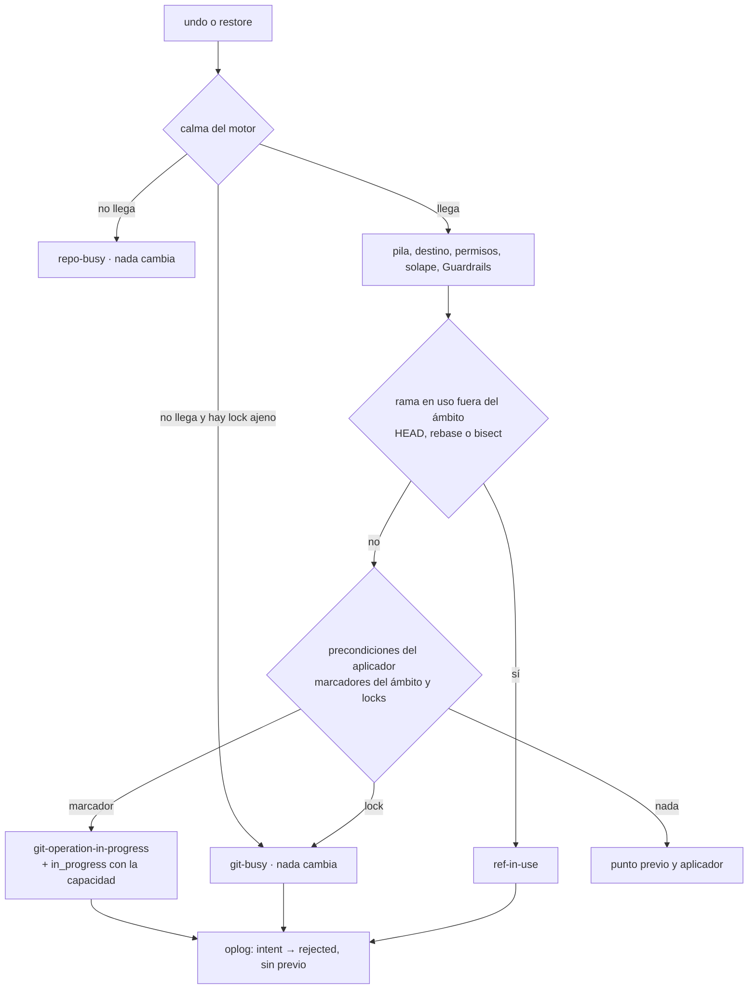
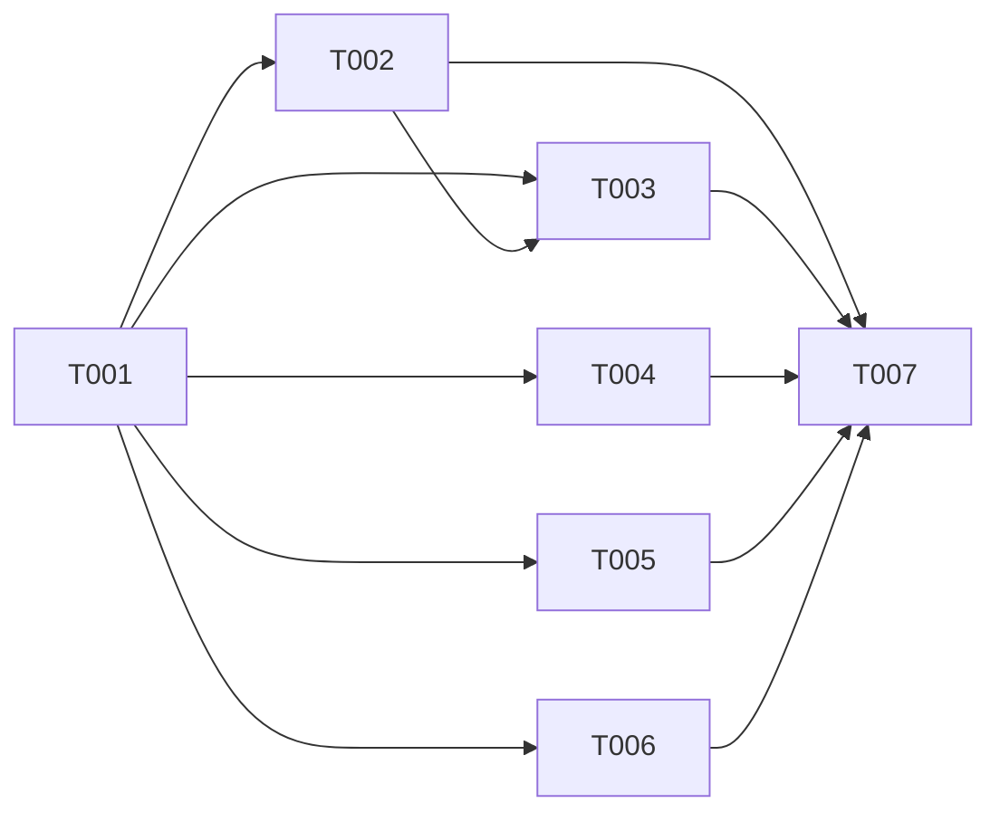

# DS-US-TMC-015 · Undo y restauración ante una operación de Git en curso

## Contexto rápido

Al terminar, un undo o una restauración pedidos con un rebase, un merge, un cherry-pick, un revert, un bisect o una secuencia a medias se detienen sin tocar el repo, sin gastar un punto previo y con un aviso que nombra la operación, el worktree y cómo terminarla o abortarla. Un lock de Git ajeno se reporta como "Git ocupado" y sigue ahí. Al abortar la operación, el mismo undo corre.

**Esta Dev Spec es de brecha.** El mecanismo ya está en `main` (US-TMC-002, US-TMC-009, TS-TMC-003): el aplicador comprueba los siete marcadores y los locks antes del previo y otra vez bajo sus locks, y nunca borra un lock que no es suyo. Lo que falta son el aviso concreto, dos huecos de "worktree afectado" (§ La forma), "Git ocupado" cuando un lock ajeno impide la calma, y los tests de los escenarios que hoy no tienen ninguno (restaurar con un merge en curso, rebase, cherry-pick, revert, bisect y sequencer).

| Término | Qué es aquí |
|---|---|
| Marcador | Entrada del directorio Git **del worktree** que indica una operación en curso: `rebase-merge/`, `rebase-apply/`, `MERGE_HEAD`, `CHERRY_PICK_HEAD`, `REVERT_HEAD`, `BISECT_LOG`, `sequencer/` (`IN_PROGRESS_MARKERS`) |
| Lock ajeno | `index.lock` o `HEAD.lock` del worktree, `packed-refs.lock`, `config.lock`, `shallow.lock` o un `refs/**/*.lock` del directorio común que el aplicador no creó |
| Ámbito del plan | Los worktrees de `ApplyPlan.worktrees` más las refs de `RefScope` |

⚠️ **ASSUMPTION**: no existe `architecture-constitution.md` en la cascada; rigen `AGENTS.md` y los ADR listados (NFR-01, NFR-02, ADR-GRP-016). Formalizar con `/aadd-architect --init-constitution`.

---

## ⚠️ Gaps y violaciones de la constitución

_No gaps. Ready to implement._ Las decisiones nuevas están en § Decisiones; la pregunta abierta TQ-19 no bloquea (la prueba del escenario 3 no depende de su respuesta).

---

## 🔭 La forma

### Qué ya se cumple y con qué test

| Requisito (historia o ADR-TMC-002 § 3 paso 1) | Dónde está | Test que lo prueba hoy |
|---|---|---|
| Los siete marcadores detienen el aplicador sin cambios | `crates/git/src/tm_write/worktree.rs` (`IN_PROGRESS_MARKERS`, `WriteWorktree::preconditions`) → `crates/core/src/timemachine/apply/mod.rs` (`preconditions_of`, `Refusal::InProgress`) | `crates/core/tests/tm_apply.rs::an_operation_in_progress_rejects` (solo `MERGE_HEAD`, escrito a mano) |
| Undo con una operación en curso: rechazado, repo igual, sin punto previo gastado; al quitarla, el undo corre | `undo.rs` (precondiciones antes del previo, `refusal_reason`) | `crates/core/tests/us_tmc_002.rs::an_undo_with_a_git_operation_in_progress_is_rejected` (`MERGE_HEAD` escrito a mano) |
| Undo con un merge real parado en conflicto; tras `merge --abort` el undo devuelve el trabajo sin pérdida | Igual, más `prior_point::before_event` (foto a mitad elegible para un abort) | `apps/cli/tests/tm_chaos.rs::hostile_half_done_merge_rejects_until_aborted` (binario `raptor`, en inglés) |
| Lock ajeno: rechazado, nunca se borra; al quitarlo, el undo corre | `tm_write/lock.rs` (`create_new`, `WriteError::Busy`), `Refusal::GitBusy` | `tm_apply.rs::a_foreign_lock_rejects_and_stays`; `tm_chaos.rs::hostile_foreign_git_locks_reject_and_stay` (`index.lock` y `refs/heads/feat-login.lock`) |
| Al arrancar, el daemon solo suelta sus propios locks | Barrido de US-TMC-019 | `apps/cli/tests/tm_interruption.rs::s4_only_the_own_git_lock_is_released_at_start` |
| Restauración: precondiciones antes del previo y bajo los locks | `restore.rs` (≈ línea 781) | **Ninguno** con una operación en curso |
| El rechazo queda en el oplog como `intent → rejected` con su código y no entra en la pila | `undo.rs::record_rejection`, `restore.rs` (`OperationTransition::Rejected`) | `us_tmc_002.rs::nothing_to_undo_changes_nothing` (solo para `nothing-to-undo`) |
| Mensaje en/es "termínala o abórtala antes; nada cambió" | `apps/cli/i18n/{en,es}/timemachine.txt` (`undo.reason.git-operation-in-progress`, `restore.reason.…`) | `apps/cli/src/undo/mod.rs::every_rejection_has_a_message` (solo que la clave existe) |
| Una captura a mitad de operación lo registra (`mid_operation`) y la regla del punto previo lo usa | `store/capture.rs` (`in_progress_at_start`, `in_progress_at_end`), `prior_point.rs` (#272, #281) | `crates/core/tests/tm_prior_point_condition.rs::an_observation_taken_mid_rebase_records_mid_operation`; `prior_point_tests.rs` (C1–C8) |

### Qué falta (la brecha)

| # | Brecha | Por qué importa | Tarea |
|---|---|---|---|
| B1 | El aviso es genérico ("merge, rebase, cherry-pick..."): no nombra la operación ni el worktree. El escenario 1 pide "terminar o abortar **el rebase**" | Con un merge en `main` y el undo pedido desde `feat-login`, el usuario no sabe dónde mirar. `TmRejectedData` solo lleva `reason` | T001, T002, T003, T004 |
| B2 | Los marcadores del worktree principal bloquean siempre, aunque `main` no esté en el ámbito (`check_preconditions` arranca con `vec![main]`) | Un merge de Rene en `main` impide que un agente deshaga su propio trabajo en `feat-x`. Sobra el rechazo: ese worktree no se toca | T002 |
| B3 | Un worktree **fuera** del ámbito con un rebase o un bisect en curso tiene `HEAD` separado: `head_branch` no ve la rama que esa operación está reescribiendo y `ref-in-use` no salta | El undo podría mover una rama bajo un rebase ajeno, que al terminar la sobrescribe o falla: el estado mezclado que la historia prohíbe | T002 |
| B4 | Un `index.lock` ajeno impide la calma del motor y el undo responde `repo-busy` ("otra operación…"), no "Git ocupado" | Requisito técnico de la historia: el lock ajeno se reporta como "Git ocupado". `tm_chaos` hoy acepta los dos textos | T002 |
| B5 | Sin tests de restauración con una operación en curso, ni de rebase, cherry-pick, revert, bisect y sequencer con Git real, ni de que el rechazo quede en el oplog con su código | Los criterios 2 y la lista de la historia no tienen prueba | T005, T006 |
| B6 | Un undo cuyo destino es una foto a mitad de operación (`mid_operation`) restaura archivos e índice; nada comprueba que nunca recrea los marcadores | La foto de un merge a medias es el "antes" de un `merge --abort` (brief de #272, C8): deshacer el abort no debe volver a dejar el merge abierto | T005 |

### Lo que no cambia

- El orden de ADR-TMC-005 § 4: las precondiciones de Git van al final, antes del previo, y se repiten bajo los locks del aplicador.
- El código de rechazo (`git-operation-in-progress`, `git-busy`) y su registro en el oplog. El detalle de la operación viaja solo en la respuesta, no se guarda (D5).
- La restauración (`RefScope::All`) mantiene los marcadores de `main` (D2): mueve todas las ramas y no tiene la protección por ramas de B2.
- Redo y undo selectivo todavía no existen (`timemachine.redo` y los selectores responden `NOT_IMPLEMENTED`); heredan esta regla (D7).

### Flujo de un undo con una operación en curso (tras esta entrega)



1. Validación, solicitante, ámbito y lock del repo, como en DS-US-TMC-002 § 2.1.
2. Calma del motor (`settle`). Si no llega en `ANCHOR_SETTLE_LIMIT` y hay un lock ajeno en el worktree pedido o en el directorio común: `rejected` con `git-busy` (B4). Si no lo hay: `repo-busy`, como hoy.
3. Pila, destino, regla base, confirmación, solape (US-TMC-012) y Guardrails (US-TMC-021), sin cambios.
4. Ramas en uso fuera del ámbito: además de las de `HEAD`, la rama que reescribe un rebase (`head-name`) y la que dejó un bisect (`BISECT_START`). Si una está en `planned.refs`: `rejected` con `ref-in-use` (B3).
5. `Applier::check_preconditions`, con los marcadores de `main` solo si `main` está en el ámbito (`RefScope::Only`, B2). El primer `Refusal::InProgress` lleva su detalle: operación y worktree (B1).
6. Rechazo: `record_rejection` con el código, sin punto previo. La respuesta lleva `in_progress` si la conexión tiene `timemachine.git-in-progress`.

---

## 🚀 Plan de implementación

> Orden topológico (`Depende:`). Rutas relativas a la raíz del repo. Cada tarea es una rebanada disjunta; las ediciones en archivos compartidos son las que se nombran (ADR-GRP-016).

### El trabajo de un vistazo

Contrato (T001), motor (T002), canal (T003), CLI (T004), tests de core (T005), e2e (T006) y cierre (T007). T001 desbloquea todo; T005 y T006 escriben sus tests en rojo antes de T002–T004 (guardia R4: archivo propio).

| # | Tarea | Depende | Aterriza en |
|---|---|---|---|
| T001 | Definir el detalle de la operación en curso y su capacidad | — | `crates/api/src/` |
| T002 | Afinar las precondiciones del undo y de la restauración | T001 | `crates/core/src/timemachine/` |
| T003 | Servir el detalle en el canal | T001, T002 | `crates/core/src/channel/conn.rs` |
| T004 | Mostrar el aviso concreto en `raptor undo` y `raptor restore` | T001 | `apps/cli/` |
| T005 | Probar los escenarios en el daemon real | T001 | `crates/core/tests/` |
| T006 | Probar los escenarios con el binario `raptor` | T001 | `apps/cli/tests/` |
| T007 | Cerrar la historia y los pendientes multiplataforma | T002, T003, T004, T005, T006 | `docs/` |

### En qué orden



### T001 — Definir el detalle de la operación en curso y su capacidad

**Objetivo.** El tipo del detalle, el campo opcional en los dos datos de rechazo y la capacidad que lo enciende; sin lógica.

**Ubicación.** `crates/api/src/timemachine.rs` (**MODIFY**) · `crates/api/src/methods/timemachine.rs` (**MODIFY**, una constante y una entrada en `capabilities`)

**Reglas**
- `TmGitInProgress { operation: TmGitOperation, worktree: Option<Untrusted> }` y `TmGitOperation` (§ Tipos y datos compartidos), nuevos.
- `TmRejectedData` y `TmConfirmData` ganan `in_progress: Option<TmGitInProgress>` con `#[serde(default, skip_serializing_if = "Option::is_none")]`. Los dos llevan `deny_unknown_fields` y la CLI lee `TmConfirmData` también para los rechazos simples: el campo va en los dos o la CLI cae en `undo.reason.unsupported`.
- `CAP_TM_GIT_IN_PROGRESS = Capability::new("timemachine.git-in-progress")`, nuevo, en `GROUP.capabilities`. Es un cambio de forma de un método que ya existía: sin la capacidad, la respuesta es la de hoy (ADR-GRP-016; guía de extensión § Añadir una capacidad). No sube `PROTOCOL_VERSION`.
- `TmGitOperation::of_marker(&str) -> Option<Self>` (nuevo): `rebase-merge`, `rebase-apply` → `Rebase`; `MERGE_HEAD` → `Merge`; `CHERRY_PICK_HEAD` → `CherryPick`; `REVERT_HEAD` → `Revert`; `BISECT_LOG` → `Bisect`; `sequencer` → `Sequence`. ⚠️ **ASSUMPTION**: un `git am` parado (`rebase-apply/applying`) se muestra como `Rebase`; es raro en la flota y su aviso sigue diciendo que nada cambió.

- **Depende:** —
- **Refs:** ADR-GRP-016 § 1, NFR-TMC-14
- **Aceptación:** `git_in_progress_wire_form`, `rejected_data_without_in_progress_is_todays_form` y `every_marker_has_an_operation` en `crates/api/src/timemachine.rs`

### T002 — Afinar las precondiciones del undo y de la restauración

**Objetivo.** Cerrar B2, B3 y B4 y llevar el detalle de B1 hasta el error del motor.

**Ubicación.** `crates/core/src/timemachine/apply/mod.rs` (**MODIFY**) · `crates/core/src/timemachine/undo.rs` (**MODIFY**) · `crates/core/src/timemachine/restore.rs` (**MODIFY**) · `crates/git/src/tm_write/worktree.rs` (**MODIFY**, una función de lectura)

**Reglas**
- **B2.** En `Applier::check_preconditions` y en la comprobación bajo locks de `Applier::apply`: con `RefScope::Only`, los `Precondition::InProgress` del worktree principal se descartan si su raíz no está en `plan.worktrees`; sus `GitBusy` (locks del directorio común) se mantienen siempre. Con `RefScope::All` o `RefScope::None`, nada cambia.
- **B3.** `undo::head_branch` (y su uso en `restore.rs` ≈ línea 751) pasa a `branches_in_use(common_dir, root) -> Vec<String>`, nueva: la rama de `HEAD` si es simbólica, más la de `rebase-merge/head-name` o `rebase-apply/head-name` y la de `BISECT_START`, leídas con `WriteWorktree::operation_branches()`, nueva en `tm_write/worktree.rs`. Sin seguir enlaces, a lo sumo 1 KiB por archivo y solo nombres válidos (`refname`); el texto es del repo (SEC-12). El `RepoReader::rebase_branch` de `crates/git/src/reader.rs` es el precedente: la nueva no abre gitoxide.
- **B4.** Cuando `engine.settle` devuelve `None` (undo ≈ línea 744, restore ≈ líneas 437 y 571): antes de responder `repo-busy`, abrir `WriteWorktree::open(worktree)` y, si `preconditions()` trae un `GitBusy`, responder `git-busy`. Si falla al abrir, `repo-busy` (falla cerrado, como hoy).
- **B1.** `UndoError::Rejected` y `RestoreError::Rejected` ganan `in_progress: Option<InProgressDetail>` (nuevo, `pub struct InProgressDetail { pub operation: TmGitOperation, pub worktree: PathBuf }`), con valor solo cuando el primer rechazo es un `Refusal::InProgress`, ya sea de `check_preconditions` o del aplicador bajo sus locks (`ApplyError::Rejected`). `record_rejection` sigue guardando solo el código.
- Nunca se borra, mueve ni reescribe un marcador o un lock: la tarea no añade ninguna escritura. `grep -n "remove_file\|remove_dir" ` en los archivos tocados no muestra nada nuevo.

- **Depende:** T001
- **Refs:** ADR-TMC-002 § 3 paso 1, ADR-TMC-005 § 4, D2, D3, D4
- **Aceptación:** `a_main_marker_outside_the_scope_does_not_block_only_refs` y `a_main_marker_blocks_a_restore` en `crates/core/tests/tm_apply_in_progress.rs`; `branches_in_use_reads_rebase_and_bisect` en `crates/git/src/tm_write/worktree.rs`; `the_in_progress_detail_names_the_first_marker` en `crates/core/src/timemachine/undo.rs`

### T003 — Servir el detalle en el canal

**Objetivo.** `rejection_data` rellena `in_progress` para las conexiones que tienen la capacidad.

**Ubicación.** `crates/core/src/channel/conn.rs` (**MODIFY**: `rejection_data`, `undo_error`, `restore_error`)

**Reglas**
- `rejection_data(reason, operation_id, in_progress, confirm, has_cap)`: con `self.has(methods::CAP_TM_GIT_IN_PROGRESS.name)`, el campo va con `operation` y `worktree` como `Untrusted`; sin ella, `None`.
- Por MCP, `worktree` va siempre `None` (SEC-12: la proyección MCP no lleva rutas). Hoy el undo por MCP responde `SCOPE_REFUSED` antes (DEP-MCP-4) y `raptor-mcp` no tiene herramienta de undo: es la regla para cuando la tenga.

- **Depende:** T001, T002
- **Refs:** ADR-GRP-016 (capacidades), SEC-12
- **Aceptación:** `in_progress_is_served_only_with_the_capability` en `crates/core/tests/us_tmc_015.rs`

### T004 — Mostrar el aviso concreto en `raptor undo` y `raptor restore`

**Objetivo.** Con `in_progress`, la CLI dice qué operación, en qué worktree y con qué comando terminarla o abortarla; sin él, el texto de hoy.

**Ubicación.** `apps/cli/src/undo/mod.rs` (**MODIFY**, `failure_text`) · `apps/cli/src/commands/restore.rs` (**MODIFY**, `failure_text`) · `apps/cli/i18n/{en,es}/timemachine.txt` (**MODIFY**, grupo nuevo `tm-git.`)

**Reglas**
- Claves nuevas `tm-git.<operation>` con el marcador `{worktree}` (§ Valores numéricos tiene la lista; textos en § i18n). Las comparten undo y restore: el grupo `tm-git.` vive solo en `timemachine.txt`.
- La ruta se muestra saneada (`Untrusted::sanitized`), como `undo.not-restored`. Ausente: "este worktree" / "this worktree".
- El cliente de `crates/core` pide la capacidad en `connection.accept` en cuanto existe (guía de extensión, regla 3): la CLI debe entenderla en el mismo PR. La TUI no muestra rechazos de undo hoy: nada que cambiar allí.
- `--json` saca `in_progress` tal cual.

- **Depende:** T001
- **Refs:** NFR-TMC-14, AGENTS.md (i18n en/es)
- **Aceptación:** `every_git_operation_has_a_message` en `apps/cli/src/undo/mod.rs`; los tests de catálogo (`catalogs_match`) siguen verdes

### T005 — Probar los escenarios en el daemon real

**Objetivo.** Un test por escenario y por marcador, con Git real, más las brechas B2–B4 y B6.

**Ubicación.** `crates/core/tests/us_tmc_015.rs` (**CREATE**, reutiliza `us_tmc_013_common`) · `crates/core/tests/tm_apply_in_progress.rs` (**CREATE**, reutiliza `tm_common`)

**Reglas**
- Repos y perfiles temporales (`Fixture`, `TempProfile`); nunca este repo (NFR-01). `#![cfg(any(target_os = "macos", target_os = "linux"))]`, como `us_tmc_002.rs`.
- Las operaciones en curso se producen con Git real parado en un conflicto (`git rebase`, `git merge`, `git cherry-pick A B`, `git revert`, `git bisect start`), no escribiendo el marcador a mano. Solo `tm_apply_in_progress.rs` escribe marcadores, para la matriz de B2.
- "No cambia" es la huella del testkit (`fingerprint` + `diff`), los marcadores siguen con sus bytes y el número de snapshots no crece.
- Sin esperas fijas: cada paso espera la respuesta o un estado con plazo (como `tm_chaos.rs::Machine::events` y `captured`).

- **Depende:** T001
- **Refs:** § Estrategia de pruebas y cobertura
- **Aceptación:** los tests de § 9.4 en `crates/core/tests/us_tmc_015.rs` y `crates/core/tests/tm_apply_in_progress.rs`

### T006 — Probar los escenarios con el binario `raptor`

**Objetivo.** El aviso real en inglés y en español y el undo después de abortar, desde el binario.

**Ubicación.** `apps/cli/tests/us_tmc_015_process.rs` (**CREATE**, mismo patrón que `undo_process.rs` y `restore_process.rs`)

**Reglas**
- `#![cfg(target_os = "macos")]`, como sus hermanos. Daemon real en proceso y catálogo de test.
- Comprueba el texto completo de `tm-git.rebase` en `en_US.UTF-8` y en `es_ES.UTF-8`, el código de salida 1 y `--json` con `in_progress.operation = "rebase"`.

- **Depende:** T001
- **Refs:** § Estrategia de pruebas y cobertura
- **Aceptación:** `a_rebase_in_progress_says_finish_or_abort_the_rebase_in_en_and_es`, `a_restore_with_a_merge_in_progress_says_so`, `after_rebase_abort_raptor_undo_runs` en `apps/cli/tests/us_tmc_015_process.rs`

### T007 — Cerrar la historia y los pendientes multiplataforma

**Objetivo.** La historia pasa a `implemented` con su PR; los pendientes de Linux y Windows quedan anotados.

**Ubicación.** `docs/requirements/features/time-machine/user-stories/US-TMC-015-operacion-git-en-curso.md` (**MODIFY**) · `docs/architecture/xplat-pendientes.md` (**MODIFY**) · esta Dev Spec (**MODIFY**, § Estado de la implementación)

**Reglas**
- Las enmiendas a ADR de § Decisiones las aplica el orquestador; esta tarea no edita ADR.
- `tm_chaos.rs::hostile_foreign_git_locks_reject_and_stay` puede dejar de aceptar `REPO_BUSY` solo si T002 (B4) lo hace determinista; si no, se queda como está y se anota.

- **Depende:** T002, T003, T004, T005, T006
- **Refs:** AGENTS.md (estado de las historias)
- **Aceptación:** `cargo test --workspace` verde en macOS con los tests de T005 y T006; la historia lleva `status: implemented` y el enlace al PR

---

## Estructura de ficheros

```text
crates/api/src/timemachine.rs                          ← MODIFY  (T001)
crates/api/src/methods/timemachine.rs                  ← MODIFY  (T001, 2 líneas)
crates/git/src/tm_write/worktree.rs                    ← MODIFY  (T002, operation_branches)
crates/core/src/timemachine/apply/mod.rs               ← MODIFY  (T002, B2)
crates/core/src/timemachine/{undo,restore}.rs          ← MODIFY  (T002, B1, B3, B4)
crates/core/src/channel/conn.rs                        ← MODIFY  (T003)
apps/cli/src/undo/mod.rs, apps/cli/src/commands/restore.rs   ← MODIFY (T004)
apps/cli/i18n/{en,es}/timemachine.txt                  ← MODIFY  (T004, grupo tm-git.)
crates/core/tests/us_tmc_015.rs                        ← CREATE  (T005)
crates/core/tests/tm_apply_in_progress.rs              ← CREATE  (T005)
apps/cli/tests/us_tmc_015_process.rs                   ← CREATE  (T006)
docs/…                                                 ← MODIFY  (T007)
```

## Contratos compartidos

### Tipos y datos compartidos

```rust
// crates/api/src/timemachine.rs — NUEVO
/// The Git operation in progress that stopped an undo or a restore (BR-TMC-EDGE-004).
#[derive(Debug, Clone, Copy, PartialEq, Eq, Serialize, Deserialize, JsonSchema)]
#[serde(rename_all = "kebab-case")]
pub enum TmGitOperation { Rebase, Merge, CherryPick, Revert, Bisect, Sequence }

/// Only with `CAP_TM_GIT_IN_PROGRESS`. `worktree` is never sent over MCP (SEC-12).
#[derive(Debug, Clone, PartialEq, Eq, Serialize, Deserialize, JsonSchema)]
#[serde(deny_unknown_fields)]
pub struct TmGitInProgress {
    pub operation: TmGitOperation,
    #[serde(default, skip_serializing_if = "Option::is_none")]
    pub worktree: Option<Untrusted>,
}

// MODIFICADO: campo nuevo en TmRejectedData y en TmConfirmData
#[serde(default, skip_serializing_if = "Option::is_none")]
pub in_progress: Option<TmGitInProgress>,

// crates/core/src/timemachine/undo.rs — NUEVO (lo usa también restore.rs)
pub struct InProgressDetail { pub operation: TmGitOperation, pub worktree: PathBuf }
```

Forma en el cable (con la capacidad):

```json
{ "reason": "git-operation-in-progress", "operation_id": "…",
  "in_progress": { "operation": "rebase", "worktree": "/…/feat-login" } }
```

### Ciclos de vida (DI)

| Servicio / componente | Ámbito / ciclo de vida | Razón |
|---|---|---|
| `Applier` de precondiciones | Uno por petición, antes del previo; otro bajo los locks | Ya es así (DS-US-TMC-002 D3); la entrega solo filtra su resultado |
| `WriteWorktree` de B3 y B4 | Uno por worktree y petición; solo lee | Sin estado en el daemon; un worktree que no abre falla cerrado |
| Capacidad `timemachine.git-in-progress` | Por conexión, desde `connection.accept` | Patrón de `CAP_TM_CONFIRMATION` |

### Firmas del stack

```rust
// crates/git/src/tm_write/worktree.rs — NUEVO
impl WriteWorktree {
    /// Branches an operation in progress works on: `rebase-*/head-name` and `BISECT_START`,
    /// as short names. Never follows links; at most 1 KiB per file; invalid names are dropped.
    pub fn operation_branches(&self) -> Vec<String>;
}
// crates/core/src/timemachine/undo.rs — REEMPLAZA a `head_branch` en sus dos usos
pub(super) fn branches_in_use(common_dir: &Path, root: &Path) -> Vec<String>;
// MODIFICADO
pub enum UndoError { Rejected { reason: TmRejectReason, operation_id: Option<String>,
                                in_progress: Option<InProgressDetail> }, /* resto igual */ }
// crates/core/src/timemachine/restore.rs — MODIFICADO, mismo campo
pub enum RestoreError { Rejected { reason: TmRejectReason, operation_id: Option<String>,
                                   in_progress: Option<InProgressDetail> }, /* resto igual */ }
// crates/api/src/methods/timemachine.rs — NUEVO
pub const CAP_TM_GIT_IN_PROGRESS: Capability = Capability::new("timemachine.git-in-progress");
```

`Applier::check_preconditions(&self, plan: &ApplyPlan) -> Vec<Refusal>` no cambia de firma: el filtro de B2 depende de `plan.refs`.

## Contrato de API

| Método | Canal | Cambio |
|---|---|---|
| `timemachine.undo` | CLI/TUI (MCP: `SCOPE_REFUSED` hoy) | `OPERATION_REJECTED` con `git-operation-in-progress` lleva `in_progress` si la conexión tiene la capacidad |
| `timemachine.restore` | CLI/TUI | Igual |

### Forma del error y del cuerpo de respuesta

Sin códigos nuevos. `OPERATION_REJECTED` (ya existente) con `TmRejectedData` o `TmConfirmData`; el único cambio es el campo opcional `in_progress`, detrás de la capacidad. `git-busy` pasa a salir también cuando un lock ajeno impide la calma (B4), con la misma forma.

### Forma de la configuración

_No aplica — la entrega no añade configuración._

### Valores numéricos

| Concepto | Valor | Fuente |
|---|---|---|
| Espera de calma antes de `repo-busy`/`git-busy` | `ANCHOR_SETTLE_LIMIT` (2 s) | ADR-TMC-003, enmienda `fix/tm-restore-calm-mark` |
| Lectura de `head-name` y `BISECT_START` | ≤ 1 KiB por archivo | Decisión del Arquitecto (un nombre de rama válido cabe de sobra) |
| Operaciones con aviso propio | 6 (`rebase`, `merge`, `cherry-pick`, `revert`, `bisect`, `sequence`) para 7 marcadores | `IN_PROGRESS_MARKERS` |

### i18n

| Clave | en | es |
|---|---|---|
| `tm-git.rebase` | a rebase is in progress in {worktree}; finish it (git rebase --continue) or abort it (git rebase --abort) first; nothing changed | hay un rebase en curso en {worktree}; termínalo (git rebase --continue) o abórtalo (git rebase --abort) antes; nada cambió |
| `tm-git.merge` | a merge is in progress in {worktree}; finish it (git merge --continue) or abort it (git merge --abort) first; nothing changed | hay un merge en curso en {worktree}; termínalo (git merge --continue) o abórtalo (git merge --abort) antes; nada cambió |
| `tm-git.cherry-pick` | a cherry-pick is in progress in {worktree}; finish it (git cherry-pick --continue) or abort it (git cherry-pick --abort) first; nothing changed | hay un cherry-pick en curso en {worktree}; termínalo (git cherry-pick --continue) o abórtalo (git cherry-pick --abort) antes; nada cambió |
| `tm-git.revert` | a revert is in progress in {worktree}; finish it (git revert --continue) or abort it (git revert --abort) first; nothing changed | hay un revert en curso en {worktree}; termínalo (git revert --continue) o abórtalo (git revert --abort) antes; nada cambió |
| `tm-git.bisect` | a bisect is in progress in {worktree}; end it (git bisect reset) first; nothing changed | hay un bisect en curso en {worktree}; termínalo (git bisect reset) antes; nada cambió |
| `tm-git.sequence` | a cherry-pick or revert of several commits is in progress in {worktree}; continue it (--continue), abort it (--abort) or leave it (--quit) first; nothing changed | hay un cherry-pick o un revert de varios commits en curso en {worktree}; continúalo (--continue), abórtalo (--abort) o déjalo (--quit) antes; nada cambió |
| `tm-git.this-worktree` | this worktree | este worktree |

---

## Modelo de datos

_No aplica — ni el oplog ni el almacén cambian: el rechazo se sigue registrando como `intent → rejected` con el código de hoy (D5)._

---

## Estrategia de pruebas y cobertura

### 9.1 Pirámide de pruebas

Repos, perfiles y worktrees temporales (`Fixture`, `TempProfile`); nunca este repo (NFR-01). Sin esperas fijas.

| Tipo | Cantidad | Tareas dueñas | Herramientas | Cuándo |
|---|---:|---|---|---|
| Unit | 5 | T001, T002, T004 | `cargo test` | PR gate |
| Integration | 13 | T005 | `cargo test -p gitraptor-core --test us_tmc_015 --test tm_apply_in_progress` | PR gate |
| E2E | 3 | T006 | `cargo test -p gitraptor-cli --test us_tmc_015_process` | PR gate (macOS) |

### 9.2 Umbrales de cobertura

| Capa | Línea | Rama | Mutación | Camino crítico 100% |
|---|---:|---:|---:|:---:|
| Precondiciones del undo y de la restauración | — | — | — | todo marcador y todo lock ajeno rechazan sin cambios y sin punto previo |

### 9.3 Datos de prueba

- Fixture del testkit con `main`, `feat-login` y `feat-pagos` (`repo_with_login` de `us_tmc_013_common`).
- Conflicto preparado: dos ramas que cambian la misma línea de `conf.txt` (patrón de `tm_chaos.rs::hostile_half_done_merge_rejects_until_aborted`).
- La operación a deshacer es un `reset --hard` del catálogo de test sobre trabajo sin commitear (`Running::reset_hard`).

### 9.4 Comportamientos críticos verificados

| Escenario | Test |
|---|---|
| 1. Undo con un rebase en curso | `us_tmc_015.rs::an_undo_with_a_rebase_in_progress_is_rejected_and_names_it`: rebase real parado en `feat-login`; `git-operation-in-progress` con `in_progress = rebase` y su worktree; huella igual; `rebase-merge/` intacto; snapshots sin crecer; el undo queda `rejected` en el oplog con ese código. E2E `a_rebase_in_progress_says_finish_or_abort_the_rebase_in_en_and_es` |
| 2. Restauración con un merge en curso | `us_tmc_015.rs::a_restore_with_a_merge_in_progress_changes_nothing`: merge real parado; `restore_params` a un punto anterior; mismo rechazo; huella igual; sin previo; restore `rejected` en el oplog. E2E `a_restore_with_a_merge_in_progress_says_so` |
| 3. Tras abortar, el undo funciona | `us_tmc_015.rs::after_aborting_the_rebase_the_undo_runs_and_loses_nothing`: tras `rebase --abort` y sus eventos, el undo no se rechaza y undos seguidos llegan al estado anterior al `reset --hard` (D6). E2E `after_rebase_abort_raptor_undo_runs` |
| Requisito: cada marcador | `us_tmc_015.rs::every_git_operation_in_progress_rejects_undo_and_restore`: merge, cherry-pick, revert, bisect y secuencia (cherry-pick de dos commits parado en el primero), con Git real; para cada uno, undo y restore rechazados con su `operation` |
| Requisito: lock ajeno | `us_tmc_015.rs::a_foreign_lock_is_git_busy_and_is_never_removed`: `index.lock` de `feat-login`, `refs/heads/feat-login.lock` y `packed-refs.lock`; `git-busy` (no `repo-busy`, B4) en undo y restore; mismos bytes tras el rechazo; al quitarlo, el undo corre |
| B2 | `us_tmc_015.rs::a_merge_in_main_does_not_block_an_undo_in_feat_login`; `tm_apply_in_progress.rs::a_main_marker_outside_the_scope_does_not_block_only_refs` y `a_main_marker_blocks_a_restore` |
| B3 | `us_tmc_015.rs::a_branch_under_a_rebase_elsewhere_is_ref_in_use`: `feat-pagos` rebasa `B` y para; el undo en `feat-login` que movería `B` responde `ref-in-use`; `B` no se mueve |
| B6 | `us_tmc_015.rs::undoing_a_merge_abort_never_reopens_the_merge`: tras deshacer el `merge --abort`, archivos e índice son los de la foto y no hay `MERGE_HEAD` |
| Marcador en otro worktree del ámbito | `tm_apply_in_progress.rs::a_marker_in_any_worktree_of_the_plan_rejects`: plan con dos worktrees y `CHERRY_PICK_HEAD` en el segundo |
| Capacidad | `us_tmc_015.rs::in_progress_is_served_only_with_the_capability`: conexión sin la capacidad recibe la forma de hoy |

Unitarios: `git_in_progress_wire_form`, `rejected_data_without_in_progress_is_todays_form`, `every_marker_has_an_operation` (api); `branches_in_use_reads_rebase_and_bisect` (git); `the_in_progress_detail_names_the_first_marker` (core); `every_git_operation_has_a_message` (cli).

Los tests de hoy siguen verdes sin cambios: `us_tmc_002.rs::an_undo_with_a_git_operation_in_progress_is_rejected`, `tm_apply.rs::{an_operation_in_progress_rejects, a_foreign_lock_rejects_and_stays}`, `tm_chaos.rs::{hostile_half_done_merge_rejects_until_aborted, hostile_foreign_git_locks_reject_and_stay}`, `tm_interruption.rs::s4_only_the_own_git_lock_is_released_at_start`.

### 9.5 Plataformas

| Plataforma | Cómo se verifica | Pendiente |
|---|---|---|
| macOS | `cargo clippy --workspace --all-targets -- -D warnings` y `cargo test --workspace` en Apple Silicon | — |
| Linux | `us_tmc_015.rs` y `tm_apply_in_progress.rs` compilan y corren con `cfg(any(macos, linux))`; el e2e es solo macOS | **Pendiente: etapa de validación multiplataforma** (e2e en Linux) |
| Windows | Compila; el aplicador responde `unsupported` | **Pendiente: etapa de validación multiplataforma** (marcadores y locks con rutas `\`; `index.lock` abierto por otro proceso sin borrar) |

---

## Gate de seguridad

- Ninguna escritura nueva: la entrega solo lee marcadores, `head-name` y `BISECT_START`, y nunca borra un lock ajeno (NFR-01). Sin shell ni argv nuevos (NFR-02).
- `head-name` y `BISECT_START` son texto del repo: lectura acotada, sin seguir enlaces, y solo nombres que valida `refname` (SEC-12, SEC-TMC-14).
- La ruta del worktree viaja como `Untrusted`, se muestra saneada y nunca por MCP.
- Un repo que no abre o una lectura que falla fallan cerrado: el undo se rechaza.

Corre `/security-review --scope devspec docs/requirements/features/time-machine/dev-specs/US-TMC-015-operacion-git-en-curso.md` antes de mezclar.

---

## Fuera de alcance

| Ítem / no-objetivo | Historia que lo cubre | Gate (cómo se verifica) |
|---|---|---|
| Redo con una operación en curso | US-TMC-003 (D7) | `timemachine.redo` sigue en `NOT_IMPLEMENTED` |
| Undo `--since`, `--agent` y por id con una operación en curso | US-TMC-010, US-TMC-011 (D7) | Los selectores siguen en `NOT_IMPLEMENTED` |
| Ofrecer abortar o terminar la operación desde GitRaptor | Fase posterior | Ningún argv nuevo en `crates/git` |
| Snapshot manual con un rebase en curso | US-MCP-008 (ya rechaza, `manual.rs::operation_in_progress`) | `us_mcp_008_manual.rs::a_rebase_in_progress_refuses_the_capture_and_records_nothing` sigue verde |
| Operaciones del catálogo del Cockpit con una operación en curso | US-GRP-003, TS-CKP-001 (`RejectReason::OperationInProgress`) | `git diff` sin cambios en `crates/core/src/executor/` |
| Distinguir un rebase abortado de uno terminado en la pila | TQ-19 | `prior_point.rs` sin cambios |

---

## Decisiones

| # | Decisión | Origen |
|---|---|---|
| D1 | El aviso nombra la operación y el worktree. Viaja en `in_progress`, un campo opcional de `TmRejectedData` y `TmConfirmData`, detrás de la capacidad `timemachine.git-in-progress`; sin ella, la respuesta de hoy | **Decisión del orquestador (2026-10-27), validada por Arquitecto y PO** |
| D2 | Con `RefScope::Only` (undo), un marcador cuenta solo en los worktrees del plan; los locks del directorio común cuentan siempre. La restauración (`RefScope::All`) mantiene los marcadores de `main`. Regla de negocio: **D-TMC-28** | **Decisión del orquestador (2026-10-27), validada por Arquitecto y PO** |
| D3 | La rama que reescribe un rebase o que dejó un bisect en un worktree fuera del ámbito está en uso: `ref-in-use`, en undo y en restauración | **Decisión del orquestador (2026-10-27), validada por Arquitecto y PO** |
| D4 | Un lock ajeno que impide la calma del motor se responde `git-busy`, no `repo-busy`. Sigue sin borrarse nunca | **Decisión del orquestador (2026-10-27), validada por Arquitecto y PO** |
| D5 | El oplog guarda solo el código del rechazo; la operación y el worktree viajan solo en la respuesta | **Decisión del orquestador (2026-10-27), validada por Arquitecto** |
| D6 | Escenario 3: la "última operación" tras abortar es el abort si el motor lo vio (ADR-TMC-003 § 4). El test exige que el undo corra y que undos seguidos lleguen al estado previo sin pérdida, no que el primero deshaga lo anterior al rebase | **Decisión del orquestador (2026-10-27), validada por Arquitecto y PO**; ver TQ-19 |
| D7 | Redo (US-TMC-003) y undo selectivo (US-TMC-010/011) heredan esta regla: precondiciones antes del previo y bajo los locks, el mismo detalle y los mismos tests de marcador. Sus Dev Specs lo citan | **Decisión del orquestador (2026-10-27), validada por Arquitecto** |

**D-TMC-28** (negocio, **Decisión del orquestador (2026-10-27), validada por Arquitecto y PO**; registrada en [business-rules.md](../business-rules.md#decisiones-de-negocio) y en BR-TMC-EDGE-004): una operación de Git en curso en otro worktree no bloquea el undo de este, salvo que esa operación use una rama que el undo movería (entonces `ref-in-use`). La restauración sigue bloqueándose con una operación en curso en `main`.

**Validación de producto**:

- **Decisión del orquestador (2026-10-27), validada por PO**: el alcance B1 a B6 es correcto para M2. B1 lo pide el escenario 1 ("terminar o abortar **el rebase**"); nombrar también el worktree hace falta por D-TMC-28, porque el bloqueo puede venir de un worktree distinto del que pide. B3 y B6 son NFR-01: el undo nunca deja un estado mezclado ni reabre un merge. B2 quita un rechazo de más que bloquearía la demo de M2 (varios agentes y Rene trabajando en `main`). B4 y B5 cierran requisitos y criterios que hoy no tienen prueba.
- **Decisión del orquestador (2026-10-27), validada por PO**: D-TMC-28 se ratifica. La asimetría con la restauración (una operación en curso en el worktree principal la sigue deteniendo) es aceptable en el MVP: detiene de más, nunca escribe de más.
- **Decisión del orquestador (2026-10-27), validada por PO**: D6 cumple la intención del escenario 3, pero no su texto: "se deshace la última operación" podía leerse como "vuelve lo de antes del rebase". El escenario 3 de US-TMC-015 se reescribe: el undo corre, dice qué deshizo y con undos seguidos se vuelve al estado anterior sin pérdida, que es lo que comprueba `after_aborting_the_rebase_the_undo_runs_and_loses_nothing`.
- **Decisión del orquestador (2026-10-27), validada por PO**: US-TMC-015 añade dos escenarios con D-TMC-28: un merge a medias en el worktree principal no bloquea el undo de "claude-1" en "feat-login", y la rama que reescribe un rebase en "feat-pagos" no se mueve. Los cubren los tests de las filas B2 y B3 de § 9.4.
- **Decisión del orquestador (2026-10-27), validada por PO**: TQ-19: un rebase o un merge abortado sin efecto neto sigue siendo una entrada de la pila en el MVP, como dice ADR-TMC-003 § 4. El undo que lo deshace debe decir qué operación deshizo, para que el usuario entienda por qué no vio cambios. Se revisa con el uso de M2; no es irreversible.

### Preguntas abiertas

| ID | Pregunta | Por defecto mientras tanto | Dueño |
|---|---|---|---|
| TQ-19 | Un rebase o un merge abortado sin efecto neto, ¿debe ser una entrada de la pila? Hoy sí (sus eventos cambian el reflog), así que el primer undo tras el abort puede no cambiar nada visible y el segundo deshace lo anterior | Se mantiene ADR-TMC-003 § 4; el aviso de éxito del undo ya dice qué operación deshizo | PO + Arquitecto |

### Enmiendas propuestas a ADR (no aplicadas)

| ADR | Enmienda propuesta |
|---|---|
| ADR-TMC-002 § 3 paso 1 | Precisar "worktree afectado": los worktrees del plan; con `RefScope::Only`, los marcadores de `main` solo si está en el ámbito; y la rama de un rebase o bisect fuera del ámbito cuenta como en uso (D2, D3) |
| ADR-TMC-002 § 3 paso 1 | "Git ocupado" también cuando un lock ajeno impide la calma del motor (D4) |
| ADR-TMC-002 § Validación, punto 3 | Añadir el aviso que nombra la operación y el worktree (D1) |

## Notas del autor

| ID | Nota | Acción | Owner |
|---|---|---|---|
| G1 | El aplicador devuelve todos los rechazos y el undo usa el primero (`.first()`). Con D2, el primero es del ámbito; con varios marcadores en el mismo worktree, gana el orden de `IN_PROGRESS_MARKERS` (`CHERRY_PICK_HEAD` antes que `sequencer`) | Ninguna | — |
| G2 | Un `sequencer/` huérfano tras un fallo de Git bloquea igual que uno vivo; el aviso ofrece `--quit` | Ninguna | — |
| G3 | B4 depende de que el lock siga ahí cuando el `settle` se rinde: un lock que aparece y desaparece puede dar `repo-busy`. Es correcto (nada cambió) | Ninguna | — |
