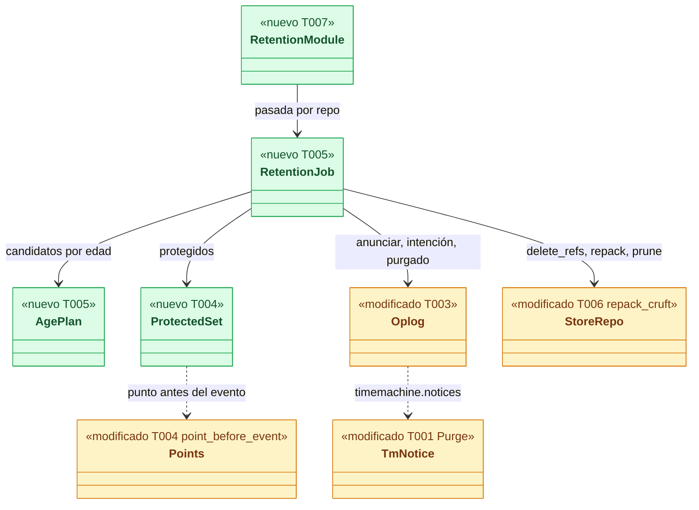
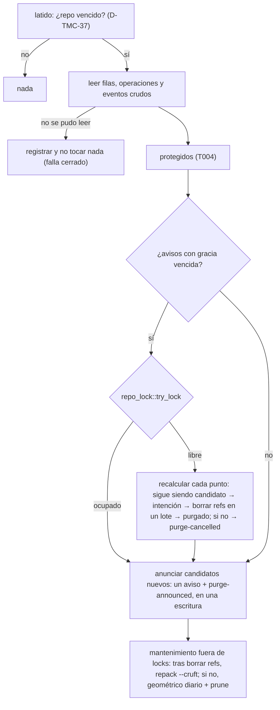
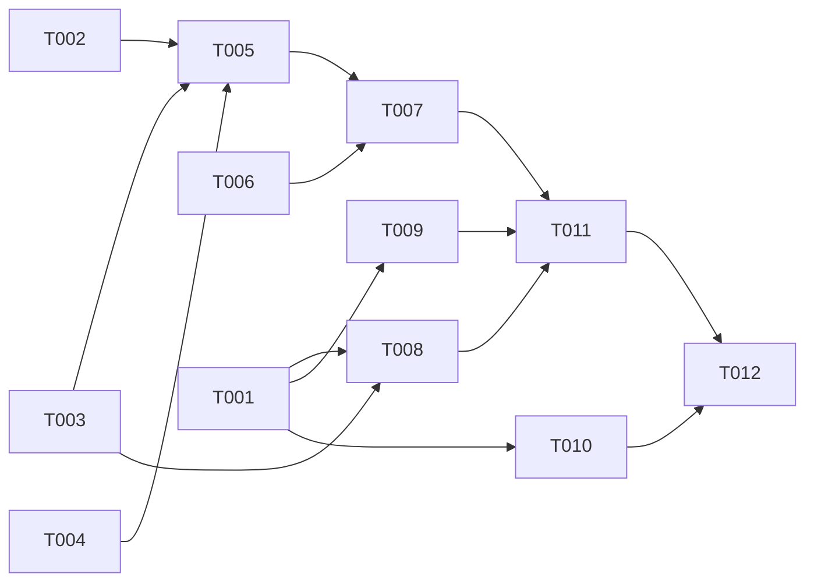

# DS-US-TMC-016 · Retención por defecto y purga segura

## Contexto rápido

Al terminar, el daemon purga los puntos de la Time Machine más antiguos que la retención (30 días por defecto) en dos fases: primero los **anuncia** con un aviso que la CLI y la TUI muestran, y solo los **purga** cuando ese aviso se mostró en la CLI o la TUI y pasaron 24 h desde la primera vez. Nunca purga un punto protegido (el previo a la última operación destructiva de cada worktree y el previo de una operación interrumpida). La purga solo borra refs del almacén; el repo del usuario no se toca (BR-TMC-CONS-004). Una purga interrumpida no deja puntos a medias.

Lo que **ya existe** y no se rediseña:

| Pieza | Dónde | Qué da |
|---|---|---|
| Estados de purga | `SnapshotState` (`oplog/model.rs`): `PurgeAnnounced`, `PurgeIntent`, `Purged`, `PurgeCancelled` y sus transiciones (`can_become`) | Un punto anunciado sigue disponible (`is_available`) |
| Aviso de purga | Tabla `notices` con `kind = 'purge'` (`oplog/schema.rs`), `Oplog::record_notice`, `mark_notice_delivered` | La entrega queda en el diario con su canal |
| Gracia | `Oplog::first_interactive_delivery_ms` (`oplog/query.rs`): primera entrega por CLI o TUI; MCP no cuenta | ADR-TMC-007 § 4.2 |
| Recuperación de una purga a medias | `oplog/recovery.rs` paso 5: `PurgeIntent` con ref → `PurgeCancelled`; sin ref → `Purged` | Escenario 6 |
| Borrado de refs atómico | `SnapshotRefs::delete` → `StoreHandle::delete_refs` (`crates/git/src/tm_write/store/mod.rs`): una transacción de gix | ADR-TMC-007 § 4.3 |
| Mantenimiento | `StoreRepo::repack` (`repack -d --geometric=2`) y `StoreRepo::prune` (`--expire=1.hour.ago`), sin llamador todavía | TS-TMC-001 dejó a esta historia el cuándo |
| Regla "punto antes de un evento" | `prior_point.rs` y `timeline::Points` (`timeline.rs:171-255`) | El mismo punto que usa el undo |
| Entrega de avisos al cliente | `timemachine.notices` (`conn.rs::tm_notices`) → `notices::take_interruptions`; la CLI los muestra en `undo`, `restore` y `timeline` (`apps/cli/src/undo/notices.rs`) | Solo interrupciones; el aviso de purga se excluye a propósito |
| Clave de retención | `TimeMachine.retention_days` (`crates/policy/src/settings/model.rs`), niveles perfil y local, rango 1..=3650 | Nadie la lee todavía |

| Término | Qué es aquí |
|---|---|
| Pasada | Una ejecución del trabajo de purga sobre un repo: ejecutar lo que venció, anunciar lo nuevo, mantener el almacén |
| Candidato por edad | Punto `complete` o `purge-cancelled`, con ref, sin marca de manipulación, más antiguo que la retención y no protegido |
| Aviso de purga | Fila `notices` de `kind = 'purge'` y `worktree = NULL`; los puntos que anuncia pasan a `purge-announced` con el id del aviso |
| Gracia vencida | `first_interactive_delivery_ms(aviso) + 24 h ≤ ahora` |

⚠️ **ASSUMPTION**: no existe `architecture-constitution.md` en la cascada; rigen `AGENTS.md` y los ADR listados (NFR-01, NFR-02, ADR-GRP-016), como en las Dev Specs hermanas.

---

## ⚠️ Gaps y violaciones de la constitución

_No gaps. Ready to implement._

Dos enmiendas de ADR propuestas (§ Decisiones, E1 y E2) para la consolidación tras una purga; el orquestador las aplica antes de mezclar T006. Las clases de trabajo (`Background`) y el modo de ahorro llegan con TS-GRP-005: hasta entonces el hilo corre con la prioridad heredada y el mantenimiento no se aplaza (§ Dependencias).

---

## 🔭 La forma



🟩 nuevo · 🟨 modificado.

### Cuándo corresponde purgar (D-TMC-37)

La historia deja el disparo al Arquitecto. Una pasada sobre un repo corre:

1. **Al arrancar el daemon**, en el primer latido del módulo tras abrir los repos: la recuperación del oplog y el barrido del aplicador ya corrieron (`Modules::start` va después de abrir los repos).
2. **Cada 24 h** desde la última pasada completa de ese repo (en memoria; un reinicio vuelve a 1).
3. **En el primer latido tras vencer la gracia** de un aviso pendiente de ese repo. El módulo late cada 60 s, así que la purga ocurre como mucho un minuto después de "24 h desde que se mostró" (ejemplo TQ-11 de BR-TMC-TIME-001).
4. Por tamaño (US-TMC-022): al cruzar el 80 % del tope. Lo añade DS-US-TMC-022.

Un repo que se despierta o se registra en caliente entra en el siguiente latido como en 1.

### Una pasada



### Diseño

**Protegidos** (ADR-TMC-007 § 3; T004). Por cada clave de worktree (la de `SnapshotRecord.worktrees`), se protege el **último** punto de cada una de estas fuentes; proteger de más está permitido, de menos nunca:

| Fuente | Punto protegido |
|---|---|
| Última operación de la Time Machine que alcanzó ese worktree (cualquier `OperationKind`: `protected`, `undo`, `redo`, `restore`) | Su `prior_snapshot` |
| Último `hook-prior` de ese worktree | Ese punto (existe porque Guardrails vio una operación destructiva) |
| Último evento de Git crudo de ese worktree, salvo `push`, `branch-create` y `worktree-create` | El punto antes del evento según `prior_point` (`Points::point_before_event`, T004) |
| Última desaparición de archivos entre dos puntos consecutivos de ese worktree (`clean`, `checkout -- ruta` sin evento de Git) | El anterior de los dos |
| Toda operación en estado `interrupted` | Su `prior_snapshot` |

- **Ante la duda, destructiva** (ADR-TMC-007 § 2): todas las operaciones de la Time Machine cuentan como destructivas y, del Git crudo, todo evento que pueda mover una ref o el `HEAD`. Un `commit` cuenta porque el evento no distingue un `--amend`.
- **Desaparición de archivos**: se recorre hacia atrás, desde el punto más reciente del worktree, la diferencia de árboles `wt/<clave>/files` entre puntos consecutivos (solo borrados, con gix sobre el almacén). Se para en la primera desaparición. Un árbol ilegible cuenta como desaparición. Si tras `MAX_DELETION_WALK` pares no encontró ninguna, protege el punto más antiguo que miró.
- Un evento con worktree inferido (`worktree_inferred`) o sin worktree protege el último punto del repo anterior al evento.
- Sin eventos crudos legibles, la pasada no ejecuta ni anuncia nada (falla cerrado) y deja `tm_retention_skipped` en el log con `kind`.

**Candidatos por edad** (T005): punto en `complete` o `purge-cancelled`, con ref en el almacén, `!tampered`, `recorded_ms ≤ ahora − retención` y no protegido. La retención la lee `profile::settings::retention_days(dirs, repo_id)` (T002) en cada pasada: local ?? perfil ?? 30. Un nivel de equipo no cuenta: el esquema ya descarta la clave allí con `key-not-allowed-at-level`. La presentación de los diagnósticos es de US-TMC-017.

**Anuncio** (T003, T005): si hay candidatos que ningún aviso cubre, una sola escritura del oplog (`Oplog::announce_purge`) registra el aviso con su detalle y pasa cada candidato a `purge-announced`, con `{"notice": <id>}` como detalle de la transición. Detalle del aviso: `{"cause": "age", "count", "from_ms", "to_ms", "bytes_upto", "retention_days"}`. `bytes_upto` es la suma de `CompleteInfo.unique_size_bytes`: es una cota superior, porque los puntos posteriores pueden compartir esos objetos (D9). Un aviso cubre un **conjunto fijo**: los candidatos que aparecen después llevan su propio aviso y su propia gracia (D-TMC-38).

**Ejecución** (T005), solo para avisos con gracia vencida y bajo `repo_lock::try_lock(<ruta del almacén>)`. Si el lock está ocupado (un undo, una restauración o una operación del ejecutor), se reintenta en el siguiente latido. Para cada punto `purge-announced` del aviso:
- Si **sigue siendo candidato** con la retención y los protegidos de ahora, pasa a `purge-intent`.
- Si no (retención ampliada, pasó a protegido, perdió la ref o se marcó como manipulado), pasa a `purge-cancelled` y vuelve a estar disponible.

Luego, en lotes de `PURGE_BATCH`: un `set_snapshot_states(…, PurgeIntent)` (una escritura), `SnapshotRefs::delete` (una transacción de refs) y un `set_snapshot_states(…, Purged)` (una escritura). La fila se conserva: el timeline la muestra como "punto purgado" (T008).

**Mantenimiento** (T006, ADR-TMC-007 § 4.4), fuera del lock del repo y del lock del escritor del almacén:
- Tras una pasada que borró refs: `repack -a -d -q --cruft --cruft-expiration=1.hour.ago`. Es el único `repack` que suelta los objetos de los puntos purgados que ya estaban en packs: el geométrico solo junta packs y el `prune` solo mira objetos sueltos. Los objetos de menos de 1 h quedan en el pack cruft, así que una captura en curso no pierde nada (E1, E2).
- Si no: `repack -d --geometric=2` + `prune` si pasaron 24 h desde el último.
- Corre en el hilo del módulo, que es de clase `Background` cuando exista TS-GRP-005. Con el modo de ahorro activo se aplaza (ADR-GRP-015 § 2); US-TMC-022 añade la excepción del tope superado.

**Aviso en el cliente** (T001, T008-T010):
- Con la capacidad `timemachine.purge-notices`, `timemachine.notices` entrega también los avisos de purga pendientes del repo (`notices::take_purges`): una vez, marcados con el canal de la conexión. La primera entrega por CLI o TUI arranca la gracia. Sin la capacidad no se entregan ni se marcan: la gracia no empieza, que es lo seguro.
- La CLI los muestra en `raptor status`, `raptor timeline`, `raptor undo` y `raptor restore`. La TUI los muestra en su widget de notificaciones al conectar y en cada refresco del estado.

**Timeline**: con la misma capacidad, una entrada cuyo punto anterior según la regla de `prior_point` está `purged` lleva `protection.level = purged` con su `snapshot_id`, en vez de caer en silencio a un punto más antiguo. Restaurar un punto purgado sigue respondiendo `target-unavailable` (`restore.rs:326`).

---

## 🚀 Plan de implementación

> Orden topológico (`Depende:`). Rutas relativas a la raíz del repo; ediciones en archivos compartidos las que se nombran (ADR-GRP-016).

### El trabajo de un vistazo

| # | Tarea | Depende | Aterriza en |
|---|---|---|---|
| T001 | Ampliar el contrato: aviso de purga y nivel "purgado" | — | `crates/api/src/timemachine.rs`, `crates/api/src/methods/timemachine.rs` |
| T002 | Leer la retención | — | `crates/core/src/profile/settings.rs` |
| T003 | Escrituras y consultas de purga en lote del oplog | — | `crates/core/src/timemachine/oplog/{mod,query}.rs` |
| T004 | Calcular los puntos protegidos | — | `crates/core/src/timemachine/retention/protect.rs`, `timeline.rs` |
| T005 | Planificar y ejecutar la pasada | T002, T003, T004 | `crates/core/src/timemachine/retention/{mod,plan,job}.rs` |
| T006 | Consolidar el almacén tras una purga | — | `crates/git/src/invoke.rs`, `crates/git/src/tm_write/store/mod.rs`, `crates/core/src/timemachine/store/mod.rs` |
| T007 | Correr la pasada como módulo del daemon | T005, T006 | `crates/core/src/daemon/modules/{tm_retention,mod}.rs` |
| T008 | Servir el aviso y el punto purgado en el canal | T001, T003 | `crates/core/src/channel/conn.rs`, `crates/core/src/timemachine/{notices,timeline}.rs` |
| T009 | Mostrar el aviso en la CLI | T001 | `apps/cli/src/undo/notices.rs`, `apps/cli/src/commands/{status,timeline}.rs`, `apps/cli/i18n/*/timemachine.txt` |
| T010 | Mostrar el aviso en la TUI | T001 | `apps/cli/src/tui/`, `apps/cli/src/present/i18n.rs` |
| T011 | Probar los escenarios | T007, T008, T009 | `crates/core/tests/`, `apps/cli/tests/` |
| T012 | Cerrar la historia | T001-T011 | `docs/` |

### En qué orden



### T001 — Ampliar el contrato: aviso de purga y nivel "purgado"

**Objetivo.** La forma del aviso de purga y del punto purgado, sin lógica.

**Ubicación.** `crates/api/src/timemachine.rs`, `crates/api/src/methods/timemachine.rs` (**MODIFY**)

**Reglas**
- `TmNoticeKind::Purge` (`purge`), al final.
- `TmNotice.purge: Option<PurgeNoticeView>` con `#[serde(default, skip_serializing_if = "Option::is_none")]`.
- `PurgeNoticeView { cause: PurgeCause, count: u32, from_utc_ms: i64, to_utc_ms: i64, bytes_upto: u64, retention_days: Option<u32>, purge_from_utc_ms: i64 }`. `purge_from_utc_ms` = primera entrega interactiva + 24 h (la de esta entrega si es la primera).
- `PurgeCause { Age, Size }` (`age`, `size`); `Size` lo usa US-TMC-022.
- `ProtectionLevel::Purged` (`purged`), al final.
- `CAP_TM_PURGE_NOTICES = Capability::new("timemachine.purge-notices")` en `GROUP.capabilities` del archivo del módulo (ADR-GRP-016, "Añadir una capacidad").
- **Depende:** —
- **Refs:** ADR-GRP-016, NFR-TMC-14
- **Aceptación:** `purge_notice_wire_form`, `purged_level_wire_form`, `purge_notices_capability_is_declared` en `crates/api/src/timemachine.rs`

### T002 — Leer la retención

**Objetivo.** `retention_days(dirs, repo_id) -> u32`.

**Ubicación.** `crates/core/src/profile/settings.rs` (**MODIFY**)

**Reglas**
- `local_settings(dirs, repo_id)` ?? `profile_settings(dirs)` ?? `DEFAULT_RETENTION_DAYS` (30), con `.applicable()` y `time_machine.retention_days`. Se lee en cada pasada, sin caché, como `include_credential_files`.
- Un documento ignorado (PQ-8) aporta el valor por defecto de su nivel. Los diagnósticos ya los produce el cargador; mostrarlos es de US-TMC-017.
- **Depende:** —
- **Refs:** ADR-TMC-007 § 1, ADR-GRP-007
- **Aceptación:** `retention_default_local_beats_profile` (local 7 + perfil 14 → 7; nada → 30; perfil "mucho" → 30)

### T003 — Escrituras y consultas de purga en lote del oplog

**Objetivo.** Anunciar, pasar a intención y a purgado en lotes, cada uno en una escritura encadenada.

**Ubicación.** `crates/core/src/timemachine/oplog/mod.rs`, `oplog/query.rs` (**MODIFY**)

**Reglas**
- `announce_purge(detail: &Value, ids: &[String], now_ms) -> Result<String>`: el aviso (`NoticeKind::Purge`, `worktree = None`) y una transición `purge-announced` con `{"notice": id}` por punto, en **un** `write`. Si una transición no vale, falla todo y no queda aviso.
- `set_snapshot_states(ids, state, now_ms)`: igual que `set_snapshot_state`, en un solo `write`, para `PurgeIntent`, `Purged` y `PurgeCancelled`.
- `purge_notices() -> Vec<PurgeNotice>`: cada aviso `purge` con su detalle, su primera entrega interactiva y los ids de los puntos que siguen en `purge-announced` con su id (lee el detalle de la transición del diario).
- Sin migración: el esquema ya admite todo esto.
- **Depende:** —
- **Refs:** ADR-TMC-003, ADR-TMC-007 § 4, SEC-TMC-09
- **Aceptación:** `announce_purge_is_one_write`, `an_invalid_announcement_leaves_no_notice`, `purge_notices_list_their_announced_points` en `oplog/tests.rs`

### T004 — Calcular los puntos protegidos

**Objetivo.** `protected_points(input: &ProtectInput) -> HashSet<String>`, una función pura salvo la diferencia de árboles.

**Ubicación.** `crates/core/src/timemachine/retention/protect.rs` (**CREATE**); `crates/core/src/timemachine/timeline.rs` (**MODIFY**: `Points::point_before_event` pasa a `pub(crate)`)

**Reglas**
- La tabla de § Diseño, por clave de worktree. `ProtectInput` lleva las `SnapshotView`, las `OperationView`, los eventos crudos (`seq`, tipo, worktree, `worktree_inferred`) y un `DeletionProbe` (trait) que dice si entre dos puntos desapareció algún archivo. La implementación real usa los árboles del almacén; los tests usan uno falso.
- `DeletionProbe` con error → cuenta como desaparición. Tope `MAX_DELETION_WALK`.
- **Depende:** —
- **Refs:** ADR-TMC-007 § 2-3, `prior_point.rs`
- **Aceptación:** `protect.rs`: `the_prior_of_the_last_operation_is_protected_per_worktree`, `two_worktrees_keep_one_each`, `an_interrupted_operation_keeps_its_prior`, `a_raw_reset_protects_the_point_before_it`, `a_vanished_file_protects_the_point_before`, `an_unreadable_tree_counts_as_destructive`, `a_long_walk_without_deletions_protects_the_oldest_seen`

### T005 — Planificar y ejecutar la pasada

**Objetivo.** `RetentionJob::pass(repo, now_ms) -> PassReport`.

**Ubicación.** `crates/core/src/timemachine/retention/{mod,plan,job}.rs` (**CREATE**); `crates/core/src/timemachine/mod.rs` (**MODIFY**: una línea `pub mod retention;`)

**Reglas**
- `plan.rs`: `age_candidates(views, protected, retention_days, refs, now) -> Vec<String>`, puro.
- `job.rs`: el orden de § Una pasada. Lee con el lock del oplog del repo (`TmRepos::repo`) y lo suelta antes de tocar el almacén. Ejecuta bajo `repo_lock::try_lock`. Lotes de `PURGE_BATCH`.
- `PassReport { announced, purged, cancelled, skipped: Option<SkipCause> }`. Log `tm_retention_pass` con `repo` (id) y recuentos, nunca rutas.
- Seam de fallos solo en debug (`PurgeFault`: después de la intención, después de borrar refs) para el escenario 6.
- **Depende:** T002, T003, T004
- **Refs:** ADR-TMC-007 § 4, D-TMC-37, D-TMC-38
- **Aceptación:** unitarios en `retention/plan.rs` (`only_old_unprotected_available_points`, `a_cancelled_point_can_be_announced_again`, `a_tampered_point_is_never_a_candidate`) y los de § 9.4

### T006 — Consolidar el almacén tras una purga

**Objetivo.** El `repack` que suelta los objetos purgados de los packs.

**Ubicación.** `crates/git/src/invoke.rs` (**MODIFY**: `WriteSubcommand::RepackCruft` → `["repack", "-a", "-d", "-q", "--cruft", "--cruft-expiration=1.hour.ago"]`); `crates/git/src/tm_write/store/mod.rs` (**MODIFY**: `StoreRepo::repack_cruft`); `crates/core/src/timemachine/store/mod.rs` (**MODIFY**: `SnapshotStore::{repack, repack_cruft, prune}` delegan)

**Reglas**
- Misma lista cerrada y mismo entorno sin configuración del usuario que `Repack` y `Prune` (ADR-TMC-002 § 2, TQ-13). Git ≥ 2.38 ya trae `--cruft` (NFR-TMC-12).
- **Depende:** — (E1 y E2 aplicadas)
- **Refs:** ADR-TMC-007 § 4.4, ADR-TMC-002 § 2
- **Aceptación:** `repack_cruft_frees_purged_objects` (el tamaño baja tras borrar refs y avanzar 1 h el `mtime` de los objetos con un helper de test), `maintenance_keeps_a_capture_in_flight` en `crates/core/tests/tm_store_safety.rs` (prueba aplazada por TS-TMC-001)

### T007 — Correr la pasada como módulo del daemon

**Objetivo.** El disparo de D-TMC-37.

**Ubicación.** `crates/core/src/daemon/modules/tm_retention.rs` (**CREATE**); `crates/core/src/daemon/modules/mod.rs` (**MODIFY**: una línea en `MODULES`, después de `tm-capture`)

**Reglas**
- `start(&Daemon)`: toma `Arc<TmRepos>`, `ProfileDirs` y `Logger` de `daemon.capture_deps()` y lanza el hilo `raptor-tm-retention`, que late cada `RETENTION_TICK`. En cada latido, por repo abierto: pasada si nunca corrió, si pasaron 24 h o si un aviso venció la gracia (`purge_notices()`).
- `repo_retired`: olvida su estado. `stop`: señala y une el hilo antes de que se cierren los almacenes. Una pasada en curso termina su lote: el diario la deja recuperable.
- El reloj del latido se inyecta en los tests (`RetentionClock`, solo debug), igual que `CaptureLayer`.
- **Depende:** T005, T006
- **Refs:** ADR-GRP-016 § 5, ADR-GRP-015 § 1
- **Aceptación:** `modules/mod.rs` actualiza el test de orden; `tm_retention.rs`: `runs_at_start_then_daily`, `runs_within_a_minute_of_the_grace_end`

### T008 — Servir el aviso y el punto purgado en el canal

**Objetivo.** `timemachine.notices` entrega los avisos de purga; el timeline marca los puntos purgados.

**Ubicación.** `crates/core/src/timemachine/notices.rs` (**MODIFY**: `take_purges`), `crates/core/src/channel/conn.rs` (**MODIFY**: `tm_notices`), `crates/core/src/timemachine/timeline.rs` (**MODIFY**)

**Reglas**
- `take_purges(oplog, channel, now_ms, logger)`: avisos `purge` pendientes del repo, marcados con `channel`, con `PurgeNoticeView` del detalle. Entrega al menos una vez, como `take_interruptions`.
- `tm_notices`: con `self.has(CAP_TM_PURGE_NOTICES)`, interrupciones y purgas ordenadas por `recorded_ms`; sin ella, como hoy.
- Timeline con la capacidad: la regla de `Points` elige también entre puntos `purged` y, si el mejor está purgado, da `ProtectionLevel::Purged`. Sin la capacidad, como hoy.
- **Depende:** T001, T003
- **Refs:** ADR-TMC-007 § 4.2-4.3, SEC-TMC-09
- **Aceptación:** `notices_tests.rs`: `a_purge_notice_is_delivered_once_and_starts_the_grace_on_cli`, `without_the_capability_the_purge_notice_stays_pending`; `timeline.rs`: `a_purged_point_shows_as_purged`

### T009 — Mostrar el aviso en la CLI

**Objetivo.** El desarrollador ve el aviso en los comandos que más usa.

**Ubicación.** `apps/cli/src/undo/notices.rs`, `apps/cli/src/commands/status.rs`, `apps/cli/src/commands/timeline.rs` (**MODIFY**); `apps/cli/i18n/{en,es}/timemachine.txt` (**MODIFY**, al final)

**Reglas**
- `show_pending` pinta `TmNoticeKind::Purge` con `tm-notice.purge-age`; `raptor status` la llama como ya hacen `undo`, `restore` y `timeline`. El cliente pide `timemachine.purge-notices` en `connection.accept` (ADR-GRP-016, paso 3).
- Fechas en la zona local; tamaño con el formateador de `resources.txt`.
- Timeline: `timeline.level.purged`.
- **Depende:** T001
- **Refs:** NFR-TMC-14, SEC-12
- **Aceptación:** `every_notice_has_its_message` cubre `Purge`; `status_shows_pending_tm_notices`

### T010 — Mostrar el aviso en la TUI

**Objetivo.** La TUI entrega y muestra el aviso con `surface = tui`.

**Ubicación.** `apps/cli/src/tui/` (**MODIFY**: al conectar y en cada refresco del estado llama a `timemachine.notices` y lo pasa a `widgets/notification.rs`; `widgets/timeline.rs` pinta `purged`); `apps/cli/src/present/i18n.rs` (**MODIFY**)

- **Depende:** T001
- **Refs:** ADR-CKP-003, NFR-TMC-14
- **Aceptación:** `tui_shows_the_purge_notice` (backend falso), `a11y_tests` sin regresión

### T011 — Probar los escenarios

Ver § 9.4. **Depende:** T007, T008, T009.

### T012 — Cerrar la historia

US-TMC-016 a `implemented` con su milestone. El orquestador integra D-TMC-37 y D-TMC-38 en `business-rules.md` y E1 y E2 en los ADR, y regenera `ARTIFACTS.md`. **Depende:** T001-T011.

## Estructura de ficheros

```text
crates/api/src/timemachine.rs                              ← MODIFY  (T001)
crates/api/src/methods/timemachine.rs                      ← MODIFY  (T001, capacidad)
crates/core/src/profile/settings.rs                        ← MODIFY  (T002)
crates/core/src/timemachine/oplog/{mod,query,tests}.rs     ← MODIFY  (T003)
crates/core/src/timemachine/retention/{mod,plan,job,protect}.rs ← CREATE (T004, T005)
crates/core/src/timemachine/timeline.rs                    ← MODIFY  (T004, T008)
crates/core/src/timemachine/mod.rs                         ← MODIFY  (T005: una línea)
crates/git/src/invoke.rs                                   ← MODIFY  (T006)
crates/git/src/tm_write/store/mod.rs                       ← MODIFY  (T006)
crates/core/src/timemachine/store/mod.rs                   ← MODIFY  (T006)
crates/core/src/daemon/modules/tm_retention.rs             ← CREATE  (T007)
crates/core/src/daemon/modules/mod.rs                      ← MODIFY  (T007: una línea)
crates/core/src/timemachine/notices.rs                     ← MODIFY  (T008)
crates/core/src/channel/conn.rs                            ← MODIFY  (T008, tm_notices)
apps/cli/src/undo/notices.rs, apps/cli/src/commands/{status,timeline}.rs ← MODIFY (T009)
apps/cli/i18n/{en,es}/timemachine.txt                      ← MODIFY  (T009)
apps/cli/src/tui/, apps/cli/src/present/i18n.rs            ← MODIFY  (T010)
crates/core/tests/{us_tmc_016,tm_store_safety}.rs, crates/core/tests/tm_common/ ← CREATE / MODIFY (T011, T006)
apps/cli/tests/us_tmc_016_process.rs                       ← CREATE  (T011)
```

## Contratos compartidos

### Tipos y datos compartidos

```rust
// crates/core/src/timemachine/retention/mod.rs
pub const DEFAULT_RETENTION_DAYS: u32 = 30;          // ADR-TMC-007 § 1
pub const PURGE_GRACE_MS: i64 = 24 * 60 * 60 * 1000; // D-TMC-25
pub const RETENTION_TICK: Duration = Duration::from_secs(60);
pub const FULL_PASS_EVERY_MS: i64 = 24 * 60 * 60 * 1000;
pub const PURGE_BATCH: usize = 500;                  // ⚠️ ASSUMPTION
pub const MAX_DELETION_WALK: usize = 2_000;          // ⚠️ ASSUMPTION

pub struct PassReport { pub announced: usize, pub purged: usize, pub cancelled: usize, pub skipped: Option<SkipCause> }
pub enum SkipCause { EventsUnreadable, OplogUnreadable, RepoBusy, StoreUnavailable }

// retention/protect.rs
pub(crate) trait DeletionProbe { fn vanished(&self, older: &str, newer: &str, worktree_key: &str) -> io::Result<bool>; }
pub(crate) fn protected_points(input: &ProtectInput<'_>, probe: &dyn DeletionProbe) -> HashSet<String>;

// oplog/query.rs
pub struct PurgeNotice { pub notice: Notice, pub first_interactive_ms: Option<i64>, pub announced: Vec<String> }
```

### Ciclos de vida (DI)

`TmRetention` (módulo del daemon) es el dueño del hilo y del estado por repo (`last_pass_ms`). Toma `Arc<TmRepos>` prestado; no guarda el `Daemon`.

### Firmas del stack

```rust
impl Oplog {
    pub fn announce_purge(&mut self, detail: &serde_json::Value, ids: &[String], now_ms: i64) -> Result<String>;
    pub fn set_snapshot_states(&mut self, ids: &[String], state: SnapshotState, now_ms: i64) -> Result<()>;
    pub fn purge_notices(&self) -> Result<Vec<PurgeNotice>>;
}
pub fn retention_days(dirs: &ProfileDirs, repo_id: &str) -> u32;                      // profile/settings.rs
pub fn take_purges(oplog: &mut Oplog, channel: Channel, now_ms: i64, logger: &Logger) -> Result<Vec<TmNotice>, ProfileError>;
impl StoreRepo { pub fn repack_cruft(&self, ctx: &WriteContext) -> Result<()>; }
```

## Contrato de API

| Método | Canal | Parámetros | Resultado |
|---|---|---|---|
| `timemachine.notices` | CLI/TUI (no MCP) | sin cambios | `NoticesResult`; con `timemachine.purge-notices`, también `TmNotice { kind: purge, purge: PurgeNoticeView }` |
| `timemachine.timeline` | CLI/TUI | sin cambios | con `timemachine.purge-notices`, `protection.level = purged` |

### Forma del error y del cuerpo de respuesta

Sin códigos nuevos. Restaurar un punto purgado: `OPERATION_REJECTED` con `target-unavailable`, como hoy.

### Forma de la configuración

`timeMachine.retentionDays` (ya en el esquema): entero 1..=3650, perfil y local, 30 por defecto. Sin claves nuevas.

### Valores numéricos

| Concepto | Valor | Fuente |
|---|---|---|
| Retención por defecto | 30 días | D-TMC-15 |
| Gracia | 24 h desde la primera entrega por CLI o TUI | D-TMC-25 (TQ-11) |
| Latido del módulo | 60 s | D-TMC-37 |
| Pasada completa | al arrancar y cada 24 h | D-TMC-37, ADR-TMC-007 § 4.1 |
| Lote de refs por transacción | 500 | ⚠️ ASSUMPTION |
| Tope del recorrido de desapariciones | 2.000 pares | ⚠️ ASSUMPTION |
| Gracia de objetos sueltos y del pack cruft | 1 h | ADR-TMC-007 § 4.4 |
| Consolidación geométrica | cada 24 h | ADR-TMC-007, Enmienda 2026-10-04 |

### i18n

| Clave | en | es |
|---|---|---|
| `tm-notice.purge-age` | {count} Time Machine points from {from} to {to} (up to {size}) are older than {days} days and will be purged from {when}; until then they can still be restored | {count} puntos de la Time Machine del {from} al {to} (hasta {size}) tienen más de {days} días y se purgarán a partir del {when}; hasta entonces se pueden restaurar |
| `timeline.level.purged` | purged point | punto purgado |

La TUI usa los mismos textos en su catálogo tipado (`present/i18n.rs`).

---

## Modelo de datos

_Sin migración._ Ya existen la tabla `notices` (`kind = 'purge'`), los estados de purga del diario y la entrega por canal. El conjunto anunciado se guarda como detalle (`{"notice": id}`) de la transición `purge-announced`.

---

## Estrategia de pruebas y cobertura

### 9.1 Pirámide de pruebas

| Tipo | Cantidad | Tareas dueñas | Herramientas | Cuándo |
|---|---:|---|---|---|
| Unit | 22 | T001-T005, T007-T010 | `cargo test` | PR gate |
| Integration | 10 | T006, T011 | `cargo test -p gitraptor-core --test us_tmc_016 --test tm_store_safety` | PR gate |
| E2E | 2 | T011 | `cargo test -p gitraptor-cli --test us_tmc_016_process` | PR gate (macOS) |

### 9.2 Umbrales de cobertura

| Capa | Línea | Rama | Mutación | Camino crítico 100% |
|---|---:|---:|---:|:---:|
| `retention/{plan,protect,job}.rs` | — | — | — | nunca un punto protegido, nunca sin gracia vencida, nunca fuera del almacén |

### 9.3 Datos de prueba

- Repos temporales del testkit y perfil temporal (`GITRAPTOR_PROFILE_DIR` en builds de debug), nunca el repo real ni el perfil real (NFR-01).
- `tm_common::aged_point(store, oplog, days)` (**nuevo**): toma una captura real del testkit y registra otra fila con `recorded_ms = base − días`, apuntando una ref nueva al mismo commit. Así el punto envejecido se restaura bit a bit.
- `tm_common::aged_operation(oplog, kind, days, prior)` (**nuevo**): registra una operación terminada (o `interrupted`) con su previo envejecido.
- La pasada se llama con `now_ms` explícito; la entrega del aviso pasa por `timemachine.notices` con `surface = cli`.
- Huella del repo (`testkit::fingerprint`) antes y después de cada pasada.

### 9.4 Comportamientos críticos verificados

| Escenario | Test |
|---|---|
| 1. Purga de antiguos con aviso visto y 24 h | `us_tmc_016.rs::old_points_go_after_the_notice_and_a_day`: puntos de 40 y 5 días; la pasada anuncia solo los de 40 (`purge-announced`, siguen restaurables); la CLI recibe el aviso en T; una pasada en T + 24 h + 1 min los deja `purged` y sin ref; los de 5 días siguen `complete` y verifican; huella igual |
| 2. Sin aviso visto no se purga (nunca mostrado) | `never_shown_means_never_purged`: aviso sin entregar; pasadas a +48 h y +30 días; nada purgado; los puntos de 40 días se restauran bit a bit (`store.verify`) |
| 2. (mostrado hace menos de 24 h) | `shown_23_hours_ago_is_not_enough`: entrega por CLI en T; pasada en T + 23 h → nada purgado |
| 2. (solo MCP) | `an_mcp_delivery_does_not_start_the_grace`: entrega marcada con `Channel::Mcp`; `first_interactive_delivery_ms` = `None`; nada purgado |
| 3. La cuota no adelanta la purga | `a_full_quota_does_not_bring_the_purge_forward`: el almacén del repo en su cuota (sonda de tamaño falsa de DS-US-TMC-022, o un almacén lleno simulado), puntos de 10 y 20 días → ningún aviso de edad y nada purgado |
| 4. El previo a la última destructiva nunca se purga | `the_prior_of_the_last_destructive_operation_stays`: operación protegida hace 45 días con su previo de 46; aviso visto y gracia vencida → el previo sigue `complete`; los demás de más de 30 días se purgan. Variantes: `two_worktrees_keep_their_own_prior`, `an_interrupted_operations_prior_stays`, `a_raw_reset_45_days_ago_keeps_its_point` |
| 5. Nada que purgar | `nothing_to_purge_records_nothing`: todos de menos de 30 días → ni aviso ni transición; el oplog verifica su cadena |
| 6. Purga interrumpida | `an_interrupted_purge_leaves_every_point_whole`: `PurgeFault` tras la intención → recuperación (`Oplog::recover`) → `purge-cancelled` y restaurables bit a bit. Tras borrar refs → `purged`. Ninguno a medias; huella igual |
| Recalcular al ejecutar | `a_point_that_became_protected_is_cancelled`, `raising_the_retention_cancels_the_rest` |
| Lock del repo | `a_busy_repo_retries_on_the_next_tick`: con `repo_lock` tomado, la ejecución espera; la siguiente pasada purga |
| Purgados en el timeline | `us_tmc_016.rs::purged_points_show_as_purged` |
| Mantenimiento | `tm_store_safety.rs::repack_cruft_frees_purged_objects`, `maintenance_keeps_a_capture_in_flight` |
| Avisos en la CLI | e2e `us_tmc_016_process.rs::status_shows_the_purge_notice_in_en_and_es`: daemon en proceso, aviso pendiente; `raptor status` lo muestra con su recuento, periodo, tamaño y fecha en los dos idiomas; la gracia queda arrancada en el oplog |
| Aviso una sola vez | e2e `the_purge_notice_is_shown_once` |

### 9.5 Plataformas

| Plataforma | Cómo se verifica | Pendiente |
|---|---|---|
| macOS | `cargo clippy --workspace --all-targets -- -D warnings`, `cargo test --workspace` | — |
| Linux | `us_tmc_016.rs` con `cfg(any(macos, linux))` | **Pendiente: etapa de validación multiplataforma** (e2e) |
| Windows | Compila; la pasada y la purga no dependen del SO salvo el `repack` del Git del sistema | **Pendiente: etapa de validación multiplataforma** |

---

## Gate de seguridad

- La purga solo borra refs `refs/tm/snap/*` del almacén privado (`is_snapshot_id` en `delete_refs`); nunca escribe en el repo del usuario (BR-TMC-CONS-004, huella en cada test).
- Las filas no se borran: el oplog sigue siendo solo de inserción y encadenado (SEC-TMC-09). Un punto marcado como manipulado nunca es candidato.
- Falla cerrado: sin eventos crudos legibles, sin oplog legible o con el repo ocupado, la pasada no ejecuta nada.
- Nada se borra sin aviso visto en CLI o TUI: MCP no arranca la gracia, y un cliente sin la capacidad no recibe ni marca el aviso.
- `repack --cruft` y `prune` pasan por la lista cerrada de la capa de escritura, sin configuración ni hooks del usuario (TQ-13), con gracia de 1 h para las capturas en curso.
- Log sin rutas: ids del repo y recuentos (SEC-12).

Corre `/security-review --scope devspec docs/requirements/features/time-machine/dev-specs/US-TMC-016-retencion-por-defecto.md` antes de mezclar.

---

## Dependencias

| Dependencia | Cómo entra aquí |
|---|---|
| TS-TMC-002 (oplog) | Estados, avisos, gracia y recuperación de la purga, sin cambios de esquema |
| TS-TMC-001 / TS-TMC-003 (almacén y capa de escritura) | `delete_refs`, `repack`, `prune`; T006 añade `repack_cruft` |
| US-TMC-001 / US-TMC-004 | Los previos y las capturas que se protegen o se purgan |
| US-TMC-017 | Presentación de los diagnósticos de `retentionDays`; aquí solo se lee |
| US-TMC-022 | Reutiliza la pasada y el aviso con `PurgeCause::Size` |
| TS-GRP-005 | Clase `Background` del hilo y modo de ahorro. Sin ella, el hilo hereda la prioridad y el mantenimiento no se aplaza; no bloquea |
| US-TMC-007 | Filtros y huecos del timeline; el nivel `purged` es de esta ficha |

---

## Fuera de alcance

| Ítem / no-objetivo | Historia que lo cubre | Gate (cómo se verifica) |
|---|---|---|
| Purga por tamaño, tope y hueco "sin espacio" | US-TMC-022 | `a_full_quota_does_not_bring_the_purge_forward` |
| `raptor tm forget` | Sin historia (D-TMC-24) | Sin método ni subcomando |
| Mostrar los diagnósticos de la retención | US-TMC-017 | — |
| Purgar sin ningún cliente que vea el aviso | Nunca (ADR-TMC-007 § 4.2) | `never_shown_means_never_purged` |
| Borrar filas del oplog | Nunca (ADR-TMC-007, alternativas) | Triggers solo de inserción |

---

## Decisiones

| # | Decisión | Origen |
|---|---|---|
| D1 | La pasada es un módulo del daemon con su propio hilo y un latido de 60 s (ADR-GRP-016 § 5), no un trabajo del bucle principal: así no alarga el latido del motor ni comparte su presupuesto | **Decisión del orquestador (2026-10-28), validada por Arquitecto** |
| D2 | El conjunto anunciado se guarda como detalle de la transición `purge-announced` (`{"notice": id}`), escrito en el mismo lote que el aviso: sin migración, y sin lista de ids en el detalle del aviso, que podría tener miles | **Decisión del orquestador (2026-10-28), validada por Arquitecto** |
| D3 | Protegidos por worktree: el último punto de cada fuente de § Diseño (operación de la Time Machine, `hook-prior`, evento crudo que puede mover una ref, desaparición de archivos) y el previo de toda operación interrumpida. Se protege de más en vez de clasificar con precisión cada `commit`, porque el evento no distingue un `--amend` | **Decisión del orquestador (2026-10-28), validada por Arquitecto** (ADR-TMC-007 § 2-3) |
| D4 | La ejecución corre bajo `repo_lock::try_lock` y, si el repo está ocupado, espera al siguiente latido: un undo o una restauración nunca ven desaparecer su destino a mitad | **Decisión del orquestador (2026-10-28), validada por Arquitecto** |
| D5 | Tras una pasada que borró refs, `repack -a -d --cruft --cruft-expiration=1.hour.ago`; el geométrico diario y el `prune` siguen para el resto. Sin el cruft, los objetos purgados que estaban en packs no se liberan nunca | **Decisión del orquestador (2026-10-28), validada por Arquitecto** (E1, E2) |
| D6 | Sin eventos crudos u oplog legibles, la pasada no ejecuta ni anuncia (falla cerrado) | **Decisión del orquestador (2026-10-28), validada por Arquitecto** |
| D7 | El aviso de purga solo viaja con la capacidad `timemachine.purge-notices`; sin ella no se entrega ni se marca, así que la gracia no arranca | **Decisión del orquestador (2026-10-28), validada por Arquitecto** (ADR-GRP-016) |
| D8 | La CLI muestra los avisos también en `raptor status`; la TUI, al conectar y en cada refresco. Sin eso, quien no usa `undo`, `restore` ni `timeline` no vería nunca el aviso y nada se purgaría | **Decisión del orquestador (2026-10-28), validada por Arquitecto** |
| D9 | El tamaño que libera un aviso se muestra como cota superior ("hasta X"): la suma de `unique_size_bytes`, porque los puntos posteriores pueden compartir objetos | **Decisión del orquestador (2026-10-28), validada por Arquitecto** |
| D10 | La retención se lee en cada pasada con `retention_days` (local ?? perfil ?? 30); los diagnósticos y sus pruebas de niveles son de US-TMC-017 | **Decisión del orquestador (2026-10-28), validada por Arquitecto** |
| D11 | El timeline marca como `purged` la entrada cuyo mejor punto anterior se purgó, con la capacidad, en vez de caer en silencio a un punto más antiguo (ADR-TMC-007 § 4.3, "punto purgado") | **Decisión del orquestador (2026-10-28), validada por Arquitecto** |

### Decisiones de negocio nuevas (para `business-rules.md`, las integra el orquestador)

| ID | Decisión |
|---|---|
| D-TMC-37 | "Corresponde purgar": el trabajo de purga de cada repo corre al arrancar el daemon, cada 24 h y como mucho un minuto después de que venza la gracia de un aviso. Por tamaño, también al pasar del 80 % del tope (US-TMC-022). Cada pasada ejecuta solo lo que anunció un aviso con la gracia vencida y anuncia lo nuevo. **Decisión del orquestador (2026-10-28), validada por Arquitecto** |
| D-TMC-38 | Cada aviso de purga cubre un conjunto fijo de puntos. Solo esos puntos se purgan cuando vence su gracia; los que pasan a ser candidatos después llevan su propio aviso y sus 24 h. Si al purgar un punto anunciado ya no cumple (se amplió la retención, pasó a protegido o el tamaño ya bajó), no se purga y sigue disponible. El aviso dice cuántos puntos, de qué periodo, cuánto espacio como máximo y desde cuándo se purgarán. **Decisión del orquestador (2026-10-28), validada por Arquitecto** |

### Preguntas abiertas nuevas

_Ninguna propia; las de tamaño están en DS-US-TMC-022 (TQ-24, TQ-25)._

### Enmiendas a ADR (propuestas; las aplica el orquestador)

| # | ADR | Enmienda | Estado |
|---|---|---|---|
| E1 | ADR-TMC-007 § 4.4 | "Tras una purga que borró refs, el mantenimiento corre `repack -a -d --cruft --cruft-expiration=1.hour.ago`: el geométrico no suelta los objetos que ya estaban en packs. La consolidación geométrica diaria y el `prune` siguen igual." | Propuesta |
| E2 | ADR-TMC-002 § 2 | Añadir `repack -a -d -q --cruft --cruft-expiration=1.hour.ago` a la lista cerrada de comandos sobre el almacén | Propuesta |

## Notas del autor

| ID | Nota | Acción | Owner |
|---|---|---|---|
| G1 | El escenario 3 ("la cuota no adelanta la purga") sigue siendo cierto con US-TMC-022 para la **cuota por repo**; el tope total sí purga por tamaño los puntos de 7 días o más. Ver TQ-24 en DS-US-TMC-022 | Validar con el PO | PO |
| G2 | `TmRejectReason`, `GROUP.capabilities` e `i18n/*/timemachine.txt` son puntos calientes compartidos con US-TMC-022 y otras fichas: variantes y claves al final | Ninguna | — |
| G3 | Un desarrollador que solo trabaja por MCP nunca arranca la gracia y nada se purga por edad. Es lo que decide ADR-TMC-007 § 4.2; con US-TMC-022, el disco queda acotado porque la captura se detiene | Ninguna | — |
