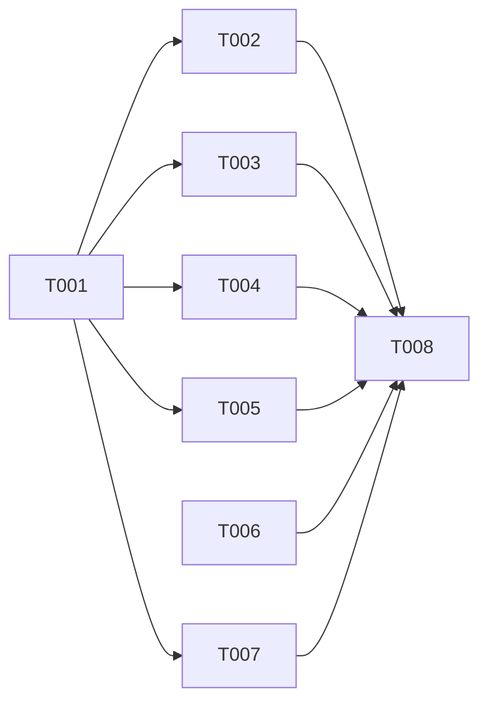

# DS-US-TMC-018 · Garantías de los snapshots: sin publicación, sin pérdida por mantenimiento, sin alteración

## Contexto rápido

Al terminar, cada escenario de US-TMC-018 tiene una prueba que lo demuestra con el almacén real de ADR-TMC-001, en repos, perfiles y remotos bare temporales (NFR-01), y la historia puede pasar a `implemented`. Las cuatro garantías se cumplen por construcción (el almacén es un repo bare privado en `<datos>/tm/<id>/store.git`, sin `alternates` y sin escribir nada en el repo del usuario) y ya hay pruebas de la forma base de cada una. Esta ficha es de **verificación y cierre de huecos**: no cambia el diseño ni, en principio, el código de producto.

Lo que ya existe y no se duplica:

| Escenario | Ya cubierto | Hueco que cierra esta ficha |
|---|---|---|
| 1. Un push no publica snapshots | `tm_store_safety.rs::snapshots_are_never_pushed` (`push --mirror`, `--all`, `refs/*:refs/*` a un bare temporal; ni ref `refs/tm/` ni el blob del no seguido); `tm_chaos.rs::hostile_mirror_of_every_ref_leaks_no_snapshot` (daemon real) | Remoto configurado con `remote.<n>.mirror=true` y `git push` sin argumentos, push desde un worktree enlazado, `--tags`, un clon `--mirror` del repo hecho por otro y `bundle create --all`. Y el commit del snapshot, no solo el blob (T001) |
| 2. El mantenimiento no los borra | `tm_store_safety.rs::aggressive_maintenance_after_a_destructive_reset_keeps_every_snapshot` (`reset --hard HEAD~1`, `stash clear`, `reflog expire --expire=now --all`, `gc --prune=now --aggressive`); `tm_chaos.rs::hostile_aggressive_maintenance_after_a_destructive_reset` (con `raptor undo`) | `repack -a -d`, `repack --cruft` con caducidad inmediata, `git maintenance run` con todas sus tareas, `prune --expire=now`, `worktree remove`/`prune` del worktree capturado, un repo con `alternates` cuyo origen se limpia y el registro del mantenimiento programado (T002, T003, T004) |
| 3. Un agente no los altera | `tm_store_safety.rs::agent_work_in_the_worktree_never_alters_a_snapshot` (checkout, reset, `clean -fdx` y commit en el worktree **principal**; compara ref y archivos) | El escenario pide `feat-login`: el mismo trabajo en el worktree enlazado, más `commit --amend`, `rebase` y `branch -f`, con la huella byte a byte de la carpeta del almacén, no solo la ref y los archivos de un snapshot (T005) |
| 4. Guardar no cambia el repo | `tm_store_safety.rs::repo_intact::capture_leaves_the_repo_intact` (huella del testkit, INF-GRP-001, en proceso: siembra, previo de 2 worktrees, observación completa e incremental, con `core.fsmonitor` y `core.untrackedCache`) | El mismo criterio con el **daemon real** observando (captura continua de US-TMC-004), más la comprobación semántica que nombra la historia: worktrees, ramas visibles, cambios pendientes, stash y `fsck` (T006). Y en Windows, que el mantenimiento del usuario no quede bloqueado por los archivos que el lector tiene abiertos (T007) |

"Disponible para restaurar" (escenario 2) se comprueba con `SnapshotStore::verify` (re-hash del commit, del árbol y de lo que cuelga, SEC-TMC-09), el contenido byte a byte y `fsck --connectivity-only` del almacén. La restauración de punta a punta tras el mantenimiento ya la prueba `hostile_aggressive_maintenance_after_a_destructive_reset`, y restaurar solo lee del almacén (D2).

⚠️ **ASSUMPTION**: no existe `architecture-constitution.md` en la cascada; rigen `AGENTS.md` y los ADR listados (NFR-01, ADR-GRP-016), como en las Dev Specs hermanas.

---

## ⚠️ Gaps y violaciones de la constitución

_No gaps. Ready to implement._

Si un test nuevo sale en rojo, es un defecto de una garantía de NFR-01, no de la prueba: se corrige dentro de `crates/git/src/tm_write/store/` o `crates/core/src/timemachine/store/` y se anota en § Estado. Si el arreglo sale de esas carpetas, se para y se escala (D1).

---

## 🚀 Plan de implementación

> Orden topológico (`Depende:`). Rutas relativas a la raíz del repo. Solo archivos nuevos y propios, más `docs/` (ADR-GRP-016): ningún test existente se mueve ni se edita.

### El trabajo de un vistazo

| # | Tarea | Depende | Aterriza en |
|---|---|---|---|
| T001 | Probar que ninguna forma de publicar saca un snapshot | — | `crates/core/tests/us_tmc_018.rs` |
| T002 | Probar el mantenimiento completo de Git | T001 | `crates/core/tests/us_tmc_018.rs` |
| T003 | Probar que un worktree borrado y podado conserva su snapshot | T001 | `crates/core/tests/us_tmc_018.rs` |
| T004 | Probar los `alternates` y el mantenimiento programado | T001 | `crates/core/tests/us_tmc_018.rs` |
| T005 | Probar el trabajo de un agente en `feat-login` | T001 | `crates/core/tests/us_tmc_018.rs` |
| T006 | Probar la huella con el daemon real | — | `apps/cli/tests/us_tmc_018_intact.rs` |
| T007 | Probar que el mantenimiento del usuario no queda bloqueado | T001 | `crates/core/tests/us_tmc_018.rs` |
| T008 | Cerrar la historia | T002, T003, T004, T005, T006, T007 | `docs/` |

### En qué orden



### T001 — Probar que ninguna forma de publicar saca un snapshot

**Objetivo.** Crear `us_tmc_018.rs` con su arranque y el escenario 1 en las formas que `snapshots_are_never_pushed` no cubre.

**Ubicación.** `crates/core/tests/us_tmc_018.rs` (**CREATE**). Usa `mod tm_common;` (`Env`, `git()`, `hint`) sin editarlo; lo que falte (un `Env` sobre otra ruta de repo) va como función privada de este archivo.

**Reglas**
- Fixture: `Fixture::busy` con stash, `gc` previo y un worktree enlazado `feat-login` (rama `feat-login` creada antes de `add_worktree`), como `packed_busy` de `tm_store_safety.rs` (se copia, no se importa: es privada). Un previo garantizado de `main` y `feat-login` y una observación de `feat-login` con un archivo sin seguimiento nuevo. Se guardan `S` = ids de snapshot, `C` = sus commits del almacén y `B` = el blob que solo tiene el almacén.
- Formas de publicar, cada una a su remoto bare temporal bajo `f.root`:
  1. `remote add backup <bare>` + `config remote.backup.mirror true` + `git push backup` sin argumentos.
  2. `git push --all` y `git push --tags` ejecutados **desde** `wt-feat-login`.
  3. `git clone --mirror <repo> <bare>` (otro que copia todas las refs del repo del usuario).
  4. `git bundle create <f.root>/all.bundle --all` y `git bundle list-heads`.
- Aserciones por destino: ninguna ref empieza por `refs/tm/`; `cat-file -e` falla para cada `C` y para `B`; en el bundle, ninguna cabeza es `refs/tm/*` ni un `C`. En el repo: `for-each-ref` sin `refs/tm/` y `log --all` sin `tm snapshot` (como el test base).

- **Depende:** —
- **Refs:** ADR-TMC-001 § Validación 1, BR-TMC-CONS-004
- **Aceptación:** `every_way_of_publishing_leaks_no_snapshot` en `crates/core/tests/us_tmc_018.rs`

### T002 — Probar el mantenimiento completo de Git

**Objetivo.** Escenario 2 con la lista cerrada de mantenimiento de D4, después de dejar inalcanzable en el repo lo que los snapshots necesitan.

**Ubicación.** `crates/core/tests/us_tmc_018.rs` (**MODIFY**, archivo propio de T001)

**Reglas**
- Preparación: tres commits nuevos en `feat-login` (uno con un archivo que solo existe ahí), un previo de los dos worktrees, una observación con un no seguido y otra tras `git add` de un archivo nuevo (blob solo en el índice). Antes del mantenimiento se leen `files` y `staged` de cada snapshot.
- Destrucción en el repo: en `wt-feat-login`, `reset --hard HEAD~3` y `clean -fdx`; `stash clear`; `branch -D` de una rama capturada (fuera de los worktrees); `reflog expire --expire=now --expire-unreachable=now --all`.
- Mantenimiento, en este orden: `repack -a -d -f`, `repack -d --cruft --cruft-expiration=now`, `maintenance run --task=gc --task=loose-objects --task=incremental-repack --task=pack-refs --task=commit-graph`, `prune --expire=now`, `gc --prune=now --aggressive`. Comprobación de la preparación: `cat-file -e` del commit de la punta perdida falla en el repo.
- Aserciones por snapshot: `store.verify(id)` es `Ok`; `files` y `staged` son iguales byte a byte a los leídos antes; `snapshot_commit` no cambia; el almacén tiene la punta perdida (`store_git cat-file -e`) y `store_git fsck --connectivity-only --no-dangling` pasa.

- **Depende:** T001
- **Refs:** ADR-TMC-001 § Validación 2, ADR-TMC-007 § 4, D4
- **Aceptación:** `every_git_maintenance_keeps_every_snapshot`

### T003 — Probar que un worktree borrado y podado conserva su snapshot

**Objetivo.** Un agente borra el worktree capturado; el snapshot sigue completo y sigue declarando ese worktree (D-TMC-41).

**Ubicación.** `crates/core/tests/us_tmc_018.rs` (**MODIFY**)

**Reglas**
- Dos variantes en el mismo test: `wt-feat-login` borrado del disco a mano seguido de `git worktree prune`; y un segundo worktree `wt-tmp` con `git worktree remove --force`. En ambos, rama borrada después con `branch -D` y `reflog expire` + `gc --prune=now`.
- Aserciones: `verify` pasa; `files(id, "feat-login")` igual que antes; `meta(id)` sigue listando el worktree (ruta y rama) entre los registrados. No se restaura aquí: recrear un worktree es de US-TMC-009.

- **Depende:** T001
- **Refs:** BR-TMC-CONS-002, ADR-TMC-001 § 1, D-TMC-41
- **Aceptación:** `a_removed_and_pruned_worktree_keeps_its_snapshot`

### T004 — Probar los `alternates` y el mantenimiento programado

**Objetivo.** El snapshot no depende de objetos que el repo toma de otro sitio, y el almacén nunca entra en el mantenimiento que Git programa.

**Ubicación.** `crates/core/tests/us_tmc_018.rs` (**MODIFY**)

**Reglas**
- **Origen con `alternates`**: `f.repo` hace de origen, con una rama `only-here` y un commit que solo está en ella. `git clone -q --shared --branch only-here <f.repo> <f.root>/shared` crea el repo observado (sus objetos están en el origen vía `objects/info/alternates`). Un previo de `shared` con `CaptureRequest` construido a mano (como `repo_intact::capture_leaves_the_repo_intact`). En el origen: `branch -D only-here`, `reflog expire --expire=now --all`, `gc --prune=now`. Comprobación de la preparación: `cat-file -e <commit>` falla en `shared`. Aserciones: `verify` pasa, el almacén tiene el commit y sus blobs y no tiene `objects/info/alternates`. Lo cubre el anclaje: `StoreHandle::copy_closure` lee con `RepoReader` y copia lo que falta (`anchor.rs`).
- **Mantenimiento programado**: con el `HOME` temporal del fixture, `git maintenance register` en el repo y una captura. El `maintenance.repo` global solo lista el repo (nunca el almacén ni nada bajo `profile/`). En la configuración del almacén: `maintenance.auto=false` y `gc.auto=0` (el test base no comprueba la primera). Nunca `maintenance start`: tocaría `launchd`/`systemd`/`schtasks` reales.

- **Depende:** T001
- **Refs:** ADR-TMC-001 § 3 (sin `alternates`, anclaje), ADR-TMC-002 § 2
- **Aceptación:** `maintenance_of_an_alternates_source_keeps_the_snapshot`, `the_store_is_never_registered_for_scheduled_maintenance`

### T005 — Probar el trabajo de un agente en `feat-login`

**Objetivo.** El escenario 3 tal como lo escribe la historia, medido sobre todo el almacén.

**Ubicación.** `crates/core/tests/us_tmc_018.rs` (**MODIFY**)

**Reglas**
- Un previo de `feat-login` con cambios preparados, sin preparar y sin seguimiento. Antes del trabajo: `gitraptor_testkit::fingerprint::Snapshot::of_dir(env.store_path())` y `snapshot_refs(&env.store)`.
- En `wt-feat-login`: `checkout -b scratch` y vuelta a `feat-login`, `reset --hard HEAD~1`, `clean -fdx`, dos commits, `commit --amend`, `rebase` sobre `main`, `branch -f feat-login HEAD~1`. Sin captura en medio: en el test no hay daemon.
- Aserciones: la huella de la carpeta del almacén es idéntica (`fingerprint::diff` vacío); `snapshot_refs` igual; `files`/`staged` iguales; `verify` pasa.

- **Depende:** T001
- **Refs:** ADR-TMC-001 § Validación 3, D3, D-TMC-40
- **Aceptación:** `agent_work_in_feat_login_leaves_the_store_byte_identical`

### T006 — Probar la huella con el daemon real

**Objetivo.** Escenario 4 de punta a punta: el daemon observa y guarda snapshots, y el repo, sus worktrees y el `HOME` no cambian.

**Ubicación.** `apps/cli/tests/us_tmc_018_intact.rs` (**CREATE**), `#![cfg(any(target_os = "macos", target_os = "linux"))]`.

**Reglas**
- Arnés: el del daemon hijo de `tm_chaos.rs` (`Machine`: repo, home y perfil temporales, alta por la API del perfil), copiado en este archivo en su forma mínima. Excepciones: las de `continuous_observation.rs::engine_profile()`.
- Antes de `gitraptor_testkit::check`: worktree enlazado `feat-login`, en los dos worktrees cambios preparados, sin preparar y sin seguimiento, un stash, `core.fsmonitor=true` y `core.untrackedCache=true`.
- Dentro de `check`: se arranca el daemon, se espera (con plazo, sin esperas fijas) a que el timeline tenga una captura de cada worktree posterior al arranque (detección completa `first-capture` con siembra), se pide un previo de los dos worktrees por la misma vía que usa `tm_chaos` y se para el daemon. `report.assert_intact()`.
- Comprobación semántica además de la huella, antes y después: `worktree list --porcelain`, `for-each-ref`, `branch -a`, `status --porcelain=v2` de cada worktree, `stash list` y `fsck --no-progress` (la misma salida).

- **Depende:** —
- **Refs:** ADR-TMC-001 § Validación 4, INF-GRP-001, US-TMC-004
- **Aceptación:** `daemon_captures_leave_the_observed_repo_intact` en `apps/cli/tests/us_tmc_018_intact.rs`

### T007 — Probar que el mantenimiento del usuario no queda bloqueado

**Objetivo.** Guardar snapshots no deja abiertos archivos del repo que impidan a Git borrar sus packs viejos. En Windows un archivo abierto no se borra y `gc` deja packs huérfanos (o pregunta "Unlink of file failed. Should I try again?"). En macOS y Linux pasa siempre: el test es el mismo en los tres SO (TQ-26).

**Ubicación.** `crates/core/tests/us_tmc_018.rs` (**MODIFY**)

**Reglas**
- `Env` con el almacén y el oplog abiertos, una siembra y dos capturas (leen packs del usuario). Sin soltar `env`: `git repack -a -d` y `gc --prune=now` con `stdin` nulo y `GIT_ASK_YESNO` apuntando a un programa que devuelve error (no hay pregunta interactiva).
- Aserciones: los dos comandos salen con 0, su stderr no contiene `unlink` ni `Deletion of`, y en `objects/pack` solo queda un `.pack` (más su `.idx` y sus ficheros auxiliares).

- **Depende:** T001
- **Refs:** BR-TMC-CONS-004 (guardar no cambia el repo), ADR-GRP-009 § 3, TQ-26
- **Aceptación:** `user_maintenance_is_not_blocked_by_open_store_or_reader`

### T008 — Cerrar la historia

**Objetivo.** Dejar la trazabilidad al día.

**Ubicación.** `docs/` (**MODIFY**)

**Reglas**
- US-TMC-018: `status: implemented`, enlace a esta ficha en § Diseño y Dev Spec, la marca "Pendiente: etapa de validación multiplataforma" (XP-49) en § Dependencias / Transversal, y el estado del backlog o del hito que corresponda. Cerrar con Windows parcial está aceptado por el PO (M2 = MVP completo en macOS).
- § Estado de esta ficha con PR, tests y plataformas verificadas. `xplat-pendientes.md`: XP-49 ya existe (T006 en Linux y Windows, T007 en Windows real); se actualiza su estado con lo verificado.

- **Depende:** T002, T003, T004, T005, T006, T007
- **Refs:** AGENTS.md § Pull requests
- **Aceptación:** `cargo test -p gitraptor-core --test us_tmc_018` y `cargo test -p gitraptor-cli --test us_tmc_018_intact` en verde; US-TMC-018 con `status: implemented`

---

## Estructura de ficheros

```text
crates/core/tests/us_tmc_018.rs           ← CREATE  (T001, T002, T003, T004, T005, T007)
apps/cli/tests/us_tmc_018_intact.rs       ← CREATE  (T006)
docs/…                                    ← MODIFY  (T008)
```

Sin cambios en `Cargo.toml`: los tests de integración de `crates/core/tests/` y `apps/cli/tests/` se descubren solos, y `tempfile` y `gitraptor-testkit` ya son dev-dependencies de los dos crates.

## Contratos compartidos

### Tipos y datos compartidos

_No aplica — ficha de verificación, sin tipos nuevos._ Los tests usan API pública que ya existe: `SnapshotStore::{open_or_create, capture, verify, files, staged, meta, snapshot_commit, path}`, `timemachine::store::snapshot_refs`, `CaptureRequest`/`WorktreeScope`, `gitraptor_testkit::{check, Exceptions, Fixture}` y `gitraptor_testkit::{Snapshot, diff}` (reexportados de `fingerprint`).

### Ciclos de vida (DI)

_No aplica — sin componentes nuevos._ Cada test abre su propio `SnapshotStore` y `Oplog` sobre el perfil temporal (`tm_common::Env::new`) y los suelta al terminar; T007 los mantiene vivos a propósito mientras corre el mantenimiento.

### Firmas del stack

_No aplica — sin firmas nuevas de producción._ Solo funciones `#[test]` con los nombres de § Plan.

## Contrato de API

### Forma del error y del cuerpo de respuesta

_No aplica — sin superficie de API nueva._

### Forma de la configuración

_No aplica — sin claves nuevas._ Se comprueban las que el almacén ya escribe: `gc.auto=0`, `maintenance.auto=false`, sin remotos y sin `alternates`.

### Valores numéricos

_No aplica — sin umbrales nuevos._ Las esperas de T006 usan los plazos del arnés de `tm_chaos.rs`.

## Modelo de datos

_Sin esquema ni migración._

---

## Estrategia de pruebas y cobertura

### 9.1 Pirámide de pruebas

| Tipo | Cantidad | Tareas dueñas | Herramientas | Cuándo |
|---|---:|---|---|---|
| Integration | 7 | T001–T005, T007 | `cargo test -p gitraptor-core --test us_tmc_018` | PR gate (macOS, Linux y Windows en CI) |
| E2E | 1 | T006 | `cargo test -p gitraptor-cli --test us_tmc_018_intact` | PR gate (macOS, Linux) |

### 9.2 Umbrales de cobertura

| Capa | Línea | Rama | Mutación | Camino crítico 100% |
|---|---:|---:|---:|:---:|
| Garantías del almacén | — | — | — | cada escenario de US-TMC-018 tiene al menos un test que falla si la garantía se rompe |

### 9.3 Datos de prueba

- Repos, `HOME`, perfiles y remotos bare siempre bajo el `root` temporal del `Fixture`; nunca este repo ni el perfil real (NFR-01). Git del sistema con la configuración del fixture (`HOME_GITCONFIG`).
- `feat-login` es un worktree enlazado de `Fixture::busy` (`add_worktree`).

### 9.4 Comportamientos críticos verificados

| Escenario | Test |
|---|---|
| 1. Un push no publica snapshots | Base: `tm_store_safety.rs::snapshots_are_never_pushed`, `tm_chaos.rs::hostile_mirror_of_every_ref_leaks_no_snapshot`. Nuevo: `us_tmc_018.rs::every_way_of_publishing_leaks_no_snapshot` |
| 2. El mantenimiento de Git no borra snapshots | Base: `aggressive_maintenance_after_a_destructive_reset_keeps_every_snapshot`, `hostile_aggressive_maintenance_after_a_destructive_reset` (con undo). Nuevo: `every_git_maintenance_keeps_every_snapshot`, `a_removed_and_pruned_worktree_keeps_its_snapshot`, `maintenance_of_an_alternates_source_keeps_the_snapshot`, `the_store_is_never_registered_for_scheduled_maintenance` |
| 3. El trabajo de un agente no altera los snapshots | Base: `agent_work_in_the_worktree_never_alters_a_snapshot`, `hostile_agent_cleans_and_resets`. Nuevo: `agent_work_in_feat_login_leaves_the_store_byte_identical` |
| 4. Guardar un snapshot no cambia el repo del usuario | Base: `repo_intact::capture_leaves_the_repo_intact`, `seeding_and_writing_known_objects_leave_the_user_packs_untouched`. Nuevo: `us_tmc_018_intact.rs::daemon_captures_leave_the_observed_repo_intact`, `us_tmc_018.rs::user_maintenance_is_not_blocked_by_open_store_or_reader` |

### 9.5 Plataformas

| Plataforma | Cómo se verifica | Pendiente |
|---|---|---|
| macOS | `cargo clippy --workspace --all-targets -- -D warnings` y `cargo test --workspace` | — |
| Linux | `us_tmc_018` y `us_tmc_018_intact` en el CI (ubuntu); los `tm_store_*` ya pasan en contenedor (XP-11) | **Pendiente: etapa de validación multiplataforma** (reflink real, XP-11) (XP-49) |
| Windows | `us_tmc_018` compila y corre como `tm_store_safety` tras XP-12; T007 es el que importa aquí. `us_tmc_018_intact` no corre (el daemon con Git no corre todavía en el CI de Windows, como `tm_chaos`) | **Pendiente: etapa de validación multiplataforma** (T007 y T006 en máquina real) (XP-49) |

---

## Gate de seguridad

- Ningún test toca el repo real ni el perfil real: todo bajo el `root` del fixture, con `HOME` temporal (T004 escribe `maintenance.repo` en el `.gitconfig` de ese `HOME`).
- Ningún test programa tareas del SO (`maintenance start` prohibido).
- El almacén no gana remotos, `alternates` ni hooks: T001 y T004 lo comprueban además del test base de la configuración.
- Fuera de las garantías (D-TMC-40): un proceso del mismo usuario que escribe en `<datos>/tm/` no queda impedido. La **alteración** de un snapshot la detecta `verify` (SEC-TMC-09) y su caso hostil es SEC-TMC-11 de INF-TMC-001 § 6. La **desaparición entera** de `<datos>/tm/<repo>/` hoy **no** se detecta: la cabeza de la cadena del oplog vive en esa misma carpeta (`oplog/mod.rs`, `HEAD_FILE`), así que el daemon recrea un oplog vacío y el timeline sale vacío sin aviso. D-TMC-40 promete solo lo primero (G4).

---

## Dependencias

| Dependencia | Cómo entra aquí |
|---|---|
| TS-TMC-001 (implementada) | Almacén, captura, anclaje, `verify`, configuración y los tests base de `tm_store_safety.rs` |
| INF-TMC-001 (implementado en parte) | Arnés del daemon hijo y los `hostile_*`, que ya cubren push, mantenimiento y agente con `raptor undo` |
| US-TMC-001 / US-TMC-004 | Previo garantizado y captura continua que T006 ejercita |
| US-TMC-016 (sin construir) | El mantenimiento **del almacén** (`repack`, `prune` con gracia) y la purga: fuera de esta historia (ADR-TMC-007 § 4) |

---

## Fuera de alcance

| Ítem / no-objetivo | Historia que lo cubre | Gate (cómo se verifica) |
|---|---|---|
| Mantenimiento y purga del almacén (snapshots fuera de retención, gracia de objetos sueltos, captura en curso durante el mantenimiento) | US-TMC-016 | Sus propios tests; aquí, `gc.auto=0` y `maintenance.auto=false` del almacén |
| Almacén u oplog editados fuera del daemon, disco lleno | INF-TMC-001 § 6 (SEC-TMC-11, SEC-TMC-12) | — |
| Restaurar un worktree borrado | US-TMC-009 | — |
| Reflink real en Linux y la suite del daemon en Windows | Etapa de validación multiplataforma (XP-11, XP-12) | `xplat-pendientes.md` |

---

## Decisiones

| # | Decisión | Origen |
|---|---|---|
| D1 | La ficha es de verificación: dos archivos de test nuevos y propios, sin mover ni editar `tm_store_safety.rs`, `tm_chaos.rs` ni `tm_common` (ADR-GRP-016). Un rojo es un defecto de NFR-01 y se arregla en el código del almacén. Si el arreglo sale de `tm_write/store/` o `timemachine/store/`, se escala | **Decisión del orquestador (2026-10-28), validada por Arquitecto** |
| D2 | "Disponible para restaurar" se prueba en proceso con `verify`, el contenido byte a byte y `fsck` del almacén. La restauración de punta a punta tras el mantenimiento ya la prueba `hostile_aggressive_maintenance_after_a_destructive_reset`, y restaurar solo lee del almacén: repetirla por cada comando de mantenimiento no prueba nada nuevo | **Decisión del orquestador (2026-10-28), validada por Arquitecto** |
| D3 | La no alteración por un agente se mide con la huella byte a byte de la carpeta del almacén (`fingerprint::Snapshot::of_dir`), no solo con la ref y los archivos de un snapshot: cubre todos los snapshots y cualquier escritura indirecta (refs empaquetadas, objetos, configuración) | **Decisión del orquestador (2026-10-28), validada por Arquitecto** |
| D4 | El escenario 2 ("máxima agresividad") se fija como una lista cerrada: `reflog expire --expire=now --expire-unreachable=now --all`, `repack -a -d -f`, `repack -d --cruft --cruft-expiration=now`, `maintenance run` con `gc`, `loose-objects`, `incremental-repack`, `pack-refs` y `commit-graph`, `prune --expire=now` y `gc --prune=now --aggressive`, más `worktree prune` y la limpieza de un origen de `alternates`. Una forma nueva de mantenimiento se añade a la lista | **Decisión del orquestador (2026-10-28), validada por Arquitecto** |
| D5 | T007 corre en los tres SO con la misma aserción (packs viejos borrados, sin aviso de `unlink`): en macOS y Linux pasa siempre y en Windows es el caso que importa. Si falla en Windows, el arreglo es soltar los manejadores del `RepoReader` al terminar cada captura (TQ-26) | **Decisión del orquestador (2026-10-28), validada por Arquitecto** |
| D6 | La huella con el daemon (T006) se limita a macOS y Linux, como `tm_chaos`; Windows queda en la etapa de validación multiplataforma | **Decisión del orquestador (2026-10-28), validada por Arquitecto** |

### Decisiones de negocio nuevas (para `business-rules.md`, las integra el orquestador)

| ID | Decisión |
|---|---|
| D-TMC-40 | "Un agente no altera los snapshots" (D-TMC-11) cubre todo lo que un agente hace con Git y con los archivos del repo y sus worktrees, incluido borrar un worktree, podarlo y cualquier mantenimiento. No cubre escribir o borrar a propósito en la carpeta de datos de GitRaptor: eso no se impide y queda fuera de esta garantía. La alteración de un snapshot se detecta (su verificación falla y se avisa, SEC-TMC-09); la desaparición entera de la carpeta de un repo no se detecta en el MVP. **Decisión del orquestador (2026-10-28), validada por Arquitecto y PO** |
| D-TMC-41 | Un snapshot no depende de nada del repo del usuario: sigue disponible aunque desaparezcan su worktree, su rama, sus commits o los objetos que el repo tomaba de otro (`alternates`). Mientras esté dentro de la retención solo lo retira la purga de la Time Machine, por edad, por tope o por cuota, siempre con aviso visto y 24 h (BR-TMC-TIME-001, D-TMC-38). **Decisión del orquestador (2026-10-28), validada por Arquitecto y PO** |

### Preguntas abiertas nuevas

| ID | Pregunta | Por defecto mientras tanto | Dueño |
|---|---|---|---|
| TQ-26 | En Windows, ¿el `RepoReader` del daemon mantiene abiertos los packs del usuario entre capturas e impide que `git gc`/`repack` borre los viejos? | T007 lo mide. Si falla, se sueltan los manejadores al terminar cada captura. Pendiente: etapa de validación multiplataforma | Arquitecto |

## Notas del autor

| ID | Nota | Acción | Owner |
|---|---|---|---|
| G1 | La historia dice "tres SO". En Windows, los tests en proceso corren tras XP-12. La huella con el daemon y los `hostile_*` siguen sin correr allí, como todo el arnés de INF-TMC-001 | Pendiente: etapa de validación multiplataforma | Orquestador |
| G2 | El test base de configuración (`store_configuration_has_no_remotes_hooks_or_gc`) no comprueba `maintenance.auto=false`, que el almacén sí escribe (`tm_write/store/mod.rs`). T004 lo comprueba sin editar ese test (D1) | Ninguna | — |
| G4 | Detectar la desaparición entera de `<datos>/tm/<repo>/` de un repo registrado que tenía snapshots (guardar fuera de esa carpeta, en el almacén del perfil, una marca o la cabeza de la cadena, y avisar en el siguiente comando de la CLI o la TUI). Pide migración del almacén del perfil y un tipo de aviso nuevo: no cabe en una ficha de verificación. Mientras tanto D-TMC-40 promete solo detectar la alteración | Candidato para INF-TMC-001 § 6 o una historia nueva; decide el PO | Arquitecto → PO |
| G3 | El Git CLI que corre sobre el almacén va con `GIT_CONFIG_NOSYSTEM=1` y `GIT_CONFIG_GLOBAL` vacío (`crates/git/src/invoke.rs`): un `gc.*` global del usuario no le afecta. Lo que sí le afectaría es una herramienta del usuario que lance `git gc` dentro de `<datos>/tm/`, fuera de las garantías por D-TMC-40 | Ninguna | — |
