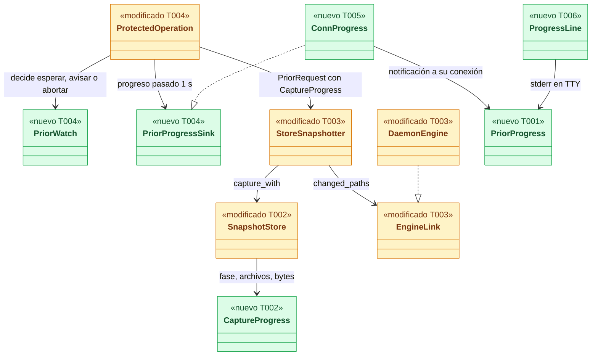
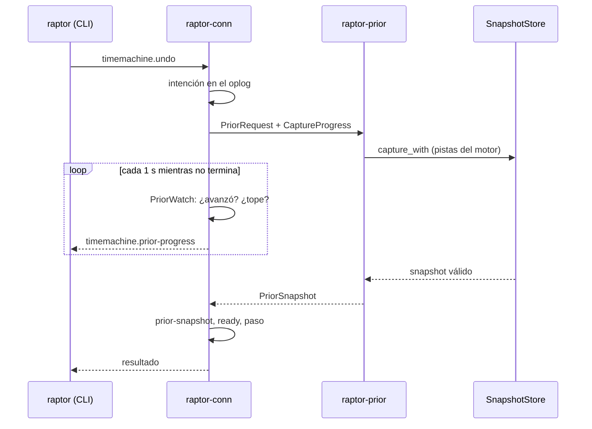
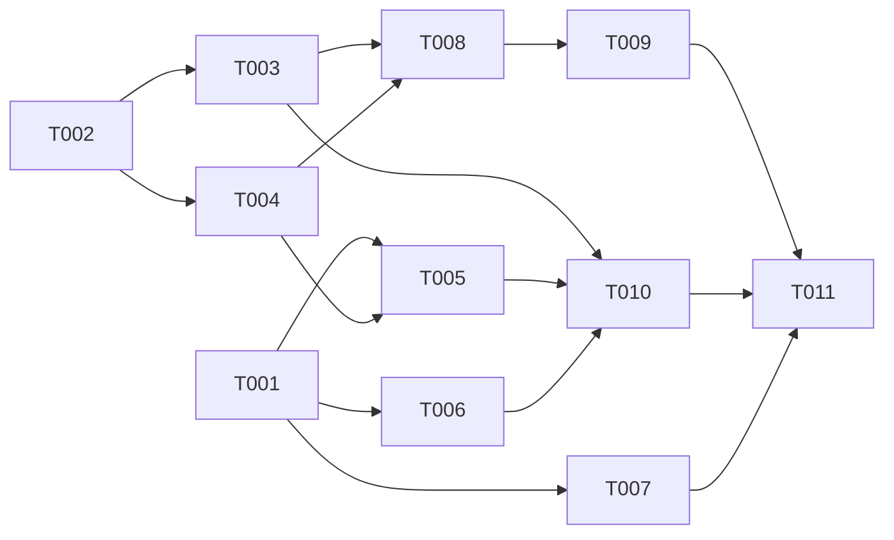

# DS-US-TMC-020 · Overhead del snapshot previo < 200 ms (p95) y progreso cuando tarda

## Contexto rápido

Al terminar: (1) el snapshot previo de una operación protegida usa en producción las rutas del motor con marca de continuidad (escalón 2 de ADR-TMC-006 § 5), así que el p95 medido por el banco es el del camino real; (2) el banco `tm_snapshot` mide el overhead **de la operación protegida** (no solo de la captura) en el perfil `M`, con 1 y 10 worktrees, con `--gate ci|reference` y corre en CI; (3) un previo lento no se corta mientras avance (D-TMC-42) y, pasado 1 s, la CLI y la TUI dicen que se está guardando el previo (D-TMC-43). El MCP no recibe progreso.

Punto de partida en el código:

- `ProtectedOperation::run` (`crates/core/src/timemachine/protected/mod.rs`) lanza `raptor-prior` y espera con `rx.recv_timeout(self.deadline)`; `DEFAULT_PRIOR_DEADLINE` = 10 s **absolutos**. Un archivo de 1 GB tarda ~7 s en macOS (SPIKE-TMC-001 § 5.2) y en Linux/Windows no se midió: el escenario 3 puede abortar con `prior-timeout`.
- `StoreSnapshotter::prior` construye cada `WorktreeScope` con `hint: None`. Ningún código de producción construye `ChangeHint` (solo el banco): cada previo hace **detección completa**. ADR-TMC-006 § 5 y el overview § 7.2 lo dejan como "nota de integración pendiente"; sin ella el presupuesto no se cumple.
- `crates/core/benches/tm_snapshot.rs` mide `SnapshotStore::capture` con pistas sintéticas, falla con p95 ≥ 200 ms del delta de referencia, no tiene `--gate` ni `--out` y **no corre en CI** (DS-INF-GRP-002 § Time Machine).
- No hay mecanismo de progreso: `api::Client::call` guarda las notificaciones que llegan durante una llamada en `notifications` y la CLI no las mira hasta después.

| Término | Qué es aquí |
|---|---|
| Overhead | ADR-TMC-006 § 1: desde que el daemon acepta la petición hasta que el previo es válido (ref y fila `complete`), cola del escritor incluida |
| Pistas del motor | `ChangeHint { since, mark, paths, continuous }`: rutas que el motor vio cambiar en un worktree entre dos marcas |
| Avance del previo | Cambio de fase de la captura, un archivo más escrito o 256 KiB más leídos |
| Progreso | Notificación `timemachine.prior-progress` a la conexión que pidió la operación |

⚠️ **ASSUMPTION**: no existe `architecture-constitution.md` en la cascada; rigen `AGENTS.md` y los ADR listados (NFR-01, NFR-04, ADR-GRP-016), como en las Dev Specs hermanas.

---

## ⚠️ Gaps y violaciones de la constitución

| ID | Gap | Bloquea | Qué se hace |
|---|---|---|---|
| G1 | **Escalón 2 sin cablear en producción** (`hint: None`). El gate del banco con pistas sintéticas mediría un camino que el usuario no recorre | El gate (no el inicio) | T003 lo cablea; el escenario `protected` del banco usa el `StoreSnapshotter` real con un `EngineLink` de banco que devuelve las pistas como lo haría el daemon |
| G2 | **10 worktrees bajo carga**: TS-TMC-001 § 8, pasada B, 217 ms ❌ (árboles 114–233 ms, cola 23–26 ms). El remedio previsto, una sola barrera por snapshot, es de TS-TMC-002 (TS-TMC-001 § 9) | **Release** | Si `--gate reference` falla con 10 worktrees tras T003, la historia no cierra: se abre la tarea de TS-TMC-002 con la cifra. No se mete aquí |
| G3 | **La TUI no lanza hoy ninguna operación protegida** (no hay `operation.run` ni `timemachine.undo` en `apps/cli/src/tui/`) | **Release** del escenario 3 en la TUI | T007 entrega el mapeo de la notificación y la línea de estado con snapshot test. La prueba e2e se traslada por escrito a **US-CKP-014** (integrar la rama de un agente con una tecla: la primera historia del Cockpit que lanza desde la TUI una operación protegida con snapshot previo, cadena TS-CKP-002/TS-CKP-003). Su Dev Spec debe llevar la comprobación "la TUI muestra el progreso del previo y lo borra con la respuesta" (PO, punto 10; esta ficha no toca archivos del Cockpit) |
| G4 | **TS-GRP-005 PR-B sin implementar** (`crates/core/src/work_class` no existe). Su T010 pone `raptor-prior`, `raptor-conn` y el hashing del previo en `UserInitiated`; su T013 añade el escenario `saturated` al mismo `tm_snapshot.rs` | No | Ver § Dependencias: no se crea ningún hilo nuevo y los escenarios del banco van en funciones propias para que el rebase sea trivial |

---

## 🔭 La forma





### Diseño

- **Medir lo que paga el usuario** (D1). El escenario `protected` del banco llama a `ProtectedOperation::run` con el `StoreSnapshotter` real y un paso vacío que anota `Instant::now()` al entrar. Overhead = entrada de `run` → entrada del paso: intención, hilo, captura, `prior-snapshot` y `ready`. "Admisión" = overhead − `StageTimings.total`. El salto por el socket ya tiene su gate (`channel_flood`, p95 < 25 ms, ADR-GRP-011).
- **Escalón 2 en producción** (D5). `EngineLink::changed_paths` con implementación por defecto `None` (los dobles siguen con detección completa, que siempre es correcta). La captura pide las pistas **dentro** del escritor, con la marca guardada del worktree, así que `since` siempre es la de su captura anterior. La regla de continuidad es una función pura y falla cerrado (ADR-TMC-006 § 5).
- **El plazo cuenta el avance** (D-TMC-42). `PriorWatch` sustituye el `recv_timeout` único: aborta con `Timeout` si la captura pasa `prior_deadline` (10 s) sin avanzar o si llega a `PRIOR_HARD_DEADLINE` (100 s desde que se aceptó la petición, cola del lock incluida; por debajo de `WRITE_CALL_TIMEOUT` = 120 s del cliente, para que la respuesta tipada llegue siempre). `PriorFailure::Timeout` no cambia.
- **Progreso empujado por el daemon** (D2, D-TMC-43). Pasado `PRIOR_PROGRESS_AFTER` (1 s), y cada `PRIOR_PROGRESS_EVERY` (1 s), el hilo que espera llama al `PriorProgressSink`. En el canal, el sink empuja `timemachine.prior-progress` al `Outbox` de **esa** conexión solo si tiene la capacidad `timemachine.prior-progress` y no es `raptor-mcp`.
- **Sin hilos nuevos** (D3). La espera y el progreso corren en el hilo que ya esperaba (`raptor-conn`). Los contadores de la captura son atómicos `Relaxed` que escriben los hilos de hashing; nadie toma el cerrojo del escritor para leerlos. Compatible con TS-GRP-005 D11.

---

## 🚀 Plan de implementación

> Orden topológico (`Depende:`). Rutas relativas a la raíz del repo. Los archivos compartidos que se tocan se nombran (ADR-GRP-016).

### El trabajo de un vistazo

| # | Tarea | Depende | Aterriza en | Complejidad |
|---|---|---|---|---|
| T001 | Contrato del progreso del previo | — | `crates/api/src/methods/timemachine.rs`, `crates/api/src/timemachine.rs` | Low |
| T002 | Progreso de la captura y entrada `capture_with` | — | `crates/core/src/timemachine/store/` | Med |
| T003 | Pistas del motor para el previo (escalón 2) | T002 | `crates/core/src/timemachine/{engine,hints}.rs`, `protected/mod.rs`, `daemon/tm.rs` | High |
| T004 | Plazo con avance y emisión del progreso | T002 | `crates/core/src/timemachine/protected/{mod,watch}.rs` | Med |
| T005 | Servir el progreso en el canal | T001, T004 | `crates/core/src/channel/conn.rs`, `timemachine/undo.rs`, `executor/mod.rs` | Med |
| T006 | Progreso en la CLI | T001 | `crates/api/src/client/mod.rs`, `apps/cli/src/` | Med |
| T007 | Progreso en la TUI | T001 | `apps/cli/src/client/mod.rs`, `apps/cli/src/tui/`, `apps/cli/src/present/i18n.rs` | Low |
| T008 | Banco: operación protegida, `--gate`, perfil `L` | T003, T004 | `crates/core/benches/tm_snapshot.rs`, `crates/testkit/src/tm_budget.rs` | Med |
| T009 | Gate de CI y calibración | T008 | `.github/workflows/engine-bench.yml` | Low |
| T010 | Pruebas de los escenarios | T003, T005, T006 | `crates/core/tests/us_tmc_020.rs`, `apps/cli/tests/us_tmc_020_process.rs` | Med |
| T011 | Cerrar la historia | todas | `docs/` | Low |

### En qué orden



### T001 — Contrato del progreso del previo

**Objetivo.** Una notificación y una capacidad nuevas en el módulo `timemachine`, sin lógica.

**Ubicación.** `crates/api/src/methods/timemachine.rs` (**MODIFY**: `NOTIFY_PRIOR_PROGRESS = "timemachine.prior-progress"` en `GROUP.notifications`; `CAP_PRIOR_PROGRESS = Capability::new("timemachine.prior-progress")` en `GROUP.capabilities`). `crates/api/src/timemachine.rs` (**MODIFY**: `PriorProgress`, `PriorPhase`).

**Reglas**
- Nada en `methods/mod.rs` ni en `rpc.rs` (lo comprueba `crates/api/tests/architecture.rs`).
- `PriorProgress` no lleva rutas ni nombres de archivo: solo recuentos y la fase.
- `PriorPhase` (kebab-case): `queue`, `detect`, `anchor`, `blobs`, `trees`, `record`. Valor desconocido al deserializar → `#[serde(other)] Unknown` (un cliente viejo no rompe).

- **Depende:** —
- **Refs:** ADR-GRP-016 § 1; NFR-TMC-14
- **Aceptación:** `prior_progress_wire_form`, `prior_progress_carries_no_paths` (schemars: ningún campo string salvo `operation_id`) en `crates/api/src/timemachine.rs`

### T002 — Progreso de la captura y entrada `capture_with`

**Objetivo.** La captura publica su avance en atómicos que se pueden leer desde otro hilo.

**Ubicación.**
- `crates/core/src/timemachine/store/progress.rs` (**CREATE**: `CaptureProgress`, `ProgressReading`)
- `crates/core/src/timemachine/store/mod.rs` (**MODIFY**: `mod progress; pub use progress::*;`; `CaptureExtras`)
- `crates/core/src/timemachine/store/capture.rs` (**MODIFY**: `capture_with`, `run_capture` recibe `&CaptureExtras`; contador en `write_one`)

**Reglas**
- `SnapshotStore::capture(oplog, req)` conserva su firma y delega en `capture_with(oplog, req, &CaptureExtras::default())`: los 14 literales de `CaptureRequest` no cambian (D6).
- La fase se publica al entrar en cada etapa que ya mide `StageTimings` (`queue` antes de pedir el escritor; `detect`, `anchor`, `blobs`, `trees`, `record`).
- `files_total` = número de `Job` al entrar en `write_blobs`; `files_done` sube por cada `JobResult::Written`.
- `bytes_done`: en `write_one`, el archivo de más de 1 MiB que va a `write_blob_stream` se envuelve en un `Read` que suma a `bytes_done` lo que lee; el pequeño suma su tamaño tras `read_to_end`. `crates/git` no cambia (D4).
- `version` es un contador que sube con cada cambio de fase, archivo o cada 256 KiB: es lo que `PriorWatch` compara para saber si hubo avance.
- Todo con `Ordering::Relaxed`; ninguna lectura toma `writer`.

- **Depende:** —
- **Refs:** ADR-TMC-006 § 1 y § 2; TS-GRP-005 D11
- **Aceptación:** `cargo test -p gitraptor-core --lib timemachine::store::progress`
- **Guard ⛔2.1:** `capture_progress_counts_streamed_bytes` (un archivo de 3 MiB sin seguimiento: `bytes_done` = 3 MiB al terminar, `files_done` = `files_total` = 1)
- **Guard ⛔2.2:** `capture_without_extras_is_unchanged` (mismo `snapshot_id` y árbol que `capture`)

### T003 — Pistas del motor para el previo (escalón 2)

**Objetivo.** El previo de producción usa las rutas que el motor persistió desde la marca de la última captura de cada worktree, con continuidad que se da por rota mientras no se demuestre.

**Ubicación.**
- `crates/core/src/timemachine/hints.rs` (**CREATE**: `fn continuity(events, gaps, since, upto, ignore_rules_changed) -> Option<ChangeHint>`, pura)
- `crates/core/src/timemachine/mod.rs` (**MODIFY**: una línea `mod hints;`)
- `crates/core/src/timemachine/engine.rs` (**MODIFY**: `EngineLink::changed_paths(&self, repo_id, worktree, since) -> Option<ChangeHint>`, por defecto `None`)
- `crates/core/src/daemon/tm.rs` (**MODIFY**: `impl EngineLink for DaemonEngine::changed_paths` con `ProfileStore::events_in_range(since, last_seq)` filtrado por worktree y `ProfileStore::gaps`)
- `crates/core/src/timemachine/store/capture.rs` (**MODIFY**: `CaptureExtras.hints: Option<&dyn HintSource>`; dentro del escritor, con `state.mark` del worktree, rellena `WorktreeScope.hint` si llega `None`)
- `crates/core/src/timemachine/protected/mod.rs` (**MODIFY**: `StoreSnapshotter` gana `engine: Option<Arc<dyn EngineLink>>` y `repo_id`; pasa el `HintSource` a `capture_with`)
- `crates/core/src/timemachine/protected/backend.rs` (**MODIFY**: donde se construye `StoreSnapshotter`, el `EngineLink` del daemon)

**Reglas** (ADR-TMC-006 § 5, escalón 2)
- `continuous = false` si en `(since, upto]`: hay un hueco (`gap_id` o fila de `gaps` que lo solapa), el nivel de observación del worktree estuvo en sondeo, el motor se reinició (otra `generation`), hubo desbordamiento o resync, cambió un archivo de reglas de ignore (`.gitignore` en cualquier carpeta, `info/exclude`, `core.excludesFile`), o un evento no trae la lista completa de rutas.
- `since` desconocido (anterior a `generation_floor`, sin captura previa del worktree) → `None` → detección completa.
- La captura sigue tratando como cambiado todo archivo *racy* (`mtime` ≥ marca), como hoy.
- Una detección completa se anota como hoy (`Detection::Full`); el previo nunca se salta.
- ⚠️ **ASSUMPTION**: el `metadata` de los eventos de archivo del motor lista todas las rutas afectadas, o marca que la lista está truncada. Si no es así, T003 añade la marca de truncado en el motor (un campo en el JSON, sin migración) y la trata como continuidad rota.

- **Depende:** T002
- **Refs:** ADR-TMC-006 § 5 y Validación 4; ADR-GRP-010; overview § 7.2
- **Aceptación:** `cargo test -p gitraptor-core --lib timemachine::hints` y `--test us_tmc_020`
- **Guard ⛔3.1:** `hints::a_gap_breaks_continuity`; `hints::an_ignore_rule_change_breaks_continuity`; `hints::an_unknown_since_gives_no_hint`; `hints::a_truncated_event_breaks_continuity`
- **Guard ⛔3.2:** `us_tmc_020::the_prior_uses_the_engine_paths_when_continuous` (`Detection::Engine` en el `CaptureOutcome` del previo de una operación protegida con daemon real)
- **Guard ⛔3.3:** `us_tmc_020::a_broken_continuity_falls_back_to_full_detection_and_misses_nothing` (hueco simulado, `.gitignore` cambiado sin evento y archivo *racy*: el snapshot contiene los tres cambios)

### T004 — Plazo con avance y emisión del progreso

**Objetivo.** Un previo que avanza no se corta antes del tope; uno parado sí. Pasado 1 s, quien espera recibe el progreso.

**Ubicación.**
- `crates/core/src/timemachine/protected/watch.rs` (**CREATE**: `PriorWatch`, pura sobre `Instant` inyectados)
- `crates/core/src/timemachine/protected/mod.rs` (**MODIFY**: `pub mod watch;`; `PriorRequest.progress: Arc<CaptureProgress>`; `trait PriorProgressSink`; `ProtectedOperation::run_with(req, step, sink: Option<&dyn PriorProgressSink>)`; `run` delega con `None`; constantes)

**Reglas**
- `PriorWatch::next(now, reading) -> Wait(Duration) | Notify | Abort`: `Abort` si `now − último avance ≥ deadline` o `now − inicio ≥ PRIOR_HARD_DEADLINE`; `Notify` si `now − inicio ≥ PRIOR_PROGRESS_AFTER` y pasó `PRIOR_PROGRESS_EVERY` desde el último aviso; si no, `Wait` hasta el más cercano de esos plazos.
- `ProtectedOperation.deadline` pasa a ser el plazo **sin avance** (D-TMC-42). `ProtectedOperation` gana `hard_deadline`, `progress_after` y `accepted: Instant`; `ProtectedWiring` y `TimeMachineWiring` (`channel/mod.rs`) también, con los valores por defecto en `daemon/serve.rs`. Se actualizan los tres literales de `ProtectedOperation` (`undo.rs`, `restore.rs`, `executor/mod.rs`) y los de `UndoEnv` y `RunEnv`; los tests, con `..Default`-like donde exista.
- **El tope cuenta desde que `raptor-conn` aceptó la petición** (`accepted`), no desde que arranca el previo: incluye la espera en la cola del lock del repo (`lock_queued`, hasta `MAX_QUEUED_PER_REPO` = 8 por delante). Si no, una petición en cola detrás de previos lentos pasaría de `WRITE_CALL_TIMEOUT` (120 s): el cliente daría la operación por fallida y el daemon la ejecutaría después. Si al empezar el previo ya no queda tope, aborta con `Timeout` sin capturar (revisión del Arquitecto, 2026-10-28).
- `progress_after == 0` emite el primer aviso **antes** de esperar: así los tests de proceso lo ven sin depender del tiempo.
- El abortado sigue siendo `PriorFailure::Timeout`: intención `aborted`, el paso no corre, el repo no cambia (BR-TMC-CONS-001). La captura tardía sigue como punto del timeline, nunca como previo (TS-TMC-004).
- Al terminar el previo, una línea de diagnóstico en el log del daemon con `operation_id`, overhead, `StageTimings` y la detección (ADR-TMC-006 § 4; NFR-03). Sin rutas.

- **Depende:** T002
- **Refs:** ADR-TMC-006 § 1; TS-TMC-004; D-TMC-42, D-TMC-43
- **Aceptación:** `cargo test -p gitraptor-core --lib timemachine::protected`
- **Guard ⛔4.1:** `watch::a_prior_that_keeps_advancing_is_not_cut_before_the_hard_deadline`
- **Guard ⛔4.2:** `watch::a_prior_without_advance_for_the_deadline_aborts`
- **Guard ⛔4.3:** `watch::the_hard_deadline_aborts_even_while_advancing`
- **Guard ⛔4.4:** `watch::no_progress_before_the_threshold_then_one_per_period`
- **Guard ⛔4.5:** `protected::tests::a_stalled_prior_aborts_and_the_step_never_runs` (doble de `PriorSnapshotter` que se bloquea en un canal; `deadline` 50 ms; sin `sleep`: el test espera el `Err` de `run`)
- **Guard ⛔4.6:** `watch::the_hard_deadline_counts_the_queue` (`accepted` anterior al inicio del previo en más del tope → `Abort` en la primera consulta)

### T005 — Servir el progreso en el canal

**Objetivo.** La conexión que pidió la operación, y solo ella, recibe el progreso si lo entiende.

**Ubicación.**
- `crates/core/src/channel/conn.rs` (**MODIFY**: `ConnProgress { outbox, enabled }` donde se arman `UndoEnv` y `RunEnv`; `enabled = self.has(CAP_PRIOR_PROGRESS.name) && !self.is_mcp()`)
- `crates/core/src/timemachine/undo.rs` (**MODIFY**: `UndoEnv.prior_progress: Option<&dyn PriorProgressSink>`; `run_with` en el sitio de `ProtectedOperation`)
- `crates/core/src/timemachine/restore.rs` (**MODIFY**: igual)
- `crates/core/src/executor/mod.rs` (**MODIFY**: `RunEnv.prior_progress`; `run_with`)
- `crates/core/src/client.rs`: **sin cambios**. `ClientOptions::new` ya pide en `connection.accept` toda capacidad declarada (`capability::all()`), así que la CLI, la TUI y `raptor-mcp` la piden en cuanto T001 la declara

**Reglas**
- `ConnProgress` empuja con `Outbox::push`; si la cola está `is_lagged`, descarta el aviso (el progreso no es un evento: el siguiente lo sustituye).
- `raptor-mcp` también pide la capacidad (usa `gitraptor_core::client` con `capability::all()`); la exclusión la hace `is_mcp()` en el daemon, que es lo que prueba Guard ⛔5.2.
- Ningún brazo nuevo en el `match` de dispatch: no hay método nuevo.

- **Depende:** T001, T004
- **Refs:** ADR-GRP-016 § 1; SEC-12
- **Aceptación:** `cargo test -p gitraptor-core --test us_tmc_020`
- **Guard ⛔5.1:** `us_tmc_020::progress_reaches_only_the_requesting_connection_with_the_capability`
- **Guard ⛔5.2:** `us_tmc_020::an_mcp_connection_never_gets_progress`

### T006 — Progreso en la CLI

**Objetivo.** `raptor undo` y `raptor restore` muestran en stderr que se guarda el previo cuando el daemon lo avisa.

**Ubicación.**
- `crates/api/src/client/mod.rs` (**MODIFY**: `Client::call_observing(method, params, on_note: &mut dyn FnMut(&Notification))`, el mismo bucle de `call` que entrega cada notificación en vez de encolarla; `call` no cambia)
- `apps/cli/src/progress.rs` (**CREATE**: `ProgressLine`: una línea en stderr reescrita con `\r` y borrada al terminar)
- `apps/cli/src/lib.rs` o `main.rs` (**MODIFY**: una línea `mod progress;`)
- `apps/cli/src/undo/confirm/mod.rs` (**MODIFY**: `call` usa `call_observing` con `ProgressLine` cuando `interactive`)
- `apps/cli/i18n/{en,es}/timemachine.txt` (**MODIFY**: claves `prior.progress`, `prior.progress-files`; `prior.timeout` pasa a `prior.timeout.stalled` y `prior.timeout.too-large`)
- `crates/api/src/timemachine.rs` (**MODIFY**: `PriorFailedData.timeout: Option<PriorTimeout { cause: PriorTimeoutCause { Stalled, TooLarge }, read_bytes: u64 }>`, `serde(default, skip_serializing_if)`; el daemon solo lo rellena a una conexión con `timemachine.prior-progress`, porque `PriorFailedData` es `deny_unknown_fields`)

**Reglas**
- Solo si stderr es una TTY y no hay `--json` (D11). Sin TTY o con `--json` las notificaciones se consumen y se ignoran: stdout no cambia.
- La línea se borra antes de imprimir el resultado o el error. Sin color ni spinner propio: el aspecto final es de diseño (§ i18n).

- **Depende:** T001
- **Refs:** D-TMC-43; ADR-GRP-003; NFR-TMC-14
- **Aceptación:** `cargo test -p gitraptor-cli --lib progress` y `--test us_tmc_020_process`
- **Guard ⛔6.1:** `progress::the_line_is_cleared_before_the_result`
- **Guard ⛔6.2:** `us_tmc_020_process::undo_shows_progress_on_a_tty_and_not_with_json` (pty; daemon de prueba con `progress_after = 0`)
- **Guard ⛔6.3:** `prior_timeout_names_its_cause_in_en_and_es` (`Stalled` → "dejó de avanzar… reinténtalo"; `TooLarge` → "demasiado grande… X MB leídos… .gitignore"; sin `timeout`, el texto de `stalled`)
- Regla: el motivo sigue siendo `prior-timeout` (`PriorFailure::Timeout`); `TooLarge` es llegar al tope de 100 s, `Stalled` es pasar 10 s sin avance. Nunca se sugiere subir el tope: no hay clave (D-TMC-42)

### T007 — Progreso en la TUI

**Objetivo.** La TUI sabe pintar "guardando el trabajo primero" en cuanto le llegue el aviso.

**Ubicación.**
- `apps/cli/src/client/mod.rs` (**MODIFY**: brazo `methods::NOTIFY_PRIOR_PROGRESS` junto a los de `timemachine` en el `match` de la línea ~701, que lo convierte en un mensaje del modelo)
- `apps/cli/src/tui/update.rs`, `apps/cli/src/tui/view.rs` (**MODIFY**: estado `prior_progress: Option<PriorProgress>`, se limpia con la respuesta)
- `apps/cli/src/present/i18n.rs` (**MODIFY**: variante tipada `PriorProgress { elapsed_s, done, total, read_mb }` en en/es)
- `apps/cli/src/tui/gallery/stories.rs` (**MODIFY**: historia de galería)

- **Depende:** T001
- **Refs:** ADR-CKP-003; D-TMC-43
- **Aceptación:** `cargo test -p gitraptor-cli --lib tui`
- **Guard ⛔7.1:** snapshot `statusline__prior_progress` (en y es)
- **Guard ⛔7.2:** `the_prior_progress_clears_with_the_answer`

### T008 — Banco: operación protegida, `--gate`, perfil `L`

**Objetivo.** El banco mide el overhead de ADR-TMC-006 § 1 en el camino de producción y decide según dónde corre.

**Ubicación.**
- `crates/core/benches/tm_snapshot.rs` (**MODIFY**: argumentos `--gate ci|reference`, `--out <json>`, `--scenario <nombre>`; escenarios nuevos en funciones propias `protected_1wt`, `protected_10wt`, `large`)
- `crates/testkit/src/tm_budget.rs` (**CREATE**: `TM_LIMIT_MS = 200.0`, presupuestos por etapa de ADR-TMC-006 § 2, `TM_REGRESSION_CEILINGS` por `Platform` y escenario, `tm_ceiling(platform, scenario)`)
- `crates/testkit/src/lib.rs` (**MODIFY**: una línea `pub mod tm_budget;`)

**Reglas**
- Reutiliza de `testkit::freshness`: `GateMode`, `Platform::detect`, `Summary`, `confirm` (2 de 3), `calibrated`, `MAX_ATTEMPTS`. No toca `REGRESSION_CEILINGS` (D7).
- `protected_1wt` y `protected_10wt`: perfil `M`, almacén sembrado, delta de referencia (100 archivos / ~20 MB); `ProtectedOperation::run_with` con `StoreSnapshotter` real y un `BenchEngine: EngineLink` que devuelve las rutas del delta con `continuous: true`, como el daemon tras T003. En `protected_10wt`, 9 worktrees capturan por observación una vez por segundo, como hoy.
- Gates: `reference` → **falla** si p95 del overhead ≥ 200 ms; `ci` → reporta el p95 frente a 200 ms y **falla** si supera su techo calibrado confirmado 2 de 3. En los dos: aviso por etapa sobre su presupuesto y si la cola p95 pasa de 10 ms; **falla** siempre si la huella de `.git` cambia (NFR-01).
- `large`: perfil `L`, delta de referencia y, aparte, un archivo de 1 GB sin seguimiento. Sin gate de latencia: **falla** si la operación no ejecuta su paso, si el snapshot no contiene el archivo o si con `progress_after` = 1 s no hubo al menos un aviso. Reporta tiempos.
- Los escenarios de hoy (`capture` por delta) quedan como diagnóstico, sin gate.

- **Depende:** T003, T004
- **Refs:** ADR-TMC-006 § 2–§ 4; INF-GRP-002 (Enmienda 2026-10-05); D-TMC-21
- **Aceptación:** `cargo bench -p gitraptor-core --bench tm_snapshot -- --gate reference` en el Mac de referencia, informe en el PR
- **Guard ⛔8.1:** `tm_budget::tests::every_tm_scenario_is_calibrated_on_both_runners`
- **Guard ⛔8.2:** sensibilidad (ADR-TMC-006 Validación 3): `TM_BENCH_INJECT_BLOB_DELAY_MS` (solo en el banco) que pasa el total de 200 ms hace fallar `--gate reference`; uno que solo pasa la etapa de blobs da aviso. Se ejecuta una vez y el resultado va en el PR

### T009 — Gate de CI y calibración

**Objetivo.** El banco corre en CI con el mismo reparto de runners que el del motor.

**Ubicación.** `.github/workflows/engine-bench.yml` (**MODIFY**)

**Reglas**
- Paso nuevo "Time Machine prior overhead" tras "Channel under flood": `cargo bench -p gitraptor-core --bench tm_snapshot -- --gate ci --scenario protected` (prefijo: `protected_1wt` y `protected_10wt`) `--out "$TM_BENCH_ROOT/tm-snapshot-${{ runner.os }}.json"`. Su informe se sube con el artefacto `engine-bench-*`.
- Caché del perfil `M` como la del repo de 100K commits: `key: tm-bench-ref-M-v1-${{ runner.os }}-${{ hashFiles('crates/testkit/src/repogen.rs') }}`.
- `large` (perfil `L`) solo en `schedule` y `workflow_dispatch`, con su caché.
- El recordatorio de la máquina de referencia se amplía a `^crates/core/src/timemachine/((store|protected)/|hints\.rs)`: pide adjuntar `--gate reference` del banco `tm_snapshot` (D9).
- **Calibración** (antes de mezclar): 5 ejecuciones con `workflow_dispatch` en la rama por runner; techos = `calibrated(máximo, WIDE_FACTOR)` para el p95 y `calibrated(máximo, STEADY_P50_FACTOR)` para el p50; la tabla de ejecuciones va en el PR y en DS-INF-GRP-002.

- **Depende:** T008
- **Refs:** INF-GRP-002 D6, D15; TD-GRP-003; ADR-TMC-006 § 4 (Decisión de Rene 2026-10-07)
- **Aceptación:** job `engine-bench (ubuntu-latest)` verde en el PR; `macos-latest` verde en `main`

### T010 — Pruebas de los escenarios

**Objetivo.** Lo funcional de los tres escenarios en debug, sin cifras de tiempo y sin `sleep` fijos.

**Ubicación.** `crates/core/tests/us_tmc_020.rs` (**CREATE**), `apps/cli/tests/us_tmc_020_process.rs` (**CREATE**)

- **Depende:** T003, T005, T006
- **Aceptación:** `cargo test -p gitraptor-core --test us_tmc_020`; `cargo test -p gitraptor-cli --test us_tmc_020_process`
- Tabla en § 9.4.

### T011 — Cerrar la historia

**Ubicación.** `docs/` (**MODIFY**)

- DS-INF-GRP-002: el banco `tm_snapshot` pasa a correr en CI, con su tabla de calibración.
- ADR-TMC-006: Enmienda (gate en CI con `--gate`; overhead medido en `ProtectedOperation`; plazo con avance y tope, D-TMC-42; escalón 2 cableado; cifras de Linux).
- `non-functional.md`: NFR-TMC-04 con la verificación real y las cifras de Linux.
- Historia `status: implemented` con backlog e hito (lo comprueba el orquestador al mezclar) **solo si** `protected_10wt` pasa `--gate reference`. Si sigue en rojo (G2): las partes se mezclan (progreso, plazo por avance, banco y gate), US-TMC-020 queda `partially-implemented` ("en parte") y se abre la tarea de TS-TMC-002 (una barrera por snapshot) con la cifra, con prioridad en M2. Si esa tarea no cierra el gate, se escala a Rene: es un Should bloqueado y, por el criterio 1 de M2, o se implementa o Rene lo saca (PO, punto 13).

- **Depende:** todas

---

## Estructura de ficheros

```text
crates/api/src/methods/timemachine.rs                  ← MODIFY  (T001)
crates/api/src/timemachine.rs                          ← MODIFY  (T001)
crates/api/src/client/mod.rs                           ← MODIFY  (T006, call_observing)
crates/core/src/timemachine/store/progress.rs          ← CREATE  (T002)
crates/core/src/timemachine/store/{mod,capture}.rs     ← MODIFY  (T002, T003)
crates/core/src/timemachine/hints.rs                   ← CREATE  (T003)
crates/core/src/timemachine/mod.rs                     ← MODIFY  (T003, una línea)
crates/core/src/timemachine/engine.rs                  ← MODIFY  (T003)
crates/core/src/daemon/tm.rs                           ← MODIFY  (T003)
crates/core/src/timemachine/protected/watch.rs         ← CREATE  (T004)
crates/core/src/timemachine/protected/{mod,backend}.rs ← MODIFY  (T003, T004)
crates/core/src/channel/{mod,conn}.rs                  ← MODIFY  (T004 wiring, T005)
crates/core/src/daemon/serve.rs                        ← MODIFY  (T004, valores por defecto)
crates/core/src/timemachine/{undo,restore}.rs          ← MODIFY  (T005)
crates/core/src/executor/mod.rs                        ← MODIFY  (T005)
apps/cli/src/progress.rs                               ← CREATE  (T006)
apps/cli/src/undo/confirm/mod.rs                       ← MODIFY  (T006)
apps/cli/i18n/{en,es}/timemachine.txt                  ← MODIFY  (T006)
apps/cli/src/client/mod.rs                             ← MODIFY  (T007)
apps/cli/src/tui/{update,view}.rs, gallery/stories.rs  ← MODIFY  (T007)
apps/cli/src/present/i18n.rs                           ← MODIFY  (T007)
crates/core/benches/tm_snapshot.rs                     ← MODIFY  (T008)
crates/testkit/src/tm_budget.rs                        ← CREATE  (T008)
crates/testkit/src/lib.rs                              ← MODIFY  (T008, una línea)
.github/workflows/engine-bench.yml                     ← MODIFY  (T009)
crates/core/tests/us_tmc_020.rs                        ← CREATE  (T010)
apps/cli/tests/us_tmc_020_process.rs                   ← CREATE  (T010)
docs/…                                                 ← MODIFY  (T011)
```

## Contratos compartidos

### Tipos y datos compartidos

```rust
// crates/api/src/timemachine.rs (T001) — NUEVO
#[derive(Serialize, Deserialize, JsonSchema)] #[serde(rename_all = "kebab-case")]
pub enum PriorPhase { Queue, Detect, Anchor, Blobs, Trees, Record, #[serde(other)] Unknown }
pub struct PriorProgress { pub operation_id: String, pub elapsed_ms: u64, pub phase: PriorPhase,
    pub files_done: u64, pub files_total: Option<u64>, pub bytes_done: u64 }

// crates/core/src/timemachine/store/progress.rs (T002) — NUEVO
pub struct CaptureProgress { /* AtomicU8 phase, AtomicU64 files_done, files_total, bytes_done, version */ }
impl CaptureProgress { pub fn read(&self) -> ProgressReading; }
pub struct ProgressReading { pub phase: PriorPhase, pub files_done: u64,
    pub files_total: Option<u64>, pub bytes_done: u64, pub version: u64 }

// crates/core/src/timemachine/store/capture.rs (T002, T003) — NUEVO
#[derive(Default)]
pub struct CaptureExtras<'a> { pub progress: Option<&'a CaptureProgress>,
    pub hints: Option<&'a dyn HintSource> }
pub trait HintSource: Sync { fn hint(&self, worktree: &Path, since: i64) -> Option<ChangeHint>; }

// crates/core/src/timemachine/protected/mod.rs (T004) — MODIFICADO / NUEVO
pub struct PriorRequest { /* … de hoy … */ pub progress: Arc<CaptureProgress> }   // nuevo campo
pub trait PriorProgressSink: Sync { fn progress(&self, p: &PriorProgress); }
pub const DEFAULT_PRIOR_DEADLINE: Duration = Duration::from_secs(10);   // ahora: sin avance
pub const PRIOR_HARD_DEADLINE: Duration = Duration::from_secs(100);
pub const PRIOR_PROGRESS_AFTER: Duration = Duration::from_secs(1);
pub const PRIOR_PROGRESS_EVERY: Duration = Duration::from_secs(1);
```

### Ciclos de vida (DI)

| Pieza | Vive | Quién la crea |
|---|---|---|
| `CaptureProgress` | Una operación protegida | `ProtectedOperation::run_with`, dentro del `PriorRequest` |
| `ConnProgress` | Una petición | El brazo del método en `conn.rs` |
| `HintSource` del previo | El `StoreSnapshotter` del repo | `protected/backend.rs` con el `EngineLink` del daemon |

### Firmas del stack

```rust
impl SnapshotStore {
    pub fn capture_with(&self, oplog: &Mutex<Oplog>, req: &CaptureRequest,
        extras: &CaptureExtras<'_>) -> Result<CaptureOutcome, CaptureError>;   // nuevo
}
pub trait EngineLink {
    fn changed_paths(&self, repo_id: &str, worktree: &Path, since: i64) -> Option<ChangeHint> { None }
}
impl ProtectedOperation<'_> {
    pub fn run_with(&self, req: &ProtectedRequest, step: &mut dyn ProtectedStep,
        sink: Option<&dyn PriorProgressSink>) -> Result<ProtectedOutcome, ProtectedError>;  // nuevo
}
impl gitraptor_api::client::Client {
    pub fn call_observing<P: Serialize, R: DeserializeOwned>(&mut self, method: &str, params: P,
        on_note: &mut dyn FnMut(&Notification)) -> Result<R, ClientError>;     // nuevo
}
```

## Contrato de API

| Mensaje | Canal | Cuándo | Cuerpo |
|---|---|---|---|
| `timemachine.prior-progress` (notificación) | CLI/TUI con `timemachine.prior-progress`; nunca MCP | Durante `timemachine.undo`, `timemachine.restore` y `operation.run`, pasado 1 s del inicio del previo y cada 1 s | `PriorProgress` |

### Forma del error y del cuerpo de respuesta

Sin códigos nuevos. Un previo parado o pasado el tope sigue siendo `PRIOR_SNAPSHOT_FAILED` con `PriorFailure::Timeout`.

### Forma de la configuración

_No aplica: sin claves nuevas._ Los plazos son constantes; los tests los fijan por el wiring (`ProtectedWiring`, `TimeMachineWiring`).

### Valores numéricos

| Concepto | Valor | Fuente |
|---|---|---|
| Límite NFR-04 (p95 del overhead, perfil `M`, 1 y 10 worktrees) | < 200 ms | ADR-TMC-006 § 2; D-TMC-21 |
| Presupuestos por etapa (aviso) | admisión 10, detección 5, anclaje 5, blobs 90, árboles 45, ref + oplog 25 ms | ADR-TMC-006 § 2 |
| Cola del escritor (aviso) | 10 ms p95 | ADR-TMC-004 § 2 |
| Delta de referencia | 100 archivos / ~20 MB | ADR-TMC-006 § 2 |
| Plazo sin avance | 10 s | D-TMC-42 (era el plazo absoluto) |
| Tope del previo | 100 s fijos desde la aceptación de la petición, cola incluida (< 120 s de `WRITE_CALL_TIMEOUT`); sin clave | D-TMC-42; TQ-27 cerrada |
| Umbral y periodo del progreso | 1 s y 1 s | D-TMC-43; story § Requisitos técnicos |
| Paso del contador de bytes | 256 KiB | Igual que el sondeo de `write_blob_stream` |
| Techos de regresión de CI | Los de la calibración de T009 | INF-GRP-002 |

### i18n

| Clave | en | es |
|---|---|---|
| `prior.progress` | saving the work first… {elapsed} s, {read} MB read | guardando el trabajo primero… {elapsed} s, {read} MB leídos |
| `prior.progress-files` | saving the work first… {elapsed} s, {done} of {total} files, {read} MB read | guardando el trabajo primero… {elapsed} s, {done} de {total} archivos, {read} MB leídos |
| `prior.timeout.stalled` (sustituye a `prior.timeout`) | not run: saving the work first stopped advancing; nothing changed; try again | no se ejecutó: guardar el trabajo primero dejó de avanzar y nada cambió; reinténtalo |
| `prior.timeout.too-large` | not run: the uncommitted work is too large to save in time ({read} MB read); nothing changed. If they are generated files, add them to .gitignore: ignored files are not saved in snapshots nor protected | no se ejecutó: el trabajo sin commitear es demasiado grande para guardarlo a tiempo ({read} MB leídos) y nada cambió. Si son archivos generados, añádelos al .gitignore: los ignorados no se guardan en los snapshots ni se protegen |
| TUI `PriorProgress` | saving the work first · {elapsed} s · {read} MB | guardando el trabajo primero · {elapsed} s · {read} MB |

El aspecto (formato de MB, si hay barra) queda pendiente de diseño; las claves y los marcadores son el contrato.

---

## Modelo de datos

_Sin esquema ni migración._ Si la ⚠️ ASSUMPTION de T003 falla, se añade un campo `truncated` al JSON de `metadata` de los eventos de archivo, que es texto libre.

---

## Estrategia de pruebas y cobertura

### 9.1 Pirámide de pruebas

| Tipo | Cantidad | Tareas dueñas | Herramientas | Cuándo |
|---|---:|---|---|---|
| Unit | 18 | T001, T002, T003, T004, T006, T007, T008 | `cargo test` | PR |
| Integration | 7 | T003, T005, T010 | `cargo test -p gitraptor-core --test us_tmc_020` | PR |
| E2E | 2 | T006, T010 | `cargo test -p gitraptor-cli --test us_tmc_020_process` (pty) | PR (macOS y Linux) |
| Bench | 3 escenarios | T008, T009 | `cargo bench -p gitraptor-core --bench tm_snapshot` (release) | CI y máquina de referencia |

Regla del proyecto: **ninguna cifra de tiempo en tests debug**. Los gates de rendimiento van solo en el banco (release). Los tests no usan `sleep` fijos: se sincronizan con canales o con `progress_after = 0`.

### 9.2 Umbrales de cobertura

| Capa | Camino crítico 100% |
|---|---|
| `hints::continuity` | Toda causa de rotura de continuidad da `continuous = false` o `None` |
| `PriorWatch` | Nunca `Abort` mientras haya avance antes del tope; siempre `Abort` sin avance o en el tope |

### 9.3 Datos de prueba

- Debug: repos temporales de `gitraptor_testkit::fixture`, nunca este repo (NFR-01). Daemon en proceso como en `channel_protected.rs`.
- Banco: perfiles `M` y `L` de `testkit::repogen` (semilla fija), en `TM_BENCH_ROOT` o carpeta temporal fuera de cualquier repo.

### 9.4 Comportamientos críticos verificados

| Escenario | Prueba o bench | Cómo se mide | Gate | SO |
|---|---|---|---|---|
| 1. Overhead dentro del objetivo (1 worktree) | Bench `tm_snapshot` escenario `protected_1wt` | p95 de entrada de `run_with` → entrada del paso, n = 100, perfil `M`, delta de referencia, almacén sembrado, pistas de continuidad | `reference`: falla si ≥ 200 ms. `ci`: techo calibrado 2 de 3; los 200 ms se reportan | macOS: máquina de referencia (bloquea) y `macos-latest` en `main`. Linux: `ubuntu-latest` en cada PR. Windows: **Pendiente: etapa de validación multiplataforma** |
| 1. (camino real) | `us_tmc_020::the_prior_uses_the_engine_paths_when_continuous` | `Detection::Engine` en el previo de una operación con daemon real | PR | macOS, Linux |
| 1. (continuidad) | `us_tmc_020::a_broken_continuity_falls_back_to_full_detection_and_misses_nothing`; unitarios `hints::*` | Contenido del snapshot | PR | macOS, Linux |
| 2. Con 10 worktrees activos | Bench escenario `protected_10wt` | Igual que el 1, con 9 worktrees capturando por observación cada segundo; cola p95 | Igual que el 1; aviso de cola > 10 ms | Igual que el 1 (ver G2) |
| 3. Repo mayor: sigue protegido | Bench escenario `large` | Perfil `L`: el paso corre, el snapshot contiene el archivo de 1 GB, ≥ 1 aviso de progreso; tiempos reportados | Falla si la operación aborta o no hubo aviso; sin gate de latencia | `ubuntu-latest` y `macos-latest` en nightly; Windows: **Pendiente: etapa de validación multiplataforma** |
| 3. No se corta mientras avanza | `watch::a_prior_that_keeps_advancing_is_not_cut_before_the_hard_deadline`; `watch::the_hard_deadline_aborts_even_while_advancing` | `Instant` inyectados | PR | Todos (puro) |
| 3. Parado → no se ejecuta, nada cambia | `protected::tests::a_stalled_prior_aborts_and_the_step_never_runs` | El paso no corre; intención `aborted` | PR | Todos |
| 3. La CLI sabe que sigue en curso | `us_tmc_020_process::undo_shows_progress_on_a_tty_and_not_with_json` | pty: stderr contiene `prior.progress` (en y es); con `--json`, stdout es solo el JSON | PR | macOS, Linux; Windows: **Pendiente: etapa de validación multiplataforma** |
| 3. La TUI sabe que sigue en curso | Snapshot `statusline__prior_progress` (en, es); `the_prior_progress_clears_with_the_answer` | insta | PR | Todos (render) |
| MCP fuera | `us_tmc_020::an_mcp_connection_never_gets_progress` | Ninguna notificación `timemachine.prior-progress` en la conexión | PR | macOS, Linux |
| Solo a quien pidió | `us_tmc_020::progress_reaches_only_the_requesting_connection_with_the_capability` | Otra conexión suscrita a eventos no la recibe; una sin la capacidad tampoco | PR | macOS, Linux |
| Sensibilidad del gate | Ejecución de T008 Guard ⛔8.2 | Retardo inyectado en blobs | Una vez, resultado en el PR | macOS |

### 9.5 Plataformas

| Plataforma | Cómo se verifica | Pendiente |
|---|---|---|
| macOS | `cargo clippy --workspace --all-targets -- -D warnings`, `cargo test --workspace`, banco `--gate reference` en el Mac de referencia | — |
| Linux | Banco en `ubuntu-latest` en cada PR (primeras cifras de Linux para ADR-TMC-006); tests de proceso | Cifra absoluta frente a 200 ms en máquina dedicada: **Pendiente: etapa de validación multiplataforma** (XP-52) |
| Windows | Compila; `PriorWatch` y la captura son portables | Banco, canal (cliente Unix-only en CI) y CLI: **Pendiente: etapa de validación multiplataforma** (receta de la máquina Windows con el binario release) (XP-52) |

---

## Gate de seguridad

- El progreso no lleva rutas, nombres ni contenido: solo recuentos y fase (Guard de T001).
- Se envía solo a la conexión que pidió la operación y solo si entiende la capacidad; nunca a `raptor-mcp` aunque la pida (SEC-12).
- Un aviso que no cabe en la cola se descarta: no puede bloquear ni retrasar la operación.
- Las pistas del motor solo **reducen** lo que se relee; ante cualquier duda la detección es completa y el previo nunca se salta (ADR-TMC-006 § 5; NFR-01).
- El tope de 100 s evita que un previo colgado retenga el lock del repo indefinidamente; al agotarse, el paso no corre y el repo no cambia (BR-TMC-CONS-001).
- El lector que cuenta bytes no cambia lo que se lee ni el hash; `write_blob_stream` sigue verificando el tamaño.

Corre `/security-review --scope devspec docs/requirements/features/time-machine/dev-specs/US-TMC-020-overhead-snapshot.md` antes de mezclar.

---

## Dependencias

| Dependencia | Cómo entra aquí |
|---|---|
| TS-GRP-005 (DS mezclada en #286; código sin implementar) | La operación protegida es trabajo de primer plano: `raptor-conn`, `raptor-prior` y el hashing del previo en `UserInitiated` (su T010). Aquí no se crea ningún hilo ni se cambia ninguna clase. Su T013 (`saturated`) y nuestro T008 tocan `tm_snapshot.rs`: cada escenario en su función y el que mezcle segundo rebasa. Con T013 mezclado, `saturated` mide también `protected_10wt` |
| TS-TMC-001 | `SnapshotStore`, `StageTimings`, `ChangeHint`, `Detection` y el banco de partida. El pendiente "una barrera por snapshot" sigue en TS-TMC-002 (G2) |
| TS-TMC-004 | `ProtectedOperation`, `PriorSnapshotter`, `PriorFailure::Timeout`. Cambia el significado de `deadline` (D-TMC-42) |
| US-TMC-004 | Las marcas por worktree de la observación son el `since` de las pistas. La observación sigue con detección completa (su D7) |
| INF-GRP-002 / TD-GRP-003 | `GateMode`, calibración 2 de 3, máquina de referencia y recordatorio en el PR |
| US-TMC-001 / US-TMC-012 | Sin cambios: el punto previo y el solape no dependen del tiempo del previo |

---

## Fuera de alcance

| Ítem / no-objetivo | Historia que lo cubre | Gate (cómo se verifica) |
|---|---|---|
| Pistas del motor en la captura por observación | US-TMC-004 (D7) | `continuous.rs` sin cambios en el diff |
| Una sola barrera de durabilidad por snapshot | TS-TMC-002 (TS-TMC-001 § 9) | G2 |
| p95 del motor con la Time Machine activa (NFR-TMC-05) | US-TMC-004 | Gate de `engine` existente |
| Tiempos por etapa persistidos en el oplog | Sin historia (aquí, solo en el log del daemon) | Esquema del oplog sin cambios |
| Porcentaje, ETA o cancelar desde el progreso | Diseño posterior | `PriorProgress` sin campos de estimación |
| Progreso en MCP | Fuera por la historia | Guard ⛔5.2 |

---

## Decisiones

| # | Decisión | Origen |
|---|---|---|
| D1 | El gate mide el overhead en `ProtectedOperation::run_with` (entrada → entrada del paso) en proceso, con el `StoreSnapshotter` real. El salto por el socket ya lo cubre `channel_flood` (p95 < 25 ms); medirlo aquí exigiría un daemon completo en el banco | **Decisión del orquestador (2026-10-28), validada por Arquitecto** |
| D2 | El progreso lo empuja el daemon como notificación a la conexión que pidió, con capacidad propia y nunca a MCP, en vez de un temporizador en el cliente: solo el daemon sabe que lo que tarda es el previo y no el paso | **Decisión del orquestador (2026-10-28), validada por Arquitecto** |
| D3 | Sin hilos nuevos: la espera con avisos corre en el hilo que ya esperaba; los contadores son atómicos que nadie lee bajo el escritor (compatible con TS-GRP-005 D11) | **Decisión del orquestador (2026-10-28), validada por Arquitecto** |
| D4 | Los bytes se cuentan con un lector envoltorio en `write_one`; `crates/git` no cambia | **Decisión del orquestador (2026-10-28), validada por Arquitecto** |
| D5 | El escalón 2 entra por `EngineLink::changed_paths` (por defecto `None`) y se pide dentro del escritor con la marca guardada del worktree; la regla de continuidad es una función pura que falla cerrado | **Decisión del orquestador (2026-10-28), validada por Arquitecto** (cierra la nota de integración del overview § 7.2 para el previo) |
| D6 | `capture_with` y `run_with` son entradas nuevas; `capture` y `run` conservan su firma para no tocar los 14 literales de `CaptureRequest` ni los dobles de los tests | **Decisión del orquestador (2026-10-28), validada por Arquitecto** |
| D7 | Se amplía `tm_snapshot` (ADR-TMC-006 § 4: sin INF nuevo) y se reutiliza el gate de `testkit::freshness`; los techos de la Time Machine van en `testkit/src/tm_budget.rs`, no en `REGRESSION_CEILINGS` (ADR-GRP-016) | **Decisión del orquestador (2026-10-28), validada por Arquitecto** |
| D8 | CI: Linux en cada PR, macOS en `main`, nightly y bajo demanda, como el banco del motor; el perfil `L` solo en nightly y bajo demanda por coste de caché y tiempo | **Decisión del orquestador (2026-10-28), validada por Arquitecto** |
| D9 | El límite absoluto de 200 ms bloquea en la máquina de referencia (`--gate reference`, informe en el PR); en runners compartidos se reporta y bloquea la regresión confirmada (Decisión de Rene 2026-10-07 en ADR-TMC-006 § 4) | **Decisión del orquestador (2026-10-28), validada por Arquitecto** |
| D10 | El progreso lleva fase, tiempo, archivos y bytes; sin porcentaje ni ETA: el total de bytes no se conoce sin un stat extra en la ruta crítica | **Decisión del orquestador (2026-10-28), validada por Arquitecto** |
| D11 | La CLI pinta el progreso solo en stderr con TTY y sin `--json`, en una línea que se borra al terminar: la salida de máquina no cambia | **Decisión del orquestador (2026-10-28), validada por Arquitecto** |
| D12 | `prior-timeout` lleva la causa (`Stalled` o `TooLarge`, con lo leído) solo a clientes con `timemachine.prior-progress`; la CLI pinta dos textos y nunca sugiere subir el tope (PO, punto 11) | **Decisión del orquestador (2026-10-28), validada por Arquitecto y PO** |
| D13 | Con el gate de 10 worktrees en rojo, la historia queda `partially-implemented`, la barrera única de TS-TMC-002 entra en M2 con prioridad y, si no basta, se escala a Rene (PO, punto 13) | **Decisión del orquestador (2026-10-28), validada por Arquitecto y PO** |
| D14 | La e2e del progreso en la TUI la hereda US-CKP-014, la primera historia del Cockpit que lanza una operación protegida (PO, punto 10) | **Decisión del orquestador (2026-10-28), validada por Arquitecto y PO** |

### Decisiones de negocio nuevas (para `business-rules.md`, las integra el orquestador)

| ID | Decisión |
|---|---|
| D-TMC-42 | Un snapshot previo que sigue avanzando no se corta: la operación espera mientras la captura avance (cambio de fase, un archivo más escrito o más contenido leído), hasta un tope fijo de 100 s contados desde que el daemon aceptó la petición, con la espera en cola incluida. Si la captura pasa 10 s sin avanzar o llega al tope, la operación no se ejecuta, el repo no cambia y el motivo es `prior-timeout`, con dos textos: "dejó de avanzar; reinténtalo" o "el trabajo sin commitear es demasiado grande para guardarlo a tiempo (X MB leídos); si son archivos generados, añádelos al .gitignore: los ignorados no se guardan ni se protegen". Los dos plazos son fijos, sin clave en el perfil, y nunca se sugiere subirlos. La captura tardía queda como punto del timeline, nunca como previo. Sustituye el plazo absoluto de 10 s de TS-TMC-004. Cierra TQ-27. **Decisión del orquestador (2026-10-28), validada por Arquitecto y PO** |
| D-TMC-43 | Si guardar el snapshot previo pasa de 1 s, la CLI y la TUI muestran que se está guardando el trabajo primero, con el tiempo y lo leído, y lo actualizan cada segundo hasta la respuesta. El MCP no recibe progreso (su respuesta llega al terminar), y la CLI no lo muestra con `--json` ni sin terminal. **Decisión del orquestador (2026-10-28), validada por Arquitecto y PO** |

### Preguntas abiertas nuevas

| ID | Pregunta | Respuesta | Dueño |
|---|---|---|---|
| TQ-27 | ¿100 s es un tope aceptable para el previo de un repo con archivos sin seguimiento muy grandes (unos 14 GB a 145 MB/s)? ¿Qué dice el motivo al agotarse? | **Cerrada**: 10 s sin avance y 100 s fijos desde la aceptación, sin clave en el perfil; dos textos de `prior-timeout` (dejó de avanzar / demasiado grande, que sugiere `.gitignore` y no subir el tope) (D-TMC-42) | PO + Arquitecto |

### Enmiendas a ADR (las aplica T011)

| # | ADR | Enmienda |
|---|---|---|
| E1 | ADR-TMC-006 § 4 | El banco es `tm_snapshot` con `--gate ci\|reference`, escenarios `protected_1wt`, `protected_10wt` y `large`; el overhead se mide en `ProtectedOperation` (D1) |
| E2 | ADR-TMC-006 § 5.2 | Escalón 2 cableado para el previo por `EngineLink::changed_paths` (D5); la observación sigue pendiente (US-TMC-004) |
| E3 | ADR-TMC-006 § 1 / ADR-TMC-004 | Plazo del previo por avance (10 s) con tope de 100 s (D-TMC-42) |

## Notas del autor

| ID | Nota | Acción | Owner |
|---|---|---|---|
| N1 | El banco de hoy usa pistas sintéticas; sin T003 su verde no dice nada del producto (G1) | Ninguna: T003 lo cierra | — |
| N2 | Si T003 hace bajar mucho la carga de las observaciones del banco de 10 worktrees, puede ser porque producción las hace con detección completa: el banco las simula con pistas. El escenario `protected_10wt` las mantiene con pistas para medir el caso de US-TMC-004 cuando las tenga | Revisar cuando US-TMC-004 cablee pistas | Arquitecto |
| N3 | `crates/api/src/client/mod.rs`, `conn.rs` (construcción de `UndoEnv`/`RunEnv`) y `engine-bench.yml` son puntos compartidos: cambios en bloque propio, junto a los de su módulo | Ninguna | — |
