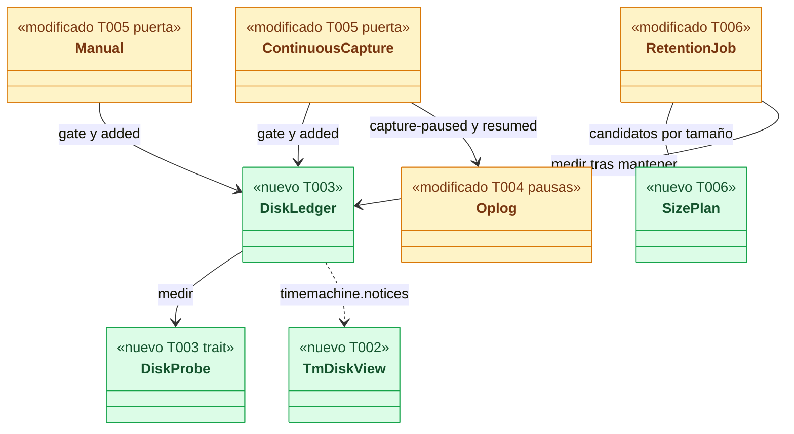
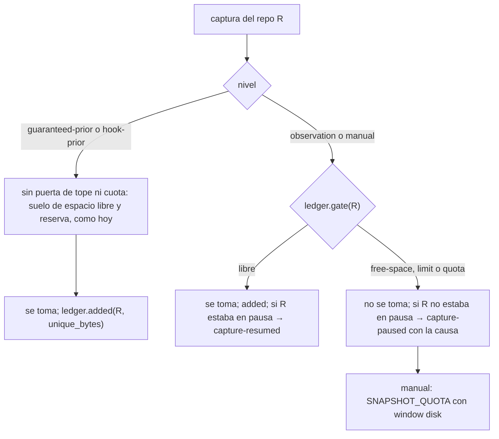
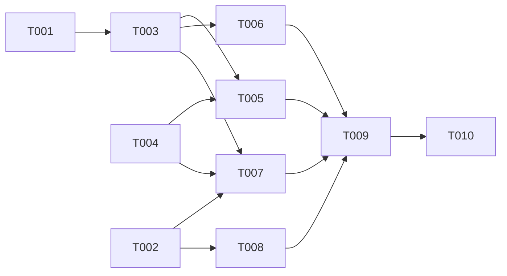

# DS-US-TMC-022 · Tope de disco de la Time Machine

## Contexto rápido

Al terminar, la Time Machine tiene un tope total de disco (`timeMachine.maxDiskSizeGiB`, solo en el perfil, 10 GiB por defecto) y una cuota por repo. Al pasar el 80 % del tope, o el 80 % de la cuota de un repo (TQ-24 → a), la pasada de purga de DS-US-TMC-016 anuncia los puntos más antiguos que no están protegidos y tienen 7 días o más. Tras el mismo aviso visto y las mismas 24 h, los purga hasta bajar al 70 % del tope o de la cuota. Si el tope o la cuota se alcanzan antes, la captura por observación se detiene con un hueco "sin espacio" declarado y no se borra nada. Los snapshots previos de las operaciones protegidas se siguen tomando.

**Esta ficha no rediseña la purga.** Usa la pasada, el anuncio, la gracia, la ejecución en lotes, la recuperación, el mantenimiento y el aviso en la CLI y la TUI de DS-US-TMC-016, y solo añade:

| Añade | Dónde |
|---|---|
| Claves `timeMachine.maxDiskSizeGiB` y `timeMachine.storeQuotaGiB` | `crates/policy/src/settings/model.rs`, `crates/core/src/profile/settings.rs` |
| Contabilidad del tamaño (`DiskLedger`) | `crates/core/src/timemachine/retention/disk.rs` |
| Candidatos por tamaño (80 % → 70 %, 7 días o más), del tope total y de la cuota de cada repo | `crates/core/src/timemachine/retention/size.rs` |
| Puerta de la captura por observación y del snapshot manual; previos exentos | `continuous.rs`, `manual.rs` |
| Hueco "sin espacio" registrado en el oplog | migración 5 de `oplog/schema.rs` |
| Estado de disco persistente en `timemachine.notices` | `crates/api/src/timemachine.rs`, `conn.rs` |

Lo que ya existe y se reutiliza: `FreeSpaceFloor` y `below_floor` (`continuous.rs`, máx(5 GiB, 5 %)), que hoy omiten la captura y solo lo registran en el log (`tm_capture_failed`, `no-space`); la reserva de `manual.rs` (`cached_reserve`, `MIN_RESERVE_BYTES` = 1 GiB) que usan el manual y el `hook-prior`; `CaptureOutcome.unique_bytes`; `ManualError::NoSpace` → `SnapshotQuotaData { window: Disk }`; `StoreRepo::size_bytes`. La clave `storeQuotaGB` existe en el esquema y nadie la lee; queda como alias obsoleto de `storeQuotaGiB` (D7).

| Término | Qué es aquí |
|---|---|
| Tamaño de la Time Machine | Bytes de `<data>/tm/` entero: almacenes y oplogs de todos los repos |
| Tope | `maxDiskSizeGiB` × 2³⁰ |
| Cuota por repo | `storeQuotaGiB` × 2³⁰ sobre `<data>/tm/<repo_id>/` (SEC-TMC-12, Enmienda 2026-10-05) |
| Candidato por tamaño | Candidato de DS-US-TMC-016 sin la condición de edad de la retención, con 7 días o más |
| Pausa de captura | Intervalo en el que la captura por observación de un repo se omite por espacio: es el hueco "sin espacio" |

⚠️ **ASSUMPTION**: no existe `architecture-constitution.md` en la cascada; rigen `AGENTS.md` y los ADR listados.

---

## ⚠️ Gaps y violaciones de la constitución

_No gaps. Ready to implement_ cuando DS-US-TMC-016 esté mezclada (T001 a T008 de esa ficha).

TQ-24 (cuota por repo frente al tope total) no bloquea: el diseño trata los dos límites con la misma función y cambiar la respuesta es cambiar una línea (§ Decisiones).

---

## 🔭 La forma



🟩 nuevo · 🟨 modificado.

### La puerta de cada captura



### Diseño

**Tamaño** (T003). `DiskLedger` vive en `TmRepos` (campo `pub disk`, como `kept`). Guarda la última medida (`DiskProbe::measure`: total de `<data>/tm/` y por repo) y su momento, y lo añadido desde entonces. Cada captura completa de cualquier nivel suma `CaptureOutcome.unique_bytes` (`added`). Se mide al arrancar el módulo de purga, al final de cada pasada (después del mantenimiento, ADR-TMC-007 Enmienda 2026-10-05) y en cada pasada completa. `used() = medido + añadido`: entre medidas sobrestima, nunca subestima, porque `unique_bytes` es lo que la captura escribió sin comprimir en pack.

**Puerta** (T005), en este orden: suelo de espacio libre (`free-space`, ya existe), tope (`limit`: `used_total ≥ tope`) y cuota (`quota`: `used_repo ≥ cuota`). Se aplica a la captura por observación (`continuous::observe`, antes de leer el worktree, donde hoy está `below_floor`) y al snapshot manual (`manual.rs`, `ManualError::NoSpace`). **No** se aplica al previo garantizado ni al `hook-prior`: se toman con el tope al 100 %, con su reserva frente al suelo del volumen como hoy, y si no caben, la operación se aborta sin cambios (`PRIOR_SNAPSHOT_FAILED` `no-space`, DS-US-TMC-001). Su tamaño sí cuenta para la purga.

**Hueco "sin espacio"** (T004, T005). La primera captura omitida de un repo escribe en su oplog `capture-paused` con `{"cause": "free-space" | "limit" | "quota"}`. La primera que se toma después escribe `capture-resumed`. El estado de pausa se guarda en memoria por repo y, al arrancar, se reconstruye de la última entrada del diario: tras un reinicio con la pausa abierta no se duplica. Si la causa cambia durante la pausa, no se escribe nada nuevo: el hueco es uno. El timeline lo intercala con US-TMC-007 (`Oplog::capture_pauses`); aquí se expone en `TmDiskView.capture_paused`.

**Purga por tamaño** (T006), dentro de la pasada de DS-US-TMC-016, después de la de edad. Hay dos ámbitos con la **misma regla** (aviso al 80 %, purga hasta el 70 %, puntos de 7 días o más no protegidos, aviso visto y 24 h):
- **Tope total** (`PurgeCause::Limit`): candidatos de todos los repos observados, **un solo aviso** para todos (punto 2).
- **Cuota de un repo** (`PurgeCause::Quota`, TQ-24 → a): candidatos de ese repo frente a su cuota, con su aviso en su oplog. Si un punto ya está anunciado por el otro ámbito, cuenta en la proyección y no se anuncia dos veces.

1. **Cuándo** (D-TMC-37, punto 4): cuando `added` hace que `used_total` cruce el 80 % del tope, o `used_repo` el 80 % de la cuota de su repo, el ledger levanta `size_due`. El módulo lo atiende en su latido, como mucho una vez cada `SIZE_PASS_MIN_INTERVAL`. También en cada pasada completa.
2. **Anuncio**: si `used_total ≥ 80 %` del tope, `size_candidates` reúne, de **todos** los repos abiertos, los puntos disponibles, con ref, sin manipular, no protegidos (`protected_points` de cada repo), con 7 días o más y que no estén ya anunciados. Los ordena del más antiguo al más reciente y toma hasta que `used_total − Σ anunciados pendientes − Σ nuevos ≤ 70 %` del tope, contando con `unique_size_bytes`. **Un solo aviso del tope** (PO, punto 5): el mismo aviso se registra con `Oplog::announce_purge` en el oplog de cada repo con candidatos, con un `group` común (id del aviso del primero) y el detalle completo: `used_bytes`, `limit_bytes` y, por repo, `{repo, count, from_ms, to_ms, bytes_upto}`. `timemachine.notices` desde **cualquier** repo observado devuelve los avisos de tope pendientes de todos los oplogs, uno por `group`. Una entrega pintada se marca en el oplog de **cada** repo del grupo (cada uno con su `notice-delivered`), así que verlo en cualquier repo arranca la gracia de todos los puntos que anuncia. Si un oplog no se puede escribir, la gracia de ese repo no arranca (falla cerrado). Los avisos de cuota siguen siendo de su repo.
3. **Ejecución**, cuando vence la gracia del aviso: se vuelve a medir. Si `used_total ≤ 70 %` del tope (o `used_repo ≤ 70 %` de la cuota en un aviso de cuota), todos pasan a `purge-cancelled`. Si no, se purgan del más antiguo al más reciente hasta la proyección del 70 % y el resto pasa a `purge-cancelled`. Mismos lotes, lock y recuperación que DS-US-TMC-016.
4. Tras el mantenimiento se mide. Si sigue en el 80 % o más (la cota de `unique_size_bytes` fue optimista), la siguiente pasada anuncia otra ronda con su propio aviso y su gracia (D-TMC-38). Nunca se borra sin aviso.
5. **Solo protegidos o recientes por encima del tope o de la cuota**: no hay candidatos, no se anuncia nada y `TmDiskView.state = over-limit` (u `over-quota`) hace que la CLI y la TUI lo avisen en **cada** comando, sin marcarlo como entregado. Si parte del exceso son repos que ya no se observan, el aviso los nombra aparte (ver **Un repo que ya no se observa**).
6. **Mantenimiento con el tope superado**: corre aunque el modo de ahorro esté activo (`maintenance_allowed(power_saving, over_limit)`, ADR-GRP-015 § 2). El modo de ahorro llega con TS-GRP-005; hasta entonces vale `false`.

**Configuración** (T001). `maxDiskSizeGiB`: entero 1..=1024, solo perfil, 10. `storeQuotaGiB`: entero 1..=1024, solo perfil, 5. `storeQuotaGB` se acepta como **alias obsoleto** (el mismo número, en GiB) con el diagnóstico nuevo `deprecated-key`, que no ignora el perfil; si están las dos, gana `storeQuotaGiB`. Así no se rompe el perfil de dogfooding de Rene (D7). Lo demás lo hace el cargador común de ADR-GRP-007:
- En los niveles local y de equipo, la clave se descarta con `key-not-allowed-at-level`.
- Un valor fuera de rango ignora el documento del perfil entero con `out-of-range` (PQ-8). Mientras tanto la pasada no anuncia ni purga (DS-US-TMC-016, `SettingsIgnored`), y la puerta usa el último tope y la última cuota válidos que leyó esta ejecución del daemon (sin ninguno, solo el suelo de espacio libre): un error tipográfico no detiene la captura ni adelanta una purga.

`profile::settings::max_disk_size_gib(dirs)` y `store_quota_gib(dirs)` se leen en cada pasada y en cada medida, así que un cambio vale sin reiniciar. Los diagnósticos de esas dos claves en los tres niveles viajan en `TmDiskView.diagnostics`. Los del nivel de equipo salen de la `TeamConfig` del repo, filtrados por puntero `/timeMachine/…`.

**Un repo que ya no se observa** (TQ-25, cerrada): su carpeta cuenta en el tamaño total y no se purga sola: nadie puede ver un aviso "en" ese repo, y sus snapshots pueden ser la única copia de un trabajo. `TmDiskView.unobserved` lista sus ids y tamaños; el aviso persistente y `raptor status` los nombran aparte y dicen cómo liberar espacio: volver a observarlo (la pasada lo purga con las reglas normales) o subir el tope.

---

## 🚀 Plan de implementación

> Orden topológico (`Depende:`). Todas las tareas dependen de DS-US-TMC-016 mezclada.

### El trabajo de un vistazo

| # | Tarea | Depende | Aterriza en |
|---|---|---|---|
| T001 | Añadir el tope y la cuota a la configuración | — | `crates/policy/src/settings/model.rs`, `crates/core/src/profile/settings.rs` |
| T002 | Ampliar el contrato: estado de disco y aviso por tamaño | — | `crates/api/src/timemachine.rs`, `crates/api/src/methods/timemachine.rs` |
| T003 | Contar el tamaño | T001 | `crates/core/src/timemachine/retention/disk.rs`, `protected/backend.rs` |
| T004 | Registrar el hueco "sin espacio" | — | `crates/core/src/timemachine/oplog/{schema,mod,query}.rs` |
| T005 | Poner la puerta a la captura y al manual | T003, T004 | `continuous.rs`, `manual.rs`, `protected/mod.rs`, `hook_prior.rs` |
| T006 | Purgar por tamaño | T003 | `crates/core/src/timemachine/retention/{size,job}.rs`, `daemon/modules/tm_retention.rs` |
| T007 | Servir el estado de disco | T002, T003, T004 | `crates/core/src/channel/conn.rs`, `crates/core/src/daemon/tm.rs` |
| T008 | Mostrarlo en la CLI y la TUI | T002 | `apps/cli/src/undo/notices.rs`, `apps/cli/src/tui/`, `apps/cli/i18n/*/timemachine.txt`, `apps/cli/src/present/i18n.rs` |
| T009 | Probar los escenarios | T005, T006, T007, T008 | `crates/core/tests/`, `apps/cli/tests/` |
| T010 | Cerrar la historia | T001-T009 | `docs/` |

### En qué orden



### T001 — Añadir el tope y la cuota a la configuración

**Ubicación.** `crates/policy/src/settings/model.rs`, `crates/policy/src/settings/diagnostic.rs` (`Code::DeprecatedKey`, al final), `crates/core/src/profile/settings.rs` (**MODIFY**)

**Reglas**
- `TimeMachine.max_disk_size_gib: Option<u32>` con `#[serde(rename = "maxDiskSizeGiB")]`, `range(min = 1, max = 1024)`, `x-gitraptor-levels = ["profile"]`.
- `store_quota_gb` → `store_quota_gib` (`storeQuotaGiB`, `range(min = 1, max = 1024)`, solo perfil). `storeQuotaGB` sigue en el esquema como propiedad `deprecated: true`; el cargador la lee como `storeQuotaGiB` y emite `Code::DeprecatedKey` (`deprecated-key`, variante nueva al final de `Code`), sin ignorar el documento. Se regenera el esquema embebido y su snapshot.
- `max_disk_size_gib(dirs) -> u32` (10) y `store_quota_gib(dirs) -> u32` (5); `time_machine_diagnostics(dirs, repo_id, team) -> Vec<Diagnostic>`, filtrados por `/timeMachine/maxDiskSizeGiB` y `/timeMachine/storeQuotaGiB`.
- **Refs:** ADR-TMC-007 Enmienda 2026-10-05, ADR-GRP-007 (PQ-8, Q24)
- **Aceptación:** `max_disk_size_by_level` (esquema del escenario 5 más el nivel local), `store_quota_defaults_to_5` y `the_old_quota_key_is_an_alias_with_a_warning` (perfil con `storeQuotaGB: 8` → cuota 8, diagnóstico `deprecated-key`, el resto del perfil aplica) en `profile/settings.rs`

### T002 — Ampliar el contrato: estado de disco y aviso por tamaño

**Ubicación.** `crates/api/src/timemachine.rs`, `crates/api/src/methods/timemachine.rs` (**MODIFY**, al final)

**Reglas**
- `NoticesResult.disk: Option<TmDiskView>` (`serde(default, skip_serializing_if)`).
- `TmDiskView { used_bytes, limit_bytes, repo_used_bytes, repo_quota_bytes, state: DiskState, capture_paused: Option<CapturePauseView>, unobserved: Vec<UnobservedRepoView>, measured_utc_ms, diagnostics: Vec<TmSettingsDiagnostic> }`; `UnobservedRepoView { repo_id, bytes }` (TQ-25).
- `DiskState { Ok, Warning, QuotaWarning, OverLimit, OverQuota }`: `Warning` desde el 80 % del tope; `QuotaWarning` desde el 80 % de la cuota del repo.
- `CapturePauseView { cause: NoSpaceCause, since_utc_ms }`; `NoSpaceCause { FreeSpace, Limit, Quota }`.
- `TmSettingsDiagnostic { key: &'static str, level, code }`: código estable de `Code::as_str`, nunca el valor.
- `PurgeNoticeView` gana `used_bytes: Option<u64>`, `limit_bytes: Option<u64>` (`Some` con `PurgeCause::Limit` y `Quota`; en `Quota`, los del repo) y `repos: Vec<PurgeRepoView>` (`{repo_id, count, from_utc_ms, to_utc_ms, bytes_upto}`, solo en `Limit`). `PurgeCause::{Limit, Quota}` ya los declara DS-US-TMC-016 T001.
- `CAP_TM_DISK_LIMIT = Capability::new("timemachine.disk-limit")`.
- **Refs:** ADR-GRP-016, NFR-TMC-14
- **Aceptación:** `disk_view_wire_form`, `limit_purge_notice_wire_form`, `quota_purge_notice_wire_form`

### T003 — Contar el tamaño

**Ubicación.** `crates/core/src/timemachine/retention/disk.rs` (**CREATE**); `crates/core/src/timemachine/protected/backend.rs` (**MODIFY**: `pub disk: DiskLedger` en `TmRepos`)

**Reglas**
- `trait DiskProbe: Send + Sync { fn measure(&self, dirs: &ProfileDirs) -> io::Result<DiskSizes>; }`. `TmDirProbe` recorre `<data>/tm/` sin seguir enlaces (`symlink_metadata`, como `StoreRepo::size_bytes`).
- `DiskLedger::{measure, added, used, gate, size_due, take_size_due}` con atómicos y un `Mutex` por repo. `gate(repo_id, dirs, floor) -> Result<(), NoSpaceCause>` (§ Firmas del stack).
- Lee el tope y la cuota con T001 en cada `measure`.
- **Refs:** RES-09, SEC-TMC-12
- **Aceptación:** `ledger_adds_until_the_next_measure`, `gate_order_is_floor_limit_quota`, `crossing_80_percent_raises_size_due_once`

### T004 — Registrar el hueco "sin espacio"

**Ubicación.** `crates/core/src/timemachine/oplog/schema.rs` (**MODIFY**: una migración al final de `OPLOG_MIGRATIONS`; hoy hay 4, así que es la 5. DS-US-MCP-015 T004 también añade una al final: la que se mezcle segunda rebasa y toma el número siguiente), `oplog/mod.rs`, `oplog/query.rs` (**MODIFY**)

**Reglas**
- Migración 5: reconstruye `journal` con `entry` ampliado a `'capture-paused'` y `'capture-resumed'`. Mismas columnas y en el mismo orden, filas copiadas tal cual (el hash verifica con su formato, como las migraciones 3 y 4), índice `journal_by_subject` y triggers recreados con el texto de la migración 1.
- `record_capture_paused(cause, now_ms)`, `record_capture_resumed(now_ms)`, `capture_pauses(since_ms) -> Vec<CapturePause { cause, from_ms, to_ms: Option<i64> }>`, `open_capture_pause()`.
- **Refs:** ADR-TMC-003, SEC-TMC-09, BR-TMC-EDGE-002
- **Aceptación:** `migration_tests.rs::journal_rebuild_keeps_the_chain`, `oplog/tests.rs::pauses_open_and_close`

### T005 — Poner la puerta a la captura y al manual

**Ubicación.** `crates/core/src/timemachine/continuous.rs`, `manual.rs`, `protected/mod.rs`, `hook_prior.rs` (**MODIFY**)

**Reglas**
- `continuous::observe`: `Failure::NoSpace` pasa a `NoSpace(NoSpaceCause)`. La comprobación de `below_floor` se sustituye por `deps.repos.disk.gate(repo_id, &deps.profile, floor)` en el mismo sitio. `capture_one` registra la pausa la primera vez y la reanudación con la primera captura tomada.
- `manual.rs`: `gate` antes de leer el worktree → `ManualError::NoSpace`.
- Previo protegido, `hook-prior`, observación y manual llaman a `disk.added(repo_id, outcome.unique_bytes)` al completar. El previo y el `hook-prior` **no** pasan por `gate`.
- **Refs:** ADR-TMC-004 § 2, ADR-TMC-007 Enmienda 2026-10-05 § 3, US-TMC-004 D8
- **Aceptación:** `continuous.rs`: `over_the_limit_the_capture_pauses_once`, `the_first_capture_after_resumes`; `manual/tests.rs::a_manual_snapshot_is_refused_over_the_limit`

### T006 — Purgar por tamaño

**Ubicación.** `crates/core/src/timemachine/retention/size.rs` (**CREATE**); `retention/job.rs`, `daemon/modules/tm_retention.rs` (**MODIFY**)

**Reglas**
- `size_candidates(repos: &[RepoInput], used, limit, now) -> Vec<(repo_id, Vec<String>)>`, puro, con § Diseño, puntos 2 y 3. La misma función sirve a la cuota con un solo repo y `limit` = cuota (TQ-24 → a).
- Aviso del tope: un `group` en los oplogs de todos los repos con candidatos (§ Diseño, punto 2). `notices::take_purges` reúne los avisos de tope de todos los repos observados por `group` y marca la entrega pintada en cada oplog del grupo.
- La pasada: edad → tamaño → ejecución de los dos tipos de aviso → mantenimiento → `disk.measure`. El latido atiende `take_size_due()` con `SIZE_PASS_MIN_INTERVAL`.
- Ejecución de un aviso `limit` o `quota`: vuelve a medir y aplica § Diseño, punto 3.
- `maintenance_allowed(power_saving, over_limit)`.
- **Refs:** ADR-TMC-007 Enmienda 2026-10-05, D-TMC-37, D-TMC-38
- **Aceptación:** `size.rs`: `oldest_first_down_to_70_percent`, `never_protected_nor_younger_than_7_days`, `under_80_percent_nothing`, `already_announced_points_count_in_the_projection`, `the_quota_uses_the_same_rule`; `job.rs`: `at_execution_under_70_percent_cancels_all`, `maintenance_runs_over_the_limit_in_power_saving`; `notices_tests.rs`: `one_limit_notice_for_every_repo`, `a_painted_limit_notice_marks_every_oplog_of_its_group`

### T007 — Servir el estado de disco

**Ubicación.** `crates/core/src/channel/conn.rs` (**MODIFY**: `tm_notices`), `crates/core/src/daemon/tm.rs` (**MODIFY**: `disk_probe: Option<Arc<dyn DiskProbe>>`, solo en builds de debug, como `no_free_space_floor`)

**Reglas**
- Con `CAP_TM_DISK_LIMIT`, `tm_notices` añade `disk` si el estado no es `Ok`, si el repo está en pausa o si hay diagnósticos. No se marca como entregado: se repite en cada llamada.
- **Refs:** ADR-GRP-016, SEC-12
- **Aceptación:** `notices_tests.rs::the_disk_state_is_served_every_time`

### T008 — Mostrarlo en la CLI y la TUI

**Ubicación.** `apps/cli/src/undo/notices.rs`, `apps/cli/src/tui/widgets/notification.rs`, `apps/cli/i18n/{en,es}/timemachine.txt`, `apps/cli/src/present/i18n.rs`, el comando `raptor snapshot` de `apps/cli` (**MODIFY**); `crates/api/src/methods/operation.rs` (**MODIFY**: `SnapshotQuotaData.cause`, `purge_from_utc_ms`); `crates/core/src/timemachine/manual.rs` (rellena esos campos)

**Reglas**
- `PurgeCause::Limit` → `tm-notice.purge-limit` (con una línea por repo, `tm-notice.purge-limit-repo`); `PurgeCause::Quota` → `tm-notice.purge-quota`; `disk.state` → `tm-disk.*`; `disk.unobserved` → `tm-disk.unobserved`; `capture_paused` → `tm-disk.paused.*`; diagnósticos → `tm-disk.setting-ignored` y `tm-disk.setting-deprecated`. El cliente pide `timemachine.disk-limit`.
- El aviso por tamaño se marca como visto con las mismas reglas que el de edad: `presented = true` solo en una terminal sin `--json` o en la TUI (DS-US-TMC-016 D12).
- `SNAPSHOT_QUOTA` con `window: disk` (`raptor snapshot`, y el texto que el MCP devuelve) nombra la causa (`tm-manual.no-space.limit`, `.quota`, `.free-space`) y las salidas: subir el tope en el perfil o esperar a la purga anunciada, con su fecha si hay aviso pendiente (PO, punto 6). `SnapshotQuotaData` gana `cause: Option<NoSpaceCause>` y `purge_from_utc_ms: Option<i64>` (`serde(default)`, con `timemachine.disk-limit`).
- **Aceptación:** `every_disk_state_has_its_message`, `the_manual_refusal_names_cause_and_way_out_in_en_and_es`

### T009 — Probar los escenarios

Ver § 9.4.

### T010 — Cerrar la historia

US-TMC-022 a `implemented`. El orquestador integra D-TMC-39 en `business-rules.md`. E3 y E4 ya están en los ADR (2026-10-28). SEC-TMC-12 de `non-functional.md` ya dice 5 GiB en su Enmienda 2026-10-05; esta tarea solo añade el nombre de la clave (`timeMachine.storeQuotaGiB`) a esa línea y a la nota de integración de ADR-GRP-007, que aún nombra `storeQuotaGB`.

## Estructura de ficheros

```text
crates/policy/src/settings/{model,diagnostic}.rs (+ esquema)   ← MODIFY  (T001)
crates/api/src/methods/operation.rs                            ← MODIFY  (T008, SnapshotQuotaData)
crates/core/src/profile/settings.rs                            ← MODIFY  (T001)
crates/api/src/timemachine.rs, crates/api/src/methods/timemachine.rs ← MODIFY (T002)
crates/core/src/timemachine/retention/disk.rs                  ← CREATE  (T003)
crates/core/src/timemachine/protected/backend.rs               ← MODIFY  (T003: un campo)
crates/core/src/timemachine/oplog/{schema,mod,query}.rs        ← MODIFY  (T004)
crates/core/src/timemachine/{continuous,manual,hook_prior}.rs  ← MODIFY  (T005)
crates/core/src/timemachine/protected/mod.rs                   ← MODIFY  (T005: added)
crates/core/src/timemachine/retention/size.rs                  ← CREATE  (T006)
crates/core/src/timemachine/retention/job.rs                   ← MODIFY  (T006)
crates/core/src/daemon/modules/tm_retention.rs                 ← MODIFY  (T006)
crates/core/src/channel/conn.rs, crates/core/src/daemon/tm.rs  ← MODIFY  (T007)
apps/cli/src/undo/notices.rs, apps/cli/src/tui/, apps/cli/i18n/*, apps/cli/src/present/i18n.rs ← MODIFY (T008)
crates/core/tests/us_tmc_022.rs, apps/cli/tests/us_tmc_022_process.rs ← CREATE (T009)
```

## Contratos compartidos

### Tipos y datos compartidos

```rust
// crates/core/src/timemachine/retention/disk.rs
pub const DEFAULT_MAX_DISK_GIB: u32 = 10;
pub const DEFAULT_STORE_QUOTA_GIB: u32 = 5;
pub const WARN_PERCENT: u64 = 80;
pub const TARGET_PERCENT: u64 = 70;
pub const SIZE_MIN_AGE_MS: i64 = 7 * 24 * 60 * 60 * 1000;
pub const SIZE_PASS_MIN_INTERVAL: Duration = Duration::from_secs(3_600); // ⚠️ ASSUMPTION

pub struct DiskSizes { pub total: u64, pub by_repo: HashMap<String, u64> }
pub trait DiskProbe: Send + Sync { fn measure(&self, dirs: &ProfileDirs) -> io::Result<DiskSizes>; }
pub struct DiskLedger { /* medida, añadido, size_due, pausa por repo */ }

// crates/core/src/timemachine/oplog/model.rs
text_enum!(NoSpaceCause { FreeSpace => "free-space", Limit => "limit", Quota => "quota" });
pub struct CapturePause { pub cause: NoSpaceCause, pub from_ms: i64, pub to_ms: Option<i64> }
```

### Ciclos de vida (DI)

`DiskLedger` lo crea `TmRepos::new` y vive con él. El módulo `tm_retention` lo mide; las capturas lo alimentan. La sonda se inyecta por `daemon/tm.rs` solo en builds de debug; en release es siempre `TmDirProbe`.

### Firmas del stack

```rust
impl DiskLedger {
    pub fn measure(&self, dirs: &ProfileDirs, probe: &dyn DiskProbe, now_ms: i64) -> io::Result<()>;
    pub fn added(&self, repo_id: &str, bytes: u64);
    pub fn gate(&self, repo_id: &str, dirs: &ProfileDirs, floor: Option<FreeSpaceFloor>) -> Result<(), NoSpaceCause>;
    pub fn take_size_due(&self) -> bool;
}
pub fn size_candidates(repos: &[RepoInput<'_>], used: u64, limit: u64, now_ms: i64) -> Vec<(String, Vec<String>)>;
impl Oplog {
    pub fn record_capture_paused(&mut self, cause: NoSpaceCause, now_ms: i64) -> Result<()>;
    pub fn record_capture_resumed(&mut self, now_ms: i64) -> Result<()>;
    pub fn capture_pauses(&self, since_ms: i64) -> Result<Vec<CapturePause>>;
}
pub fn max_disk_size_gib(dirs: &ProfileDirs) -> u32;   // profile/settings.rs
pub fn store_quota_gib(dirs: &ProfileDirs) -> u32;
```

## Contrato de API

| Método | Canal | Parámetros | Resultado |
|---|---|---|---|
| `timemachine.notices` | CLI/TUI (no MCP) | `presented` (DS-US-TMC-016) | con `timemachine.disk-limit`, `disk: TmDiskView` y `purge.used_bytes`/`limit_bytes`/`repos` en los avisos por tamaño; los avisos del tope, desde cualquier repo observado |
| `timemachine.snapshot` (manual) | sin cambios | sin cambios | por encima del tope o de la cuota, `SNAPSHOT_QUOTA` con `window: disk` (ya existe) y, con la capacidad, `cause` y `purge_from_utc_ms` |

### Forma del error y del cuerpo de respuesta

Sin códigos nuevos.

### Forma de la configuración

| Clave | Tipo | Niveles | Por defecto | Fuera de nivel o de rango |
|---|---|---|---|---|
| `timeMachine.maxDiskSizeGiB` | entero 1..=1024 | perfil | 10 | `key-not-allowed-at-level` en local o equipo; `out-of-range` ignora el perfil (PQ-8) |
| `timeMachine.storeQuotaGiB` | entero 1..=1024 | perfil | 5 | ídem |
| `timeMachine.storeQuotaGB` (obsoleta) | alias de `storeQuotaGiB` | perfil | — | `deprecated-key`, sin ignorar el perfil; pierde frente a `storeQuotaGiB` |

### Valores numéricos

| Concepto | Valor | Fuente |
|---|---|---|
| Tope por defecto | 10 GiB | ADR-TMC-007, Enmienda 2026-10-05 |
| Cuota por repo | 5 GiB | ídem (SEC-TMC-12) |
| Aviso | ≥ 80 % del tope o de la cuota del repo | RES-09; TQ-24 → a |
| Objetivo de la purga | ≤ 70 % del tope o de la cuota | RES-09; TQ-24 → a |
| Edad mínima por tamaño | 7 días | RES-09 |
| Suelo de espacio libre | máx(5 GiB, 5 %) | SEC-TMC-12 (`FreeSpaceFloor`) |
| Pasada por tamaño | como mucho una por hora | ⚠️ ASSUMPTION |

### i18n

| Clave | en | es |
|---|---|---|
| `tm-notice.purge-limit` | the Time Machine passed 80 % of its disk limit ({used} of {limit}); {count} points from {from} to {to} (up to {size}) will be purged from {when}, down to 70 %: | la Time Machine pasó el 80 % de su tope de disco ({used} de {limit}); {count} puntos del {from} al {to} (hasta {size}) se purgarán a partir del {when}, hasta bajar al 70 %: |
| `tm-notice.purge-limit-repo` | {repo}: {count} points from {from} to {to} (up to {size}) | {repo}: {count} puntos del {from} al {to} (hasta {size}) |
| `tm-notice.purge-quota` | this repo passed 80 % of its Time Machine quota ({used} of {limit}); {count} points from {from} to {to} (up to {size}) will be purged from {when}, down to 70 % | este repo pasó el 80 % de su cuota de la Time Machine ({used} de {limit}); {count} puntos del {from} al {to} (hasta {size}) se purgarán a partir del {when}, hasta bajar al 70 % |
| `tm-disk.unobserved` | {size} belong to repos that are no longer observed ({repos}); observe them again so they are purged by the usual rules, or raise timeMachine.maxDiskSizeGiB | {size} son de repos que ya no se observan ({repos}); vuelve a observarlos para que se purguen con las reglas normales, o sube timeMachine.maxDiskSizeGiB |
| `tm-manual.no-space.limit` | no snapshot: the Time Machine reached its disk limit ({used} of {limit}); raise timeMachine.maxDiskSizeGiB in your profile or wait for the announced purge ({when}) | no se guardó: la Time Machine alcanzó su tope de disco ({used} de {limit}); sube timeMachine.maxDiskSizeGiB en tu perfil o espera a la purga anunciada ({when}) |
| `tm-manual.no-space.quota` | no snapshot: this repo reached its Time Machine quota ({used} of {limit}); raise timeMachine.storeQuotaGiB in your profile or wait for the announced purge ({when}) | no se guardó: este repo alcanzó su cuota de la Time Machine ({used} de {limit}); sube timeMachine.storeQuotaGiB en tu perfil o espera a la purga anunciada ({when}) |
| `tm-manual.no-space.free-space` | no snapshot: the disk is almost full; free up disk space | no se guardó: el disco está casi lleno; libera espacio |
| `tm-disk.setting-deprecated` | {key} is deprecated; rename it to {new} | {key} está obsoleta; renómbrala a {new} |
| `tm-disk.over-limit` | the Time Machine is over its disk limit ({used} of {limit}) and, in the observed repos, only protected or recent points are left; raise timeMachine.maxDiskSizeGiB in your profile or free up disk space | la Time Machine supera su tope de disco ({used} de {limit}) y en los repos observados solo quedan puntos protegidos o recientes; sube timeMachine.maxDiskSizeGiB en tu perfil o libera espacio |
| `tm-disk.over-quota` | this repo's Time Machine reached its quota ({used} of {limit}) | la Time Machine de este repo alcanzó su cuota ({used} de {limit}) |
| `tm-disk.warning` | the Time Machine uses {used} of its {limit} disk limit | la Time Machine usa {used} de su tope de {limit} |
| `tm-disk.quota-warning` | this repo's Time Machine uses {used} of its {limit} quota | la Time Machine de este repo usa {used} de su cuota de {limit} |
| `tm-disk.paused.limit` | changes are not being captured since {since}: the disk limit was reached (prior snapshots of protected operations are still taken) | los cambios no se capturan desde {since}: se alcanzó el tope de disco (los snapshots previos de las operaciones protegidas se siguen tomando) |
| `tm-disk.paused.quota` | changes are not being captured since {since}: this repo reached its quota | los cambios no se capturan desde {since}: este repo alcanzó su cuota |
| `tm-disk.paused.free-space` | changes are not being captured since {since}: the disk is almost full | los cambios no se capturan desde {since}: el disco está casi lleno |
| `tm-disk.setting-ignored` | {key} in the {level} settings was ignored ({code}); using {value} | se ignoró {key} en la configuración de {level} ({code}); se usa {value} |

---

## Modelo de datos

Migración 5 del oplog (T004): reconstruye `journal` para admitir `capture-paused` y `capture-resumed`. Es de solo inserción, encadenada y conserva el hash de cada fila. Sin cambios en el perfil ni en el almacén.

---

## Estrategia de pruebas y cobertura

### 9.1 Pirámide de pruebas

| Tipo | Cantidad | Tareas dueñas | Herramientas | Cuándo |
|---|---:|---|---|---|
| Unit | 20 | T001-T008 | `cargo test` | PR gate |
| Integration | 8 | T009 | `cargo test -p gitraptor-core --test us_tmc_022` | PR gate |
| E2E | 2 | T009 | `cargo test -p gitraptor-cli --test us_tmc_022_process` | PR gate (macOS) |

### 9.2 Umbrales de cobertura

| Capa | Línea | Rama | Mutación | Camino crítico 100% |
|---|---:|---:|---:|:---:|
| `retention/{size,disk}.rs` | — | — | — | nunca un protegido ni uno de menos de 7 días; nunca sin gracia vencida; el previo nunca pasa por la puerta |

### 9.3 Datos de prueba

- Repos temporales del testkit y perfil temporal; nunca el repo ni el perfil reales (NFR-01).
- **Tamaños simulados** (la historia lo pide): `SimProbe` inyectada por `daemon/tm.rs`, que devuelve una base fija más la suma de `unique_size_bytes` de los puntos no purgados. Así una purga baja el tamaño medido sin escribir gigas.
- `tm_common::aged_point(…, days, unique_bytes)` de DS-US-TMC-016, con tamaño declarado.

### 9.4 Comportamientos críticos verificados

| Escenario | Test |
|---|---|
| 1. Aviso al acercarse al tope | `us_tmc_022.rs::warns_past_80_percent_with_count_period_and_size`: tope 10 GiB, `SimProbe` en 8,2 GiB, puntos de 10 a 20 días; la pasada anuncia un aviso `limit` con recuento, periodo, `bytes_upto`, `used` y `limit`. e2e `us_tmc_022_process.rs::the_size_notice_reads_in_en_and_es`: `raptor status` lo muestra (80 %, recuento, periodo, tamaño) y `disk.state = warning` |
| 2. (aviso visto desde otro repo) | `the_limit_notice_seen_in_repo_b_starts_the_grace_for_points_of_repo_a`: los candidatos más antiguos están en A; el aviso del tope se pinta desde B por CLI hace 25 h → se purgan los de A; con `--json` desde B, nada |
| 2. Purga de lo más antiguo tras el aviso y la gracia | `purges_the_oldest_down_to_70_percent`: aviso entregado por CLI hace 25 h; la pasada purga del más antiguo al más reciente hasta ≤ 7 GiB medidos y deja el resto `complete`; `raptor timeline` muestra `purged` en ellos (DS-US-TMC-016 T008); huella igual |
| 3. Protegidos y recientes nunca | `only_protected_and_recent_over_the_limit`: 10,5 GiB con solo previos de la última destructiva de cada worktree y puntos de menos de 7 días → ni aviso ni purga; `disk.state = over-limit` en dos llamadas seguidas (persistente); un cambio de archivo → ningún punto y `capture-paused` con `limit` |
| 4. Al tope antes de la gracia se detiene la captura | `at_the_limit_before_the_grace_capture_stops`: aviso entregado hace 2 h, `SimProbe` al 100 %; el agente cambia un archivo en `feat-login` → sin punto de observación, pausa `limit`, nada purgado; luego `raptor undo` (operación protegida) toma su previo `complete` y se aplica. Variante `a_hook_prior_is_taken_at_the_limit` (US-TMC-005). "Si no cabe, se aborta" ya lo cubre `us_tmc_001.rs::no_prior_snapshot_means_no_operation` |
| 5. El tope solo se fija en el perfil (esquema) | `profile/settings.rs::max_disk_size_by_level`: perfil 20 → 20, sin diagnóstico; equipo 2 → 10 y `key-not-allowed-at-level`; perfil 0 → 10 y `out-of-range`; local 3 → 10 y `key-not-allowed-at-level`. e2e: `raptor status` muestra `tm-disk.setting-ignored` en los dos idiomas |
| Hueco "sin espacio" una sola vez | `a_pause_survives_a_restart_without_duplicating` |
| Reanudación | `capture_resumes_after_the_purge`: tras purgar por debajo del tope, el siguiente cambio se captura y escribe `capture-resumed` |
| 6. La cuota de un repo se gestiona como el tope (TQ-24 → a) | `a_repo_past_80_percent_of_its_quota_is_announced`: cuota 5 GiB, tope 10 GiB, un solo repo con 4,1 GiB → aviso `quota` con recuento, periodo y espacio; e2e `us_tmc_022_process.rs::the_quota_notice_reads_in_en_and_es`. `a_repo_at_its_quota_announces_and_pauses_alone`: el repo A en el 100 % de su cuota pausa con `quota` y tiene su aviso; el repo B sigue capturando. `a_quota_never_purges_recent_or_protected_points` (escenario 3 de US-TMC-016) |
| Rechazo del manual | `the_manual_refusal_names_cause_and_way_out_in_en_and_es` (tope, cuota y espacio libre; con aviso pendiente, la fecha) |
| Configuración | `the_old_quota_key_is_an_alias_with_a_warning`; `an_out_of_range_profile_announces_nothing_and_keeps_the_last_limits` |
| Otra ronda si no basta | `a_second_round_needs_its_own_notice`: la estimación deja un 82 % → aviso nuevo y nada purgado hasta su gracia |
| Repo que ya no se observa (TQ-25) | `a_retired_repo_counts_but_is_not_purged`: su carpeta suma en `used_total`, ningún aviso ni transición en su oplog; `disk.unobserved` lo lista y `raptor status` muestra `tm-disk.unobserved` (en y es) con su tamaño y cómo liberar espacio |
| Repo intacto | huella del testkit antes y después en todos |

### 9.5 Plataformas

| Plataforma | Cómo se verifica | Pendiente |
|---|---|---|
| macOS | `cargo clippy --workspace --all-targets -- -D warnings`, `cargo test --workspace`, tamaños simulados | — |
| Linux | `us_tmc_022.rs` con `cfg(any(macos, linux))` | **Pendiente: etapa de validación multiplataforma** (tamaño real en disco, `statvfs`) (XP-51) |
| Windows | Compila; `below_floor` sin implementar en Windows (cuenta como "suficiente") | **Pendiente: etapa de validación multiplataforma** (tamaño en disco y exclusión de copias de seguridad, ADR-TMC-007) (XP-51) |

---

## Gate de seguridad

- Nada se borra sin aviso visto en CLI o TUI y 24 h: la purga por tamaño usa el mismo camino que la de edad (DS-US-TMC-016).
- El previo de una operación protegida nunca queda bloqueado por el tope: la operación sigue protegida (NFR-01). Si el volumen no tiene sitio, la operación se aborta sin cambios.
- El repo del usuario no cambia: solo refs del almacén y filas del oplog.
- La sonda simulada solo existe en builds de debug.
- Los diagnósticos llevan clave, nivel y código, nunca el valor leído (SEC-12, `diagnostics_never_carry_values`).
- El estado de disco solo va por CLI y TUI, con el alcance del repo del llamante.

Corre `/security-review --scope devspec docs/requirements/features/time-machine/dev-specs/US-TMC-022-tope-disco.md` antes de mezclar.

---

## Dependencias

| Dependencia | Cómo entra aquí |
|---|---|
| DS-US-TMC-016 | Pasada, protegidos, anuncio, gracia, ejecución, recuperación, mantenimiento, aviso en CLI y TUI, nivel `purged` |
| US-TMC-004 | La captura continua donde va la puerta; esta ficha entrega la cuota y el hueco que esa ficha aplazó (su D8) |
| US-TMC-001 / US-TMC-005 | Previos exentos de la puerta |
| US-TMC-007 | Pinta el hueco "sin espacio" en el timeline a partir de `capture_pauses` |
| TS-GRP-005 | `power_saving` real para `maintenance_allowed` |
| US-GRP-017 / US-GRP-018 | Pueden leer el tamaño del `DiskLedger` y de `TmDirProbe` para `raptor status --resources` y `raptor doctor` |

---

## Fuera de alcance

| Ítem / no-objetivo | Historia que lo cubre | Gate (cómo se verifica) |
|---|---|---|
| Pintar el hueco en el timeline | US-TMC-007 | — |
| Purgar solos los repos que ya no se observan | Nunca (TQ-25 cerrada) | `a_retired_repo_counts_but_is_not_purged` |
| Mostrar el tamaño en `raptor status --resources` y `raptor doctor` | US-GRP-017, US-GRP-018 | — |

---

## Decisiones

| # | Decisión | Origen |
|---|---|---|
| D1 | El tamaño es una medida de `<data>/tm/` entero (al arrancar, tras cada pasada y tras el mantenimiento) más lo añadido por cada captura (`unique_bytes`). Recorrer la carpeta en cada captura es caro; sumar sobrestima y nunca deja pasar el tope | **Decisión del orquestador (2026-10-28), validada por Arquitecto** |
| D2 | Los candidatos del tope se eligen entre **todos** los repos, del más antiguo al más reciente, porque el tope es total; el aviso del tope es **uno solo**, registrado con un `group` común en el oplog de cada repo con candidatos, visible desde cualquier repo observado y marcado en todos al verse (PO, punto 5) | **Decisión del orquestador (2026-10-28), validada por Arquitecto y PO** |
| D3 | La proyección hasta el 70 % usa `unique_size_bytes` y, al ejecutar, se vuelve a medir. Si tras el mantenimiento sigue en el 80 % o más, la siguiente ronda lleva su propio aviso y su gracia | **Decisión del orquestador (2026-10-28), validada por Arquitecto** (D-TMC-38) |
| D4 | El hueco "sin espacio" se registra en el diario del oplog (`capture-paused` con causa, `capture-resumed`), con una migración que reconstruye `journal`. No va a los huecos del motor, porque esos marcan eventos "sin atribuir" y aquí el motor sí observó | **Decisión del orquestador (2026-10-28), validada por Arquitecto** |
| D5 | Orden de la puerta: suelo de espacio libre, tope y cuota. Se aplica a la observación y al snapshot manual (que tiene la prioridad de una observación, ADR-TMC-004, Enmienda 2026-10-05, MCP); nunca al previo garantizado ni al `hook-prior` | **Decisión del orquestador (2026-10-28), validada por Arquitecto** (ADR-TMC-007, Enmienda 2026-10-05 § 3) |
| D6 | El estado de disco viaja en `timemachine.notices` con la capacidad `timemachine.disk-limit` y no se marca como entregado: el aviso del tope superado se repite en cada comando | **Decisión del orquestador (2026-10-28), validada por Arquitecto** |
| D7 | `storeQuotaGB` pasa a `storeQuotaGiB` (1..=1024, 5 por defecto); la clave vieja se acepta como alias con aviso `deprecated-key`, sin ignorar el perfil, para no romper el perfil de dogfooding de Rene | **Decisión del orquestador (2026-10-28), validada por Arquitecto y PO** |
| D8 | Los diagnósticos de las claves de disco en los tres niveles salen en `TmDiskView.diagnostics`: el escenario 5 pide "se avisa" y la Time Machine no tenía dónde decirlo | **Decisión del orquestador (2026-10-28), validada por Arquitecto** |
| D9 | Con el tope superado, el mantenimiento corre aunque el modo de ahorro esté activo (ADR-GRP-015 § 2), detrás de `maintenance_allowed` hasta que llegue TS-GRP-005 | **Decisión del orquestador (2026-10-28), validada por Arquitecto** |
| D11 | TQ-24 → (a): la cuota por repo purga por tamaño con la misma regla que el tope (aviso al 80 %, purga hasta el 70 %, puntos de 7 días o más no protegidos, aviso visto y 24 h), con su aviso en su repo. **Abierta a veto de Rene**, porque cambia su TQ-5 → (b) | **Decisión del orquestador (2026-10-28), validada por Arquitecto y PO** |
| D12 | TQ-25: los repos que ya no se observan cuentan para el tope y no se purgan solos; `TmDiskView.unobserved`, el aviso persistente y `raptor status` los nombran aparte con cómo liberar espacio | **Decisión del orquestador (2026-10-28), validada por Arquitecto y PO** |
| D13 | El rechazo del snapshot manual por espacio nombra la causa y las salidas (subir el tope o la cuota, o esperar a la purga anunciada con su fecha), en en y es (PO, punto 6) | **Decisión del orquestador (2026-10-28), validada por Arquitecto y PO** |
| D14 | Con el perfil ignorado por un diagnóstico, la pasada no anuncia ni purga y la puerta usa los últimos límites válidos de esta ejecución (sin ninguno, solo el suelo de espacio libre) (PO, hallazgo B) | **Decisión del orquestador (2026-10-28), validada por Arquitecto y PO** |
| D10 | Los tamaños de los tests se simulan con una sonda inyectada solo en debug, que descuenta lo purgado; los escenarios no escriben gigas | **Decisión del orquestador (2026-10-28), validada por Arquitecto** |

### Decisiones de negocio nuevas (para `business-rules.md`, las integra el orquestador)

| ID | Decisión |
|---|---|
| D-TMC-39 | El tope total y la cuota por repo, al 100 %, detienen la captura por observación y los snapshots manuales, nunca los snapshots previos (garantizado y de hook): estos se toman mientras quepan en el disco y cuentan para la purga. El rechazo de un snapshot manual dice la causa (tope, cuota o poco espacio libre) y las salidas (subir el tope en el perfil o esperar a la purga anunciada, con su fecha). El hueco "sin espacio" empieza con la primera captura omitida, acaba con la siguiente que se toma y dice su causa. Mientras el tope o la cuota estén superados, la CLI y la TUI lo avisan en cada comando. Los repos que ya no se observan cuentan para el tope y no se purgan solos: el aviso persistente y `raptor status` los nombran aparte, con su tamaño, y dicen cómo liberar espacio (volver a observarlos, para que la pasada los purgue con las reglas normales, o subir el tope). Cierra TQ-25. **Decisión del orquestador (2026-10-28), validada por Arquitecto y PO** |

### Preguntas abiertas nuevas

| ID | Pregunta | Respuesta | Dueño |
|---|---|---|---|
| TQ-24 | Con los valores por defecto (cuota de 5 GiB, tope de 10 GiB), quien tiene un solo repo llega a la cuota antes del 80 % del tope: ¿la cuota también purga por tamaño? | **Cerrada → (a)**: la cuota purga con la misma regla que el tope, con aviso por repo (D11). Abierta a veto de Rene | PO / Rene |
| TQ-25 | ¿Qué se hace con la carpeta de un repo que ya no se observa? | **Cerrada**: cuenta para el tope y no se purga sola; el aviso persistente y `raptor status` la nombran aparte con cómo liberar espacio (D12, D-TMC-39) | PO |

### Enmiendas a ADR

| # | ADR | Enmienda | Estado |
|---|---|---|---|
| E3 | ADR-TMC-007, Enmienda 2026-10-05 | El tope y la cuota se miden sobre `<data>/tm/` (almacenes y oplogs); entre medidas se suma `unique_bytes` de cada captura. La cuota se lee de `storeQuotaGiB`. El snapshot manual pasa por la puerta del tope como una observación | Aplicada (2026-10-28) |
| E5 | ADR-TMC-007, Enmienda 2026-10-05 y Enmienda 2026-10-28 (US-TMC-022) | La cuota por repo purga por tamaño con la misma regla que el tope (80 % → 70 %, 7 días, aviso y gracia), con aviso por repo; el aviso del tope total es uno solo, visible desde cualquier repo; los repos que ya no se observan no se purgan solos (TQ-24 → a, TQ-25) | Aplicada (2026-10-28), en la Enmienda (2026-10-28, US-TMC-022) de ADR-TMC-007; TQ-24 (a) abierta a veto de Rene |
| E4 | ADR-TMC-003 § 2 (Diario) | Migración del diario: entradas `capture-paused` y `capture-resumed` (hueco "sin espacio") | Aplicada (2026-10-28) |

## Enmienda (2026-10-28, US-CKP-021)

**Decisión del orquestador (2026-10-28), validada por Arquitecto y PO.** Origen: [DS-US-CKP-021](../../cockpit/dev-specs/US-CKP-021-historial-aviso-purga.md) H13. **T008**, añadir: "En la TUI, los avisos de tope y de cuota usan la fecha relativa de DS-US-CKP-021 H13."

## Notas del autor

| ID | Nota | Acción | Owner |
|---|---|---|---|
| G1 | El aviso del tope se ve desde cualquier repo observado; el de la cuota, solo desde su repo. Un repo cuyo cliente nunca abre la CLI ni la TUI no arranca la gracia de su cuota: la captura de ese repo se detiene al 100 % y el aviso persistente lo explica | Ninguna | — |
| G2 | `non-functional.md` (SEC-TMC-12) ya recoge los 5 GiB en su Enmienda 2026-10-05 (revisado el 2026-10-28: no discrepa del ADR). Falta el nombre de la clave, que nace en esta ficha | T010 lo añade | Orquestador |
| G3 | `GROUP.capabilities`, `TmNotice` y `i18n/*/timemachine.txt` se tocan también en DS-US-TMC-016: variantes y claves al final; mezclar 016 antes | Ninguna | — |
