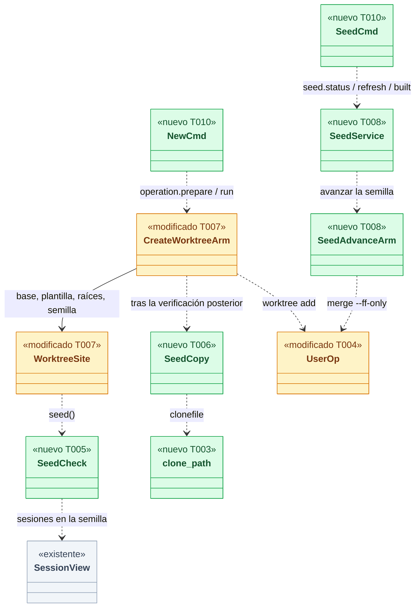
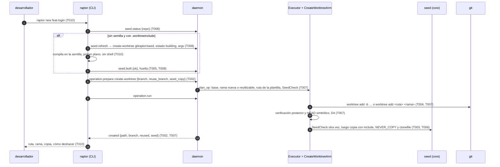
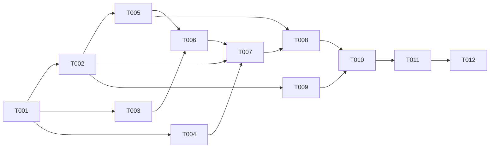

# DS-US-WTL-001 · `raptor new` crea un worktree con rama con nombre y copia copy-on-write desde una semilla quieta

## Contexto rápido

Al terminar, el desarrollador escribe `raptor new feat-login` y obtiene, en la carpeta que fija su plantilla de ruta, un worktree en la rama con nombre `feat-login` con los ignorados que lista `.worktreeinclude` (por ejemplo `target/` y `node_modules/`) clonados con copy-on-write desde una semilla quieta de la rama base. No se lanza ningún agente ni se instala ninguna skill (eso es US-WTL-013). La primera vez que un repo con `.worktreeinclude` usa `raptor new`, GitRaptor crea la semilla desde la rama base confirmada y la compila con la orden que el desarrollador configuró; después la reconstruye con `raptor seed refresh`.

La operación de crear el worktree no se construye aquí. Es `create-worktree` del catálogo, con su brazo de producción, su plantilla, su sitio, sus motivos y su capacidad, que construye [DS-US-MCP-019](../../mcp/dev-specs/US-MCP-019-dev-spec.md) y que US-CKP-018 también reutiliza. Esta DS la **amplía** con dos argumentos que solo acepta la capa del desarrollador (reutilizar una rama existente y copiar desde la semilla) y añade lo que no existe: la semilla, la copia, `.worktreeinclude`, el clon de macOS y la CLI.

Por qué importa, con datos medidos el 2026-11-09 (diario de la bitácora, en `evidence`; se cita lo necesario y la DS no depende de él):

| Medida (macOS, APFS, repo de GitRaptor) | Valor |
|---|---|
| Clon de `target/` desde una semilla quieta, 25 clones | **4–10 s** cada uno (7–10 s los primeros 20), y entre **−1002 MB y +72 MB** de `df`: ~0 MB reales |
| `target/` completo con el perfil ligero de #328 | **~10 GiB** (`df`), 253 crates en 178 s |
| Primera compilación tras clonar de una semilla del mismo toolchain y perfil | solo los crates del workspace; 3,7 s en un caso (solo `gitraptor-desktop`) |
| Origen con otro perfil (antes de #328) | cargo recompiló **todas** las dependencias: el ahorro se pierde al reescribirse los archivos |
| Origen que seguía compilando (prueba 3) | el disco libre bajó de 106 a 53 GiB en una hora: cada reescritura del origen deja al clon como único dueño de los bloques viejos |
| Disco liberado al borrar un worktree tras una historia completa | entre 1,8 y 24,3 GB: es lo que divergió de la semilla |

De ahí las tres condiciones de la copia: origen **quieto**, **mismo toolchain y perfil** y **solo lo que el repo lista**.

Hoy:
- `create-worktree` está en el catálogo (`crates/api/src/catalog.rs:61-70`, `CreateWorktreeArgs { branch, path }` en `:246-250`), pero **nada de DS-US-MCP-019 está en `main`** (comprobado el 2026-11-21): no existen `crates/core/src/executor/ops/create_worktree.rs`, `crates/api/src/worktree_template.rs` ni `WorktreeSite`. G1.
- `UserOp` es una lista cerrada (`crates/git/src/user_ops.rs:94-135`): `WorktreeAdd` solo hace `worktree add -b`; no hay `worktree add <ruta> <rama>` ni `merge --ff-only`.
- `crates/macsys` es una de las dos excepciones a `unsafe_code = "forbid"` (ADR-GRP-002, Enmienda 2026-10-07): `unsafe` solo en módulos privados `ffi_*`, y `libc 0.2.190` (ya en `[workspace.dependencies]`) declara `clonefile` en macOS.
- `raptor` registra cada subcomando de primer nivel en `commands!` (`apps/cli/src/commands/mod.rs`). Cuando quien llama es un agente, el daemon fija el perfil `mcp` en la conexión y la CLI lo detecta (`apps/cli/src/restricted.rs`).
- La detección de sesiones (ADR-GRP-012, S1) sabe si hay un proceso de Claude Code con el cwd dentro de un worktree observado.

| Término | Qué es aquí |
|---|---|
| Semilla | Worktree del repo en la rama local `gitraptor/seed`, creado desde la base confirmada, compilado con `worktree.seedBuild` y donde nadie trabaja. Una por repo en M3 (M4: una por toolchain y perfil, US-WTL-006) |
| Manifiesto | `repos/<id>/seed.json` en el perfil de GitRaptor: ruta, `(dev, inode)` de la carpeta, oid, huella, estado y hora de compilación. **Un worktree es la semilla porque el manifiesto lo dice, nunca por el nombre de su rama** (D5) |
| Huella | SHA-256 de lo que define el toolchain y el perfil de compilación (D8) |
| Semilla quieta | Estado `ready`, sin sesión de agente, con el `HEAD` y el árbol rastreado del manifiesto y sin compilación en curso (D7) |
| `.worktreeinclude` | Lista, con sintaxis de `.gitignore`, de los ignorados que se copian (D10) |
| Lista fija de exclusiones | `NEVER_COPY`: lo que nunca se copia aunque el repo lo liste (D10) |
| `clone_path` | La función segura de `gitraptor-macsys` que clona un archivo o un directorio con `clonefile(2)` (D11) |
| `NewCmd` · `SeedCmd` | Los `Cmd` de `apps/cli/src/commands/new.rs` y `commands/seed.rs` (T010) |
| `CreateWorktreeArm` · `WorktreeSite` | El brazo de producción de `create-worktree` y su sitio, creados por DS-MCP-019 y ampliados en T007 |
| `SeedService` · `SeedCheck` · `SeedCopy` | El servicio de la semilla en el daemon (T008), el resultado de la comprobación de semilla quieta (T005) y la copia de `crates/core/src/seed/copy.rs` (T006) |
| `SeedAdvanceArm` | El brazo de la operación `seed-advance` (`crates/core/src/executor/ops/seed_advance.rs`, T008) |
| `SessionView` | La sesión de agente que publica la detección de ADR-GRP-012 (existente) |

Sin `architecture-constitution.md` en la cascada: rigen [AGENTS.md](../../../../../AGENTS.md) y los ADR de `must_read` (`unsafe_code = forbid` y escritura con la Git CLI, ADR-GRP-001; excepciones `ffi_*`, ADR-GRP-002; argv fijo y sin shell, NFR-02; cero pérdida de datos, NFR-01; el agente nunca elige la ruta, H-02). Ninguna tarea las viola.

---

## 📋 Índice

> **Para aprobar:** [Contexto rápido](#contexto-rápido) · [Decisiones](#decisiones-validadas) · [⚠️ Gaps](#gaps-y-violaciones-de-la-constitución) · [🔭 La forma](#la-forma) · [El trabajo de un vistazo](#el-trabajo-de-un-vistazo).
> **Para implementar:** [🚀 Plan](#plan-de-implementación), en orden. Las secciones `_(ref)_` se abren desde la tarea que las cita.

| Sección | Propósito |
|---------|-----------|
| [Contexto rápido](#contexto-rápido) | Qué se construye, por qué y con qué datos |
| [Decisiones validadas](#decisiones-validadas) | D1 a D14 |
| [⚠️ Gaps y violaciones de la constitución](#gaps-y-violaciones-de-la-constitución) | Qué impide empezar o liberar |
| [🔭 La forma](#la-forma) | Piezas y flujo |
| [🚀 Plan de implementación](#plan-de-implementación) | T001…T012, en orden |
| [Estructura de ficheros](#estructura-de-ficheros) _(ref)_ | Tramos disjuntos |
| [Contratos compartidos](#contratos-compartidos) _(ref)_ | Tipos y firmas |
| [Contrato de API](#contrato-de-api) _(ref)_ | Canal, CLI, configuración y valores |
| [Modelo de datos](#modelo-de-datos) _(ref)_ | Manifiesto de la semilla y oplog |
| [Estrategia de pruebas y cobertura](#estrategia-de-pruebas-y-cobertura) _(ref)_ | Escenario → prueba, certificación |
| [Gate de seguridad](#gate-de-seguridad) | FFI, ejecución de la orden de compilación, envenenamiento de la semilla |
| [Fuera de alcance](#fuera-de-alcance) | Diferido |
| [Enmiendas que implica](#enmiendas-que-implica) | Cambios propuestos, sin aplicar |
| [Notas del autor](#notas-del-autor) _(ref)_ | Hechos y preguntas abiertas |

---

## Decisiones validadas

Todas son **Decisión del orquestador (2026-11-21), validada por Arquitecto**. Lo que ya fija DS-US-MCP-019 (plantilla D2, sitio D3, "nunca reutilizar" D4, motivos D5, TOCTOU de la ruta D6, ruta como `Untrusted` D7, `created` con capacidad D8, base local D11) y DS-US-CKP-018 (capa `cockpit` para los argumentos de conexión completa C3, Deshacer como descarte C5) se cita y no se redecide.

| # | Decisión | Por qué / descartado |
|---|---|---|
| D1 | **Validación de la decisión del PO del 2026-11-21: de acuerdo.** `create-worktree` es una sola operación del catálogo con un solo brazo de producción, que construye DS-US-MCP-019. US-CKP-018 (TUI, preparar sin lanzar) y US-WTL-001 (CLI, `raptor new`) la reutilizan. US-WTL-001 pasa a `blocked_by: US-MCP-019` y deja de depender de US-CKP-018. Esta DS amplía ese brazo con dos argumentos de la capa `cockpit` (`reuse_branch` y `seed_copy`, D3 y D11), igual que DS-CKP-018 C2 lo amplió con la ruta explícita. No hay un segundo brazo ni una segunda operación de crear | Las reglas de H-02 (ruta solo por plantilla), de la carrera de la ruta (DS-MCP-019 D6) y de "rama libre" tienen que existir una sola vez: dos caminos para crear un worktree divergirían. `raptor new` no usa el flujo de escritura de la TUI (US-CKP-014) ni el descarte (US-CKP-017), así que esperar a US-CKP-018 lo bloqueaba sin razón. **Matiz**: el Deshacer de la creación desde la CLI sigue dependiendo del descarte (US-CKP-017 o US-WTL-002); no bloquea la construcción, sí la liberación (G2). Descartado: absorber US-CKP-018 en esta historia (mezcla la superficie de la TUI con la de la CLI y la semilla) |
| D2 | **`raptor new <rama> [--no-seed]`** es un subcomando de primer nivel de la CLI, cliente del motor por el canal, como la TUI. Pide `create-worktree` con `{branch, reuse_branch: true, seed_copy: !no_seed}` sobre el worktree principal del repo del cwd (regla de DS-CKP-018 C12). **Ruta**: siempre la de la plantilla del perfil (`cockpit.worktreePathTemplate`, DS-MCP-019 D2), sin `--path` en M3. **Base**: exige la base confirmada (`base-unconfirmed` y `base-missing` de DS-MCP-019), también al reutilizar una rama, porque la semilla sale de esa base. **Perfil restringido** (quien llama es un agente, perfil `mcp` de TS-GRP-010; ADR-GRD-007 Enmienda 2026-11-10: crear sin lanzar no es reservado): `raptor new <rama> --no-seed`, o `raptor new <rama>` en un repo sin `.worktreeinclude`, manda solo `{branch}`, con la misma semántica que `create_worktree` del MCP (rama nueva, sin copia, sin crear semilla), y lo dice en la salida. `raptor new <rama>` sin `--no-seed` en un repo con `.worktreeinclude` (lo que para el desarrollador crearía, compilaría o copiaría la semilla) se rechaza entero con `reserved-refused` antes de crear nada (D6, P-WTL-21) | Una sola forma de calcular la ruta para el humano y el agente: nadie elige una ruta fuera de la plantilla por la CLI (H-02). `--path` queda para cuando haga falta: la ruta explícita ya existe para la capa `cockpit` (DS-CKP-018 C2), así que añadirla es una puerta de doble sentido. Descartado: rechazar `raptor new` a un agente (contradice ADR-GRD-007, que solo reserva `--agent`) |
| D3 | **Reutilizar una rama existente** (Pregunta 14, supuesto provisional "se reutiliza, como `wt switch`"). Con `reuse_branch: true`: si `refs/heads/<rama>` existe **con ese nombre exacto** y no está sacada en ningún worktree, el plan la reutiliza y el paso corre `git worktree add <ruta> <rama>` (UserOp nuevo `WorktreeAddExisting`, argv fijo). Si está sacada en otro worktree → motivo nuevo `branch-checked-out` con la ruta de ese worktree en `data.worktree` (escenario 5). Una variante de mayúsculas o un choque de carpeta sigue siendo `branch-exists` (DS-MCP-019 D4). El worktree arranca en la punta de la rama; la salida dice "rama existente reutilizada" y su punta. `reuse_branch` solo lo acepta la capa `cockpit`; para otra capa → `not-available-for-layer` (como DS-CKP-018 C3). El MCP nunca lo manda | Cumple el supuesto provisional sin tocar el MCP, que nunca reutiliza (BR-MCP-ELIG-004). Reutilizar no mueve ninguna ref, así que no hay nada que perder (NFR-01). Si Rene cierra la Pregunta 14 con "rama nueva siempre", el cambio es que la CLI mande `false`: una línea. Descartados: un brazo aparte para reutilizar (lo que el encargo prohíbe); `worktree add <ruta> refs/heads/<rama>` (Git lo trata como commit y deja HEAD separado) |
| D4 | **Nunca HEAD separado**, comprobado y no supuesto. La verificación posterior del paso (DS-MCP-019 T004 paso 3.4) añade: el `HEAD` del worktree nuevo es una ref simbólica a `refs/heads/<rama>`, leída con `gix`. Si no lo es → `StepError` (la operación queda `interrupted` con su previo) y no se copia nada. Vale para `-b` y para la rama reutilizada | BR-WTL-001 y el escenario "Nunca HEAD separado". Una comprobación cuesta una lectura y cierra el caso de un nombre ambiguo |
| D5 | **Dónde vive la semilla y cuánto ocupa (Pregunta 9).** La carpeta de la semilla es la de la plantilla del perfil con la rama `gitraptor/seed` (saneada `gitraptor-seed`): con la plantilla de Orca, `~/orca/workspaces/<repo>/gitraptor-seed`; sin plantilla, `<padre>/<repo>-gitraptor-seed`. Se crea con el mismo `create-worktree` (rama nueva desde la base, sin reutilizar). Su identidad la guarda el manifiesto del perfil (`repos/<id>/seed.json`: ruta canónica y `(dev, inode)`), nunca el nombre de la rama: si `gitraptor/seed` ya existe y el manifiesto no la registra, la semilla no se crea (`branch-exists`) y el worktree se crea sin copia con aviso. **Ocupa** el checkout más los artefactos compilados una vez por repo (~10 GiB en GitRaptor con el perfil de #328, medido con `df`); cada clon cuesta ~0 (de −1002 a +72 MB en 25 clones). `raptor seed status` muestra el tamaño de la semilla | Misma carpeta padre que los worktrees nuevos: `clonefile` solo clona dentro de un mismo volumen, y la plantilla garantiza ese volumen en el caso normal. Descartados: el perfil de GitRaptor (es una raíz protegida, DS-MCP-019 D3; está en `~/Library`, que la copia de seguridad de macOS incluye; y puede estar en otro volumen que los worktrees) y dentro de `.git` (raíz protegida y fuera de la vista del desarrollador). Identidad por manifiesto: un agente con shell puede crear una rama `gitraptor/seed`, y reutilizarla convertiría su worktree en el origen de la copia de todos (envenenamiento) |
| D6 | **Cómo se compila la semilla.** Con la orden que el desarrollador configura en `worktree.seedBuild`: una lista de argv (`[["cargo","test","--workspace","--exclude","gitraptor-desktop","--no-run"]]`), solo en el perfil o en la local personal; en la configuración del equipo (`.gitraptor/settings.json`) se ignora con diagnóstico. **La ejecuta la CLI** (`raptor seed refresh` o el primer `raptor new`), en primer plano, con cwd en la semilla, stdin/stdout/stderr heredados, sin shell y nunca el daemon ni el MCP. Sin `worktree.seedBuild`, la semilla se crea pero queda `unbuilt`: no se copia nada y la salida dice cómo configurarla | GitRaptor no puede adivinar cómo se compila un repo, y una semilla sin artefactos no ahorra nada. La CLI en primer plano deja ver el progreso y cancelar con `Ctrl-C`, y no hace competir al daemon con los agentes (ADR-GRP-015). Nunca del equipo: un repo clonado no puede hacer que GitRaptor ejecute su orden. **P-WTL-21, cerrada. Decisión del orquestador (2026-11-21), con la delegación de Rene, validada por Arquitecto: aceptada con condiciones.** (a) `worktree.seedBuild` se lee solo del perfil o de la local personal; en `.gitraptor/settings.json` se ignora con diagnóstico (T009). (b) La ejecuta la CLI en primer plano, argv fijo sin shell, cwd en la semilla; nunca el daemon ni el MCP. (c) **Nuevo**: con el perfil `mcp` (la CLI la lanzó un agente, S-01, TS-GRP-010) la ejecución se rechaza con el código de operación reservada `reserved-refused` (`ErrorCode::ReservedRefused`, `-32003`, `crates/api/src/rpc.rs:33`, `:196`; ADR-GRD-007 y su Enmienda 2026-11-10), con motivo «compilar la semilla es una operación reservada al desarrollador» y acción «el desarrollador ejecuta `raptor seed refresh` desde su terminal». Dos cercas: la CLI comprueba `hello.profile` (`restricted::is_restricted`, `apps/cli/src/restricted.rs`) antes de pedir nada, y el daemon responde `-32003` a `seed.refresh` y `seed.built` de toda conexión con perfil `mcp` sin devolver el argv ni poner `building` (T008). No entra en la lista de comandos reservados de ADR-GRD-007 § 1 con los controles 1 a 3: el humano la ejecuta sin pty ni ascendencia especial; lo único reservado es que un agente no puede | GitRaptor no puede adivinar cómo se compila un repo, y una semilla sin artefactos no ahorra nada. La CLI en primer plano deja ver el progreso y cancelar con `Ctrl-C`, y no hace competir al daemon con los agentes (ADR-GRP-015). (c): un agente que pudiera lanzar la compilación ejecutaría, con la identidad del humano, una orden que él no pidió en ese momento, y su resultado se copia a todos los worktrees (envenenamiento de la semilla). Descartados: `raptor seed refresh --built` sin ejecución (el humano compila a mano; cuesta un paso en cada refresco y no cierra nada que (c) no cierre); añadirla a los comandos reservados con controles 1 a 3 (obliga a una pty para una orden que el humano lanza a diario, sin ganar nada frente al perfil `mcp`) |
| D7 | **"Semilla quieta"** se comprueba al preparar y otra vez en el paso, justo antes de copiar. Las cinco condiciones: (1) manifiesto en estado `ready`; (2) ninguna sesión de agente en la semilla en estado distinto de terminado (S1 de ADR-GRP-012: proceso con el cwd dentro de la carpeta de la semilla); (3) el `HEAD` de la semilla es el oid del manifiesto y el árbol rastreado está limpio (`gix` status sin ignorados); (4) la carpeta tiene el `(dev, inode)` del manifiesto; (5) ninguna compilación en curso: el estado `building` lo pone `seed.refresh` y se libera con `seed.built` o al cerrarse la conexión que lo puso (→ `failed`). Si falla alguna, el worktree se crea **sin copia** y la salida dice el motivo (`seed-busy`, `seed-moved`, `seed-building`, `seed-not-built`) | BR-WTL-003 y el escenario "Semilla con trabajo en curso". Atar `building` a la conexión evita una semilla bloqueada para siempre si la CLI muere. **Límite conocido (G6)**: un humano que compila a mano dentro de la semilla no se detecta; la semilla es de GitRaptor y `raptor seed status` lo advierte |
| D8 | **Huella "toolchain y perfil actuales"**: SHA-256 de, en este orden: `std::env::consts::{OS, ARCH}`; el argv de `worktree.seedBuild` (la orden lleva el perfil: `--release`, `--profile`); y, leídos del **commit** con `gix` (sin ejecutar nada), el contenido de `rust-toolchain`, `rust-toolchain.toml`, `.cargo/config.toml`, `.cargo/config`, `.nvmrc`, `.node-version`, `.tool-versions` y las tablas `[profile.*]` del `Cargo.toml` raíz (líneas desde cada cabecera `[profile…]` hasta la siguiente cabecera). La huella de la semilla se calcula sobre su `HEAD` al marcarla compilada; la actual, sobre el oid de la base confirmada al crear. Distintas → sin copia, motivo `fingerprint-mismatch` y la orden `raptor seed refresh` (Pregunta 5b, escenario "Semilla de otro toolchain o perfil") | Se compara lo que invalida los artefactos (prueba 1: el cambio de perfil de #328), no lo que cambia a diario: `Cargo.lock` o un `Cargo.toml` con un crate nuevo solo recompilan una parte, y la copia sigue ahorrando. Sin ejecutar `rustc -vV` ni `node --version`: un proxy de `rustup` puede instalar un toolchain al llamarlo. **Límite**: un toolchain sin fijar en el repo que se actualiza (`rustup update stable`) no cambia la huella; cargo recompila y el ahorro de esa copia se pierde, sin error (cargo valida sus propios artefactos). `raptor seed refresh` lo resuelve |
| D9 | **`raptor seed refresh`** (y la primera vez, `raptor new`): (1) sin semilla, la crea con `create-worktree` `{branch: "gitraptor/seed"}` y registra el manifiesto; (2) con semilla quieta, la lleva al oid actual de la base con la operación de catálogo nueva `seed-advance` (`git merge --ff-only <oid>` en la semilla, UserOp nuevo `MergeFfOnly`, previo garantizado del ejecutor); si no es avance rápido, se rechaza con `seed-diverged` y la salida propone borrarla; (3) pone `building`, devuelve el argv a la CLI, que compila; (4) `seed.built {ok}`: el daemon comprueba otra vez D7 (3) y (4), calcula la huella y pone `ready` o `failed`. La semilla se crea siempre desde la rama **base confirmada** (en GitRaptor, `main`) | Avanzar en lugar de recrear conserva la compilación incremental. `seed-advance` es una operación del catálogo y no un `git` suelto del daemon: toda escritura en un repo pasa por el ejecutor con su previo (NFR-01). No es `rebase-onto-base` (US-CKP-015, sin construir) porque la semilla nunca tiene commits propios y un avance rápido no reescribe nada. Sin `.worktreeinclude`, `raptor new` no crea semilla: no habría nada que copiar |
| D10 | **`.worktreeinclude`** (Pregunta 16). Se lee del **worktree principal** del repo, en su raíz, esté o no rastreado (en el dogfooding vivía en `info/exclude`). Sintaxis de `.gitignore`, anclada en la raíz, con negaciones `!` y "gana la última", como worktrunk y la app de Codex; se interpreta con el matcher de `gix` (feature `excludes`, ya en el workspace). Una ruta se copia si y solo si: está **ignorada por Git en la semilla**, casa con `.worktreeinclude` y no casa con `NEVER_COPY`. **Sin el archivo, no se copia ningún ignorado** y el worktree se crea igual (escenario 3). `NEVER_COPY` (en cualquier profundidad, no configurable en M3): `.git`, `.env`, `.env.*`, `.envrc`, `.claude/runs/`, `.claude/worktrees/`, `.claude/settings.local.json`, `.gitraptor/`, `.netrc`, `.npmrc`, `.pypirc`, `*.pem`, `*.key`, `id_rsa*`, `id_ed25519*` | Compatibilidad con worktrunk y Codex (CTX-WTL-001 § 5): el mismo archivo sirve a las tres herramientas. Del principal y no de la semilla ni del worktree nuevo: el principal es el del humano, y así un `.worktreeinclude` sin versionar sigue funcionando. Solo ignorados: lo rastreado ya lo trae el checkout. `NEVER_COPY` resuelve la Pregunta 16 con su supuesto provisional: estado de otros agentes (`.claude/runs`, hallazgo del 2026-11-09) y secretos que un `.worktreeinclude` amplio (`.claude/`, `*`) arrastraría. Ampliarla o hacerla configurable es de doble sentido |
| D11 | **Copia copy-on-write sin dependencias de shell.** `gitraptor-macsys` gana el módulo público `clone` (`clone_path(src, dst) -> Result<(), CloneError>`) y el privado `ffi_clonefile`, un bloque `unsafe` por llamada a `libc::clonefile(src, dst, CLONE_NOFOLLOW \| CLONE_NOOWNERCOPY)`. `clonefile` clona un directorio entero en una llamada. El recorrido (`crates/core/src/seed/copy.rs`) parte de los ignorados de la semilla: un directorio que casa entero y no contiene nada de `NEVER_COPY` (comprobado con `read_dir`, solo nombres, sin seguir enlaces) se clona en una llamada; si contiene algo excluido, se desciende. Nunca sigue enlaces simbólicos (se clona el enlace). Un destino que ya existe no se toca (`EEXIST` → se cuenta como omitido). La copia corre **dentro del paso de `create-worktree`**, tras la verificación posterior (D4) y antes de devolver el resultado, con `seed_copy: true` y solo para la capa `cockpit` | ADR-GRP-001 (`unsafe_code = forbid`) y ADR-GRP-002 (excepciones `ffi_*` en `macsys`, con precedente en `ffi_procargs`): el FFI queda aislado y revisable. Descartado `cp -c -R` con argv fijo: no respeta `NEVER_COPY` dentro de un directorio, depende del `cp` de BSD y lanza un proceso por entrada. Dentro del paso: el worktree nuevo no se publica a la flota ni lo usa nadie hasta que la copia termina, y la TUI y la app de escritorio lo heredan sin código propio. **Punto de sensibilidad**: el cerrojo del repo se mantiene durante la copia (medido con worktrunk: 4–10 s por archivo; con un `clonefile` por directorio se espera menos). Una llamada MCP que espera el cerrojo tiene 30 s (`MCP_WRITE_TIME_LIMIT`). Si la certificación mide más de 10 s, la copia pasa a una fase posterior al cerrojo (registrado como alternativa, no construido) |
| D12 | **Sin copy-on-write** (Pregunta 11): **no se copia y se avisa**, como dice el supuesto provisional. `ENOTSUP` (volumen que no es APFS) → `no-cow`; `EXDEV` (semilla y worktree en volúmenes distintos) → `cross-device`; Linux y Windows → `unsupported-platform` sin intentar nada. Se detecta en la primera entrada, así que no queda nada a medias. Un error posterior (`ENOSPC`, `EACCES`) para la copia, deja lo ya clonado (son clones, no ocupan) y devuelve `partial` con el motivo. **Semilla de otro toolchain** (Pregunta 5b): el worktree se crea sin copia y se avisa de `raptor seed refresh` (D8). En ningún caso el fallo de la copia deshace la creación del worktree | Una copia normal de ~10 GiB por worktree es justo el problema de disco que la feature resuelve (BRD, 2026-11-08): copiar sin reflink no debe pasar en silencio. Crear el worktree sin copia sigue siendo útil: cargo compila desde cero. Copia normal con aviso: descartada para M3; se puede añadir con un `--full-copy` explícito tras la etapa multiplataforma |
| D13 | **NFR-01.** La creación va por el ejecutor con su previo garantizado (DS-MCP-019 G6) y no destruye nada: rama nueva o rama reutilizada sin mover ninguna ref. `seed-advance` es un avance rápido de una rama de GitRaptor con previo. **Deshacer la creación** es descartar el worktree creado (DS-CKP-018 C5): `raptor new` termina con "para deshacerlo: D en su fila de la TUI" hasta que exista el descarte por CLI (US-WTL-002). Con una rama **reutilizada**, el descarte de US-CKP-017 borra también la rama, con snapshot y confirmación si tiene trabajo no integrado (restaurable 30 días); la salida lo advierte. Los ignorados copiados no entran en ningún snapshot (D-TMC-16): el original sigue en la semilla. **BRD § 6.4**: aquí no se lanza ningún agente ni se instala ninguna skill (eso es US-WTL-013, operación reservada) | La copia solo crea entradas que no existían en un worktree recién creado: no puede pisar trabajo de nadie. G2 deja constancia de que, hasta US-CKP-017, deshacer desde la CLI no existe |
| D14 | **El MCP no cambia** (escenario 6). `McpCreateWorktreeArgs` no gana campos; el ejecutor rechaza `reuse_branch` y `seed_copy` para toda capa distinta de `cockpit` **y para toda conexión con perfil `mcp`** (`not-available-for-layer`), igual que la ruta explícita (DS-CKP-018 C3). **Alineado el 2026-11-21 con DS-US-MCP-019 D12**: los dos campos de `CreateWorktreeArgs` y la regla de capa (`cockpit_only_args`, en `Executor::prepare` antes de `parse`) los construye DS-MCP-019 T001 y T004; esta DS solo sirve su comportamiento (T007). `created.reused` y `created.seed` solo viajan con la capacidad nueva `operation.create-worktree-seed`, que `raptor-mcp` no pide; para el MCP la forma de `OperationRunResult` no cambia | Defensa en profundidad: hoy solo el esquema del MCP quita campos, y un agente que hablara el protocolo completo podría pedir la copia o reutilizar una rama |

---

## ⚠️ Gaps y violaciones de la constitución

| ID | Qué falta | Severidad | Alcance | Acción | Owner |
|----|-----------|-----------|---------|--------|-------|
| G1 | **Parte común de DS-US-MCP-019** (T001 a T005: brazo `create-worktree`, sitio, plantilla, motivos, capacidad y `created`). Nada está en `main` (2026-11-21) | Bloqueante | T007 (y por `Depende:` T008, T010, T011) | Mezclar DS-US-MCP-019 T001 a T005 antes de T007. T001 a T006 y T009 no la necesitan | Orquestador |
| G2 | **Deshacer la creación desde la CLI**: el descarte es de US-CKP-017 (TUI) y US-WTL-002 (CLI e informe de disco), sin construir | Bloquea liberación | — | Hasta entonces, la salida remite a `D` en la TUI; cerrar con US-CKP-017 o US-WTL-002 | Orquestador |
| G3 | **Linux y Windows**: reflink en btrfs y XFS (`FICLONE`), ReFS (block cloning), y `parent_is_private` en Windows (G1 de DS-MCP-019). Hoy esas plataformas responden `unsupported-platform` y crean sin copia | Bloquea liberación en Linux y Windows | Solo Linux y Windows | Etapa de validación multiplataforma; fila nueva en `xplat-pendientes.md` (T012) | Arquitecto |
| G4 | La semilla aparece en la flota como un worktree más | Informativo | — | Mostrarla como «semilla» con su origen es de US-WTL-005 (convivencia); la limpieza no la toca (US-WTL-008) | PO |
| G6 | Un humano que compila a mano dentro de la semilla no se detecta (D7) | Informativo | — | `raptor seed status` advierte que la semilla es de GitRaptor; M4 (US-WTL-006) la mantiene el daemon | — |

Ninguna violación: sin constitución, ver Contexto rápido.

---

## 🔭 La forma



🟩 nuevo · 🟨 modificado · ⬜ existente.

**Cómo fluye `raptor new feat-login`:**



---

## 🚀 Plan de implementación

> Orden topológico (`Depende:`). Rutas relativas a la raíz del repo. Cada tramo de § Estructura de ficheros es disjunto. Repos y perfiles temporales siempre, nunca este repo (NFR-01).

### El trabajo de un vistazo

| # | Tarea | Depende | Aterriza en |
|---|---|---|---|
| T001 | Escribir en rojo los tests de contrato | — | `crates/core/tests/us_wtl_001_*.rs`, `apps/cli/tests/raptor_new.rs`, stubs |
| T002 | Definir el contrato: argumentos, motivos, capacidad, informe de copia y métodos `seed.*` | T001 | `crates/api/src/` |
| T003 | Clonar con `clonefile` detrás de una API segura | T001 | `crates/macsys/src/` |
| T004 | Añadir `WorktreeAddExisting` y `MergeFfOnly` a la lista cerrada de Git | T001 | `crates/git/src/user_ops.rs` |
| T005 | Crear el manifiesto, la huella y la comprobación de semilla quieta | T002 | `crates/core/src/seed/` |
| T006 | Leer `.worktreeinclude` y copiar con `NEVER_COPY` | T003, T005 | `crates/core/src/seed/{include,copy}.rs` |
| T007 | Ampliar `create-worktree`: reutilizar, HEAD simbólico y copia | T002, T004, T006, G1 | `crates/core/src/executor/ops/create_worktree.rs`, `…/create_worktree/site.rs` |
| T008 | Servir `seed.*` y la operación `seed-advance` | T005, T007 | `crates/core/src/executor/ops/seed_advance.rs`, `crates/core/src/channel/conn.rs` |
| T009 | Leer `worktree.seedBuild` del perfil y de la local | T002 | `crates/policy/src/settings/` |
| T010 | Los subcomandos `raptor new` y `raptor seed` | T008, T009 | `apps/cli/src/` |
| T011 | Prueba de extremo a extremo y certificación en macOS | T010 | `apps/cli/tests/raptor_new.rs` |
| T012 | Cerrar la historia y las enmiendas | T011 | `docs/` |

### En qué orden

T003, T004 y T009 van en paralelo con T005. Todo converge en T007, que espera a G1.



### T001 — Escribir en rojo los tests de contrato

**Objetivo.** Los doce escenarios de la historia, en rojo, contra el daemon real (`OperationsWiring::production()`, sin brazos de prueba) con repos y perfil temporales, y contra el binario `raptor`.

**Ubicación.**
- `crates/core/tests/us_wtl_001_create.rs` (**CREATE**): daemon en proceso, Git real; la base se confirma como en `crates/core/tests/profile_team_baseline.rs`. `#![cfg(target_os = "macos")]` para los casos con copia.
- `crates/core/tests/us_wtl_001_seed.rs` (**CREATE**): manifiesto, huella, semilla quieta, `seed-advance`.
- `apps/cli/tests/raptor_new.rs` (**CREATE**): arnés de `apps/cli/tests/mcp_snapshot.rs` (copia, sin editarlo), solo macOS.
- Stubs que compilan (`PlanError::NotImplemented` o un `Err` tipado; nunca `todo!()` en un camino de producción) en los archivos de T002 a T010.

**Reglas**
- Los tests rojos van en su archivo y no se editan durante la implementación (R4 de `/implement`).
- El padre de los repos temporales con modo `0o755` (lo exige `parent_is_private`, `new_path.rs:35-39`). En macOS, `tempfile` crea en APFS: `clonefile` funciona.
- La capa `cockpit` sale de la resolución real del solicitante, nunca de `test_layer_override` en los tests de punta a punta.

- **Depende:** —
- **Refs:** US-WTL-001, los doce escenarios; § 9.3
- **Aceptación:** `cargo test -p gitraptor-core --test us_wtl_001_create --test us_wtl_001_seed` y `cargo test -p gitraptor-cli --test raptor_new` compilan y fallan por "no implementado"

### T002 — Definir el contrato: argumentos, motivos, capacidad, informe de copia y métodos `seed.*`

**Objetivo.** Los tipos y textos que comparten el daemon y la CLI. Ninguno se produce todavía.

**Ubicación.**
- `crates/api/src/catalog.rs` (**MODIFY**): `CreateWorktreeArgs.reuse_branch` y `.seed_copy`; `RejectReason::{BranchCheckedOut, SeedDiverged, NotTheSeed}`; entrada `OperationId::SeedAdvance` (no destructiva, sin marca MCP, `governed: None`)
- `crates/api/src/timemachine.rs` (**MODIFY**): `CreatedWorktree.reused` y `.seed`
- `crates/api/src/seed.rs` (**CREATE**) y una línea `pub mod seed;` en `crates/api/src/lib.rs`: `SeedCopyReport`, `SeedCopyStatus`, `SeedSkipReason`, `SeedView`, `SeedState`
- `crates/api/src/methods/seed.rs` (**CREATE**) y sus tres líneas en `methods/mod.rs`: grupo `seed` con `seed.status`, `seed.refresh`, `seed.built`
- `crates/api/src/methods/operation.rs` (**MODIFY**): `CAP_OPERATION_CREATE_WORKTREE_SEED`
- `crates/api/tests/us_wtl_001_wire.rs` (**CREATE**)

**Pasos**
1. Tests de `us_wtl_001_wire.rs` en rojo: forma de cable de cada tipo y que `CreatedWorktree` sin la capacidad serializa igual que antes.
2. `CreateWorktreeArgs.reuse_branch` y `.seed_copy` **ya los añade DS-US-MCP-019 T001 (D12)**; aquí no se tocan. Si DS-MCP-019 T001 no ha entrado, se espera a él (G1). `McpCreateWorktreeArgs` **no cambia** (D14).
3. `RejectReason`, aditivas (DS-MCP-013 D2): `BranchCheckedOut` (`branch-checked-out`, con `data.worktree: Untrusted`), `SeedDiverged` (`seed-diverged`), `NotTheSeed` (`not-the-seed`).
4. `CreatedWorktree`: `#[serde(default, skip_serializing_if = "is_false")] reused: bool`, `#[serde(default, skip_serializing_if = "Option::is_none")] seed: Option<SeedCopyReport>`.
   - ⛔2.1 `reused` y `seed` solo se rellenan para una conexión con `operation.create-worktree-seed`; sin ella, `OperationRunResult` serializa byte a byte como en DS-MCP-019 (es `deny_unknown_fields`).
5. Métodos `seed.*` con `method(SEED_REFRESH, true, false)` (escriben) y `seed.status` de lectura, según `extender-sin-archivos-compartidos.md` § Añadir un método.

- **Depende:** T001
- **Refs:** ADR-GRP-016 § 1 y § 3, ADR-CKP-002 § 1 y § 12, DS-MCP-019 T001
- **Aceptación:** `cargo test -p gitraptor-api` en verde
- **Guard ⛔2.1:** `us_wtl_001_wire::without_the_capability_the_created_worktree_keeps_its_shape`

### T003 — Clonar con `clonefile` detrás de una API segura

**Objetivo.** `gitraptor_macsys::clone::clone_path(src, dst)` clona un archivo, un enlace o un directorio entero con copy-on-write, sin exponer punteros.

**Ubicación.**
- `crates/macsys/src/clone.rs` (**CREATE**): `clone_path`, `CloneError`
- `crates/macsys/src/ffi_clonefile.rs` (**CREATE**): la única llamada `unsafe`
- `crates/macsys/src/lib.rs` (**MODIFY**): `#[cfg(target_os = "macos")] pub mod clone;` y `#[cfg(target_os = "macos")] #[allow(unsafe_code)] mod ffi_clonefile;`
- `crates/macsys/tests/clone.rs` (**CREATE**)

**Reglas**
- `ffi_clonefile::clonefile(src: &CStr, dst: &CStr) -> io::Result<()>`: un bloque `unsafe` con su comentario `SAFETY`, flags `CLONE_NOFOLLOW | CLONE_NOOWNERCOPY`. Los `CStr` se construyen en `clone.rs` desde `OsStr::as_bytes()`; una ruta con `\0` es `CloneError::Invalid` sin llamar al sistema.
- `CloneError`: `Unsupported` (`ENOTSUP`), `CrossDevice` (`EXDEV`), `Exists` (`EEXIST`), `Io(io::Error)`.
- ⛔3.1 Ningún `unsafe` fuera de `ffi_clonefile.rs`; la prueba `crates/winsys/tests/unsafe_boundary.rs` sigue en verde sin cambios.
- ⛔3.2 Nunca sigue un enlace simbólico: clonar un enlace produce un enlace con el mismo destino.

- **Depende:** T001
- **Refs:** ADR-GRP-002 (Enmienda 2026-10-07, crates/macsys), ADR-GRP-001, `man 2 clonefile`
- **Aceptación:** `cargo test -p gitraptor-macsys --test clone` y `cargo test -p gitraptor-winsys --test unsafe_boundary` en verde; `cargo clippy -p gitraptor-macsys --all-targets -- -D warnings` en verde
- **Guard ⛔3.1:** `unsafe_boundary` (existente)
- **Guard ⛔3.2:** `clone::a_symlink_is_cloned_as_a_link_and_never_followed`

### T004 — Añadir `WorktreeAddExisting` y `MergeFfOnly` a la lista cerrada de Git

**Objetivo.** Las dos órdenes de Git que necesitan D3 y D9, con argv fijo.

**Ubicación.**
- `crates/git/src/user_ops.rs` (**MODIFY**): dos variantes, sus argv y una línea `#[path]` de pruebas
- `crates/git/src/user_ops_wtl_tests.rs` (**CREATE**)

**Reglas**
- `WorktreeAddExisting { branch: RefName, path: PathBuf }` → `worktree add <ruta> <rama corta>`. La ruta es absoluta (nunca empieza por `-`); la rama ya pasó `check_new_branch` y existe como `refs/heads/<rama>`.
- `MergeFfOnly { oid: Oid }` → `merge --ff-only --no-edit <oid>`: un oid del plan, nunca un nombre.
- ⛔4.1 `WorktreeAddExisting` nunca recibe `refs/heads/…` ni un oid: Git lo trataría como commit y dejaría HEAD separado.

- **Depende:** T001
- **Refs:** ADR-GRP-001 (Git CLI para escribir), NFR-02
- **Aceptación:** `cargo test -p gitraptor-git user_ops` en verde
- **Guard ⛔4.1:** `user_ops_wtl_tests::worktree_add_existing_passes_the_short_branch_name_only`

### T005 — Crear el manifiesto, la huella y la comprobación de semilla quieta

**Objetivo.** El módulo `seed` del núcleo sabe dónde está la semilla, si es de este toolchain y perfil y si está quieta.

**Ubicación.**
- `crates/core/src/seed/mod.rs` (**CREATE**) y una línea `pub mod seed;` en `crates/core/src/lib.rs`
- `crates/core/src/seed/manifest.rs` (**CREATE**): lectura y escritura atómica de `repos/<id>/seed.json`
- `crates/core/src/seed/fingerprint.rs` (**CREATE**): D8
- `crates/core/src/seed/quiet.rs` (**CREATE**): D7, `SeedCheck`
- `crates/core/src/seed/manifest_tests.rs`, `fingerprint_tests.rs`, `quiet_tests.rs` (**CREATE**)

**Reglas**
- Manifiesto: esquema de § Modelo de datos; escritura en archivo temporal y `rename` en el mismo directorio; solo lo escribe el daemon.
- `fingerprint(repo, oid, build_argv) -> [u8; 32]`: lee los blobs con `gix` del árbol de `oid`; un archivo ausente entra como marcador `absent:<ruta>` para que su aparición cambie la huella. Las tablas `[profile.*]` se extraen por líneas, sin parsear TOML.
- `check(repo, manifest, sessions) -> SeedCheck`: `Ready(SeedSource)` o `Skip(SeedSkipReason)`, con las cinco condiciones de D7 en ese orden. Las sesiones vienen del registro de ADR-GRP-012 (estado distinto de terminado con cwd dentro de la carpeta de la semilla).
- ⛔5.1 La identidad de la semilla es la ruta canónica y el `(dev, inode)` del manifiesto; nunca se deduce de la rama `gitraptor/seed`.

- **Depende:** T002
- **Refs:** ADR-GRP-012 (S1), ADR-GRP-008 (almacén del repo en el perfil), D5, D7, D8
- **Aceptación:** `cargo test -p gitraptor-core seed::` en verde
- **Guard ⛔5.1:** `quiet_tests::a_gitraptor_seed_branch_not_in_the_manifest_is_never_the_seed`

### T006 — Leer `.worktreeinclude` y copiar con `NEVER_COPY`

**Objetivo.** Dado un origen quieto y un worktree nuevo, clonar exactamente los ignorados que el repo lista.

**Ubicación.**
- `crates/core/src/seed/include.rs` (**CREATE**): lectura del archivo del principal, matcher de `gix`, `NEVER_COPY`
- `crates/core/src/seed/copy.rs` (**CREATE**): recorrido y clon
- `crates/core/src/seed/include_tests.rs`, `copy_tests.rs` (**CREATE**)

**Pasos**
1. `Include::load(main_root) -> Result<Option<Include>, IncludeError>`: sin archivo → `None`; más de 64 KiB o más de 512 patrones → `IncludeError::TooLarge` (la copia se omite con `include-invalid`).
2. `copy(seed_root, dst_root, include, ignored) -> SeedCopyReport`: `ignored` son las entradas ignoradas de la semilla (dirwalk de `gix` con los directorios ignorados colapsados). Para cada una que casa con `include` y no con `NEVER_COPY`: si es un directorio, `read_dir` recursivo de nombres sin seguir enlaces; sin excluidos dentro → un `clone_path`; con excluidos → descender. Archivo o enlace → `clone_path`.
3. Errores (D12): `Unsupported` o `CrossDevice` en la primera entrada → `skipped` con `no-cow` o `cross-device`; `Exists` → omitido y contado; cualquier otro después → `partial` con el motivo.
4. Fuera de macOS, `copy` devuelve `skipped` con `unsupported-platform` sin recorrer nada.
- ⛔6.1 Nada de `NEVER_COPY` llega al destino, a ninguna profundidad, aunque `.worktreeinclude` liste su directorio padre o `*`.
- ⛔6.2 Ningún archivo rastreado ni ningún ignorado fuera de `.worktreeinclude` llega al destino; sin `.worktreeinclude`, ninguno.
- ⛔6.3 `copy` nunca borra: ni en el origen ni en el destino, tampoco tras un fallo.

- **Depende:** T003, T005
- **Refs:** D10, D11, D12; formato de `.worktreeinclude` de worktrunk y la app de Codex (CTX-WTL-001, Panorama)
- **Aceptación:** `cargo test -p gitraptor-core seed::include_tests seed::copy_tests` en verde (los de clon real, solo macOS)
- **Guard ⛔6.1:** `copy_tests::never_copy_holds_at_any_depth_even_under_a_listed_parent`
- **Guard ⛔6.2:** `copy_tests::only_ignored_and_listed_entries_reach_the_new_worktree`
- **Guard ⛔6.3:** `copy_tests::a_failed_copy_never_removes_anything`

### T007 — Ampliar `create-worktree`: reutilizar, HEAD simbólico y copia

**Objetivo.** El brazo de DS-MCP-019 sirve `reuse_branch` y `seed_copy` para la capa `cockpit`, comprueba el HEAD y copia desde la semilla dentro del paso.

**Ubicación.**
- `crates/core/src/executor/ops/create_worktree.rs` (**MODIFY**, creado por DS-MCP-019 T004)
- `crates/core/src/executor/ops/create_worktree/site.rs` (**MODIFY**): `WorktreeSite::seed`, con implementación por defecto `SeedCheck::Skip(NoSeed)`; `DaemonSite` lo implementa con T005
- `crates/core/src/executor/ops/create_worktree_wtl_tests.rs` (**CREATE**) y su línea `#[path]`

`crates/core/src/executor/mod.rs` **no cambia** aquí: la regla de capa ya la sirve `cockpit_only_args` de DS-MCP-019 T004 (D12).

**Pasos**
1. Capa: nada que construir. `reuse_branch` o `seed_copy` presentes con capa distinta de `cockpit` o con perfil `mcp` ya dan `NotAvailableForLayer` en `Executor::prepare` antes de `parse` (DS-MCP-019 D12). Este paso quita el `NotImplemented("US-WTL-001")` del paso 2.1b de DS-MCP-019 T004.
2. `plan_op`, entre los pasos 2.3 y 2.4 de DS-MCP-019 T004: si `reuse_branch` y existe `refs/heads/<rama>` exacta → sacada en algún worktree (lista de `gix`) → `BranchCheckedOut { worktree }`; si no, plan de reutilización con `at = punta de la rama` y `PlanShape::CreateWorktree { branch, at }`. Variante de mayúsculas o choque de carpeta → `BranchExists` como siempre.
3. Con `seed_copy`, `site.seed(repo)` entra en el plan como `expected.seed = {estado, oid, huella}`: si cambia bajo el cerrojo, `state-changed`. Una semilla que no sirve **no** rechaza el plan: el plan lleva `Skip(motivo)`.
4. Paso: `WorktreeAdd` (rama nueva) o `WorktreeAddExisting` (reutilizada); verificación posterior de DS-MCP-019 y además `HEAD` simbólico a `refs/heads/<rama>` (D4). Después, si el plan lleva `Ready`, `site.seed` otra vez (D7) y `seed::copy`.
5. `StepOutput` lleva `reused` y el `SeedCopyReport`; `conn.rs` los copia a `created` solo con la capacidad (⛔2.1).
- ⛔7.1 Un fallo o un omitido de la copia nunca convierte la operación en fallida ni deshace el worktree creado.
- ⛔7.2 Nunca HEAD separado: si el `HEAD` del worktree nuevo no es `refs/heads/<rama>`, el paso falla antes de copiar.
- ⛔7.3 Para la capa `mcp`, `create-worktree` se comporta exactamente como en DS-MCP-019.

- **Depende:** T002, T004, T006, G1
- **Refs:** DS-MCP-019 T003 a T005 y D3, D4, D6; DS-CKP-018 C3; D3, D4, D11, D14
- **Aceptación:** `cargo test -p gitraptor-core executor::ops::` y `cargo test -p gitraptor-core --test us_wtl_001_create` en verde; siguen en verde las pruebas de DS-MCP-019 (`--test us_mcp_019_run`)
- **Guard ⛔7.1:** `create_worktree_wtl_tests::a_skipped_or_partial_copy_keeps_the_worktree`
- **Guard ⛔7.2:** `create_worktree_wtl_tests::a_detached_head_fails_the_step_before_copying`
- **Guard ⛔7.3:** `us_wtl_001_create::over_mcp_nothing_changes`

### T008 — Servir `seed.*` y la operación `seed-advance`

**Objetivo.** El daemon crea, avanza, marca y describe la semilla.

**Ubicación.**
- `crates/core/src/executor/ops/seed_advance.rs` (**CREATE**) y una línea en `ops/mod.rs` (`ARMS`)
- `crates/core/src/seed/service.rs` (**CREATE**): `status`, `refresh`, `built`, y el estado `building` atado a la conexión
- `crates/core/src/channel/conn.rs` (**MODIFY**): tres brazos junto a los de su módulo
- `crates/core/src/seed/service_tests.rs` (**CREATE**)

**Reglas**
- `seed.refresh {repo}` y `seed.built {repo, ok}`: conexión con perfil `mcp` → `-32003 reserved-refused` (D6 (c)), antes de leer el manifiesto; no devuelve argv, no crea semilla y no pone `building`.
- ⛔8.1 Ninguna conexión con perfil `mcp` obtiene el argv de `worktree.seedBuild` ni cambia el estado de la semilla. Sin semilla: `create-worktree {branch: "gitraptor/seed"}` por el ejecutor con el solicitante de la conexión, y manifiesto nuevo (`unbuilt`). Con semilla: D7 (2) a (4) o `seed-busy`/`seed-moved`; luego `seed-advance` al oid de la base. Pone `building` si hay `worktree.seedBuild` y devuelve `{path, build: argv | null, state}`.
- `seed-advance`: el brazo comprueba que el worktree nombrado es el del manifiesto (`not-the-seed` si no), árbol limpio y que el `HEAD` es antepasado del oid (`seed-diverged` si no); paso `MergeFfOnly`.
- `seed.built {repo, ok}`: solo desde la conexión que puso `building`; vuelve a comprobar D7 (3) y (4), calcula la huella y pone `ready` o `failed`. Si esa conexión se cierra antes → `failed`.
- `seed.status {repo}`: `SeedView` con el tamaño en disco de la carpeta (suma de bloques asignados, `st_blocks`).

- **Depende:** T005, T007
- **Refs:** D5, D6, D9; `extender-sin-archivos-compartidos.md` § Añadir una operación del catálogo y § Añadir un método
- **Aceptación:** `cargo test -p gitraptor-core seed::service_tests` y `--test us_wtl_001_seed` en verde
- **Guard ⛔8.1:** `us_wtl_001_seed::seed_refresh_with_the_mcp_profile_is_reserved_refused` (cliente con perfil `mcp` real por `raptor-fake-agent`: `seed.refresh` y `seed.built` → `-32003`, sin `build` en la respuesta, `seed.json` ausente o igual byte a byte)

### T009 — Leer `worktree.seedBuild` del perfil y de la local

**Objetivo.** La clave de D6 existe, admitida en el perfil y en la local personal e ignorada con diagnóstico en la del equipo.

**Ubicación.**
- `crates/policy/src/settings/model.rs` (**MODIFY**): sección `worktree` con `seed_build: Option<Vec<Vec<String>>>`, `#[schemars(extend("x-gitraptor-levels" = ["profile", "local"]))]`
- `crates/policy/src/settings/worktree_tests.rs` (**CREATE**) y su línea `#[path]`

**Reglas**
- Hasta 8 órdenes, cada argv de 1 a 64 elementos, cada elemento de 1 a 4096 bytes, sin `\0`. Un valor que no cumple descarta la clave con diagnóstico (ADR-GRP-007, "Valor que no sirve").
- ⛔9.1 En `.gitraptor/settings.json` (equipo) la clave se ignora siempre, con diagnóstico. El texto del diagnóstico es el del escenario «La orden de compilar la semilla del archivo del equipo se ignora»: es «`worktree.seedBuild` del archivo del equipo se ignora: solo se lee del perfil personal o de la configuración local personal.» / en «`worktree.seedBuild` in the team file is ignored: it is only read from the personal profile or the personal local settings.»

- **Depende:** T002
- **Refs:** ADR-GRP-007, ADR-GRP-008, D6 (a)
- **Aceptación:** `cargo test -p gitraptor-policy settings::worktree_tests` en verde
- **Guard ⛔9.1:** `worktree_tests::the_team_level_never_sets_the_seed_build`

### T010 — Los subcomandos `raptor new` y `raptor seed`

**Objetivo.** Las dos órdenes del desarrollador, con textos en/es.

**Ubicación.**
- `apps/cli/src/commands/new.rs` y `apps/cli/src/commands/seed.rs` (**CREATE**) y dos líneas en `commands!` de `commands/mod.rs`
- `apps/cli/src/new.rs` y `apps/cli/src/seed.rs` (**CREATE**): la lógica y la ejecución de la orden de compilación
- Textos en/es según `extender-sin-archivos-compartidos.md` § Añadir un mensaje (i18n)

**Pasos**
0. **Perfil `mcp` (D6 (c), P-WTL-21)**, comprobado con `restricted::is_restricted(&client)` justo después del `hello` y antes de cualquier otra petición:
   - `raptor seed refresh` → rechazo `reserved-refused`, sin llamar a `seed.refresh`.
   - `raptor new <rama>` sin `--no-seed` en un repo cuyo principal tiene `.worktreeinclude` → el mismo rechazo, sin `seed.status` ni `operation.prepare`: no se crea rama, worktree ni semilla.
   - `raptor new <rama> --no-seed`, o sin `.worktreeinclude` → solo `{branch}` (D2) y la línea «copia desde la semilla: solo para el desarrollador».
   - Salida del rechazo (i18n en/es, § Añadir un mensaje): la línea existente `error.reserved-refused` (`apps/cli/i18n/*/contract.txt:43`) seguida de `seed.reserved.reason` (es «compilar la semilla es una operación reservada al desarrollador» / en «building the seed is reserved to the developer») y `seed.reserved.action` (es «el desarrollador ejecuta `raptor seed refresh` desde su terminal» / en «the developer runs `raptor seed refresh` from their terminal»); en `raptor new`, además `seed.reserved.no-seed` (es «para crear el worktree sin copia: `raptor new <rama> --no-seed`» / en «to create the worktree without a copy: `raptor new <branch> --no-seed`»). Código de salida: el de rechazo de `apps/cli/src/codes.rs`.
1. `raptor new <rama> [--no-seed]` sin perfil `mcp`: repo del cwd; `seed.status`; sin semilla, con `.worktreeinclude` y sin `--no-seed` → flujo de `raptor seed refresh`; después `operation.prepare` y `run` de `create-worktree` con `reuse_branch: true` y `seed_copy: !no_seed`.
2. Salida: "Worktree listo", rama ("nueva desde <base>" o "existente reutilizada, punta <oid corto>"), ruta saneada, la copia ("copiados N elementos desde la semilla" o el motivo y su acción, § Forma del error) y "Para deshacerlo: D en su fila de la TUI". Con rama reutilizada, la advertencia de D13. Ningún proceso aparte de la CLI.
3. `raptor seed refresh`: `seed.refresh`; con `build`, ejecuta cada argv con `std::process::Command::new(argv[0]).args(&argv[1..]).current_dir(<semilla>)`, stdio heredado, en orden, parando en el primer código distinto de 0; luego `seed.built {ok}`. `Ctrl-C` → `seed.built {ok: false}`. Sin `build` → el texto de cómo configurarla.
4. `raptor seed status`: estado, ruta, oid, si la huella coincide, hora de compilación y tamaño.
- ⛔10.1 La orden de compilación nunca pasa por un shell ni se concatena en una cadena.
- ⛔10.2 `raptor new` nunca lanza un agente ni escribe una skill (BRD § 6.4; US-WTL-013).
- ⛔10.3 Con perfil `mcp`, la CLI nunca ejecuta `worktree.seedBuild`: ni `raptor seed refresh` ni `raptor new` llegan a `Command::new(argv[0])`.

- **Depende:** T008, T009
- **Refs:** ADR-GRP-016 § 5, ADR-GRD-007 (Enmienda 2026-11-10), D2, D6, D9, D13
- **Aceptación:** `cargo test -p gitraptor-cli new:: seed::` en verde y `cargo clippy --workspace --exclude gitraptor-desktop --all-targets -- -D warnings` en verde
- **Guard ⛔10.1:** `seed::tests::the_build_runs_argv_without_a_shell`
- **Guard ⛔10.2:** `raptor_new::raptor_new_starts_no_process_but_git`
- **Guard ⛔10.3:** `raptor_new::an_agent_cannot_build_the_seed` (T011; escenario «Un agente no puede compilar la semilla», sus dos filas)

### T011 — Prueba de extremo a extremo y certificación en macOS

**Objetivo.** Los escenarios pasan con el binario real y la medición confirma lo del diario.

**Ubicación.**
- `apps/cli/tests/raptor_new.rs` (**MODIFY**, creado en T001)

**Reglas**
- Recorre § 9.3, escenario a escenario, con un repo temporal: base confirmada con el comando reservado, `.worktreeinclude` con `target/` y `node_modules/`, y, como `worktree.seedBuild`, un binario de prueba del arnés (nunca un shell) que escribe `target/x` y `node_modules/y` en su cwd.
- **Binario de prueba de la compilación** (`seed-build-probe`): el propio binario de `raptor_new.rs`, copiado con ese nombre al directorio temporal, con un test de entrada `seed_build_probe_entry` que solo actúa con `RAPTOR_SEED_PROBE=1` (patrón de `fake_agent_entry`, `apps/cli/tests/guard_us_grd_009.rs:47-55`): escribe `target/x`, `node_modules/y` y el marcador `.seed-build-probe-ran` en su cwd y sale con 0. `worktree.seedBuild` del perfil temporal = `[["<tmp>/seed-build-probe", "seed_build_probe_entry", "--exact", "--nocapture"]]`. Nunca `/bin/sh`.
- **`raptor_new::an_agent_cannot_build_the_seed`** (escenario «Un agente no puede compilar la semilla»): repo temporal con `.worktreeinclude`, perfil temporal con el `seed-build-probe` y `GITRAPTOR_AGENT_EXECUTABLES=raptor-fake-agent`; `raptor` se lanza como hijo de `raptor-fake-agent` (perfil `mcp` real, sin `test_layer_override`). Fila 1: semilla de `main` ya creada por el desarrollador (sin `RAPTOR_SEED_PROBE`, `seed.json` en `ready`); el agente ejecuta `raptor seed refresh`. Fila 2: repo sin semilla; el agente ejecuta `raptor new feat-h`. En las dos: código de salida de rechazo, la salida contiene la línea `error.reserved-refused`, el motivo y la acción (es y en, una ejecución por idioma), ningún `.seed-build-probe-ran` bajo el directorio temporal, `seed.json` ausente (fila 2) o igual byte a byte (fila 1), y en la fila 2 ni `refs/heads/feat-h` ni carpeta nueva.
- **`raptor_new::the_developer_builds_the_seed_with_their_command`** (escenario «El desarrollador sí compila la semilla con su orden»): el mismo perfil, `raptor seed refresh` desde la pty del desarrollador (`developer_command`, como `guard_us_grd_009.rs`): el marcador aparece dentro de la carpeta de la semilla y en ningún otro sitio, y `seed.json` pasa a `ready`.
- Sin esperas fijas: cada lectura tiene su plazo.
- Certificación manual (§ 9.5): no es una prueba automatizada y no bloquea el CI.

- **Depende:** T010
- **Refs:** Criterios de Certificación de US-WTL-001; NFR-01
- **Aceptación:** `cargo test -p gitraptor-cli --test raptor_new` en verde en macOS

### T012 — Cerrar la historia y las enmiendas

**Objetivo.** Dejar escritas en sus documentos las decisiones de esta spec. No toca código.

**Ubicación.**
- Los documentos de § Enmiendas que implica (**MODIFY**)
- `docs/requirements/features/worktree-lifecycle/user-stories/US-WTL-001-worktree-con-copia-desde-semilla.md` (**MODIFY**): `status: implemented` si los doce escenarios pasan en macOS; `related.specs` y Requisitos Técnicos con el enlace a esta spec
- `docs/architecture/xplat-pendientes.md` (**MODIFY**): fila de G3
- `docs/requirements/release-plan.md` (**MODIFY**)

**Reglas**
- No se edita `docs/ARTIFACTS.md`.

- **Depende:** T011
- **Refs:** § Enmiendas que implica, `AGENTS.md`
- **Aceptación:** revisión de Arquitecto y PO; `/aadd-analyze` sin BLOCKER

---

> Las secciones siguientes son de referencia. Se abren desde la tarea que las cita.

## Estructura de ficheros

Ocho tramos disjuntos. B, C y H esperan a A; D espera a A; E a C y D; F a G1, A, B y E; G a D y F; I a G y H.

```text
# Tramo A — contrato (T002)
crates/api/src/catalog.rs                       ← MODIFY  args, RejectReason (3), OperationId::SeedAdvance
crates/api/src/timemachine.rs                   ← MODIFY  CreatedWorktree.reused, .seed
crates/api/src/seed.rs                          ← CREATE
crates/api/src/lib.rs                           ← MODIFY  pub mod seed
crates/api/src/methods/seed.rs                  ← CREATE
crates/api/src/methods/mod.rs                   ← MODIFY  grupo seed
crates/api/src/methods/operation.rs             ← MODIFY  CAP_OPERATION_CREATE_WORKTREE_SEED
crates/api/tests/us_wtl_001_wire.rs             ← CREATE
# Tramo B — clon (T003)
crates/macsys/src/clone.rs                      ← CREATE
crates/macsys/src/ffi_clonefile.rs              ← CREATE
crates/macsys/src/lib.rs                        ← MODIFY  dos líneas
crates/macsys/tests/clone.rs                    ← CREATE
# Tramo C — Git (T004)
crates/git/src/user_ops.rs                      ← MODIFY  WorktreeAddExisting, MergeFfOnly
crates/git/src/user_ops_wtl_tests.rs            ← CREATE
# Tramo D — semilla (T005, T006)
crates/core/src/lib.rs                          ← MODIFY  pub mod seed
crates/core/src/seed/{mod,manifest,fingerprint,quiet,include,copy}.rs           ← CREATE
crates/core/src/seed/{manifest,fingerprint,quiet,include,copy}_tests.rs         ← CREATE
# Tramo E — configuración (T009)
crates/policy/src/settings/model.rs             ← MODIFY  sección worktree
crates/policy/src/settings/mod.rs               ← MODIFY  #[path] de las pruebas
crates/policy/src/settings/worktree_tests.rs    ← CREATE
# Tramo F — brazo (T007)
crates/core/src/executor/ops/create_worktree.rs            ← MODIFY
crates/core/src/executor/ops/create_worktree/site.rs       ← MODIFY
crates/core/src/executor/ops/create_worktree_wtl_tests.rs  ← CREATE
# Tramo G — servicio de la semilla (T008)
crates/core/src/executor/ops/seed_advance.rs    ← CREATE
crates/core/src/executor/ops/mod.rs             ← MODIFY  ARMS
crates/core/src/seed/service.rs                 ← CREATE
crates/core/src/seed/service_tests.rs           ← CREATE
crates/core/src/channel/conn.rs                 ← MODIFY  seed.*, created con la capacidad
# Tramo H — CLI (T010)
apps/cli/src/commands/{new,seed}.rs             ← CREATE
apps/cli/src/commands/mod.rs                    ← MODIFY  dos líneas en commands!
apps/cli/src/{new,seed}.rs                      ← CREATE
# Tramo I — pruebas de punta a punta (T001, T011) y documentos (T012)
crates/core/tests/us_wtl_001_create.rs          ← CREATE
crates/core/tests/us_wtl_001_seed.rs            ← CREATE
apps/cli/tests/raptor_new.rs                    ← CREATE
docs/…                                          ← MODIFY  (T012)
```

Sin cambios: `apps/mcp/` entero (D14), `crates/core/src/executor/new_path.rs`, `crates/core/src/timemachine/`, `crates/policy/src/guard/` (`PlanShape::CreateWorktree` ya cubre la reutilización con `at = punta`).

**Puntos calientes compartidos**: `RejectReason`, `OperationId` y su tabla, `ops/mod.rs::ARMS`, `conn.rs` (dispatch), `methods/mod.rs::GROUPS`, `commands!` y `settings/model.rs`. Cada fila es aditiva; el segundo en entrar rebasa. `create_worktree.rs` y `site.rs` los crea DS-MCP-019 y los amplían DS-CKP-018 (ruta explícita) y esta: los tres cambios son disjuntos dentro del archivo (argumentos distintos), y el que entra después integra.

---

## Contratos compartidos

### Tipos y datos compartidos

```rust
// crates/api/src/catalog.rs — en CreateWorktreeArgs (McpCreateWorktreeArgs no cambia)
/// Reuse an existing local branch that no worktree has checked out (D3). Layer `cockpit` only.
#[serde(default)]
pub reuse_branch: bool,
/// Clone the `.worktreeinclude` entries from the quiet seed (D11). Layer `cockpit` only.
#[serde(default)]
pub seed_copy: bool,

// crates/api/src/catalog.rs — en RejectReason, aditivas
/// The branch exists and is checked out in another worktree (`data.worktree`).
BranchCheckedOut,   // wire: "branch-checked-out"
/// The seed's HEAD is not an ancestor of the base: it cannot fast-forward.
SeedDiverged,       // wire: "seed-diverged"
/// The named worktree is not the seed of the manifest.
NotTheSeed,         // wire: "not-the-seed"

// crates/api/src/timemachine.rs — en CreatedWorktree (con operation.create-worktree-seed)
#[serde(default, skip_serializing_if = "std::ops::Not::not")]
pub reused: bool,
#[serde(default, skip_serializing_if = "Option::is_none")]
pub seed: Option<SeedCopyReport>,

// crates/api/src/seed.rs
pub struct SeedCopyReport {
    pub status: SeedCopyStatus,          // copied | partial | skipped
    pub reason: Option<SeedSkipReason>,  // None only with `copied`
    pub entries: u32,                    // clone calls that succeeded
    pub existing: u32,                   // destinations left untouched (EEXIST)
}
pub enum SeedSkipReason {               // kebab-case on the wire
    NoInclude, IncludeInvalid, NoSeed, SeedNotBuilt, SeedBuilding, SeedBusy, SeedMoved,
    FingerprintMismatch, NoCow, CrossDevice, UnsupportedPlatform, Io,
}
pub enum SeedState { Unbuilt, Building, Ready, Failed }
pub struct SeedView {
    pub state: SeedState,
    pub path: Untrusted,
    pub branch: UntrustedName,
    pub oid: String,
    pub fingerprint_matches: bool,
    pub built_at: Option<String>,        // RFC 3339
    pub size_bytes: Option<u64>,
}
```

### Ciclos de vida (DI)

`DaemonSite` (DS-MCP-019 D3) gana `seed()`: lee el manifiesto y el registro de sesiones en cada llamada, sin caché. `SeedService` vive en el daemon, uno por proceso, junto al sitio; guarda en memoria solo qué conexión tiene cada semilla en `building` (`HashMap<RepoId, ConnId>`), que se limpia al cerrarse la conexión.

### Firmas del stack

```rust
// crates/git/src/user_ops.rs — en UserOp (lista cerrada)
/// `worktree add <path> <branch>`: the short name of an existing local branch, never a ref or an oid.
WorktreeAddExisting { branch: RefName, path: PathBuf },
/// `merge --ff-only --no-edit <oid>`: an oid of the plan.
MergeFfOnly { oid: Oid },

// crates/macsys/src/clone.rs
pub fn clone_path(src: &Path, dst: &Path) -> Result<(), CloneError>;

// crates/core/src/seed/fingerprint.rs
pub fn fingerprint(repo: &gix::Repository, oid: gix::ObjectId, build: &[Vec<String>]) -> Result<[u8; 32], SeedError>;

// crates/core/src/seed/quiet.rs
pub enum SeedCheck { Ready(SeedSource), Skip(SeedSkipReason) }
pub fn check(repo: &RepoHandle, manifest: Option<&SeedManifest>, sessions: &[SessionView], current: [u8; 32]) -> SeedCheck;

// crates/core/src/seed/include.rs
pub fn load(main_root: &Path) -> Result<Option<Include>, IncludeError>;
pub const NEVER_COPY: &[&str];

// crates/core/src/seed/copy.rs
pub fn copy(src: &SeedSource, dst_root: &Path, include: &Include) -> SeedCopyReport;

// crates/core/src/executor/ops/create_worktree/site.rs — en WorktreeSite
fn seed(&self, repo: &RepoHandle) -> SeedCheck { SeedCheck::Skip(SeedSkipReason::NoSeed) }
```

---

## Contrato de API

| Superficie | Cambio | Quién lo recibe |
|---|---|---|
| Canal, `operation.prepare` de `create-worktree` | `reuse_branch` y `seed_copy`; para capa distinta de `cockpit`, `-32014` `not-available-for-layer`. Motivo nuevo `branch-checked-out` con `data.worktree` | La CLI y, después, la TUI y la app |
| Canal, `operation.run` | `created.reused` y `created.seed` con `operation.create-worktree-seed` | Clientes que piden la capacidad; `raptor-mcp` no |
| Canal, grupo `seed` | `seed.status` (lectura), `seed.refresh` y `seed.built` (escritura; con perfil `mcp`, `-32003 reserved-refused`, D6 (c)) | La CLI |
| Catálogo | `seed-advance`, no destructiva, sin marca MCP, no gobernada | Solo el servicio de la semilla |
| CLI | `raptor new <rama> [--no-seed]`, `raptor seed refresh`, `raptor seed status` | El desarrollador |

### Forma del error y del cuerpo de respuesta

Canal (sin cambio de forma, DS-MCP-019):

```json
{ "code": -32014, "message": "operation rejected",
  "data": { "reason": "branch-checked-out", "worktree": {"untrusted": "/code/wt-login"} } }
```

Resultado de `run` con la capacidad:

```json
{ "operation_id": "op_…", "created": {
    "path": {"untrusted": "/code/shop-feat-login"}, "branch": {"untrusted": "feat-login"},
    "reused": true,
    "seed": { "status": "skipped", "reason": "fingerprint-mismatch", "entries": 0, "existing": 0 } } }
```

Textos de la CLI (es / en) para cada motivo de la copia; el worktree se crea siempre:

| Motivo | es | en |
|---|---|---|
| `no-include` | Sin `.worktreeinclude`: no se copió ningún ignorado. | No `.worktreeinclude`: no ignored file was copied. |
| `include-invalid` | `.worktreeinclude` no válido (demasiado grande): no se copió nada. | Invalid `.worktreeinclude` (too large): nothing was copied. |
| `no-seed` / `seed-not-built` | La semilla no está compilada: configura `worktree.seedBuild` y ejecuta `raptor seed refresh`. | The seed is not built: set `worktree.seedBuild` and run `raptor seed refresh`. |
| `seed-building` | La semilla se está compilando: se creó sin copia. | The seed is being built: created without a copy. |
| `seed-busy` | Hay una sesión de agente en la semilla: se creó sin copia. | An agent session is in the seed: created without a copy. |
| `seed-moved` | Alguien cambió la semilla: ejecuta `raptor seed refresh`. | The seed was changed: run `raptor seed refresh`. |
| `fingerprint-mismatch` | La semilla es de otro toolchain o perfil: ejecuta `raptor seed refresh`. | The seed is from another toolchain or profile: run `raptor seed refresh`. |
| `no-cow` | El disco no admite copy-on-write: no se copió nada. | The disk has no copy-on-write: nothing was copied. |
| `cross-device` | La semilla está en otro volumen: no se copió nada. | The seed is on another volume: nothing was copied. |
| `unsupported-platform` | Copia desde la semilla aún no disponible en esta plataforma. | Seed copy is not available on this platform yet. |
| `io` (con `partial`) | La copia se detuvo a medias: el worktree está creado. | The copy stopped part-way: the worktree is created. |

`branch-checked-out` en la CLI: «La rama "feat-login" ya está en ../wt-login.» (ruta relativa al cwd si cabe; saneada). Códigos de salida: los de `apps/cli/src/codes.rs` para rechazo (sin crear) y éxito (creado, con o sin copia).

### Forma de la configuración

```json
// settings.json del perfil, o repos/<id-repo>/settings.local.json (gana); en .gitraptor/settings.json se ignora
{ "cockpit": { "worktreePathTemplate": "~/orca/workspaces/<repo>/<rama>" },
  "worktree": { "seedBuild": [["cargo", "test", "--workspace", "--exclude", "gitraptor-desktop", "--no-run"]] } }
```

`.worktreeinclude` (raíz del worktree principal, sintaxis de `.gitignore`):

```gitignore
target/
node_modules/
```

### Valores numéricos

| Concepto | Valor | Fuente |
|---------|-------|--------|
| Tiempo de `raptor new` con copia desde semilla quieta (GitRaptor, macOS) | ≤ 10 s | Diario del 2026-11-09 (4–10 s en 25 clones); Criterio de Certificación |
| Disco real de la copia | `df` baja mucho menos que `target/` (~10 GiB); referencia: −1002 a +72 MB | Diario del 2026-11-09 |
| `.worktreeinclude` | ≤ 64 KiB y ≤ 512 patrones | D10 |
| `worktree.seedBuild` | ≤ 8 órdenes; argv de 1 a 64 elementos; elemento de 1 a 4096 bytes | T009 |
| Comprobaciones de semilla quieta | 2: al preparar (en la huella del plan) y en el paso antes de copiar | D7 |
| Semillas por repo en M3 | 1 | D5 (M4: una por toolchain y perfil, US-WTL-006) |

---

## Modelo de datos

- **Manifiesto** `repos/<id>/seed.json` (perfil, lo escribe solo el daemon, escritura atómica):

  ```json
  { "version": 1, "path": "/Users/x/orca/workspaces/shop/gitraptor-seed", "dev": 16777230, "inode": 9876543,
    "branch": "gitraptor/seed", "oid": "8acbf511…", "fingerprint": "sha256:…",
    "state": "ready", "built_at": "2026-11-21T10:53:00Z" }
  ```

  Sin migración: un repo sin el archivo no tiene semilla.
- **Oplog**: `create-worktree` como en DS-MCP-019, con `reused` en el plan; `seed-advance` como entrada protegida con su previo y `refs/heads/gitraptor/seed` en el ámbito. Sin columnas nuevas.
- **Configuración**: `worktree.seedBuild` (T009).

---

## Estrategia de pruebas y cobertura

### 9.1 Pirámide de pruebas

| Tipo | Cantidad | Tareas dueñas | Herramientas | Cuándo |
|------|---------:|-------------|---------|------|
| Unit | ~35 | T002 a T006, T009, T010 | `cargo test` | PR gate |
| Integration | ~14 | T007, T008 | `cargo test -p gitraptor-core` | PR gate |
| E2E | 12 | T011 | `cargo test -p gitraptor-cli --test raptor_new` (macOS) | PR gate en macOS |
| Certificación | 1 medición | T011 | manual, § 9.5 | Antes de `implemented` |

El contrato de `/nassa-core:implement` declara `"suite": { "command": "node tools/test/nextest-junit.mjs" }` y `"layers": { "runtime": { "commands": [{ "id": "suite", "cmd": "node tools/test/nextest-junit.mjs" }], "report": "target/nextest/ci/junit-paths.xml" } }` (AGENTS.md).

### 9.2 Umbrales de cobertura

| Capa | Línea | Rama | Mutación | Camino crítico 100% |
|-------|-----:|-------:|---------:|:------------------:|
| `seed::copy` | — | — | — | ✅ cada `SeedSkipReason` de la copia, `partial`, `EEXIST`, `NEVER_COPY` a toda profundidad |
| `seed::quiet` | — | — | — | ✅ las cinco condiciones de D7 |
| `create_worktree` (lo nuevo) | — | — | — | ✅ reutilizar, `branch-checked-out`, HEAD separado, capa `mcp` |

### 9.3 Datos de prueba

- Builders / fixtures: `gitraptor_testkit::Fixture` y `tempfile`, nunca este repo ni el perfil real (NFR-01); padre con `0o755`.
- Multi-tenant data: un solicitante humano (capa `cockpit`) y un agente simulado (`raptor-fake-agent`, perfil `mcp`).
- PII / PHI: no aplica; `.env` de prueba con contenido ficticio.
- Time / clock: ninguna espera fija.

Escenario de la historia → prueba:

| Escenario | Prueba |
|---|---|
| 1. Worktree con copia desde la semilla | `raptor_new::copies_target_and_node_modules_from_a_quiet_seed`: rama `feat-login` con HEAD simbólico, `target/x` y `node_modules/y` presentes, y ningún proceso aparte de `git` |
| 2. Primera vez, la semilla se crea desde main | `raptor_new::the_first_new_builds_the_seed_from_the_base_then_copies` y `us_wtl_001_seed::refresh_advances_the_seed_to_the_base` |
| 3. Sin `.worktreeinclude` no se copia ningún ignorado | `raptor_new::without_worktreeinclude_no_ignored_file_is_copied` y `copy_tests::only_ignored_and_listed_entries_reach_the_new_worktree` |
| 4. Solo se copia lo que el repo lista | `copy_tests::never_copy_holds_at_any_depth_even_under_a_listed_parent` (`.claude/runs/`, `.env`) y extremo a extremo |
| 5. Rama ya sacada en otro worktree | `us_wtl_001_create::a_checked_out_branch_is_refused_naming_its_worktree`: ningún worktree nuevo, oplog sin avanzar |
| 6. Crear por el MCP sigue como hasta ahora | `us_wtl_001_create::over_mcp_nothing_changes` (con `reuse_branch` o `seed_copy` → `not-available-for-layer`; sin ellos, igual que DS-MCP-019) |
| 7. Nunca HEAD separado | `create_worktree_wtl_tests::a_detached_head_fails_the_step_before_copying` y la comprobación de HEAD en cada prueba que crea |
| 8. Semilla de otro toolchain o perfil | `us_wtl_001_create::a_fingerprint_mismatch_creates_without_copy` (cambia `rust-toolchain.toml` en la base) y `fingerprint_tests::a_profile_table_change_changes_the_fingerprint`, `…a_lockfile_change_does_not` |
| 9. Semilla con trabajo en curso | `quiet_tests::a_live_session_in_the_seed_skips_the_copy` y `us_wtl_001_create::a_busy_seed_creates_without_copy` |
| 10. Un agente no puede compilar la semilla (dos filas) | `raptor_new::an_agent_cannot_build_the_seed` (T011) y `us_wtl_001_seed::seed_refresh_with_the_mcp_profile_is_reserved_refused` (T008, la cerca del daemon) |
| 11. El desarrollador sí compila la semilla con su orden | `raptor_new::the_developer_builds_the_seed_with_their_command` y `seed::tests::the_build_runs_argv_without_a_shell` |
| 12. La orden de compilar del archivo del equipo se ignora | `worktree_tests::the_team_level_never_sets_the_seed_build` (T009) y `raptor_new::a_team_seed_build_is_ignored_with_a_notice` (el `seed-build-probe` solo en `.gitraptor/settings.json`: sin marcador, aviso en la salida, semilla `unbuilt`) |
| D3. Rama existente se reutiliza | `us_wtl_001_create::an_existing_free_branch_is_reused_at_its_tip` (ninguna ref se mueve) |
| D5. Rama `gitraptor/seed` ajena | `quiet_tests::a_gitraptor_seed_branch_not_in_the_manifest_is_never_the_seed` |
| D12. Sin copy-on-write | `copy_tests::cross_device_skips_without_leaving_anything` (con un segundo volumen de prueba solo si existe; si no, el error se inyecta en un `Cloner` de prueba) |

### 9.4 Comportamientos críticos verificados

- [ ] Ningún ignorado fuera de `.worktreeinclude`, y nada de `NEVER_COPY`, llega al worktree nuevo.
- [ ] La copia solo sale de una semilla quieta, del manifiesto, con la huella actual.
- [ ] Nunca HEAD separado; una rama sacada en otro worktree se rechaza nombrándolo.
- [ ] Un fallo de copia nunca deshace el worktree ni borra nada.
- [ ] El MCP no cambia; `reuse_branch` y `seed_copy` solo para la capa `cockpit`.
- [ ] La orden de compilación es argv sin shell, solo del perfil o la local, y solo la corre la CLI.
- [ ] `raptor new` no lanza ningún agente ni escribe ninguna skill.

### 9.5 Plataformas

| Plataforma | Cómo se verifica | Pendiente |
|---|---|---|
| macOS | todas las pruebas; **certificación manual**: en el repo de GitRaptor, semilla compilada con `cargo test --workspace --exclude gitraptor-desktop --no-run` y `.worktreeinclude` con `target/`; cinco `time raptor new cert-wtl-001-<n>` con `df -k` antes y después de cada uno. Pasa si cada uno tarda ≤ 10 s y `df` baja < 1 GiB (con `target/` de ~10 GiB). Se anota como el diario del 2026-11-09 y se descartan los worktrees al terminar | — |
| Linux | unitarias e integración sin clon en CI `ubuntu-latest`; la copia responde `unsupported-platform` | Reflink btrfs y XFS: etapa de validación multiplataforma (G3) |
| Windows | `clippy --target x86_64-pc-windows-msvc`; `unsupported-platform` | ReFS y `parent_is_private` (G3): etapa de validación multiplataforma |

---

## Gate de seguridad

- **FFI nuevo** (`ffi_clonefile`): un bloque `unsafe` por llamada, `CStr` sin `\0` interior, `CLONE_NOFOLLOW`. Toda edición de un módulo `ffi_*` pasa por revisión de seguridad (ADR-GRP-002).
- **Ejecución de la orden de compilación** (D6): argv sin shell; solo de la configuración personal (nunca del repo ni del equipo); solo la CLI, en primer plano y por una orden del humano; nunca el daemon ni el MCP; con perfil restringido, `seed.refresh` se rechaza.
- **Envenenamiento de la semilla**: identidad por manifiesto y `(dev, inode)`, nunca por el nombre de la rama (D5); ninguna sesión de agente dentro (D7); árbol rastreado limpio y `HEAD` del manifiesto. **Riesgo residual (aceptado)**: un proceso del mismo usuario puede escribir en `target/` de la semilla, igual que puede escribir en `~/.cargo`; la copia lo propagaría. No da privilegio nuevo a ese proceso.
- **Fuga de secretos y estado de agentes**: `NEVER_COPY` a toda profundidad (D10); los ignorados copiados no entran en el snapshot (D-TMC-16) y la salida no los lista.
- **Enlaces simbólicos**: nunca se siguen al recorrer ni al clonar (⛔3.2); la ruta del worktree nuevo conserva las comprobaciones de DS-MCP-019 D6.
- **Superficie del agente**: `reuse_branch` y `seed_copy` fuera del MCP, de la capa `mcp` y del perfil `mcp` (D14, DS-MCP-019 D12); `raptor new` con perfil `mcp` = semántica del MCP, o `reserved-refused` si pediría la semilla (D2); la compilación de la semilla, `reserved-refused` en la CLI y en el daemon (D6 (c), ⛔8.1, ⛔10.3).

Toca un FFI, la ejecución de un programa configurado y el sistema de archivos: **revisión de `security-expert` obligatoria** antes de mezclar.

🛡 Corre `/security-review --scope devspec docs/requirements/features/worktree-lifecycle/dev-specs/US-WTL-001-dev-spec.md` antes de implementar.

---

## Fuera de alcance

| Ítem / no-objetivo | Historia que lo cubre | Gate (cómo se verifica) |
|----------------|--------------------|-------------------------|
| Lanzar el agente e instalar la skill (`--agent`) | US-WTL-013 | `raptor_new::raptor_new_starts_no_process_but_git` |
| `--path` en `raptor new` | — (doble sentido; la capa `cockpit` ya la tiene, DS-CKP-018 C2) | `raptor new --path` es un error de `clap` |
| Semilla mantenida por el daemon, una por toolchain y perfil, `--wait` | US-WTL-006 | Sin código de reconstrucción en el daemon |
| Descartar desde la CLI e informe de disco recuperado | US-WTL-002 | G2 |
| Mostrar la semilla como «semilla» en la flota | US-WTL-005 | G4 |
| Copia normal sin copy-on-write (`--full-copy`) | Etapa multiplataforma | `no-cow` y `cross-device` no copian |
| Reflink en Linux y Windows | Etapa multiplataforma | `unsupported-platform` |
| Salida `--json` de `raptor new` | US-MCP-023 (sobre de la CLI) | Sin `--json` en el subcomando |
| Hooks de setup en el worktree nuevo | US-WTL-009 | `worktree.seedBuild` solo corre en la semilla |

---

## Enmiendas que implica

Propuestas y **sin aplicar**: cada dueño las aplica en su documento (T012). **Ninguna cambia el alcance** de la historia; P-WTL-21 (D6) quedó cerrada por el orquestador el 2026-11-21.

| # | Origen | Qué cambia | Documento | Dueño |
|---|---|---|---|---|
| E1 | D11 | `crates/macsys` gana el módulo público `clone` y el privado `ffi_clonefile` | ADR-GRP-002 (Enmienda 2026-10-07, crates/macsys) | Arquitecto |
| E2 | D3, D4, D9, D14 | `create-worktree`: `reuse_branch` y `seed_copy` solo para la capa `cockpit`; motivo `branch-checked-out`; verificación posterior del HEAD simbólico. Operación nueva `seed-advance`, motivos `seed-diverged` y `not-the-seed` | ADR-CKP-002 § 1, § 5 y § 12; `api-contract-ipc.md` | Arquitecto |
| E3 | D7, D11 | Aditiva a DS-US-MCP-019: `WorktreeSite::seed` con implementación por defecto y `CreatedWorktree.{reused, seed}` bajo `operation.create-worktree-seed`. El comportamiento del MCP no cambia | DS-US-MCP-019 (§ Enmienda) | Arquitecto |
| E4 | D6 | Clave `worktree.seedBuild`, niveles perfil y local | ADR-GRP-007 (tabla de secciones) | Arquitecto |
| E5 | D5, D10, D12, D3, D8 | Preguntas 9 (dónde vive la semilla), 11 (sin reflink: no se copia y se avisa), 14 (se reutiliza), 16 (lista fija `NEVER_COPY`) y 5b: anotar la decisión del Arquitecto, provisional hasta que Rene las cierre. P-WTL-21 cerrada el 2026-11-21 (D6) | CTX-WTL-001, Preguntas abiertas | PO |
| E7 | D6 (c) | Una línea en la Enmienda 2026-11-10: ejecutar `worktree.seedBuild` (`raptor seed refresh`, y `raptor new` cuando pediría la semilla) se rechaza al perfil `mcp` con `reserved-refused`; no se añade a la lista del § 1 con los controles 1 a 3 | ADR-GRD-007 | Arquitecto |
| E6 | D3, D13 | Escenario nuevo "Rama existente se reutiliza" (cuando Rene cierre la Pregunta 14) y frase en la descripción: el Deshacer de la creación es el descarte | US-WTL-001 | PO |

---

## Notas del autor

| ID | Nota | Acción | Owner |
|----|------|--------|-------|
| N1 | `devspec-target --reserve` devolvió `DS-US-WTL-001` con el directorio `cockpit/dev-specs` (`dirSource: disk-other-slug`, porque `worktree-lifecycle` aún no tenía `dev-specs/`). Se escribe en `worktree-lifecycle/dev-specs/` como pidió el orquestador y como hacen las DS hermanas del feature `mcp` | Ninguna | — |
| N2 | `create_worktree.rs` y `site.rs` los crean DS-MCP-019 T003/T004 y los amplían DS-CKP-018 T002 (ruta explícita) y T007 de esta: tres argumentos disjuntos en el mismo brazo. El orden de entrada es MCP-019 → (CKP-018 ∥ WTL-001) | Coordinar el rebase | Orquestador |
| N3 | Prueba 1 del diario: el cambio de perfil de #328 hizo recompilar todas las dependencias. La huella de D8 lo detecta porque incluye las tablas `[profile.*]`; un `rustup update` sin toolchain fijado no (límite declarado) | Ninguna | — |
| N4 | `SeedSkipReason::Io` con `partial` deja clones en el worktree nuevo. Son copy-on-write y no ocupan; cargo valida sus artefactos | Ninguna | — |

### Preguntas abiertas

Ninguna para el coordinador. P-WTL-21 se cerró el 2026-11-21 (D6). Las preguntas 5b, 11, 14 y 16 de CTX-WTL-001 siguen con la decisión provisional de esta DS hasta que Rene las cierre; ninguna bloquea.
