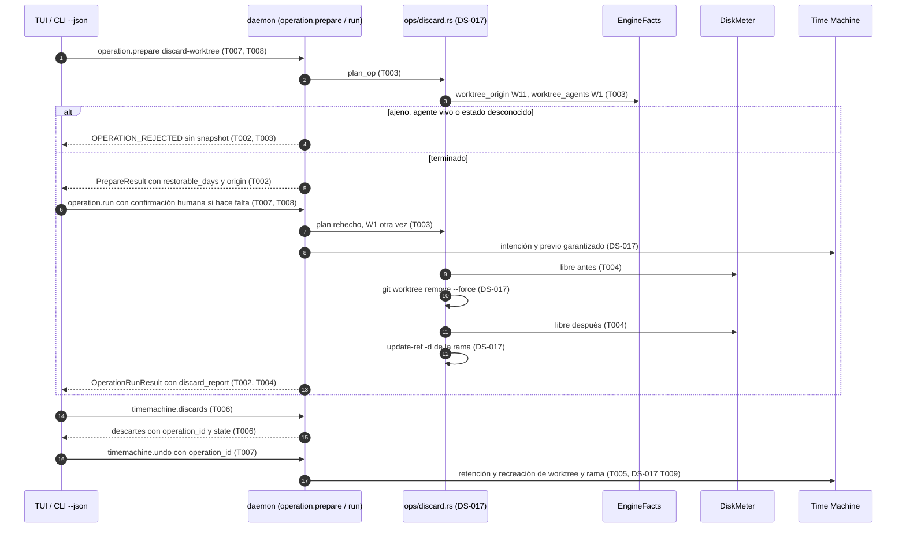

# DS-US-WTL-002 · Descarte con agente terminado, disco real y restauración en la retención

## Contexto rápido

Al terminar, el desarrollador descarta el worktree de un agente terminado, ve cuánto espacio ganó el disco de verdad y lo restaura durante la retención aunque haya hecho otras operaciones después; un agente vivo, en cualquiera de sus cuatro estados, y un worktree ajeno con HEAD separado quedan protegidos. Lo mismo desde la CLI con salida JSON. Hoy no puede: el descarte de US-CKP-017 bloquea por «sesión presente» sin decir el estado, no mide el disco, solo ofrece el Deshacer del toast y no distingue un worktree ajeno.

**Base y delta.** El descarte lo construye [DS-US-CKP-017](../../cockpit/dev-specs/US-CKP-017-descartar-worktree.md) (aprobada): brazo `discard-worktree`, snapshot previo garantizado, lista de lo no recuperable, confirmación con default No, Deshacer que recrea el worktree con la Time Machine y la tecla `D`. **Esta DS no repite ni reimplementa nada de eso**: añade cinco piezas que se enganchan a los puntos de extensión de DS-US-CKP-017, citados por id (X1…X16, T001…T009):

1. Protección del agente vivo por los cinco estados de US-WTL-003 en lugar de X15 (W1–W4).
2. Informe del disco ganado, medido como espacio libre del volumen antes y después (W5–W6).
3. Retención y origen de los ignorados en la confirmación; restauración en la retención con el selector `operation_id` de X9/X10, más un método de lectura para localizar el descarte (W7–W10).
4. Rechazo de un worktree ajeno con HEAD separado (W11).
5. La misma operación por CLI con salida JSON, sin herramienta MCP (W12–W13).

| Término | Qué es aquí |
|---|---|
| Estado del agente | La dimensión de la [Enmienda 2026-11-21 de ADR-GRP-012](../../../../architecture/decisions/ADR-GRP-012-deteccion-sesiones-claude-code.md#enmienda-2026-11-21-estados-del-agente-us-wtl-003): `active`, `awaiting-human`, `awaiting-ci`, `stalled`, `ended`. No es el `state` de BR-WF-001 (activo, inactivo, terminado) |
| Agente vivo | Sesión cuyo proceso ve S1 (`vivo` en § 4 de la enmienda): cualquier estado salvo `ended` |
| Previo del descarte | El snapshot previo garantizado que toma la operación `discard-worktree` antes de borrar (X10 de DS-US-CKP-017; ADR-TMC-001) |
| Retención | `timeMachine.retentionDays`, local ?? perfil ?? 30 días (ADR-TMC-007 § 1; `crates/policy/src/settings/model.rs:128`) |
| Ajeno, no tocar | Worktree con HEAD separado que GitRaptor no creó (BR-WTL-011, US-WTL-005) |
| Disco ganado | Espacio libre del volumen del worktree después del borrado menos el de antes. Nunca la suma de tamaños |

Sin `architecture-constitution.md`: rigen [AGENTS.md](../../../../../AGENTS.md) y los ADR citados (`unsafe_code = "forbid"` en `Cargo.toml:47`, ADR-GRP-001; protocolo congelado con capacidades aditivas, ADR-GRP-016; argv fijo y sin shell, NFR-02; cero pérdida de datos, NFR-01). Ninguna tarea las viola.

---

## 📋 Índice

> **Para aprobar:** [Contexto rápido](#contexto-rápido) · [⚠️ Gaps](#gaps-y-violaciones-de-la-constitución) · [🔭 La forma](#la-forma) · [El trabajo de un vistazo](#el-trabajo-de-un-vistazo).
> **Para implementar:** [🚀 Plan](#plan-de-implementación), en orden. Las `_(ref)_` se abren desde la tarea que las cita.

| Sección | Propósito |
|---------|-----------|
| [Contexto rápido](#contexto-rápido) | Qué se construye y el glosario |
| [Decisiones](#decisiones) | W1…W13 y qué punto de DS-US-CKP-017 toca cada una |
| [⚠️ Gaps y violaciones de la constitución](#gaps-y-violaciones-de-la-constitución) | Qué impide empezar |
| [🔭 La forma](#la-forma) | Flujo del delta sobre el descarte |
| [🚀 Plan de implementación](#plan-de-implementación) | T001…T009, en orden |
| ↳ [El trabajo de un vistazo](#el-trabajo-de-un-vistazo) | Tareas en tabla y su orden |
| [Estructura de ficheros](#estructura-de-ficheros) _(ref)_ | Archivos por tarea |
| [Contratos compartidos](#contratos-compartidos) _(ref)_ | Tipos, motivos y firmas |
| [Contrato de API](#contrato-de-api) _(ref)_ | Métodos · configuración · numéricos |
| [Modelo de datos](#modelo-de-datos) _(ref)_ | Sin persistencia nueva |
| [Estrategia de pruebas y cobertura](#estrategia-de-pruebas-y-cobertura) _(ref)_ | Pirámide, escenarios, plataformas |
| [Gate de seguridad](#gate-de-seguridad) | Checklist pre-merge |
| [Enmiendas que implica](#enmiendas-que-implica) | Qué cambia en otros artefactos |
| [Fuera de alcance](#fuera-de-alcance) | Lo que esta entrega no toca |
| [Notas del autor](#notas-del-autor) _(ref)_ | Riesgos y preguntas abiertas |

---

## Decisiones

Todas: **Decisión del orquestador (2026-11-21), validada por Arquitecto.** La columna «Engancha en» dice qué decisión o tarea de DS-US-CKP-017 extiende o sustituye.

| ID | Decisión | Engancha en | Por qué / descartado |
|----|----------|-------------|----------------------|
| W1 | **Solo «terminado» permite descartar.** La regla 3 de `plan_op` (T003 de DS-017: `present_sessions` no vacío → `other-session-present`) se sustituye por `EngineFacts::worktree_agents(repo_id, root)` (a crear, T003): toda sesión que S1 ve viva en el worktree bloquea, sea cual sea su estado (`active`, `awaiting-human`, `awaiting-ci`, `stalled`), y el rechazo `agent-alive` nombra cada agente con su estado. **Fail-closed** (NFR-01, ante la duda no se borra): (a) sesión viva con estado aún no calculado (primer escaneo, daemon recién arrancado, agente que no es Claude Code) → bloquea con estado `unknown`; (b) registro de sesiones ilegible o sin un escaneo de S1 completado tras arrancar → `agent-state-unknown`, sin listar a nadie. `decision = no-signal` y `ci = unreadable` son notas de un agente que sigue vivo: bloquean como cualquier otro estado vivo y la nota viaja en el rechazo. Nada de `decision` ni de `ci` puede **permitir** un descarte | X15, X2; T003 regla 3 | Es igual o más estricto que X15: «Activa o Inactiva» de BR-WF-001 son sesiones vivas, que siguen bloqueando, y una sesión terminada ya no estaba presente. El estado solo añade el porqué al texto (BR-WTL-007, «dice qué agente lo ocupa»). Descartado: permitir con `stalled` (la enmienda § 4.2 lo prohíbe: «un agente colgado sigue siendo un agente vivo que protege su worktree») |
| W2 | **Combinación: gana la más restrictiva.** Orden de `plan_op` tras `check_common` (`executor/facts.rs:72`): `foreign-worktree` (W11) → `main-worktree` → `agent-alive` / `agent-state-unknown` (W1) → `base-branch` → `protected-branch` → integrado, cambios y no recuperable (sin cambios, T003 de DS-017). Con worktree compartido por varias sesiones (BR-CKP-EDGE-004), basta una viva; el rechazo las lista todas (hasta 5, ordenadas por la precedencia de la enmienda § 4, y «y n más»). Una sesión viva sin estado del agente (otra sesión de BR-CKP-ELIG-001, un agente que no es Claude Code) sale en `agent-alive` con estado `unknown`; `other-session-present` deja de usarse para `discard-worktree` | X2, X15; BR-CKP-EDGE-004 | Un solo motivo por rechazo, el más fuerte. «Ajeno» va primero porque no depende del momento: nunca se descarta, haya o no agente |
| W3 | **Sin forma de forzar** (Pregunta 13 de CTX-WTL-001, propuesta aplicada). `agent-alive` y `agent-state-unknown` son `RejectReason`, no `WarningCode`: `accepted_warnings` no los acepta, no hay parámetro `force` y no son una denegación de Guardrails, así que la excepción consciente (`x`, US-CKP-019) no aplica. La TUI no ofrece ninguna acción sobre el rechazo salvo cerrarlo | X2 | Un forzado sería la única vía para borrar bajo los pies de un agente vivo (BR-WTL-007, «sin excepción»). Si Rene decide otra cosa, es otra historia |
| W4 | **Rechazo sin snapshot ni escritura.** W1 corre en `operation.prepare` y **otra vez** en el plan rehecho bajo el cerrojo de `operation.run`, antes de la intención y del previo (esqueleto de DS-014 que reutiliza DS-017). Un agente que arranca entre preparar y ejecutar da `agent-alive` en `run`: sin oplog, sin previo, sin `git` | X8; T003 | La intención y el previo cuestan disco y tiempo; un rechazo no debe dejar huella en el oplog (mismo criterio que `RepoBusy` en `restore.rs:425-429`) |
| W5 | **Disco ganado = libre después − libre antes, en el volumen del worktree.** Se lee con `rustix::fs::statvfs` (`f_bavail × f_frsize`), la misma llamada segura que ya usan `VolumeProbe` (`timemachine/manual.rs:304-317`) y la captura continua (`continuous.rs:132`); `rustix` con `fs` ya es dependencia `cfg(unix)` de `gitraptor-core` (`crates/core/Cargo.toml:44`). Sin `unsafe` y sin crate nuevo. Se reutiliza el trait `FreeSpaceProbe` (`manual.rs:265`) para inyectar volúmenes en los tests; la sonda de producción nueva (`DiskMeter`) **no** hereda el «hay de sobra» (`u64::MAX`) de `VolumeProbe` fuera de Unix (`manual.rs:319-322`): allí devuelve error y el informe dice «no medido». Las dos lecturas, **pegadas al hijo `git worktree remove`** dentro de `DiscardStep::run` (T003 de DS-017): «antes» después del previo garantizado (el coste del snapshot no resta) y justo antes de lanzar el hijo; «después» en cuanto el hijo sale y antes de `update-ref -d` | X6, X8; T003 `run()` | Lo pide BR-WTL-008: en APFS con clones copy-on-write, los bloques compartidos con la semilla (`target/` copiado por US-WTL-001) **no se liberan**, así que lo ganado puede ser mucho menor que el tamaño del worktree, incluso cero. Sumar tamaños mentiría justo en el caso que motiva la historia. Descartados: `sysinfo`/`fs2` (dependencia nueva para una llamada que ya está), `du` del worktree (es la suma prohibida) y medir el volumen del perfil (no es donde se borra) |
| W6 | **El informe nunca inventa.** `DiskReport` lleva `free_before`, `free_after`, `gained` (con signo) y `approximate: true` siempre que mide: otras escrituras concurrentes del mismo volumen (agentes compilando, el propio daemon) entran en la diferencia y no se pueden separar. Mitigación: lecturas inmediatas, mismo volumen comprobado y ventana registrada (`window_ms`). Diferencia ≤ 0 → «no se midió espacio ganado (otras escrituras en el disco)»; por debajo de 1 MiB → «menos de 1 MiB». **«No medido»** con motivo cerrado cuando: plataforma sin sonda (`unsupported-platform`, hoy Windows), `statvfs` falla (`unreadable`), la raíz del worktree es un punto de montaje o está en otro dispositivo que su carpeta padre (`other-volume`: se compara `st_dev` de la raíz y del padre con `rustix::fs::stat` antes de borrar, y las dos lecturas se hacen sobre el padre, que sigue existiendo después), o el borrado no llegó a quitar el worktree (`not-removed`, desenlace `failed-unchanged` de X8). Se mide el volumen del worktree aunque la semilla o el perfil estén en otro: el informe dice «medido en el volumen del worktree» | X8 | NFR-01 aplicado a la información: un número dudoso se marca, uno que no se pudo medir no se escribe. En APFS, `f_bavail` excluye el espacio purgable y los snapshots locales de macOS retienen bloques borrados: el texto avisa de que el espacio puede liberarse más tarde |
| W7 | **La confirmación dice hasta cuándo se restaura.** `DiscardPlanView` gana `restorable_days` (la retención efectiva al preparar) y el resultado gana `restorable_until_utc_ms` = hora del descarte + retención. La retención sale de la misma lectura de configuración que la Time Machine (ADR-TMC-007 § 1); valor inválido → 30 con el aviso que ya existe. Si la retención cambia después, la fecha mostrada cambia con ella: el texto dice «durante N días (retención actual)» | X4; T002, T006 de DS-017 | Lo pide el escenario 4. Un dato que ya existe; no se persiste nada nuevo |
| W8 | **Origen de los ignorados.** `UnrecoverableView` gana `origin: Option<IgnoredOrigin>`: `worktree-include` cuando la ruta casa con el `.worktreeinclude` del repo (BR-WTL-002; el original sigue en la semilla o en el worktree principal). `None` = no se sabe, y el texto no afirma nada. El emparejador de `.worktreeinclude` es el de US-WTL-001; esta DS no escribe otro | X4; T002 de DS-017 | Pregunta 15 (propuesta aplicada: basta el aviso, ningún ignorado se guarda; X11 sin cuarentena sigue). Descartado: inferir el origen por el nombre (`target/`, `node_modules/`): afirmaría algo que no se comprobó |
| W9 | **Restaurar = `timemachine.undo {worktree, operation_id}` con el selector de X9 y la recreación de X10**, no `timemachine.restore`. Las pilas son por worktree (`oplog/stack.rs:7`): tras el descarte, nada más ocurre en la raíz borrada, así que el descarte sigue siendo `last_operation()` (`stack.rs:126`) de su pila aunque haya operaciones posteriores en otros worktrees; X9 ya lo admite y X10 recrea worktree, índice, archivos y rama. Esta DS añade **solo**: (a) comprobación de retención antes del plan: descarte más antiguo que la retención efectiva → `retention-expired` (`TmRejectReason` aditivo, sin capacidad: solo lo recibe quien manda `operation_id`, criterio de `not-last-operation` en X9); (b) la ruta reutilizada después por otro worktree deja operaciones encima en la pila de esa raíz → `not-last-operation`, con el texto «la ruta se usó después»; (c) rama reutilizada con otra punta, ruta ocupada, `worktrees/<id>` ocupado, previo purgado o que no verifica (`store.verify`) → los rechazos de X10 (`worktree-unavailable`, `ref-moved`, `target-unavailable`, `invalid-snapshot`), sin escribir. Las 5 operaciones posteriores no se deshacen: el plan del undo solo toca la raíz recreada y `refs/heads/<rama>` del ámbito del descarte | X9, X10; T004, T009 de DS-017 | `timemachine.restore` no sirve tal cual: `valid_point` exige que el worktree nombrado esté en la meta del punto (`restore.rs:332-335`), y el previo del descarte solo tiene la raíz borrada; además el plan solo pliega operaciones cuyo ámbito incluye el worktree nombrado (`restore.rs:497-499`), así que la rama del descarte saldría como «no devuelta». Adaptarlo duplicaría X9/X10. El selector `operation_id` hoy responde `NOT_IMPLEMENTED` (`channel/conn.rs:4504-4506`; DS-017 citaba `:3583`, la línea se movió): lo crea T004 de DS-017 |
| W10 | **Localizar el descarte: método de lectura `timemachine.discards`**, en el módulo `timemachine` que ya existe (`crates/api/src/methods/timemachine.rs`, vía «Añadir un método» de ADR-GRP-016). Parámetros: `worktree` (raíz observada que nombra el repo, como `undo`) y `name` opcional (carpeta o rama). Devuelve los descartes del repo desde el oplog (`subtype == discard-worktree`, `Finished` o `Interrupted`) con `operation_id`, carpeta, raíz, rama, punta, hora, `restorable_until_utc_ms` y `state`: `restorable`, `undone`, `expired`, `purged`, `tampered`. No escribe ni toma cerrojo de escritura. Ni el selector ni la búsqueda aceptan la ruta borrada como `worktree` (SEC-TMC-07, `repo_of` sin cambios) | X9 (cómo la TUI y la CLI obtienen el `operation_id` fuera del toast) | X9 cubre el toast, que ya tiene el id. Tras cerrarlo, el cliente necesita el id de un descarte de hace 10 días. Descartado: que cada cliente filtre `timemachine.timeline` (repetiría el cálculo de retención y de estado en la CLI, la TUI y la app) |
| W11 | **Ajeno, no tocar.** Nuevo motivo `foreign-worktree`, el primero tras `check_common`: HEAD separado **y** el worktree no figura como creado por GitRaptor. Lo responde `EngineFacts::worktree_origin(repo_id, admin_id)` (a crear), alimentado por el registro de procedencia de US-WTL-005/US-WTL-001. **Sin ese registro, `Unknown` cuenta como ajeno** (fail-closed): hasta que exista, todo worktree con HEAD separado se rechaza y la ruta de X6/X7 con HEAD separado (`PlanShape::RemoveWorktree`) queda solo para worktrees que GitRaptor creó y que se separaron después (BR-WTL-001 impide crearlos separados). Un worktree ajeno **con** rama no lleva la marca (BR-WTL-011) y sigue las reglas de siempre | X6, X7; T003 regla 2 | Es BR-WTL-011. Ante la duda sobre la procedencia, no se borra (NFR-01). Descartado: considerar de GitRaptor todo worktree registrado en Git (cualquier herramienta registra los suyos) |
| W12 | **Contrato aditivo tras la capacidad `operation.discard-guard`** (en `methods/operation.rs`, junto a `operation.discard` de X1): motivos `agent-alive`, `agent-state-unknown`, `foreign-worktree` con su detalle; `DiscardPlanView.restorable_days`; `UnrecoverableView.origin`; `discard_report` en `OperationRunResult` (`crates/api/src/timemachine.rs:149`). **Desde esta entrega, preparar `discard-worktree` exige las dos capacidades**: una conexión con solo `operation.discard` recibe `-32004` con `implemented_by = US-WTL-002`, antes de llamar al ejecutor (la misma compuerta que X1 pone en `channel/conn.rs`). Todos los clientes del repo se adaptan en el mismo PR (ADR-GRP-016, paso 3) | X1, X2 | Proyectar los motivos nuevos sobre los viejos mentiría: «ajeno» no es «otra sesión presente», y un cliente que no sabe pintar el estado ni el disco no cumple BR-WTL-007 ni BR-WTL-008. Negar la operación a un cliente viejo nunca convierte un rechazo en un permiso. Descartado: proyectar `agent-alive` a `other-session-present` |
| W13 | **Autorización: nada lo dispara un agente ni el MCP.** El descarte sigue en capa `cockpit` (DS-017: un agente, capa `mcp`, recibe `not-available-for-layer`, `catalog.rs:988`), gobernado como `DeleteWorktree` (ADR-GRD-002) y fuera del MCP en el MVP (ADR-CKP-002 § 1, tabla, `discard-worktree` «No en el MVP»). La restauración por `timemachine.undo {operation_id}` por MCP sigue en `tm_command` (regla de T004 de DS-017). `timemachine.discards` no está en el perfil `mcp`. No hay herramienta MCP de descarte ni de restauración de un descarte. La CLI con `--json` pide la confirmación humana igual que `raptor restore` (`apps/cli/src/commands/restore.rs:21`, `:54`, `confirm::call`): sin terminal, un descarte que exige confirmación se rechaza con `confirmation-unavailable` | X1; capa de DS-017 | La confirmación es humana o no hay descarte con trabajo en juego. Un descarte integrado y limpio (`Affected::Nobody`, sin lista) no pide confirmación tampoco en JSON, como en la TUI (BR-CKP-ELIG-004) |

## ⚠️ Gaps y violaciones de la constitución

| ID | Qué falta | Severidad | Alcance | Acción | Owner |
|----|-----------|-----------|---------|--------|-------|
| G1 | **DS-US-CKP-017 no está en `main`**: no existen `executor/ops/discard.rs`, `crates/api/src/discard.rs`, el selector `operation_id` (hoy `NOT_IMPLEMENTED`, `conn.rs:4504-4506`) ni la recreación de X10 (`undo.rs:913`, «Removed, moved or foreign: not recreated yet»). DS-017 a su vez espera su G1: **DS-US-CKP-014 no está en `main`** (no existen `executor/ops/merge.rs`, `ops/context.rs` ni `apps/cli/src/tui/write_flow.rs`; comprobado el 2026-11-21) | Bloqueante | T001, T002, T003, T004, T005, T006, T007, T008, T009 | Mezclar DS-014 T002, T005, T007 y DS-017 T002, T003, T004, T009 (y T005–T007 para T008 de esta DS) antes | Orquestador |
| G2 | **Estado del agente**: `EngineFacts::worktree_agents` lee la dimensión `agent_state` de la Enmienda 2026-11-21 de ADR-GRP-012 (§ 4 y § 5), que construye la Dev Spec de US-WTL-003 (en redacción en paralelo). Esta DS se coordina por la enmienda, no por esa DS: necesita, por sesión viva, su `agent_state` o «aún sin calcular», y saber si S1 completó un escaneo | Bloqueante | T003, T008 (y T001 en lo que toca a W1) | Mezclar antes la tarea de US-WTL-003 que publique el estado del agente en el daemon. Si su DS fija otro nombre de tipo, se adapta en T003 sin cambiar W1 | Orquestador |
| G3 | **Procedencia y `.worktreeinclude`**: `worktree_origin` (W11) y el origen de los ignorados (W8) salen de US-WTL-005 y US-WTL-001, que no están en `blocked_by` de la historia. W11 falla cerrado sin ellos (todo HEAD separado es ajeno), así que no bloquea construir; pero el escenario 4 («de dónde vienen los ignorados») no se puede certificar sin el emparejador de US-WTL-001 | Bloquea liberación | — | Mezclar US-WTL-001 antes de certificar el escenario 4; o el PO lo acota | Orquestador / PO |

Ninguna violación: sin constitución, ver Contexto rápido.

## 🔭 La forma



---

## 🚀 Plan de implementación

### El trabajo de un vistazo

| # | Tarea | Depende | Aterriza en |
|---|---|---|---|
| T001 | Escribir en rojo los tests de contrato del delta | G1, G2 | `crates/core/tests/us_wtl_002_discard.rs`, `apps/cli/tests/cli_worktree_discard.rs`, stubs |
| T002 | Ampliar el contrato: capacidad, motivos, campos y `timemachine.discards` | T001 | `crates/api/src/{discard,catalog,timemachine}.rs`, `methods/{operation,timemachine}.rs` |
| T003 | Sustituir X15 por el estado del agente y añadir «ajeno» en `plan_op` | T002, G2 | `executor/ops/discard.rs`, `ops/context.rs`, `daemon/operation_facts.rs` |
| T004 | Medir el disco ganado en `DiscardStep::run` | T002 | `crates/core/src/executor/ops/disk.rs`, `ops/discard.rs` |
| T005 | Retención en el undo de un descarte | T002 | `crates/core/src/timemachine/undo.rs` |
| T006 | Servir `timemachine.discards` | T002 | `crates/core/src/timemachine/discards.rs`, `channel/conn.rs` |
| T007 | Crear `raptor worktree discard` y `raptor worktree restore` con `--json` | T003, T004, T005, T006 | `apps/cli/src/commands/worktree.rs`, `commands/mod.rs`, `present/worktree_text.rs` |
| T008 | Rechazo con agente y estado, retención, origen y disco en la TUI | T003, T004 | `apps/cli/src/tui/discard.rs`, `present/discard_text.rs` |
| T009 | Cerrar la historia y aplicar las enmiendas | T001–T008 | `docs` |

### En qué orden

T001 primero (tests rojos en su archivo, R4). T002 desbloquea el resto. T003 espera además a G2. T004, T005 y T006 van en paralelo tras T002 (archivos distintos; T004 y T003 comparten `ops/discard.rs`: T004 solo toca `run()`, T003 solo `plan_op`). T007 y T008 cierran las superficies.

### T001 — Escribir en rojo los tests de contrato del delta

**Objetivo.** Los nueve escenarios de US-WTL-002 en rojo, contra el daemon real con repos y perfil temporales, y contra la CLI real.

**Ubicación.**
- `crates/core/tests/us_wtl_002_discard.rs` (**CREATE**): daemon en proceso con `OperationsWiring::production()`, el contexto adjunto de DS-014 y Git real; `EngineFacts` de sesiones alimentado por sesiones simuladas (proceso que se presenta como Claude Code, como en SPIKE-GRP-001) con el estado del agente fijado por el reloj inyectable de la enmienda § 4.1. `FreeSpaceProbe` inyectado (volúmenes simulados) para W5/W6.
- `apps/cli/tests/cli_worktree_discard.rs` (**CREATE**): `raptor worktree discard|restore --json` contra el daemon de prueba (`gitraptor_testkit::Fixture`).
- Stubs que compilan (`PlanError::NotImplemented` o tipos vacíos) en los archivos de T002 a T008; sin `todo!()` en rutas de producción.

**Reglas**
- Nunca este repo ni el perfil real (NFR-01). Repos y directorios temporales.
- **Sin sleeps**: el paso del tiempo (retención de 10 y 31 días, 2 h colgado) se fija con el reloj inyectable y con la hora registrada del descarte en el oplog de prueba; la espera de estados, con las señales del daemon.
- La capa `cockpit` sale de la resolución real del solicitante.

- **Depende:** G1, G2
- **Refs:** US-WTL-002, escenarios 1 a 9; § 9.4
- **Aceptación:** `cargo test -p gitraptor-core --test us_wtl_002_discard` y `cargo test -p gitraptor-cli --test cli_worktree_discard` compilan y fallan por «no implementado»

### T002 — Ampliar el contrato

**Objetivo.** El daemon puede rechazar con agente y estado, informar disco y retención, y listar descartes, solo para quien entiende la forma nueva.

**Ubicación.**
- `crates/api/src/methods/operation.rs` (**MODIFY**): `CAP_OPERATION_DISCARD_GUARD = Capability::new("operation.discard-guard")` en el `GROUP` (W12).
- `crates/api/src/catalog.rs` (**MODIFY**): `RejectReason::{AgentAlive, AgentStateUnknown, ForeignWorktree}` (junto a `OtherSessionPresent`, `:1007`) y el detalle `DiscardRejectDetail` en `data` del rechazo.
- `crates/api/src/discard.rs` (**MODIFY**, creado por DS-017 T002): `DiscardPlanView.restorable_days`, `UnrecoverableView.origin`, `IgnoredOrigin`, `DiskReport`, `NotMeasuredReason`, `DiscardResultView`, `AgentOccupantView`.
- `crates/api/src/timemachine.rs` (**MODIFY**): `OperationRunResult.discard_report` (`:149`); `TmRejectReason::RetentionExpired` (`:207`); `DiscardsParams`, `DiscardsResult`, `DiscardedView`, `DiscardedState`.
- `crates/api/src/methods/timemachine.rs` (**MODIFY**): método `timemachine.discards` en su `GROUP`, ausente del perfil `mcp`.
- Cliente de `crates/core`: pide `operation.discard-guard` en `connection.accept`.

**Reglas**
- Todo campo nuevo con `#[serde(default, skip_serializing_if = …)]`; sin la capacidad no viaja ninguno, y `operation.prepare` de `discard-worktree` responde `-32004` con `implemented_by = US-WTL-002` (W12).
- Sin códigos de error nuevos: `-32014 OPERATION_REJECTED` con `data.reason` y el rechazo de la Time Machine con `TmRejectedData`.
- `retention-expired` es aditivo y sin capacidad (W9 a).

- **Depende:** T001
- **Refs:** W6, W7, W8, W10, W12; X1, X2 de DS-017; ADR-GRP-016
- **Aceptación:** `cargo test -p gitraptor-api` en verde, con `crates/api/tests/architecture.rs` (sin códigos ni protocolo nuevos) y el esquema que incluye los motivos y el método

### T003 — Sustituir X15 por el estado del agente y añadir «ajeno»

**Objetivo.** `plan_op` de `discard-worktree` solo deja pasar un worktree sin agente vivo y no ajeno.

**Ubicación.**
- `crates/core/src/executor/ops/context.rs` (**MODIFY**, creado por DS-014): `EngineFacts::worktree_agents` y `EngineFacts::worktree_origin`.
- `crates/core/src/daemon/operation_facts.rs` (**MODIFY**, creado por DS-014): su implementación, leyendo el registro de sesiones y el estado del agente de G2, y el registro de procedencia (G3; sin él, `Unknown`).
- `crates/core/src/executor/ops/discard.rs` (**MODIFY**, creado por DS-017 T003): el orden de W2 en `plan_op`.

**Reglas**
- Orden de W2. La regla 3 de DS-017 pasa a: `agent-alive` (con la lista) o `agent-state-unknown`. La compuerta de capacidades de W12 (las dos o `-32004`) está en `channel/conn.rs`, antes del ejecutor; `plan_op` no ramifica por capacidad.
- `worktree_agents` cuenta las sesiones vivas cuyo worktree es la raíz (la misma atribución por cwd que `present_sessions`). Nunca filtra por estado: ningún estado vivo permite (W1). `scan_complete == false` → `agent-state-unknown`.
- `worktree_origin`: HEAD separado y origen distinto de `Gitraptor` (incluido `Unknown`) → `foreign-worktree` (W11).
- Se evalúa en `prepare` y en el plan rehecho de `run`, antes de la intención (W4).
- Sin forzado (W3): ningún parámetro ni aviso lo salta.

- **Depende:** T002, G1, G2
- **Refs:** W1–W4, W11; X2, X15 de DS-017; ADR-GRP-012, Enmienda 2026-11-21 § 4 y § 4.2
- **Aceptación:** `cargo test -p gitraptor-core --lib executor::ops::discard` en verde, con:
- [ ] Un test por estado vivo (`active`, `awaiting-human`, `awaiting-ci`, `stalled`) → `agent-alive` con nombre y estado; `ended` → pasa.
- [ ] Estado sin calcular → `agent-alive` con `unknown`; escaneo no completado → `agent-state-unknown`.
- [ ] Dos sesiones vivas en un worktree compartido, una `ended` y otra `stalled` → rechazo con la `stalled`.
- [ ] HEAD separado con origen `Unknown` → `foreign-worktree`; con origen `Gitraptor` → sigue la ruta de X6/X7.
- [ ] Ningún rechazo de W1/W11 deja intención, previo ni entrada en el oplog.

### T004 — Medir el disco ganado

**Objetivo.** El resultado del descarte trae el espacio libre antes y después del borrado, o «no medido» con su motivo.

**Ubicación.**
- `crates/core/src/executor/ops/disk.rs` (**CREATE**, una línea en `ops/mod.rs`): `DiskMeter` (impl `FreeSpaceProbe` de `timemachine/manual.rs:265`) y `measure_around`.
- `crates/core/src/executor/ops/discard.rs` (**MODIFY**): `DiscardStep::run` llama a `measure_around` alrededor de `UserOp::WorktreeRemove` y deja el `DiskReport` en el resultado.

**Reglas**
- `DiskMeter`: `cfg(unix)` → `rustix::fs::statvfs(path)`, `f_bavail.saturating_mul(f_frsize.max(1))`; fuera de Unix → `Err(Unsupported)`. Nunca `u64::MAX`. Sin `unsafe`.
- Antes de borrar: `rustix::fs::stat` de la raíz y de su padre; `st_dev` distinto → `other-volume`, sin medir. Las dos lecturas se hacen sobre el padre.
- «Antes» tras el previo garantizado y justo antes del hijo; «después» en cuanto sale, antes de `update-ref -d`. Se registra `window_ms`.
- `gained = after − before` con signo. `approximate = true` siempre que mide. Fallo de cualquiera de las dos lecturas → `unreadable`. Borrado que no quitó el worktree → `not-removed`.
- Nada de recorrer el worktree para sumar tamaños.

- **Depende:** T002, G1
- **Refs:** W5, W6; X6, X8 de DS-017; BR-WTL-008
- **Aceptación:** `cargo test -p gitraptor-core --lib executor::ops::disk` en verde, con una sonda inyectada: ganancia positiva, ganancia negativa por escritura concurrente simulada, `other-volume`, `unreadable` y `unsupported-platform`; y `us_wtl_002_discard::discard_reports_free_space_difference_not_sizes` (en macOS, volumen real: el informe es la diferencia de las dos lecturas de espacio libre, nunca el tamaño del worktree)

### T005 — Retención en el undo de un descarte

**Objetivo.** Un descarte se restaura mientras está dentro de la retención, aunque ya no sea lo último que pasó en el repo; fuera de ella, se rechaza sin escribir.

**Ubicación.** `crates/core/src/timemachine/undo.rs` (**MODIFY**, con `Selection::Operation` de DS-017 T004 y la recreación de T009).

**Reglas**
- Solo en `Selection::Operation(id)` con `subtype == discard-worktree`: antes del plan, `now − at_descarte > retención efectiva` → `retention-expired`, sin cerrojo de escritura ni previo.
- El resto es X9/X10 sin cambios: pila de la raíz borrada, `last_operation()`, recreación con `recreate_id`, rechazos sin escribir. Las operaciones posteriores en otros worktrees no entran en el plan.
- El reloj es el del oplog (hora de pared registrada del descarte frente a la actual); un reloj que va hacia atrás no rejuvenece un descarte: si `now < at_descarte`, cuenta como dentro de la retención solo si la diferencia es menor que la retención (no se rechaza por un salto de NTP).

- **Depende:** T002, G1 (DS-017 T004, T009)
- **Refs:** W9; X9, X10 de DS-017; ADR-TMC-007 § 1, § 3
- **Aceptación:** `cargo test -p gitraptor-core --lib timemachine::undo` en verde, con: descarte de hace 10 días con 5 operaciones posteriores en otros worktrees → restaurado, las 5 intactas; 31 días con retención 30 → `retention-expired`, nada escrito; rama reutilizada con otra punta → rechazo, nada escrito; ruta reutilizada y borrada después → `not-last-operation`; previo que no verifica → `target-unavailable` o `invalid-snapshot`

### T006 — Servir `timemachine.discards`

**Objetivo.** Un cliente obtiene los descartes de un repo con su `operation_id` y si aún se pueden restaurar.

**Ubicación.**
- `crates/core/src/timemachine/discards.rs` (**CREATE**, una línea en `timemachine/mod.rs`): `list_discards(repo, name, now, retention) -> Vec<DiscardedView>`.
- `crates/core/src/channel/conn.rs` (**MODIFY**): brazo de `timemachine.discards` junto a los del módulo `timemachine` (`tm_undo` `:4496`, `tm_restore` `:4660`).

**Reglas**
- Una lectura del oplog (como `restore.rs:446-452`). `state`: `undone` si una operación `Undo` lo deshizo y sigue en vigor; `purged` si el previo es un punto purgado; `tampered` si el oplog lo marca; `expired` fuera de la retención; si no, `restorable`.
- `name` casa con la carpeta o con la rama, exacto. Tope de 50 entradas, las más recientes primero.
- Solo lectura; `repo_of` sin cambios; ausente del perfil `mcp`.
- Rutas y nombres como `Untrusted`/`UntrustedName`.

- **Depende:** T002
- **Refs:** W10; ADR-GRP-016 («Añadir un método»)
- **Aceptación:** `cargo test -p gitraptor-core --lib timemachine::discards` en verde, un test por `state`

### T007 — Crear `raptor worktree discard` y `raptor worktree restore`

**Objetivo.** La misma operación desde la CLI, con salida legible o JSON.

**Ubicación.**
- `apps/cli/src/commands/worktree.rs` (**CREATE**) y una línea en `apps/cli/src/commands/mod.rs`.
- `apps/cli/src/present/worktree_text.rs` (**CREATE**): textos en/es.

**Reglas**
- `raptor worktree discard <carpeta|rama> [--json]`: `operation.prepare` → si hay aviso o reto, confirmación con `confirm::call` como `raptor restore` (`commands/restore.rs:54`), default No; sin terminal → `confirmation-unavailable` y nada se borra → `operation.run`.
- `raptor worktree restore <carpeta|rama|operation-id> [--json]`: `timemachine.discards` para resolver el id (ambiguo → lista y sale con error, sin escribir) → `timemachine.undo {worktree: <raíz del worktree principal o el primero disponible>, operation_id}` (la misma elección que T007 de DS-017).
- `--json`: un objeto con `result`, `discard_report`, `restorable_until_utc_ms` o el rechazo con `reason` y `agents` (nombre y estado). Códigos de salida: 0 hecho, distinto de 0 en rechazo.
- Si el daemon (más viejo) no anuncia `operation.discard-guard`, la CLI dice que la versión del motor no lo soporta y no prepara nada.

- **Depende:** T003, T004, T005, T006
- **Refs:** W6, W7, W10, W13; escenario 9
- **Aceptación:** `cargo test -p gitraptor-cli --test cli_worktree_discard` en verde (escenario 9 y rechazo con `claude-2` vivo) y snapshots en/es del texto

### T008 — Pintar el delta en la TUI

**Objetivo.** La TUI dice qué agente ocupa el worktree y en qué estado, cuánto se puede restaurar, de dónde vienen los ignorados y cuánto disco se ganó.

**Ubicación.**
- `apps/cli/src/tui/discard.rs` (**MODIFY**, creado por DS-017 T005): regla 6 de `discard_eligibility` pasa de `SessionPresent` a `AgentAlive { agent, state }` con la dimensión del estado de la fila (G2); `Foreign` antes que `MainWorktree` cuando la fila tiene HEAD separado y marca «ajeno, no tocar».
- `apps/cli/src/present/discard_text.rs` (**MODIFY**, creado por DS-017 T006): textos en/es.

**Reglas**
- Desactivado: «<agente> ocupa <carpeta> (<estado>): termínalo antes de descartar»; «colgado» añade «hace N min» (escenario 3). Sin acción de forzar (W3).
- Prompt: además de lo de DS-017 T006, «Se puede restaurar durante N días» y, para cada ignorado con `origin = worktree-include`, «no se guarda: su original sigue en la semilla o en el repo principal».
- Toast `done`: «Descartado <rama> · disco ganado ≈ X (medido) · u Deshacer»; «no medido: <motivo>»; «menos de 1 MiB»; «no se midió espacio ganado (otras escrituras en el disco)».
- Restaurar desde la TUI fuera del toast queda fuera (Diseño pendiente; ver Fuera de alcance).

- **Depende:** T003, T004, G1
- **Refs:** W1, W3, W6–W8, W11; X12, X13 de DS-017
- **Aceptación:** `cargo test -p gitraptor-cli --lib tui` con snapshots en/es de cada rechazo por estado, del prompt con retención y origen y de cada variante del toast

### T009 — Cerrar la historia

**Objetivo.** La historia queda implementada, verificada y enlazada.

**Ubicación.** `docs/requirements/features/worktree-lifecycle/user-stories/US-WTL-002-descarte-reversible-disco.md` y esta DS (**MODIFY**).

**Reglas**
- La historia pasa a `implemented` con el PR; esta DS añade `## Estado de la implementación`.
- [Enmiendas que implica](#enmiendas-que-implica): se aplican en el mismo PR o quedan anotadas en él.
- La medición de disco del criterio de certificación 1 se hace en macOS con APFS y un `target/` clonado desde la semilla, y se anota con sus cifras.

- **Depende:** T001, T002, T003, T004, T005, T006, T007, T008
- **Refs:** AGENTS.md (reglas de calidad)
- **Aceptación:** `cargo clippy --workspace --exclude gitraptor-desktop --all-targets -- -D warnings` y `node tools/test/nextest-junit.mjs` en verde

---

## Estructura de ficheros

| Archivo | Acción | Tarea |
|---|---|---|
| `crates/core/tests/us_wtl_002_discard.rs` | CREATE | T001 |
| `apps/cli/tests/cli_worktree_discard.rs` | CREATE | T001 |
| `crates/api/src/methods/operation.rs` | MODIFY (capacidad) | T002 |
| `crates/api/src/catalog.rs` | MODIFY (3 motivos, detalle) | T002 |
| `crates/api/src/discard.rs` | MODIFY (campos y tipos nuevos) | T002 |
| `crates/api/src/timemachine.rs` | MODIFY (`discard_report`, `retention-expired`, tipos de `discards`) | T002 |
| `crates/api/src/methods/timemachine.rs` | MODIFY (método) | T002 |
| `crates/core/src/executor/ops/context.rs`, `daemon/operation_facts.rs` | MODIFY | T003 |
| `crates/core/src/executor/ops/discard.rs` | MODIFY (`plan_op` T003; `run` T004) | T003, T004 |
| `crates/core/src/executor/ops/disk.rs`, `ops/mod.rs` | CREATE, MODIFY (1 línea) | T004 |
| `crates/core/src/timemachine/undo.rs` | MODIFY (retención) | T005 |
| `crates/core/src/timemachine/discards.rs`, `timemachine/mod.rs` | CREATE, MODIFY (1 línea) | T006 |
| `crates/core/src/channel/conn.rs` | MODIFY (brazo de `timemachine.discards`) | T006 |
| `apps/cli/src/commands/worktree.rs`, `commands/mod.rs` | CREATE, MODIFY (1 línea) | T007 |
| `apps/cli/src/present/worktree_text.rs` | CREATE | T007 |
| `apps/cli/src/tui/discard.rs`, `present/discard_text.rs` | MODIFY | T008 |

## Contratos compartidos

### Tipos y datos compartidos

```rust
// crates/api/src/discard.rs (T002) — añadido a lo de DS-017
pub struct DiscardPlanView { /* … campos de DS-017 … */
    #[serde(default, skip_serializing_if = "Option::is_none")]
    pub restorable_days: Option<u32>,                // W7; solo con operation.discard-guard
}
pub struct UnrecoverableView { /* … campos de DS-017 … */
    #[serde(default, skip_serializing_if = "Option::is_none")]
    pub origin: Option<IgnoredOrigin>,               // W8; None = no se sabe
}
#[serde(rename_all = "kebab-case")]
pub enum IgnoredOrigin { WorktreeInclude }

#[serde(deny_unknown_fields)]
pub struct DiskReport {
    pub measured: bool,
    pub free_before: Option<u64>,                    // bytes; None si no se midió
    pub free_after: Option<u64>,
    pub gained: Option<i64>,                         // after − before, con signo
    pub approximate: bool,                           // true siempre que measured
    pub window_ms: Option<u32>,
    pub not_measured: Option<NotMeasuredReason>,
}
#[serde(rename_all = "kebab-case")]
pub enum NotMeasuredReason { UnsupportedPlatform, Unreadable, OtherVolume, NotRemoved }

pub struct DiscardResultView { pub disk: DiskReport, pub restorable_until_utc_ms: i64 }

pub struct AgentOccupantView {
    pub agent: UntrustedName,                        // nombre del agente o sesión
    pub state: Option<AgentStateView>,               // tipo de la Enmienda 2026-11-21 § 5; None = unknown
    pub stalled_secs: Option<u64>,                   // idle_secs cuando es stalled
}
pub struct DiscardRejectDetail { pub agents: Vec<AgentOccupantView>, pub agents_more: u32 }

// crates/api/src/catalog.rs (T002) — RejectReason, variantes nuevas (solo con operation.discard-guard)
AgentAlive, AgentStateUnknown, ForeignWorktree,

// crates/api/src/timemachine.rs (T002)
// OperationRunResult, campo nuevo
#[serde(default, skip_serializing_if = "Option::is_none")]
pub discard_report: Option<crate::discard::DiscardResultView>,
// TmRejectReason, variante nueva
RetentionExpired,
pub struct DiscardsParams { pub worktree: Option<String>, pub name: Option<String> }
pub struct DiscardsResult { pub discards: Vec<DiscardedView> }
pub struct DiscardedView {
    pub operation_id: String, pub worktree: UntrustedName, pub root: Untrusted,
    pub branch: Option<UntrustedName>, pub tip: Option<String>,
    pub at_utc_ms: i64, pub restorable_until_utc_ms: i64, pub state: DiscardedState,
}
#[serde(rename_all = "kebab-case")]
pub enum DiscardedState { Restorable, Undone, Expired, Purged, Tampered }
```

`AgentStateView` es el tipo que publique la DS de US-WTL-003 para `agent_state` (G2); si cambia de nombre, se adapta aquí sin cambiar W1.

### Ciclos de vida (DI)

- `EngineFacts` y `OpsContext`: los de DS-014 I1; `worktree_agents` y `worktree_origin` se leen en cada `plan_op`, sin caché propia.
- `DiskMeter`: sin estado; una instancia por `DiscardStep`. Los tests inyectan un `FreeSpaceProbe`.
- `list_discards`: una lectura del oplog por petición.

### Firmas del stack

```rust
// crates/core/src/executor/ops/context.rs (T003) — añadido a EngineFacts de DS-014/DS-017
pub struct WorktreeAgents { pub scan_complete: bool, pub occupants: Vec<Occupant> }
pub struct Occupant { pub agent: String, pub state: Option<AgentState>, pub idle_secs: Option<u64> }
pub enum WorktreeOrigin { Gitraptor, Foreign, Unknown }
pub trait EngineFacts: Send + Sync {
    // … base, present_sessions (DS-014), protected_branch (DS-017)
    fn worktree_agents(&self, repo_id: &str, root: &Path) -> WorktreeAgents;
    fn worktree_origin(&self, repo_id: &str, admin_id: Option<&str>) -> WorktreeOrigin;
}

// crates/core/src/executor/ops/disk.rs (T004) — a crear
pub(crate) struct DiskMeter;
impl crate::timemachine::manual::FreeSpaceProbe for DiskMeter { /* statvfs en unix; Err fuera */ }
pub(crate) fn measure_around<T>(probe: &dyn FreeSpaceProbe, root: &Path,
                                remove: impl FnOnce() -> T) -> (T, DiskReport);

// crates/core/src/timemachine/discards.rs (T006) — a crear
pub fn list_discards(repo: &TmRepoHandle, name: Option<&str>, now_ms: i64,
                     retention_days: u32) -> Result<Vec<DiscardedView>, DiscardsError>;
```

## Contrato de API

| Método | Cambio | Con la capacidad | Sin ella |
|---|---|---|---|
| `operation.prepare {operation: "discard-worktree", …}` | Motivos `agent-alive`, `agent-state-unknown`, `foreign-worktree` con `DiscardRejectDetail`; `restorable_days`, `origin` | Con `operation.discard` y `operation.discard-guard` | `-32004`, `implemented_by = US-WTL-002` (W12) |
| `operation.run {plan_id, …}` | `OperationRunResult.discard_report` | Con las dos | — (no hay plan sin ellas) |
| `timemachine.undo {worktree, operation_id}` | Motivo aditivo `retention-expired` (W9 a) | — (sin capacidad; solo con `operation_id`) | — |
| `timemachine.discards {worktree, name}` | Método nuevo, solo lectura, fuera del perfil `mcp` | Descubierto en `hello.methods` | — |

### Forma del error y del cuerpo de respuesta

Rechazo del descarte: `-32014 OPERATION_REJECTED` con `data.reason` y, para `agent-alive`, `data.detail = DiscardRejectDetail`. Rechazo del undo: `TmRejectedData` con `reason = retention-expired`. Sin códigos nuevos (`crates/api/tests/architecture.rs`).

### Forma de la configuración

_No aplica — se leen claves que ya existen: `timeMachine.retentionDays` (ADR-TMC-007 § 1) y el umbral de colgado de la Enmienda 2026-11-21 de ADR-GRP-012 § 4.1. Ninguna clave nueva._

### Valores numéricos

| Valor | Cifra | Fuente |
|---|---|---|
| Retención por defecto | 30 días | ADR-TMC-007 § 1 |
| Umbral de «colgado» | 15 min, configurable | BR-WTL-009; enmienda § 4.1 |
| Agentes listados en el rechazo | 5, y «y n más» | Esta DS (W2) |
| Ganancia por debajo de la cual se dice «menos de 1 MiB» | 1 MiB | Esta DS (W6) |
| Descartes devueltos por `timemachine.discards` | 50 | Esta DS (T006) |

## Modelo de datos

_No aplica — nada nuevo se persiste. El descarte, su hora y su previo ya están en el oplog (ADR-TMC-003, DS-017); el informe de disco viaja en la respuesta y no se guarda._

## Estrategia de pruebas y cobertura

### 9.1 Pirámide de pruebas

| Nivel | Dónde | Qué |
|---|---|---|
| Unit | `ops/discard.rs`, `ops/disk.rs`, `timemachine/undo.rs`, `timemachine/discards.rs`, `tui/discard.rs` | Orden de motivos, sonda, retención, estados, elegibilidad |
| Integración (daemon + Git real) | `crates/core/tests/us_wtl_002_discard.rs` | Escenarios del daemon |
| CLI | `apps/cli/tests/cli_worktree_discard.rs` | Escenario 9, `--json` |
| Snapshots | `apps/cli/src/tui/snapshots/`, textos de la CLI | en/es |

### 9.2 Umbrales de cobertura

Toda regla de W1–W11 con su test. Sin cifra de cobertura de líneas en el repo.

### 9.3 Datos de prueba

`gitraptor_testkit::Fixture` como en DS-017 § 9.3, más: `feat-old` con `target/` y `.env` en el `.worktreeinclude`; sesiones simuladas `claude-1` (terminada), `claude-2` (en cada estado vivo) y `claude-4` (colgada 2 h por el reloj inyectable); un worktree con HEAD separado sin procedencia; oplog con un descarte fechado hace 10 y otro hace 31 días. Directorios temporales; nunca este repo ni el perfil real.

### 9.4 Comportamientos críticos verificados

| Escenario de la historia | Test |
|---|---|
| 1. Descarte de un agente terminado con informe de disco real | `us_wtl_002_discard::discard_reports_free_space_difference_not_sizes` |
| 2. Agente vivo protegido en sus cuatro estados | `us_wtl_002_discard::each_live_state_refuses_without_snapshot` (sin entrada en el oplog, sin previo) |
| 3. Un agente colgado también protege | `us_wtl_002_discard::stalled_agent_refuses_naming_state` |
| 4. Confirmación con retención y origen | `us_wtl_002_discard::confirmation_carries_retention_and_origin` (G3 para el origen) |
| 5. Restaurar tras otras operaciones | `us_wtl_002_discard::restore_after_five_later_operations_keeps_them` |
| 6. Rama ya existe con otra punta | `us_wtl_002_discard::restore_refuses_reused_branch_writing_nothing` |
| 7. Fuera de la retención | `us_wtl_002_discard::restore_out_of_retention_is_refused` |
| 8. Worktree ajeno con HEAD separado | `us_wtl_002_discard::foreign_detached_worktree_is_refused` |
| 9. CLI con salida JSON | `cli_worktree_discard::discard_and_restore_json`, `cli_worktree_discard::live_agent_refusal_json` |

Además:
- `us_wtl_002_discard::unknown_agent_state_fails_closed` y `::sessions_scan_not_complete_fails_closed`.
- `us_wtl_002_discard::no_signal_and_unreadable_ci_still_refuse`.
- `us_wtl_002_discard::agent_started_between_prepare_and_run_is_refused_at_run` (W4).
- `us_wtl_002_discard::no_force_path_exists` (aviso aceptado, excepción consciente y parámetro desconocido: todos rechazados).
- `us_wtl_002_discard::client_without_discard_guard_gets_not_implemented` (W12).
- `us_wtl_002_discard::mcp_layer_cannot_discard_nor_list_discards` (W13).
- `us_wtl_002_discard::other_volume_is_not_measured`.

### 9.5 Plataformas

Se ejecuta y se mide en **macOS con APFS** (criterio de certificación 1, como el diario del 2026-11-09). Linux: `statvfs` existe por `cfg(unix)`, pero btrfs/XFS/ext4 y su comportamiento sin reflink (Pregunta 11) están **pendientes: etapa de validación multiplataforma** ([`xplat-pendientes.md`](../../../../architecture/xplat-pendientes.md)). Windows: el informe sale «no medido» (`unsupported-platform`) hasta esa etapa, y un descarte con trabajo en juego sigue la regla de DS-017 § 9.5 (`confirmation-unavailable`). Lo dice el texto, no se oculta.

## Gate de seguridad

- [ ] **NFR-01, fail-closed**: estado desconocido, escaneo incompleto, procedencia desconocida con HEAD separado → rechazo sin snapshot ni escritura. Ningún campo de `decision` o `ci` permite.
- [ ] **Sin forzado**: ni parámetro, ni aviso aceptable, ni excepción consciente saltan W1 o W11.
- [ ] **NFR-02**: ninguna llamada nueva a `git`; la medición es `statvfs`/`stat` de `rustix`, sin shell ni `unsafe` (`unsafe_code = "forbid"`).
- [ ] **Capa y MCP**: el descarte y `timemachine.discards` no están para la capa `mcp`; `timemachine.undo {operation_id}` por MCP sigue en `tm_command`. Ninguna herramienta MCP descarta ni restaura un descarte.
- [ ] **Confirmación humana**: la CLI con `--json` sin terminal no confirma por el humano (`confirmation-unavailable`).
- [ ] **Texto no confiable**: nombres de agente, carpetas y ramas por `Untrusted`/`UntrustedName` y `SafeText`.
- [ ] **Restauración**: solo por la recreación de X10 (`tm_write::recreate`); retención comprobada antes del plan.

## Enmiendas que implica

Aplicada en esta rama: **DS-US-CKP-017, [Enmienda (2026-11-21, US-WTL-002)](../../cockpit/dev-specs/US-CKP-017-descartar-worktree.md#enmienda-2026-11-21-us-wtl-002)** (X15 sustituida con la capacidad, motivos nuevos en X2, retención en X9). El resto, no aplicadas: las aplica el PR de la historia o quedan anotadas en él.

- **ADR-TMC-007 § 3**: el previo de un `discard-worktree` queda protegido **hasta que sale de la retención y no más**, también frente al tope de disco (la Enmienda 2026-10-05 solo protege los de menos de 7 días). Hoy la protección «previo a la última destructiva por worktree» lo protegería para siempre (el worktree borrado ya no tiene más operaciones), y el tope podría purgarlo a los 8 días. Con la enmienda, la respuesta «fuera de la retención» (W9 a) es la misma haya corrido o no la purga. Afecta a DS-US-TMC-016 y DS-US-TMC-022 (purga sin implementar: hoy nada se purga).
- **ADR-CKP-002 § 8**: «solo con el agente terminado (estado de ADR-GRP-012, Enmienda 2026-11-21); el resultado informa el disco ganado medido en el volumen; un worktree ajeno con HEAD separado no se descarta».
- **BR-CKP-ELIG-004 / matriz de BR-CKP-ELIG-001**: la columna «Descartar» bloquea por agente vivo en cualquiera de sus cuatro estados (BR-WTL-007), no por «sesión Activa o Inactiva».
- **ADR-GRP-012**: ninguna; § 4.2 ya dice que «colgado» sigue protegiendo el worktree.

## Fuera de alcance

| Qué | Dueño |
|---|---|
| El descarte base, la lista de lo no recuperable, el Deshacer del toast y la tecla `D` | DS-US-CKP-017 |
| El cálculo del estado del agente y los hooks `Notification`/`Stop` | US-WTL-003 |
| Registro de procedencia y marca «ajeno, no tocar» en la flota | US-WTL-005 |
| Copia por `.worktreeinclude` y su emparejador | US-WTL-001 |
| Restaurar un descarte desde la TUI fuera del toast, y desde la app | Diseño pendiente (historia); US-DSK-016 |
| Borrado pedido por Claude Code por su hook `WorktreeRemove` | US-WTL-004 |
| Límite de descartes restaurables aparte de la retención | Pregunta 10 (propuesta aplicada: ninguno) |
| Cuarentena o guardado de ignorados | X11 de DS-017; Pregunta 15 |
| Descartar por MCP | Fuera del MVP (Q-MCP-1) |

## Notas del autor

- **Fricción del proceso**: `devspec-target --reserve` devolvió `DS-US-WTL-002` pero propuso la carpeta `cockpit/dev-specs/` (`dirSource: disk-other-slug`) porque `worktree-lifecycle/` aún no tenía `dev-specs/`. Se escribió en `worktree-lifecycle/dev-specs/`, donde la historia y el encargo la sitúan; el id es el reservado.
- Riesgo: en APFS, los snapshots locales de macOS (Time Machine del sistema) retienen los bloques borrados y la ganancia medida puede ser 0 aunque el disco se libere horas después. El texto lo avisa; no se reintenta la medición.
- ⚠️ **ASSUMPTION**: en APFS, el espacio de un `unlink` se refleja en `f_bavail` al volver el hijo `git worktree remove`, salvo bloques compartidos o retenidos por snapshots. Lo confirma la medición de T009.
- Riesgo: un agente que no es Claude Code (Codex, después del MVP) no tiene estado del agente: sale `unknown` y bloquea. Es la dirección segura.
- Línea movida: el selector `operation_id` que DS-017 cita en `conn.rs:3583` está hoy en `conn.rs:4504-4506`.
- Coordinación: el subcomando `raptor worktree` es nuevo; si US-WTL-001 crea antes un subcomando de primer nivel equivalente, T007 se cuelga de él sin cambiar su contrato.

### Preguntas abiertas

| ID | Pregunta | Para |
|----|----------|------|
| Q-WTL-21 | Con el hook `WorktreeRemove` (US-WTL-004), es el propio agente vivo quien pide borrar su worktree. W1 lo rechazaría siempre. ¿Esa vía queda exenta de W1 (el que borra es el ocupante) o se rechaza hasta que el agente termine? No lo decide esta DS | PO / Arquitecto (DS de US-WTL-004) |
| Q-WTL-22 | Un descarte fuera de la retención cuyo previo aún no se purgó: W9 lo rechaza (escenario 7) aunque los datos existan. ¿Se mantiene, o se ofrece mientras el previo exista? Con la enmienda de ADR-TMC-007 § 3 propuesta, el comportamiento es determinista | PO |
| Q-WTL-23 | El escenario 4 cita `target/` y `.env` «copiados desde la semilla». Sin US-WTL-001 (G3) no hay forma de afirmarlo. ¿Se añade US-WTL-001 a `blocked_by` o se acepta certificar el escenario 4 después? | PO |
