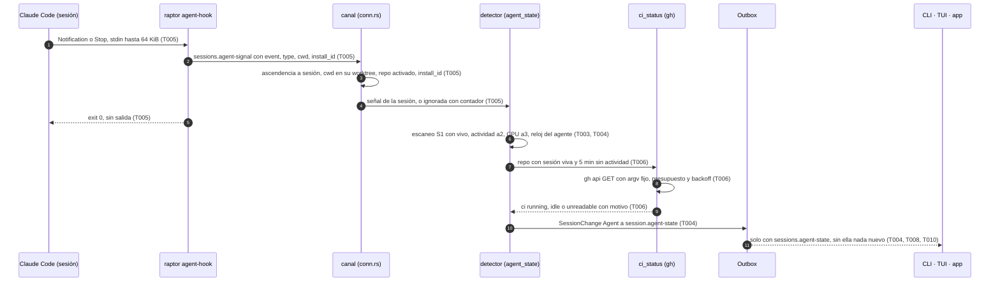

# DS-US-WTL-003 · Los cinco estados del agente en la CLI, la TUI y la app

## Contexto rápido

Al terminar, el orquestador ve cada sesión de agente en uno de cinco estados (activo, esperando una decisión humana, esperando el CI, colgado, terminado) en `raptor sessions --json`, `raptor status --json`, la TUI y la app, con «esperando una decisión humana» y «colgado» en la zona de atención. Hoy el motor solo publica los tres estados de BR-WF-001 (`SessionStateView`: `active`, `inactive`, `ended`, `crates/api/src/messages.rs:745`) y el orquestador mira las terminales con un script. Ningún estado actúa sobre el agente ni sobre su worktree.

El diseño lo fija la [Enmienda (2026-11-21) de ADR-GRP-012](../../../../architecture/decisions/ADR-GRP-012-deteccion-sesiones-claude-code.md#enmienda-2026-11-21-estados-del-agente-us-wtl-003): cinco estados con precedencia, hooks `Notification` y `Stop` conectados solo por el humano, CI de GitHub Actions en solo lectura con `gh`, CPU del árbol de la sesión como actividad auxiliar y la capacidad `sessions.agent-state`. Esta DS no reabre nada de eso; lo baja a archivos y tareas. Donde la enmienda tiene un hueco, la DS propone la corrección en [Enmiendas que implica](#enmiendas-que-implica) (E1 a E6).

Hoy, en el código (verificado el 2026-11-21):

- El detector (`crates/core/src/detect/mod.rs`) guarda cada sesión viva en `Live` (`:307`) con `last_activity_ms` y pasa a `Inactive` en `Live::idle` (`:326`) desde `Inner::scan` (`:1053`), que corre cada `SessionConfig::scan_interval` (1 s, `:128`). Su `Clock` es de pared y **cuenta la suspensión** (`:142-144`). La actividad (a2) entra por `Detector::activity` (`:827`): `Hooks::worktree_touched` (`:1513`) y los eventos de Git (`crates/core/src/daemon/sessions.rs:585`).
- `ProcEntry` (`crates/core/src/detect/procs.rs:16`) tiene `pid`, `ppid`, `start_us` y `exe`; nadie lee la CPU. macOS lista con `libproc` (`procs.rs:507-509`, `libproc = "=0.14.11"` en `crates/core/Cargo.toml:56`).
- `sessions.list` (`crates/api/src/methods/sessions.rs:8`) se declara `method(SESSIONS_LIST, false, false)`: **no** se ofrece a `raptor-mcp` (SEC-12). Ya hay una capacidad de forma en el grupo, `sessions.worktree-removed` (`:12`), con su proyección para clientes viejos: `SessionView::without_worktree_removed` (`messages.rs:786`), aplicada en `sessions.list` (`conn.rs:3096-3100`) y en el evento `session.state` (`bus.rs:233-251`, activada desde `apply_capabilities`, `conn.rs:802`).
- Los perfiles de conexión son dos, `Full` y `Mcp` (`messages.rs:37-42`); `offered` (`conn.rs:881-886`) deja a `Mcp` solo los métodos con `mcp = true`. El cliente de hooks de Guardrails (`raptor hook`, `apps/cli/src/main.rs:77-79`) conecta como `Full`.
- La sesión de un proceso se resuelve por ascendencia con `requester::resolve` y `via == Ancestry` en `detect::hook::session_of` (`crates/core/src/detect/hook.rs:229-242`).
- `engine.idleThresholdMinutes` existe en el esquema (`crates/policy/src/settings/model.rs:37-40`) pero el motor no lo lee todavía (US-GRP-013); el umbral efectivo es `SessionConfig::inactivity` (5 min).
- No hay lectura de CI, ni uso de `gh`, ni detección de reanudación tras la suspensión en el código.
- El instalador con marca y la transacción reversible de US-MCP-021 y US-MCP-022 **no están en `main`** (las dos historias están en `draft`): G1.
- La TUI agrupa las filas con `fleet_order::group(main, attention, lead)` (`apps/cli/src/tui/fleet_order.rs:134`); `attention` es hoy `conflict || blocked` (`tui/view.rs:560`) o `conflict` (`tui/selection.rs:33`).
- La app traduce `SessionView` a `SessionDto` (`apps/desktop/src-tauri/src/engine/ingest.rs:272`, `wire.rs:397`) y pide sus capacidades en `link.rs:18-23`.
- Contrato de los hooks de Claude Code, verificado en la documentación oficial (`code.claude.com/docs/en/hooks`) el 2026-11-21: entrada común `session_id`, `transcript_path`, `cwd`, `hook_event_name`; tipos de `Notification` `permission_prompt`, `idle_prompt`, `auth_success`, `auth_storage_failure`, `elicitation_dialog`, `elicitation_url_dialog`, `elicitation_complete`, `elicitation_response`, `agent_needs_input`, `agent_completed`, `quota_auto_resume_fired`, `quota_auto_resume_stale`, `quota_auto_resume_disabled`, `plugin_notification`. `Notification` ignora el código de salida; en `Stop`, salir con 2 o con `decision` bloquea la parada y salir con 0 sin salida no hace nada. Los hooks de los niveles usuario, proyecto y local se suman, y un mismo comando definido en varios archivos corre una vez.

Sin `architecture-constitution.md` en la cascada: las restricciones salen de [AGENTS.md](../../../../../AGENTS.md) y de los ADR citados (`unsafe_code = "forbid"` salvo `gitraptor-macsys` y `gitraptor-winsys`; argv fijo y sin shell, NFR-02; protocolo congelado en 9 y códigos en `-32016`, ADR-GRP-016; nunca `cmd` ni `environ`, SEC-04). Ninguna tarea las viola.

| Término | Qué es aquí |
|---|---|
| Estado del agente | `agent_state`: `active`, `awaiting-human`, `awaiting-ci`, `stalled`, `ended`. Dimensión aparte del `state` de BR-WF-001, que no cambia |
| Señal de decisión | Los hooks `Notification` y `Stop` de Claude Code, conectados por el humano para un repo (A5). Sin conexión, `decision = no-signal` |
| Actividad | (a2) cambios del worktree y eventos de Git; (a3) CPU del árbol de la sesión por encima del umbral; o un evento de hook de la sesión (ADR-GRP-012, § 4) |
| Reloj del agente | `std::time::Instant`: no avanza durante la suspensión en macOS y Linux (A7) |

### Decisiones

Todas son **Decisión del orquestador (2026-11-21), validada por Arquitecto**, salvo que la fila diga otra cosa.

| ID | Decisión | Por qué / descartado |
|----|----------|----------------------|
| A1 | **El estado del agente lo calcula el detector, puro y en memoria.** `crates/core/src/detect/agent_state.rs` (nuevo) tiene los hechos (`AgentFacts`) y `evaluate(&AgentFacts, &Thresholds, now) -> AgentEval` con la precedencia del § 4 de la enmienda. `Live` gana un campo `agent: AgentFacts`. `Inner::scan` evalúa en cada pasada y al llegar una señal de hook o de CI; un cambio sale como variante nueva `SessionChange::Agent { repo_id, session_id, eval }` hacia el bucle del daemon, que lo publica. Nada se persiste ni entra en el historial | Es donde ya viven `vivo` (S1) y la actividad (a2). Una función pura deja probar las invariantes con secuencias aleatorias sin daemon. Descartado: un módulo del daemon aparte que relea las sesiones, que duplicaría el estado de `Live` y su lock |
| A2 | **Contrato aditivo con capacidad `sessions.agent-state`** (en `methods/sessions.rs`). Con ella: `SessionView` gana `agent_state`, `decision`, `ci` e `idle_secs` (opcionales, `skip_serializing_if`); `SessionsListResult` gana `agent_signal: Vec<RepoAgentSignalView>` (un booleano por repo, para el escenario «la flota indica que en ese repo…»); y la conexión recibe el evento nuevo `session.agent-state` (data `SessionView`) cuando solo cambia el estado del agente. Sin ella: ningún campo nuevo, ningún evento nuevo, y `state` es el de siempre. Los tipos van en `crates/api/src/agent_state.rs` (nuevo) | ADR-GRP-012 § 5 y ADR-GRP-016 («Añadir una capacidad»). Un evento propio evita mandar a un cliente viejo un `session.state` repetido con el mismo `state`. Descartado: mismo `session.state` con un marcador de «solo agente», que obligaba a la `Outbox` a deserializar cada evento para decidir si lo descarta |
| A3 | **Método del hook `sessions.agent-signal`**, `method(…, false, false)`: ni reservado ni del perfil `mcp`. Parámetros: `event` (`notification` \| `stop`), `notification_type` (texto ASCII ≤ 64, opcional), `cwd` y `install_id`. La sesión sale de la ascendencia del peer (`requester::resolve`, `via == Ancestry`, `Requester::Agent { origin: Detected }`, como `detect::hook::session_of`), nunca de `session_id` ni de `cwd`. Se descarta sin cambiar nada si: no hay sesión resuelta; `cwd` canonicalizado no cae en el worktree de esa sesión; el repo no tiene la señal conectada; `install_id` no es el de la conexión vigente (A5). Devuelve solo `{ outcome: "recorded" \| "ignored" }`, sin motivo | Reglas 1, 5, 6 y 7 del § 3.1. Sin motivo en la respuesta, quien llama desde la shell de un agente no aprende qué falló. El motivo va a un contador entero del diagnóstico |
| A4 | **Cliente del hook: `raptor agent-hook <notification\|stop> --install <id>`**, despachado en `main.rs` antes de `clap`, como `raptor hook` (sin perfil, sin arrancar el daemon). Lee stdin con tope de 64 KiB + 1 byte; deserializa solo `hook_event_name`, `notification_type` y `cwd` (el resto, `message` y `transcript_path` incluidos, se ignora y nunca se copia ni se escribe). Conecta solo si el socket existe, con un tope total de 2 s. **Sale siempre con 0 y sin escribir en stdout ni stderr**, también con entrada inválida, daemon parado o tiempo agotado | Reglas 2, 3 y 6 del § 3.1. Exit 0 y stdout vacío: `Stop` nunca se bloquea y `Notification` no tiene efecto. Descartado: reutilizar `raptor hook`, cuyo contrato (exit 1 deniega) es el contrario |
| A5 | **La señal se conecta a nivel de usuario y se activa por repo.** La operación reservada escribe una sola entrada por evento en `~/.claude/settings.json` (comando absoluto del `raptor` instalado, `timeout: 5`), con el instalador y la marca de US-MCP-021 y la transacción de US-MCP-022, y anota en el perfil de GitRaptor el repo como activado y un `install_id` aleatorio de 128 bits. «Señal activada en el repo» = el repo está en esa lista del perfil y la entrada de usuario lleva la marca vigente. Un evento de una sesión de otro repo se ignora | Los worktrees, incluidos los que Claude Code crea solo, no comparten `.claude/settings.local.json` con el principal, y escribir `.claude/settings.json` versionado cambia el repo del usuario. El nivel de usuario cubre todos los worktrees con una sola escritura reversible. El `install_id` cierra el caso ingenuo del escenario «Avisos que no vienen de la configuración del desarrollador» (E1). Descartado: nivel de proyecto por worktree, que habría que repetir en cada worktree nuevo |
| A6 | **CPU del árbol (a3), barata y acotada.** `ProcLister` gana `fn cpu_ns(&self, pid: u32) -> Option<u64>` (por defecto `None`). macOS: `libproc` `pidinfo::<TaskInfo>` (`pti_total_user + pti_total_system`), sin `unsafe` en `crates/core`. Linux: `utime + stime` de `/proc/<pid>/stat`. Windows: `None` hasta la etapa multiplataforma. Se muestrea cada 15 s, no en cada escaneo, y solo para sesiones con ≥ 60 s sin actividad (a2); el árbol son los descendientes por `ppid` de la tabla de `list_bare`, tope de 64 procesos (`MAX_DEPTH`). Cuenta como actividad si el árbol consumió ≥ 2 s de CPU en el último minuto (⚠️ **ASSUMPTION** del § 4.1, se ajusta en dogfooding). Si la lectura falla, (a3) no cuenta y la sesión lleva la nota «sin lectura de CPU» | El escaneo de 1 s ya fue la mayor parte de la CPU del daemon en reposo (RES-01, `procs.rs:31-34`); leer la CPU de todos cada segundo lo repetiría. Con 10 sesiones y 64 procesos son ≤ 43 lecturas por segundo de media. **Verificación en T003**: en Apple Silicon, `pti_total_*` puede venir en tics de `mach_absolute_time`; si es así, se convierte con el timebase, con un `ffi_` nuevo en `gitraptor-macsys` |
| A7 | **Reloj del agente = `std::time::Instant`** (en macOS es `CLOCK_UPTIME_RAW` y en Linux `CLOCK_MONOTONIC`: ninguno avanza dormido), inyectable (`MonoClock = Arc<dyn Fn() -> Instant>`). **Reanudación**: si entre dos escaneos la pared avanza ≥ 30 s más que el reloj del agente, el detector marca `resumed` y no emite ningún `stalled` nuevo en ese repo hasta un escaneo más y una lectura de CI (o un `unreadable`). En builds de depuración, el archivo de `GITRAPTOR_TEST_CLOCK_SKEW_FILE` (`daemon/env.rs:152`) desplaza también este reloj; release no lo lee (SEC-06) | § 4.1 de la enmienda sin `unsafe` nuevo. El `Clock` de pared actual sigue para BR-WF-001, que cuenta la suspensión a propósito. Windows: `Instant` usa `QueryPerformanceCounter`, que puede contar la suspensión: ⚠️ **ASSUMPTION** a medir en la etapa multiplataforma |
| A8 | **Umbral de colgado `engine.stalledThresholdMinutes`**: niveles `profile` y `local` (ADR-GRP-007), esquema `range(min = 5, max = 1440)`, por defecto 15. Además, un valor menor que el umbral de inactividad efectivo se rechaza con el diagnóstico de configuración que ya existe y se usa el defecto. Lo lee `profile::settings::stalled_threshold(dirs, repo_id)` (local sobre perfil) y el detector lo vuelve a leer como mucho cada 10 s por repo, comparando el `mtime` de los dos archivos: se aplica sin reiniciar | § 4.1. Leer en cada escaneo de 1 s sería un `stat` por repo y segundo sin necesidad. Descartado: un evento de recarga de configuración, que no existe todavía para el nivel local |
| A9 | **Lector de CI**: módulo del daemon `crates/core/src/daemon/modules/ci_status.rs` (un hilo) sobre la lógica pura de `crates/core/src/ci/` (argv, presupuesto, análisis). Argv fijo: `gh api --method GET --include -H "Accept: application/vnd.github+json" "repos/<owner>/<repo>/actions/runs?per_page=100&exclude_pull_requests=true"`, con `owner` y `repo` validados (`[A-Za-z0-9._-]{1,100}`). Una petición por repo cubre todas sus ramas: se filtra en local por `head_branch` (E2). `gh` se resuelve una vez al arrancar entre rutas absolutas fijas (`/opt/homebrew/bin/gh`, `/usr/local/bin/gh`, `/usr/bin/gh`) o `engine.ghPath` (solo nivel `profile`), nunca por `PATH` ni dentro de un repo observado. Entorno vacío salvo `HOME`, `PATH=/usr/bin:/bin`, `GH_PROMPT_DISABLED=1`, `GH_NO_UPDATE_NOTIFIER=1`, `NO_COLOR=1`, `GH_PAGER=` (sin `GH_TOKEN` ni `GITHUB_TOKEN`). Tope de 10 s y de 2 MiB de respuesta | § 3.3. Resolver `gh` por `PATH` dejaría que un agente que controla un directorio del `PATH` sirviera respuestas falsas (el mismo criterio de L-02 en D21 de DS-US-DSK-008). Descartado: llamar a la API REST, que exige custodiar un token |
| A10 | **Remoto**: el `origin` del repo con `RepoReader::remote_url` (`crates/git/src/reader.rs:489`). Solo `https://github.com/<o>/<r>(.git)`, `git@github.com:<o>/<r>(.git)` y `ssh://git@github.com/<o>/<r>(.git)`; cualquier otro, `ci = unreadable` con motivo `unsupported-remote` | § 9 de la enmienda: GitHub Enterprise y otros CI fuera de M3 |
| A11 | **Despeje de la decisión pendiente** exactamente como el § 4: `Notification` con (a2) posterior, otro evento de hook de la sesión o el fin; `Stop` con cualquier actividad posterior, (a3) incluida; un `Stop` sustituye a una `Notification`. Mapa de tipos (E3): `permission_prompt` → `permission`; `elicitation_dialog`, `elicitation_url_dialog`, `agent_needs_input` → `question`; `idle_prompt` → `turn-ended`; `auth_success`, `auth_storage_failure`, `elicitation_complete`, `elicitation_response`, `agent_completed`, `quota_auto_resume_*` y `plugin_notification` → se ignoran (no son una espera); un tipo fuera de las dos listas, o ausente, → `question` | La regla 6 dice «un tipo desconocido cuenta como pregunta»; la documentación verificada tiene tipos que no son esperas y contarlos como pregunta daría falsos «esperando una decisión humana» |
| A12 | **Superficies.** CLI: `raptor sessions --json` y `raptor status --json` añaden `agent_state`, `decision`, `decision_kind`, `ci`, `ci_reason`, `idle_secs`, `notes[]` por sesión y `agent_signal` por repo; el texto muestra la etiqueta y las notas. TUI: `fleet_order::group` recibe `attention = conflict \|\| blocked \|\| agent_attention`, con `agent_attention` = alguna sesión `awaiting-human` o `stalled`; la fila pinta la etiqueta y la nota. App: `SessionDto` gana los mismos campos y `fleet-model.ts` sube esas tarjetas a atención. Todo texto por el registro de mensajes (en/es) | § 5 de la enmienda y BR-WTL-009 |
| A13 | **Conectar y quitar la señal**: métodos reservados `sessions.signal-connect` y `sessions.signal-disconnect` (`method(…, true, false)`) y `sessions.signal-status` (no reservado, no `mcp`); CLI `raptor agent-signal connect\|disconnect\|status [--repo <ruta>] [--yes] [--dry-run]`. Desde un solicitante agente o desde la conexión del MCP se rechazan y se auditan. Fila nueva de ADR-GRD-007 en [Enmiendas que implica](#enmiendas-que-implica) | Regla 4 del § 3.1 y escenario «La señal de avisos la activa solo el desarrollador» |
| A14 | **`raptor-mcp` no cambia.** `McpSession` (`methods/mcp.rs:233`) sigue con `actor` y `state`; no pide la capacidad | `sessions.list` no está en el perfil `mcp` (SEC-12) y BR-WTL-016 no pide esta lectura por MCP. El § 5 de la enmienda dice lo contrario: E6 |
| A15 | **Propiedades sin dependencia nueva.** La prueba de invariantes usa un generador determinista con semilla (LCG de 64 bits) sobre 10 000 secuencias de hechos, en `detect/agent_state_tests.rs` | El workspace no tiene `proptest` ni `quickcheck`; una semilla fija hace el fallo reproducible |

## ⚠️ Gaps y violaciones de la constitución

| ID | Qué falta | Severidad | Alcance | Acción | Owner |
|----|-----------|-----------|---------|--------|-------|
| G1 | **Instalador con marca y transacción reversible** de US-MCP-021 y US-MCP-022: los dos en `draft`, nada en `main` (comprobado el 2026-11-21: ninguna coincidencia de `configure_agents` en `crates/` ni en `apps/`). A5 y A13 los necesitan para escribir `~/.claude/settings.json` de forma reversible (NFR-01) | Bloqueante | T009 | Implementar antes US-MCP-021 y US-MCP-022, o que el orquestador decida que T009 crea el instalador mínimo con su transacción y US-MCP-021 lo reutiliza. Hasta entonces, T001 a T008 y T010 se prueban con la señal activada por el arnés (perfil temporal) | Orquestador |
| G2 | **Revisión de seguridad** del método del hook y del lector de `gh` (§ 9 de la enmienda: «antes de aceptar la Dev Spec, la revisa `security-review`»), y los NFR de seguridad del `security-expert`, que se incrustan literales en el [Gate de seguridad](#gate-de-seguridad) | Bloqueante | T005, T009; aprobación de la DS | Lanzar `security-review` (security-expert) sobre esta DS antes de pasarla a `approved`. El Arquitecto no puede lanzarlo | Orquestador |
| G3 | Criterio de certificación 3 (una jornada de dogfooding sin supervisor ni watchdog) y el ajuste del umbral de CPU de A6 | Bloquea liberación | — | Dogfooding tras el merge de T001 a T010, con la señal conectada | Orquestador |

Ninguna violación: sin constitución, ver Contexto rápido.

## 🔭 La forma



---

## 🚀 Plan de implementación

### El trabajo de un vistazo

| # | Tarea | Depende | Aterriza en |
|---|---|---|---|
| T001 | Escribir en rojo los tests de contrato | — | `crates/core/src/detect/agent_state_tests.rs`, `crates/core/tests/us_wtl_003_*.rs`, `apps/cli/tests/{agent_hook,tui_agent_state}.rs`, stubs |
| T002 | Crear el contrato: tipos, capacidad, métodos, evento y proyección | T001 | `crates/api/src/agent_state.rs`, `methods/sessions.rs`, `messages.rs`, `event.rs` |
| T003 | Leer la CPU del árbol y el reloj del agente | T001 | `detect/procs.rs`, `detect/agent_clock.rs` |
| T004 | Calcular el estado en el detector y publicarlo | T002, T003 | `detect/agent_state.rs`, `detect/mod.rs`, `daemon/sessions.rs`, `channel/{conn,bus}.rs` |
| T005 | Atender el hook: método y cliente `raptor agent-hook` | T004, G2 | `crates/core/src/detect/agent_signal.rs`, `channel/conn.rs`, `apps/cli/src/agent_hook.rs`, `main.rs` |
| T006 | Leer el CI con `gh` | T004 | `crates/core/src/ci/`, `daemon/modules/ci_status.rs`, `modules/mod.rs` |
| T007 | Configurar el umbral de colgado | T004 | `crates/policy/src/settings/model.rs`, `crates/core/src/profile/settings.rs` |
| T008 | Mostrar los estados en la CLI y la TUI, en/es | T004 | `apps/cli/src/{sessions,status}.rs`, `tui/{fleet_order,view,selection}.rs`, `present/`, `i18n/` |
| T009 | Conectar, quitar y consultar la señal (operación reservada) | T005, G1, G2 | `methods/sessions.rs`, `crates/core/src/daemon/agent_signal_install.rs`, `apps/cli/src/commands/agent_signal.rs` |
| T010 | Mostrar los estados en la app | T004 | `apps/desktop/src-tauri/src/engine/{wire,ingest,link}.rs`, `apps/desktop/src/fleet/` |
| T011 | Cerrar la historia | T001–T010 | `docs` |

### En qué orden

T001 → T002 y T003 en paralelo → T004. Tras T004, T005, T006, T007, T008 y T010 van en paralelo (archivos distintos salvo el `match` de `conn.rs`, donde cada brazo va junto a los de `sessions`). T009 espera a G1 y G2. T011 al final.

### T001 — Escribir en rojo los tests de contrato

**Objetivo.** Los escenarios de la historia y las invariantes del § 4, en rojo, con sesiones simuladas y repos temporales.

**Ubicación.**
- `crates/core/src/detect/agent_state_tests.rs` (**CREATE**, `#[cfg(test)] #[path]` desde `agent_state.rs`): precedencia, despeje e invariantes (A15).
- `crates/core/tests/us_wtl_003_agent_state.rs` (**CREATE**): daemon en proceso como `crates/core/tests/us_grp_003_sessions.rs` (perfil temporal, `gitraptor_testkit::Fixture`, `raptor-fake-agent` como Claude Code), `MonoClock` inyectado por `DaemonConfig`, señal activada por el arnés en el perfil temporal.
- `crates/core/tests/us_wtl_003_ci_gh.rs` (**CREATE**): lector de CI contra `fake-gh`.
- `crates/testkit/src/bin/fake-gh.rs` (**CREATE**): responde con el archivo grabado que nombra `FAKE_GH_DIR` y anota su argv en `FAKE_GH_DIR/argv.log`. En depuración el daemon acepta `GITRAPTOR_TEST_GH_PATH`; release no la lee (SEC-06).
- `apps/cli/tests/agent_hook.rs` (**CREATE**): el binario `raptor` real como cliente del hook.
- `apps/cli/tests/tui_agent_state.rs` (**CREATE**, `#![cfg(all(target_os = "macos", debug_assertions))]`): `App` real sobre `TestBackend`.
- Stubs que compilan (`unimplemented!` fuera de rutas de producción, o `NotImplemented`) en los archivos de T002 a T010.

**Reglas**
- Los tests rojos van en su archivo y no se editan durante la implementación (R4 de `/implement`).
- Nunca este repo ni el perfil real (NFR-01).
- **Ningún `sleep` fijo**: cada paso espera la notificación o la respuesta que lo prueba, con techo de 10 s; el tiempo avanza con el reloj inyectado o con el archivo de desfase.

- **Depende:** —
- **Refs:** US-WTL-003, todos los escenarios; ADR-GRP-012 Enmienda 2026-11-21 § 7; § 9.4
- **Aceptación:** `cargo test -p gitraptor-core --lib agent_state`, `cargo test -p gitraptor-core --test us_wtl_003_agent_state --test us_wtl_003_ci_gh` y `cargo test -p gitraptor-cli --test agent_hook --test tui_agent_state` compilan y fallan por «no implementado»

### T002 — Crear el contrato

**Objetivo.** Una conexión que acepta `sessions.agent-state` puede recibir los cinco estados; las demás no ven nada nuevo.

**Ubicación.**
- `crates/api/src/agent_state.rs` (**CREATE**) y una línea `pub mod agent_state;` en `crates/api/src/lib.rs`: los tipos de [Contratos compartidos](#tipos-y-datos-compartidos).
- `crates/api/src/methods/sessions.rs` (**MODIFY**): `CAP_SESSIONS_AGENT_STATE`, `SESSIONS_AGENT_SIGNAL` (`method(…, false, false)`), `SESSIONS_SIGNAL_CONNECT` y `SESSIONS_SIGNAL_DISCONNECT` (`method(…, true, false)`), `SESSIONS_SIGNAL_STATUS` (`method(…, false, false)`), en el `GROUP` (`:14`).
- `crates/api/src/messages.rs` (**MODIFY**): `SessionView` (`:797`) gana los cuatro campos opcionales y `fn without_agent_state(&mut self)`; `SessionsListResult` gana `agent_signal`.
- `crates/api/src/event.rs` (**MODIFY**): `SESSION_AGENT_STATE = "session.agent-state"` y su `change(…, "US-WTL-003")` junto a `SESSION_STATE` (`:120`, `:200`).

**Reglas**
- Ningún código de error nuevo: un parámetro inválido del hook es `INVALID_PARAMS`, y la respuesta del hook es siempre `recorded` o `ignored`.
- Sin `.since(...)` (ADR-GRP-016, «Añadir un método»).
- `crates/api/tests/architecture.rs` en verde: nada declarado en `methods/mod.rs` ni en `rpc.rs`.

- **Depende:** T001
- **Refs:** A2, A3, A13; ADR-GRP-016
- **Aceptación:** `cargo test -p gitraptor-api` en verde, con `describe` y el esquema mostrando la capacidad, los métodos y el evento nuevos

### T003 — Leer la CPU del árbol y el reloj del agente

**Objetivo.** El detector sabe cuánta CPU gastó el árbol de una sesión y mide el tiempo sin contar la suspensión.

**Ubicación.**
- `crates/core/src/detect/procs.rs` (**MODIFY**): `ProcLister::cpu_ns` (por defecto `None`) y sus implementaciones de macOS y Linux (A6).
- `crates/core/src/detect/agent_clock.rs` (**CREATE**, una línea `mod agent_clock;` en `detect/mod.rs`): `MonoClock`, `CpuWindow` (suma acotada del árbol y consumo del último minuto) y `ResumeDetector` (A7).
- Si T003 confirma que macOS da tics de Mach: `crates/macsys/src/ffi_timebase.rs` (**CREATE**) y `crates/macsys/src/clock.rs` (**CREATE**, `pub fn mach_ticks_to_ns(u64) -> u64`), con su `unsafe` comentado y `tests/unsafe_boundary.rs` en verde.

**Reglas**
- Nunca `cmd` ni `environ` (SEC-04): solo tiempos de CPU.
- Un pid cuyo `start_us` ya no coincide no suma (pid reutilizado).
- Un hijo que muere entre dos muestras resta su CPU del árbol: la ventana usa `max(0, actual − anterior)` por proceso, nunca la suma negativa.

- **Depende:** T001
- **Refs:** A6, A7; ADR-GRP-012 Enmienda 2026-11-21 § 3 (a3), § 4.1
- **Aceptación:** tests unitarios de `agent_clock.rs` (ventana, pid reutilizado, hijo muerto, reanudación con pared +8 h y reloj +0) y `cargo test -p gitraptor-core --lib procs` en verde

### T004 — Calcular el estado en el detector y publicarlo

**Objetivo.** Cada sesión viva tiene su estado del agente, que llega a las conexiones con la capacidad.

**Ubicación.**
- `crates/core/src/detect/agent_state.rs` (**CREATE**): `AgentFacts`, `Thresholds`, `evaluate`, `AgentEval` y el despeje de A11.
- `crates/core/src/detect/mod.rs` (**MODIFY**): `Live.agent`; `Inner::scan` evalúa tras `scan_processes`; `Inner::activity` actualiza (a2) con el reloj del agente; `SessionChange::Agent`; `Detector::ci_changed(repo_id, CiSnapshot)` y `Detector::agent_signal(session_id, Signal)`; `Diagnostics` gana contadores enteros de señales descartadas por motivo.
- `crates/core/src/daemon/sessions.rs` (**MODIFY**): el brazo de `SessionChange::Agent` publica `session.agent-state` y guarda el último `AgentEval` para `sessions.list`; un `Started` o `State` publicado lleva los campos del agente.
- `crates/core/src/channel/bus.rs` (**MODIFY**): `Outbox::set_without_agent_state` descarta `session.agent-state` y quita los campos de `session.state` (patrón de `shape_session`, `:233`).
- `crates/core/src/channel/conn.rs` (**MODIFY**): en `apply_capabilities` (`:774`), `set_without_agent_state(!self.has(CAP_SESSIONS_AGENT_STATE.name))`; en `sessions_list` (`:3088`), `without_agent_state` y `agent_signal` vacío sin la capacidad.
- `crates/core/src/client.rs` (**MODIFY**): el cliente de `crates/core` pide `sessions.agent-state` en `connection.accept`.

**Reglas** — `evaluate`, en este orden (gana la primera)
1. `alive == false` → `ended`. Nunca se reactiva (Q41).
2. `decision == Pending(_)` → `awaiting-human`.
3. `ci == Running` y `idle ≥ inactivity` (5 min) → `awaiting-ci`.
4. `idle ≥ stalled` y `ci != Running` y `!resume_grace` → `stalled`.
5. Cualquier otro caso → `active`.

`idle` = reloj del agente − la más reciente de: (a2), (a3) por encima del umbral, un evento de hook de la sesión. Mientras el repo no está `Observed` (`RepoStateView`, `messages.rs:136`), `idle` no crece para el umbral de colgado (§ 3, a2).

**Reglas** — publicación
- Solo se publica un cambio de `agent_state`, de `decision`, de `ci` o de las notas; `idle_secs` viaja con cada evento y en `sessions.list`, pero un cambio solo de `idle_secs` no publica.
- Ningún estado llama al ejecutor, a Guardrails, a la Time Machine ni escribe en el terminal o el worktree (§ 4.2). Lo fija un test con un `ProtectedStep` espía.
- Sin `CiFacts` todavía (T006), el detector recibe `not-applicable`.

- **Depende:** T002, T003
- **Refs:** A1, A2, A11; ADR-GRP-012 Enmienda 2026-11-21 § 4 y § 5
- **Aceptación:** `cargo test -p gitraptor-core --lib agent_state` en verde (invariantes incluidas) y, de `us_wtl_003_agent_state`, los tests de colgado, activo, terminado, umbral, nunca actúa y cliente sin capacidad

### T005 — Atender el hook: método y cliente `raptor agent-hook`

**Objetivo.** Un `Notification` o un `Stop` de la sesión, con la señal activada, la pone en «esperando una decisión humana»; nada de lo que llega cambia otra sesión ni bloquea al agente.

**Ubicación.**
- `crates/core/src/detect/agent_signal.rs` (**CREATE**): validación de los parámetros, mapa de tipos (A11), resolución de la sesión (función compartida con `detect::hook::session_of`, que pasa a `pub(crate)`) y el contraste de `cwd`.
- `crates/core/src/channel/conn.rs` (**MODIFY**): brazo de `SESSIONS_AGENT_SIGNAL` junto a `SESSIONS_LIST` (`:1142`).
- `apps/cli/src/agent_hook.rs` (**CREATE**) y `apps/cli/src/main.rs` (**MODIFY**, junto al `hook` de `:77`): `if args.get(1) == Some("agent-hook") { return agent_hook::run(&args[2..]); }`.

**Reglas** — cliente
- Lee stdin con `take(65_536 + 1)`; si pasa del tope, sale con 0 sin conectar.
- Deserializa un `struct` con solo `hook_event_name`, `notification_type` y `cwd`; nunca registra ni reenvía el buffer.
- Conecta solo si el socket del daemon existe (nunca lo arranca), con tope total de 2 s (conexión + `hello` + llamada).
- **Siempre exit 0, stdout y stderr vacíos.**

**Reglas** — daemon (orden fijo; cualquier fallo → `ignored` y contador)
1. Parámetros válidos: `event` de la lista, `notification_type` ASCII ≤ 64, `cwd` absoluto, `install_id` de 32 hex.
2. Sesión por ascendencia (A3). Sin sesión → `no-session`.
3. Repo de la sesión con la señal activada y `install_id` igual al vigente → si no, `not-connected` o `wrong-install`.
4. `cwd` canonicalizado dentro del worktree de la sesión → si no, `cwd-mismatch`.
5. Tipo mapeado (A11): ignorado → `ignored-type`; si no, `Detector::agent_signal`.

- **Depende:** T004, G2
- **Refs:** A3, A4, A11; ADR-GRP-012 Enmienda 2026-11-21 § 3.1
- **Aceptación:** `cargo test -p gitraptor-cli --test agent_hook` y, de `us_wtl_003_agent_state`, los escenarios 1, 2, 3, 13 y 14 en verde

### T006 — Leer el CI con `gh`

**Objetivo.** Para cada repo con una sesión viva sin actividad ≥ 5 min, el detector sabe si su rama tiene una ejecución en curso, o por qué no se pudo leer.

**Ubicación.**
- `crates/core/src/ci/mod.rs` (**CREATE**, una línea `pub mod ci;` en `crates/core/src/lib.rs`): `CiSnapshot`, `Budget`, `parse_runs`, `GithubRepo::from_remote` (A10).
- `crates/core/src/ci/gh.rs` (**CREATE**): resolución de `gh` (A9), `argv(&GithubRepo) -> [OsString; N]` y la llamada con tope de tiempo y bytes, sin shell.
- `crates/core/src/daemon/modules/ci_status.rs` (**CREATE**) y una línea en `MODULES` de `daemon/modules/mod.rs`: hilo con cola por repo; entrega `Detector::ci_changed`.

**Reglas**
- Solo `GET`. `argv` es una función pura con una prueba que falla si aparece `rerun`, `cancel`, `workflow`, `run`, `-X`/`--method` distinto de `GET`, `-f`/`-F`/`--input`.
- «En curso» = `status` en `queued`, `in_progress`, `waiting`, `pending` o `requested`, con `head_branch` igual a la rama local de la sesión. HEAD separado → `not-applicable`.
- Se leen solo `id`, `status`, `conclusion`, `head_branch`, `head_sha`, `html_url`; el resto se descarta al analizar. Nada se persiste.
- Presupuesto: ≤ 1 petición por repo y minuto, caché de 60 s; error o límite → backoff exponencial desde 60 s hasta 15 min, respetando `Retry-After`; con `X-RateLimit-Remaining` < 10 % de `X-RateLimit-Limit`, sin lecturas hasta `X-RateLimit-Reset`.
- Motivos de `unreadable` (lista cerrada): `gh-missing`, `not-authenticated`, `unsupported-remote`, `rate-limited`, `backoff`, `timeout`, `invalid-response`, `error`.
- Diagnóstico: contadores enteros (peticiones, errores por motivo, backoffs); nunca URL, rama ni respuesta.

- **Depende:** T004
- **Refs:** A9, A10; ADR-GRP-012 Enmienda 2026-11-21 § 3.3
- **Aceptación:** `cargo test -p gitraptor-core --lib ci` y `cargo test -p gitraptor-core --test us_wtl_003_ci_gh` en verde

### T007 — Configurar el umbral de colgado

**Objetivo.** El umbral de colgado se cambia por perfil o por repo y se aplica sin reiniciar.

**Ubicación.**
- `crates/policy/src/settings/model.rs` (**MODIFY**): `Engine.stalled_threshold_minutes: Option<u32>` con `range(min = 5, max = 1440)` y niveles `profile`, `local` (junto a `idle_threshold_minutes`, `:40`); `Engine.gh_path: Option<String>` solo `profile` (A9).
- `crates/core/src/profile/settings.rs` (**MODIFY**): `pub fn stalled_threshold(dirs: &ProfileDirs, repo_id: &str) -> Duration` y `pub fn gh_path(dirs: &ProfileDirs) -> Option<PathBuf>`.

**Reglas**
- Local sobre perfil; documento no aplicable o valor por debajo del umbral de inactividad efectivo → defecto de 15 min y el diagnóstico existente.
- El detector relee como mucho cada 10 s por repo, por `mtime` (A8).

- **Depende:** T004
- **Refs:** A8; ADR-GRP-007
- **Aceptación:** `cargo test -p gitraptor-policy` y el escenario «Umbral configurable» de `us_wtl_003_agent_state` en verde

### T008 — Mostrar los estados en la CLI y la TUI, en/es

**Objetivo.** El desarrollador ve los cinco estados, las notas y la zona de atención en la CLI y en la TUI.

**Ubicación.**
- `apps/cli/src/sessions.rs` (**MODIFY**): `SessionJson` (`:83`) y `session_json` (`:103`) añaden los campos de A12; `line` (`:20`) muestra la etiqueta y las notas; `json` (`:128`) añade `agent_signal`.
- `apps/cli/src/status.rs` (**MODIFY**): `json` (`:498`) y `text` (`:89`) igual.
- `apps/cli/src/model.rs` (**MODIFY**): `SessionRow` (`:499`) gana `agent_state`, `decision`, `ci`, `idle_secs`; `RepoView` gana `agent_signal`. `apps/cli/src/present/ingest.rs` (**MODIFY**): `session` (`:216`) los copia.
- `apps/cli/src/tui/fleet_order.rs` (**MODIFY**): `pub fn agent_attention(shown: &Shown<'_>) -> bool`. `tui/view.rs` (`:560`) y `tui/selection.rs` (`:33`) (**MODIFY**): `attention = … || agent_attention(&shown)`.
- `apps/cli/src/present/agent_state_text.rs` (**CREATE**): etiquetas y notas de la fila.
- `apps/cli/i18n/{en,es}/sessions.txt` (**MODIFY**) y `apps/cli/src/present/i18n.rs` (**MODIFY**): los textos de [Textos](#textos).
- `apps/cli/src/commands/sessions.rs` (**MODIFY**): pide la capacidad.

**Reglas**
- Una conexión a un daemon sin la capacidad muestra lo de hoy y no inventa estados.
- Nota «sin señal de decisión» en toda sesión con `decision = no-signal`; en `stalled`, la nota larga. Línea de repo «En este repo no se puede detectar…» cuando `agent_signal.connected == false` y hay alguna sesión viva.
- «CI no legible: <motivo>» junto a la sesión con `ci = unreadable` y `idle ≥ inactivity`.
- Texto no confiable por `SafeText` (SEC-12).

- **Depende:** T004
- **Refs:** A12; ADR-GRP-012 Enmienda 2026-11-21 § 3.2 y § 5
- **Aceptación:** `cargo test -p gitraptor-cli` en verde (snapshots en/es) y `cargo test -p gitraptor-cli --test tui_agent_state`

### T009 — Conectar, quitar y consultar la señal

**Objetivo.** Solo el desarrollador activa la señal de un repo; un agente que lo pide recibe un rechazo y la señal sigue sin activar.

**Ubicación.**
- `crates/core/src/daemon/agent_signal_install.rs` (**CREATE**): plan (qué se escribe, dónde, por qué y cómo se revierte), escritura de las dos entradas en `~/.claude/settings.json` con el instalador y la marca de US-MCP-021, transacción de US-MCP-022, `install_id` y lista de repos activados en el perfil.
- `crates/core/src/channel/conn.rs` (**MODIFY**): brazos de los tres métodos, junto a los de `sessions`.
- `apps/cli/src/commands/agent_signal.rs` (**CREATE**) y una línea en `commands!` de `commands/mod.rs`.
- `apps/cli/i18n/{en,es}/agentsignal.txt` (**CREATE**).

**Reglas**
- Reservado (ADR-GRD-007, fila nueva): controles 1 a 3, 5 y 6 de ADR-GRP-005 § 6; un solicitante agente o la conexión del MCP → rechazo auditado. Plan visible y confirmación (o `--yes`), sin ventana. `--dry-run` no escribe.
- El comando que se escribe es la ruta absoluta del `raptor` instalado, `agent-hook <evento> --install <id>`, sin shell.
- Quitar la señal del último repo retira las entradas y deja el archivo byte a byte como estaba (US-MCP-022).
- `signal-status` dice si el repo está activado y si la entrada de usuario sigue presente con la marca vigente.

- **Depende:** T005, G1, G2
- **Refs:** A5, A13; ADR-GRD-007; US-MCP-021, US-MCP-022
- **Aceptación:** escenario «La señal de avisos la activa solo el desarrollador» de `us_wtl_003_agent_state` y prueba de reversión byte a byte en verde

### T010 — Mostrar los estados en la app

**Objetivo.** La app de escritorio muestra los cinco estados y sube a atención las mismas tarjetas que la TUI.

**Ubicación.**
- `apps/desktop/src-tauri/src/engine/link.rs` (**MODIFY**): pide `sessions.agent-state` (`:18-23`).
- `apps/desktop/src-tauri/src/engine/wire.rs` (**MODIFY**): `SessionDto` (`:397`) gana `agentState`, `decision`, `ci`, `idleSecs`, `notes`; `RepoFleetDto` gana `agentSignal`.
- `apps/desktop/src-tauri/src/engine/ingest.rs` (**MODIFY**): `session` (`:272`) los copia, saneados; traduce `session.agent-state`.
- `apps/desktop/src/fleet/fleet-model.ts` (**MODIFY**): atención por `awaiting-human` y `stalled`; `apps/desktop/src/fleet/agent-state.ts` (**CREATE**) y su test; textos en `apps/desktop/src/i18n/locales/`.

**Reglas**
- Sin lógica de Git ni de estado en el frontend: la app pinta lo que el motor publica (ADR-GRP-017).
- Sin la capacidad (daemon viejo), la tarjeta queda como en US-DSK-004.

- **Depende:** T004
- **Refs:** A12; DS-US-DSK-004
- **Aceptación:** `pnpm --filter @gitraptor/desktop test`, `cargo clippy -p gitraptor-desktop --all-targets -- -D warnings` y `cargo test -p gitraptor-desktop` en verde

### T011 — Cerrar la historia

**Objetivo.** La historia queda implementada, verificada y enlazada.

**Ubicación.** `docs/requirements/features/worktree-lifecycle/user-stories/US-WTL-003-estado-real-del-agente.md` (**MODIFY**), esta DS (**MODIFY**) y la fila de ADR-GRD-007 (**MODIFY**).

**Reglas**
- La historia pasa a `implemented` y enlaza el PR; esta DS añade `## Estado de la implementación`.
- Las [Enmiendas que implica](#enmiendas-que-implica) se aplican en el mismo PR o quedan anotadas en él.

- **Depende:** T001–T010
- **Refs:** AGENTS.md (reglas de calidad)
- **Aceptación:** `cargo clippy --workspace --exclude gitraptor-desktop --all-targets -- -D warnings` y `node tools/test/nextest-junit.mjs` en verde

---

## Estructura de ficheros

| Archivo | Acción | Tarea |
|---|---|---|
| `crates/api/src/agent_state.rs`, `crates/api/src/lib.rs` | CREATE, MODIFY (1 línea) | T002 |
| `crates/api/src/methods/sessions.rs` | MODIFY (capacidad, 4 métodos) | T002 |
| `crates/api/src/messages.rs` | MODIFY (campos de `SessionView`, `agent_signal`) | T002 |
| `crates/api/src/event.rs` | MODIFY (`session.agent-state`) | T002 |
| `crates/core/src/detect/procs.rs` | MODIFY (`cpu_ns`) | T003 |
| `crates/core/src/detect/agent_clock.rs` | CREATE | T003 |
| `crates/macsys/src/{clock,ffi_timebase}.rs` | CREATE (si aplica, A6) | T003 |
| `crates/core/src/detect/agent_state.rs`, `agent_state_tests.rs` | CREATE | T004, T001 |
| `crates/core/src/detect/mod.rs` | MODIFY | T003, T004 |
| `crates/core/src/daemon/sessions.rs` | MODIFY (brazo `Agent`) | T004 |
| `crates/core/src/channel/bus.rs` | MODIFY (proyección) | T004 |
| `crates/core/src/channel/conn.rs` | MODIFY (capacidad, brazos de `sessions`) | T004, T005, T009 |
| `crates/core/src/client.rs` | MODIFY (pide la capacidad) | T004 |
| `crates/core/src/detect/agent_signal.rs`, `detect/hook.rs` | CREATE, MODIFY (`session_of` `pub(crate)`) | T005 |
| `apps/cli/src/agent_hook.rs`, `apps/cli/src/main.rs` | CREATE, MODIFY | T005 |
| `crates/core/src/ci/{mod,gh}.rs`, `crates/core/src/lib.rs` | CREATE, MODIFY (1 línea) | T006 |
| `crates/core/src/daemon/modules/ci_status.rs`, `modules/mod.rs` | CREATE, MODIFY (1 línea) | T006 |
| `crates/policy/src/settings/model.rs`, `crates/core/src/profile/settings.rs` | MODIFY | T007 |
| `apps/cli/src/{sessions,status,model}.rs`, `present/ingest.rs`, `present/i18n.rs` | MODIFY | T008 |
| `apps/cli/src/tui/{fleet_order,view,selection}.rs` | MODIFY | T008 |
| `apps/cli/src/present/agent_state_text.rs` | CREATE | T008 |
| `apps/cli/i18n/{en,es}/sessions.txt` | MODIFY | T008 |
| `crates/core/src/daemon/agent_signal_install.rs` | CREATE | T009 |
| `apps/cli/src/commands/agent_signal.rs`, `commands/mod.rs` | CREATE, MODIFY (1 línea) | T009 |
| `apps/cli/i18n/{en,es}/agentsignal.txt` | CREATE | T009 |
| `apps/desktop/src-tauri/src/engine/{link,wire,ingest}.rs` | MODIFY | T010 |
| `apps/desktop/src/fleet/{fleet-model,agent-state}.ts` | MODIFY, CREATE | T010 |
| `crates/core/tests/us_wtl_003_{agent_state,ci_gh}.rs` | CREATE | T001 |
| `crates/testkit/src/bin/fake-gh.rs` | CREATE | T001 |
| `apps/cli/tests/{agent_hook,tui_agent_state}.rs` | CREATE | T001 |

## Contratos compartidos

### Tipos y datos compartidos

```rust
// crates/api/src/agent_state.rs (T002) — a crear
#[derive(Debug, Clone, Copy, PartialEq, Eq, Serialize, Deserialize, JsonSchema)]
#[serde(rename_all = "kebab-case")]
pub enum AgentStateView { Active, AwaitingHuman, AwaitingCi, Stalled, Ended }

#[derive(Debug, Clone, Copy, PartialEq, Eq, Serialize, Deserialize, JsonSchema)]
#[serde(rename_all = "kebab-case")]
pub enum DecisionKindView { Permission, Question, TurnEnded }

#[derive(Debug, Clone, Copy, PartialEq, Eq, Serialize, Deserialize, JsonSchema)]
#[serde(rename_all = "kebab-case", tag = "value", content = "kind")]
pub enum DecisionView { Pending(DecisionKindView), None, NoSignal }

#[derive(Debug, Clone, Copy, PartialEq, Eq, Serialize, Deserialize, JsonSchema)]
#[serde(rename_all = "kebab-case")]
pub enum CiUnreadableReason { GhMissing, NotAuthenticated, UnsupportedRemote, RateLimited, Backoff, Timeout, InvalidResponse, Error }

#[derive(Debug, Clone, Copy, PartialEq, Eq, Serialize, Deserialize, JsonSchema)]
#[serde(rename_all = "kebab-case", tag = "value", content = "reason")]
pub enum CiView { Running, Idle, Unreadable(CiUnreadableReason), NotApplicable }

#[derive(Debug, Clone, Copy, PartialEq, Eq, Serialize, Deserialize, JsonSchema)]
#[serde(rename_all = "kebab-case")]
pub enum AgentNoteView { NoDecisionSignal, NoCpuReading }

#[derive(Debug, Clone, PartialEq, Eq, Serialize, Deserialize, JsonSchema)]
#[serde(deny_unknown_fields)]
pub struct RepoAgentSignalView { pub repo_id: String, pub connected: bool }

#[derive(Debug, Clone, Copy, PartialEq, Eq, Serialize, Deserialize, JsonSchema)]
#[serde(rename_all = "kebab-case")]
pub enum AgentSignalEvent { Notification, Stop }

#[derive(Debug, Clone, PartialEq, Eq, Serialize, Deserialize, JsonSchema)]
#[serde(deny_unknown_fields)]
pub struct AgentSignalParams {
    pub event: AgentSignalEvent,
    #[serde(default)] pub notification_type: Option<String>, // ASCII ≤ 64; se valida en el daemon
    pub cwd: String,                                          // solo para el contraste (A3)
    pub install_id: String,                                   // 32 hex
}

#[derive(Debug, Clone, Copy, PartialEq, Eq, Serialize, Deserialize, JsonSchema)]
#[serde(rename_all = "kebab-case")]
pub enum AgentSignalOutcome { Recorded, Ignored }

// crates/api/src/messages.rs (T002) — SessionView, campos nuevos (solo con sessions.agent-state)
#[serde(default, skip_serializing_if = "Option::is_none")] pub agent_state: Option<crate::agent_state::AgentStateView>,
#[serde(default, skip_serializing_if = "Option::is_none")] pub decision: Option<crate::agent_state::DecisionView>,
#[serde(default, skip_serializing_if = "Option::is_none")] pub ci: Option<crate::agent_state::CiView>,
#[serde(default, skip_serializing_if = "Option::is_none")] pub idle_secs: Option<u64>,
#[serde(default, skip_serializing_if = "Vec::is_empty")]   pub agent_notes: Vec<crate::agent_state::AgentNoteView>,
// SessionsListResult, campo nuevo
#[serde(default, skip_serializing_if = "Vec::is_empty")]   pub agent_signal: Vec<crate::agent_state::RepoAgentSignalView>,
```

Lo que ya existe y se usa tal cual: `SessionStateView`, `SessionView::without_worktree_removed`, `SESSION_STATE`, `Detector::activity`, `ProcLister::list_bare`, `requester::resolve`, `ResolvedVia::Ancestry`, `RepoReader::remote_url`, `RepoStateView`, `CLOCK_SKEW_FILE_ENV`, `DaemonModule`, `SafeText`, `fleet_order::group`.

### Ciclos de vida (DI)

- `AgentFacts`: dentro de `Live`, bajo el lock del detector; nace con la sesión y muere con ella. Un reinicio del daemon pierde las decisiones pendientes (§ 4).
- Último `CiSnapshot` por repo: en `ci_status`, en memoria; se olvida en `repo_retired`.
- `install_id` y repos activados: en el perfil, escritos solo por T009.
- `MonoClock`: uno por daemon, inyectado por `DaemonConfig` (tests en proceso) o `Instant::now` desplazado por el archivo de desfase (depuración).

### Firmas del stack

```rust
// crates/core/src/detect/agent_state.rs (T004) — a crear
pub struct AgentFacts { pub alive: bool, pub last_activity: Instant, pub decision: Decision, pub ci: CiView,
                        pub cpu_readable: bool, pub signal_connected: bool, pub resume_grace: bool }
pub enum Decision { Pending { kind: DecisionKindView, at: Instant, from: SignalFrom }, None, NoSignal }
pub struct Thresholds { pub inactivity: Duration, pub stalled: Duration }
pub struct AgentEval { pub state: AgentStateView, pub decision: DecisionView, pub ci: CiView,
                       pub idle: Duration, pub notes: Vec<AgentNoteView> }
pub fn evaluate(facts: &AgentFacts, th: &Thresholds, now: Instant) -> AgentEval;
pub fn clear_on_activity(facts: &mut AgentFacts, kind: ActivityKind, at: Instant); // A11

// crates/core/src/detect/procs.rs (T003)
fn cpu_ns(&self, pid: u32) -> Option<u64> { None } // en ProcLister

// crates/core/src/detect/agent_clock.rs (T003) — a crear
pub type MonoClock = Arc<dyn Fn() -> Instant + Send + Sync>;
pub struct CpuWindow { /* por sesión: muestras (pid, start_us) → cpu_ns */ }
impl CpuWindow { pub fn sample(&mut self, tree: &[(u32, u64, Option<u64>)], now: Instant) -> CpuReading; }
pub struct ResumeDetector { /* última pared y último Instant */ }
impl ResumeDetector { pub fn observe(&mut self, wall_ms: i64, mono: Instant) -> bool; } // true = reanudado

// crates/core/src/ci/mod.rs y gh.rs (T006) — a crear
pub struct GithubRepo { pub owner: String, pub name: String }
impl GithubRepo { pub fn from_remote(url: &str) -> Option<Self>; }
pub struct CiSnapshot { pub running_branches: BTreeSet<String>, pub read_at: Instant }
pub fn parse_runs(body: &[u8]) -> Result<CiSnapshot, CiUnreadableReason>;
pub fn argv(repo: &GithubRepo) -> Vec<OsString>;
pub fn read(gh: &Path, home: &Path, repo: &GithubRepo, timeout: Duration) -> Result<CiSnapshot, CiUnreadableReason>;

// crates/core/src/profile/settings.rs (T007)
pub fn stalled_threshold(dirs: &ProfileDirs, repo_id: &str) -> Duration;
pub fn gh_path(dirs: &ProfileDirs) -> Option<PathBuf>;

// apps/cli/src/agent_hook.rs (T005) — a crear
pub fn run(args: &[OsString]) -> ExitCode; // siempre ExitCode::SUCCESS

// apps/cli/src/tui/fleet_order.rs (T008)
pub fn agent_attention(shown: &Shown<'_>) -> bool;
```

### Textos

| Clave | es | en |
|---|---|---|
| `agent-state.active` | activo | active |
| `agent-state.awaiting-human` | esperando una decisión humana | waiting for your decision |
| `agent-state.awaiting-ci` | esperando el CI | waiting for CI |
| `agent-state.stalled` | colgado | stalled |
| `agent-state.ended` | terminado | ended |
| `agent-note.no-decision-signal` | sin señal de decisión | no decision signal |
| `agent-note.stalled-no-signal` | colgado · sin señal de decisión: puede estar esperando una respuesta | stalled · no decision signal: it may be waiting for an answer |
| `agent-note.no-cpu` | sin lectura de CPU | no CPU reading |
| `agent-note.idle` | sin actividad hace {minutes} min | no activity for {minutes} min |
| `agent-note.ci-unreadable` | CI no legible: {reason} | CI unreadable: {reason} |
| `agent-repo.no-signal` | En este repo no se puede detectar «esperando una decisión humana»: conecta la señal con `raptor agent-signal connect` | In this repo "waiting for your decision" cannot be detected: connect the signal with `raptor agent-signal connect` |
| `ci-reason.*` | sin `gh` · `gh` sin sesión · remoto no soportado · límite de la API · reintentando más tarde · tiempo agotado · respuesta no válida · error | `gh` missing · `gh` not signed in · unsupported remote · API rate limit · retrying later · timed out · invalid response · error |

## Contrato de API

| Método / evento | Cambio | Con `sessions.agent-state` | Sin ella |
|---|---|---|---|
| `sessions.list` | Campos de `SessionView`; `agent_signal` | Los cinco estados y las notas | Lo de hoy |
| `session.state` (evento) | Campos de `SessionView` | Con los campos | Sin los campos |
| `session.agent-state` (evento nuevo) | Cambio solo del estado del agente | Se recibe | No se recibe |
| `sessions.agent-signal {event, notification_type?, cwd, install_id}` | Nuevo; no reservado; fuera de `mcp` | `{outcome}` | Igual (no depende de la capacidad) |
| `sessions.signal-connect` / `-disconnect {repo_id, dry_run?}` | Nuevos; reservados; fuera de `mcp` | Plan y resultado de la operación reservada | Igual |
| `sessions.signal-status {repo_id?}` | Nuevo; no reservado; fuera de `mcp` | `{repos: [RepoAgentSignalView], user_entry: present\|absent\|stale}` | Igual |

### Forma del error y del cuerpo de respuesta

Sin códigos nuevos. Un parámetro inválido es `INVALID_PARAMS`; un método reservado pedido por un agente, el rechazo de reservados que ya existe. `sessions.agent-signal` nunca devuelve error por una señal que no cuenta: `ignored`.

### Forma de la configuración

```json
{ "engine": { "stalledThresholdMinutes": 30, "ghPath": "/opt/homebrew/bin/gh" } }
```

`stalledThresholdMinutes`: niveles `profile` y `local`, 5–1440, por defecto 15, nunca menor que el umbral de inactividad. `ghPath`: solo `profile`, ruta absoluta.

### Valores numéricos

| Valor | Cifra | Fuente |
|---|---|---|
| Umbral de colgado por defecto | 15 min | BR-WTL-009, Pregunta 4 |
| Umbral de inactividad (para `awaiting-ci` y para leer el CI) | 5 min | BR-WF-001, `SessionConfig::inactivity` |
| Tope de entrada del hook | 64 KiB | § 3.1, regla 6 |
| Tope total del cliente del hook | 2 s | § 3.1, regla 3 |
| `timeout` de la entrada en `~/.claude/settings.json` | 5 s | Esta DS (A5) |
| Muestreo de CPU | cada 15 s, sesiones con ≥ 60 s sin (a2) | Esta DS (A6) |
| Umbral de CPU del árbol | 2 s por minuto | ⚠️ **ASSUMPTION** (§ 4.1) |
| Tope de procesos por árbol | 64 | `MAX_DEPTH`, `detect/mod.rs:54` |
| Margen de reanudación | pared − reloj del agente ≥ 30 s | Esta DS (A7) |
| Relectura del umbral | ≤ 1 vez cada 10 s por repo | Esta DS (A8) |
| Peticiones de CI | ≤ 1 por repo y minuto; caché 60 s | § 3.3 |
| Backoff de CI | 60 s → 15 min; pausa con < 10 % restante | § 3.3 |
| Tope de `gh` | 10 s y 2 MiB | Esta DS (A9) |
| Ejecuciones por petición | 100 | Esta DS (A9, E2) |

## Modelo de datos

_No aplica — el estado del agente vive en memoria (ADR-GRP-012 § 5; ADR-GRP-013 no cambia). Solo T009 escribe en el perfil: el `install_id` y la lista de repos activados, en el documento de US-MCP-021._

## Estrategia de pruebas y cobertura

### 9.1 Pirámide de pruebas

| Nivel | Dónde | Qué |
|---|---|---|
| Unit | `detect/agent_state_tests.rs`, `detect/agent_clock.rs`, `ci/`, `detect/agent_signal.rs`, `present/agent_state_text.rs`, `tui/fleet_order_tests.rs` | Precedencia e invariantes, despeje, CPU, reanudación, presupuesto y argv, validación del hook, textos |
| Integración (daemon + Git real) | `crates/core/tests/us_wtl_003_agent_state.rs`, `us_wtl_003_ci_gh.rs` | Escenarios con sesiones simuladas, hook simulado y `fake-gh` |
| Cliente del hook | `apps/cli/tests/agent_hook.rs` | Exit 0, salida vacía, topes, daemon parado |
| E2E (TUI + daemon) | `apps/cli/tests/tui_agent_state.rs` (macOS, debug) | Zona de atención, etiquetas, notas |
| App | `apps/desktop/src/fleet/agent-state.test.ts`, tests de `ingest.rs` | Atención y DTO |

### 9.2 Umbrales de cobertura

Toda regla de `evaluate`, de despeje, de `agent_signal` y del lector de CI con su test. Sin cifra de cobertura de líneas en el repo.

### 9.3 Datos de prueba

`gitraptor_testkit::Fixture` con `main` y los worktrees `feat-a` a `feat-d`; sesiones de `raptor-fake-agent` como "claude-1" a "claude-8"; remoto `origin` falso `https://github.com/acme/demo.git` (nunca se contacta); `fake-gh` con respuestas grabadas: ejecución `in_progress` para `feat-c`, ninguna, error 500, 403 con `Retry-After: 120`, `X-RateLimit-Remaining: 3`, `gh` ausente, cuerpo de 3 MiB. Canario `GR-CANARY-7f3a` en `message` y en `transcript_path`. Nunca este repo ni el perfil real.

### 9.4 Comportamientos críticos verificados

La historia tiene 16 escenarios (el pedido mencionaba 8); todos tienen test.

| Escenario de la historia | Test |
|---|---|
| 1 · Esperando una decisión humana sube a la zona de atención | `us_wtl_003_agent_state::a_notification_puts_the_session_in_awaiting_human`; `tui_agent_state::awaiting_human_goes_above_active` |
| 2 · Un prompt de aprobación largo no es colgado ni activo | `us_wtl_003_agent_state::a_permission_prompt_for_40_minutes_stays_awaiting_human` (reloj +40 min, sin a2 ni CI) |
| 3 · Turno terminado con la sesión abierta espera al humano | `us_wtl_003_agent_state::a_stop_with_the_session_alive_is_awaiting_human_not_ended` |
| 4 · Agente vivo con su CI en curso espera el CI | `us_wtl_003_ci_gh::a_running_run_for_the_branch_is_awaiting_ci` (reloj +20 min) |
| 5 · Trabajando mientras corre el CI sigue activo | `us_wtl_003_ci_gh::writing_while_ci_runs_is_active` |
| 6 · Colgado tras 15 minutos sin actividad | `us_wtl_003_agent_state::fifteen_minutes_without_activity_nor_ci_is_stalled` |
| 7 · Umbral configurable | `us_wtl_003_agent_state::a_local_threshold_of_30_minutes_is_not_stalled_at_20` |
| 8 · Colgado nunca actúa solo | `us_wtl_003_agent_state::stalled_for_two_hours_never_acts` (pid vivo, sin entrada en su stdin, sin relanzamiento, huella de `feat-d` igual, ningún `ProtectedStep` llamado); vuelve a `active` con una escritura |
| 9 · Nunca activo si está colgado ni terminado si sigue vivo | `agent_state_tests::invariants_hold_over_random_sequences` (A15) y `us_wtl_003_agent_state::sixteen_minutes_alive_is_neither_active_nor_ended` |
| 10 · Terminado | `us_wtl_003_agent_state::a_gone_process_is_ended_and_leaves_attention` (y no se reactiva) |
| 11 · Sin la señal de avisos, el estado se deduce y lo dice | `us_wtl_003_agent_state::without_the_signal_stalled_carries_the_note`; `tui_agent_state::repo_line_says_the_signal_is_off` |
| 12 · La señal de avisos la activa solo el desarrollador | `us_wtl_003_agent_state::an_agent_cannot_connect_the_signal` (CLI y JSON-RPC desde ascendencia de agente, y conexión `Mcp`: rechazo auditado, perfil sin cambios) — T009 |
| 13 · Avisos que no vienen de la configuración del desarrollador no cuentan | `us_wtl_003_agent_state::a_signal_without_the_install_id_is_ignored`, `…_from_another_session_is_ignored`, `…_with_a_foreign_cwd_is_ignored` |
| 14 · Estado por la CLI con salida JSON | `apps/cli` `sessions::tests::json_has_agent_state_and_signal`; `us_wtl_003_agent_state::list_carries_the_five_states_and_the_repo_signal` |
| 15 · Solo lectura del CI | `ci::gh::tests::argv_is_get_only` y `us_wtl_003_ci_gh::argv_log_has_only_get` |
| 16 · El CI no se puede leer | `us_wtl_003_ci_gh::unreadable_ci_is_said_and_never_awaiting_ci` (cada motivo) |

Además:
- `agent_hook::always_exits_zero_with_empty_output` (daemon parado, entrada de 100 MB, JSON malformado, `hello` que no responde: 2 s).
- `agent_hook::stop_output_never_contains_a_decision` (stdout vacío en todos los casos).
- `us_wtl_003_agent_state::the_canary_never_reaches_profile_logs_or_ipc` (SEC-05).
- `agent_state_tests::notification_is_not_cleared_by_cpu_but_stop_is` (A11).
- `agent_state_tests::ignored_notification_types_change_nothing` y `unknown_type_counts_as_question` (E3).
- `agent_clock::tests::suspension_does_not_count` (pared +8 h, reloj +0: ni `stalled` ni avance de `idle`) y `resume_waits_one_scan_and_one_ci_read`.
- `us_wtl_003_ci_gh::budget_is_one_request_per_repo_per_minute` y `retry_after_and_low_remaining_suspend_reads`.
- `us_wtl_003_ci_gh::gh_is_never_taken_from_path` (un `gh` en el `PATH` del daemon no se ejecuta).
- `us_wtl_003_agent_state::a_client_without_the_capability_sees_todays_state` (`inactive` en una colgada; ningún campo ni evento nuevo).
- `us_wtl_003_agent_state::a_daemon_restart_drops_pending_decisions`.

### 9.5 Plataformas

Se ejecuta y se valida en macOS. Linux: la lectura de CPU por `/proc` y el reloj `CLOCK_MONOTONIC` están diseñados pero **Pendiente: etapa de validación multiplataforma** ([`xplat-pendientes.md`](../../../../architecture/xplat-pendientes.md)); `CLK_TCK` se asume 100 (⚠️ **ASSUMPTION**). Windows: `cpu_ns` devuelve `None` (la fila dice «sin lectura de CPU») y el reloj del agente puede contar la suspensión (A7); **Pendiente: etapa de validación multiplataforma**. El cliente del hook y el lector de `gh` no dependen del SO salvo la lista de rutas de `gh`, que en Windows queda vacía hasta esa etapa (`ci = unreadable`, `gh-missing`).

## Gate de seguridad

_Pendiente de G2: los NFR de seguridad del `security-expert` se incrustan aquí, literales, cuando vuelva la revisión._

- [ ] **NFR-02, sin shell**: `gh` por ruta absoluta resuelta al arrancar, argv fijo de `ci::gh::argv`, entorno vacío salvo la lista de A9, tope de tiempo y bytes. El cliente del hook no lanza procesos.
- [ ] **Solo lectura del CI**: ningún verbo distinto de `GET`; la prueba de argv lo fija.
- [ ] **Sin tokens**: GitRaptor no lee, guarda ni pasa `GH_TOKEN` ni `GITHUB_TOKEN`.
- [ ] **Entrada no confiable del hook**: tope de 64 KiB, solo tres campos, `message` y `transcript_path` nunca guardados ni mostrados (canario).
- [ ] **Sesión por ascendencia**, nunca por el contenido del evento; `cwd` solo se contrasta; `install_id` obligatorio.
- [ ] **El hook nunca concede ni bloquea**: exit 0 y salida vacía siempre.
- [ ] **Falsificación acotada** (§ 3.1, regla 8): un agente solo puede mover su sesión entre estados de la zona de atención.
- [ ] **Reservado**: conectar y quitar la señal, rechazado desde un agente y desde el MCP, auditado, reversible (US-MCP-022).
- [ ] **Ningún estado actúa** sobre el agente ni el worktree (§ 4.2).
- [ ] **SEC-04**: de los procesos, solo identidad, ascendencia y tiempos de CPU.
- [ ] **SEC-12**: rama, URL y nombres por `SafeText` antes de mostrarse.

## Enmiendas que implica

No aplicadas por esta DS; las aplica el PR de la historia (T011) o quedan anotadas en él. E1 a E6 son **Enmiendas propuestas** a la Enmienda 2026-11-21 de ADR-GRP-012 y a la historia, para validar por el Arquitecto y, donde tocan producto, por el PO.

- **ADR-GRD-007, fila nueva** en la tabla de la Enmienda 2026-11-10 (o en una enmienda propia de la misma fecha que la historia):

  | Comando (nombres provisionales) | Historia | ¿Relaja? | Controles |
  |---|---|---|---|
  | Conectar, cambiar o quitar la señal de decisión (hooks `Notification` y `Stop` de Claude Code) de un repo (`raptor agent-signal connect\|disconnect`) | US-WTL-003 | No | Igual que «Conectar los hooks de worktree», más la Enmienda 2026-11-21 de ADR-GRP-012 § 3.1: solo registran un evento de estado en memoria; nunca conceden ni bloquean (exit 0, sin salida); fail-open para el estado. Escribe una entrada por evento en `~/.claude/settings.json` con la marca y la transacción de US-MCP-021/022, y activa el repo en el perfil con un `install_id`. Un agente no puede lanzarla; el MCP no la ofrece |

- **E1 — Avisos de una configuración ajena (escenario 13 frente a la regla 8).** La regla 8 acepta que un agente cambie la etiqueta de su sesión; el escenario 13 pide que un aviso de una configuración añadida por el agente no cuente. Propuesta: el comando que escribe GitRaptor lleva un `install_id` y el daemon ignora todo evento sin él (A5). Cubre la configuración ingenua; un agente que copia el `install_id` de `~/.claude/settings.json` sigue en el riesgo acotado de la regla 8. El escenario 13 queda verdadero «para una configuración que no lleva la marca de GitRaptor»; el PO decide si basta.
- **E2 — Una petición por repo frente a «filtrando por rama».** El § 3.3 dice «filtrando por rama» y «una petición por repo cubre todas sus ramas». Propuesta: una sola `GET` de las 100 ejecuciones más recientes del repo, filtradas en local por `head_branch`. Riesgo: una ejecución en cola más antigua que esas 100 no se ve (`idle`), ⚠️ **ASSUMPTION** a medir en dogfooding.
- **E3 — Tipos de notificación que no son esperas.** La regla 6 cuenta todo tipo desconocido como «pregunta»; la documentación verificada el 2026-11-21 trae tipos que no son una espera (`auth_success`, `elicitation_complete`, `agent_completed`, `quota_auto_resume_*`…). Propuesta: la lista de ignorados de A11; lo desconocido sigue contando como pregunta.
- **E4 — Nivel de la conexión.** El § 3.1, regla 4 dice «usuario o repo». Propuesta: escritura a nivel de usuario y activación por repo en el perfil (A5), porque los worktrees no comparten `.claude/settings.local.json`.
- **E5 — Texto de la nota sin señal (historia).** La historia dice «sin avisos de Claude Code: puede estar esperando tu decisión»; la enmienda fija «colgado · sin señal de decisión: puede estar esperando una respuesta». Manda la enmienda (Dependencias de la historia): el PO ajusta el texto del escenario 11 al del § 3.2.
- **E6 — Perfil de la lectura y del hook.** El § 5 dice que la lectura del estado «sigue el perfil del método de sesiones, incluido `mcp`», pero `sessions.list` no se ofrece al MCP (`methods/sessions.rs:16`, SEC-12). Y la regla 7 del § 3.1 habla de «el perfil del cliente de hooks», que no existe: hay `Full` y `Mcp` (`messages.rs:37-42`). Propuesta: la lectura del estado del agente queda fuera de `mcp` (A14) y el método del hook se ofrece a `Full` y no a `Mcp`.
- **Historia US-WTL-003, Dependencias**: la pregunta «sin la señal, un agente parado en un prompt no se distingue de uno colgado» queda resuelta por el § 3.2 (colgado con la nota).

## Fuera de alcance

| Qué | Dueño |
|---|---|
| Leer el estado del agente por MCP | Decisión de producto (BR-WTL-016); E6 |
| Silenciar un agente concreto (`wd-ignore-idle`) | PO (§ 9 de la enmienda) |
| Sexto estado entre 5 y 15 min | PO (§ 9) |
| Hooks `UserPromptSubmit` o `PostToolUse` para despejar antes | PO (§ 9) |
| CI distinto de GitHub Actions, GitHub Enterprise | Fuera de M3 |
| Resumen de CI y PR por rama | US-WTL-011 |
| Protección del descarte por los cinco estados | US-WTL-002 |
| Mtime de transcripts como actividad | Después del MVP (S2) |

## Notas del autor

- Escrita por `nassa-architect:architect`.
- El resolutor del plugin (`devspec-target --reserve`) devolvió el id `DS-US-WTL-003` y como carpeta la de cockpit (`dirSource: disk-other-slug`), porque `worktree-lifecycle` no tenía `dev-specs/`. Cada feature guarda sus Dev Specs en su propia carpeta, así que esta va en `worktree-lifecycle/dev-specs/`. Fricción anotada para el plugin.
- Riesgo: un servidor MCP que sondea puede mantener «activo» a un agente colgado por (a3); se mide en dogfooding (§ 8 de la enmienda).
- Riesgo: un agente que solo lee o piensa tras aprobar un permiso sigue «esperando una decisión humana» hasta su primera escritura (§ 8). El error atrae la mirada, no la oculta.
- Versión de Claude Code: el contrato de los hooks se verificó en la documentación oficial el 2026-11-21; T005 graba un evento real de cada tipo con la versión del equipo de dogfooding y la anota en el PR.

### Preguntas abiertas

| ID | Pregunta | Para |
|----|----------|------|
| Q-WTL-003-1 | ¿Basta el `install_id` (E1) para el escenario 13, aceptando que un agente que lo copia queda en el riesgo de la regla 8? | PO |
| Q-WTL-003-2 | G1: ¿T009 espera a US-MCP-021/022 o crea el instalador mínimo que esas historias reutilizan? | Orquestador |
