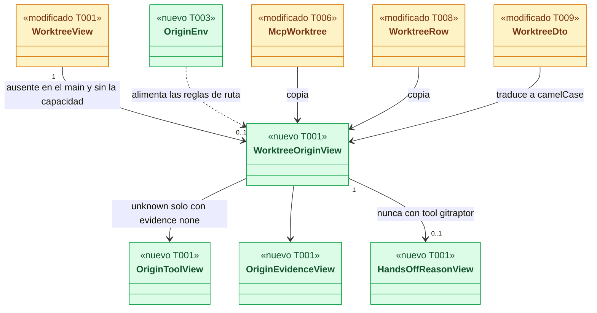
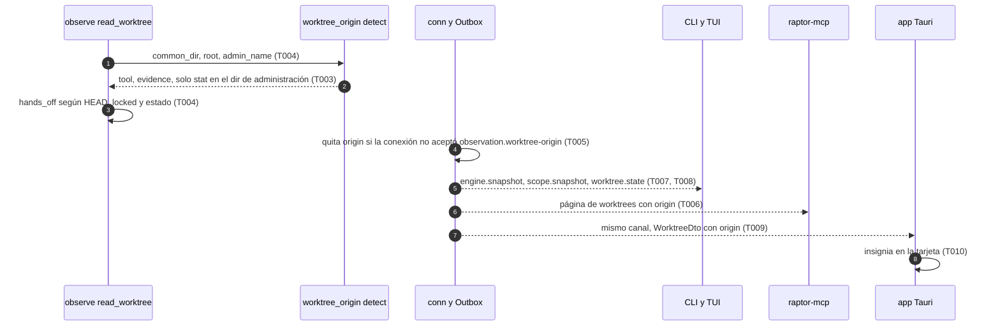
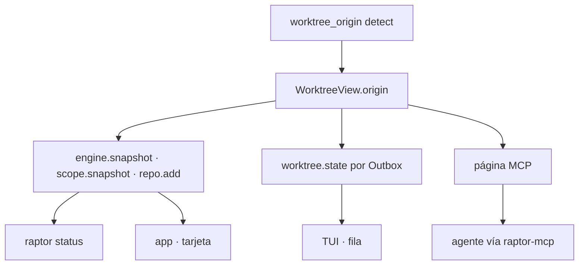
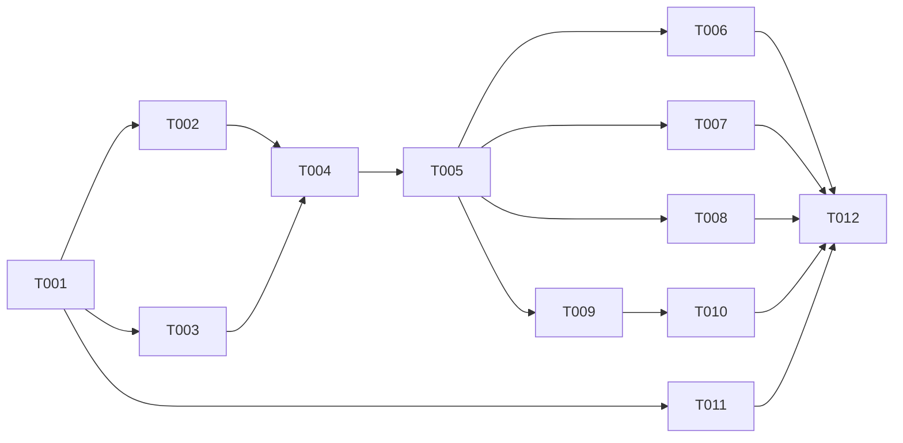

# DS-US-WTL-005 · Origen de cada worktree y marca «ajeno, no tocar»

## Contexto rápido

Al terminar, el desarrollador ve en `raptor status`, la TUI, la app y `raptor-mcp` qué herramienta creó cada worktree (Orca, worktrunk, Codex, Claude Code) o «ajeno» cuando no se sabe, y los de HEAD separado salen marcados «ajeno, no tocar». Hoy la flota los pinta todos iguales: no hay forma de saber de quién es un worktree ni cuáles no debe tocar una operación futura de descarte o limpieza.

Para eso: un tipo cerrado de origen en el contrato detrás de una capacidad nueva, una detección de **solo lectura** en el motor (marcas en el directorio de administración de Git y patrones de ruta, nunca nada dentro del worktree) y la marca derivada que respetan los cuatro clientes y respetarán las operaciones de US-WTL-001/002/007/008.

| Término | Qué es aquí |
|---|---|
| Worktree ajeno | Uno que no creó GitRaptor (glosario de CTX-WTL-001). Hoy GitRaptor no crea worktrees, así que todo worktree enlazado es ajeno |
| Origen | `tool` (quién lo creó) + `evidence` (cómo se sabe). `unknown` con `none` cuando no hay evidencia |
| Evidencia `admin-marker` | Una marca que la herramienta deja en `<common>/worktrees/<id>/`: cierta |
| Evidencia `path-pattern` | La ruta coincide con la ubicación por defecto de la herramienta: probable, se pinta como tal |
| «Ajeno, no tocar» (`hands_off`) | Worktree ajeno que GitRaptor no descarta, no limpia y al que no copia nada (BR-WTL-011) |
| Directorio de administración | `<common>/worktrees/<id>/`, lo que Git registra de un worktree enlazado |
| Capacidad | Nombre que el cliente acepta en `connection.accept` para recibir una forma nueva (ADR-GRP-016) |

---

## 📋 Índice

> **Para aprobar:** [Contexto rápido](#contexto-rápido) · [⚠️ Gaps](#gaps-y-violaciones-de-la-constitución) · [🔭 La forma](#la-forma) · [El trabajo de un vistazo](#el-trabajo-de-un-vistazo).
> **Para implementar:** [🚀 Plan](#plan-de-implementación), en orden. Las `_(ref)_` se abren desde la tarea que las cita.

| Sección | Propósito |
|---------|-----------|
| [Contexto rápido](#contexto-rápido) | Qué se construye y el glosario |
| [⚠️ Gaps y violaciones de la constitución](#gaps-y-violaciones-de-la-constitución) | Qué impide empezar |
| [🔭 La forma](#la-forma) | Piezas, cambios y flujo |
| [🚀 Plan de implementación](#plan-de-implementación) | T001…T012, en orden |
| ↳ [El trabajo de un vistazo](#el-trabajo-de-un-vistazo) | Tareas en tabla y su orden |
| [Estructura de ficheros](#estructura-de-ficheros) _(ref)_ | Árbol anotado de ficheros |
| [Contratos compartidos](#contratos-compartidos) _(ref)_ | Tipos, reglas de detección, firmas, textos |
| [Contrato de API](#contrato-de-api) _(ref)_ | Capacidad, forma JSON, numéricos |
| [Modelo de datos](#modelo-de-datos) _(ref)_ | No aplica |
| [Estrategia de pruebas y cobertura](#estrategia-de-pruebas-y-cobertura) _(ref)_ | Pirámide, comportamientos críticos, plataformas |
| [Gate de seguridad](#gate-de-seguridad) | Checklist pre-merge |
| [Fuera de alcance](#fuera-de-alcance) | Lo que esta entrega no toca |
| [Notas del autor](#notas-del-autor) _(ref)_ | Lo que no bloquea |

---

## ⚠️ Gaps y violaciones de la constitución

| ID | Qué falta | Severidad | Alcance | Acción | Owner |
|----|-----------|-----------|---------|--------|-------|
| G1 | El Riesgo 7 de CTX-WTL-001 (`context.md:408`, «un worktree de Codex con HEAD separado se limpia desde Codex, no desde GitRaptor») sigue «Pendiente de Rene». La entrega implementa BR-WTL-011 tal cual; si Rene no acepta el riesgo, cambia qué significa `hands_off` | Bloquea liberación | — | Rene acepta o rechaza el Riesgo 7 antes del merge | Rene (PO) |

Lo que no bloquea nada va en [Notas del autor](#notas-del-autor), con su id `Gn`.

---

## 🔭 La forma

Al terminar, cada `WorktreeView` enlazado lleva un `WorktreeOriginView` calculado en cada lectura, sin persistir, y los cuatro clientes lo pintan con la misma regla de confianza.



🟩 nuevo · 🟨 modificado · ⬜ existente (contexto: no cambia). Cada pieza dice qué tarea la toca.

Las invariantes de las aristas (`unknown` ⇔ `none`, `gitraptor` ⇔ `registered`, sin `hands_off` para `gitraptor`) las hace cumplir el deserializador: un origen adivinado con confianza falsa no se puede ni construir.

**Cómo fluye:**



El paso 4 es el que cambia un contrato publicado: `WorktreeView` es `deny_unknown_fields`, así que un cliente anterior falla si recibe `origin` por cualquiera de sus salidas.

**Dónde acaba el dato:**



Sale igual por las cuatro salidas y llega con la misma regla de pintado (cierto, probable, desconocido); T005 comprueba las salidas y T007–T010 el pintado.

---

## 🚀 Plan de implementación

> Orden topológico (`Depende:`). Una casilla se marca cuando su `Aceptación` está verificada. Las rutas son relativas a la raíz del repo.

### El trabajo de un vistazo

Cuatro frentes y un cierre: contrato (T001–T002), motor (T003–T005), clientes (T006–T010), documentación (T011) y verificación en macOS (T012).

| # | Tarea | Depende | Aterriza en |
|---|---|---|---|
| T001 | Crear el tipo del origen y la capacidad `observation.worktree-origin` | — | `crates/api` |
| T002 | Completar las construcciones literales de `WorktreeView` con `origin: None` | T001 | `crates/*`, `apps/*` |
| T003 | Crear la detección de origen de solo lectura en el motor | T001 | `crates/core` |
| T004 | Rellenar el origen y la marca al leer cada worktree | T002, T003 | `crates/core` |
| T005 | Servir el origen solo a la conexión que tiene la capacidad | T004 | `crates/core/src/channel` |
| T006 | Añadir el origen a la página de worktrees de `raptor-mcp` | T005 | `crates/api`, `crates/core` |
| T007 | Mostrar el origen en `raptor status` | T005 | `apps/cli` |
| T008 | Mostrar el origen y la marca en la fila de la TUI | T005 | `apps/cli` |
| T009 | Pedir la capacidad y llevar el origen al DTO de la app | T005 | `apps/desktop/src-tauri` |
| T010 | Pintar la insignia de origen en la tarjeta de la app | T009 | `apps/desktop/src` |
| T011 | Documentar la capacidad en el contrato IPC y en ADR-GRP-016 | T001 | `docs/architecture` |
| T012 | Verificar en macOS con worktrees reales de Orca y worktrunk | T006, T007, T008, T010, T011 | — |

### En qué orden

Una cadena corta hasta T005 y luego un abanico de cuatro clientes en paralelo.



### T001 — Crear el tipo del origen y la capacidad `observation.worktree-origin`

**Objetivo.** El contrato tiene `WorktreeOriginView` y la capacidad que lo gobierna; no hay detección todavía.

**Ubicación.**
- `crates/api/src/worktree_origin.rs` (**CREATE**)
- `crates/api/src/lib.rs` (**MODIFY**)
- `crates/api/src/methods/observation.rs` (**MODIFY**)
- `crates/api/src/messages.rs` (**MODIFY**)
- `crates/api/tests/worktree_origin.rs` (**CREATE**)

**Pasos**
1. Crear `worktree_origin.rs` con los tipos de [Tipos y datos compartidos](#tipos-y-datos-compartidos), `OriginToolView::label` y el deserializador por `try_from` que rechaza las combinaciones prohibidas.
   1.1 ⛔1.1 Derivar `Deserialize` directo sobre `WorktreeOriginView` deja pasar `{"tool":"codex","evidence":"none"}`: confianza sin evidencia. Hazlo con `#[serde(try_from = "OriginWire")]`.
2. Añadir `pub mod worktree_origin;` en `lib.rs`, en orden alfabético (una línea; no toca `PROTOCOL_VERSION` ni `API_VERSION`).
3. Declarar `CAP_OBSERVATION_WORKTREE_ORIGIN` en `observation.rs` y añadirla a `GROUP.capabilities`.
4. Añadir a `WorktreeView` el campo `origin` con `#[serde(default, skip_serializing_if = "Option::is_none")]`, y `without_worktree_origin()` en `WorktreeView`, `RepoView` y `WorktreeStateData`, como `without_change_attribution`.

- **Depende:** —
- **Refs:** ADR-GRP-016 § Añadir una capacidad; guía `extender-sin-archivos-compartidos.md`; BR-WTL-011
- **Aceptación:** `cargo test -p gitraptor-api --test worktree_origin` (forma JSON de los tres ejemplos del [Contrato de API](#contrato-de-api), campos desconocidos rechazados, capacidad en el grupo `observation`, `without_worktree_origin` deja el JSON de antes)
- **Guard ⛔1.1:** `inconsistent_origins_are_rejected` en `crates/api/tests/worktree_origin.rs`: `unknown`+`path-pattern`, `codex`+`none`, `gitraptor`+`path-pattern` y `gitraptor`+`hands_off` fallan al deserializar.

### T002 — Completar las construcciones literales de `WorktreeView` con `origin: None`

**Objetivo.** El workspace compila con el campo nuevo; ningún comportamiento cambia.

**Ubicación.**
- `apps/cli/src/present/graph_order_tests.rs` (**MODIFY**)
- `apps/cli/src/present/graph_tests.rs` (**MODIFY**)
- `apps/cli/src/status_summary_tests.rs` (**MODIFY**)
- `apps/cli/src/tui/conflict_toast_tests.rs` (**MODIFY**)
- `apps/cli/src/tui/freshness_view_tests.rs` (**MODIFY**)
- `apps/cli/src/tui/graph_tests.rs` (**MODIFY**)
- `apps/cli/src/tui/prediction_stale_tests.rs` (**MODIFY**)
- `apps/cli/src/tui/prediction_tests.rs` (**MODIFY**)
- `apps/cli/src/tui/view_order_tests.rs` (**MODIFY**)
- `apps/cli/src/tui/view/a11y_tests.rs` (**MODIFY**)
- `apps/cli/tests/tui_conflict_alert.rs` (**MODIFY**)
- `apps/cli/tests/tui_fleet_order.rs` (**MODIFY**)
- `apps/cli/tests/tui_freshness.rs` (**MODIFY**)
- `apps/cli/tests/tui_loop.rs` (**MODIFY**)
- `apps/cli/tests/tui_screens.rs` (**MODIFY**)
- `apps/cli/tests/tui_state_screens.rs` (**MODIFY**)
- `apps/desktop/src-tauri/tests/support/fake_daemon.rs` (**MODIFY**)
- `crates/api/tests/change_attribution.rs` (**MODIFY**)
- `crates/api/tests/special_states.rs` (**MODIFY**)
- `crates/core/src/channel/mcp_conflicts_tests.rs` (**MODIFY**)
- `crates/core/src/channel/mcp_status_more_tests.rs` (**MODIFY**)
- `crates/core/src/channel/mcp_status_tests.rs` (**MODIFY**)
- `crates/core/tests/observe.rs` (**MODIFY**)
- `crates/core/tests/us_grp_003_states.rs` (**MODIFY**)

**Reglas**
- Solo se añade `origin: None,` en cada construcción literal; un patrón con `..` no se toca. La lista sale de `git grep -l "WorktreeView {"` del 2026-11-21: el compilador manda si difiere.
- `status.rs` y `tui/view.rs` también construyen literales; se completan en T007 y T008, y `observe.rs`, `conn.rs` y `bus.rs` en T004 y T005.

- **Depende:** T001
- **Refs:** guía `extender-sin-archivos-compartidos.md` § Qué sigue siendo compartido
- **Aceptación:** `cargo clippy --workspace --exclude gitraptor-desktop --all-targets -- -D warnings` y `cargo test --workspace --exclude gitraptor-desktop` en verde sin cambios de aserciones.

### T003 — Crear la detección de origen de solo lectura en el motor

**Objetivo.** Una función pura, sin escrituras, que da `(tool, evidence)` y la marca para un worktree; no se llama todavía desde la observación.

**Ubicación.**
- `crates/core/src/worktree_origin.rs` (**CREATE**)
- `crates/core/tests/worktree_origin_detect.rs` (**CREATE**)
- `crates/core/src/lib.rs` (**MODIFY**)

**Reglas**
- `lib.rs` lleva `pub mod worktree_origin;`; `OriginEnv` (campos públicos), `detect`, `is_locked`, `hands_off`, `origin_of` y `refuses_destructive` son `pub`, porque la prueba de aceptación es de integración.
- Aplica las reglas de [Reglas de detección](#reglas-de-detección) en ese orden; la primera que acierta gana.
- Solo `std::fs::symlink_metadata` sobre `<common>/worktrees/<id>/orca` y `<common>/worktrees/<id>/locked`; nada se abre, nada se lee dentro de la raíz del worktree y nada se escribe, mueve ni borra.
- El `id` se acepta solo si es un único componente `Normal`, como en `linked_is_trusted_in` (`observe.rs:538`).
- Las comparaciones de ruta usan `observe::canonical` en los dos lados y `Path::starts_with`, nunca prefijos de texto.
- Ninguna función devuelve `Result`: lo que no se puede comprobar (raíz que desapareció, `stat` que falla) cae en la regla siguiente y, al final, en `unknown`.
- `OriginEnv::from_process()` lee `observe::home_folders()` y `CODEX_HOME`; los tests construyen `OriginEnv` a mano y nunca tocan el entorno del proceso.
- `refuses_destructive` es el punto de enganche de las operaciones futuras: `true` para un worktree enlazado sin origen o con `hands_off`.

> **Nota técnica.** Un `orca` que es un enlace simbólico no cuenta: el directorio de administración lo puede escribir un agente (SEC-11), y seguir el enlace convertiría una marca falsa en evidencia cierta.

- **Depende:** T001
- **Refs:** ADR-GRP-009 (frontera de solo lectura); SEC-11; NFR-01
- **Aceptación:** `cargo test -p gitraptor-core --test worktree_origin_detect` (una prueba por regla, precedencia marca > ruta, Codex con `CODEX_HOME` y con el valor por defecto, repo bare sin reglas de raíz principal, `orca` simbólico ignorado, raíz borrada sin pánico, `refuses_destructive`).

### T004 — Rellenar el origen y la marca al leer cada worktree

**Objetivo.** `read_worktree` publica `origin` en cada worktree enlazado, listo o no disponible; el principal sigue sin él.

**Ubicación.**
- `crates/core/src/observe.rs` (**MODIFY**)
- `crates/core/tests/worktree_origin.rs` (**CREATE**)

**Pasos**
1. En `read_worktree` (`observe.rs:724`), añadir `origin: None` al cierre `view` y, tras decidir el estado (listo o `Unavailable`), asignar `view.origin = worktree_origin::origin_of(common_dir, path, main, admin_name, false, &view.status, &OriginEnv::from_process())`.
   1.1 ⛔1.1 Calcularlo solo en la rama `Ok` deja sin origen un worktree ajeno ilegible, y `refuses_destructive` lo trataría bien pero los clientes no pintarían «no tocar». Hazlo en las dos ramas.
2. No cambiar la firma de `read_worktree` ni `reconcile`: 24 llamadas fuera de `observe.rs` dependen de ella.
3. No guardar el origen en el almacén (`store_ops` no cambia).

- **Depende:** T002, T003
- **Refs:** BR-WTL-011; US-WTL-005 escenarios 1–4
- **Aceptación:** `cargo test -p gitraptor-core --test worktree_origin`: `fleet_shows_origin_when_known` (worktree hermano `repo.feat` → `worktrunk`/`path-pattern`, marca `orca/` → `orca`/`admin-marker`, uno a mano en otra carpeta → `unknown`/`none`), `detached_foreign_is_hands_off`, `locked_foreign_is_hands_off`, `other_tool_config_is_untouched`, `vanished_worktree_leaves_without_error`.
- **Guard ⛔1.1:** `unreadable_foreign_is_hands_off` en el mismo archivo.

### T005 — Servir el origen solo a la conexión que tiene la capacidad

**Objetivo.** Ninguna salida entrega `origin` a una conexión que no aceptó `observation.worktree-origin`.

**Ubicación.**
- `crates/core/src/channel/bus.rs` (**MODIFY**)
- `crates/core/src/channel/conn.rs` (**MODIFY**)
- `crates/core/tests/worktree_origin_capability.rs` (**CREATE**)

**Pasos**
1. En `bus.rs`, añadir `without_worktree_origin: AtomicBool` (por defecto `true`), su setter y su aplicación a `WorktreeStateData`, junto a `without_change_attribution` (`bus.rs:50`, `bus.rs:225`).
2. En `conn.rs`, en `apply_capabilities` (`conn.rs:774`), `set_without_worktree_origin(!self.has(methods::CAP_OBSERVATION_WORKTREE_ORIGIN.name))`.
3. Crear `shape_worktree_origin` junto a `shape_change_attribution` (`conn.rs:5163`) y llamarla en los tres sitios donde se llama esta (`repo.add`, `engine.snapshot`, `scope.snapshot`).
   3.1 ⛔3.1 Olvidar una salida rompe al cliente anterior al deserializar (ADR-GRP-016, Enmienda 2026-10-28, primera regla).

- **Depende:** T004
- **Refs:** ADR-GRP-016 § Añadir una capacidad y Enmienda (2026-10-28); precedente DS-US-GRP-008
- **Aceptación:** `cargo test -p gitraptor-core --test worktree_origin_capability` (con la capacidad, `origin` en las cuatro salidas; sin ella, ninguna lo lleva y el JSON es el de antes), siguiendo `crates/core/tests/change_attribution.rs`.
- **Guard ⛔3.1:** `no_output_leaks_origin_without_capability` recorre `repo.add`, `engine.snapshot`, `scope.snapshot` y `worktree.state`.

### T006 — Añadir el origen a la página de worktrees de `raptor-mcp`

**Objetivo.** Un agente que lista los otros worktrees ve quién los creó y cuáles no debe tocar.

**Ubicación.**
- `crates/api/src/methods/mcp.rs` (**MODIFY**)
- `crates/core/src/channel/mcp_status.rs` (**MODIFY**)
- `crates/core/src/channel/conn.rs` (**MODIFY**)
- `crates/core/src/channel/mcp_status_origin_tests.rs` (**CREATE**)

**Pasos**
1. Añadir a `McpWorktree` (`mcp.rs:350`) `origin: Option<WorktreeOriginView>` con `#[serde(default, skip_serializing_if = "Option::is_none")]`.
2. En `worktrees_page` (`mcp_status.rs:380`), copiar `view.origin.clone()`.
3. En `mcp_worktrees_page` (`conn.rs:2483`), poner `origin = None` en cada elemento si la conexión no tiene la capacidad.
4. Registrar el archivo de pruebas con `#[cfg(test)] #[path = "mcp_status_origin_tests.rs"] mod origin_tests;` en `mcp_status.rs`, como los dos existentes.

- **Depende:** T005
- **Refs:** ADR-MCP-001; NFR-02
- **Aceptación:** `cargo test -p gitraptor-core --lib mcp_status::origin_tests` (con origen y marca en la página; sin la capacidad, ausente).

### T007 — Mostrar el origen en `raptor status`

**Objetivo.** Texto y `--json` de `raptor status` llevan el origen y la marca de cada worktree enlazado.

**Ubicación.**
- `apps/cli/src/status.rs` (**MODIFY**)
- `apps/cli/i18n/en/status.txt` (**MODIFY**)
- `apps/cli/i18n/es/status.txt` (**MODIFY**)
- `apps/cli/tests/status_origin.rs` (**CREATE**)

**Reglas**
- Una línea por worktree enlazado, tras la de la rama: `status.hands-off-*` si hay marca; si no, `status.origin`, `status.origin-likely` o `status.origin-unknown` según [Textos](#textos-del-catálogo).
- El nombre de la herramienta sale de `OriginToolView::label`; la ruta y la rama se siguen imprimiendo solo por `sanitized()` (SEC-12).
- En el JSON, `origin` es el mismo objeto del cable (serializar `WorktreeOriginView`), ausente en el principal y frente a un motor sin la capacidad.
- La construcción literal de `status.rs:596` recibe `origin: None`.

- **Depende:** T005
- **Refs:** SEC-12; guía § Añadir un mensaje
- **Aceptación:** `cargo test -p gitraptor-cli --test status_origin` (líneas en `en` y `es`, JSON con y sin origen, un nombre de rama con escapes OSC sigue saliendo saneado).

### T008 — Mostrar el origen y la marca en la fila de la TUI

**Objetivo.** La fila de cada worktree enlazado lleva su etiqueta de origen o «ajeno · no tocar».

**Ubicación.**
- `apps/cli/src/model.rs` (**MODIFY**)
- `apps/cli/src/present/ingest.rs` (**MODIFY**)
- `apps/cli/src/present/i18n.rs` (**MODIFY**)
- `apps/cli/src/tui/view.rs` (**MODIFY**)
- `apps/cli/tests/tui_origin.rs` (**CREATE**)

**Reglas**
- `WorktreeRow` (`model.rs:441`) gana `origin: Option<WorktreeOriginView>`; `ingest.rs:185` lo copia del `WorktreeView`.
- En `row` (`view.rs:707`), `tag` sigue la precedencia: marca «no tocar» > `temporary` > origen.
- `Text` gana `Origin { tool: &'static str, likely: bool }`, `OriginUnknown` y `HandsOff(HandsOffReasonView)`, con su brazo en los dos `match` por idioma.
- La construcción literal de `view.rs:926` recibe `origin: None`.

- **Depende:** T005
- **Refs:** ADR-CKP-003; SEC-12
- **Aceptación:** `cargo test -p gitraptor-cli --test tui_origin` (las cuatro etiquetas en `en` y `es`, precedencia sobre `temporary`, el principal sin etiqueta), con el arnés de pantalla de `apps/cli/tests/tui_screens.rs`.

### T009 — Pedir la capacidad y llevar el origen al DTO de la app

**Objetivo.** El backend de la app acepta la capacidad y entrega `origin` al webview en el `WorktreeDto` que ya envía; sin comando IPC nuevo.

**Ubicación.**
- `apps/desktop/src-tauri/src/engine/link.rs` (**MODIFY**)
- `apps/desktop/src-tauri/src/engine/wire.rs` (**MODIFY**)
- `apps/desktop/src-tauri/src/engine/ingest.rs` (**MODIFY**)
- `apps/desktop/src-tauri/tests/worktree_origin.rs` (**CREATE**)

**Reglas**
- `CAP_OBSERVATION_WORKTREE_ORIGIN.name` entra en la lista de capacidades de `link.rs:20`.
- `WorktreeDto` (`wire.rs:326`) gana `origin: Option<OriginDto>`; `ingest::worktree` (`ingest.rs:185`) traduce los enums cerrados uno a uno. No hay texto no confiable nuevo.
- La lista cerrada de comandos de ADR-GRP-017 § 1 no cambia.

- **Depende:** T005
- **Refs:** ADR-GRP-017 § 1 y § 2; SEC-12
- **Aceptación:** `cargo test -p gitraptor-desktop --test worktree_origin` (traducción de los tres casos, `null` sin origen, la capacidad está en la lista), con `apps/desktop/dist` construido.

### T010 — Pintar la insignia de origen en la tarjeta de la app

**Objetivo.** La tarjeta de un worktree enlazado muestra su origen o «Ajeno · no tocar».

**Ubicación.**
- `apps/desktop/src/client/engine-types.ts` (**MODIFY**)
- `apps/desktop/src/fleet/fleet-model.ts` (**MODIFY**)
- `apps/desktop/src/ui/WorktreeCard.tsx` (**MODIFY**)
- `apps/desktop/src/i18n/locales/en.json` (**MODIFY**)
- `apps/desktop/src/i18n/locales/es.json` (**MODIFY**)
- `apps/desktop/src/fleet/fleet-model.test.ts` (**MODIFY**)

**Reglas**
- `WorktreeDto` en TS gana `origin: OriginDto | null`; `CardModel` gana `originText: string | null` y `handsOff: boolean`.
- `originText` sigue la misma regla que la TUI con las claves `fleet.origin.*` y `fleet.handsOff.*`; React lo pinta como texto.
- `a11yLabel` incluye `originText`.

- **Depende:** T009
- **Refs:** ADR-GRP-004; ADR-GRP-017 § 2 (texto no confiable)
- **Aceptación:** `pnpm --filter @gitraptor/desktop test` (casos de `fleet-model.test.ts`: cierto, probable, desconocido, marca, principal sin insignia); el test de catálogo existente comprueba claves iguales en `en` y `es`.

### T011 — Documentar la capacidad en el contrato IPC y en ADR-GRP-016

**Objetivo.** La siguiente Dev Spec ve el nombre de la capacidad tomado y la forma del campo.

**Ubicación.**
- `docs/architecture/design/api-contract-ipc.md` (**MODIFY**)
- `docs/architecture/decisions/ADR-GRP-016-extension-registro-capacidades.md` (**MODIFY**)

**Reglas**
- En § Estado de un worktree, una viñeta con la forma de `origin` y la regla «ausente en el principal y sin la capacidad».
- En ADR-GRP-016, una `## Enmienda (2026-11-21, US-WTL-005)` con una fila en el formato de la tabla de 2026-10-28: capacidad, archivo, qué cambia, quién la pide (CLI, TUI, `raptor-mcp` y la app), fuente `DS-US-WTL-005`. No cambia ninguna regla ni el `status`.

- **Depende:** T001
- **Refs:** ADR-GRP-016, Enmienda (2026-10-28)
- **Aceptación:** `grep -rln "observation.worktree-origin" docs/architecture` devuelve las dos rutas.

### T012 — Verificar en macOS con worktrees reales de Orca y worktrunk

**Objetivo.** Ver en un repo de demo los tres escenarios de la historia con herramientas reales, sin tocar este repo.

**Ubicación.** Ninguna: solo corre verificaciones.

**Pasos**
1. En un repo de demo bajo `~/orca/workspaces/` creado con Orca, crear un worktree con `wt switch -c demo-feat` y otro a mano con `git worktree add --detach /tmp/<demo>/manual`.
2. Comprobar en `raptor status`, la TUI y la app: Orca `admin-marker`, worktrunk probable, el manual «ajeno, no tocar: HEAD separado».
3. Anotar sha256 de `.worktreeinclude`, `.config/wt.toml` y `<common>/worktrees/*/orca/*` antes y después de 5 minutos de observación: iguales.
4. Borrar el de worktrunk con `wt remove`: la flota deja de mostrarlo y el resto no cambia.

- **Depende:** T006, T007, T008, T010, T011
- **Refs:** US-WTL-005 escenarios 1, 3 y 4
- **Aceptación:** los cuatro pasos anotados en el PR; lo que no se pudo ver, dicho.

---

> Las secciones siguientes son de referencia: se abren desde la tarea que las cita.

## Estructura de ficheros

```text
crates/api/src/
├── worktree_origin.rs                 ← CREATE  (T001)
├── lib.rs                             ← MODIFY  (T001, una línea)
├── messages.rs                        ← MODIFY  (T001, campo + without_worktree_origin)
└── methods/
    ├── observation.rs                 ← MODIFY  (T001)
    └── mcp.rs                         ← MODIFY  (T006)
crates/api/tests/worktree_origin.rs    ← CREATE  (T001)
crates/core/src/
├── worktree_origin.rs                 ← CREATE  (T003)
├── lib.rs                             ← MODIFY  (T003, una línea)
├── observe.rs                         ← MODIFY  (T004)
└── channel/
    ├── bus.rs                         ← MODIFY  (T005)
    ├── conn.rs                        ← MODIFY  (T005, T006)
    ├── mcp_status.rs                  ← MODIFY  (T006)
    └── mcp_status_origin_tests.rs     ← CREATE  (T006)
crates/core/tests/
├── worktree_origin_detect.rs          ← CREATE  (T003)
├── worktree_origin.rs                 ← CREATE  (T004)
└── worktree_origin_capability.rs      ← CREATE  (T005)
apps/cli/
├── src/status.rs                      ← MODIFY  (T007)
├── src/model.rs                       ← MODIFY  (T008)
├── src/present/ingest.rs              ← MODIFY  (T008)
├── src/present/i18n.rs                ← MODIFY  (T008)
├── src/tui/view.rs                    ← MODIFY  (T008)
├── i18n/en/status.txt                 ← MODIFY  (T007)
├── i18n/es/status.txt                 ← MODIFY  (T007)
├── tests/status_origin.rs             ← CREATE  (T007)
└── tests/tui_origin.rs                ← CREATE  (T008)
apps/desktop/
├── src-tauri/src/engine/link.rs       ← MODIFY  (T009)
├── src-tauri/src/engine/wire.rs       ← MODIFY  (T009)
├── src-tauri/src/engine/ingest.rs     ← MODIFY  (T009)
├── src-tauri/tests/worktree_origin.rs ← CREATE  (T009)
├── src/client/engine-types.ts         ← MODIFY  (T010)
├── src/fleet/fleet-model.ts           ← MODIFY  (T010)
├── src/fleet/fleet-model.test.ts      ← MODIFY  (T010)
├── src/ui/WorktreeCard.tsx            ← MODIFY  (T010)
└── src/i18n/locales/{en,es}.json      ← MODIFY  (T010)
docs/architecture/
├── design/api-contract-ipc.md         ← MODIFY  (T011)
└── decisions/ADR-GRP-016-…md          ← MODIFY  (T011)
```

`← CREATE`: fichero nuevo. `← MODIFY`: fichero existente. Los 24 ficheros de construcciones literales de T002 están en su `Ubicación`.

---

## Contratos compartidos

### Tipos y datos compartidos

```rust
// crates/api/src/worktree_origin.rs
#[derive(Debug, Clone, Copy, PartialEq, Eq, Serialize, Deserialize, JsonSchema)]
#[serde(rename_all = "kebab-case")]
pub enum OriginToolView { Gitraptor, Orca, Worktrunk, Codex, Gitkraken, ClaudeCode, Unknown }

#[derive(Debug, Clone, Copy, PartialEq, Eq, Serialize, Deserialize, JsonSchema)]
#[serde(rename_all = "kebab-case")]
pub enum OriginEvidenceView {
    /// GitRaptor's own record (reserved: US-WTL-001, US-WTL-004). Never produced by this spec.
    Registered,
    /// A marker the tool leaves in `<common>/worktrees/<id>/`.
    AdminMarker,
    /// The root sits where the tool puts worktrees by default: likely, not certain.
    PathPattern,
    /// No evidence: `tool` is `unknown`.
    None,
}

#[derive(Debug, Clone, Copy, PartialEq, Eq, Serialize, Deserialize, JsonSchema)]
#[serde(rename_all = "kebab-case")]
pub enum HandsOffReasonView { Detached, Locked, Unreadable }

/// Who created a linked worktree and how that is known (US-WTL-005, BR-WTL-011).
#[derive(Debug, Clone, PartialEq, Eq, Serialize, Deserialize, JsonSchema)]
#[serde(deny_unknown_fields, try_from = "OriginWire")]
pub struct WorktreeOriginView {
    pub tool: OriginToolView,
    pub evidence: OriginEvidenceView,
    /// Foreign and not proven safe to touch: GitRaptor offers no discard, cleanup or copy.
    #[serde(default, skip_serializing_if = "Option::is_none")]
    pub hands_off: Option<HandsOffReasonView>,
}

/// The combinations `WorktreeOriginView::new` refuses.
#[derive(Debug, Clone, Copy, PartialEq, Eq)]
pub enum OriginInvariant { UnknownWithEvidence, EvidenceWithoutTool, GitraptorNotRegistered, GitraptorHandsOff }

// crates/api/src/messages.rs — WorktreeView gains:
#[serde(default, skip_serializing_if = "Option::is_none")]
pub origin: Option<WorktreeOriginView>,

// crates/core/src/worktree_origin.rs
pub struct OriginEnv {
    /// `observe::home_folders()`: HOME, and USERPROFILE on Windows.
    pub homes: Vec<PathBuf>,
    /// `CODEX_HOME` when set; otherwise `<home>/.codex` is tried.
    pub codex_home: Option<PathBuf>,
}

// apps/cli/src/model.rs — WorktreeRow gains (closed enums: nothing to sanitize):
pub origin: Option<WorktreeOriginView>,

// apps/desktop/src-tauri/src/engine/wire.rs — WorktreeDto (camelCase) gains:
pub origin: Option<OriginDto>,
#[derive(Debug, Clone, PartialEq, Eq, Serialize)]
#[serde(rename_all = "camelCase")]
pub struct OriginDto { pub tool: OriginToolView, pub evidence: OriginEvidenceView, pub hands_off: Option<HandsOffReasonView> }
```

```ts
export interface OriginDto {
  tool: "gitraptor" | "orca" | "worktrunk" | "codex" | "gitkraken" | "claude-code" | "unknown";
  evidence: "registered" | "admin-marker" | "path-pattern" | "none";
  handsOff: "detached" | "locked" | "unreadable" | null;
}
```

#### Reglas de detección

Solo para worktrees enlazados; el principal no lleva `origin`. `main_root` es `common_dir.parent()` cuando `common_dir` se llama `.git`; en un repo bare no hay y las reglas 4 y 7 se saltan.

| # | Regla | Resultado | Fuente | Estado |
|---|---|---|---|---|
| 1 | `registered_by_gitraptor` (hoy siempre `false`) | `gitraptor` · `registered` | US-WTL-001 / US-WTL-004 lo activarán | Reservado |
| 2 | `<common>/worktrees/<id>/orca` es un directorio real (no enlace) | `orca` · `admin-marker` | Visto en esta máquina el 2026-11-21: los 8 worktrees de Orca de este repo lo tienen, con `setup-runner.sh` | Comprobado en macOS |
| 3 | (sin regla para GitKraken) | — | Su ayuda no da ubicación ni marca (consultado 2026-11-21) | Por confirmar en validación |
| 4 | Raíz bajo `<main_root>/.claude/worktrees/` | `claude-code` · `path-pattern` | Ubicación documentada de `claude --worktree`; no había ninguno en esta máquina | Por confirmar en validación |
| 5 | Raíz bajo `<codex_home>/worktrees/`, o `<home>/.codex/worktrees/` sin `CODEX_HOME` | `codex` · `path-pattern` | La ayuda de Codex dice `$CODEX_HOME/worktrees`, configurable en *Worktree root*; el valor por defecto `~/.codex` no lo dice la página | Por confirmar en validación |
| 6 | Raíz bajo `<home>/orca/workspaces/` | `orca` · `path-pattern` | Ubicación de Orca en esta máquina (AGENTS.md) | Comprobado en macOS |
| 7 | `root.parent() == main_root.parent()` y el nombre de la raíz es `<nombre de main_root>.<algo no vacío>` | `worktrunk` · `path-pattern` | Plantilla por defecto de `wt` v0.81.0: `{{ repo_path }}/../{{ repo }}.{{ branch \| sanitize }}` (`wt config --help`). Una plantilla propia del usuario cae en `unknown` | Comprobado en macOS |
| 8 | Ninguna de las anteriores | `unknown` · `none` | Incluye los creados a mano | — |

**Marca `hands_off`** (si `tool != gitraptor`), primera que acierta: estado listo con `HeadView::Detached` → `detached`; existe `<common>/worktrees/<id>/locked` → `locked`; estado `Unavailable` → `unreadable`; si no, ausente.

#### Textos del catálogo

| Caso | CLI (`status.txt`) en / es | TUI (`Text`) en / es | App (`fleet.*`) en / es |
|---|---|---|---|
| Cierto | `status.origin = origin: {tool}` / `origen: {tool}` | `Origin{likely:false}`: `{tool}` / `{tool}` | `origin.known`: `{{tool}}` / `{{tool}}` |
| Probable | `status.origin-likely = origin: probably {tool} (by path)` / `origen: probablemente {tool} (por la ruta)` | `Origin{likely:true}`: `{tool}?` / `¿{tool}?` | `origin.likely`: `Probably {{tool}}` / `Probablemente {{tool}}` |
| Desconocido | `status.origin-unknown = foreign (unknown origin)` / `ajeno (origen desconocido)` | `OriginUnknown`: `foreign` / `ajeno` | `origin.unknown`: `Foreign` / `Ajeno` |
| Marca, HEAD separado | `status.hands-off-detached = foreign, do not touch: detached HEAD` / `ajeno, no tocar: HEAD separado` | `HandsOff`: `foreign · hands off` / `ajeno · no tocar` | `handsOff.detached`: `Foreign · do not touch (detached HEAD)` / `Ajeno · no tocar (HEAD separado)` |
| Marca, bloqueado | `status.hands-off-locked = foreign, do not touch: locked by its tool` / `ajeno, no tocar: bloqueado por su herramienta` | igual que arriba | `handsOff.locked`: `Foreign · do not touch (locked)` / `Ajeno · no tocar (bloqueado)` |
| Marca, ilegible | `status.hands-off-unreadable = foreign, do not touch: could not be read` / `ajeno, no tocar: no se pudo leer` | igual que arriba | `handsOff.unreadable`: `Foreign · do not touch (unreadable)` / `Ajeno · no tocar (ilegible)` |

`{tool}` es `OriginToolView::label`: `GitRaptor`, `Orca`, `worktrunk`, `Codex`, `GitKraken`, `Claude Code` (nombres de producto, sin traducir). La línea de la marca añade el origen cuando se sabe: `ajeno, no tocar: HEAD separado (Codex, por la ruta)`.

### Ciclos de vida (DI)

_No ambient state — DI lifetimes follow stack defaults._ `OriginEnv::from_process()` se construye en cada `read_worktree`; el origen no se guarda en el almacén ni en caché.

### Firmas del stack

```rust
// crates/api/src/worktree_origin.rs
impl OriginToolView { pub fn label(self) -> Option<&'static str> } // None for Unknown
impl WorktreeOriginView {
    pub fn new(tool: OriginToolView, evidence: OriginEvidenceView, hands_off: Option<HandsOffReasonView>)
        -> Result<Self, OriginInvariant>;
    pub fn is_foreign(&self) -> bool;    // tool != Gitraptor
    pub fn is_hands_off(&self) -> bool;  // hands_off.is_some()
    pub fn is_likely(&self) -> bool;     // evidence == PathPattern
}
impl TryFrom<OriginWire> for WorktreeOriginView { type Error = OriginInvariant; }

// crates/api/src/messages.rs
impl WorktreeView { pub fn without_worktree_origin(&mut self); }
impl RepoView { pub fn without_worktree_origin(&mut self); }
impl WorktreeStateData { pub fn without_worktree_origin(&mut self); }

// crates/core/src/worktree_origin.rs
impl OriginEnv { pub fn from_process() -> Self; }
pub fn detect(common_dir: &Path, root: &Path, admin_name: Option<&str>,
              registered_by_gitraptor: bool, env: &OriginEnv) -> (OriginToolView, OriginEvidenceView);
pub fn is_locked(common_dir: &Path, admin_name: Option<&str>) -> bool;
pub fn hands_off(tool: OriginToolView, status: &WorktreeStatus, locked: bool) -> Option<HandsOffReasonView>;
/// None for the main worktree.
pub fn origin_of(common_dir: &Path, root: &Path, main: bool, admin_name: Option<&str>,
                 registered_by_gitraptor: bool, status: &WorktreeStatus, env: &OriginEnv)
    -> Option<WorktreeOriginView>;
/// Hook for discard, cleanup and copy (US-WTL-001/002/007/008, US-CKP-017):
/// true for a linked worktree with no origin or with `hands_off`.
pub fn refuses_destructive(view: &WorktreeView) -> bool;

// crates/core/src/channel/bus.rs
impl Outbox { pub fn set_without_worktree_origin(&self, without: bool); }
// crates/core/src/channel/conn.rs
fn shape_worktree_origin(accepted: bool, repos: &mut [RepoView]);
```

---

## Contrato de API

| Elemento | Valor |
|---|---|
| Capacidad | `observation.worktree-origin`, en `crates/api/src/methods/observation.rs` |
| Qué cambia de forma | `WorktreeView.origin` (todas las salidas de `RepoView` y `worktree.state`) y `McpWorktree.origin` |
| Quién la pide | CLI, TUI y `raptor-mcp` (el cliente de `crates/api` pide toda capacidad que conoce); la app, en `link.rs` |
| Protocolo | Sigue en 9; ningún método nuevo, ningún comando IPC nuevo (ADR-GRP-017 § 1) |

```json
{"path":{"untrusted":"/Users/u/.codex/worktrees/a1b2/demo"},"main":false,"admin_name":{"untrusted":"demo"},
 "status":{"state":"ready","head":{"kind":"detached"},"counts":{"staged":0,"unstaged":0,"untracked":0},"changes":[]},
 "origin":{"tool":"codex","evidence":"path-pattern","hands_off":"detached"}}
```

```json
{"origin":{"tool":"orca","evidence":"admin-marker"}}
{"origin":{"tool":"unknown","evidence":"none"}}
```

### Forma del error y del cuerpo de respuesta

_No aplica — esta entrega no añade caminos de error._ La detección nunca falla: lo que no se puede comprobar es `unknown`.

### Forma de la configuración

_No aplica — esta entrega no lee ni añade configuración._ `.worktreeinclude`, `.config/wt.toml`, `~/.config/worktrunk/config.toml` y la configuración de Orca, Codex y GitKraken no se abren.

### Valores numéricos

| Concepto | Valor | Fuente |
|---|---|---|
| Llamadas al sistema de archivos por worktree enlazado y lectura | ≤ 2 `symlink_metadata` (`orca`, `locked`) | T003 |
| Bytes leídos de la raíz de un worktree por la detección | 0 | ADR-GRP-009, NFR-01 |
| Escrituras en worktrees o en su directorio de administración | 0 | BR-WTL-011, NFR-01 |
| Texto no confiable nuevo en el cable | 0 campos (solo enums cerrados) | SEC-12 |

---

## Modelo de datos

_No aplica — el origen se calcula en cada lectura y no se guarda en el almacén del perfil._

---

## Estrategia de pruebas y cobertura

### 9.1 Pirámide de pruebas

| Tipo | Cantidad | Tareas dueñas | Herramientas | Cuándo |
|------|---------:|-------------|---------|------|
| Unit | 4 | T003, T006, T010 | `cargo test --lib`, vitest | PR gate |
| Integration | 5 | T004, T005, T007, T008, T009 | `cargo test --test`, `gitraptor-testkit` | PR gate |
| Contract | 2 | T001 | `cargo test -p gitraptor-api` | PR gate |
| E2E | 1 | T012 | manual en macOS | merge gate |

### 9.2 Umbrales de cobertura

| Capa | Línea | Rama | Mutación | Camino crítico 100% |
|-------|-----:|-------:|---------:|:------------------:|
| `crates/core/src/worktree_origin.rs` | — | — | — | ✅ cada regla de detección y cada razón de `hands_off` |

### 9.3 Datos de prueba

- Repos temporales con `gitraptor-testkit` y el CLI de `git` para crear fixtures, como `crates/core/tests/observe.rs`; nunca este repo.
- Worktrunk: worktree en `<tmp>/repo.feat`, hermano de `<tmp>/repo`. Orca: `mkdir <common>/worktrees/<id>/orca`. Codex y Claude Code: rutas bajo un `OriginEnv` de prueba. Bloqueado: `git worktree lock`.
- Entorno: `OriginEnv` construido a mano; ningún test modifica `HOME` ni `CODEX_HOME` del proceso.

### 9.4 Comportamientos críticos verificados

- [ ] Origen cierto, probable o desconocido según la evidencia; nunca una herramienta sin evidencia (T001 Guard, T003)
- [ ] HEAD separado y ajeno ⇒ `hands_off: detached` en los cuatro clientes (T004, T006–T010)
- [ ] Ningún archivo de otra herramienta cambia: sha256 y mtime de `.worktreeinclude`, `.config/wt.toml`, `.git/config` y `<common>/worktrees/*/**` iguales tras dos reconciliaciones (T004 `other_tool_config_is_untouched`)
- [ ] Un worktree ajeno quitado con `git worktree remove` entre dos reconciliaciones desaparece; `reconcile` devuelve `Ok` y los demás quedan iguales; uno borrado durante la lectura no provoca pánico (T004 `vanished_worktree_leaves_without_error`)
- [ ] Sin la capacidad, ninguna salida lleva `origin` (T005 Guard)
- [ ] `refuses_destructive` es `true` sin origen o con marca (T003)

### 9.5 Plataformas

| Plataforma | Cómo se verifica | Pendiente |
|---|---|---|
| macOS | Local y T012 | — |
| Linux | CI `ubuntu-latest` | Reglas de Orca y Codex en rutas reales: pendiente de validación en máquina Linux |
| Windows | CI de la suite | Pendiente de validación en máquina real: `USERPROFILE` frente a `HOME`, `%USERPROFILE%\.codex`, prefijo `\\?\` y mayúsculas en `starts_with` |

---

## Gate de seguridad

- `crates/core/src/worktree_origin.rs` no contiene `fs::write`, `create_dir`, `remove_`, `rename`, `File::create` ni `Command` (`grep` en el PR).
- `orca` y `locked` se comprueban con `symlink_metadata`; un enlace simbólico no es evidencia (SEC-11).
- El `id` de administración es un único componente (`observe.rs:538`).
- Rutas y ramas siguen saliendo como `Untrusted`/`UntrustedName` y se pintan solo saneadas en CLI, TUI, app y MCP (SEC-12); el origen no añade texto no confiable.
- Ninguna salida entrega `origin` sin la capacidad.

Corre `/security-review --scope devspec docs/requirements/features/worktree-lifecycle/dev-specs/US-WTL-005-convivencia-worktrees-ajenos.md` antes de mezclar.

---

## Fuera de alcance

| Ítem / no-objetivo | Historia que lo cubre | Gate (cómo se verifica) |
|----------------|--------------------|-------------------------|
| Crear, descartar, limpiar o copiar a worktrees | US-WTL-001, US-WTL-002, US-WTL-007, US-WTL-008, US-CKP-017 | `git diff --stat main -- crates/core/src/executor/ops` vacío |
| Escribir en worktrees ajenos o en la configuración de otras herramientas | BR-WTL-011 | 9.4 tercera casilla y el `grep` del Gate de seguridad |
| Regla de detección de GitKraken | Validación (G6) | Ningún brazo produce `OriginToolView::Gitkraken` (test en T003) |
| Guardar el origen en el almacén | — | `store_ops` sin cambios en `observe.rs` |
| Comando IPC nuevo en la app | ADR-GRP-017 § 1 | Manifiesto de capacidades de Tauri sin cambios |
| Origen `gitraptor` (`registered`) | US-WTL-001, US-WTL-004 | `registered_by_gitraptor` se pasa `false` en `observe.rs` |

---

## Notas del autor

| ID | Nota | Acción | Owner |
|----|------|--------|-------|
| G2 | El resolutor de Dev Specs propuso `features/cockpit/dev-specs/` (`dirSource: disk-other-slug`); el spec va en `features/worktree-lifecycle/dev-specs/`, como se pidió, junto a su historia | Ninguna | — |
| G3 | BR-WTL-011 dice «uno con HEAD separado» sin «ajeno». Hoy da igual (GitRaptor no crea worktrees, y los que cree tendrán rama con nombre); la marca se calcula como ajeno ∧ separado para que no se aplique a los de GitRaptor | Ninguna | — |
| G4 | `hands_off` también cubre `locked` (Git ya se niega a quitarlo sin `--force` doble) y `unreadable` (sin poder leer HEAD no se demuestra que sea seguro): deducción de NFR-01 que solo resta ofertas. El PO puede quitarlas antes de US-WTL-002 | Confirmar al revisar | PO |
| G5 | US-CKP-017, escenario «HEAD separado, solo el worktree», borra el worktree; con BR-WTL-011, si es ajeno, «Descartar» debe salir desactivado con su motivo. Su implementación debe llamar a `refuses_destructive` | Enmendar US-CKP-017 | PO |
| G6 | GitKraken no documenta ubicación ni marca: sus worktrees salen «ajeno», que cumple el escenario 4. La variante `gitkraken` existe ya para que añadir la regla no sea un cambio de forma | Comprobar en una instalación real | Orquestador |
| G7 | Un worktree creado a mano no se distingue de uno desconocido: sale «ajeno», que es lo que pide el escenario 1 | Ninguna | — |
| G8 | Un worktree cuya carpeta se borra sin `git worktree remove` sigue registrado y sale `unavailable { missing }` hasta que Git lo poda (contrato actual, `api-contract-ipc.md` § Estado de un worktree). No es un error | Ninguna | — |
| G9 | Ramas en paralelo que tocan lo mismo: US-WTL-001 y US-WTL-002 (worktrees `wtlcreate`, `wtldiscard`) deben consumir `refuses_destructive`; US-MCP-023 toca el JSON de `status.rs`. `messages.rs` sigue compartido: mergear en serie | Coordinar el orden de merge | Orquestador |
| G10 | T002 edita 24 ficheros solo para añadir `origin: None`. Un constructor de `WorktreeView` para tests ahorraría esto la próxima vez | Fuera de alcance; anotar como TD si se repite | Arquitecto |
