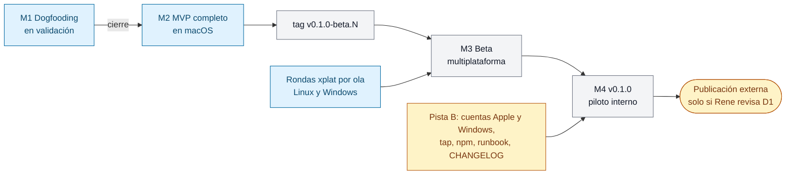

# Plan de releases y control de estado

> **Estado: propuesto (2026-10-08). Pendiente de la aprobación de Rene Bonilla.** Las decisiones que solo él puede tomar están en [Decisiones para Rene](#decisiones-para-rene).
>
> GitRaptor no usa board. Este documento es el **control de estado** del proyecto: los hitos después de M1, el criterio de salida de cada uno, las fichas que lo componen, su avance y una fecha estimada a partir de la velocidad real. No hay sprints: cada hito termina cuando se cumple su criterio de salida (mejora 3.3 del informe AADD).
>
> Fuentes: [documento de negocio](../business/gitraptor-documento-de-negocio.md) (§ 6, 7, 8, 11 y 12), [backlog](backlog.md) (hito M1), los índices de cada feature, [xplat-pendientes.md](../architecture/xplat-pendientes.md) y `.github/workflows/release*.yml`. Composición propuesta por el PO, criterios de M3 y v0.1.0 por el Arquitecto y estimación por el Scrum Master, todos el 2026-10-08.

## Resumen

| Hito | Criterio de salida (resumen) | % completado | Fecha estimada (días naturales) | Depende de |
|---|---|---|---|---|
| **M1** Dogfooding | 6 criterios del [backlog](backlog.md#hito-m1--dogfooding): 10 días de uso real, detección ≥ 90 %, un `undo` real, force-push bloqueado, recursos y frescura | Construido 100 %; criterios 50 % (2 cumplidos, 2 en parte, 1 en curso, 1 sin cumplir) | 2026-10-22 a 2026-11-06 | Rene: racha de 10 días con registro diario |
| **M2** MVP completo en macOS | Las 112 fichas Must y Should del MVP que no son de M1, implementadas; gates del MVP obligatorios en CI, rendimiento medido en la máquina de referencia y la demo del BRD § 13 en macOS. US-MCP-009 se libera junto con US-MCP-010 y US-MCP-011 (G2 y G4 de DS-US-MCP-009) | 42,0 % (34 implementadas, 3 hechas y 20 en parte de 112); solo historias 34,5 % | Central 2027-01-14; rango 2026-12-21 a 2027-01-28 | La flota y las ventanas de revisión; cierre de M1; la cola de confirmación |
| **EA** Acceso anticipado (alpha semanal) | Hito continuo, sin fichas propias: cada viernes un tag `v0.1.0-alpha.N` desde `main` (solo macOS, sin firmar) si cumple el [criterio de cada alpha](#ea-acceso-anticipado-alpha-semanal). Se cierra con la primera `v0.1.0-beta.N` | Pipeline y guía en el PR `chore/weekly-alpha`; la primera alpha está por cortar | Primera: 2026-11-06; luego cada viernes | M1 cerrado en lo que afecte a NFR-01 (W116 y W117) |
| **M3** Beta multiplataforma | Sobre un tag `v0.1.0-beta.N`: los XP Must de `xplat-pendientes.md` cerrados, `cargo test` y "repo intacto" en verde en Linux y Windows reales, humo de punta a punta instalado | 37,5 % (8 hechos y 8 en parte de 32) | Por recalcular (no antes del cierre de M2); la del 2026-10-08 era 2026-11-02 a 2026-12-01 | Cierre de M2; rondas manuales de Rene; una máquina con Windows 11 |
| **M4** v0.1.0: primera release instalable (piloto interno) | Release firmada en macOS y Windows, instalación y actualización verificadas en los tres SO, primera experiencia en una máquina nueva | 14,3 % (2 en parte de 7) | Por recalcular (no antes del cierre de M2); la del 2026-10-08 era 2026-11-09 a 2026-12-15 | Cierre de M3; cuentas de firma (externos); decisión D1 |

Los rangos salen de 4,5 días de datos y son amplios a propósito. **El optimista no es un compromiso**: exige empezar esta semana el dogfooding y la pista de firma, y que no haya días sin revisión como el 2026-10-07.



## Velocidad observada y método de estimación

Medida por el Scrum Master el 2026-10-08, del 2026-10-04 00:00Z al 2026-10-08 12:37Z (unos 4,5 días naturales). Los días del 1 al 3 se excluyen: hubo 5 PR en total y aún no había flota. La flota trabaja también en fin de semana, así que todo se mide en **días naturales**.

| Métrica | Total | Media por día | Día malo / bueno |
|---|---|---|---|
| PR mergeados | 123 | 27 | 12 (10-07) / 31 (10-06) |
| PR `feat` | 51 | 11 | 5 / 17 |
| Fichas completas | 34 | 7,5 | 3 / 12 |
| Fichas equivalentes (completa = 1, en parte = 0,5) | 40 | 8,8 | 3,5 / 14,5 |

**Método.** Cada ficha cuenta el día de su **primer** PR citado en "Estado de la implementación". El 2026-10-08 se sincronizaron los estados en lote y la fecha del último PR lo inflaría. Cada ficha equivalente cuesta unos 3 PR, con 0,45 `fix` por cada `feat`: el retrabajo ya está incluido.

**Supuestos** (⚠️ **ASSUMPTION** del Scrum Master):

- **Flota de 3 a 5 workers.** Pasar de 3 a 5 no escala la velocidad de forma lineal: el cuello de botella es la revisión y el merge del coordinador y el CI de macOS, no el número de workers.
- **Ventanas de uso.** El 2026-10-07 no se mergeó nada durante unas 18 horas: encaja con un límite de uso o con que Rene no estuviera supervisando. Los merges se concentran entre las 19 y las 21Z y entre las 00 y las 03Z. Un día así quita en torno a la mitad de la velocidad, y es la principal razón de que el rango conservador sea la mitad del optimista.
- **M2 es más difícil que lo cerrado hasta hoy.** Hasta ahora se cerraron esqueletos y fundamentos; M2 trae escrituras, el predictor y cadenas secuenciales. Se aplica un factor de complejidad k de 0,6 a 0,7 en el caso optimista y de 0,35 a 0,4 en el conservador.
- **Velocidad aplicada a M2: de 3 a 6 fichas equivalentes por día natural.** Era el supuesto inicial del 2026-10-08. La medición posterior lo superó (0,79 por día del 22 al 28 de octubre) y desde el 2026-10-28 el factor de complejidad es k = 1, porque la velocidad ya se mide sobre trabajo de M2; ver [Ruta crítica y fecha](#ruta-crítica-y-fecha).

**Fórmula para recalcular:**

```
restante_equiv = fichas_sin_empezar + 0,5 × fichas_en_parte
v              = fichas equivalentes cerradas (por fecha del PRIMER PR) en los últimos 7 días naturales / 7
fecha_opt      = hoy + restante_equiv / (p75_diario × k_opt)
fecha_cons     = hoy + restante_equiv / (p25_diario × k_cons) × 1,1   # si el p25 es 0, la media de los últimos 7 días en su lugar (2026-10-28)
fecha_hito     = max(fecha_flota, ruta_crítica, dependencias humanas) + cierre (demo o tag)
```

**Comandos:**

```
gh pr list --state merged --limit 500 --json number,title,mergedAt,headRefName > prs.json
grep -rh '^status:' docs/requirements/features --include='*.md' | sort | uniq -c
```

La fecha del primer PR de cada ficha se obtiene cruzando los PR citados en su sección "Estado de la implementación" con el `mergedAt` de `prs.json`.

**Cuándo revisar:** al cerrar cada ola del DAG y, como mínimo, una vez por semana con una ventana móvil de 7 días. Además, enseguida si la velocidad cae más de un 30 % por debajo de la media de las dos semanas previas (el umbral absoluto de 3 por día dejó de servir: la semana del 22 al 28 de octubre fue de 0,79), o si un spike de la ruta crítica (SPIKE-CKP-001, SPIKE-GRD-002) cambia el diseño.

## M1: Dogfooding

El objetivo, el criterio de salida, el alcance, el DAG y el estado de cada criterio están en el [backlog](backlog.md#hito-m1--dogfooding). Todo lo que hay que construir está en `main`: lo que falta es **evidencia de uso real**, y eso depende de Rene, no de la flota.

| Fecha | Supuesto |
|---|---|
| Optimista: **2026-10-22** | El registro diario de dogfooding empieza el 2026-10-09 y no falla ningún día laborable |
| Conservadora: **2026-11-06** | Arranque tardío o un día perdido que reinicia la racha. Riesgo propio: el dogfooding se hace sobre un `main` que recibe unos 25 PR al día, y una regresión puede cortar la racha |

### Fichas de M1

Las fichas del alcance de M1 que siguen en este hito. INF-GRP-001, INF-GRP-002 y TS-GRP-004 tienen hecha la parte que exige M1 y se siguen en M2, donde está lo que les falta. Los Should de M1 sin empezar (TS-GRP-005 y US-TMC-005) pasan a M2.

| Ids | Qué | Estado |
|---|---|---|
| US-GRP-001, US-GRP-002, US-GRP-004, US-GRP-007, US-GRP-009 | Repo observado, eventos en vivo, observación continua, sesiones de Claude Code, registro explícito | I |
| US-GRP-012, US-GRP-017 | Rama base `main`; `raptor status --resources` | I |
| INF-CKP-001, US-CKP-001 | Esqueleto de la TUI; flota en vivo | I |
| TS-TMC-004, US-TMC-001, US-TMC-002, US-TMC-004 | Operación protegida; snapshot previo; `raptor undo`; captura del Git crudo | I |
| INF-GRD-001, US-GRD-001 | Arnés de hooks; force-push bloqueado | I |
| US-MCP-001, US-MCP-002, US-MCP-003 | MCP mínimo (Should) | I |
| SPIKE-GRP-001 | Precisión de la detección: falta la medición en el dogfooding (criterio 2) | P |

Lo primero que necesita M1 es el **registro diario de dogfooding**: fecha, sesiones, daemon encendido, lectura de `raptor status --resources` e incidentes. Instrumento: registro diario de dogfooding, PR #188 ([`tools/dogfooding/`](../../tools/dogfooding/README.md)), que cierra el hueco 1 de [Huecos y limpieza](#huecos-y-limpieza); falta que Rene lo instale. Es la evidencia de los criterios 1, 2, 3 y 5. El primer uso del 2026-10-06 no cuenta para la racha porque no hubo registro ni continuidad.

## M2: MVP funcionalmente completo en macOS

**Objetivo.** En macOS, las cinco features del MVP cumplen todos sus Must y Should, la demo del BRD § 13 funciona de punta a punta y los gates del MVP bloquean el merge.

### Criterio de salida

1. Las 112 fichas de M2 están en `implemented` (frontmatter e índice), cada una con su PR. Un Should bloqueado está implementado o Rene lo sacó del MVP, con la decisión anotada en el backlog.
2. La demo del BRD § 13 se ejecuta en macOS y queda anotada en el registro de dogfooding: 4 sesiones de Claude Code, un conflicto previsto antes del merge (US-CKP-006), un force-push bloqueado y `raptor undo --agent <id> --since` restaurando (US-TMC-011).
3. Estos gates están en verde y son obligatorios en CI:
   - "repo intacto", con la auditoría dinámica de `exec` en macOS (INF-GRP-001);
   - caos de snapshots (INF-TMC-001, NFR-12);
   - el corpus de seguridad del MCP, rechazado al 100 % (INF-MCP-001, NFR-02);
   - RES-01 (ventana de 10 min), RES-02, RES-03, RES-05 y RES-07 (INF-GRP-002).
4. El rendimiento está medido en la máquina de referencia, con el informe del banco adjunto:
   - TUI < 500 ms p95 (TD-GRP-003);
   - snapshot < 200 ms p95 en el repo mediano (US-TMC-020);
   - predicción ≤ 5 s p95 (SPIKE-CKP-001, con su Research Brief cerrado);
   - 10 worktrees y 100K commits sin degradarse (escenario `tiered-scale`, NFR-05);
   - el motor estable bajo una ráfaga de archivos (TD-GRP-002).
5. Los KPIs del BRD § 9 se leen con un comando: bloqueos (US-GRD-005), porcentaje de conflictos previstos (US-CKP-010) y métricas del MCP (US-MCP-015).
6. M1 está cerrado: sus seis criterios cumplidos con evidencia. M1 es requisito para **cerrar** M2, no para empezarlo.

### Composición

Estados (al 2026-10-28, sacados de [release-status.md](release-status.md)): **I** = implemented, **D** = done (equivale a I), **P** = partially-implemented, **R** = ready, **Pend** = draft o blocked. El MoSCoW sale de los índices de cada feature. Time Machine no tiene MoSCoW en su índice: se tomó del frontmatter (high = Must, medium = Should, low = Could) y es un ⚠️ **ASSUMPTION** que Rene debe confirmar ([Decisiones para Rene](#decisiones-para-rene), decisión 7).

**Cockpit** (25 US y 6 enablers)

| Ids | Qué | MoSCoW | Estado | Bloqueo |
|---|---|---|---|---|
| US-CKP-026 | Autoría del último commit | Should | I (PR #147) | — |
| US-CKP-025 | TUI en un repo no observado | Should | P (PR #165, #170) | Los niveles en la TUI (`tier` y "reconciliando"); Linux y Windows |
| US-CKP-003 | Estado del motor y de la conexión en la TUI | Must | I (PR #282) | — |
| US-CKP-002, US-CKP-005 | Prioriza lo que pide atención; terminal pequeña o ASCII | Must | P (PR #284; PR #273) | US-CKP-005: escenario 4 en Windows y terminales reales de Linux y Windows (XP-21) |
| US-CKP-020 | Confirmar un plan sobre trabajo ajeno | Must | P (PR #220) | El `ConfirmPrompt` de la TUI y la confirmación ligada al plan; el texto en/es para Windows |
| US-CKP-006, US-CKP-007, US-CKP-008, US-CKP-009, US-CKP-010 | Predicción de conflictos: choque, vigencia, aviso, base sin confirmar y KPI | Must | Pend | SPIKE-CKP-001 y TS-CKP-001 ya están en parte; faltan sus consumidores |
| US-CKP-012, US-CKP-014, US-CKP-015, US-CKP-016, US-CKP-017, US-CKP-018, US-CKP-024 | Revisar, integrar, poner al día, choque detenido, descartar, crear worktree, integrar con seguridad | Must | Pend | — (TS-CKP-003 ya está implementada) |
| US-CKP-019, US-CKP-021, US-CKP-022 | Por qué frena Guardrails; historial; grafo | Must | Pend | — |
| US-CKP-004, US-CKP-011, US-CKP-013 | Recordar la vista; consulta por CLI; abrir en el editor | Should | Pend | — (US-CKP-004 tiene Dev Spec desde el 2026-10-28; US-CKP-013 guarda su aprobación en las preferencias de US-CKP-004). **Propuesto para recorte (pendiente de Rene): US-CKP-011, tanda A; US-CKP-004 y US-CKP-013 solo en la tanda B, [ver EA](#propuesta-de-recorte-de-shoulds-de-m2-pendiente-de-rene)** |
| US-CKP-023 | Cola de confirmación en la TUI | Should | Pend (blocked) | US-GRD-015. **Propuesto para recorte (pendiente de Rene): tanda A)** |
| TS-CKP-002, TS-CKP-004, TS-CKP-005 | Catálogo y ejecutor; tokens; widgets | Must | I | — |
| TS-CKP-003 | Capa del Cockpit en la decisión de Guardrails | Must | I (PR #261) | — |
| SPIKE-CKP-001 | Predicción en ≤ 5 s | Must | P (PR #266) | Fase (b) con la máquina en reposo; auditoría de `exec`; Linux y Windows |
| TS-CKP-001 | Predictor en el daemon | Must | P (PR #275) | La ficha no lista pendientes |

**Guardrails** (18 US y 2 enablers)

| Ids | Qué | MoSCoW | Estado | Bloqueo |
|---|---|---|---|---|
| US-GRD-019 | Quién ejecutó y a nombre de quién | Should | I | — |
| US-GRD-005 | Registro de bloqueos (KPI) | Must | P | El spool en modo degradado (TS sin crear), las entradas `request` y `exception*` y `protection-state` |
| US-GRD-018 | Política de autoría | Should | P | Agente registrado; nivel local (US-GRP-013) |
| US-GRD-002, US-GRD-007, US-GRD-008, US-GRD-012 | Hooks previos; políticas; ramas y rutas; un agente no relaja | Must | I (PR #193, #268, #197, #217) | — |
| US-GRD-003, US-GRD-010 | Retirar sin rastro; endurecer sin relajar | Must | P (PR #193, #201, #264; PR #217) | La ficha no lista pendientes |
| US-GRD-011 | Fail-safe | Must | Pend | — |
| US-GRD-006 | Excepción consciente | Must | I (PR #295, PR #301) | Windows en la validación multiplataforma; el escenario de D5 de rebase sin test (US-GRD-009) |
| US-GRD-016 | La misma decisión por MCP y por hooks | Must | P (PR #313) | `diff-size` exacto por MCP (parte B); prueba de daemon de T007; Linux y Windows |
| US-GRD-017 | Destructiva permitida con punto previo | Must | I (PR #260, PR #301) | TD-TMC-001 |
| US-GRD-004 | Aviso de protección caída | Should | P (PR #201) | Escenario 3 (repo retirado de la observación, con US-GRP-006); vigilante de `config` para el ≤ 5 s de los repos observados; H2 por worktree (`config.worktree`) |
| US-GRD-009, US-GRD-014 | Tamaño de diff y formato; rama base del equipo | Should | I (PR #296; PR #277) | — |
| US-GRD-013, US-GRD-015 | Configuración por comando; cola de confirmación | Should | Pend | Dev Spec tras SPIKE-GRD-002; US-GRD-013 espera además Q-GRD-32. **Propuesto para recorte (pendiente de Rene): ambas, tanda A)** |
| TS-GRD-001 | Configuración commiteada | Must | I (PR #27) | — |
| SPIKE-GRD-002 | Factor de autenticación del SO (la parte de macOS) | Must | R (ready) | Plan validado (2026-10-09); falta ejecutar el prototipo y la matriz en el Mac |

**Time Machine** (18 US y 5 enablers; MoSCoW supuesto)

| Ids | Qué | MoSCoW | Estado | Bloqueo |
|---|---|---|---|---|
| US-TMC-006 | Timeline: qué cambió, cuándo y quién | Must | I (PR #198) | — |
| US-TMC-009, US-TMC-013, US-TMC-019 | Restaurar a un punto; no pisar a otro (undo); recuperable si el proceso muere | Must | I (PR #212 y #219; PR #219; PR #247) | — |
| US-TMC-012, US-TMC-024, US-TMC-018 | No pisar a otro (restauración, desde el 2026-10-27: TQ-18, D-TMC-30); un agente no deshace lo ajeno; los snapshots no se publican | Must | US-TMC-012 implementada (PR #__PR__, sin certificar, 2026-10-29); US-TMC-024 y US-TMC-018 Pend | — |
| US-TMC-011 | Undo por agente y periodo | Must | Pend | — (P17 cerrada el 2026-10-27, Q50 de motor-local) |
| US-TMC-005 | Previo por hooks | Should | I (PR #248) | Deuda TD-TMC-001 |
| US-TMC-003, US-TMC-007, US-TMC-008, US-TMC-010, US-TMC-014, US-TMC-015, US-TMC-016, US-TMC-022 | Redo; filtros; correcciones; últimos N minutos; aviso del remoto; rebase a medias; disco; tope | Should | Pend | **Propuesto para recorte (pendiente de Rene): US-TMC-008, US-TMC-014 y US-TMC-022, tanda A)** |
| US-TMC-020 | Overhead < 200 ms | Should | Pend | — (SPIKE-TMC-001 ya está hecho) |
| TD-TMC-001 | Previo de hook: plazo real, cupo barato y cubo «sin atribuir» acotado (US-GRD-017) | Should | Pend | — |
| TS-TMC-001, TS-TMC-002, TS-TMC-003 | Almacén, oplog, aplicador | Must | I | — |
| SPIKE-TMC-001 | Spike del almacén | Must | D (done) | — |
| INF-TMC-001 | Arnés de caos | Must | P (PR #189) | Los tres SO; la ficha no lista pendientes |

**MCP** (16 US y 1 enabler)

| Ids | Qué | MoSCoW | Estado | Bloqueo |
|---|---|---|---|---|
| US-MCP-005 | Respuestas acotadas | Must | I | — |
| US-MCP-004 | Quién más trabaja (`status` completo y "no disponible") | Must | I (PR #216, #277) | — |
| US-MCP-008 | `snapshot` | Must | I (PR #213) | — |
| US-MCP-006, US-MCP-007, US-MCP-017 | Agente sin soporte; hook sin poderes; `explain_history` | Must | Pend | US-MCP-017 espera US-TMC-006 (implementada) y US-TMC-007 |
| US-MCP-009, US-MCP-010 | `safe_commit` y archivos nombrados | Must | P (PR #289) | Se liberan juntas con US-MCP-011 (G2 y G4 de DS-US-MCP-009) |
| US-MCP-013 | "Necesita al humano" | Must | P (PR #267) | Contrato y ejecutor hechos; aceptación de extremo a extremo en US-MCP-009 |
| US-MCP-011, US-MCP-012, US-MCP-018, US-MCP-019 | Worktree esperado, `undo`, `safe_rebase`, `create_worktree` | Must | Pend | — (TS-CKP-003 ya está implementada) |
| US-MCP-016 | `check_conflicts` | Must | Pend | TS-CKP-001 (en parte) |
| US-MCP-014 | Acción en espera del humano | Should | Pend | US-GRD-015. **Propuesto para recorte (pendiente de Rene): tanda A)** |
| US-MCP-015 | Métricas del MCP | Should | Pend | — |
| INF-MCP-001 | Corpus de seguridad en CI | Must | P | Casos de las herramientas futuras; Linux y Windows (XP-42) |

**Motor local** (10 US y 10 enablers)

| Ids | Qué | MoSCoW | Estado | Bloqueo |
|---|---|---|---|---|
| US-GRP-020, US-GRP-022 | Repos descubiertos | Should | I | — |
| US-GRP-003, US-GRP-005, US-GRP-010 | Estado especial; lo que no se vio; corregir la atribución | Must | I (PR #274; PR #280 y #285; PR #300) | Windows (XP-60 para US-GRP-010) |
| US-GRP-008 | El editor nunca se atribuye | Must | P (PR #315: T003, S3 solo cuenta un `git` de la sesión que escribe) | — |
| US-GRP-006, US-GRP-011, US-GRP-013, US-GRP-016 | Historial de un repo retirado; sesiones compartidas; umbral por repo; rama base del equipo | Should | Pend | **Propuesto para recorte (pendiente de Rene): US-GRP-006, solo tanda B (el cuerpo de la ficha dice Must, ver Huecos)** |
| TS-GRP-003, TS-GRP-006 | Daemon, niveles | Must | I | — |
| TS-GRP-001, TS-GRP-002 | Almacén, lectura | Must | D (done) | — |
| TS-GRP-004 | Canal: N8 a N11 y retención de la auditoría | Should | P | — |
| INF-GRP-001 | Parte de M2: auditoría de `exec` en macOS (eslogger) | Must | P | — |
| INF-GRP-002 | Parte de M2: RES-01 de 10 min, RES-03, RES-05, RES-07 y `tiered-scale` | Must | P | — |
| TS-GRP-005 | Prioridad del SO: clases de trabajo y ahorro de energía | Should | P (PR #298) | La ficha no lista pendientes |
| TD-GRP-002, TD-GRP-003 | Motor bajo ráfaga; NFR-04 en la máquina de referencia | Must | R (ready) | — |

**Fuera de M2** (no bloquean el cierre): los Could US-GRP-018 (`raptor doctor`), US-GRP-019 (batería), US-GRP-021 (`raptor clone`) y US-TMC-017 (retención personal); US-TMC-021 (Fase 2); SPIKE-GRP-001 (es de M1). SPIKE-GRD-001, SPIKE-GRP-002 y TD-GRP-001 van a M3, porque lo único que les falta es Linux y Windows. US-GRP-014 y US-GRP-015 van a v0.1.0: son la experiencia de una máquina nueva y solo tienen sentido cuando instala otra persona.

### Avance

Estado al **2026-10-28**, medido con `node tools/status/release-status.mjs` sobre `origin/main` (commit `3cb912f5`). M2 son **todos los Must y Should del MVP que no son de M1**: 112 fichas (87 US y 25 enablers), con 34 implementadas (24 US y 10 enablers), 3 hechas (`done`, equivalen a implementadas) y 20 en parte (12 y 8). Las 55 restantes están sin empezar (51 en borrador, 3 listas y 1 bloqueada). Las fichas de M1 cuentan en M1 aunque también sean del MVP.

- Hito completo: (34 + 3 + 0,5 × 20) / 112 = **42,0 %**. El 18,0 % anterior se calculó el 2026-10-09 y nadie lo actualizó: desde entonces la flota implementó decenas de fichas de las cinco features y los estados se sincronizaron.
- Solo historias: (24 + 0,5 × 12) / 87 = **34,5 %**. Refleja mejor el valor que falta por entregar.
- Con M1 incluido (el MVP en macOS completo): (34 + 3 + 18 + 0,5 × (20 + 1)) / (112 + 19) = 65,5 / 131 = **50,0 %**.

### Ruta crítica y fecha

Estado al 2026-10-28. Quedan unas **65 fichas equivalentes** (55 sin empezar y 20 en parte, a 0,5).

**Velocidad real de la última semana** (2026-10-22 a 2026-10-28, `gh pr list` y fecha del primer PR de cada ficha, como en el [método](#velocidad-observada-y-método-de-estimación)):

| Métrica | 08 a 14 oct | 15 a 21 oct | 22 a 28 oct |
|---|---|---|---|
| PR mergeados | 75 | 27 | 24 |
| De código (`feat`, `fix`, `test`, `perf`, `refactor`) | 59 | 19 | 13 (11 `feat`) |
| Fichas equivalentes cerradas (primer PR) | 14,0 | 6,5 | 5,5 |
| Por día natural | 2,0 | 0,93 | 0,79 |

Lo que cambió respecto del 2026-10-08 (27 PR y 8,8 fichas equivalentes por día): la flota ya no cierra esqueletos sino historias con escrituras, y el 2026-10-23 al 26 no se mergeó nada (el 2026-10-28 se mergearon 17 PR). Once de los 24 PR de la última semana son documentos: las Dev Specs del MVP, que ya están todas escritas, así que el trabajo que viene es casi todo código.

**Cálculo** (⚠️ **ASSUMPTION** del orquestador; el factor de complejidad pasa a 1 porque la velocidad ya se mide sobre trabajo de M2):

- **Optimista:** p75 diario de los últimos 14 días (1,25 fichas equivalentes por día): 65 / 1,25 = 52 días, 2026-12-19, más 2 de demo: **2026-12-21**.
- **Conservadora:** el p25 diario es 0 (9 de los 14 días no cerraron ninguna ficha), así que se usa la media de los últimos 7 días (0,79 por día) con un 10 % de colchón: 65 / 0,79 × 1,1 = 90 días, 2027-01-26, más 2 de demo: **2027-01-28**.
- El rango es amplio a propósito y sale del dato: antes del 2026-10-22 la velocidad era 2 a 3 veces mayor. Si la flota vuelve a 2 por día (la semana del 08 al 14 de octubre), el cierre cae hacia 2026-12-01. No se promete esa fecha.

- **Ruta crítica:** SPIKE-CKP-001 (en parte) y TS-CKP-001 (en parte) → US-CKP-006 a 010 y US-MCP-016, con 4 o 5 eslabones de 1 a 2 días cada uno (6 a 10 días). Ya no limita: la fecha la fija la velocidad de la flota. **Riesgo:** si la fase (b) de SPIKE-CKP-001 concluye que el predictor no funciona como está diseñado, se replanifica todo el bloque de predicción.
- **Otras cadenas:** US-CKP-012 a 024 y las escrituras del MCP (US-MCP-011, 012, 018 y 019; TS-CKP-003 ya está implementada); US-TMC-007 → US-MCP-017; SPIKE-GRD-002 → US-GRD-013 y 015 → US-CKP-023 y US-MCP-014 (la cola de confirmación: si se queda en M2 suma de 3 a 6 días al optimista).
- **Cierre:** lo que llegue más tarde entre la flota y M1, más 1 o 2 días de demo. **Central: 2027-01-14** (65 / 0,86, la media de los últimos 14 días, son 76 días hasta 2027-01-12, más 2 de demo). **Optimista: 2026-12-21** (si repunta la flota; no incluye los 3 a 6 días de la cola de confirmación). **Conservadora: 2027-01-28.** La velocidad va a la baja (2,0, 0,93 y 0,79 por día en las tres últimas semanas) y los cuellos de botella son la revisión y el CI de macOS, no solo la flota.
- **M3 y M4** dependen del cierre de M2: sus fechas de abajo (calculadas el 2026-10-08) se desplazan al menos lo mismo que M2 y no se han recalculado.

## M3: Beta multiplataforma

**Objetivo.** Lo que M2 entrega en macOS funciona igual en Linux y Windows, validado sobre un binario de release, en máquina real, contenedor o VM según lo que exija cada pendiente.

### Criterio de salida

Propuesto por el Arquitecto y aceptado por el orquestador:

| # | Criterio | Evidencia |
|---|---|---|
| 1 | Se valida un binario de release, no un build de desarrollo: un tag `v0.1.0-beta.N` sobre el alcance cerrado de M2, construido por `release.yml` (6 targets, musl en Linux) | Enlace al run y borrador de prerelease. Hoy el workspace está en `0.0.0` y no hay ningún tag real |
| 2 | `repo-intact.yml` en verde en los tres SO y **Windows bloquea**: se quitan los `continue-on-error` del lint y los tests de Windows | Diff del workflow y run en verde (XP-10) |
| 3 | Linux arm64: `xplat/run-linux.sh` sin fallos con Git 2.38.5, 2.43 y 2.56, más `repo_intact` con strace; los ignorados son solo los de diseño. Linux x86_64 lo cubre el CI de ubuntu | Nueva tabla de ronda en `xplat-pendientes.md` |
| 4 | Windows x64 real: `cargo test --workspace --no-fail-fast` sin `--skip` y sin fallos, y `repo_intact` en verde | Tabla de ronda en `xplat-pendientes.md` |
| 5 | Todo XP Must está en `pasa` o `hecho`. Los Should están en `pasa` o tienen ficha y una degradación *fail-closed* documentada. Ninguno queda en `pendiente` sin una decisión | Columna Estado de `xplat-pendientes.md` |
| 6 | Humo de punta a punta con el binario instalado por `install.sh` o `install.ps1`, en una VM Linux y en Windows real: enable, añadir repo, observar, snapshot y `undo`, bloqueo de Guardrails, `raptor-mcp` en Claude Code, stop y disable. Repite la demo del BRD § 13 | XP-27; registro de dogfooding. El guion no existe todavía (hueco 2) |
| 7 | NFR-04, RES-01, RES-02 y RES-04 medidos en la referencia Linux (Lima) y en Windows real con `--gate reference`. En `non-functional.md`, NFR-04 deja de ser ASSUMPTION en Linux y Windows, o se abre una TD | XP-06, INF-GRP-002, TD-GRP-003; informe JSON adjunto |
| 8 | Seguridad de Windows cerrada: TD-GRP-001 completa, named pipe con un cliente de otra cuenta (XP-01), rutas UNC (XP-25), ámbito del MCP (XP-24) y revisión de `security-expert` sobre `crates/winsys` | PR y revisión |
| 9 | Autoarranque por SO: `systemd --user` (XP-23) y la clave `Run` de HKCU, con el ciclo enable/disable completo | Test e2e por SO |
| 10 | Ninguna marca "Pendiente: etapa de validación multiplataforma" queda sin su XP cerrado | `grep` sobre `docs/` |

### Composición (estado al 2026-10-08)

| Grupo | Ítems | Estado |
|---|---|---|
| Ya pasan | XP-07, 13, 14, 15, 31; XP-30 en contenedor | pasa o hecho |
| Linux, en parte | XP-03 (falta `SO_PEERPIDFD`), XP-04 (el e2e de procesos solo existe en macOS), XP-05 (límites del kernel), XP-11 (reflink) | parcial |
| Linux, pendientes | XP-09 (otro uid), XP-16 (`/proc` del multiplexor), XP-17 (subreaper), XP-18 (ejecutor), XP-23 (systemd) | pendiente |
| Windows, en parte | XP-01 (otra cuenta), XP-12 (e2e de `raptor undo` por el canal), XP-32 (dispatcher) | parcial o hecho con resto |
| Windows, pendientes | XP-02 (QPC), XP-08 (ACE de Git, ETW), XP-19 (ejecutor: hoy rechaza todo lanzamiento), XP-25 (UNC); XP-30 por repetir | pendiente |
| Los dos SO | XP-06, 20, 21, 22, 24, 26, 27 | pendiente |
| Fichas | SPIKE-GRD-001, SPIKE-GRP-002, TD-GRP-001 | P |
| Fichas de M2 con parte multiplataforma | INF-GRP-001, INF-GRP-002, TS-GRP-004 (P); SPIKE-TMC-001 (hecho solo en macOS; se cierra con el gate de CI de US-TMC-020); TD-GRP-003 (ready); INF-TMC-001, SPIKE-GRD-002, INF-MCP-001 (draft) | Se cuentan en M2; su parte de Linux y Windows cierra aquí |

- **Must**: todo lo anterior salvo lo que sigue.
- **Should**: XP-11 (el respaldo por copia ya funciona), XP-22 (editor externo) y la parte ETW de XP-08.
- **Según lo que entre en M2**: XP-18, 19 y 20 (ejecutor y predictor). Si no entran, basta el *fail-closed* documentado. XP-26 se verifica como *fail-closed*; el factor del SO completo puede ir después.
- **Van a v0.1.0**: XP-28 y XP-29.

**Avance.** 32 ítems (29 XP y 3 fichas): 8 hechos y 8 en parte → (8 + 0,5 × 8) / 32 = **37,5 %**. El [estado de release](release-status.md) solo cuenta las 3 fichas de este hito; el avance de los XP sale de la columna Estado de `xplat-pendientes.md`.

### Dónde se valida

- **Contenedor Linux.** Vale para lo funcional: `/proc`, inotify básico, strace sin root, `renameat2`, varias versiones de Git y un segundo uid (XP-09). **No vale** para los límites de inotify (XP-05: son del kernel de la VM de Docker y globales), `systemd --user` (XP-23), la sesión gráfica y los terminales (XP-18, 21, 22), polkit (XP-26), el reflink sobre btrfs o xfs (XP-11) ni los tiempos de referencia (XP-06). Eso va a Lima o UTM. ⚠️ **ASSUMPTION**: una VM basta como máquina de referencia para Linux (decisión de Rene del 2026-10-07).
- **Windows real.** Lo interactivo y lo de identidad, que el runner `windows-latest` no da: la consola y crossterm en la TUI, `CREATE_NO_WINDOW` y el editor, Windows Hello, un named pipe con una segunda cuenta, las DACL de NTFS y las ACE de Git for Windows, actualizar con winget con el daemon en marcha, la firma (SmartScreen) y los tiempos.
- **Alertas sobre la máquina.** La de las rondas es Windows 10 19045, sin soporte desde octubre de 2025; la beta debería validarse en **Windows 11** (⚠️ **ASSUMPTION**). No hay máquina Windows ARM: XP-28 y la ejecución real en ARM no se pueden verificar.

### Fecha

M3 se solapa con M2 y ya avanza: las rondas de Linux y Windows siguen a lo que se mergea, y 8 XP pendientes y los 5 parciales tratan piezas que ya existen. **El cierre no se solapa**: cada historia nueva de M2 añade marcas de xplat, así que los criterios 1, 5 y 6 se miden sobre el tag beta con M2 cerrado. Recomendación: una ronda por ola de M2 y la ronda final sobre la RC.

- **Optimista: 2026-11-02.** M2 más una ronda en Linux y otra en Windows, con sus correcciones.
- **Conservadora: 2026-12-01.** Dos o tres rondas y la espera de la máquina con Windows 11.
- **Factor dominante:** las rondas manuales de Rene y el hardware, no la flota.

## M4: v0.1.0, primera release instalable (piloto interno)

**Decisión del orquestador (2026-10-08), validada por el PO y el Arquitecto:** la propuesta de partida llamaba a v0.1.0 "primera release pública". **D1 sigue vigente** (herramienta interna al inicio; se publica fuera cuando el MVP esté estable internamente) y ADR-GRP-014 e INF-GRP-004 se diseñaron sin publicar nada. Por eso v0.1.0 es la **primera release versionada, firmada e instalable para el piloto interno** (KPI del BRD § 9: 5 desarrolladores en 2 equipos). Publicarla en los canales externos es una decisión aparte de Rene (decisión 1 de [Decisiones para Rene](#decisiones-para-rene)).

**Objetivo.** Una persona que no es Rene instala, arranca y actualiza GitRaptor en macOS, Linux o Windows desde una release firmada y verificable.

### Criterio de salida

1. **macOS** firmado con Developer ID y notarizado: `spctl -a -vv` y `codesign --verify` sobre los tres binarios de los dos targets. El log del job no contiene el aviso de "requiere secreto".
2. **Windows** firmado: `Get-AuthenticodeSignature` válido en x64. En arm64, XP-28 resuelto o una decisión explícita de entregarlo sin firmar o sacarlo de esta versión.
3. **Instalación:** en cada SO y en cada canal que se active, instalación limpia, `raptor --version` y el humo del criterio 6 de M3. En una máquina nueva se llega a un repo observado (US-GRP-014 y US-GRP-015 implementadas).
4. **Actualización** de `v0.1.0-beta.N` a `v0.1.0` por cada canal, con el daemon en marcha (XP-29):
   - el daemon viejo se sustituye por "versión incompatible" (ADR-GRP-005 § 4; ya está en `crates/api/src/client`, `PROTOCOL_VERSION 9`, `MIN_COMPATIBLE_PROTOCOL 5`);
   - las migraciones del perfil avanzan, y un perfil escrito por un binario más nuevo se deja intacto;
   - el cambio de versión no pierde ningún snapshot (NFR-01). Hoy no hay ficha ni test de actualización entre versiones publicadas (hueco 5).
5. **Desinstalación:** borra solo los binarios y deja intactos el perfil y la Time Machine. El artefacto de autoarranque queda resuelto, por `disable` o porque se documenta que hay que ejecutarlo.
6. **Cadena de suministro:** `cargo audit` en verde y SBOM adjuntos (ya hecho); `RELEASE_ATTEST` y `attest-sbom` activados y `gh attestation verify` en verde; `cargo-deny` (SEC-07, NFR-11) en CI (hueco).
7. **Licencia:** `license.yml` en verde y los manifiestos con FSL-1.1-ALv2 (ya está). La revisión legal recomendada (titular de la propiedad intelectual, CLA o DCO) está cerrada o aceptada como riesgo.
8. **Seguridad:** la revisión OWASP y MCP Top 10 de NFR-02 "antes de cada release" (SEC-MCP-12), con el corpus de INF-MCP-001 como suite, adjunta al PR de la release.
9. **Rendimiento:** el informe NFR-04 de la máquina de referencia, adjunto a la release (INF-GRP-003, TD-GRP-003).
10. **Pasos humanos** hechos y anotados en INF-GRP-003 e INF-GRP-004: secretos, releases inmutables, tags de prueba `v0.0.0*` borrados, versión subida a `0.1.0`, y `winget validate` y `brew audit` en verde para los canales que se activen.
11. M3 está cerrado.
12. **Límites y perfil del MCP** (decisión del orquestador (2026-10-08), validada por Arquitecto, PO y security-expert; Enmienda (2026-10-08, US-MCP-008) de ADR-MCP-001): **S-03 completo** (cupo de rate limit compartido entre las conexiones del mismo solicitante y ≤ 8 conexiones por solicitante, condición de entrada de US-MCP-009) y **S-01** (perfil `mcp` por solicitante) implementados. Con S-01 caducan los dos riesgos residuales de US-MCP-008: el salto del cubo de escrituras de la conexión `mcp` (Medio) y la etiqueta sin el envoltorio `{"untrusted": …}` en `raptor timeline --json` (Bajo).

### Canales: qué existe y qué falta

| Canal | Ya hecho | Falta |
|---|---|---|
| GitHub Release (borrador) | `release.yml`: 6 targets, `cargo audit`, SBOM CycloneDX, `SHA256SUMS`, borrador. Ensayo en verde con `v0.0.0-test.1` | Activar releases inmutables; borrar los tags `v0.0.0` y `v0.0.0-test.1`; subir la versión a `0.1.0`; publicar (paso humano) |
| `install.sh` e `install.ps1` | Probados en CI, incluido el rechazo de un checksum manipulado | Documentar la URL estable; probar la actualización con el daemon vivo (XP-29) |
| Homebrew (tap propio) | El render y el job de `release-channels.yml` | Crear el repo del tap, el secreto `HOMEBREW_TAP_TOKEN` y `brew audit` |
| winget | El render (zip y portable) | El secreto `WINGET_TOKEN`, `winget validate` y XP-29. Sin verificar: que `raptor-hook.exe` quede junto a `raptor.exe` (no está en `NestedInstallerFiles`). La revisión del PR en winget-pkgs tarda |
| npm | El render de los 7 paquetes y el *launcher* | Reservar `gitraptor` y `@gitraptor` (no se comprobó que estén libres) y configurar el *trusted publisher* |

Todos los canales dependen además de `RELEASE_PUBLISH_CHANNELS=true`. Las prereleases nunca publican en canales, así que la beta no ensaya de verdad el tap, winget ni npm: para eso hace falta un tap de prueba o `brew audit` y `winget validate` sin publicar.

### Composición

| Id | Qué | MoSCoW | Estado | Qué le falta |
|---|---|---|---|---|
| INF-GRP-003 | Pipeline de release (firma, SBOM) | Must | P | Secretos, releases inmutables, XP-28, tags de prueba |
| INF-GRP-004 | Canales Homebrew, winget, npm y scripts | Must | P | Tap, tokens, nombres de npm, validate y audit, XP-29 |
| US-GRP-014 | Sabe qué Git le falta | Must | Pend | — |
| US-GRP-015 | Primer repo guiado | Should | Pend | — |
| XP-27, XP-28, XP-29 | Binarios probados más allá de `--version`, firma en ARM, actualización | Must | pendiente | — |

Relacionadas, sin contar en el avance: TS-GRP-003 (I: SEC-14 ya rechaza `npx` y `node_modules`, y el autoarranque usa la ruta estable), TD-GRP-001 (P, en M3), TD-GRP-003 (ready, en M2), INF-MCP-001 (draft, en M2) y US-GRP-018 (`raptor doctor`, Could; candidata a entrar aquí como herramienta de soporte del piloto).

**Avance.** (0 + 0,5 × 2) / 7 = **14,3 %**, contando las 4 fichas y los 3 XP. El [estado de release](release-status.md) solo cuenta las 4 fichas.

### Fecha

La pista B (cuentas, firma, tap, nombres de npm, runbook, CHANGELOG, `SECURITY.md`, revisión legal) **no depende de M2** y conviene empezarla ya, por lo que tardan las validaciones de identidad. `release.yml` firma también las prereleases, así que la firma se puede ensayar con el tag beta.

- **Optimista: 2026-11-09**, si la pista de cuentas y firma arranca esta semana.
- **Conservadora: 2026-12-15.** Si la firma de Windows empieza tarde, pasa a ser la ruta crítica: fecha de inicio más 2 a 6 semanas.
- **Riesgo de ruta crítica:** la firma de Windows (identidad y elegibilidad) y la máquina con Windows 11, no el código: el pipeline ya existe y tiene un ensayo en verde.

## EA: Acceso anticipado (alpha semanal)

> Decisión de Rene (2026-10-28), validada por el Arquitecto y el PO (decisión del orquestador, 2026-10-28). El proceso y el versionado están en la enmienda del 2026-10-28 de [ADR-GRP-014](../architecture/decisions/ADR-GRP-014-pipeline-release-distribucion.md).

**Objetivo.** Que un grupo pequeño use GitRaptor en su Mac con entregables semanales, mientras M2 sigue su curso. No es un hito con fichas: es una cadencia sobre `main`. Corre **en paralelo a M2** y no bloquea su cierre. Los dogfoods de M1 se hacen con el mismo binario.

**Qué sale.** Cada viernes, desde el **2026-11-06**, un tag `v0.1.0-alpha.N` desde `main`, que produce un borrador de GitHub Release (prerelease) con `raptor`, `raptor-mcp` y `raptor-hook` para macOS arm64 y x86_64, `SHA256SUMS`, los SBOM e `install.sh`. **Sin firma ni notarización**, y las notas lo avisan. Windows y Linux no se ofrecen hasta que terminen su etapa de validación. Publicar el borrador es un paso humano (de Rene).

**Criterio de cada alpha** (si algo falla, ese viernes no hay alpha; el número `N` no se consume y se anota el motivo):

1. **CI en verde** en el commit de `main` que se etiqueta, incluidos los gates obligatorios (repo intacto y corpus de seguridad del MCP).
2. **Pruebas de humo del orquestador** con el binario instalado por `install.sh`, en un repo de demo de macOS (nunca este repo ni el perfil real): instalar y `raptor --version`; `raptor repo add`; `raptor guard install` con un force-push bloqueado; abrir la TUI; conectar Claude Code (`raptor mcp install` y `raptor mcp enable`); `raptor undo` y `raptor restore` de una operación destructiva; desinstalar (`install.sh --uninstall`) comprobando que el perfil y la Time Machine quedan intactos.
3. **Ninguna regresión de NFR-01 abierta con severidad alta** en macOS. El riesgo 12 solo afecta a Windows y figura en las notas como limitación conocida.
4. **Notas de la versión en es y en**, hechas con [`docs/releases/alpha-template.md`](../releases/alpha-template.md) y guardadas como `docs/releases/v0.1.0-alpha.N.md` (el borrador las usa).

**Procedimiento del viernes** (unos 10 minutos del coordinador; detalle en la enmienda del ADR):

1. Rama desde `origin/main`: `sh tools/release/bump-version.sh 0.1.0-alpha.N` (sube `[workspace.package].version` y las entradas propias de `Cargo.lock`, y falla si cambia algo más).
2. Notas en `docs/releases/v0.1.0-alpha.N.md`, PR `chore(release): v0.1.0-alpha.N` y rebase-merge con el CI en verde.
3. Etiqueta anotada sobre el SHA ya mergeado de `origin/main` (el rebase reescribe los SHA): `git tag -a v0.1.0-alpha.N origin/main` y `git push origin v0.1.0-alpha.N`.
4. `release.yml` deja el borrador; el coordinador corre las pruebas de humo y Rene lo publica.

**Criterio de salida del hito.** Se cierra con la primera `v0.1.0-beta.N` (criterio 1 de M3); desde ahí las prereleases son betas. Mientras tanto, `main` lleva la versión del último alpha (ya no `0.0.0`).

**No cambia** lo que ya decidió Rene: la v0.1.0 sigue siendo el piloto interno de M4, con release firmada. Las alphas no sustituyen a M3 ni a M4.

### Propuesta de recorte de Shoulds de M2 (pendiente de Rene)

> **Propuesto, no aplicado.** Ninguna ficha sale del plan hasta que Rene decida: siguen en las tablas de M2, marcadas "propuesto para recorte (pendiente de Rene)". Propone el PO y valida el Scrum Master (2026-10-28), porque la app de escritorio (W118) y las alphas semanales consumen capacidad de M2 y la fecha central (2027-01-14) no debe moverse. Ningún BR-xx se elimina: se aplazan a después de v0.1.0. Cada decisión se anotará en el backlog (criterio 1 de M2).

**Cómo se calculan los días.** Cada ficha sin empezar vale 1 ficha equivalente; con 0,86 fichas por día natural (velocidad central del plan), son unos **1,2 días de calendario de M2**. Ninguna ficha tiene estimación propia, así que las cifras son del plan, no de cada historia.

**Tanda A (recomendada): 8 fichas, unos 9,3 días centrales** (6,4 optimista; 11,1 conservador, con el colchón del 10 %).

| Id | Título | Días est. | Motivo | Riesgo (BR/NFR) |
|---|---|---|---|---|
| US-GRD-015 | Cola de confirmación | 1,2 | La decisión 4 ya la recomendaba sacar: S-GRD-9 trata "pedir confirmación" como "denegar" | BR-13 (Should) queda entera para después de v0.1.0. US-MCP-013 (Must) cubre la variante "denegar" |
| US-CKP-023 | Cola de confirmación en la TUI | 1,2 | Bloqueada por US-GRD-015 | BR-13 |
| US-MCP-014 | Acción en espera del humano | 1,2 | Bloqueada por US-GRD-015 | BR-13; la variante "pendiente" de BR-MCP-WF-004 se queda sin historia |
| US-GRD-013 | Configuración por comando | 1,2 | La alpha no la necesita: la configuración se edita a mano. Q-GRD-32 sigue abierta | BR-11 (Must) queda cubierta por TS-GRD-001 y US-GRD-007. BR-CONS-006 de Guardrails se aplaza |
| US-CKP-011 | Consulta de la flota por CLI | 1,2 | La flota ya se ve en la TUI y por `status` del MCP; la app la repetirá | CONS-007 del Cockpit se aplaza. Sin NFR |
| US-TMC-008 | Timeline con la atribución vigente | 1,2 | US-TMC-011 no depende de ella | BR-10 queda cubierta por US-TMC-006 y US-TMC-007. NFR-01 no cambia |
| US-TMC-014 | Aviso de que lo deshecho sigue en el remoto | 1,2 | Es informativa: los datos locales no se pierden | BR-TMC-EDGE-001 se aplaza. **Riesgo de UX en la alpha**: el usuario puede creer que el undo también deshizo el remoto (las notas de la alpha lo avisan) |
| US-TMC-022 | Límite de disco | 1,2 | US-TMC-016 (retención por defecto) se queda en M2 | RES-09. Vuelve si `status --resources` mide un almacén de más de 2 GiB (misma regla que en M1) |

**Tanda B (solo si hace falta): 3 fichas, unos 3,5 días centrales.**

| Id | Título | Días est. | Riesgo |
|---|---|---|---|
| US-CKP-004 y US-CKP-013 | Vista recordada; abrir en el editor | 2,3 | US-CKP-013 guarda su aprobación en las preferencias de US-CKP-004, así que van juntas. Recortarla quita "abrirlo en el editor" de **BR-07, que es Must**: lo decide Rene |
| US-GRP-006 | Retirar un repo y volver a añadirlo | 1,2 | El cuerpo de la ficha dice Must y el índice Should (ver Huecos): resolverlo antes. Perder ese historial se percibiría como pérdida de datos; US-GRD-004 (escenario 3) la usa y quedaría en `P` con la decisión escrita |

**Lo que no se recorta, y por qué.** US-GRD-018 (el resto, 0,6 días): lo que falta es el nivel local, que depende de US-GRP-013 (Should, fuera de ambas tandas); recortarla sola libera poco. US-TMC-003 y US-TMC-010: BR-09 (Must) dice "Undo / Redo" y comparten motor con US-TMC-011. US-TMC-007: la necesitan US-MCP-017 y US-TMC-011 (Must). US-TMC-015, US-TMC-016 y TD-TMC-001: protegen NFR-01. US-TMC-020 y US-MCP-015: los exigen los criterios 4 y 5 de M2. US-GRP-011, US-GRP-013 y US-GRP-016: están en cadenas de Musts. US-GRD-004 y US-CKP-025: son la experiencia de la alpha. TS-GRP-004 N8 a N11 y TS-GRP-005: canal de la app y RES-07.

**Impacto en días** (cifras del Scrum Master).

- La tanda A libera **unos 9,3 días centrales** (6,4 optimista; 11,1 conservador).
- Lo que consume lo nuevo es de **9 a 14 días** (punto medio ~11,5): W118 UI-1 (de 5 a 7), el pipeline de la alpha (de 1,2 a 2,3, una vez), unas 10 alphas semanales (de 3 a 5) y los arreglos de lo que reporten los usuarios (sin estimar: el rango es un piso, no un techo).
- **Con solo la tanda A, la fecha central pasa de 2027-01-14 a unos 2027-01-16** si el consumo es el medio, y se mantiene solo si el consumo no pasa de ~9 días. Con **A + B** (unos 12,8 días) se cubre hasta ~13 días de consumo.
- El escenario conservador (2027-01-28) ya estaba más allá de la fecha y ningún recorte lo arregla.
- **Riesgos de la cuenta.** El cuello de botella son la revisión y el CI de macOS, que la app y las alphas comparten: el coste real puede superar los días de desarrollo. Hay un posible doble conteo: el optimista del plan "no incluye los 3 a 6 días de la cola", pero sus fichas equivalentes sí cuentan US-GRD-015, US-CKP-023 y US-MCP-014; si es así, cortarlas no libera esos días en el optimista.
- **Dependencias blandas de Musts a anotar si se corta**: US-TMC-011 cita US-TMC-014 y US-TMC-008 como opcionales (si se cortan, su PR lleva por su cuenta la llamada a `on_remote::check`); US-CKP-021 cita US-TMC-022 solo para las causas "límite y cuota" del aviso de purga, que quedan fuera de M2.
- **Contrato del generador.** Si Rene aprueba, las fichas se mueven de las tablas de M2 a "Fuera de M2" y se regenera `release-status.md` (el total de 112 baja).
- Recalcular en la primera revisión semanal tras la `v0.1.0-alpha.1`.

**Recomendación del PO y del SM.** Aprobar la tanda A ya y decidir la B después de la primera alpha, cuando se conozca el consumo real.

## Decisiones de Rene (2026-10-08)

| # | Decisión | Respuesta de Rene | Efecto en el plan |
|---|---|---|---|
| 1 | D1: v0.1.0 interna o pública | **Interna** | v0.1.0 = piloto interno (canales internos: script y tap) |
| 2 | Fecha objetivo del MVP | **Sin fecha fija: lo antes posible.** Disponibilidad de Rene: **8:00-17:00 dedicadas al 100 %**; las noches, la flota trabaja en **modo autónomo** | El plan usa como capacidad las jornadas de Rene más la flota nocturna; se revisa con la velocidad real de la primera semana de M2 |
| 3 | Partir M2 | **Se acepta la recomendación**: M2a (Time Machine, Guardrails y escrituras del MCP) y M2b (predictor y acciones del Cockpit) | M2 se divide en M2a y M2b |
| 4 | Cuentas y firma | **Betas sin firmar** para ir probando; la firma (Apple Developer, Windows) se resuelve más tarde para la versión firmada. Tema a revisar con Rene | Las `v0.1.0-beta.N` salen sin firmar con el aviso de Gatekeeper o SmartScreen documentado; la firma pasa a criterio de la release final firmada |
| 5 | Máquina con Windows 11 | **Rene valorará VM en AWS** para Windows 11 (y Linux) | Ruta crítica de M3 condicionada a esas VM |

Las decisiones 6 a 15 siguen abiertas (tabla siguiente); hasta que Rene decida, el plan aplica la recomendación.

## Decisiones para Rene

Ninguna se ha tomado en su nombre. Hasta que decida, el plan aplica la recomendación indicada.

| # | Decisión | Recomendación | Efecto en el plan |
|---|---|---|---|
| 1 | **D1**: ¿v0.1.0 se publica en los canales externos o se queda interna (script y tap)? ¿Quiere una `v0.1.0-beta.N` solo de macOS justo después de M2 para el piloto? | Interna; publicar más tarde | Define el criterio 10 de v0.1.0 y los canales |
| 2 | **Pregunta abierta 3 del BRD: fecha objetivo del MVP** | Fijarla tras ver la primera semana de velocidad de M2 | Sin ella el plan dice cuándo terminaría, no si es viable ni qué recortar |
| 3 | **Pregunta abierta 1: qué pesa más.** Si gana "proteger y deshacer", partir M2 en **M2a** (Time Machine, Guardrails y escrituras del MCP) y **M2b** (predictor y acciones del Cockpit) | Partir M2 si confirma la propuesta v0.7 | Adelanta lo diferencial de seguridad |
| 4 | **BR-13, la cola de confirmación** (US-GRD-015, US-CKP-023, US-MCP-014; Should) | Sacarla de M2: S-GRD-9 trata "pedir confirmación" como "denegar", así que es seguro | Si se queda, suma de 3 a 6 días al optimista de M2 |
| 5 | ~~**P17** (US-TMC-011, BR-09 Must, parte de la demo)~~ **Cerrada el 2026-10-27** (Q50 de motor-local; decisión del orquestador, validada por PO y Arquitecto, abierta a veto de Rene) | Aceptar el supuesto: al retirar una corrección, los eventos vuelven a su atribución detectada. **Aplicada** | US-TMC-011 desbloqueada; el criterio 2 de M2 ya no espera a P17 |
| 6 | **Los Could** (US-GRP-018, US-GRP-019, US-GRP-021 y US-TMC-017) | Fuera de M2; US-GRP-018 podría entrar en v0.1.0 | — |
| 7 | **MoSCoW de Time Machine**, sobre todo US-TMC-016 (disco) y US-TMC-020 (overhead), hoy Should por supuesto | Confirmar o subir a Must | Cambia el total de M2 |
| 8 | **Cifras de RES-01 y RES-02** (CPU < 1 %, RSS < 150 MB con 10 worktrees), abiertas desde M1 | Confirmarlas | Cierra el criterio 5 de M1 |
| 9 | **Cuentas y firma:** Apple Developer Program (individual u organización; si es organización, D-U-N-S) y firma de Windows (Artifact Signing, certificado OV o sin firmar con el aviso de SmartScreen). ⚠️ **ASSUMPTION**: Artifact Signing para personas solo existe en EE. UU. y Canadá | Empezar esta semana | Ruta crítica de v0.1.0 |
| 10 | **Máquina con Windows 11 x64**, y si se consigue una ARM o se saca arm64 de Windows (o sale sin firmar) | Conseguir Windows 11; arm64 sin firmar o fuera | Ruta crítica de M3 |
| 11 | **Activar** `RELEASE_ATTEST`, `RELEASE_PUBLISH_CHANNELS` y las releases inmutables, y publicar el borrador | Solo en el tag final (las attestations son públicas e irreversibles) | v0.1.0 |
| 12 | **Revisión legal:** titular de la propiedad intelectual (Rene o ASSA) y CLA o DCO | Cerrarla antes de v0.1.0 | Criterio 7 de v0.1.0 |
| 13 | **Paridad en la beta:** ¿M3 exige paridad funcional en Windows y Linux o acepta degradación documentada (*fail-closed*)? | Aceptar degradación documentada en los XP Should | Criterio 5 de M3 |
| 14 | **TD-GRP-002** (NFR-04 y NFR-05 no se cumplen bajo ráfaga en macOS): ¿bloquea v0.1.0 o sale como limitación conocida? | Bloquea M2 (criterio 4) | — |
| 15 | **Pendientes de Guardrails:** Q-GRD-32 (relajación personal pendiente), adopción del factor por D8, desinstalar y la excepción de OQ-GRD-008-3: ¿entran al MVP? | Decidir antes de la ola de Guardrails de M2 | Pueden añadir historias a M2 |
| 16 | **Recorte de Shoulds de M2** (tandas A y B de [EA](#propuesta-de-recorte-de-shoulds-de-m2-pendiente-de-rene)) | Aprobar la tanda A; decidir la B tras la primera alpha | Libera unos 9,3 días centrales; sin recorte, M2 se mueve unos 2 días o más |
| 17 | **Alpha semanal:** repo público (el `curl` anónimo falla si es privado), activar `RELEASE_ATTEST` desde `alpha.1` (las attestations son públicas e irreversibles), aprobar el filtro de solo macOS del borrador, y crear el tap `rbonillajr/homebrew-gitraptor` si quiere Homebrew además del script | Repo público; `RELEASE_ATTEST` sí desde la primera alpha; script como canal primario | Define cómo se instala la alpha y si hay autenticidad verificable |

## Huecos y limpieza

**Huecos sin ficha.** No se les asigna id aquí: cada uno se crea con el siguiente número libre cuando se tome.

| # | Hueco | Lo necesita | Quién |
|---|---|---|---|
| 1 | Registro diario de dogfooding (artefacto, no historia). Hecho en el PR #188 (`tools/dogfooding/`) | M1 (criterios 1, 2, 3 y 5) y la demo de M2 | Orquestador |
| 2 | Guion o test e2e de la demo del BRD § 13 (el D-5 del MCP la declara prueba de aceptación) | M2 (criterio 2) y M3 (criterio 6) | PO y Arquitecto |
| 3 | TS del spool en modo degradado de US-GRD-005 | M2 | Arquitecto |
| 4 | Historias de Guardrails que debe el PO: relajación personal (Q-GRD-32), adopción del factor (D8), desinstalar y excepción (OQ-GRD-008-3) | M2, según la decisión 15 | PO |
| 5 | Actualizar y desinstalar GitRaptor como experiencia del usuario, con su test entre versiones publicadas (perfil, Time Machine y daemon); `raptor --version` con el canal de origen | v0.1.0 (criterios 4 y 5) | PO y Arquitecto |
| 6 | Historia de instalación en un paso por el canal de cada SO (anotada como pendiente del PO en INF-GRP-004) | v0.1.0 | PO |
| 7 | `cargo-deny` en CI (SEC-07, NFR-11; ADR-GRP-014 lo da por pendiente) | v0.1.0 (criterio 6) | Arquitecto |
| 8 | Checklist de la revisión de seguridad por release (SEC-MCP-12, NFR-02) y runbook de release con los pasos humanos | v0.1.0 | Arquitecto |
| 9 | `CHANGELOG`, notas de versión, `SECURITY.md` (política de divulgación) y matriz de soporte (versiones mínimas de SO y degradaciones) | v0.1.0 | Orquestador |
| 10 | Gate de i18n en/es (NFR-10): ningún workflow lo comprueba (⚠️ **ASSUMPTION** del PO) | M2, si se quiere como criterio | Arquitecto |
| 11 | No hay `architecture-constitution.md` en el repo; el Arquitecto usó AGENTS.md y los ADR-GRP como restricciones | — | Arquitecto (`/aadd-architect --init-constitution`) |
| 12 | ⚠️ **RIESGO NFR-01 abierto (calma ante un `git` en curso)**: la calma de la Time Machine ve un `git` en curso por la lista de procesos (D15 del brief `docs/dev-briefs/tm-restore-calm-mark.md`). (1) **Windows**: el código lee el `cwd` de otro proceso por el PEB, así que D15 queda activo, pero **sin validar en máquina real**; si esa lectura falla, D15 no ve un `git` sin hooks y un `reset --hard` en pleno vuelo puede quedar en un punto con marca anterior (el undo restauraría sin el trabajo). Lo mitiga, solo en parte, la regla de "llamada de hook en vuelo" (D18). (2) **`git` ilegible**: un `git` vivo con los argumentos ilegibles cuenta solo si su carpeta se lee y está en este repo (otro worktree o el directorio común), y solo durante la ventana de gracia de `settle` (2 s); después se registra `tm_calm_probe_unreadable` una vez por `(pid, inicio)` y deciden el reflog, las ramas (D1) y las llamadas de hook (D18). **Riesgo residual, más estrecho**: un `git` con `-C` o `GIT_DIR` hacia este repo lanzado desde una carpeta de fuera del repo, con los argumentos ilegibles, no se ve; lo cubren solo D1 y D18. Tampoco se ve uno cuya carpeta no se puede leer. Se cierra cuando D15 se valide en Windows en máquina real y se mida cuánto dura en uso real un `git` ilegible | M3 (criterios 4 y 5) | Arquitecto |

**Estados obsoletos detectados** (limpieza fuera del alcance de este PR):

- El backlog (líneas de Cockpit y MCP) y US-CKP-023 citan bloqueos ya resueltos por ADR-GRD-008, ADR-MCP-001 y ADR-CKP-002, todos aceptados.
- US-GRD-016 sigue "bloqueada por MCP" en el índice de Guardrails.
- US-TMC-020 sigue bloqueada por SPIKE-TMC-001, que está hecho.
- XP-10 sigue en `pendiente`, aunque el backlog cita #163 como "obligatorio en los tres SO".
- TS-GRP-001, TS-GRP-002 y SPIKE-TMC-001 dicen `done` en lugar de `implemented`.
- US-GRP-006 dice Must en el cuerpo y Should en el índice.

## Cómo se mantiene este documento

- **Contrato con el generador de estado** (`node tools/status/release-status.mjs`, que escribe [release-status.md](release-status.md)): cada hito es un encabezado `## M<n>` y una ficha pertenece al **primer** hito que la lista con su id completo en una fila de tabla (un campo `milestone` en el frontmatter de la ficha manda sobre el plan). Por eso las tablas de composición usan ids completos y no rangos, y las fichas de M1 solo aparecen en la tabla de M1. Si se cambia una tabla de este plan, hay que regenerar `release-status.md` en el mismo PR: docs-lint compara el archivo byte a byte.
- **Cada PR que cierra una ficha** actualiza su frontmatter y su fila en el backlog (regla del 2026-10-08) y regenera `release-status.md`. Este plan no repite el estado ficha a ficha: los porcentajes y las fechas se recalculan con el método de [Velocidad observada](#velocidad-observada-y-método-de-estimación) al cerrar cada ola y al menos una vez por semana.
- **Al cerrar un hito**, su fila del resumen pasa a "Cerrado (fecha)" con la evidencia, y el hito siguiente recibe su DAG en olas (como el de M1 en el backlog).
- **Al aprobarlo Rene**, `status` pasa de `proposed` a `approved` y cada decisión de [Decisiones para Rene](#decisiones-para-rene) se anota con "Decisión de Rene (fecha)".

## Decisiones registradas

| Decisión | Quién |
|---|---|
| Hitos M2 (MVP completo en macOS), M3 (beta multiplataforma) y v0.1.0, cada uno con criterio de salida verificable y sin sprints | Decisión del orquestador (2026-10-08), validada por el PO (composición) y el Arquitecto (M3 y v0.1.0) |
| v0.1.0 es la primera release instalable para el **piloto interno**, no pública: D1 sigue vigente | Propuesta del PO y del Arquitecto, por separado; aceptada por el orquestador (2026-10-08). Publicar es la decisión 1 de Rene |
| US-GRP-014 y US-GRP-015 pasan de M2 a v0.1.0; SPIKE-GRD-001, SPIKE-GRP-002 y TD-GRP-001 pasan a M3 | Propuesta del PO, aceptada por el orquestador (2026-10-08) |
| M3 se valida sobre un binario de release (`v0.1.0-beta.N`), no sobre un build de desarrollo; Linux en contenedor para lo funcional y en VM para kernel, systemd, sesión gráfica y tiempos | Propuesta del Arquitecto, aceptada por el orquestador (2026-10-08) |
| Estimación por velocidad real en días naturales, por fecha del primer PR de cada ficha, con factor de complejidad para M2 | Scrum Master (2026-10-08) |
| Porcentaje de M1 por criterios de salida (2 cumplidos, 2 en parte, 1 en curso y 1 sin cumplir = 50 %), no por fichas: todo lo construible ya está en `main` | Decisión del orquestador (2026-10-08). El SM estimaba la evidencia en torno al 5 %: los dos números miden cosas distintas |
| Este documento no lleva id canónico: el esquema de AADD no tiene un tipo "plan" y sigue el patrón de `xplat-pendientes.md` | Decisión del orquestador (2026-10-08) |
| La v0.1.0 es el hito **M4**: el generador de estado (#184) solo reconoce hitos `M<n>`. El tag sigue siendo `v0.1.0` | Decisión del orquestador (2026-10-08), por el contrato del generador |
| M2 son los Must y Should del MVP **que no son de M1** (112 fichas desde el 2026-10-27). Las fichas de M1 cuentan en M1; INF-GRP-001, INF-GRP-002 y TS-GRP-004, con la parte de M1 hecha, se siguen en M2. US-GRP-018, US-GRP-019, US-GRP-021, US-TMC-017 (Could) y US-TMC-021 (Fase 2) quedan sin hito | Decisión del orquestador (2026-10-08). El PO contaba M2 con las de M1 (128 fichas, 29,7 %); con el contrato del generador cada ficha va a un solo hito |
| Avance de M2 al 2026-10-28: 42,0 % (112 fichas; solo historias 34,5 %). Fecha de M2 recalculada con la velocidad de los últimos 7 y 14 días: k = 1 (la velocidad ya se mide sobre M2), y media de 7 días en lugar del p25 cuando este es 0. Central 2027-01-14, rango 2026-12-21 a 2027-01-28. Las fechas de M3 y M4 quedan por recalcular | Decisión del orquestador (2026-10-28), validada por el Scrum Master |
